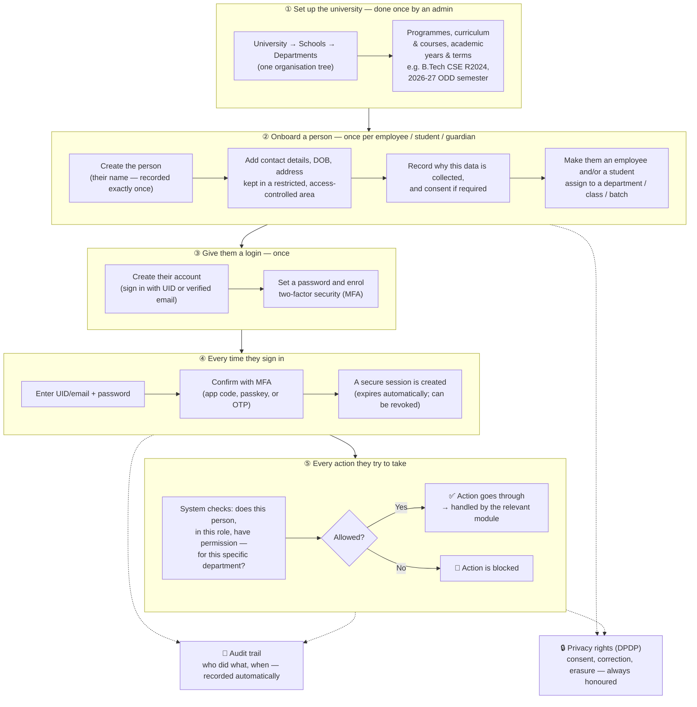
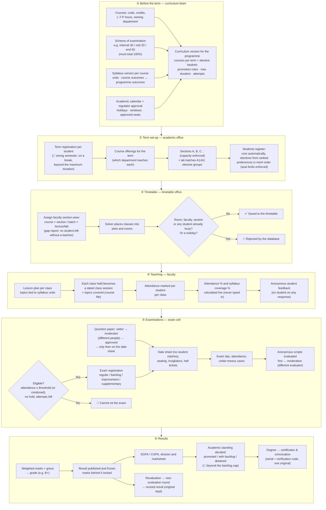
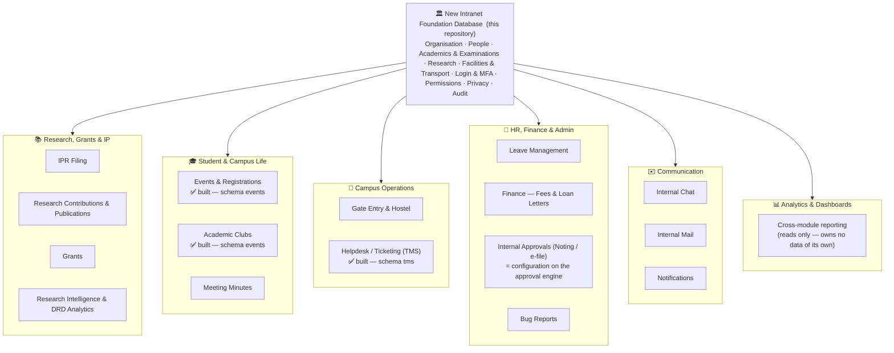

# New Intranet — Foundation Database (PostgreSQL)

The normalised database design for the shared foundation of the new SGT intranet. It covers:
- the **organisation structure**,
- the **academic structure**: programmes, specializations, academic years and term cycles, batches,
- **curriculum and teaching delivery**: course catalogue, course–department mapping, versioned curriculum with elective baskets, sections, faculty–course–section assignment, clash-free timetable, per-lecture attendance,
- **examinations**: scheme of examination, eligibility and holds, exam registration (regular/backlog/improvement/supplementary), date sheet, seating, invigilation, unfair-means cases, anonymous evaluation with moderation, grace, published results, SGPA/CGPA, marksheets, revaluation,
- **people** (employees, students, guardians) and student enrollment,
- **user creation**,
- **roles and permissions**, scoped to org units,
- **login** with UID or email, password and **MFA**,
- **DPDP Act 2023** controls,
- an append-only **audit trail**.

Module-specific tables (IPR, fees …) are intentionally not in the foundation files. Modules attach to the foundation in files of their own; see *How a new module plugs in* in `docs/design.md`. Two are built: the **helpdesk (TMS)** — schema `tms` in `sql/12_tms.sql`, tested by `sql/98_tms_smoke_test.sql` — and **clubs & event management** — schema `events` in `sql/13_events.sql`, tested by `sql/97_events_smoke_test.sql`.

Every approval — in the foundation and in every module — runs on **one configurable approval engine** (schema `wf`): for each kind of document the levels, who approves each level, the conditions, deadlines and escalation are configuration rows, so a new approval is configured, not developed.

Backend target: Django. Database: PostgreSQL 16+ (tested on 17.6).

## Contents

The documents are indexed by purpose in [`docs/README.md`](docs/README.md). Folder layout: `sql/` the database, `scripts/` generators and checks, `docs/` the foundation documents, `docs/tms/` and `docs/events/` the modules.

### Start here

| Path | What |
|---|---|
| `docs/README.md` | **Documentation index** — every document grouped by purpose, the folder layout and the conventions |
| `CLAUDE.md` | Rules Claude Code follows in this repo (normalisation, RBAC, DPDP, verification) |
| `SKILL.md` | Step-by-step design-time gate consulted before any schema change |

### Foundation documents

| Path | What |
|---|---|
| `docs/design.md` | The design: principles, ER diagrams, onboarding / login / authorisation flows, Django mapping notes |
| `docs/user-access-design.md` | User master, login and permission-based roles in one place: the 36 tables of `people` / `pii` / `iam` / `authz` involved, the login flow and how a permission check is computed |
| `docs/soe-permission-design.md` | How SGT's role-based SOE (Statement of Examination) module maps onto this permission-based model — and, in §8, how it is now implemented (curriculum approval through the `wf` engine, `academic.v_soe`) |
| `docs/module-integration.md` | Worked examples: central departments (HR, IT, Finance…), how the helpdesk (TMS) and Event Management (+ clubs) are built on the foundation, how the old Resource Management module maps onto the built-in `facility` schema, and how any approval is configured on the `wf` engine |

### Reference (generated from the live database)

| Path | What |
|---|---|
| `docs/table-catalog.md` | Every one of the 546 tables, diagram first: schema map, the DFDs, an ER diagram per functional group (every column and key, from the live DB), a one-line summary and a card per table (why it exists, what it connects to) |
| `docs/data-dictionary.md` | Every table, column, type, constraint and index (generated from the live catalog) |
| `docs/data-flow.md` (+ `docs/dfd/`) | Data-flow diagrams in three levels — context, the 16 processes, and each process in detail with table-level data stores — plus, per step, what the database refuses. Generated from `docs/dfd/build_dfd.py`, which checks that every table is placed |
| `docs/data-flow-features.md` (+ `docs/dfd/features/`) | Level 3: every feature of every module on its own data-flow diagram (170), with what comes in, what goes out and every table it reads or writes, linked to the table catalog. Generated by `docs/dfd/build_dfd.py` |

### Compliance and audit

| Path | What |
|---|---|
| `docs/dpdp-compliance.md` | DPDP section → table/constraint mapping, data-minimisation choices, POLICY items for legal/DPO |
| `docs/audit-2026-10-01.md` | Audit of the whole database: duplication, normalisation, DPDP compliance and docs against the live structure — what was checked, what was fixed, what is accepted by design, what is open for decision |

### Modules

| Path | What |
|---|---|
| `docs/tms/tms-design.md` | The helpdesk & student grievance redressal module end to end: the old flow and what changed, routes, redressal forums on the UGC regulations, settings (POLICY), every flow and state, access, notices, reports, DPDP, tests, open items |
| `docs/tms/tms-backend-plan.md` | Plan (not yet built) for the Django backend of the helpdesk: ground rules, data access, the API by area (raising, actions, committees, lists, reports, knowledge base, administration), authorisation, the notification outbox, the scheduler, privacy, testing, delivery phases, go-live configuration, decisions |
| `docs/events/events-backend-plan.md` | Plan (not yet built) for the Django backend of the events module: ground rules, API by area, integrations (payments, mail, QR / PDF), background jobs, privacy, testing, delivery phases, open decisions |

### Presentation

| Path | What |
|---|---|
| `docs/academic-flow.md` (+ `.png`, `.svg`) | One-slide diagram of the complete academic flow, NEP 2020 paths included, with talking points — for presentations |

### Database — foundation (`sql/00`–`11`)

| Path | What |
|---|---|
| `sql/00_bootstrap.sql` | Extensions (`citext`, `pgcrypto`, `btree_gist`), schemas, group roles, helper functions |
| `sql/01_ref.sql` | 132 lookup tables (the modules add 51 more in their own files — 183 in all) |
| `sql/02_org.sql` | Org-unit tree, type rules, contacts, campus / building (kind) / floor / room (use, area), positions |
| `sql/03_people.sql` | Person, personal data (`pii`), employee, assignments (with function/role), reporting & reviewing manager, student, mentor, appointments |
| `sql/04_academic.sql` | Programmes (delivery mode, medium), calendar, batches, enrollment (end reason); grade scales (percentage conversion) and schemes of examination; course catalogue, curriculum (maximum duration, attempt limit) & elective baskets; offerings, sections, registrations, faculty assignment, timetable (clash-checked), class sessions, attendance |
| `sql/04b_exam.sql` | Exam sessions, eligibility holds & condonation, exam registration, date sheet, rooms & seating, invigilation, exam attendance, UFM cases, anonymous answer scripts & evaluation rounds, marks, grace, result publication, marksheets, revaluation |
| `sql/04c_academic_flexibility.sql` | NEP 2020 / UGC flexibility: course equivalence, multiple entry & exit (award rules, awards, re-entry), credit transfer (ABC, MOOC / SWAYAM mappings), minors & honours |
| `sql/04d_student_lifecycle.sql` | Academic calendar (holidays, windows), regulator approvals & accreditation, term registration & academic standing (promotion rules, detention), breaks in study, programme transfer, elective preferences & merit allotment, syllabus versions & CO–PO outcomes, lesson plan & course file, workload norms, division bands, anonymous student feedback |
| `sql/04e_research.sql` | Doctoral / research degrees (schema `research`): supervision norms & allocation, advisory committee, progress reviews, thesis, examiners, viva; a Ph.D. award needs an accepted viva |
| `sql/04f_exam_papers_certificates.sql` | Question-paper lifecycle (setter / moderator, draft → moderated → approved → on the date sheet), exam attempt limit, convocation, certificate register (transcript, degree, migration, bonafide … with serial and verification code) |
| `sql/05_iam.sql` | Accounts, password history/reset, MFA, OTP, devices, sessions, lockouts, auth log |
| `sql/06_authz.sql` | RBAC catalogue, roles, inheritance, SoD, scoped grants, derivation rules |
| `sql/06b_workflow.sql` | **The approval engine** (schema `wf`) every approval is configured on: document types; chains (default or per org subtree) of levels, each level configured — who approves (a permission at an org level, a position holder, the requester's manager, named people, a committee quorum), how many, amount / flag conditions, self-approval rule, required file / signature / checklist, forward and return-to, deadline and timeout action; rounds with a snapshot of steps and assignees; append-only actions (approve, sign, return, return-to, reject, withdraw, forward, delegate, system escalate / auto-approve / auto-reject); standing delegations, consultations, reviewer comments, a notice outbox. Also the curriculum / SOE approval link and freeze, and internal-marks revision |
| `sql/06c_academic_operations.sql` | Academic operations: credit load per term (+ overloads), duty / medical leave through the approval workflow, projects / dissertations / internships with guides, medals & prizes (rank-tied), relative grading, mentoring meetings, class representatives, room requirements & facilities, faculty course preferences, question bank; CO / PO attainment (question-wise marks, policy), non-exam disciplinary cases |
| `sql/06d_facility.sql` | Resource & facility management (schema `facility`): one occupancy ledger for every room (timetable materialised per term, extra classes, exams, vivas, convocations, bookings, guest stays, maintenance windows) with a gist EXCLUDE, composed halls, custody per space, space allocation, reserved / private rooms, configurable pre-emption with displacement & reinstatement; bookings, groups (rooms × dates, recurring) and events approved through `wf` at the custodian (per-block chains); assets, loans, service contracts, preventive maintenance and work orders; guest house with tariffs; parking permits; fleet, drivers, trip requests (normal / urgent), driver-then-vehicle allocation, pooling, trips, ratings, escalations; keys & access cards |
| `sql/07_privacy.sql` | Purposes, data inventory, notices, consent, parental consent, nominee, requests, processors, erasure, breach, PII access log |
| `sql/08_audit.sql` | Append-only audit (row + column level) and auto-attachment to all tables |
| `sql/09_views_functions.sql` | All derived data (effective permissions, `has_permission`, batch year, current term, home department …) and privilege grants |
| `sql/10_seed_reference.sql` | Lookup values, Indian states/languages, core RBAC catalogue and roles, DPDP purposes and inventory |
| `sql/11_comments.sql` | Catalog comments on schemas and tables |

### Database — modules (`sql/12`–`13`)

| Path | What |
|---|---|
| `sql/12_tms.sql` | **Module — helpdesk & student grievance redressal (schema `tms`)**, design in `docs/tms/tms-design.md`: student and employee tickets on one category tree per domain (KRA type → KRA → KPI → criteria / master → category → sub-category) with the responsible org unit on the root and route, forum, confidentiality, anonymity, respondents, incident date, UGC grievance head and academic context inherited down the tree; **routes** of levels — scoped round-robin handlers, category owners, the student's mentor, the employee's manager, positions relative to the requester (HOD, Dean), the category's office or fixed (Registrar, Dean Academics, VC), named people; **redressal forums** on the UGC regulations (the nearest SGRC deciding by a quorate resolution, appeal to the Ombudsperson; ICC, anti-ragging and equal-opportunity committees straight and confidential); respondents who never see or handle a case; an intake desk; a business-hours SLA clock with first-response targets and clarification pauses; immutable tickets with an append-only timeline validated against a lifecycle table, from which every status is derived; reply vs internal note, accept / reopen (limited) / rate / withdraw / merge; the hourly scheduler (auto-referral, escalation, reminders, expiry, auto-close); the grievance register and yearly return; holds with a reason, consultations of other offices, compliance tracking of committee decisions, a knowledge base with anonymous deflection feedback; every behaviour of the old module (per-year numbers, duplicate guard, file rules, attention tiers, switches and lock, assignee search, available actions) — mapped in `docs/tms/tms-design.md` §2.1; notice rules with opt-outs, mandatory notices, channel switches and a deduplicated delivery log; its own lookups, RBAC, DPDP registration, audit and grants |
| `sql/13_events.sql` | **Module — clubs & event management (schema `events`)**: clubs as org units of type CLUB with advisor appointments, student officers, members, applications and suspensions; club proposals and event proposals (audience, SDGs, speakers, budget, funding, prizes, sponsors, visibility) approved **purely by configuration** on the `wf` engine (default: advisor / unit head → central coordination committee; a school or club overrides with chain rows; the budget total is the round's amount, PAID / EXTERNAL_GUESTS / SPONSORED are flags) and sharing the round with the `facility` package for rooms and vehicles; events created by the approval, published by the organisers; registrations with seats and a waiting list, extra questions, guests, QR tickets; coupons and payments (online orders, offline claims verified by an organiser) with a derived refund queue and expiry of unpaid registrations; teams with invitations and join requests; an append-only gate log with derived attendance; volunteers; prizes, certificates with public verification, anonymous feedback, post-event report, duty-leave list; sponsors and receipts; club points and tiers; its own lookups, RBAC, DPDP registration, audit and grants |

### Database — illustrative SGT data (`sql/90`–`91`, not part of the build)

| Path | What |
|---|---|
| `sql/90_example_sgt_org_structure.sql` | Illustrative: creates SGT's real central departments (HR, IT, Finance…) and one worked permission proof — see `docs/module-integration.md` |
| `sql/91_example_tms_student_helpdesk.sql` | *Illustrative* (run after `90`): SGT's standard student helpdesk on the UGC grievance heads — 8 masters, 28 leaves, routes; the committees the UGC norms require (SGRC, ICC, Anti-Ragging Squad → Committee, Equal Opportunity Cell, SC / ST Cell); harassment and ragging URGENT and round the clock; the declaration; starter help articles |

### Database — smoke tests (`sql/97`–`99`, rolled back)

| Path | What |
|---|---|
| `sql/97_events_smoke_test.sql` | Clubs & events scenario with 327 assertions — club founding, proposals through the default and a school-scoped chain (Dean above a budget, committee quorum), the event from publication to points, and every admin setting changing the behaviour it governs (rolled back) |
| `sql/98_tms_smoke_test.sql` | Helpdesk & grievance-redressal scenario with 319 assertions — clock, routes and forums, tree inheritance, the old employee flow, the student academic route, intake desk, respondents, SGRC → Ombudsperson and compliance, the confidential ragging case, every parity rule of the old module, holds, consultations, knowledge base, scheduler, notices, reports, privacy (rolled back) |
| `sql/99_smoke_test.sql` | End-to-end scenario with 678 assertions (rolled back) |

### Scripts

| Path | What |
|---|---|
| `scripts/gen_data_dictionary.sql` + `.py` | Regenerate `docs/data-dictionary.md` from the live catalog |
| `scripts/gen_catalog_diagrams.py` + `catalog_groups.py` | Regenerate the table catalog's ER diagrams, schema map and per-group summaries (`docs/catalog-diagrams/`) from the live database |
| `scripts/check_table_catalog.py` | Check every table has a catalog card and every foreign key appears in it |

## At a glance
- **546 tables, 132 views, 163 functions (plus trigger functions), 15 schemas**: `ref`, `org`, `people`, `academic`, `exam`, `research`, `facility`, `tms`, `events`, `pii`, `iam`, `authz`, `wf`, `privacy`, `audit`.
- **Normalisation:** BCNF/4NF throughout.
  - No JSON or arrays hold relational data.
  - Every multi-valued fact has its own table.
  - Derived values are views, never stored. Examples: batch year, programme duration in years, a student's current semester and home department.
  - Business history uses validity ranges with `EXCLUDE` constraints, so the database itself rejects overlaps (two primary assignments, two heads of a unit, two active enrollments, overlapping academic years …).
- **Academic structure:**
  - A programme is run by an academic unit, follows a calendar type (semester / annual / professional year) and lasts N terms.
  - Academic years contain terms (e.g. "2026-27 ODD").
  - A **batch** = programme × admission year.
  - Students enroll in a batch; lateral entry is `entry_term_no`. Specializations are offered per batch.
- **Curriculum (scheme of studies):**
  - A **course** has a code, credits, L-T-P hours, prerequisites and an *owning* department.
  - A programme has versioned **curricula** (e.g. "R2024") listing the fixed courses per term, plus **elective baskets** ("choose 1 of these 5").
  - Each batch follows exactly one curriculum version, which also sets its grade scale and attendance threshold.
- **Scheme of examination:** reusable schemes such as internal 30 / mid-term 20 / end-term 50. The weights must total 100%, and a component can carry its own pass mark. **The result formula is data too:** best N of M tests, separate internal / external pass minimums, a cap on how far internal marks may lead external marks, rounding rules, and board moderation per course — change a regulation by editing a scheme row, not code.
- **Teaching delivery:**
  - A **course offering** is a course running in a term, taught by any academic department (the course–department mapping).
  - Offerings are delivered through **sections** and **faculty assignments** (faculty × section × lecture/tutorial/lab).
  - **Section allocation** is one call — `academic.allocate_sections(batch, term)` fills A, B, C … in enrollment-number order up to capacity (all or nothing).
  - **Core courses** are registered for the whole batch in one call — `academic.register_core_courses(batch, term)` works out each student's own semester; electives, minor/honours courses and equivalents are chosen. Electives have seat limits.
- **Timetable:** the Django solver writes timetable entries, weekly or every N weeks (fortnightly labs). The database rejects any room, faculty, section or student double-booking and any slot a faculty member marked unavailable; alternate-week classes that never meet may share a room and teacher. Once final, `facility.materialise_timetable(term)` writes one occupancy-ledger hold per class date, so every later room booking is checked against the classes actually running.
- **NEP 2020 flexibility:**
  - **Multiple entry & exit:** each curriculum defines its exit points (UG certificate, diploma, degree, honours) with minimum credits, required courses and a re-entry window. The database confers an award only if the student qualifies, and a re-entering student keeps every earlier credit.
  - **Academic Bank of Credits & MOOCs:** APAAR / ABC ID stored encrypted; SWAYAM / NPTEL / other-university courses mapped to internal courses or category credits; transfers checked against the mapping, the curriculum and a credit cap.
  - **Minors & honours:** tracks with their own courses, credit targets, CGPA entry bar and CGPA rule.
  - **Course equivalence:** backlog students take the replacement course under their own regulation; passed courses count toward their equivalents.
  - **One credit ledger** drives CGPA, exit eligibility, prerequisites and track progress, so they can never disagree.
- **Academic calendar:** years, terms and dated events (holidays, vacations, registration / add-drop windows, exam periods), university-wide or per unit; a timetabled class on a holiday is rejected.
- **Programme approvals & accreditation:** each regulator's approval (UGC / AICTE / NMC …) with sanctioned seats and validity — a batch cannot open more seats than approved; NAAC / NBA accreditation with grade and validity; delivery mode and medium of instruction on the programme.
- **Student lifecycle:**
  - **Term registration** puts a student on the rolls of a semester; the database knows which semester they are due for (promoted → next, detained → the same again, breaks skipped) and refuses the wrong one.
  - **Academic standing** at the end of a term — promoted, promoted with backlog, detained — is checked against the derived backlog and the curriculum's **promotion rule** (backlog cap per checkpoint).
  - **Breaks in study** are dated, approved rows (medical, personal, suspension …) that pause the semester count; **programme transfers** link the old and new enrollment so credits follow; a closed enrollment always states its **end reason**; the curriculum's **maximum duration** (UGC N + 2) and **attempt limit** per course are enforced.
- **Elective allotment:** students file ranked preferences per basket; `academic.allot_electives(basket, term)` allots in merit order (CGPA, then enrollment number) within seat limits. Electives may come from any department or school; an offering can cap its seats per programme or per school (`academic.offering_seat_quota`).
- **Syllabus & outcomes (NBA / NAAC):** versioned syllabi with units and course outcomes, programme outcomes (PO / PSO) and the CO–PO articulation matrix; per teaching assignment a lesson plan and, per class held, the topics covered — syllabus coverage is derived.
- **Faculty workload:** hours per week per designation as a norm; the actual load is read off the timetable.
- **Student feedback:** anonymous by construction — the submission record (one per registration) is the only student link and is never joined to the responses; results are read only in aggregate.
- **Division / class:** first class with distinction … derived from CGPA on the curriculum's scale, with the equivalent percentage.
- **Attendance:** marked per class session; the percentage is always calculated and drives exam eligibility.
- **Examinations:** the full cycle, in order:
  1. Eligibility check (attendance or condonation, and no hold).
  2. Exam registration: regular, backlog, improvement or supplementary.
  3. Date sheet, with the database blocking a student's clashing papers.
  4. Seating, invigilation, exam attendance and unfair-means cases.
  5. Anonymous answer scripts evaluated in rounds (first, moderation, revaluation), each by a different evaluator.
  6. Grace marks, then **published results that can't be edited** (a correction is a revised publication), with SGPA/CGPA calculated.
  7. Marksheet register and revaluation requests.
  8. **Question papers** before the date sheet: a setter and a different moderator per paper; a set goes draft → submitted → moderated → approved and only an approved set can be linked to the date sheet.
  9. **Certificates & convocation:** a register of every transcript, provisional / final degree certificate, migration, character and bonafide certificate issued (serial, public verification code, NAD reference); an award certificate needs the conferred award, one original per type, duplicates as separate rows.
- **Research degrees:** a scholar is an ordinary enrollment; the `research` schema adds supervisor allocation (one principal, UGC norm per designation, external co-supervisors), the advisory committee (one chair), periodic progress reviews, the thesis with ordered milestones, independent examiners (never a supervisor), and the viva (only once every report is in and none rejects). A doctoral degree cannot be conferred without an accepted viva.
- **Statement of Examination (SOE) & approvals:** the SOE is an approved, signed **curriculum version**, not a spreadsheet table.
  - Content: courses per semester with UGC categories and sub-categories (DSC → DSCC / DSCE), council codes, L-T-P and credits, schemes of evaluation (thematic / unit / experiential / participation internals, practical and dissertation parts), combined theory + practical results, pathways (Honours vs Honours with Research), exits, course continuation (Dissertation I → II), reappear chances (usual / golden / mercy). `academic.v_soe`, `v_soe_exit`, `v_soe_header` produce the SOE sheet.
  - Approval: the generic `wf` engine sends it department → school → university → Registrar signature. Each stage is a **permission at an org level**, held through appointments (HOD, Dean, Dean Academics, Registrar) or a dated scoped grant (acting HOD) — no role strings. Returns, row-level comments with suggested values, reviewer in-place edits (audited), separation of duties, and a freeze once approved.
  - Exams the SOE implies: end-term practicals and vivas marked directly by an examiner panel with an external examiner; internal-marks revision through its own approval chain.
- **One approval engine for everything** (schema `wf`): an approval is never developed, it is configured. Per kind of document:
  - **Levels** in order, with a default chain and overrides for any org subtree (a school, a block, a club), dated.
  - **Who approves a level:** holders of a permission at an org level (the owning unit, a unit type above it, the university), the holder of a position, the manager of the person concerned (N levels up), named people (fixed, or chosen at submission), or a committee with a quorum.
  - **How many** must approve (one, N, all); **when the level applies** (an amount band, a flag such as "paid event"); what happens when **the requester is the approver** (someone else decides, or the level is skipped).
  - **What the approver must supply** (note, file, signature, checklist items); whether the level may be **forwarded** or **sent back to an earlier level**.
  - **A higher level can decide out of turn:** if a Dean approves while the round waits at the HOD, the HOD's level is passed over — but every round still ends with at least two levels approved by people (a number set per chain), a level can be marked mandatory, and a chain can be set to take every level strictly in order — the statutory academic chains (`CURRICULUM`, `INTERNAL_MARKS_REVISION`) and the financial one (`EVENT_SETTLEMENT`) are seeded strict — every level in order, as university statutes and finance practice (verify, then sanction) require; the operational ones (bookings, stays, trips, events, clubs) keep the override.
  - **Deadline and timeout action:** remind, escalate one level up, auto-approve or auto-reject — run by one system job.
  - Around it: approve / sign / return / reject / withdraw, standing **delegation** (out of office), **consultation** of someone outside the chain, reviewer comments with suggested values, an inbox with due dates, visibility, and a notice outbox.
  - Onboarding a new approval = one document-type row, chain rows, an `instance_id` on the document, `wf.submit()` / `wf.act()`. In use for the SOE, internal-marks revision, attendance leave, room bookings, event packages, guest stays, trips, club proposals, event proposals, club changes, event changes and event settlements.
- **Academic operations:**
  - **Credit load:** minimum / maximum credits per term per curriculum; the maximum is enforced on registration unless an overload is approved; the minimum is reported.
  - **Duty / medical leave:** applied for by the student, approved by the HOD through the approval workflow; approved duty leave counts as attendance without editing any mark.
  - **Projects, dissertations, internships:** guide allocation (one principal guide, external co-guides from industry), internship placement details, guide load.
  - **Medals & prizes:** rank lists derived from CGPA; a rank-tied medal goes only to the student holding that rank, once per batch.
  - **Relative grading:** a grade scale can award passing bands by the student's percentile in the course cohort, falling back to absolute bands for small cohorts.
  - **Mentoring meetings, class representatives, room requirements** (a lab needing computers is never timetabled elsewhere; a class never exceeds room seats), **faculty course preferences**, and a **question bank** tagged by course outcome and Bloom level with a paper blueprint.
- **Academic bodies:** Board of Studies, Faculty Board, Academic Council and committees with members over time (external experts are non-employees, one employee chair), meetings, attendance and numbered resolutions that are refused without quorum. Syllabi, course equivalences, MOOC mappings and programme transfers cite the resolution row, not a text reference.
- **CO / PO attainment (NBA / NAAC):** marks per question of the paper actually sat (each question tagged with its CO via the question bank) plus internal components mapped to COs give each student's CO score; `academic.v_co_attainment` applies the attainment policy (student target %, levels 1–3; programme override of a university default) and `v_po_attainment` averages CO levels weighted by CO–PO strength. Nothing is stored.
- **Disciplinary cases** (outside the exam hall): report, disciplinary committee, decision, penalty; a suspension must be served as a DISCIPLINARY_SUSPENSION study break; closed cases are final.
- **Resource & facility management** (schema `facility`): the old seminar-hall and cab-booking module, rebuilt as part of the foundation.
  - **One occupancy ledger** (`facility.room_hold`): every use of a room — timetabled class, extra class, exam paper (with setup / teardown buffers), viva, convocation, booking, guest stay, maintenance window — is one row written by a trigger from its source; two active holds on a room can never overlap (gist `EXCLUDE`), a combined hall blocks its halves and vice versa.
  - **Configurable pre-emption:** which use may displace which (an exam displaces a class, a class displaces a club night) is a rule table, optionally per room type and per custodian; a displaced class is listed for re-placement and reinstated when the event goes.
  - **Custody and reservation:** a block, department or the university takes custody of rooms, floors, buildings or a campus and its head (or a scoped grant) approves bookings there — per-block approval chains are one scoped `wf.approval_chain` row; rooms reserved for the Vice-Chancellor, a unit or a named person are rules, not flags; people can be restricted per resource kind.
  - **Bookings and events:** rooms × dates and recurring series under one `GRP-YYYY-NNNN`, tentative holds from submission, policy limits (minimum duration, advance window, check-in window, self-cancel cut-off, no-show grace), reschedule through a change round, events as one package that then goes to each room's custodian; all rooms free of charge for students and staff.
  - **Assets and maintenance:** fixed and portable assets, equipment booked with a room or lent out (never twice at once), service contracts, preventive schedules, work orders `WO-YYYY-NNNNN` with SLA per priority and an append-only history.
  - **Guest house, parking, keys:** guest stays approved by the host unit and the guest house, tariffs per guest category (the only charged spaces), parking zones with capacity, keys and access cards with one holder at a time.
  - **Fleet & transport:** vehicles with mandatory documents, drivers whose licence is an identity document with expiry, trip requests (normal: unit head → transport; urgent: transport only), driver-then-vehicle allocation with `EXCLUDE` per driver and vehicle, pooling, trips with odometer and photo, ratings, and a scheduled escalation that auto-approves undecided requests and raises alerts.
- **Clubs & event management** (module, schema `events`): the old club and event module, with approval purely configured on the engine.
  - **Every kind of club:** whose a club is, is its parent unit (an academic club under its school or department; a cultural, sports or social-service club under the Dean Students' Welfare office; a university society under the university), and what it is, is its category (academic, technical, cultural, sports, literary, social service, professional chapter, hobby — a list an administrator extends). The parent decides the approval path (a chain scoped to the DSW office gives its clubs their own), and the category rides on every approval round as a flag so a level can depend on it.
  - **Clubs** are org units of type CLUB with a faculty advisor and co-advisor as appointments, student officers (one holder per office, with history), members, applications and suspensions; a club is founded by an approved club proposal.
  - **Event proposals** by a club or a unit: type, dates, level, audience, SDGs, speakers, coordinators, budget lines, funding, prizes, sponsors, who may see it. Submission opens the approval round (budget total as its amount; flags for paid events, external guests, sponsorship) and the facility package for rooms and vehicles on the same round. Default chain: advisor / unit head (skipped when they are the proposer) → central coordination committee; a school adds its Dean above a budget, or a committee quorum, with chain rows.
  - **After approval** the event exists: organisers publish it; registrations take a seat or join the waiting list (promoted automatically), with extra questions, guests and team formation. Each participant gets a **ticket**: `events.issue_ticket()` returns the token for the QR once (only its hash is stored; re-issuing replaces a lost one) and `v_ticket` is what the ticket shows. Organisers assign **volunteers** to gates; a volunteer previews a pass (`ticket_check()`: whose it is, how many may still enter) and scans people in and out; attendance is derived from the gate log, or imported from a sheet. The **volunteer dashboard** is `v_volunteer_assignment` (my duties and what I scanned), `v_volunteer_activity` (my scans) and `v_gate_summary` (the count per gate).
  - **Money:** discount coupons (percentage with a cap, or fixed; limits and expiry) and payments of registration fees — online gateway orders (one open order at a time, captured or failed) and offline claims (UPI, transfer, cash) verified by an organiser; a team pays one fee through its leader. What is owed, what is paid, the fees collected and **who must be refunded** (cancelled or rejected registrations, duplicates, superseded orders, a cancelled event) are derived; a refund is recorded by an events administrator. Unpaid registrations can expire after a configurable time. The gateway conversation itself is the application's.
  - **Messages:** organisers write to everyone, the confirmed, the pending, the cancelled or a selection, now or scheduled; one credit per recipient from a per-registration allowance an administrator can top up; no address is stored (looked up when sending); opens are tracked only if switched on, and never for a minor.
  - **Changing an approved event:** new dates, another venue or another capacity go through an event change request approved on the engine; on approval the database moves the event (and its rounds), releases the old venue package in favour of the one opened for the new dates, and keeps what the event was before.
  - **Attendance per session:** besides the gate log, participants are checked in to each round (by ticket or an imported sheet), so a multi-day event shows who sat in which session.
  - **Expenses and settlement:** what was actually spent is recorded line by line against the approved budget, with bills; after the event the organisers submit the settlement, approved through the engine (the total spent is the round's amount; spending over budget is a flag a chain can add a level for). Budget against actual is derived.
  - **Stalls:** an event may take stall applications (deadline, limit, fee per category); approval creates the stall; organisers add their own; visitors rate a stall anonymously from its QR.
  - **Clubs after founding:** a change of name, objective, advisor, officers or members is a change request approved through the engine and then applied by the database; a student may mark a primary club; people may offer to volunteer at an event that takes applications.
  - **Nothing hard-coded:** limits, required sections, the feedback scale and similar rules are one settings row (`events.event_setting`) an events administrator edits; points and tiers are dated rows; required offices and who may propose are lookup flags; levels and deadlines are chain rows — see *What an administrator configures* below.
  - **Closure:** prizes, certificates with a public verification code, anonymous feedback (one token per attendee, no link to the answer), the post-event report, a duty-leave list, and club points with tiers when the event is completed. Cancelling an event cancels its registrations and frees its rooms.
- **Employee master data:** first/middle/last name, org unit (department/sub-department via the org tree), designation, **job function** (Academics, Finance, IT…), **job role** (what they actually do — Teaching, Recruitment…), DOB, date of joining, official and personal email, and dated **reporting manager** / **reviewing manager** (can differ — matrix org). The DB rejects a manager reporting to their own report (cycle check) and more than one active reporting/reviewing manager at a time.
- **Access model:** RBAC with role inheritance and separation of duties. Grants are scoped to any subtree of the org tree. Roles also come automatically from **designation**, **appointment** (e.g. HEAD) and **principal kind** (employee/student/guardian); these are never copied onto users.
- **Login:** UID or verified email, then Django password hash, then MFA:
  - MFA options: TOTP, WebAuthn, email/SMS OTP, recovery codes.
  - Rotating refresh-token sessions with reuse detection.
  - Lockouts and a partitioned authentication log.

## How data flows, in one go

*This section is written for a non-technical reader. If you can follow a
flowchart, you can follow this database.*

### 1. From "set up the university" to "someone does something" — the whole journey



**In plain terms:** a person's identity, their login, and what they're
allowed to do are three separate, reusable building blocks — not
something each new feature reinvents. Steps ① through ⑤ are exactly what
this repository builds today. Step ⑤'s "handled by the relevant module"
is the exact point where every other SGT system (IPR, Events, TMS,
Finance …) hooks in — see the next diagram.

Two things happen automatically underneath *every* step, with no extra
work required from whoever builds a future module: every action is
**logged** (who, what, when — tamper-proof, can't be edited or deleted),
and every **privacy right** (consent on file, right to correct, right to
be forgotten) is respected without that module having to build any of it
itself.

### 2. One teaching term and its examinations, in one go

This is how the academic and examination parts of the database are used
across a single semester, in the order things actually happen.



**In plain terms:** the curriculum team writes the rules once per
curriculum version. The academic office and the timetable office set up
each term. Faculty mark attendance. The exam cell runs registration,
papers, evaluation and results. At every step where a mistake would be
costly, the database itself refuses the mistake rather than trusting
people or code to check:
- a clashing timetable,
- an ineligible student sitting an exam,
- a student with two papers at once,
- two students in one seat,
- the same evaluator marking a script twice,
- an edit to a published result,
- a class on a holiday,
- a batch opened with more seats than the regulator approved,
- a term registration for the wrong semester, while on a break, or beyond the maximum duration,
- a promotion beyond the backlog cap,
- a third exam attempt when the curriculum allows two,
- a paper setter moderating their own paper, or an unapproved paper on the date sheet,
- a supervisor above the norm for their designation, a supervisor examining their own scholar, a viva before every report is in,
- a doctoral degree before the viva,
- a second original degree certificate.

### 2b. The complete academic flow on one slide

For management presentations, `docs/academic-flow.png` (and `.svg`) shows the whole academic structure in one diagram. The top row is set up once: **school → department → faculty → programme → students**. The bottom row repeats every semester: **sections → courses → teaching → grades → NEP 2020**. `docs/academic-flow.md` has the Mermaid source, a table showing where each link lives in the database, and talking points.


### 3. How this foundation is built to plug in every other SGT UMS module



Research degrees (supervision, committees, thesis, viva) are *not* a module: they are part of this foundation (`sql/04e_research.sql`, schema `research`), because the degree award and the examination records depend on them. The same goes for **resource & facility management** — the old "Seminar Hall & Cab Booking" module: rooms, the occupancy ledger, bookings, assets, maintenance, the guest house, parking, the fleet and keys live in the foundation (`sql/06d_facility.sql`, schema `facility`), because the timetable, examinations, vivas and convocations write the same ledger every booking is checked against. The **approval engine** (`sql/06b_workflow.sql`, schema `wf`) is foundation too: every module that needs a sign-off configures its levels there instead of building approval tables — the events module is the worked example (two document types, three chain rows, no approval code).

**What every one of those future modules reuses from this foundation —
and never has to rebuild:**

| It needs to know... | It reuses (never rebuilds) |
|---|---|
| Who this person is | `person` — one record per human, no matter how many of the boxes above they touch |
| Which department/school/club owns this | The one organisation tree (`org_unit`) — already models schools, departments, central departments, and sub-units to any depth |
| Is this person allowed to do this, for this department | The one permission engine (`authz.has_permission`) — a module just registers its own actions (e.g. "approve grant," "verify gate pass") and reuses the same scoped, role-based check every other module uses |
| How do they log in | The one account & MFA system (`iam.*`) — no module builds its own login page or password logic |
| Who approves/handles what by virtue of their job | Designation-, position- and job-based automatic roles (§ *Access model* above) — e.g. whoever is "HR Manager" automatically gets HR permissions; nothing to copy per person |
| Did we get consent for this data, and can we prove it | The DPDP toolkit (`privacy.*`) — a module just registers any new personal-data field it introduces; consent, access-export and erasure come for free |
| Who must approve this, in what order, by when | The one approval engine (`wf.*`) — a module registers its document type and configures the levels (who, how many, conditions, deadlines); submission, inbox, delegation, escalation, history and notices come with it |
| Who touched this record, and when | The audit trail (`audit.*`) — turned on for a module's own tables with one line, no logging code to write |

**A future module, in practice, is almost entirely additive:** its own
tables (an IPR application, a leave request, a gate pass) plus a handful
of foreign keys pointing back into this foundation (`org_unit_id`,
`person_id`/`employee_id`/`student_id`, `account_id`). It never needs to
re-collect a name or email, re-implement a permission check, or bolt on
privacy controls after the fact. The exact step-by-step for doing this is
in `docs/design.md` §5.6 ("How a new module plugs in") and `SKILL.md` §2.

> **Is there provision for independent/central departments like HR, IT,
> Finance?** Yes — each is just a row in `org.org_unit` (type
> `CENTRAL_DEPARTMENT`), the same generic tree as schools and academic
> departments, not a separate table. `sql/90_example_sgt_org_structure.sql`
> creates the real SGT list (HR, IT, Finance, Registrar, Admissions,
> Library, DRD, Examinations, Estate & Security, Transport) and proves a
> department Head's permissions are derived automatically — see
> **[`docs/module-integration.md`](docs/module-integration.md)**, which also
> walks through exactly how **TMS (ticketing)** and **Event Management (+
> academic clubs)** attach to this foundation, and how the old **Resource
> Management (seminar halls & cab booking)** maps onto the built-in
> `facility` schema, replacing several bespoke tables the
> old SGT UMS built for the same purpose (a role-handler table, a
> block-assignment table, seven officer columns on one row) with the one
> org-unit + appointment + scoped-role mechanism already built and tested
> here.

**This directly fixes what made the old system hard to extend:**

| In the old system | In this foundation |
|---|---|
| A person's email was stored in up to three different tables, which could drift out of sync | One email table, referenced by everything |
| Permissions were free-form JSON `{key: true}`, copied per user and per role | Permissions are structured rows; roles are assigned once and resolved automatically |
| "Which schools can this reviewer see" was 21 separate JSON arrays of IDs | One scoped-grant row per department, on one mechanism every module shares |
| No password reset, no MFA, no way to revoke a stolen session | All present, shared by every module automatically |
| No consent records, no erasure process, no log of who viewed personal data | Built into the foundation; a new module gets this for free by registering its fields |
| Credit ranges, batch documents and specialization rules in a `Program.metadata` JSON blob; `currentSemester` typed in by hand | A versioned curriculum as real tables; the current semester is calculated from the academic calendar |
| No course, section, timetable, attendance or exam structure at all | Curriculum, sections, clash-proof timetable, per-lecture attendance and the full exam cycle, with the database rejecting clashes, ineligible registrations and edits to published results |

## Run it

```bash
createdb intranet
for f in sql/0*.sql sql/1*.sql; do psql -d intranet -v ON_ERROR_STOP=1 -f "$f" || break; done
psql -d intranet -v ON_ERROR_STOP=1 -f sql/99_smoke_test.sql     # prints PASS lines, ends with ROLLBACK
psql -d intranet -v ON_ERROR_STOP=1 -f sql/98_tms_smoke_test.sql  # the helpdesk module's tests
psql -d intranet -v ON_ERROR_STOP=1 -f sql/97_events_smoke_test.sql  # the clubs & events module's tests (takes ~10 s: one event really starts and ends)
```

Run these as a superuser or database owner. `00` creates the NOLOGIN group roles `intranet_owner`, `intranet_app`, `intranet_analytics` and `intranet_dpo`. Create real login users and grant them membership, for example `CREATE ROLE django LOGIN PASSWORD '…' IN ROLE intranet_app;`.

For Django, set the connection's `search_path` to `util,ref,org,people,academic,exam,research,facility,tms,events,pii,iam,authz,wf,privacy,audit,public`. Table names are unique across schemas.

## Verification performed
Tested on a local **PostgreSQL 17.6**:
- `00`–`13` (including `04b`–`04f`, `06d` and the modules `12_tms` and `13_events`) apply cleanly on an empty database.
- `97_events_smoke_test.sql`: **327/327 checks pass** — club proposal rules (parent unit, faculty advisor, president, one office per student), approval creating the org unit, club, advisor appointments, officers and members; applications, suspension; event proposal rules (who may propose, team sizes, fees, capacity, completeness, immutability after submission, revision); the default chain and a school-scoped chain configured in the test (advisor skipped when proposing, Dean only above a budget, committee quorum of two); the facility package on the same round and its release on cancellation; publishing rules; registration (window, visibility, duplicates, waiting list and promotion, guests, custom fields, payments); teams (sizes, one live team, finalising); ticket generation (token to the holder or an organiser only, never set by hand, none for a cancelled registration, the old QR dead after re-issue), the scan preview, gate scans (who may scan, in / out counts), the volunteer dashboard and derived attendance on an event that really starts and ends; prizes, certificates, anonymous feedback tokens, report versions, completion and club points, tiers and the leaderboard; **coupons** (creation rules, limits, cap, minimum payable remainder, full discount), **payments** (amount due, one open order, capture, offline claim and verification, team fee by the leader, immutability), the **refund queue** and recording refunds, **expiry** of unpaid registrations; **volunteer sign-up**; **stalls** (applications, fee, approval creating the stall, organiser stalls, anonymous feedback); **messages** (audiences, selection, scheduling and cancelling, credits and top-up, delivery outcomes, open tracking switch, the scheduler); **event change requests** (dates, venue, capacity — applied on approval, rounds shifted, old venue package released), **attendance per session**, **expenses and settlement** (budget against actual, bills, return and resubmission), **club change requests** (name, officers, advisor, category — applied on approval), a **student-welfare club** with its own chain scoped to that office and the club category as a flag on approval rounds, and the **primary club**; **admin settings** (each rule first refused, then allowed after an administrator changes a row: objective length, non-faculty advisor, required offices, lead time, required sections, concurrent proposals, guest-pass ceiling, publishing requirements, feedback scale, new point values); audit, DPDP inventory and grants; the audit's guards (a speaker or a visibility scope once per proposal, an applied stall that repeats nothing of its application, a point award without a stored club, tables with free-text remarks closed to reporting).
- `98_tms_smoke_test.sql`: **319/319 checks pass** — the office clock and forum days; the administrator's calendar (holidays counted or not, dated overrides, per-weekday hours, the helpdesk-wide office-hours switch); route-level and forum configuration and their refusals; the category tree's shape and inheritance; the old employee flow (round-robin with requester skipping, the next route level when a leaf has no handler, manual assignment, acting rights, clarification, the KRA ladder to a fixed overseeing head and the VC, reassignment and transfer rules, resolve → accept / reopen with a limit / rate); the student academic route (mentor → HOD → Dean → Dean Academics → VC, vacant levels skipped); declaration, intake desk, own-batch context, scoped handler pools; replies vs internal notes, attachments, first response; respondents and recusal, anonymity; referral to the school's SGRC, a quorate resolution, appeal to the Ombudsperson, the register; referral rules; merge and withdrawal; the confidential ragging case; the unrouted queue; category-wise SLA (inherited, round the clock, route-level override); multiple committees (squad → committee forwarding, late-first-action alerts to the VC); the scheduler (escalation, exhaustion, office hours, overdue notices, reminders, expiry, auto-close, forum overdue, auto-referral, hold release, compliance reminders, round the clock); parity with the old module (per-year numbers, the 10-second duplicate guard, the derived subject, file type / size / ownership and downloads, internal-only categories, attention tiers, the Employee TMS switch and the Student TMS lock, assignee search, available actions); holds, consultations, compliance of decisions, the knowledge base and its deflection; opt-outs with mandatory notices, the channel switch and giving up; notices, reports, audit, DPDP inventory and grants.
- `99_smoke_test.sql`: **678/678 checks pass** (every rejection verified to fire for its intended reason, not an unrelated error):
  - curriculum: weights total 100%, one end-term per scheme, non-academic course owner, prerequisite cycle, term beyond duration, elective as fixed course, duplicate course in a curriculum, batch on another programme's curriculum,
  - delivery: section capacity / one section per term / own batch only, elective intake limit, course outside curriculum, two primary faculty, component without hours, assignment outside term,
  - timetable: faculty, room and section double-booking, faculty unavailability; co-teaching allowed,
  - class groups & section-wise teaching: batch member from another section / not registered / in two batches, group for a component without hours, assignment to both section and group, lecture assigned to a tutorial batch, two primary teachers for a batch, section lecture against its own batch, elective group clashing with a member's lab or lecture (both when joining and when timetabling); parallel batches allowed; teaching-gap report and section-wise teaching sheet; batch-only attendance,
  - attendance: wrong section, cancelled class, wrong course; derived % (unmarked = absent),
  - academic operations: relative-grade cutoffs only on passing bands of relative scales, no shared cutoffs, absolute fallback for small cohorts and percentile grading otherwise; credit-load rules (min ≤ max, one default), registration over the maximum rejected until an overload is approved; leave only by the student, medical leave needs a document, no overlapping requests, only the HOD approves, approved duty leave counts as present; project records only on project courses, one principal guide, external co-guide rules, internship only on internship courses with a non-employee industry mentor; rank list, rank-tied medals only to the rank holder, not another programme's, once per batch; mentoring meetings within the mentorship; class representatives only from the section, one role each; room type / feature requirements and seat capacity on timetable entries; preferences only from teaching staff, unique ranks; question review by a second person, outcome of the same course, only reviewed questions of the same course on an unapproved paper, blueprint derived,
  - academic bodies, attainment, discipline: one body of a type per unit, one chair (an employee), external experts not employees, no duplicate members, attendees must be members on the date, resolution refused without quorum and cited by a syllabus; attainment levels in order, one default policy, no whole-script components mapped to COs; question marks within the question's marks, within the script total, only for the paper sat, frozen after the result; CO scores (questions + revised internal), CO levels under the default and a programme policy, PO = strength-weighted average; case reported before the incident, penalty before decision, non-disciplinary committee, decided without decision, suspension without (or with another student's) study break, closed case changed,
  - SOE & approval workflow: reviewers derived from appointments (and a suspended HOD has none); council code uniqueness, continuation loop; pathway rules (same course on two pathways, not common + pathway, not before the pathway starts, not another curriculum's pathway); SOE rows, exits and header derived; submission only by the coordinator, chain snapshot with anchors CSE → SET → university; self-approval, missing permission, wrong stage, wrong level, double-stage approval, comment by a non-reviewer or on a missing column, author edit during review, return without a note, acting on a returned round, reviewer resolving own comment, editing workflow actions — all rejected; acting HOD by scoped grant, reviewer in-place edit audited, resubmission as round 2, Registrar sign-off with the signed file; freeze of the signed version, its schemes, course credits and exam rules; pathway-driven registration and scheme, Dissertation II only after I; combined theory + practical result; internal-marks revision (not allowed / over maximum / duplicate / withdrawn by someone else rejected; applied after moderation approval, original kept); viva panel (no scripts, no panel on theory papers, external ≠ employee, marks only by panel members, only with an external examiner, only per attempt); golden-chance limit,
  - term set-up: programme term number derived per academic term; core courses registered for a whole batch (and safe to re-run, electives untouched); section allocation all-or-nothing when sections are full, then filled A, B, C in enrollment-number order,
  - NEP 2020 & configurable results: best-of group with unequal weights / too few components / another scheme's group; result formula (best 2 of 3, internal-lead cap, external part minimum, board moderation, round up) with a fail and a pass case; moderation frozen after publication; honours without a programme, minor course before joining, minor in own discipline, honours below its CGPA bar; minor grades outside CGPA and track progress; unapproved equivalent rejected, equivalent assessed under own regulation, completion via equivalent; mapping to course AND category, overlapping mappings, transfer without approver / without mapping / over the cap / grade point above scale; transfer completes the mapped course and meets a prerequisite, CGPA includes transferred credits; fortnightly classes on alternate weeks allowed, same-week clash rejected, off-week session rejected; exit point beyond duration, award while enrollment open, diploma without credits, certificate conferred, re-entry into the wrong term or outside the window, credits and completed courses carried across re-entry,
  - exams: shortage and hold block registration, condonation restores it, student paper clash, non-exam component, date outside session, non-exam venue, seat taken, unregistered seating, two chief invigilators, invigilator in two rooms, UFM penalty without decision, script for an absent student, same evaluator twice, unassigned round, marks above maximum, direct entry for scripted components, component outside scheme, grace limits, published result / marks / grade band locked, second original marksheet, REGULAR attempt out of term; weighted result + grace, moderation and revaluation superseding, SGPA/CGPA, attempt numbering, mark changes visible in the audit trail,
  - reporting vs. reviewing manager derived, function/role derived, self-report rejected, duplicate concurrent manager rejected, reporting-chain cycle rejected,
  - org type rules and cycle prevention,
  - single root,
  - one primary assignment, one head per unit, one mentor, one programme coordinator,
  - programmes only on academic units,
  - credit range,
  - non-overlapping academic years and terms (within a calendar type),
  - terms inside their year,
  - unique batch per programme and year,
  - batch year derived,
  - batch specializations restricted to the programme and its duration,
  - one active enrollment,
  - lateral-entry limit,
  - specialization must be offered to the batch,
  - derived home department / school / current term (a mid-term joiner is in term 1; a student from last year's batch is in term 3),
  - login by UID and by email,
  - MFA subtype and ownership checks,
  - refresh-family invariant,
  - scoped, inherited, derived and expired grants,
  - separation of duties,
  - role-inheritance cycle,
  - suspended account denied,
  - guardian-only consent and verifiable parental consent,
  - derived rights-request status and overdue flag,
  - audit redaction and append-only,
  - calendar & approvals: holiday blocks a timetabled session (extra classes allowed), school-scoped holiday reaches its departments only, event outside its year / term of another year, batch intake above approved seats, overlapping approvals, accreditation of both a programme and a unit,
  - student lifecycle: promotion checkpoint beyond duration, wrong term number (last year's student is in term 3), term of another calendar type, clean promotion with a backlog, promotion beyond the rule's cap, detained student repeating the term (next term derived per standing), overlapping breaks, break on a closed enrollment, registration while on a break (term count paused), registration beyond the maximum duration, third attempt beyond the limit, transfer from an enrollment that ended with an award, transferred student's lineage, closing an enrollment without a reason,
  - electives & content: preference outside the basket / for another term, merit allotment (first in merit gets first choice, next gets their second) and re-run safety, seat quota for both a programme and a unit / for a non-academic unit, school quota full for a cross-school elective, programme quota taking precedence, usage derived, two current syllabus versions, CO mapped to a PO of a programme not teaching the course, lesson-plan unit of another course, topic against another class's plan, coverage derived; overlapping workload norms and hours derived from the timetable; overlapping division bands and division derived from CGPA,
  - feedback: second submission, submission from another term, rating above scale, rating on a free-text question, question from another questionnaire, summary derived, responses carry no student column,
  - research: supervisor above the norm, second principal supervisor, external person as principal, two committee chairs, review without a committee, thesis dates out of order, co-supervisor / external co-supervisor / employee-as-external as examiner, viva before reports and after a rejection, doctoral degree before the viva, scholar status derived,
  - papers & certificates: setter moderating their own paper, setter for a continuous component, approval without moderation, moderation by the setter's assignment, unapproved paper on the date sheet, paper of another course on a date sheet; award certificate without an award, second original, another student's award, migration on an open enrollment, bonafide at a convocation.
  - the approval engine, every pattern as configuration (a test document type "purchase request" with no code of its own): manager level resolved from the reporting line, forward to a named person, escalation after the deadline (system job only), unit-head level skipped when the head is the requester, a position level that applies only above an amount, a committee level that applies only with a flag and needs its quorum, a named sanctioning level with a mandatory checklist and file, return to an earlier level, final rejection, standing delegation (bounded, never to oneself, recorded as on-behalf-of), consultation answered only by the person asked, auto-approve and auto-reject on timeout, a round with no applicable level approved on submission, the inbox with due / overdue, visibility, the document registry and the notice outbox — with every refusal (ineligible actor, wrong level, missing note / file / checklist, forwarding where not allowed, a human taking a system action …),
  - a higher level approving out of turn: the Dean's approval passing over the HOD's level (recorded on the Dean's level, the HOD told, derived as superseded), the Registrar refused while only one approved level would remain and allowed once the HOD has approved, a mandatory level that cannot be passed over, a chain switched to strict order, a round in flight keeping the setting it was submitted under, no rejection out of turn, the "waiting below me" list apart from the inbox,
  - facilities & transport (164 checks): a room on another building's floor, nested / cross-building composition, two custodians, allocation shares over 100 %, a priority rule and its reverse, a stage anchored both at the owner and a unit type; holds with no / two sources or a wrong type, editing a hold, a second hold on a room, a hall while the auditorium is in use and the reverse, deactivating a room with future holds; timetable materialised per term (holidays and cancelled sessions skipped, co-teachers sharing a hold, idempotent), exam holds with buffers, a convocation shadowing both halls; bookings below the minimum, beyond the advance window, over capacity, without a feature, in the VC's or a person-granted room, by a restricted person, back-dated without the right, under a blackout; pending blocks the slot; approval by the requester or without the scoped right, per-block two-stage chain, return frees the room; check-in before approval or outside the window, NO_SHOW / EXPIRED / IN_USE derived, the no-show sweep (system job only), self-cancellation inside the cut-off, cancellation by a stranger, moving an occurrence; reschedule cancels the original; an official event displacing a class under a scoped priority rule and reinstating it on withdrawal, a student activity refused over a class; group booking with skip-conflicts, recurrence dates; an event package holding the auditorium before approval and submitting its rooms on approval; free rooms, utilisation, timeline labels; fixed asset booked, double-held projector, loan without the right, loan overlap, cancellation releasing assets; work order numbering, SLA, ASSIGNED without assignee, closing without a note, closing releasing its service window and marking the schedule done, events / edits / deletes on a closed order, overdue emergency; guest stays in a classroom, wrong category, over beds, overlapping nights, check-in before approval, editing, charge 3 × 1500 and a complimentary faculty stay, duplicate tariffs; parking over capacity, in a classroom, one vehicle twice; keys issued by a non-custodian or while held, master-key access derived, re-issue after return; drivers with a PAN as licence, urgent vs normal chains, party too large, non-E.164 phone, round of another unit, allocation before approval / by a stranger / with a bus for an LMV licence / without PUC / with an expiring PUC / across a service window / on leave / with a short dispatch window, driver-then-vehicle, cancellation once allocated, double allocation, pooling of a pending trip / over the seats / outside the window, odometer backwards, releasing a started allocation, ratings before completion / out of range / by a stranger, a passenger closing a trip, editing closed trips and requests, system approval outside a system job or with a human actor, escalation job (auto-approval + alerts), trip summary; audit redaction of a restriction note; the ledger not audited.
- Privilege checks: the app role cannot modify audit rows; the analytics role is denied on `pii`, `people.person`, `exam.question_paper`, `academic.feedback_response`, `academic.study_break` and the personal facility tables (`facility.booking_restriction`, `trip_request`, `guest_stay`, `key_issue`, `driver`, `work_order` …), the participant-level events tables (`events.event_registration`, `entry_scan`, `event_feedback`, `extra_pass` …) and `wf.approval_consultation`, and can read the `research` schema, `academic.v_feedback_summary` and `events.v_event_statistics`.

## What an administrator configures (nothing is hard-coded)

For approvals and the events module every policy value is a row an administrator changes — no function or constraint has to be edited, and each change is audited. (The helpdesk and facilities follow the same pattern: `tms.helpdesk_setting`, `ref.tms_priority`, `facility.booking_policy`, `facility.transport_policy`, `facility.hold_priority_rule`.)

| What is configured | Where it lives | Who changes it (permission → seeded role) | Seeded default |
|---|---|---|---|
| Approval levels: who approves, how many, amount / flag conditions, self-approval rule, required file / checklist, forward / return-to | `wf.approval_chain`, `wf.approval_chain_stage`, `wf.approval_chain_stage_check` | `core_admin.approval_chain.update` → WORKFLOW_ADMIN (can be granted for one school or block) | per document type |
| Deadlines and what happens when one passes (remind / escalate / auto-approve / auto-reject) | `wf.approval_chain_stage.due_within`, `.wf_timeout_action_id` | same | club proposal 7 days; event proposal 3 + 5 days; all REMIND |
| A school's, block's or club's own approval path | another `wf.approval_chain` with `scope_org_unit_id` | same | — |
| Out-of-office delegation | `wf.approval_delegation` | `core_admin.approval_delegation.assign` → WORKFLOW_ADMIN | — |
| Lists: club categories, event types, levels (by hours), modes, audience kinds, budget heads, prize / round / question types, cancel reasons, volunteer roles, certificate kinds, member roles, club offices (`may_propose`, `is_required`), approval flags | `ref.*` lookups | `core_admin.lookup.update` → CORE_ADMIN | seeded lists; President required |
| Which kinds of unit may have clubs | `org.org_unit_type_rule` | `core_admin.org_unit.update` → CORE_ADMIN | university, school, department, central department |
| Club name / objective lengths; advisor must be faculty; proposal lead time; required proposal sections (audience, coordinator, SDG); proposals under approval per proposer; guest-pass ceiling; what publishing needs (descriptions, contact, round); feedback scale | `events.event_setting` (one row) | `events.setting.update` → EVENT_ADMIN | 3–100 and 50 characters; yes; none; all three; 1; 20; all three; 1–10 |
| Points per event type; tiers | `events.event_type_points` (dated rows), `events.club_tier` (bands) | `events.points.update` → EVENT_CCC_MEMBER, EVENT_ADMIN | 2–10 per type; Bronze 0–19 … Diamond 200+ |
| Per event: registration window and cap, approval of registrations, withdrawal, guests, team sizes, fees, capacity, certificates, duty-leave scope, visibility, extra questions | the proposal and the event themselves | the organisers (`events.can_manage()`) | per event |
| Paid events: currency, minimum payable amount after a coupon, expiry of unpaid registrations | `events.event_setting` | `events.setting.update` → EVENT_ADMIN | INR; 1; never |
| Coupons of an event (type, value, cap, limits, expiry); stall fees per category; whether an event takes stall or volunteer applications, the deadline and the limit | `events.event_coupon`, `events.event_stall_fee`, columns of `events.event` | the organisers (`events.can_manage()`) | per event |
| Mail: credits per registration, subject / body length, open tracking; extra credits for one event | `events.event_setting`; `events.event_mail_credit_grant` | `events.setting.update` → EVENT_ADMIN | 3; 256 / 50,000; off |
| Club change requests: kinds of change and what each applies; requests of a club under approval at once; whether a primary club needs an office; how many scores a stall feedback takes | `ref.club_change_type`; `events.event_setting` | `core_admin.lookup.update` → CORE_ADMIN; `events.setting.update` → EVENT_ADMIN | nine kinds; 1; yes; 10 |
| Whether a higher level may pass lower levels over, the minimum of approved levels, levels that always decide themselves | `wf.approval_chain.allows_level_override`, `.min_approved_levels`; `wf.approval_chain_stage.is_mandatory` | `core_admin.approval_chain.update` → WORKFLOW_ADMIN | allowed; 2; none mandatory |
| When a session's check-in opens; above what amount an expense needs its bill | `events.event_setting` | `events.setting.update` → EVENT_ADMIN | 30 minutes before; never |
| Who approves an event change and a settlement | `wf` chain rows of EVENT_CHANGE and EVENT_SETTLEMENT (flags: what changes; OVER_BUDGET; the amount spent) | `core_admin.approval_chain.update` → WORKFLOW_ADMIN | advisor 3 days → committee 5 / 7 days |
| Who approves a club change | `wf` chain rows of CLUB_CHANGE (a level can depend on the kind of change — it is a flag on the round) | `core_admin.approval_chain.update` → WORKFLOW_ADMIN | advisor 3 days → committee 7 days |
| Payment channels and statuses, mail audiences, stall types / categories / sizes / set-ups | `ref.*` lookups | `core_admin.lookup.update` → CORE_ADMIN | seeded lists |
| Retention of participation and membership data; of payment records | `privacy.processing_purpose.retention_period` | `privacy.purpose.update` → DPO | 3 years; 8 years |
| Who is on the committee, who is an advisor, who is an administrator | `authz.account_role` (scoped grants), `org.appointment`, `academic.academic_body_member` | `core_admin.role_grant.assign` → ACCESS_ADMIN; `core_admin.appointment.assign` → CORE_ADMIN | — |

What stays in the schema, on purpose, is integrity rather than policy: one registration per person, attendance only from the gate log, feedback that cannot be linked to its writer, a submitted proposal never edited, the submitter never approving their own document, identifier formats (`EVT-YYYY-NNNN` …) and the 17 UN SDGs.

## Open items to confirm (POLICY)
- Retention periods and rights-request response windows (`10_seed_reference.sql`, marked POLICY).
- **Facilities & transport:** the default pre-emption rules (`facility.hold_priority_rule`: convocation > exam > official event > class > student activity …), the booking policy (30-minute minimum, 90 days ahead, self-cancel until 60 minutes before, 15-minute no-show grace, check-in from 30 minutes before), the transport policy (urgent under 1 hour, auto-approval 1 hour before departure, alert 30 minutes before, 50 people), the guest-house day (noon to noon) and tariffs, and which documents are mandatory for a trip (RC, insurance, PUC).
- **Approvals — passing levels over:** decided 2026-10-01 on standard practice: the statutory academic chains (`CURRICULUM`, `INTERNAL_MARKS_REVISION`) and the financial one (`EVENT_SETTLEMENT`) are seeded strict — every level in order, as university statutes and finance practice (verify, then sanction) require; the operational ones (bookings, stays, trips, events, clubs) keep the override. Any chain can be switched by an administrator (`allows_level_override`).
- **Approvals:** the seeded chains are defaults to confirm — in particular the levels and deadlines of club proposals (committee, 7 days, reminder) and event proposals (advisor / unit head 3 days → committee 5 days, reminders), whether any level should escalate or auto-decide on timeout, and which schools want their own chain (Dean above a budget, a committee quorum).
- **Clubs & events** (all editable by an administrator, see the table above — these are only the starting values): points per event type (workshop 5, hackathon 10, fest 10 …) and the tier bands (Bronze 0–19 … Diamond 200+), event levels by duration, which officers may propose and which are required (`ref.club_office`), the settings row (`events.event_setting`: lead time none, one proposal under approval per proposer, 20 guest passes at most, feedback 1–10 …), retention of participation records (3 years placeholder) and of payment records (8 years placeholder); the default CLUB_CHANGE chain (advisor 3 days → committee 7 days); mail credits (3 per registration) and whether open tracking is ever switched on (a DPO decision); the minimum payable amount (1) and whether unpaid registrations expire.
- Legal basis for student processing, including any education-sector exemption under the DPDP Rules.
- Which roles must have MFA (seeded: every admin role, DPO, auditor; superusers always).
- The real designation list, position types and org-unit type nesting for SGT.
- The academic calendar: year boundaries and term dates per calendar type; whether a SUMMER term or trimesters are needed (add rows to `ref.term_cycle`).
- **Examination regulations** (exam cell / academic council):
  - **Grade bands:** the UGC 10-point scale is seeded as a default; confirm or replace it with SGT's own bands.
  - **Attendance threshold:** set per curriculum; 75% is used in the tests.
  - **Retention of exam records:** 50 years is a placeholder.
  - **No classes held yet:** a course with no held classes currently counts as *eligible*.
  - **Grace marks:** currently added as percentage points on the total, up to the policy limits.
  - **CGPA:** currently uses each course's *latest* result; some universities use the *best* attempt.
  - **Prerequisites:** unmet ones are *reported, not blocked*, so a Dean can waive them.
- The actual courses, schemes of examination and curricula for each SGT programme. `sql/90_example_sgt_org_structure.sql` does not create any yet.
- **Division bands** (first class with distinction ≥ 7.5, first ≥ 6.5, second ≥ 5.5, pass ≥ 4 on the UGC 10-point scale) and the **percentage conversion** (CGPA × 10) are seeded as defaults.
- **Maximum duration** (UGC N + 2) and **attempts per course** are per curriculum and unset by default; **promotion rules** (backlog cap per checkpoint) have no default rows.
- **Workload norms** per designation (UGC: 14 / 14 / 16 hours) are not seeded; **supervision norms** are seeded with the UGC Ph.D. Regulations 2022 figures (8 / 6 / 4).
- **Feedback:** retention of teaching-feedback data (5 years placeholder, employment basis); which questionnaire and window each term uses.
- **Certificates:** serial-number formats, who may issue each type, and whether certificates are pushed to the National Academic Depository / DigiLocker (`nad_reference`).
