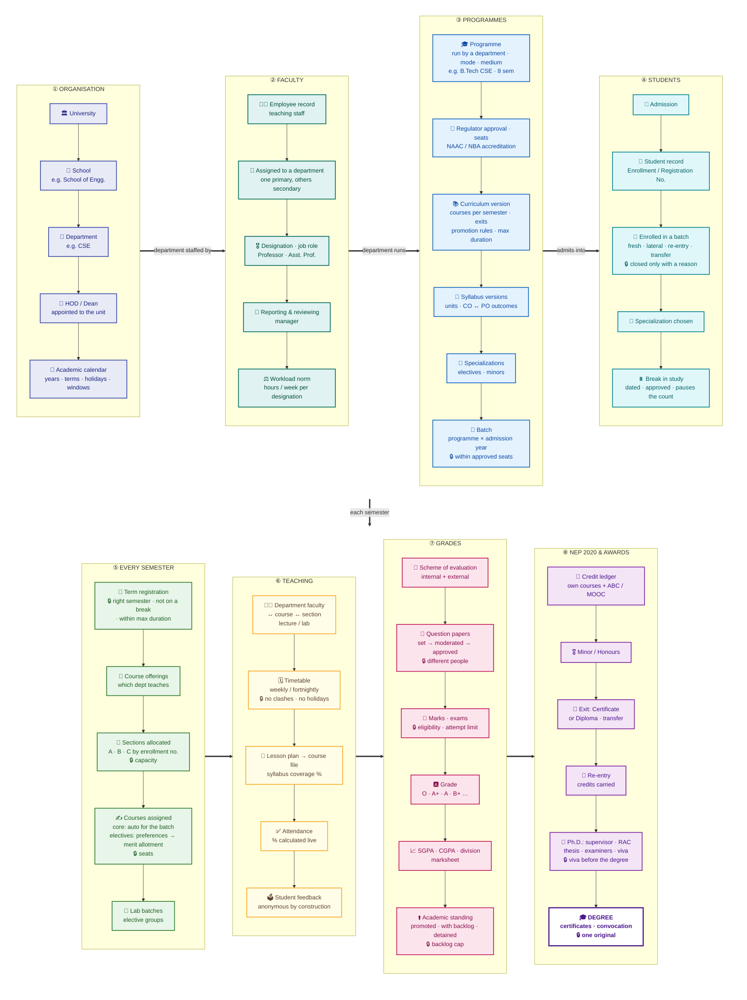

# The Complete Academic Flow

One picture of how the academic side of the university fits together:
**school → department → faculty → programme → students → sections → courses
→ teaching → grades → NEP 2020 & awards**. The top row is set up once (and
changed rarely); the bottom row repeats every semester. 🔒 marks a point
where the **database itself** refuses a mistake.

Rendered copies for slides: `academic-flow.png`, `academic-flow.svg`.

## How each link is held in the database

| Link in the picture | Where it lives |
|---|---|
| University → School → Department | `org.org_unit` — one tree; `org.org_unit_type_rule` decides what may sit under what |
| HOD / Dean of a unit | `org.appointment` — one holder per position per unit at a time |
| Academic calendar | `academic.academic_year` → `academic_term`; `academic.calendar_event` (holidays, vacations, registration / add-drop windows, exam periods) → `academic.is_working_day()`; a timetabled class on a holiday is rejected |
| Faculty ↔ Department | `people.employee_assignment` — one **primary** department at a time (plus secondary ones), with designation (Professor, Assistant Professor…), job function and job role; reporting / reviewing manager in `people.employee_reporting_line` |
| Workload norm | `academic.workload_norm` per designation; actual hours from the timetable in `academic.v_faculty_workload` |
| Department → Programme | `academic.program.offering_org_unit_id` — must be an academic unit; `delivery_mode`, `medium_language` on the programme |
| Regulator approval · accreditation | `academic.program_approval` (UGC / AICTE / NMC … letter, seats, validity — `academic.batch.intake_capacity` may not exceed it), `academic.program_accreditation` (NBA per programme, NAAC per institution) |
| Department → Course | `academic.course.owner_org_unit_id` (designs it) and `academic.course_offering.offering_org_unit_id` (teaches it this semester — may be another department) |
| Programme → Curriculum → Batch | `academic.curriculum` (versioned courses per semester, electives, `max_duration_years`, `max_attempts_per_course`), `academic.promotion_rule` (backlog allowed past each term), `academic.batch` (programme × admission year), `academic.batch_curriculum` |
| Syllabus · outcomes | `academic.course_syllabus` (versioned, one current) → `syllabus_unit`, `course_outcome`; `academic.program_outcome` (PO / PSO) ↔ `co_po_mapping` |
| Student record (Enrollment / Registration No., the GR) | `people.student.enrollment_no`, `registration_no` — unique |
| Student → Batch | `academic.student_enrollment` (fresh, lateral via `entry_term_no`, re-entry after an exit, or a transfer from another programme via `academic.program_transfer`); a closed enrollment always carries an `end_reason` |
| Break in study | `academic.study_break` — dated, approved, no overlaps; terms inside a break are not counted and no term registration is accepted during one |
| **Term registration · standing** | `academic.term_registration` — the student on the rolls of a term for programme term N (`academic.enrollment_term_no()` reads it first); at the end of the term the academic standing (promoted / promoted with backlog / detained) is checked against `academic.v_backlog` and the promotion rule; the maximum duration is enforced from the first enrollment of the lineage |
| **Sections allocated** | `academic.allocate_sections(batch, term)` — fills A, B, C … in enrollment-number order up to capacity, all or nothing; `academic.section_student` rejects a second section or an over-full one |
| **Courses assigned to students** | `academic.register_core_courses(batch, term)` — registers every student for the core courses of *their* semester; electives by `academic.elective_preference` → `academic.allot_electives(basket, term)` in merit order, from any department or school, within `academic.offering_seat_quota` ceilings per programme / school; minor/honours courses and equivalents by choice; `academic.course_registration` accepts only courses that belong to the student |
| Department faculty ↔ course ↔ section | `academic.teaching_assignment` — section-wise, per lab batch / elective group, or combined; `academic.v_section_teaching`, `v_teaching_gap` |
| Timetable, attendance | `academic.timetable_entry` (weekly / fortnightly, clash-free), `class_session` (never on a holiday), `attendance` |
| Lesson plan → course file | `academic.lesson_plan_item` per teaching assignment, `academic.class_session_topic` per class held → `academic.v_syllabus_coverage` |
| Student feedback | `academic.feedback_cycle` → `feedback_submission` (the only student link, one per registration) and `feedback_response` (no student column) → `academic.v_feedback_summary` |
| Question papers | `exam.paper_setter_assignment` (setter ≠ moderator) → `exam.question_paper` (submitted → moderated → approved) → `exam.exam_schedule.question_paper_id` |
| Grades | scheme of evaluation (`academic.evaluation_scheme`) → marks (`exam.*`, attempts capped by the curriculum) → grade band of the curriculum's grade scale → `exam.v_sgpa`, `exam.v_cgpa`, `exam.v_division` (division and equivalent %) |
| NEP 2020 | credit ledger (`academic.v_credit_ledger`), ABC / MOOC transfers, minors & honours (`academic.track`), exits (`academic.award_rule`, `student_award`), re-entry (`enrollment_reentry`) |
| Ph.D. | `research.supervisor_allocation` (one principal supervisor, norm per designation), `advisory_committee` (+ members, one chair), `progress_review`, `thesis`, `thesis_examiner` (no supervisor may examine), `viva` (all reports in, none rejecting); a doctoral `student_award` needs an accepted viva |
| Degree · certificates · convocation | `academic.student_award` → `exam.certificate` (award / provisional / transcript / migration / bonafide … serial, public verification code, NAD reference; one original per type) at an `exam.convocation` |

## Talking points (one line per box)

1. **Organisation:** one tree — University → Schools → Departments (and central departments like HR, IT, Finance). Heads are appointments, not columns. The academic calendar (terms, holidays, windows) is data the timetable obeys.
2. **Faculty:** every faculty member belongs to one primary department at a time, with a designation and job role; history is kept, never overwritten. Teaching load is read off the timetable and compared with the norm for the designation.
3. **Programmes:** a department runs a programme with a regulator's approval and seats; the programme's curriculum lists the courses of each semester, its exits, promotion rules and maximum duration; each course has a versioned syllabus whose outcomes map to programme outcomes; each year's intake is a batch that cannot exceed the approved seats.
4. **Students:** admission creates the student record (enrollment / registration number) and places the student in a batch — fresh, lateral, returning after an exit, or transferred from another programme. A break in study is a dated record that pauses the semester count; an enrollment closes only with a stated reason.
5. **Every semester:** students register for the term (the database knows which semester they are due for), courses are offered, students are allocated to sections automatically, core courses are registered for the whole batch in one step, electives are allotted from ranked preferences in merit order.
6. **Teaching:** department faculty are assigned course × section; the timetable cannot clash or land on a holiday; the lesson plan becomes the course file as classes are held; attendance is always calculated; students rate the class anonymously.
7. **Grades:** question papers are set and moderated by different people and approved before they reach the date sheet; marks follow the course's scheme of evaluation and become a grade on the curriculum's scale, then SGPA / CGPA and division; the end-of-term standing (promoted, with backlog, or detained) is checked against the backlog cap.
8. **NEP 2020 & awards:** one credit ledger (own courses + ABC / MOOC credits) drives minors & honours, exit with a certificate or diploma, re-entry with credits intact, and the degree; a Ph.D. adds supervision, a research advisory committee, thesis, independent examiners and the viva; every certificate issued is registered with a serial and a public verification code.
9. **Rooms are part of the record:** every class date, exam, viva and convocation writes the same occupancy ledger (`facility.room_hold`) that room bookings are checked against — an exam can displace a class, a club night cannot; what was displaced is listed and comes back when the event goes.
