# Data flow — feature by feature (Level 3)

<!-- GENERATED by docs/dfd/build_dfd.py — edit the Level-2 specs there, not this file. -->

Every feature of every module on its own diagram: **170 features** in 6 areas. A feature is one step (process) of a Level-2 diagram in [`data-flow.md`](data-flow.md); its diagram shows that step alone with everything it receives, reads, writes and sends, and what is at the other end. Each one is derived from the Level-2 specification by `docs/dfd/build_dfd.py`, so it cannot disagree with its parent, and the same script checks that every table of the database is in a data store that some feature writes.

Under each diagram: the flows in a table, then **every table the feature touches**, linked to its card in [`table-catalog.md`](table-catalog.md). The legend is the one of [`data-flow.md`](data-flow.md#how-to-read-the-diagrams); off-page boxes are the neighbouring steps of the same area or other processes, each with its own diagram here.

Two gates sit on every write and are not repeated per feature: **4.x** decides whether the account may do it (`authz.has_permission()`), **7.x** records that it happened (`audit.capture()`).

## Contents

- [Platform — organisation, people, login, permissions, approvals, privacy, audit](#a-platform) — 44 features
- [Academic — programmes, curriculum, student lifecycle, NEP credits, teaching](#a-academic) — 42 features
- [Examinations, awards and research degrees](#a-exam) — 32 features
- [Resource & facility management](#a-facility) — 19 features
- [Helpdesk & grievance redressal (TMS)](#a-tms) — 9 features
- [Clubs & event management](#a-events) — 24 features

---

## Platform — organisation, people, login, permissions, approvals, privacy, audit

| Feature | What it covers | Level 2 parent |
|---|---|---|
| [1.1 · Maintain org-unit tree](#f-1-1) | — | [processes 1 & 2: organisation and people](dfd/dfd-2-01-org-people.png) |
| [1.2 · Maintain campuses, buildings & rooms](#f-1-2) | — | [processes 1 & 2: organisation and people](dfd/dfd-2-01-org-people.png) |
| [1.3 · Appoint position holders](#f-1-3) | — | [processes 1 & 2: organisation and people](dfd/dfd-2-01-org-people.png) |
| [2.1 · Register person, contacts & documents](#f-2-1) | — | [processes 1 & 2: organisation and people](dfd/dfd-2-01-org-people.png) |
| [2.2 · Record employment & posting](#f-2-2) | — | [processes 1 & 2: organisation and people](dfd/dfd-2-01-org-people.png) |
| [2.3 · Set reporting & reviewing lines](#f-2-3) | — | [processes 1 & 2: organisation and people](dfd/dfd-2-01-org-people.png) |
| [2.4 · Record student & mentor](#f-2-4) | — | [processes 1 & 2: organisation and people](dfd/dfd-2-01-org-people.png) |
| [2.5 · Link guardian / family](#f-2-5) | — | [processes 1 & 2: organisation and people](dfd/dfd-2-01-org-people.png) |
| [2.6 · Open user account](#f-2-6) | — | [processes 1 & 2: organisation and people](dfd/dfd-2-01-org-people.png) |
| [2.7 · Derive current affiliation](#f-2-7) | — | [processes 1 & 2: organisation and people](dfd/dfd-2-01-org-people.png) |
| [3.1 · Resolve identifier](#f-3-1) | UID or verified e-mail | [process 3: authenticate](dfd/dfd-2-03-authenticate.png) |
| [3.2 · Check status & lockout](#f-3-2) | — | [process 3: authenticate](dfd/dfd-2-03-authenticate.png) |
| [3.3 · Verify password](#f-3-3) | — | [process 3: authenticate](dfd/dfd-2-03-authenticate.png) |
| [3.4 · Verify second factor](#f-3-4) | — | [process 3: authenticate](dfd/dfd-2-03-authenticate.png) |
| [3.5 · Open, rotate & revoke session](#f-3-5) | — | [process 3: authenticate](dfd/dfd-2-03-authenticate.png) |
| [3.6 · Reset / change password](#f-3-6) | — | [process 3: authenticate](dfd/dfd-2-03-authenticate.png) |
| [3.7 · Activate account & enrol MFA](#f-3-7) | — | [process 3: authenticate](dfd/dfd-2-03-authenticate.png) |
| [3.8 · Lock & release account](#f-3-8) | — | [process 3: authenticate](dfd/dfd-2-03-authenticate.png) |
| [4.1 · Register module, resources & permissions](#f-4-1) | — | [process 4: authorise](dfd/dfd-2-04-authorise.png) |
| [4.2 · Define roles, inheritance & conflicts](#f-4-2) | — | [process 4: authorise](dfd/dfd-2-04-authorise.png) |
| [4.3 · Set derivation rules](#f-4-3) | — | [process 4: authorise](dfd/dfd-2-04-authorise.png) |
| [4.4 · Grant role / permission explicitly](#f-4-4) | — | [process 4: authorise](dfd/dfd-2-04-authorise.png) |
| [4.5 · Resolve effective roles & permissions](#f-4-5) | — | [process 4: authorise](dfd/dfd-2-04-authorise.png) |
| [4.6 · Check permission](#f-4-6) | has_permission() | [process 4: authorise](dfd/dfd-2-04-authorise.png) |
| [5.1 · Configure document types, chains & levels](#f-5-1) | approvers · conditions · deadlines · checklists · delegations | [process 5: approval workflow](dfd/dfd-2-05-workflow.png) |
| [5.2 · Submit document](#f-5-2) | wf.submit() | [process 5: approval workflow](dfd/dfd-2-05-workflow.png) |
| [5.3 · List work pending for me](#f-5-3) | — | [process 5: approval workflow](dfd/dfd-2-05-workflow.png) |
| [5.4 · Comment, consult & resolve](#f-5-4) | — | [process 5: approval workflow](dfd/dfd-2-05-workflow.png) |
| [5.5 · Approve · sign · return · reject · forward · withdraw](#f-5-5) | wf.act() | [process 5: approval workflow](dfd/dfd-2-05-workflow.png) |
| [5.6 · Derive round state](#f-5-6) | — | [process 5: approval workflow](dfd/dfd-2-05-workflow.png) |
| [5.7 · Run deadlines](#f-5-7) | wf.run_timeouts() | [process 5: approval workflow](dfd/dfd-2-05-workflow.png) |
| [6.1 · Maintain purposes, inventory & processors](#f-6-1) | — | [process 6: privacy and data-principal rights (DPDP Act 2023)](dfd/dfd-2-06-privacy.png) |
| [6.2 · Publish privacy notice](#f-6-2) | — | [process 6: privacy and data-principal rights (DPDP Act 2023)](dfd/dfd-2-06-privacy.png) |
| [6.3 · Record & withdraw consent](#f-6-3) | — | [process 6: privacy and data-principal rights (DPDP Act 2023)](dfd/dfd-2-06-privacy.png) |
| [6.4 · Handle rights request](#f-6-4) | — | [process 6: privacy and data-principal rights (DPDP Act 2023)](dfd/dfd-2-06-privacy.png) |
| [6.5 · Erase / anonymise](#f-6-5) | — | [process 6: privacy and data-principal rights (DPDP Act 2023)](dfd/dfd-2-06-privacy.png) |
| [6.6 · Manage breach](#f-6-6) | — | [process 6: privacy and data-principal rights (DPDP Act 2023)](dfd/dfd-2-06-privacy.png) |
| [6.7 · Log access to personal data](#f-6-7) | — | [process 6: privacy and data-principal rights (DPDP Act 2023)](dfd/dfd-2-06-privacy.png) |
| [6.8 · Monitor compliance](#f-6-8) | — | [process 6: privacy and data-principal rights (DPDP Act 2023)](dfd/dfd-2-06-privacy.png) |
| [7.1 · Attach capture trigger](#f-7-1) | audit.enable_for_schemas() | [process 7: audit trail](dfd/dfd-2-07-audit.png) |
| [7.2 · Capture row change](#f-7-2) | audit.capture() | [process 7: audit trail](dfd/dfd-2-07-audit.png) |
| [7.3 · Guard append-only](#f-7-3) | audit.block_mutation() | [process 7: audit trail](dfd/dfd-2-07-audit.png) |
| [7.4 · Rotate monthly partitions](#f-7-4) | — | [process 7: audit trail](dfd/dfd-2-07-audit.png) |
| [7.5 · Review the trail](#f-7-5) | — | [process 7: audit trail](dfd/dfd-2-07-audit.png) |

### processes 1 & 2: organisation and people

Whole process: [png](dfd/dfd-2-01-org-people.png) · [svg](dfd/dfd-2-01-org-people.svg)

#### 1.1 · Maintain org-unit tree

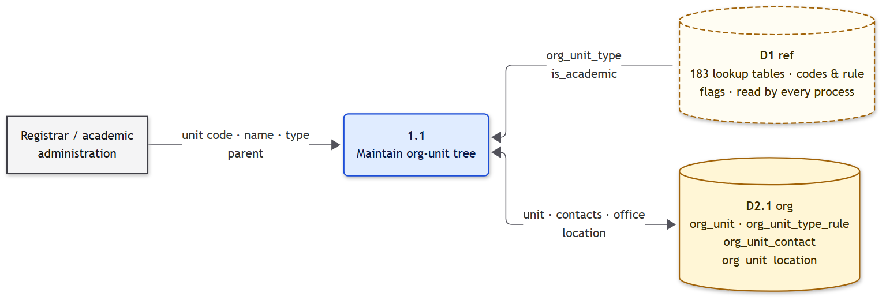

[svg](dfd/features/dfd-3-1-1.svg) · [mmd](dfd/features/dfd-3-1-1.mmd)

| Flow | With | What moves |
|---|---|---|
| ← receives | Registrar / academic administration | unit code · name · type · parent |
| ← reads | **D1** | org_unit_type · is_academic |
| reads & writes | **D2.1** | unit · contacts · office location |

**Tables touched:**

- **D1** `ref` (whole schema, drawn on its own process): 183 lookup tables · codes & rule flags · read by every process
- **D2.1** `org`: [`org_unit`](table-catalog.md#t-org-org-unit) · [`org_unit_type_rule`](table-catalog.md#t-org-org-unit-type-rule) · [`org_unit_contact`](table-catalog.md#t-org-org-unit-contact) · [`org_unit_location`](table-catalog.md#t-org-org-unit-location)

#### 1.2 · Maintain campuses, buildings & rooms

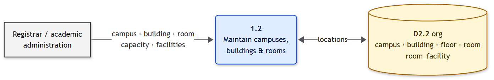

[svg](dfd/features/dfd-3-1-2.svg) · [mmd](dfd/features/dfd-3-1-2.mmd)

| Flow | With | What moves |
|---|---|---|
| ← receives | Registrar / academic administration | campus · building · room · capacity · facilities |
| reads & writes | **D2.2** | locations |

**Tables touched:**

- **D2.2** `org`: [`campus`](table-catalog.md#t-org-campus) · [`building`](table-catalog.md#t-org-building) · [`floor`](table-catalog.md#t-org-floor) · [`room`](table-catalog.md#t-org-room) · [`room_facility`](table-catalog.md#t-org-room-facility)

#### 1.3 · Appoint position holders

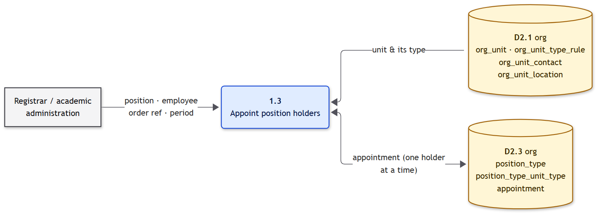

[svg](dfd/features/dfd-3-1-3.svg) · [mmd](dfd/features/dfd-3-1-3.mmd)

| Flow | With | What moves |
|---|---|---|
| ← receives | Registrar / academic administration | position · employee · order ref · period |
| ← reads | **D2.1** | unit & its type |
| reads & writes | **D2.3** | appointment (one holder at a time) |

**Tables touched:**

- **D2.1** `org`: [`org_unit`](table-catalog.md#t-org-org-unit) · [`org_unit_type_rule`](table-catalog.md#t-org-org-unit-type-rule) · [`org_unit_contact`](table-catalog.md#t-org-org-unit-contact) · [`org_unit_location`](table-catalog.md#t-org-org-unit-location)
- **D2.3** `org`: [`position_type`](table-catalog.md#t-org-position-type) · [`position_type_unit_type`](table-catalog.md#t-org-position-type-unit-type) · [`appointment`](table-catalog.md#t-org-appointment)

#### 2.1 · Register person, contacts & documents

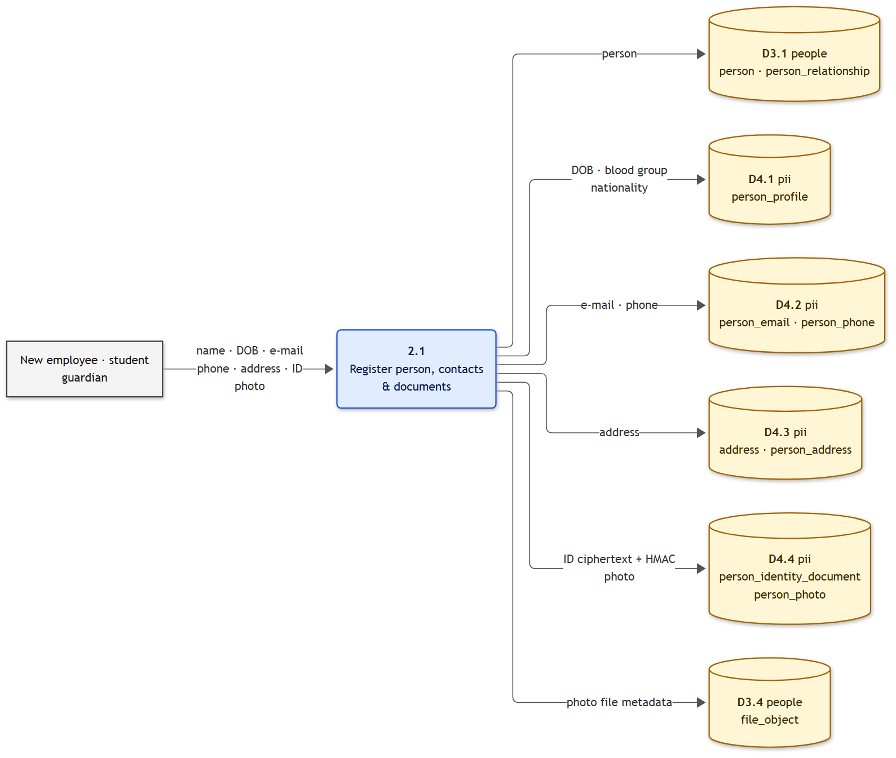

[svg](dfd/features/dfd-3-2-1.svg) · [mmd](dfd/features/dfd-3-2-1.mmd)

| Flow | With | What moves |
|---|---|---|
| ← receives | New employee · student · guardian | name · DOB · e-mail · phone · address · ID · photo |
| writes → | **D3.1** | person |
| writes → | **D4.1** | DOB · blood group · nationality |
| writes → | **D4.2** | e-mail · phone |
| writes → | **D4.3** | address |
| writes → | **D4.4** | ID ciphertext + HMAC · photo |
| writes → | **D3.4** | photo file metadata |

**Tables touched:**

- **D3.1** `people`: [`person`](table-catalog.md#t-people-person) · [`person_relationship`](table-catalog.md#t-people-person-relationship)
- **D4.1** `pii`: [`person_profile`](table-catalog.md#t-pii-person-profile)
- **D4.2** `pii`: [`person_email`](table-catalog.md#t-pii-person-email) · [`person_phone`](table-catalog.md#t-pii-person-phone)
- **D4.3** `pii`: [`address`](table-catalog.md#t-pii-address) · [`person_address`](table-catalog.md#t-pii-person-address)
- **D4.4** `pii`: [`person_identity_document`](table-catalog.md#t-pii-person-identity-document) · [`person_photo`](table-catalog.md#t-pii-person-photo)
- **D3.4** `people`: [`file_object`](table-catalog.md#t-people-file-object)

#### 2.2 · Record employment & posting

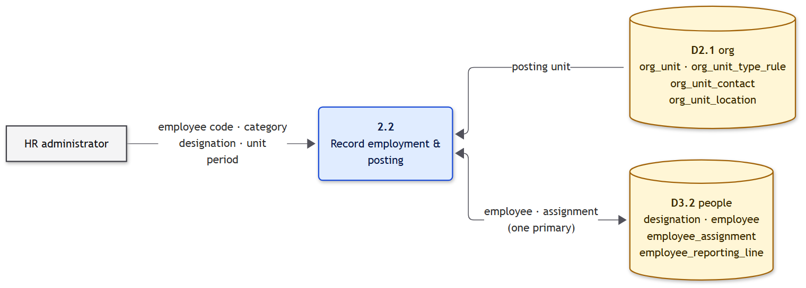

[svg](dfd/features/dfd-3-2-2.svg) · [mmd](dfd/features/dfd-3-2-2.mmd)

| Flow | With | What moves |
|---|---|---|
| ← receives | HR administrator | employee code · category · designation · unit · period |
| ← reads | **D2.1** | posting unit |
| reads & writes | **D3.2** | employee · assignment (one primary) |

**Tables touched:**

- **D2.1** `org`: [`org_unit`](table-catalog.md#t-org-org-unit) · [`org_unit_type_rule`](table-catalog.md#t-org-org-unit-type-rule) · [`org_unit_contact`](table-catalog.md#t-org-org-unit-contact) · [`org_unit_location`](table-catalog.md#t-org-org-unit-location)
- **D3.2** `people`: [`designation`](table-catalog.md#t-people-designation) · [`employee`](table-catalog.md#t-people-employee) · [`employee_assignment`](table-catalog.md#t-people-employee-assignment) · [`employee_reporting_line`](table-catalog.md#t-people-employee-reporting-line)

#### 2.3 · Set reporting & reviewing lines

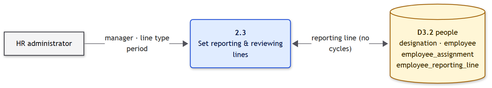

[svg](dfd/features/dfd-3-2-3.svg) · [mmd](dfd/features/dfd-3-2-3.mmd)

| Flow | With | What moves |
|---|---|---|
| ← receives | HR administrator | manager · line type · period |
| reads & writes | **D3.2** | reporting line (no cycles) |

**Tables touched:**

- **D3.2** `people`: [`designation`](table-catalog.md#t-people-designation) · [`employee`](table-catalog.md#t-people-employee) · [`employee_assignment`](table-catalog.md#t-people-employee-assignment) · [`employee_reporting_line`](table-catalog.md#t-people-employee-reporting-line)

#### 2.4 · Record student & mentor

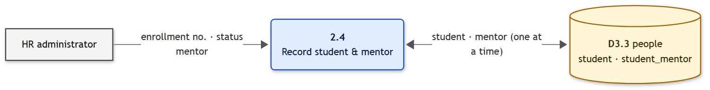

[svg](dfd/features/dfd-3-2-4.svg) · [mmd](dfd/features/dfd-3-2-4.mmd)

| Flow | With | What moves |
|---|---|---|
| ← receives | HR administrator | enrollment no. · status · mentor |
| reads & writes | **D3.3** | student · mentor (one at a time) |

**Tables touched:**

- **D3.3** `people`: [`student`](table-catalog.md#t-people-student) · [`student_mentor`](table-catalog.md#t-people-student-mentor)

#### 2.5 · Link guardian / family

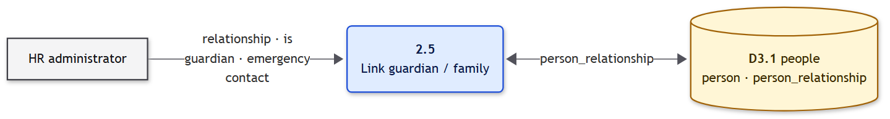

[svg](dfd/features/dfd-3-2-5.svg) · [mmd](dfd/features/dfd-3-2-5.mmd)

| Flow | With | What moves |
|---|---|---|
| ← receives | HR administrator | relationship · is guardian · emergency contact |
| reads & writes | **D3.1** | person_relationship |

**Tables touched:**

- **D3.1** `people`: [`person`](table-catalog.md#t-people-person) · [`person_relationship`](table-catalog.md#t-people-person-relationship)

#### 2.6 · Open user account

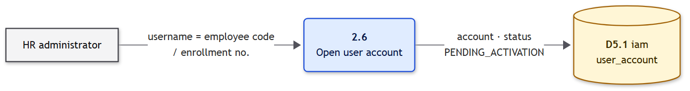

[svg](dfd/features/dfd-3-2-6.svg) · [mmd](dfd/features/dfd-3-2-6.mmd)

| Flow | With | What moves |
|---|---|---|
| ← receives | HR administrator | username = employee code / enrollment no. |
| writes → | **D5.1** | account · status PENDING_ACTIVATION |

**Tables touched:**

- **D5.1** `iam`: [`user_account`](table-catalog.md#t-iam-user-account)

#### 2.7 · Derive current affiliation

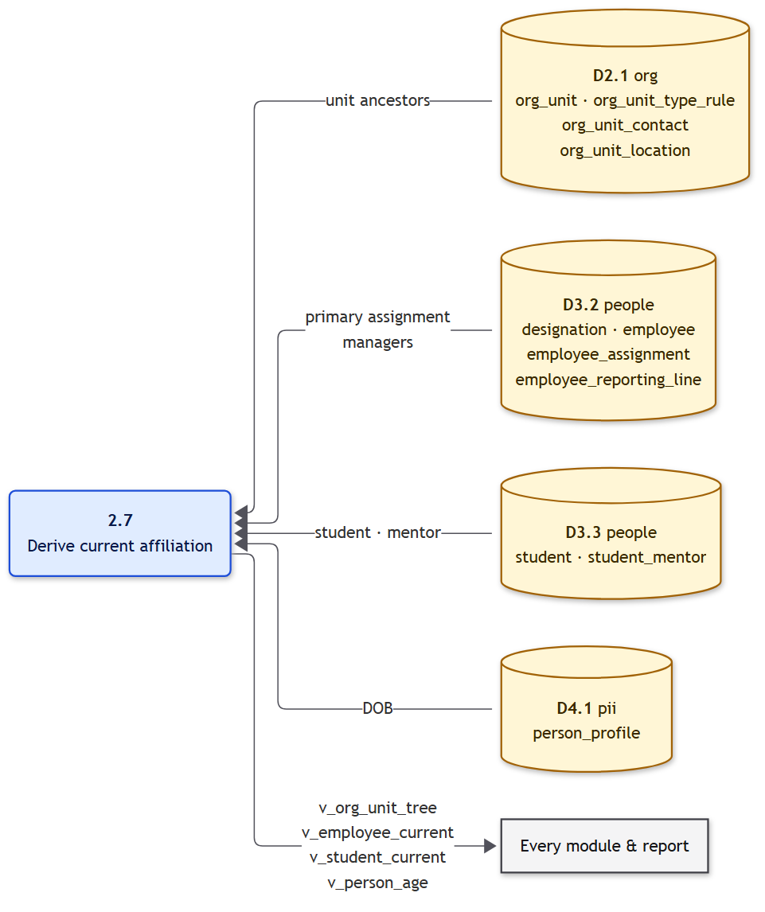

[svg](dfd/features/dfd-3-2-7.svg) · [mmd](dfd/features/dfd-3-2-7.mmd)

| Flow | With | What moves |
|---|---|---|
| ← reads | **D2.1** | unit ancestors |
| ← reads | **D3.2** | primary assignment · managers |
| ← reads | **D3.3** | student · mentor |
| ← reads | **D4.1** | DOB |
| sends → | Every module & report | v_org_unit_tree · v_employee_current · v_student_current · v_person_age |

**Tables touched:**

- **D2.1** `org`: [`org_unit`](table-catalog.md#t-org-org-unit) · [`org_unit_type_rule`](table-catalog.md#t-org-org-unit-type-rule) · [`org_unit_contact`](table-catalog.md#t-org-org-unit-contact) · [`org_unit_location`](table-catalog.md#t-org-org-unit-location)
- **D3.2** `people`: [`designation`](table-catalog.md#t-people-designation) · [`employee`](table-catalog.md#t-people-employee) · [`employee_assignment`](table-catalog.md#t-people-employee-assignment) · [`employee_reporting_line`](table-catalog.md#t-people-employee-reporting-line)
- **D3.3** `people`: [`student`](table-catalog.md#t-people-student) · [`student_mentor`](table-catalog.md#t-people-student-mentor)
- **D4.1** `pii`: [`person_profile`](table-catalog.md#t-pii-person-profile)

### process 3: authenticate

Whole process: [png](dfd/dfd-2-03-authenticate.png) · [svg](dfd/dfd-2-03-authenticate.svg)

#### 3.1 · Resolve identifier

*UID or verified e-mail*

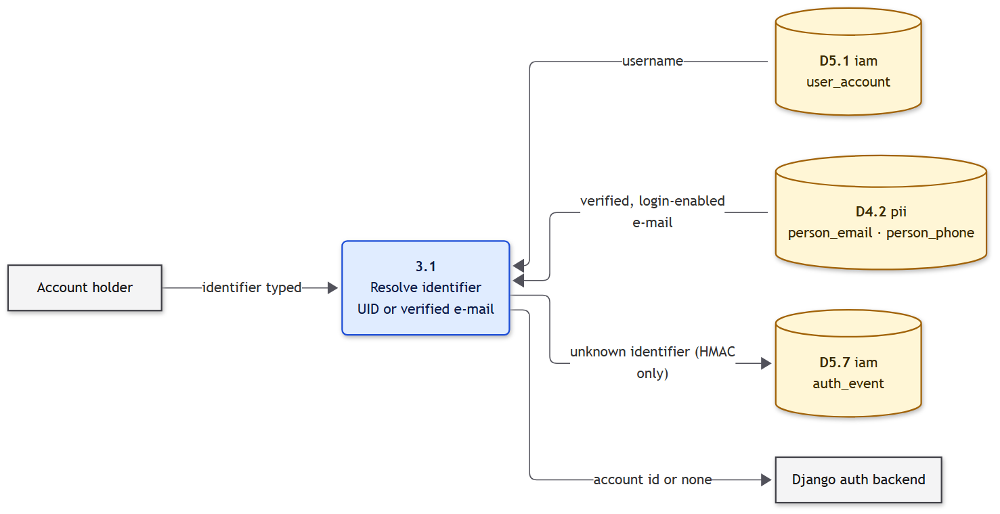

[svg](dfd/features/dfd-3-3-1.svg) · [mmd](dfd/features/dfd-3-3-1.mmd)

| Flow | With | What moves |
|---|---|---|
| ← receives | Account holder | identifier typed |
| ← reads | **D5.1** | username |
| ← reads | **D4.2** | verified, login-enabled e-mail |
| writes → | **D5.7** | unknown identifier (HMAC only) |
| sends → | Django auth backend | account id or none |

**Tables touched:**

- **D5.1** `iam`: [`user_account`](table-catalog.md#t-iam-user-account)
- **D4.2** `pii`: [`person_email`](table-catalog.md#t-pii-person-email) · [`person_phone`](table-catalog.md#t-pii-person-phone)
- **D5.7** `iam`: [`auth_event`](table-catalog.md#t-iam-auth-event)

#### 3.2 · Check status & lockout

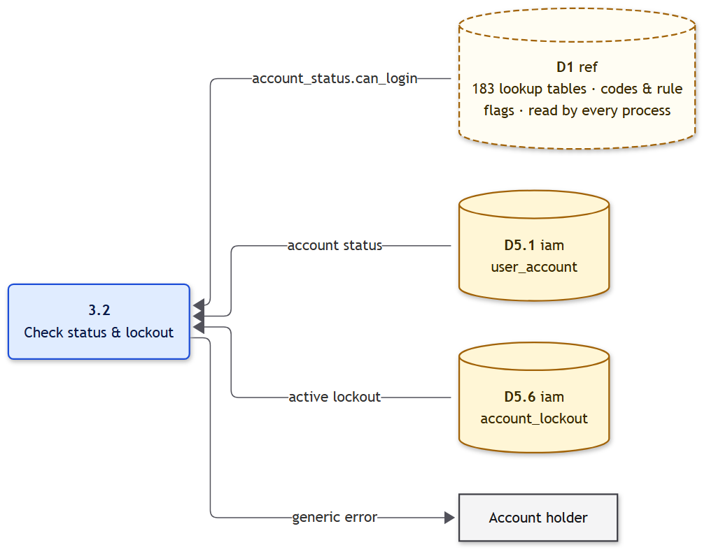

[svg](dfd/features/dfd-3-3-2.svg) · [mmd](dfd/features/dfd-3-3-2.mmd)

| Flow | With | What moves |
|---|---|---|
| ← reads | **D1** | account_status.can_login |
| ← reads | **D5.1** | account status |
| ← reads | **D5.6** | active lockout |
| sends → | Account holder | generic error |

**Tables touched:**

- **D1** `ref` (whole schema, drawn on its own process): 183 lookup tables · codes & rule flags · read by every process
- **D5.1** `iam`: [`user_account`](table-catalog.md#t-iam-user-account)
- **D5.6** `iam`: [`account_lockout`](table-catalog.md#t-iam-account-lockout)

#### 3.3 · Verify password

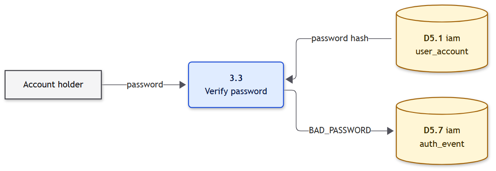

[svg](dfd/features/dfd-3-3-3.svg) · [mmd](dfd/features/dfd-3-3-3.mmd)

| Flow | With | What moves |
|---|---|---|
| ← receives | Account holder | password |
| ← reads | **D5.1** | password hash |
| writes → | **D5.7** | BAD_PASSWORD |

**Tables touched:**

- **D5.1** `iam`: [`user_account`](table-catalog.md#t-iam-user-account)
- **D5.7** `iam`: [`auth_event`](table-catalog.md#t-iam-auth-event)

#### 3.4 · Verify second factor

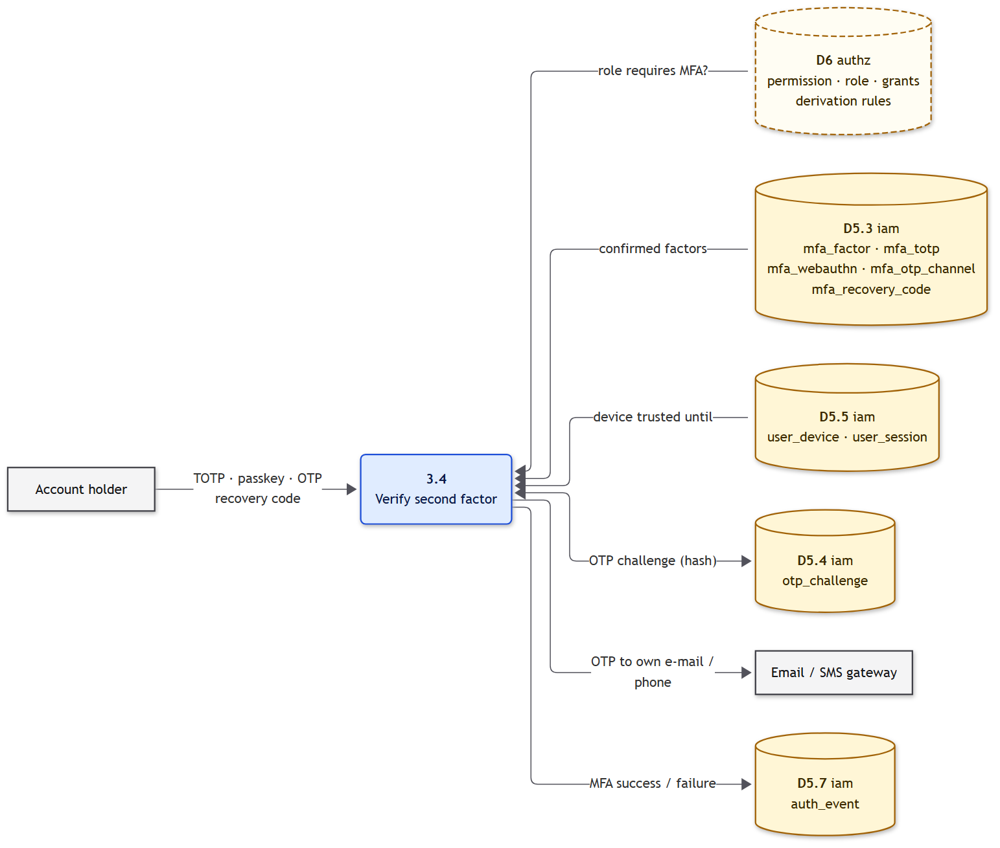

[svg](dfd/features/dfd-3-3-4.svg) · [mmd](dfd/features/dfd-3-3-4.mmd)

| Flow | With | What moves |
|---|---|---|
| ← receives | Account holder | TOTP · passkey · OTP · recovery code |
| ← reads | **D6** | role requires MFA? |
| ← reads | **D5.3** | confirmed factors |
| ← reads | **D5.5** | device trusted until |
| reads & writes | **D5.4** | OTP challenge (hash) |
| sends → | Email / SMS gateway | OTP to own e-mail / phone |
| writes → | **D5.7** | MFA success / failure |

**Tables touched:**

- **D6** `authz` (whole schema, drawn on its own process): permission · role · grants · derivation rules
- **D5.3** `iam`: [`mfa_factor`](table-catalog.md#t-iam-mfa-factor) · [`mfa_totp`](table-catalog.md#t-iam-mfa-totp) · [`mfa_webauthn`](table-catalog.md#t-iam-mfa-webauthn) · [`mfa_otp_channel`](table-catalog.md#t-iam-mfa-otp-channel) · [`mfa_recovery_code`](table-catalog.md#t-iam-mfa-recovery-code)
- **D5.5** `iam`: [`user_device`](table-catalog.md#t-iam-user-device) · [`user_session`](table-catalog.md#t-iam-user-session)
- **D5.4** `iam`: [`otp_challenge`](table-catalog.md#t-iam-otp-challenge)
- **D5.7** `iam`: [`auth_event`](table-catalog.md#t-iam-auth-event)

#### 3.5 · Open, rotate & revoke session

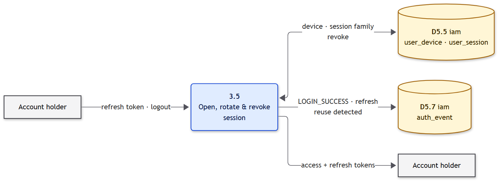

[svg](dfd/features/dfd-3-3-5.svg) · [mmd](dfd/features/dfd-3-3-5.mmd)

| Flow | With | What moves |
|---|---|---|
| ← receives | Account holder | refresh token · logout |
| reads & writes | **D5.5** | device · session family · revoke |
| writes → | **D5.7** | LOGIN_SUCCESS · refresh · reuse detected |
| sends → | Account holder | access + refresh tokens |

**Tables touched:**

- **D5.5** `iam`: [`user_device`](table-catalog.md#t-iam-user-device) · [`user_session`](table-catalog.md#t-iam-user-session)
- **D5.7** `iam`: [`auth_event`](table-catalog.md#t-iam-auth-event)

#### 3.6 · Reset / change password

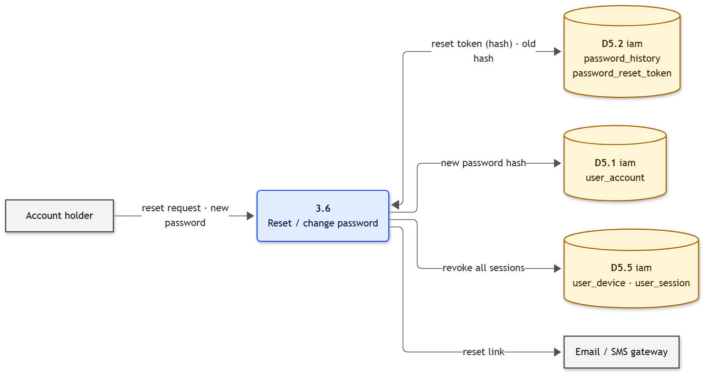

[svg](dfd/features/dfd-3-3-6.svg) · [mmd](dfd/features/dfd-3-3-6.mmd)

| Flow | With | What moves |
|---|---|---|
| ← receives | Account holder | reset request · new password |
| reads & writes | **D5.2** | reset token (hash) · old hash |
| writes → | **D5.1** | new password hash |
| writes → | **D5.5** | revoke all sessions |
| sends → | Email / SMS gateway | reset link |

**Tables touched:**

- **D5.2** `iam`: [`password_history`](table-catalog.md#t-iam-password-history) · [`password_reset_token`](table-catalog.md#t-iam-password-reset-token)
- **D5.1** `iam`: [`user_account`](table-catalog.md#t-iam-user-account)
- **D5.5** `iam`: [`user_device`](table-catalog.md#t-iam-user-device) · [`user_session`](table-catalog.md#t-iam-user-session)

#### 3.7 · Activate account & enrol MFA

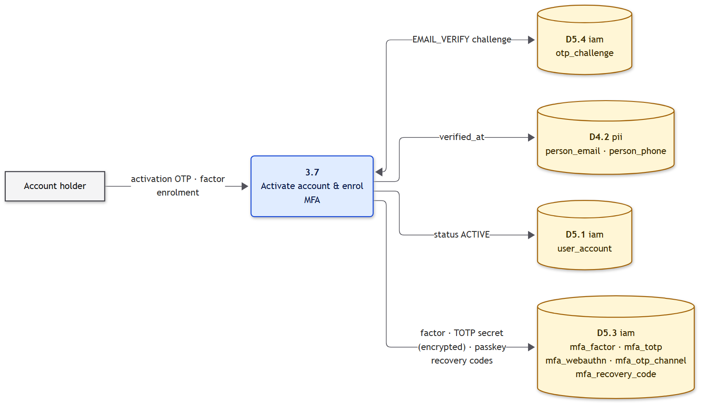

[svg](dfd/features/dfd-3-3-7.svg) · [mmd](dfd/features/dfd-3-3-7.mmd)

| Flow | With | What moves |
|---|---|---|
| ← receives | Account holder | activation OTP · factor enrolment |
| reads & writes | **D5.4** | EMAIL_VERIFY challenge |
| writes → | **D4.2** | verified_at |
| writes → | **D5.1** | status ACTIVE |
| writes → | **D5.3** | factor · TOTP secret (encrypted) · passkey · recovery codes |

**Tables touched:**

- **D5.4** `iam`: [`otp_challenge`](table-catalog.md#t-iam-otp-challenge)
- **D4.2** `pii`: [`person_email`](table-catalog.md#t-pii-person-email) · [`person_phone`](table-catalog.md#t-pii-person-phone)
- **D5.1** `iam`: [`user_account`](table-catalog.md#t-iam-user-account)
- **D5.3** `iam`: [`mfa_factor`](table-catalog.md#t-iam-mfa-factor) · [`mfa_totp`](table-catalog.md#t-iam-mfa-totp) · [`mfa_webauthn`](table-catalog.md#t-iam-mfa-webauthn) · [`mfa_otp_channel`](table-catalog.md#t-iam-mfa-otp-channel) · [`mfa_recovery_code`](table-catalog.md#t-iam-mfa-recovery-code)

#### 3.8 · Lock & release account

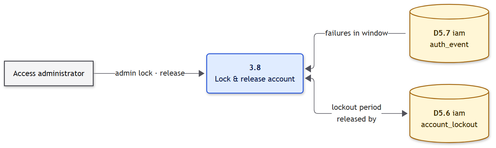

[svg](dfd/features/dfd-3-3-8.svg) · [mmd](dfd/features/dfd-3-3-8.mmd)

| Flow | With | What moves |
|---|---|---|
| ← receives | Access administrator | admin lock · release |
| ← reads | **D5.7** | failures in window |
| reads & writes | **D5.6** | lockout period · released by |

**Tables touched:**

- **D5.7** `iam`: [`auth_event`](table-catalog.md#t-iam-auth-event)
- **D5.6** `iam`: [`account_lockout`](table-catalog.md#t-iam-account-lockout)

### process 4: authorise

Whole process: [png](dfd/dfd-2-04-authorise.png) · [svg](dfd/dfd-2-04-authorise.svg)

#### 4.1 · Register module, resources & permissions

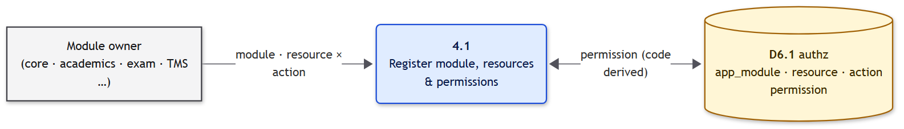

[svg](dfd/features/dfd-3-4-1.svg) · [mmd](dfd/features/dfd-3-4-1.mmd)

| Flow | With | What moves |
|---|---|---|
| ← receives | Module owner — (core · academics · exam · TMS …) | module · resource × action |
| reads & writes | **D6.1** | permission (code derived) |

**Tables touched:**

- **D6.1** `authz`: [`app_module`](table-catalog.md#t-authz-app-module) · [`resource`](table-catalog.md#t-authz-resource) · [`action`](table-catalog.md#t-authz-action) · [`permission`](table-catalog.md#t-authz-permission)

#### 4.2 · Define roles, inheritance & conflicts

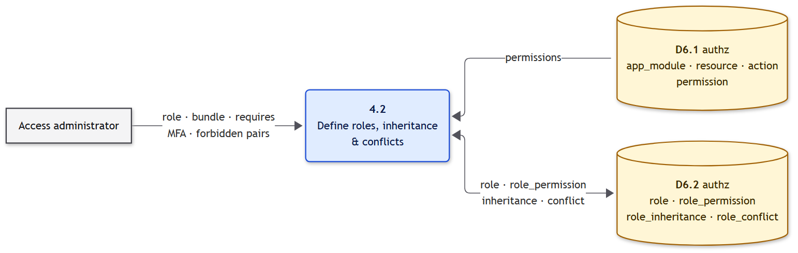

[svg](dfd/features/dfd-3-4-2.svg) · [mmd](dfd/features/dfd-3-4-2.mmd)

| Flow | With | What moves |
|---|---|---|
| ← receives | Access administrator | role · bundle · requires MFA · forbidden pairs |
| ← reads | **D6.1** | permissions |
| reads & writes | **D6.2** | role · role_permission · inheritance · conflict |

**Tables touched:**

- **D6.1** `authz`: [`app_module`](table-catalog.md#t-authz-app-module) · [`resource`](table-catalog.md#t-authz-resource) · [`action`](table-catalog.md#t-authz-action) · [`permission`](table-catalog.md#t-authz-permission)
- **D6.2** `authz`: [`role`](table-catalog.md#t-authz-role) · [`role_permission`](table-catalog.md#t-authz-role-permission) · [`role_inheritance`](table-catalog.md#t-authz-role-inheritance) · [`role_conflict`](table-catalog.md#t-authz-role-conflict)

#### 4.3 · Set derivation rules

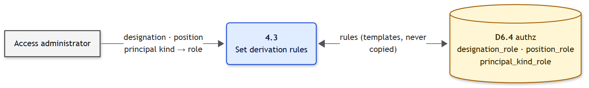

[svg](dfd/features/dfd-3-4-3.svg) · [mmd](dfd/features/dfd-3-4-3.mmd)

| Flow | With | What moves |
|---|---|---|
| ← receives | Access administrator | designation · position · principal kind → role |
| reads & writes | **D6.4** | rules (templates, never copied) |

**Tables touched:**

- **D6.4** `authz`: [`designation_role`](table-catalog.md#t-authz-designation-role) · [`position_role`](table-catalog.md#t-authz-position-role) · [`principal_kind_role`](table-catalog.md#t-authz-principal-kind-role)

#### 4.4 · Grant role / permission explicitly

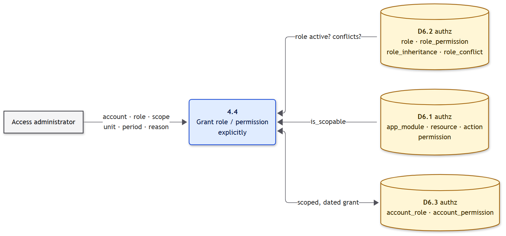

[svg](dfd/features/dfd-3-4-4.svg) · [mmd](dfd/features/dfd-3-4-4.mmd)

| Flow | With | What moves |
|---|---|---|
| ← receives | Access administrator | account · role · scope unit · period · reason |
| ← reads | **D6.2** | role active? conflicts? |
| ← reads | **D6.1** | is_scopable |
| reads & writes | **D6.3** | scoped, dated grant |

**Tables touched:**

- **D6.2** `authz`: [`role`](table-catalog.md#t-authz-role) · [`role_permission`](table-catalog.md#t-authz-role-permission) · [`role_inheritance`](table-catalog.md#t-authz-role-inheritance) · [`role_conflict`](table-catalog.md#t-authz-role-conflict)
- **D6.1** `authz`: [`app_module`](table-catalog.md#t-authz-app-module) · [`resource`](table-catalog.md#t-authz-resource) · [`action`](table-catalog.md#t-authz-action) · [`permission`](table-catalog.md#t-authz-permission)
- **D6.3** `authz`: [`account_role`](table-catalog.md#t-authz-account-role) · [`account_permission`](table-catalog.md#t-authz-account-permission)

#### 4.5 · Resolve effective roles & permissions

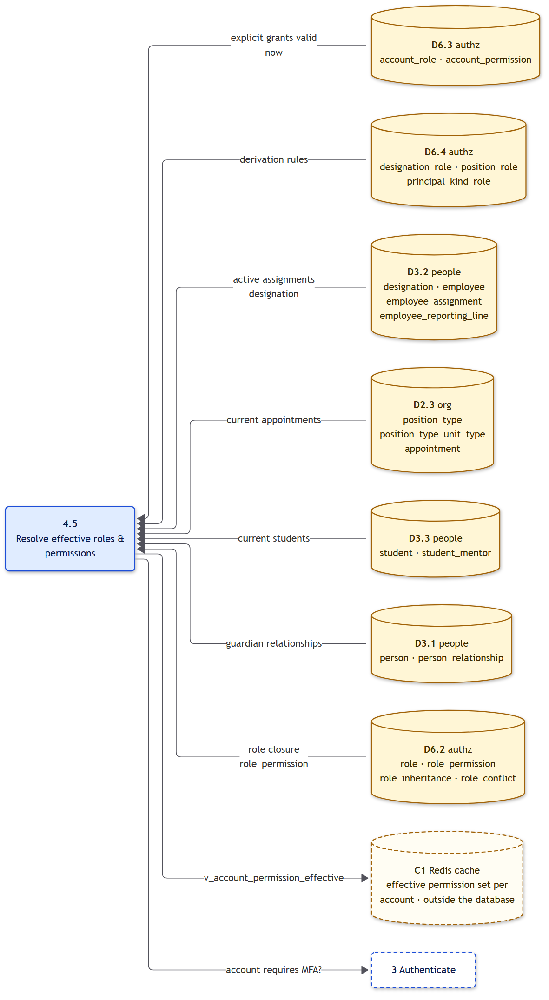

[svg](dfd/features/dfd-3-4-5.svg) · [mmd](dfd/features/dfd-3-4-5.mmd)

| Flow | With | What moves |
|---|---|---|
| ← reads | **D6.3** | explicit grants valid now |
| ← reads | **D6.4** | derivation rules |
| ← reads | **D3.2** | active assignments · designation |
| ← reads | **D2.3** | current appointments |
| ← reads | **D3.3** | current students |
| ← reads | **D3.1** | guardian relationships |
| ← reads | **D6.2** | role closure · role_permission |
| writes → | **C1** | v_account_permission_effective |
| sends → | 3 Authenticate | account requires MFA? |

**Tables touched:**

- **D6.3** `authz`: [`account_role`](table-catalog.md#t-authz-account-role) · [`account_permission`](table-catalog.md#t-authz-account-permission)
- **D6.4** `authz`: [`designation_role`](table-catalog.md#t-authz-designation-role) · [`position_role`](table-catalog.md#t-authz-position-role) · [`principal_kind_role`](table-catalog.md#t-authz-principal-kind-role)
- **D3.2** `people`: [`designation`](table-catalog.md#t-people-designation) · [`employee`](table-catalog.md#t-people-employee) · [`employee_assignment`](table-catalog.md#t-people-employee-assignment) · [`employee_reporting_line`](table-catalog.md#t-people-employee-reporting-line)
- **D2.3** `org`: [`position_type`](table-catalog.md#t-org-position-type) · [`position_type_unit_type`](table-catalog.md#t-org-position-type-unit-type) · [`appointment`](table-catalog.md#t-org-appointment)
- **D3.3** `people`: [`student`](table-catalog.md#t-people-student) · [`student_mentor`](table-catalog.md#t-people-student-mentor)
- **D3.1** `people`: [`person`](table-catalog.md#t-people-person) · [`person_relationship`](table-catalog.md#t-people-person-relationship)
- **D6.2** `authz`: [`role`](table-catalog.md#t-authz-role) · [`role_permission`](table-catalog.md#t-authz-role-permission) · [`role_inheritance`](table-catalog.md#t-authz-role-inheritance) · [`role_conflict`](table-catalog.md#t-authz-role-conflict)
- **C1** `Redis cache` (whole schema, drawn on its own process): effective permission set per account · outside the database

#### 4.6 · Check permission

*has_permission()*

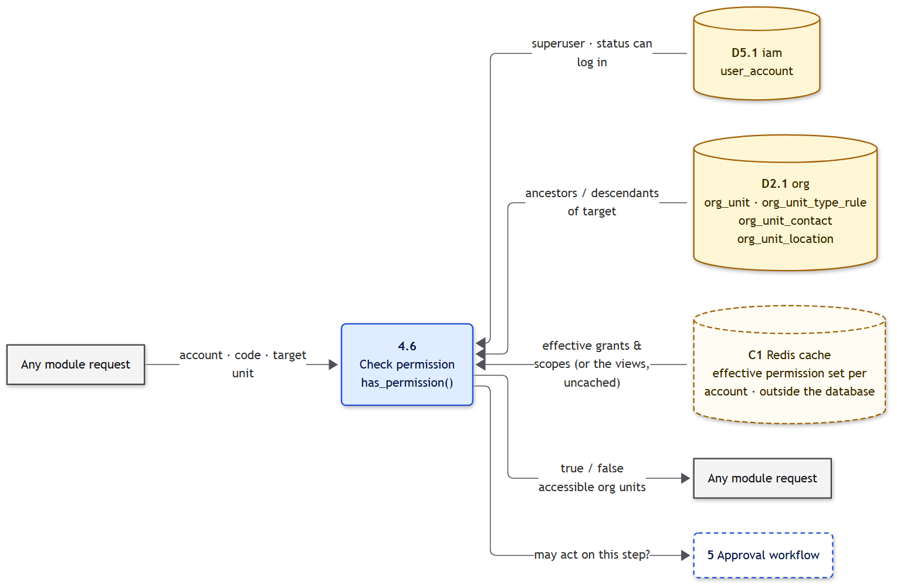

[svg](dfd/features/dfd-3-4-6.svg) · [mmd](dfd/features/dfd-3-4-6.mmd)

| Flow | With | What moves |
|---|---|---|
| ← receives | Any module request | account · code · target unit |
| ← reads | **D5.1** | superuser · status can log in |
| ← reads | **D2.1** | ancestors / descendants of target |
| ← reads | **C1** | effective grants & scopes (or the views, uncached) |
| sends → | Any module request | true / false · accessible org units |
| sends → | 5 Approval workflow | may act on this step? |

**Tables touched:**

- **D5.1** `iam`: [`user_account`](table-catalog.md#t-iam-user-account)
- **D2.1** `org`: [`org_unit`](table-catalog.md#t-org-org-unit) · [`org_unit_type_rule`](table-catalog.md#t-org-org-unit-type-rule) · [`org_unit_contact`](table-catalog.md#t-org-org-unit-contact) · [`org_unit_location`](table-catalog.md#t-org-org-unit-location)
- **C1** `Redis cache` (whole schema, drawn on its own process): effective permission set per account · outside the database

### process 5: approval workflow

Whole process: [png](dfd/dfd-2-05-workflow.png) · [svg](dfd/dfd-2-05-workflow.svg)

#### 5.1 · Configure document types, chains & levels

*approvers · conditions · deadlines · checklists · delegations*

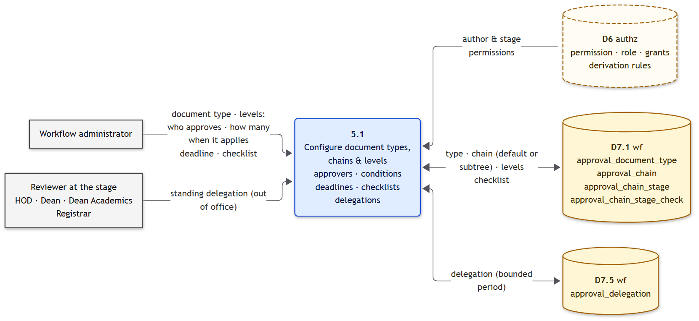

[svg](dfd/features/dfd-3-5-1.svg) · [mmd](dfd/features/dfd-3-5-1.mmd)

| Flow | With | What moves |
|---|---|---|
| ← receives | Workflow administrator | document type · levels: who approves · how many · when it applies · deadline · checklist |
| ← receives | Reviewer at the stage — HOD · Dean · Dean Academics · Registrar | standing delegation (out of office) |
| ← reads | **D6** | author & stage permissions |
| reads & writes | **D7.1** | type · chain (default or subtree) · levels · checklist |
| reads & writes | **D7.5** | delegation (bounded period) |

**Tables touched:**

- **D6** `authz` (whole schema, drawn on its own process): permission · role · grants · derivation rules
- **D7.1** `wf`: [`approval_document_type`](table-catalog.md#t-wf-approval-document-type) · [`approval_chain`](table-catalog.md#t-wf-approval-chain) · [`approval_chain_stage`](table-catalog.md#t-wf-approval-chain-stage) · [`approval_chain_stage_check`](table-catalog.md#t-wf-approval-chain-stage-check)
- **D7.5** `wf`: [`approval_delegation`](table-catalog.md#t-wf-approval-delegation)

#### 5.2 · Submit document

*wf.submit()*

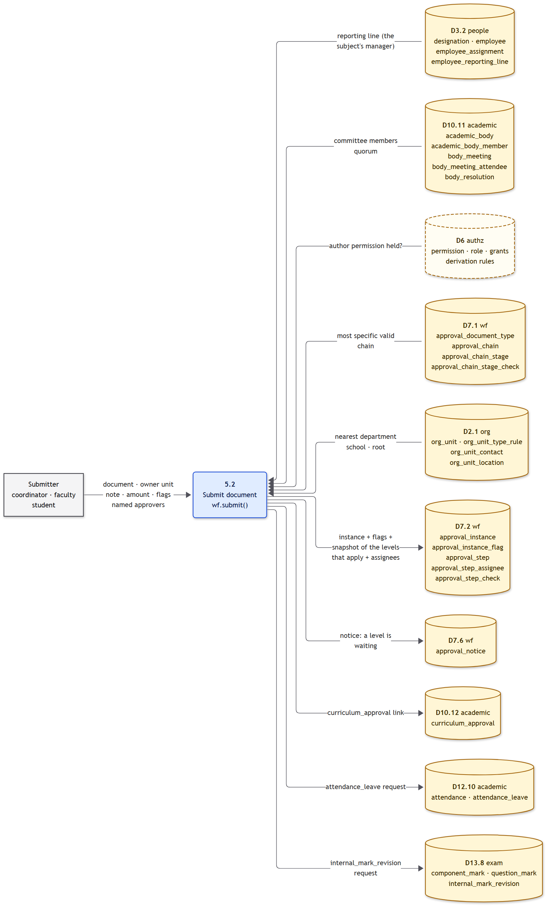

[svg](dfd/features/dfd-3-5-2.svg) · [mmd](dfd/features/dfd-3-5-2.mmd)

| Flow | With | What moves |
|---|---|---|
| ← receives | Submitter — coordinator · faculty · student | document · owner unit · note · amount · flags · named approvers |
| ← reads | **D3.2** | reporting line (the subject's manager) |
| ← reads | **D10.11** | committee members · quorum |
| ← reads | **D6** | author permission held? |
| ← reads | **D7.1** | most specific valid chain |
| ← reads | **D2.1** | nearest department · school · root |
| writes → | **D7.2** | instance + flags + snapshot of the levels that apply + assignees |
| writes → | **D7.6** | notice: a level is waiting |
| writes → | **D10.12** | curriculum_approval link |
| writes → | **D12.10** | attendance_leave request |
| writes → | **D13.8** | internal_mark_revision request |

**Tables touched:**

- **D3.2** `people`: [`designation`](table-catalog.md#t-people-designation) · [`employee`](table-catalog.md#t-people-employee) · [`employee_assignment`](table-catalog.md#t-people-employee-assignment) · [`employee_reporting_line`](table-catalog.md#t-people-employee-reporting-line)
- **D10.11** `academic`: [`academic_body`](table-catalog.md#t-academic-academic-body) · [`academic_body_member`](table-catalog.md#t-academic-academic-body-member) · [`body_meeting`](table-catalog.md#t-academic-body-meeting) · [`body_meeting_attendee`](table-catalog.md#t-academic-body-meeting-attendee) · [`body_resolution`](table-catalog.md#t-academic-body-resolution)
- **D6** `authz` (whole schema, drawn on its own process): permission · role · grants · derivation rules
- **D7.1** `wf`: [`approval_document_type`](table-catalog.md#t-wf-approval-document-type) · [`approval_chain`](table-catalog.md#t-wf-approval-chain) · [`approval_chain_stage`](table-catalog.md#t-wf-approval-chain-stage) · [`approval_chain_stage_check`](table-catalog.md#t-wf-approval-chain-stage-check)
- **D2.1** `org`: [`org_unit`](table-catalog.md#t-org-org-unit) · [`org_unit_type_rule`](table-catalog.md#t-org-org-unit-type-rule) · [`org_unit_contact`](table-catalog.md#t-org-org-unit-contact) · [`org_unit_location`](table-catalog.md#t-org-org-unit-location)
- **D7.2** `wf`: [`approval_instance`](table-catalog.md#t-wf-approval-instance) · [`approval_instance_flag`](table-catalog.md#t-wf-approval-instance-flag) · [`approval_step`](table-catalog.md#t-wf-approval-step) · [`approval_step_assignee`](table-catalog.md#t-wf-approval-step-assignee) · [`approval_step_check`](table-catalog.md#t-wf-approval-step-check)
- **D7.6** `wf`: [`approval_notice`](table-catalog.md#t-wf-approval-notice)
- **D10.12** `academic`: [`curriculum_approval`](table-catalog.md#t-academic-curriculum-approval)
- **D12.10** `academic`: [`attendance`](table-catalog.md#t-academic-attendance) · [`attendance_leave`](table-catalog.md#t-academic-attendance-leave)
- **D13.8** `exam`: [`component_mark`](table-catalog.md#t-exam-component-mark) · [`question_mark`](table-catalog.md#t-exam-question-mark) · [`internal_mark_revision`](table-catalog.md#t-exam-internal-mark-revision)

#### 5.3 · List work pending for me

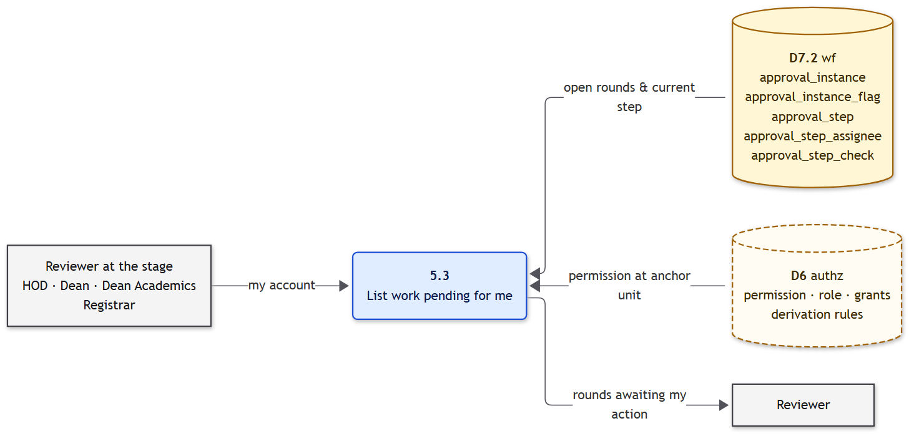

[svg](dfd/features/dfd-3-5-3.svg) · [mmd](dfd/features/dfd-3-5-3.mmd)

| Flow | With | What moves |
|---|---|---|
| ← receives | Reviewer at the stage — HOD · Dean · Dean Academics · Registrar | my account |
| ← reads | **D7.2** | open rounds & current step |
| ← reads | **D6** | permission at anchor unit |
| sends → | Reviewer | rounds awaiting my action |

**Tables touched:**

- **D7.2** `wf`: [`approval_instance`](table-catalog.md#t-wf-approval-instance) · [`approval_instance_flag`](table-catalog.md#t-wf-approval-instance-flag) · [`approval_step`](table-catalog.md#t-wf-approval-step) · [`approval_step_assignee`](table-catalog.md#t-wf-approval-step-assignee) · [`approval_step_check`](table-catalog.md#t-wf-approval-step-check)
- **D6** `authz` (whole schema, drawn on its own process): permission · role · grants · derivation rules

#### 5.4 · Comment, consult & resolve

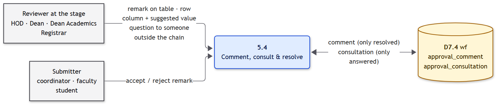

[svg](dfd/features/dfd-3-5-4.svg) · [mmd](dfd/features/dfd-3-5-4.mmd)

| Flow | With | What moves |
|---|---|---|
| ← receives | Reviewer at the stage — HOD · Dean · Dean Academics · Registrar | remark on table · row · column + suggested value · question to someone outside the chain |
| ← receives | Submitter — coordinator · faculty · student | accept / reject remark |
| reads & writes | **D7.4** | comment (only resolved) · consultation (only answered) |

**Tables touched:**

- **D7.4** `wf`: [`approval_comment`](table-catalog.md#t-wf-approval-comment) · [`approval_consultation`](table-catalog.md#t-wf-approval-consultation)

#### 5.5 · Approve · sign · return · reject · forward · withdraw

*wf.act()*

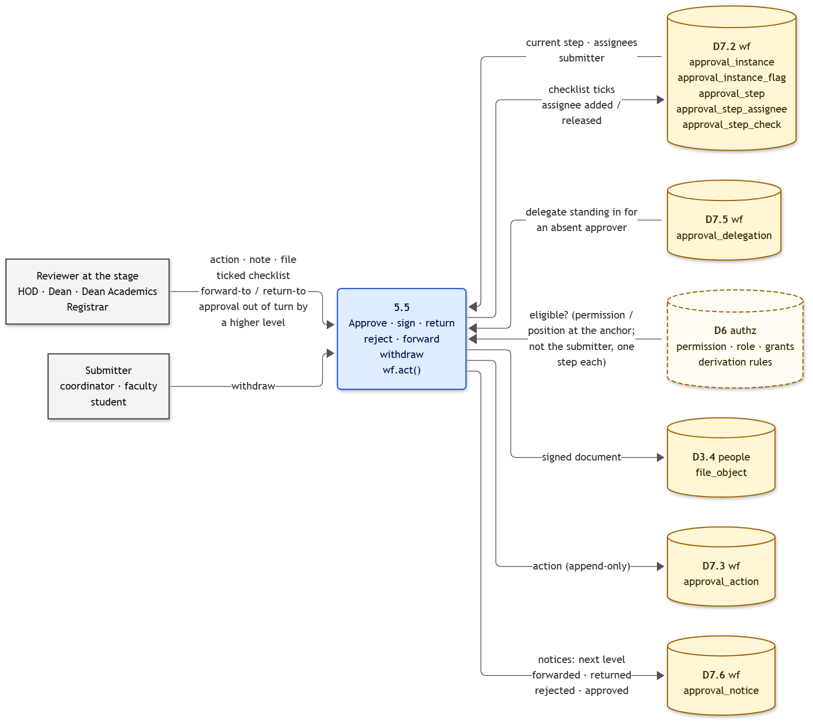

[svg](dfd/features/dfd-3-5-5.svg) · [mmd](dfd/features/dfd-3-5-5.mmd)

| Flow | With | What moves |
|---|---|---|
| ← receives | Reviewer at the stage — HOD · Dean · Dean Academics · Registrar | action · note · file · ticked checklist · forward-to / return-to · approval out of turn by a higher level |
| ← receives | Submitter — coordinator · faculty · student | withdraw |
| ← reads | **D7.2** | current step · assignees · submitter |
| ← reads | **D7.5** | delegate standing in for an absent approver |
| ← reads | **D6** | eligible? (permission / position at the anchor; not the submitter, one step each) |
| writes → | **D3.4** | signed document |
| writes → | **D7.3** | action (append-only) |
| writes → | **D7.2** | checklist ticks · assignee added / released |
| writes → | **D7.6** | notices: next level · forwarded · returned · rejected · approved |

**Tables touched:**

- **D7.2** `wf`: [`approval_instance`](table-catalog.md#t-wf-approval-instance) · [`approval_instance_flag`](table-catalog.md#t-wf-approval-instance-flag) · [`approval_step`](table-catalog.md#t-wf-approval-step) · [`approval_step_assignee`](table-catalog.md#t-wf-approval-step-assignee) · [`approval_step_check`](table-catalog.md#t-wf-approval-step-check)
- **D7.5** `wf`: [`approval_delegation`](table-catalog.md#t-wf-approval-delegation)
- **D6** `authz` (whole schema, drawn on its own process): permission · role · grants · derivation rules
- **D3.4** `people`: [`file_object`](table-catalog.md#t-people-file-object)
- **D7.3** `wf`: [`approval_action`](table-catalog.md#t-wf-approval-action)
- **D7.6** `wf`: [`approval_notice`](table-catalog.md#t-wf-approval-notice)

#### 5.6 · Derive round state

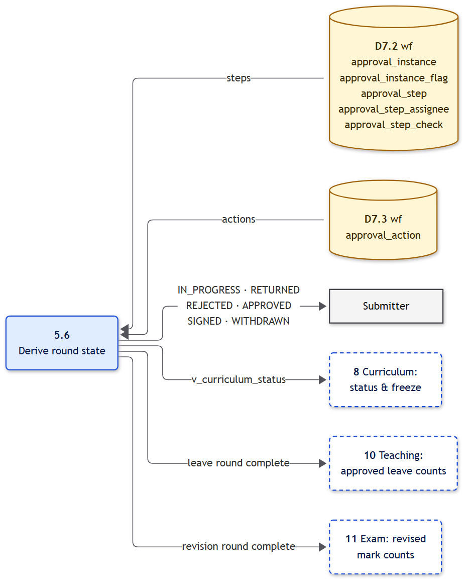

[svg](dfd/features/dfd-3-5-6.svg) · [mmd](dfd/features/dfd-3-5-6.mmd)

| Flow | With | What moves |
|---|---|---|
| ← reads | **D7.2** | steps |
| ← reads | **D7.3** | actions |
| sends → | Submitter | IN_PROGRESS · RETURNED · REJECTED · APPROVED · SIGNED · WITHDRAWN |
| sends → | 8 Curriculum: status & freeze | v_curriculum_status |
| sends → | 10 Teaching: approved leave counts | leave round complete |
| sends → | 11 Exam: revised mark counts | revision round complete |

**Tables touched:**

- **D7.2** `wf`: [`approval_instance`](table-catalog.md#t-wf-approval-instance) · [`approval_instance_flag`](table-catalog.md#t-wf-approval-instance-flag) · [`approval_step`](table-catalog.md#t-wf-approval-step) · [`approval_step_assignee`](table-catalog.md#t-wf-approval-step-assignee) · [`approval_step_check`](table-catalog.md#t-wf-approval-step-check)
- **D7.3** `wf`: [`approval_action`](table-catalog.md#t-wf-approval-action)

#### 5.7 · Run deadlines

*wf.run_timeouts()*

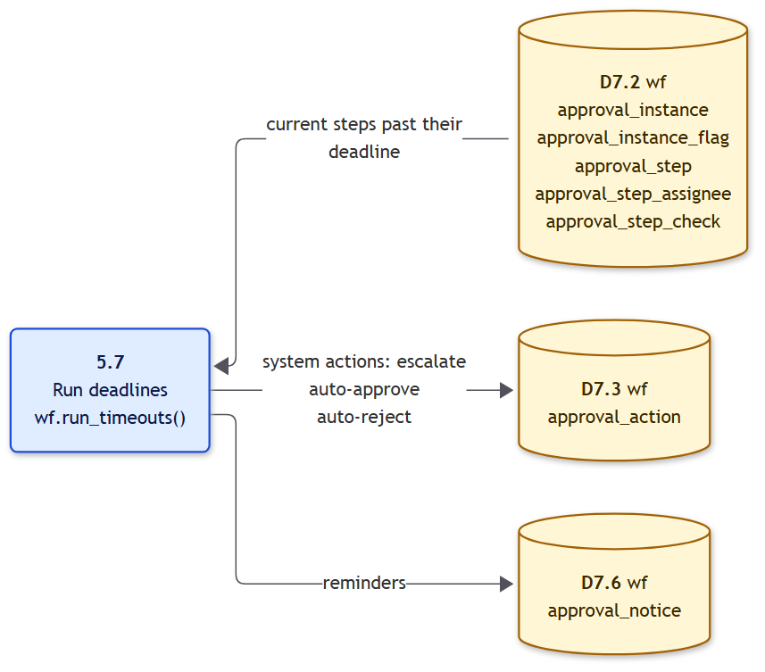

[svg](dfd/features/dfd-3-5-7.svg) · [mmd](dfd/features/dfd-3-5-7.mmd)

| Flow | With | What moves |
|---|---|---|
| ← reads | **D7.2** | current steps past their deadline |
| writes → | **D7.3** | system actions: escalate · auto-approve · auto-reject |
| writes → | **D7.6** | reminders |

**Tables touched:**

- **D7.2** `wf`: [`approval_instance`](table-catalog.md#t-wf-approval-instance) · [`approval_instance_flag`](table-catalog.md#t-wf-approval-instance-flag) · [`approval_step`](table-catalog.md#t-wf-approval-step) · [`approval_step_assignee`](table-catalog.md#t-wf-approval-step-assignee) · [`approval_step_check`](table-catalog.md#t-wf-approval-step-check)
- **D7.3** `wf`: [`approval_action`](table-catalog.md#t-wf-approval-action)
- **D7.6** `wf`: [`approval_notice`](table-catalog.md#t-wf-approval-notice)

### process 6: privacy and data-principal rights (DPDP Act 2023)

Whole process: [png](dfd/dfd-2-06-privacy.png) · [svg](dfd/dfd-2-06-privacy.svg)

#### 6.1 · Maintain purposes, inventory & processors

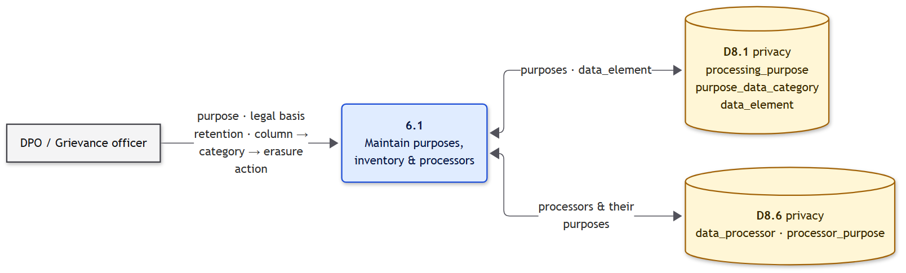

[svg](dfd/features/dfd-3-6-1.svg) · [mmd](dfd/features/dfd-3-6-1.mmd)

| Flow | With | What moves |
|---|---|---|
| ← receives | DPO / Grievance officer | purpose · legal basis · retention · column → category → erasure action |
| reads & writes | **D8.1** | purposes · data_element |
| reads & writes | **D8.6** | processors & their purposes |

**Tables touched:**

- **D8.1** `privacy`: [`processing_purpose`](table-catalog.md#t-privacy-processing-purpose) · [`purpose_data_category`](table-catalog.md#t-privacy-purpose-data-category) · [`data_element`](table-catalog.md#t-privacy-data-element)
- **D8.6** `privacy`: [`data_processor`](table-catalog.md#t-privacy-data-processor) · [`processor_purpose`](table-catalog.md#t-privacy-processor-purpose)

#### 6.2 · Publish privacy notice

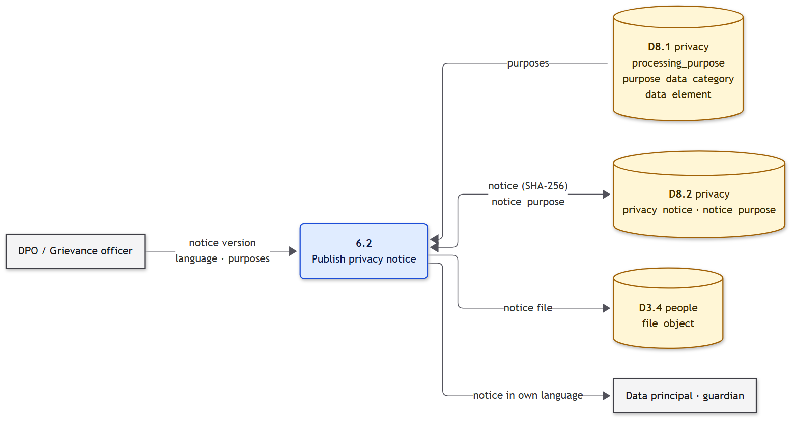

[svg](dfd/features/dfd-3-6-2.svg) · [mmd](dfd/features/dfd-3-6-2.mmd)

| Flow | With | What moves |
|---|---|---|
| ← receives | DPO / Grievance officer | notice version · language · purposes |
| ← reads | **D8.1** | purposes |
| reads & writes | **D8.2** | notice (SHA-256) · notice_purpose |
| writes → | **D3.4** | notice file |
| sends → | Data principal · guardian | notice in own language |

**Tables touched:**

- **D8.1** `privacy`: [`processing_purpose`](table-catalog.md#t-privacy-processing-purpose) · [`purpose_data_category`](table-catalog.md#t-privacy-purpose-data-category) · [`data_element`](table-catalog.md#t-privacy-data-element)
- **D8.2** `privacy`: [`privacy_notice`](table-catalog.md#t-privacy-privacy-notice) · [`notice_purpose`](table-catalog.md#t-privacy-notice-purpose)
- **D3.4** `people`: [`file_object`](table-catalog.md#t-people-file-object)

#### 6.3 · Record & withdraw consent

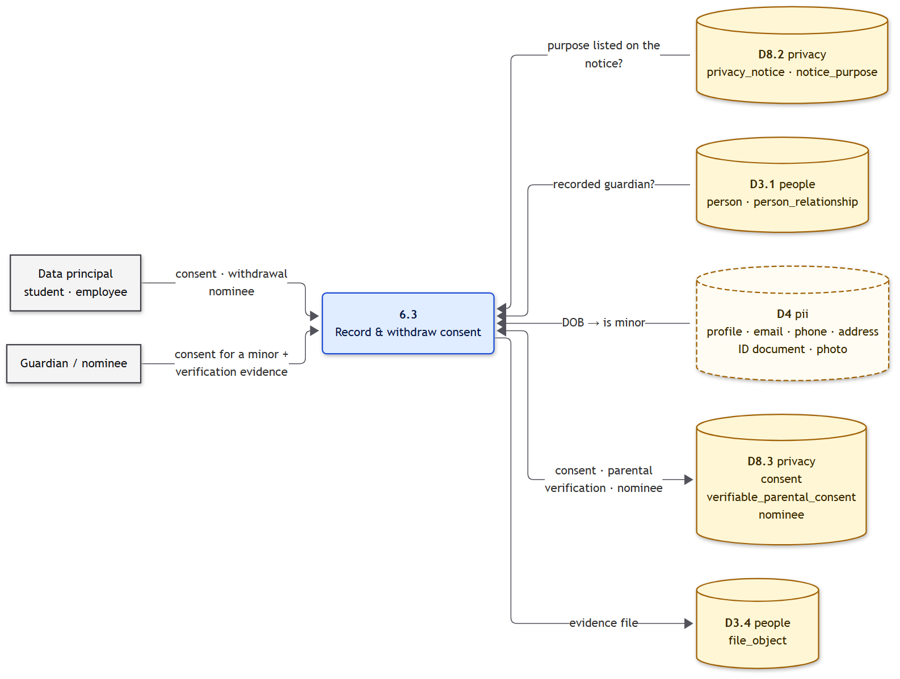

[svg](dfd/features/dfd-3-6-3.svg) · [mmd](dfd/features/dfd-3-6-3.mmd)

| Flow | With | What moves |
|---|---|---|
| ← receives | Data principal — student · employee | consent · withdrawal · nominee |
| ← receives | Guardian / nominee | consent for a minor + verification evidence |
| ← reads | **D8.2** | purpose listed on the notice? |
| ← reads | **D3.1** | recorded guardian? |
| ← reads | **D4** | DOB → is minor |
| reads & writes | **D8.3** | consent · parental verification · nominee |
| writes → | **D3.4** | evidence file |

**Tables touched:**

- **D8.2** `privacy`: [`privacy_notice`](table-catalog.md#t-privacy-privacy-notice) · [`notice_purpose`](table-catalog.md#t-privacy-notice-purpose)
- **D3.1** `people`: [`person`](table-catalog.md#t-people-person) · [`person_relationship`](table-catalog.md#t-people-person-relationship)
- **D4** `pii` (whole schema, drawn on its own process): profile · email · phone · address · ID document · photo
- **D8.3** `privacy`: [`consent`](table-catalog.md#t-privacy-consent) · [`verifiable_parental_consent`](table-catalog.md#t-privacy-verifiable-parental-consent) · [`nominee`](table-catalog.md#t-privacy-nominee)
- **D3.4** `people`: [`file_object`](table-catalog.md#t-people-file-object)

#### 6.4 · Handle rights request

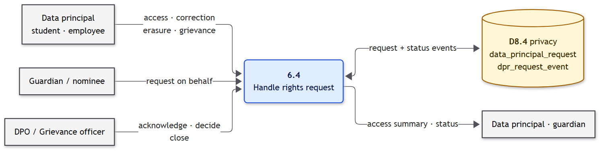

[svg](dfd/features/dfd-3-6-4.svg) · [mmd](dfd/features/dfd-3-6-4.mmd)

| Flow | With | What moves |
|---|---|---|
| ← receives | Data principal — student · employee | access · correction · erasure · grievance |
| ← receives | Guardian / nominee | request on behalf |
| ← receives | DPO / Grievance officer | acknowledge · decide · close |
| reads & writes | **D8.4** | request + status events |
| sends → | Data principal · guardian | access summary · status |

**Tables touched:**

- **D8.4** `privacy`: [`data_principal_request`](table-catalog.md#t-privacy-data-principal-request) · [`dpr_request_event`](table-catalog.md#t-privacy-dpr-request-event)

#### 6.5 · Erase / anonymise

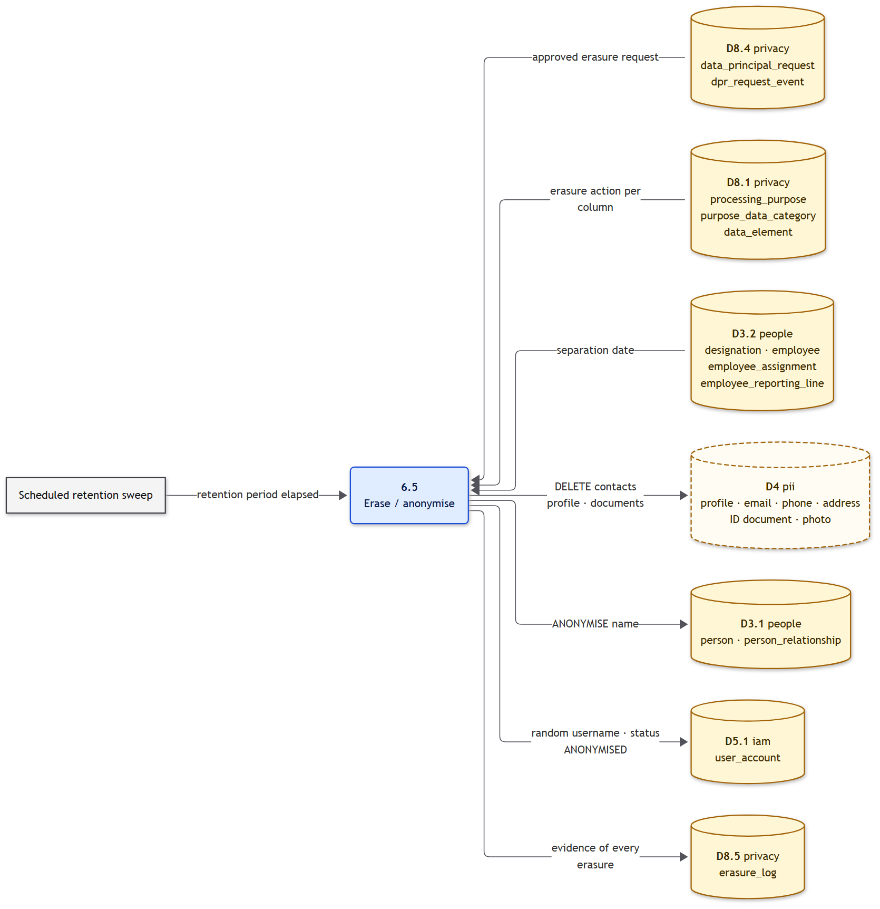

[svg](dfd/features/dfd-3-6-5.svg) · [mmd](dfd/features/dfd-3-6-5.mmd)

| Flow | With | What moves |
|---|---|---|
| ← receives | Scheduled retention sweep | retention period elapsed |
| ← reads | **D8.4** | approved erasure request |
| ← reads | **D8.1** | erasure action per column |
| ← reads | **D3.2** | separation date |
| writes → | **D4** | DELETE contacts · profile · documents |
| writes → | **D3.1** | ANONYMISE name |
| writes → | **D5.1** | random username · status ANONYMISED |
| writes → | **D8.5** | evidence of every erasure |

**Tables touched:**

- **D8.4** `privacy`: [`data_principal_request`](table-catalog.md#t-privacy-data-principal-request) · [`dpr_request_event`](table-catalog.md#t-privacy-dpr-request-event)
- **D8.1** `privacy`: [`processing_purpose`](table-catalog.md#t-privacy-processing-purpose) · [`purpose_data_category`](table-catalog.md#t-privacy-purpose-data-category) · [`data_element`](table-catalog.md#t-privacy-data-element)
- **D3.2** `people`: [`designation`](table-catalog.md#t-people-designation) · [`employee`](table-catalog.md#t-people-employee) · [`employee_assignment`](table-catalog.md#t-people-employee-assignment) · [`employee_reporting_line`](table-catalog.md#t-people-employee-reporting-line)
- **D4** `pii` (whole schema, drawn on its own process): profile · email · phone · address · ID document · photo
- **D3.1** `people`: [`person`](table-catalog.md#t-people-person) · [`person_relationship`](table-catalog.md#t-people-person-relationship)
- **D5.1** `iam`: [`user_account`](table-catalog.md#t-iam-user-account)
- **D8.5** `privacy`: [`erasure_log`](table-catalog.md#t-privacy-erasure-log)

#### 6.6 · Manage breach

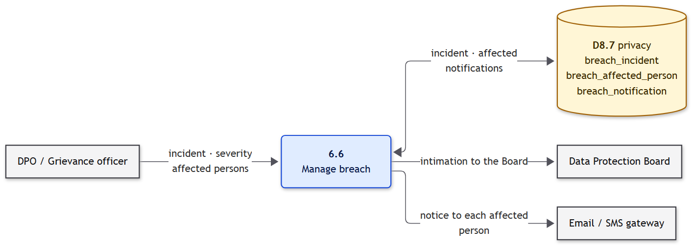

[svg](dfd/features/dfd-3-6-6.svg) · [mmd](dfd/features/dfd-3-6-6.mmd)

| Flow | With | What moves |
|---|---|---|
| ← receives | DPO / Grievance officer | incident · severity · affected persons |
| reads & writes | **D8.7** | incident · affected · notifications |
| sends → | Data Protection Board | intimation to the Board |
| sends → | Email / SMS gateway | notice to each affected person |

**Tables touched:**

- **D8.7** `privacy`: [`breach_incident`](table-catalog.md#t-privacy-breach-incident) · [`breach_affected_person`](table-catalog.md#t-privacy-breach-affected-person) · [`breach_notification`](table-catalog.md#t-privacy-breach-notification)

#### 6.7 · Log access to personal data

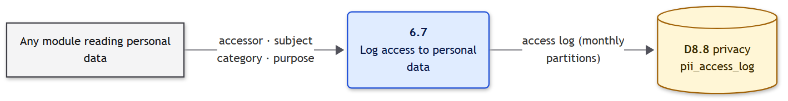

[svg](dfd/features/dfd-3-6-7.svg) · [mmd](dfd/features/dfd-3-6-7.mmd)

| Flow | With | What moves |
|---|---|---|
| ← receives | Any module reading personal data | accessor · subject · category · purpose |
| writes → | **D8.8** | access log (monthly partitions) |

**Tables touched:**

- **D8.8** `privacy`: [`pii_access_log`](table-catalog.md#t-privacy-pii-access-log)

#### 6.8 · Monitor compliance

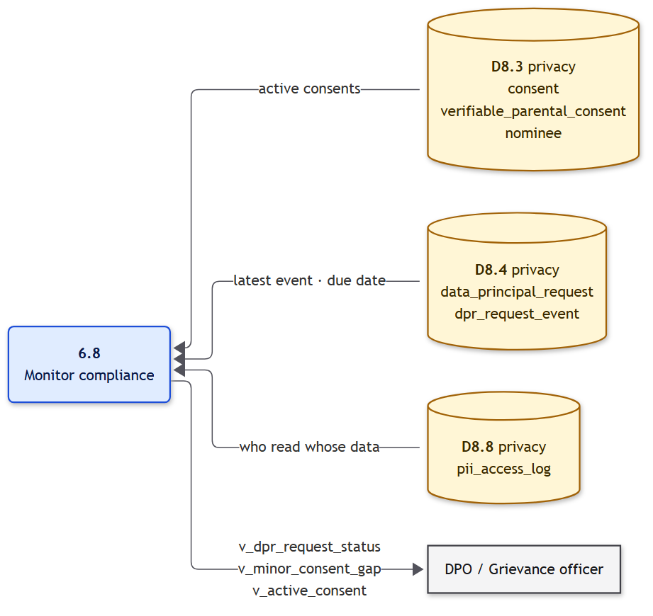

[svg](dfd/features/dfd-3-6-8.svg) · [mmd](dfd/features/dfd-3-6-8.mmd)

| Flow | With | What moves |
|---|---|---|
| ← reads | **D8.3** | active consents |
| ← reads | **D8.4** | latest event · due date |
| ← reads | **D8.8** | who read whose data |
| sends → | DPO / Grievance officer | v_dpr_request_status · v_minor_consent_gap · v_active_consent |

**Tables touched:**

- **D8.3** `privacy`: [`consent`](table-catalog.md#t-privacy-consent) · [`verifiable_parental_consent`](table-catalog.md#t-privacy-verifiable-parental-consent) · [`nominee`](table-catalog.md#t-privacy-nominee)
- **D8.4** `privacy`: [`data_principal_request`](table-catalog.md#t-privacy-data-principal-request) · [`dpr_request_event`](table-catalog.md#t-privacy-dpr-request-event)
- **D8.8** `privacy`: [`pii_access_log`](table-catalog.md#t-privacy-pii-access-log)

### process 7: audit trail

Whole process: [png](dfd/dfd-2-07-audit.png) · [svg](dfd/dfd-2-07-audit.svg)

#### 7.1 · Attach capture trigger

*audit.enable_for_schemas()*

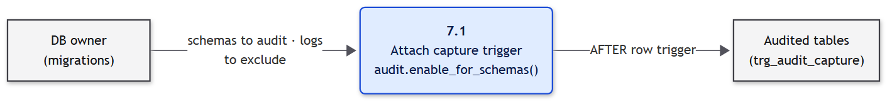

[svg](dfd/features/dfd-3-7-1.svg) · [mmd](dfd/features/dfd-3-7-1.mmd)

| Flow | With | What moves |
|---|---|---|
| ← receives | DB owner — (migrations) | schemas to audit · logs to exclude |
| sends → | Audited tables — (trg_audit_capture) | AFTER row trigger |

#### 7.2 · Capture row change

*audit.capture()*

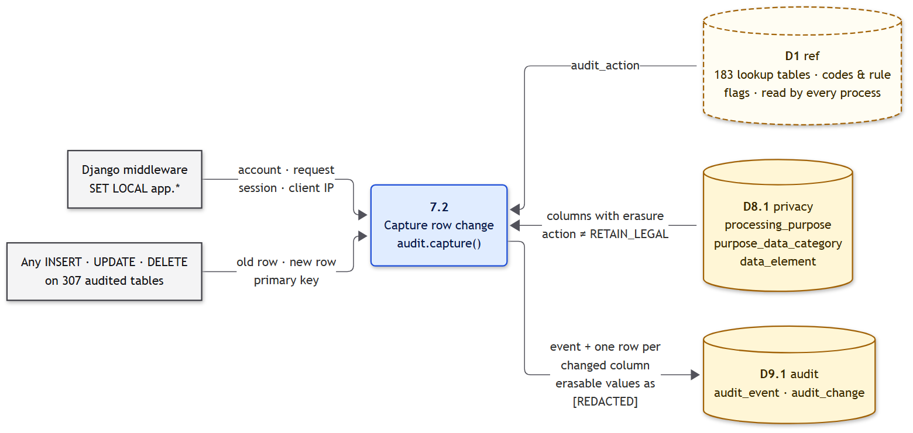

[svg](dfd/features/dfd-3-7-2.svg) · [mmd](dfd/features/dfd-3-7-2.mmd)

| Flow | With | What moves |
|---|---|---|
| ← receives | Django middleware — SET LOCAL app.* | account · request · session · client IP |
| ← receives | Any INSERT · UPDATE · DELETE — on 307 audited tables | old row · new row · primary key |
| ← reads | **D1** | audit_action |
| ← reads | **D8.1** | columns with erasure action ≠ RETAIN_LEGAL |
| writes → | **D9.1** | event + one row per changed column · erasable values as [REDACTED] |

**Tables touched:**

- **D1** `ref` (whole schema, drawn on its own process): 183 lookup tables · codes & rule flags · read by every process
- **D8.1** `privacy`: [`processing_purpose`](table-catalog.md#t-privacy-processing-purpose) · [`purpose_data_category`](table-catalog.md#t-privacy-purpose-data-category) · [`data_element`](table-catalog.md#t-privacy-data-element)
- **D9.1** `audit`: [`audit_event`](table-catalog.md#t-audit-audit-event) · [`audit_change`](table-catalog.md#t-audit-audit-change)

#### 7.3 · Guard append-only

*audit.block_mutation()*

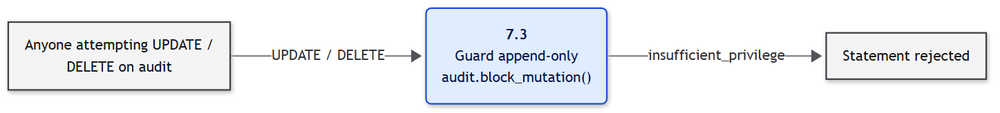

[svg](dfd/features/dfd-3-7-3.svg) · [mmd](dfd/features/dfd-3-7-3.mmd)

| Flow | With | What moves |
|---|---|---|
| ← receives | Anyone attempting UPDATE / DELETE on audit | UPDATE / DELETE |
| sends → | Statement rejected | insufficient_privilege |

#### 7.4 · Rotate monthly partitions

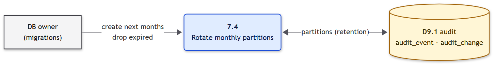

[svg](dfd/features/dfd-3-7-4.svg) · [mmd](dfd/features/dfd-3-7-4.mmd)

| Flow | With | What moves |
|---|---|---|
| ← receives | DB owner — (migrations) | create next months · drop expired |
| reads & writes | **D9.1** | partitions (retention) |

**Tables touched:**

- **D9.1** `audit`: [`audit_event`](table-catalog.md#t-audit-audit-event) · [`audit_change`](table-catalog.md#t-audit-audit-change)

#### 7.5 · Review the trail

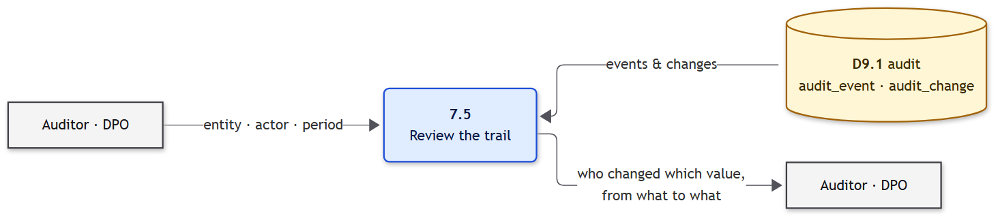

[svg](dfd/features/dfd-3-7-5.svg) · [mmd](dfd/features/dfd-3-7-5.mmd)

| Flow | With | What moves |
|---|---|---|
| ← receives | Auditor · DPO | entity · actor · period |
| ← reads | **D9.1** | events & changes |
| sends → | Auditor · DPO | who changed which value, from what to what |

**Tables touched:**

- **D9.1** `audit`: [`audit_event`](table-catalog.md#t-audit-audit-event) · [`audit_change`](table-catalog.md#t-audit-audit-change)

---

## Academic — programmes, curriculum, student lifecycle, NEP credits, teaching

| Feature | What it covers | Level 2 parent |
|---|---|---|
| [8.1 · Define programme, specializations & outcomes](#f-8-1) | — | [process 8: programmes, calendar and curriculum (SOE)](dfd/dfd-2-08-curriculum.png) |
| [8.2 · Record approvals & accreditation](#f-8-2) | — | [process 8: programmes, calendar and curriculum (SOE)](dfd/dfd-2-08-curriculum.png) |
| [8.3 · Maintain academic calendar](#f-8-3) | — | [process 8: programmes, calendar and curriculum (SOE)](dfd/dfd-2-08-curriculum.png) |
| [8.4 · Open batch (intake)](#f-8-4) | — | [process 8: programmes, calendar and curriculum (SOE)](dfd/dfd-2-08-curriculum.png) |
| [8.5 · Record body meetings & resolutions](#f-8-5) | — | [process 8: programmes, calendar and curriculum (SOE)](dfd/dfd-2-08-curriculum.png) |
| [8.6 · Maintain course catalogue & syllabus](#f-8-6) | — | [process 8: programmes, calendar and curriculum (SOE)](dfd/dfd-2-08-curriculum.png) |
| [8.7 · Define grading & schemes of examination](#f-8-7) | — | [process 8: programmes, calendar and curriculum (SOE)](dfd/dfd-2-08-curriculum.png) |
| [8.8 · Build curriculum version](#f-8-8) | — | [process 8: programmes, calendar and curriculum (SOE)](dfd/dfd-2-08-curriculum.png) |
| [8.9 · Submit SOE & enforce the freeze](#f-8-9) | — | [process 8: programmes, calendar and curriculum (SOE)](dfd/dfd-2-08-curriculum.png) |
| [9.1 · Enrol student in a batch](#f-9-1) | — | [process 9 (A): enrolment and student lifecycle](dfd/dfd-2-09a-lifecycle.png) |
| [9.2 · Record specialization & pathway](#f-9-2) | — | [process 9 (A): enrolment and student lifecycle](dfd/dfd-2-09a-lifecycle.png) |
| [9.3 · Register for the term](#f-9-3) | — | [process 9 (A): enrolment and student lifecycle](dfd/dfd-2-09a-lifecycle.png) |
| [9.4 · Decide academic standing](#f-9-4) | — | [process 9 (A): enrolment and student lifecycle](dfd/dfd-2-09a-lifecycle.png) |
| [9.5 · Approve break in study](#f-9-5) | — | [process 9 (A): enrolment and student lifecycle](dfd/dfd-2-09a-lifecycle.png) |
| [9.6 · Hear disciplinary case](#f-9-6) | — | [process 9 (A): enrolment and student lifecycle](dfd/dfd-2-09a-lifecycle.png) |
| [9.7 · Transfer programme / re-enter](#f-9-7) | — | [process 9 (A): enrolment and student lifecycle](dfd/dfd-2-09a-lifecycle.png) |
| [9.8 · Approve credit overload](#f-9-8) | — | [process 9 (A): enrolment and student lifecycle](dfd/dfd-2-09a-lifecycle.png) |
| [9.9 · Derive term, backlog & standing](#f-9-9) | — | [process 9 (A): enrolment and student lifecycle](dfd/dfd-2-09a-lifecycle.png) |
| [9.10 · Approve course equivalence](#f-9-10) | — | [process 9 (B): NEP 2020 credits, equivalence, minors and honours](dfd/dfd-2-09b-nep-credits.png) |
| [9.11 · Map external courses](#f-9-11) | — | [process 9 (B): NEP 2020 credits, equivalence, minors and honours](dfd/dfd-2-09b-nep-credits.png) |
| [9.12 · Transfer credits in](#f-9-12) | — | [process 9 (B): NEP 2020 credits, equivalence, minors and honours](dfd/dfd-2-09b-nep-credits.png) |
| [9.13 · Define minor / honours tracks](#f-9-13) | — | [process 9 (B): NEP 2020 credits, equivalence, minors and honours](dfd/dfd-2-09b-nep-credits.png) |
| [9.14 · Join a track](#f-9-14) | — | [process 9 (B): NEP 2020 credits, equivalence, minors and honours](dfd/dfd-2-09b-nep-credits.png) |
| [9.15 · Keep the credit ledger & CGPA](#f-9-15) | — | [process 9 (B): NEP 2020 credits, equivalence, minors and honours](dfd/dfd-2-09b-nep-credits.png) |
| [9.16 · Derive completion & eligibility](#f-9-16) | — | [process 9 (B): NEP 2020 credits, equivalence, minors and honours](dfd/dfd-2-09b-nep-credits.png) |
| [10.1 · Create offerings, sections & seat quotas](#f-10-1) | — | [process 10 (A): term set-up, registration and timetable](dfd/dfd-2-10a-term-setup.png) |
| [10.2 · Allocate sections](#f-10-2) | allocate_sections() | [process 10 (A): term set-up, registration and timetable](dfd/dfd-2-10a-term-setup.png) |
| [10.3 · Register core courses](#f-10-3) | register_core_courses() | [process 10 (A): term set-up, registration and timetable](dfd/dfd-2-10a-term-setup.png) |
| [10.4 · Collect elective preferences](#f-10-4) | — | [process 10 (A): term set-up, registration and timetable](dfd/dfd-2-10a-term-setup.png) |
| [10.5 · Allot electives](#f-10-5) | allot_electives() | [process 10 (A): term set-up, registration and timetable](dfd/dfd-2-10a-term-setup.png) |
| [10.6 · Register by choice / drop](#f-10-6) | — | [process 10 (A): term set-up, registration and timetable](dfd/dfd-2-10a-term-setup.png) |
| [10.7 · Form class groups](#f-10-7) | — | [process 10 (A): term set-up, registration and timetable](dfd/dfd-2-10a-term-setup.png) |
| [10.8 · Assign faculty](#f-10-8) | — | [process 10 (A): term set-up, registration and timetable](dfd/dfd-2-10a-term-setup.png) |
| [10.9 · Build timetable](#f-10-9) | — | [process 10 (A): term set-up, registration and timetable](dfd/dfd-2-10a-term-setup.png) |
| [10.10 · File lesson plan](#f-10-10) | — | [process 10 (B): classes, attendance, feedback and mentoring](dfd/dfd-2-10b-teaching.png) |
| [10.11 · Generate & record class sessions](#f-10-11) | — | [process 10 (B): classes, attendance, feedback and mentoring](dfd/dfd-2-10b-teaching.png) |
| [10.12 · Mark attendance](#f-10-12) | — | [process 10 (B): classes, attendance, feedback and mentoring](dfd/dfd-2-10b-teaching.png) |
| [10.13 · Apply for duty / medical leave](#f-10-13) | — | [process 10 (B): classes, attendance, feedback and mentoring](dfd/dfd-2-10b-teaching.png) |
| [10.14 · Derive attendance % & coverage](#f-10-14) | — | [process 10 (B): classes, attendance, feedback and mentoring](dfd/dfd-2-10b-teaching.png) |
| [10.15 · Run feedback cycle](#f-10-15) | — | [process 10 (B): classes, attendance, feedback and mentoring](dfd/dfd-2-10b-teaching.png) |
| [10.16 · Record mentoring meetings](#f-10-16) | — | [process 10 (B): classes, attendance, feedback and mentoring](dfd/dfd-2-10b-teaching.png) |
| [10.17 · Supervise projects & internships](#f-10-17) | — | [process 10 (B): classes, attendance, feedback and mentoring](dfd/dfd-2-10b-teaching.png) |

### process 8: programmes, calendar and curriculum (SOE)

Whole process: [png](dfd/dfd-2-08-curriculum.png) · [svg](dfd/dfd-2-08-curriculum.svg)

#### 8.1 · Define programme, specializations & outcomes

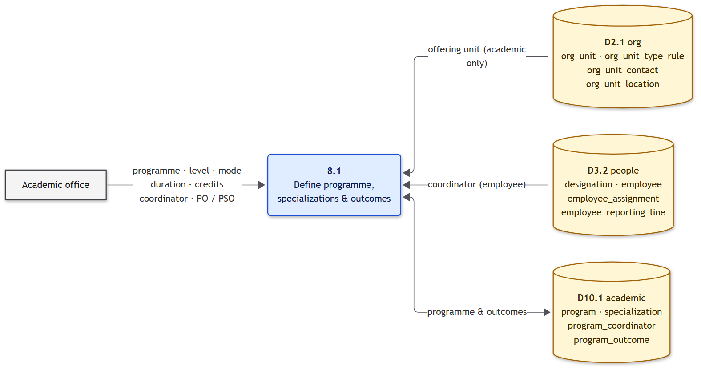

[svg](dfd/features/dfd-3-8-1.svg) · [mmd](dfd/features/dfd-3-8-1.mmd)

| Flow | With | What moves |
|---|---|---|
| ← receives | Academic office | programme · level · mode · duration · credits · coordinator · PO / PSO |
| ← reads | **D2.1** | offering unit (academic only) |
| ← reads | **D3.2** | coordinator (employee) |
| reads & writes | **D10.1** | programme & outcomes |

**Tables touched:**

- **D2.1** `org`: [`org_unit`](table-catalog.md#t-org-org-unit) · [`org_unit_type_rule`](table-catalog.md#t-org-org-unit-type-rule) · [`org_unit_contact`](table-catalog.md#t-org-org-unit-contact) · [`org_unit_location`](table-catalog.md#t-org-org-unit-location)
- **D3.2** `people`: [`designation`](table-catalog.md#t-people-designation) · [`employee`](table-catalog.md#t-people-employee) · [`employee_assignment`](table-catalog.md#t-people-employee-assignment) · [`employee_reporting_line`](table-catalog.md#t-people-employee-reporting-line)
- **D10.1** `academic`: [`program`](table-catalog.md#t-academic-program) · [`specialization`](table-catalog.md#t-academic-specialization) · [`program_coordinator`](table-catalog.md#t-academic-program-coordinator) · [`program_outcome`](table-catalog.md#t-academic-program-outcome)

#### 8.2 · Record approvals & accreditation

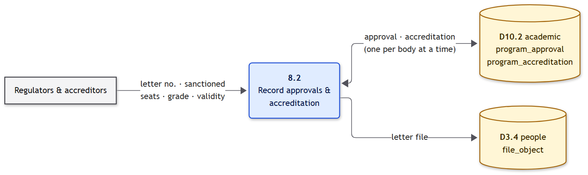

[svg](dfd/features/dfd-3-8-2.svg) · [mmd](dfd/features/dfd-3-8-2.mmd)

| Flow | With | What moves |
|---|---|---|
| ← receives | Regulators & accreditors | letter no. · sanctioned seats · grade · validity |
| reads & writes | **D10.2** | approval · accreditation (one per body at a time) |
| writes → | **D3.4** | letter file |

**Tables touched:**

- **D10.2** `academic`: [`program_approval`](table-catalog.md#t-academic-program-approval) · [`program_accreditation`](table-catalog.md#t-academic-program-accreditation)
- **D3.4** `people`: [`file_object`](table-catalog.md#t-people-file-object)

#### 8.3 · Maintain academic calendar

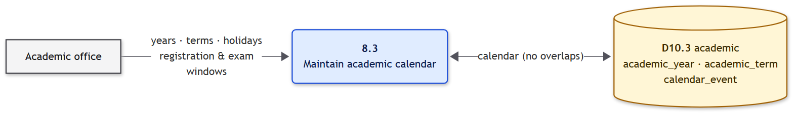

[svg](dfd/features/dfd-3-8-3.svg) · [mmd](dfd/features/dfd-3-8-3.mmd)

| Flow | With | What moves |
|---|---|---|
| ← receives | Academic office | years · terms · holidays · registration & exam windows |
| reads & writes | **D10.3** | calendar (no overlaps) |

**Tables touched:**

- **D10.3** `academic`: [`academic_year`](table-catalog.md#t-academic-academic-year) · [`academic_term`](table-catalog.md#t-academic-academic-term) · [`calendar_event`](table-catalog.md#t-academic-calendar-event)

#### 8.4 · Open batch (intake)

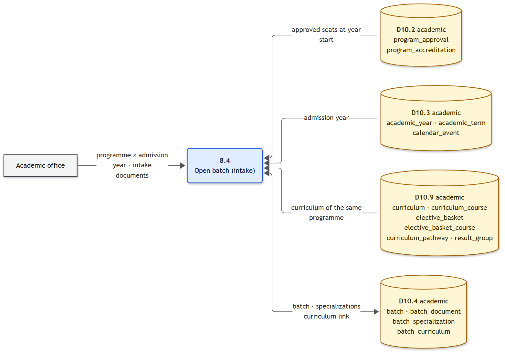

[svg](dfd/features/dfd-3-8-4.svg) · [mmd](dfd/features/dfd-3-8-4.mmd)

| Flow | With | What moves |
|---|---|---|
| ← receives | Academic office | programme × admission year · intake · documents |
| ← reads | **D10.2** | approved seats at year start |
| ← reads | **D10.3** | admission year |
| ← reads | **D10.9** | curriculum of the same programme |
| reads & writes | **D10.4** | batch · specializations · curriculum link |

**Tables touched:**

- **D10.2** `academic`: [`program_approval`](table-catalog.md#t-academic-program-approval) · [`program_accreditation`](table-catalog.md#t-academic-program-accreditation)
- **D10.3** `academic`: [`academic_year`](table-catalog.md#t-academic-academic-year) · [`academic_term`](table-catalog.md#t-academic-academic-term) · [`calendar_event`](table-catalog.md#t-academic-calendar-event)
- **D10.9** `academic`: [`curriculum`](table-catalog.md#t-academic-curriculum) · [`curriculum_course`](table-catalog.md#t-academic-curriculum-course) · [`elective_basket`](table-catalog.md#t-academic-elective-basket) · [`elective_basket_course`](table-catalog.md#t-academic-elective-basket-course) · [`curriculum_pathway`](table-catalog.md#t-academic-curriculum-pathway) · [`result_group`](table-catalog.md#t-academic-result-group)
- **D10.4** `academic`: [`batch`](table-catalog.md#t-academic-batch) · [`batch_document`](table-catalog.md#t-academic-batch-document) · [`batch_specialization`](table-catalog.md#t-academic-batch-specialization) · [`batch_curriculum`](table-catalog.md#t-academic-batch-curriculum)

#### 8.5 · Record body meetings & resolutions

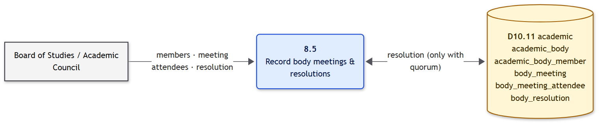

[svg](dfd/features/dfd-3-8-5.svg) · [mmd](dfd/features/dfd-3-8-5.mmd)

| Flow | With | What moves |
|---|---|---|
| ← receives | Board of Studies / Academic Council | members · meeting · attendees · resolution |
| reads & writes | **D10.11** | resolution (only with quorum) |

**Tables touched:**

- **D10.11** `academic`: [`academic_body`](table-catalog.md#t-academic-academic-body) · [`academic_body_member`](table-catalog.md#t-academic-academic-body-member) · [`body_meeting`](table-catalog.md#t-academic-body-meeting) · [`body_meeting_attendee`](table-catalog.md#t-academic-body-meeting-attendee) · [`body_resolution`](table-catalog.md#t-academic-body-resolution)

#### 8.6 · Maintain course catalogue & syllabus

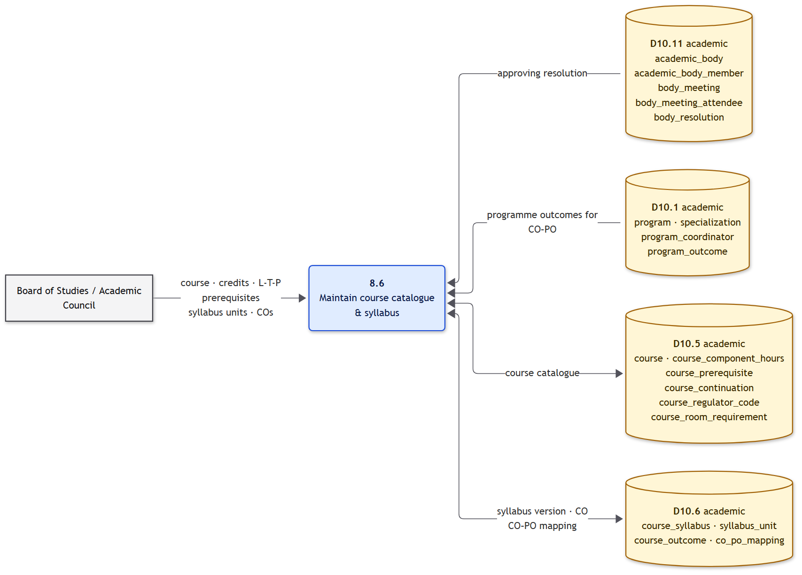

[svg](dfd/features/dfd-3-8-6.svg) · [mmd](dfd/features/dfd-3-8-6.mmd)

| Flow | With | What moves |
|---|---|---|
| ← receives | Board of Studies / Academic Council | course · credits · L-T-P · prerequisites · syllabus units · COs |
| ← reads | **D10.11** | approving resolution |
| ← reads | **D10.1** | programme outcomes for CO–PO |
| reads & writes | **D10.5** | course catalogue |
| reads & writes | **D10.6** | syllabus version · CO · CO–PO mapping |

**Tables touched:**

- **D10.11** `academic`: [`academic_body`](table-catalog.md#t-academic-academic-body) · [`academic_body_member`](table-catalog.md#t-academic-academic-body-member) · [`body_meeting`](table-catalog.md#t-academic-body-meeting) · [`body_meeting_attendee`](table-catalog.md#t-academic-body-meeting-attendee) · [`body_resolution`](table-catalog.md#t-academic-body-resolution)
- **D10.1** `academic`: [`program`](table-catalog.md#t-academic-program) · [`specialization`](table-catalog.md#t-academic-specialization) · [`program_coordinator`](table-catalog.md#t-academic-program-coordinator) · [`program_outcome`](table-catalog.md#t-academic-program-outcome)
- **D10.5** `academic`: [`course`](table-catalog.md#t-academic-course) · [`course_component_hours`](table-catalog.md#t-academic-course-component-hours) · [`course_prerequisite`](table-catalog.md#t-academic-course-prerequisite) · [`course_continuation`](table-catalog.md#t-academic-course-continuation) · [`course_regulator_code`](table-catalog.md#t-academic-course-regulator-code) · [`course_room_requirement`](table-catalog.md#t-academic-course-room-requirement)
- **D10.6** `academic`: [`course_syllabus`](table-catalog.md#t-academic-course-syllabus) · [`syllabus_unit`](table-catalog.md#t-academic-syllabus-unit) · [`course_outcome`](table-catalog.md#t-academic-course-outcome) · [`co_po_mapping`](table-catalog.md#t-academic-co-po-mapping)

#### 8.7 · Define grading & schemes of examination

[svg](dfd/features/dfd-3-8-7.svg) · [mmd](dfd/features/dfd-3-8-7.mmd)

| Flow | With | What moves |
|---|---|---|
| ← receives | Academic office | grade bands · divisions · components · weights · pass rules |
| reads & writes | **D10.7** | grade scale (new policy = new scale) |
| reads & writes | **D10.8** | scheme (weights total 100 %) |

**Tables touched:**

- **D10.7** `academic`: [`grade_scale`](table-catalog.md#t-academic-grade-scale) · [`grade_band`](table-catalog.md#t-academic-grade-band) · [`division_band`](table-catalog.md#t-academic-division-band) · [`relative_grade_cutoff`](table-catalog.md#t-academic-relative-grade-cutoff)
- **D10.8** `academic`: [`evaluation_scheme`](table-catalog.md#t-academic-evaluation-scheme) · [`evaluation_component`](table-catalog.md#t-academic-evaluation-component) · [`evaluation_component_group`](table-catalog.md#t-academic-evaluation-component-group) · [`evaluation_part_rule`](table-catalog.md#t-academic-evaluation-part-rule) · [`evaluation_component_outcome`](table-catalog.md#t-academic-evaluation-component-outcome) · [`attainment_policy`](table-catalog.md#t-academic-attainment-policy)

#### 8.8 · Build curriculum version

[svg](dfd/features/dfd-3-8-8.svg) · [mmd](dfd/features/dfd-3-8-8.mmd)

| Flow | With | What moves |
|---|---|---|
| ← receives | Programme coordinator | courses per term · baskets · pathways · exits · promotion & load rules |
| ← reads | **D10.5** | courses |
| ← reads | **D10.8** | schemes |
| ← reads | **D10.7** | grade scale |
| reads & writes | **D10.9** | curriculum items |
| reads & writes | **D10.10** | award · promotion · attempt · credit-load rules |

**Tables touched:**

- **D10.5** `academic`: [`course`](table-catalog.md#t-academic-course) · [`course_component_hours`](table-catalog.md#t-academic-course-component-hours) · [`course_prerequisite`](table-catalog.md#t-academic-course-prerequisite) · [`course_continuation`](table-catalog.md#t-academic-course-continuation) · [`course_regulator_code`](table-catalog.md#t-academic-course-regulator-code) · [`course_room_requirement`](table-catalog.md#t-academic-course-room-requirement)
- **D10.8** `academic`: [`evaluation_scheme`](table-catalog.md#t-academic-evaluation-scheme) · [`evaluation_component`](table-catalog.md#t-academic-evaluation-component) · [`evaluation_component_group`](table-catalog.md#t-academic-evaluation-component-group) · [`evaluation_part_rule`](table-catalog.md#t-academic-evaluation-part-rule) · [`evaluation_component_outcome`](table-catalog.md#t-academic-evaluation-component-outcome) · [`attainment_policy`](table-catalog.md#t-academic-attainment-policy)
- **D10.7** `academic`: [`grade_scale`](table-catalog.md#t-academic-grade-scale) · [`grade_band`](table-catalog.md#t-academic-grade-band) · [`division_band`](table-catalog.md#t-academic-division-band) · [`relative_grade_cutoff`](table-catalog.md#t-academic-relative-grade-cutoff)
- **D10.9** `academic`: [`curriculum`](table-catalog.md#t-academic-curriculum) · [`curriculum_course`](table-catalog.md#t-academic-curriculum-course) · [`elective_basket`](table-catalog.md#t-academic-elective-basket) · [`elective_basket_course`](table-catalog.md#t-academic-elective-basket-course) · [`curriculum_pathway`](table-catalog.md#t-academic-curriculum-pathway) · [`result_group`](table-catalog.md#t-academic-result-group)
- **D10.10** `academic`: [`award_rule`](table-catalog.md#t-academic-award-rule) · [`award_rule_course`](table-catalog.md#t-academic-award-rule-course) · [`promotion_rule`](table-catalog.md#t-academic-promotion-rule) · [`attempt_allowance`](table-catalog.md#t-academic-attempt-allowance) · [`credit_load_rule`](table-catalog.md#t-academic-credit-load-rule)

#### 8.9 · Submit SOE & enforce the freeze

[svg](dfd/features/dfd-3-8-9.svg) · [mmd](dfd/features/dfd-3-8-9.mmd)

| Flow | With | What moves |
|---|---|---|
| ← receives | Programme coordinator | submit_curriculum() |
| ← reads | **D7** | latest round state |
| writes → | **D7** | new CURRICULUM round |
| writes → | **D10.12** | round ↔ curriculum |
| writes → | **D10.9** | frozen once APPROVED / SIGNED |
| sends → | Academic administration · reviewers | v_soe · v_soe_exit · v_soe_header · v_curriculum_status |

**Tables touched:**

- **D7** `wf` (whole schema, drawn on its own process): chains & levels · rounds · steps & assignees · actions · delegations · notices
- **D10.12** `academic`: [`curriculum_approval`](table-catalog.md#t-academic-curriculum-approval)
- **D10.9** `academic`: [`curriculum`](table-catalog.md#t-academic-curriculum) · [`curriculum_course`](table-catalog.md#t-academic-curriculum-course) · [`elective_basket`](table-catalog.md#t-academic-elective-basket) · [`elective_basket_course`](table-catalog.md#t-academic-elective-basket-course) · [`curriculum_pathway`](table-catalog.md#t-academic-curriculum-pathway) · [`result_group`](table-catalog.md#t-academic-result-group)

### process 9 (A): enrolment and student lifecycle

Whole process: [png](dfd/dfd-2-09a-lifecycle.png) · [svg](dfd/dfd-2-09a-lifecycle.svg)

#### 9.1 · Enrol student in a batch

[svg](dfd/features/dfd-3-9-1.svg) · [mmd](dfd/features/dfd-3-9-1.mmd)

| Flow | With | What moves |
|---|---|---|
| ← receives | Academic office | student · batch · entry term · period · end reason |
| ← reads | **D3.3** | student record |
| ← reads | **D10.4** | batch & programme duration |
| ← reads | **D1** | enrollment_end_reason |
| reads & writes | **D11.1** | enrollment (one active) |

**Tables touched:**

- **D3.3** `people`: [`student`](table-catalog.md#t-people-student) · [`student_mentor`](table-catalog.md#t-people-student-mentor)
- **D10.4** `academic`: [`batch`](table-catalog.md#t-academic-batch) · [`batch_document`](table-catalog.md#t-academic-batch-document) · [`batch_specialization`](table-catalog.md#t-academic-batch-specialization) · [`batch_curriculum`](table-catalog.md#t-academic-batch-curriculum)
- **D1** `ref` (whole schema, drawn on its own process): 183 lookup tables · codes & rule flags · read by every process
- **D11.1** `academic`: [`student_enrollment`](table-catalog.md#t-academic-student-enrollment) · [`student_specialization`](table-catalog.md#t-academic-student-specialization) · [`student_pathway`](table-catalog.md#t-academic-student-pathway)

#### 9.2 · Record specialization & pathway

[svg](dfd/features/dfd-3-9-2.svg) · [mmd](dfd/features/dfd-3-9-2.mmd)

| Flow | With | What moves |
|---|---|---|
| ← receives | Student | specialization · pathway choice |
| ← reads | **D10.4** | specializations offered to the batch |
| ← reads | **D10.9** | pathways of own curriculum |
| reads & writes | **D11.1** | student_specialization · student_pathway |

**Tables touched:**

- **D10.4** `academic`: [`batch`](table-catalog.md#t-academic-batch) · [`batch_document`](table-catalog.md#t-academic-batch-document) · [`batch_specialization`](table-catalog.md#t-academic-batch-specialization) · [`batch_curriculum`](table-catalog.md#t-academic-batch-curriculum)
- **D10.9** `academic`: [`curriculum`](table-catalog.md#t-academic-curriculum) · [`curriculum_course`](table-catalog.md#t-academic-curriculum-course) · [`elective_basket`](table-catalog.md#t-academic-elective-basket) · [`elective_basket_course`](table-catalog.md#t-academic-elective-basket-course) · [`curriculum_pathway`](table-catalog.md#t-academic-curriculum-pathway) · [`result_group`](table-catalog.md#t-academic-result-group)
- **D11.1** `academic`: [`student_enrollment`](table-catalog.md#t-academic-student-enrollment) · [`student_specialization`](table-catalog.md#t-academic-student-specialization) · [`student_pathway`](table-catalog.md#t-academic-student-pathway)

#### 9.3 · Register for the term

[svg](dfd/features/dfd-3-9-3.svg) · [mmd](dfd/features/dfd-3-9-3.mmd)

| Flow | With | What moves |
|---|---|---|
| ← receives | Student | self-service registration |
| ← receives | Academic office | office registration |
| ← reads | **D10.3** | term of the programme's calendar type |
| ← reads | **D11.1** | active enrollment · entry term |
| ← reads | **D11.3** | on a break when the term starts? |
| ← reads | **D10.9** | max duration (N + 2) |
| ← reads | **D11.4** | first enrollment of the lineage |
| reads & writes | **D11.2** | term no. due (never edited) |

**Tables touched:**

- **D10.3** `academic`: [`academic_year`](table-catalog.md#t-academic-academic-year) · [`academic_term`](table-catalog.md#t-academic-academic-term) · [`calendar_event`](table-catalog.md#t-academic-calendar-event)
- **D11.1** `academic`: [`student_enrollment`](table-catalog.md#t-academic-student-enrollment) · [`student_specialization`](table-catalog.md#t-academic-student-specialization) · [`student_pathway`](table-catalog.md#t-academic-student-pathway)
- **D11.3** `academic`: [`study_break`](table-catalog.md#t-academic-study-break) · [`disciplinary_case`](table-catalog.md#t-academic-disciplinary-case)
- **D10.9** `academic`: [`curriculum`](table-catalog.md#t-academic-curriculum) · [`curriculum_course`](table-catalog.md#t-academic-curriculum-course) · [`elective_basket`](table-catalog.md#t-academic-elective-basket) · [`elective_basket_course`](table-catalog.md#t-academic-elective-basket-course) · [`curriculum_pathway`](table-catalog.md#t-academic-curriculum-pathway) · [`result_group`](table-catalog.md#t-academic-result-group)
- **D11.4** `academic`: [`program_transfer`](table-catalog.md#t-academic-program-transfer) · [`enrollment_reentry`](table-catalog.md#t-academic-enrollment-reentry)
- **D11.2** `academic`: [`term_registration`](table-catalog.md#t-academic-term-registration)

#### 9.4 · Decide academic standing

[svg](dfd/features/dfd-3-9-4.svg) · [mmd](dfd/features/dfd-3-9-4.mmd)

| Flow | With | What moves |
|---|---|---|
| ← receives | Academic office | promoted · with backlog · detained |
| ← reads | **D13.10** | published results → backlog |
| ← reads | **D10.10** | promotion rule for the term |
| writes → | **D11.2** | standing · decided by · when |

**Tables touched:**

- **D13.10** `exam`: [`result_publication`](table-catalog.md#t-exam-result-publication) · [`course_result`](table-catalog.md#t-exam-course-result)
- **D10.10** `academic`: [`award_rule`](table-catalog.md#t-academic-award-rule) · [`award_rule_course`](table-catalog.md#t-academic-award-rule-course) · [`promotion_rule`](table-catalog.md#t-academic-promotion-rule) · [`attempt_allowance`](table-catalog.md#t-academic-attempt-allowance) · [`credit_load_rule`](table-catalog.md#t-academic-credit-load-rule)
- **D11.2** `academic`: [`term_registration`](table-catalog.md#t-academic-term-registration)

#### 9.5 · Approve break in study

[svg](dfd/features/dfd-3-9-5.svg) · [mmd](dfd/features/dfd-3-9-5.mmd)

| Flow | With | What moves |
|---|---|---|
| ← receives | Student | application · reason |
| ← receives | Academic office | approval · type · period |
| reads & writes | **D11.3** | study_break (no overlap) |

**Tables touched:**

- **D11.3** `academic`: [`study_break`](table-catalog.md#t-academic-study-break) · [`disciplinary_case`](table-catalog.md#t-academic-disciplinary-case)

#### 9.6 · Hear disciplinary case

[svg](dfd/features/dfd-3-9-6.svg) · [mmd](dfd/features/dfd-3-9-6.mmd)

| Flow | With | What moves |
|---|---|---|
| ← receives | Discipline officer / committee | report · decision · penalty |
| ← reads | **D10.11** | disciplinary committee |
| reads & writes | **D11.3** | case · suspension as a study break |

**Tables touched:**

- **D10.11** `academic`: [`academic_body`](table-catalog.md#t-academic-academic-body) · [`academic_body_member`](table-catalog.md#t-academic-academic-body-member) · [`body_meeting`](table-catalog.md#t-academic-body-meeting) · [`body_meeting_attendee`](table-catalog.md#t-academic-body-meeting-attendee) · [`body_resolution`](table-catalog.md#t-academic-body-resolution)
- **D11.3** `academic`: [`study_break`](table-catalog.md#t-academic-study-break) · [`disciplinary_case`](table-catalog.md#t-academic-disciplinary-case)

#### 9.7 · Transfer programme / re-enter

[svg](dfd/features/dfd-3-9-7.svg) · [mmd](dfd/features/dfd-3-9-7.mmd)

| Flow | With | What moves |
|---|---|---|
| ← receives | Academic office | close old · open new enrollment · approver |
| ← reads | **D11.8** | exit award · re-entry window |
| ← reads | **D10.11** | resolution |
| reads & writes | **D11.1** | close with reason · open successor |
| reads & writes | **D11.4** | transfer / re-entry link |

**Tables touched:**

- **D11.8** `academic`: [`student_award`](table-catalog.md#t-academic-student-award)
- **D10.11** `academic`: [`academic_body`](table-catalog.md#t-academic-academic-body) · [`academic_body_member`](table-catalog.md#t-academic-academic-body-member) · [`body_meeting`](table-catalog.md#t-academic-body-meeting) · [`body_meeting_attendee`](table-catalog.md#t-academic-body-meeting-attendee) · [`body_resolution`](table-catalog.md#t-academic-body-resolution)
- **D11.1** `academic`: [`student_enrollment`](table-catalog.md#t-academic-student-enrollment) · [`student_specialization`](table-catalog.md#t-academic-student-specialization) · [`student_pathway`](table-catalog.md#t-academic-student-pathway)
- **D11.4** `academic`: [`program_transfer`](table-catalog.md#t-academic-program-transfer) · [`enrollment_reentry`](table-catalog.md#t-academic-enrollment-reentry)

#### 9.8 · Approve credit overload

[svg](dfd/features/dfd-3-9-8.svg) · [mmd](dfd/features/dfd-3-9-8.mmd)

| Flow | With | What moves |
|---|---|---|
| ← receives | Academic office | student · term · max credits · reason |
| reads & writes | **D11.9** | overload approval |

**Tables touched:**

- **D11.9** `academic`: [`credit_overload_approval`](table-catalog.md#t-academic-credit-overload-approval)

#### 9.9 · Derive term, backlog & standing

[svg](dfd/features/dfd-3-9-9.svg) · [mmd](dfd/features/dfd-3-9-9.mmd)

| Flow | With | What moves |
|---|---|---|
| ← reads | **D11.2** | latest counted registration |
| ← reads | **D11.3** | breaks |
| ← reads | **D11.4** | lineage |
| ← reads | **D13.10** | latest results |
| sends → | Student | current term no. · is on break · must complete by |
| sends → | Academic office · HOD | v_backlog · v_promotion_eligibility · v_student_standing |

**Tables touched:**

- **D11.2** `academic`: [`term_registration`](table-catalog.md#t-academic-term-registration)
- **D11.3** `academic`: [`study_break`](table-catalog.md#t-academic-study-break) · [`disciplinary_case`](table-catalog.md#t-academic-disciplinary-case)
- **D11.4** `academic`: [`program_transfer`](table-catalog.md#t-academic-program-transfer) · [`enrollment_reentry`](table-catalog.md#t-academic-enrollment-reentry)
- **D13.10** `exam`: [`result_publication`](table-catalog.md#t-exam-result-publication) · [`course_result`](table-catalog.md#t-exam-course-result)

### process 9 (B): NEP 2020 credits, equivalence, minors and honours

Whole process: [png](dfd/dfd-2-09b-nep-credits.png) · [svg](dfd/dfd-2-09b-nep-credits.svg)

#### 9.10 · Approve course equivalence

[svg](dfd/features/dfd-3-9-10.svg) · [mmd](dfd/features/dfd-3-9-10.mmd)

| Flow | With | What moves |
|---|---|---|
| ← receives | Board of Studies | course B counts as course A · approver |
| ← reads | **D10.11** | resolution |
| ← reads | **D10.5** | both courses |
| reads & writes | **D11.5** | course_equivalence (directional) |

**Tables touched:**

- **D10.11** `academic`: [`academic_body`](table-catalog.md#t-academic-academic-body) · [`academic_body_member`](table-catalog.md#t-academic-academic-body-member) · [`body_meeting`](table-catalog.md#t-academic-body-meeting) · [`body_meeting_attendee`](table-catalog.md#t-academic-body-meeting-attendee) · [`body_resolution`](table-catalog.md#t-academic-body-resolution)
- **D10.5** `academic`: [`course`](table-catalog.md#t-academic-course) · [`course_component_hours`](table-catalog.md#t-academic-course-component-hours) · [`course_prerequisite`](table-catalog.md#t-academic-course-prerequisite) · [`course_continuation`](table-catalog.md#t-academic-course-continuation) · [`course_regulator_code`](table-catalog.md#t-academic-course-regulator-code) · [`course_room_requirement`](table-catalog.md#t-academic-course-room-requirement)
- **D11.5** `academic`: [`course_equivalence`](table-catalog.md#t-academic-course-equivalence) · [`external_provider`](table-catalog.md#t-academic-external-provider) · [`external_course`](table-catalog.md#t-academic-external-course) · [`external_course_mapping`](table-catalog.md#t-academic-external-course-mapping)

#### 9.11 · Map external courses

[svg](dfd/features/dfd-3-9-11.svg) · [mmd](dfd/features/dfd-3-9-11.mmd)

| Flow | With | What moves |
|---|---|---|
| ← receives | Board of Studies | provider · external course · credits · maps to course or category · period |
| reads & writes | **D11.5** | provider · course · mapping (one at a time) |

**Tables touched:**

- **D11.5** `academic`: [`course_equivalence`](table-catalog.md#t-academic-course-equivalence) · [`external_provider`](table-catalog.md#t-academic-external-provider) · [`external_course`](table-catalog.md#t-academic-external-course) · [`external_course_mapping`](table-catalog.md#t-academic-external-course-mapping)

#### 9.12 · Transfer credits in

[svg](dfd/features/dfd-3-9-12.svg) · [mmd](dfd/features/dfd-3-9-12.mmd)

| Flow | With | What moves |
|---|---|---|
| ← receives | Student | claim · completion date · grade point |
| ← receives | ABC · MOOC platform · other university | ABC transaction ref · certificate |
| ← receives | Academic office | accept / reject |
| ← reads | **D11.5** | mapping valid on completion date |
| ← reads | **D10.9** | course / category in curriculum · transfer cap |
| ← reads | **D4.4** | APAAR / ABC ID (encrypted) |
| writes → | **D3.4** | certificate file |
| reads & writes | **D11.6** | credit_transfer |

**Tables touched:**

- **D11.5** `academic`: [`course_equivalence`](table-catalog.md#t-academic-course-equivalence) · [`external_provider`](table-catalog.md#t-academic-external-provider) · [`external_course`](table-catalog.md#t-academic-external-course) · [`external_course_mapping`](table-catalog.md#t-academic-external-course-mapping)
- **D10.9** `academic`: [`curriculum`](table-catalog.md#t-academic-curriculum) · [`curriculum_course`](table-catalog.md#t-academic-curriculum-course) · [`elective_basket`](table-catalog.md#t-academic-elective-basket) · [`elective_basket_course`](table-catalog.md#t-academic-elective-basket-course) · [`curriculum_pathway`](table-catalog.md#t-academic-curriculum-pathway) · [`result_group`](table-catalog.md#t-academic-result-group)
- **D4.4** `pii`: [`person_identity_document`](table-catalog.md#t-pii-person-identity-document) · [`person_photo`](table-catalog.md#t-pii-person-photo)
- **D3.4** `people`: [`file_object`](table-catalog.md#t-people-file-object)
- **D11.6** `academic`: [`credit_transfer`](table-catalog.md#t-academic-credit-transfer)

#### 9.13 · Define minor / honours tracks

[svg](dfd/features/dfd-3-9-13.svg) · [mmd](dfd/features/dfd-3-9-13.mmd)

| Flow | With | What moves |
|---|---|---|
| ← receives | Academic office | track · type · credits · CGPA bar · courses |
| ← reads | **D2.1** | offering department |
| ← reads | **D10.8** | scheme per track course |
| reads & writes | **D11.7** | track · track_course |

**Tables touched:**

- **D2.1** `org`: [`org_unit`](table-catalog.md#t-org-org-unit) · [`org_unit_type_rule`](table-catalog.md#t-org-org-unit-type-rule) · [`org_unit_contact`](table-catalog.md#t-org-org-unit-contact) · [`org_unit_location`](table-catalog.md#t-org-org-unit-location)
- **D10.8** `academic`: [`evaluation_scheme`](table-catalog.md#t-academic-evaluation-scheme) · [`evaluation_component`](table-catalog.md#t-academic-evaluation-component) · [`evaluation_component_group`](table-catalog.md#t-academic-evaluation-component-group) · [`evaluation_part_rule`](table-catalog.md#t-academic-evaluation-part-rule) · [`evaluation_component_outcome`](table-catalog.md#t-academic-evaluation-component-outcome) · [`attainment_policy`](table-catalog.md#t-academic-attainment-policy)
- **D11.7** `academic`: [`track`](table-catalog.md#t-academic-track) · [`track_course`](table-catalog.md#t-academic-track-course) · [`student_track`](table-catalog.md#t-academic-student-track)

#### 9.14 · Join a track

[svg](dfd/features/dfd-3-9-14.svg) · [mmd](dfd/features/dfd-3-9-14.mmd)

| Flow | With | What moves |
|---|---|---|
| ← receives | Student | track chosen |
| ← reads | **D11.1** | own programme & department |
| ← reads | **D13.10** | CGPA for the entry bar |
| reads & writes | **D11.7** | student_track (one per type) |

**Tables touched:**

- **D11.1** `academic`: [`student_enrollment`](table-catalog.md#t-academic-student-enrollment) · [`student_specialization`](table-catalog.md#t-academic-student-specialization) · [`student_pathway`](table-catalog.md#t-academic-student-pathway)
- **D13.10** `exam`: [`result_publication`](table-catalog.md#t-exam-result-publication) · [`course_result`](table-catalog.md#t-exam-course-result)
- **D11.7** `academic`: [`track`](table-catalog.md#t-academic-track) · [`track_course`](table-catalog.md#t-academic-track-course) · [`student_track`](table-catalog.md#t-academic-student-track)

#### 9.15 · Keep the credit ledger & CGPA

[svg](dfd/features/dfd-3-9-15.svg) · [mmd](dfd/features/dfd-3-9-15.mmd)

| Flow | With | What moves |
|---|---|---|
| ← reads | **D13.10** | latest published result per course |
| ← reads | **D11.6** | accepted transfers |
| ← reads | **D11.4** | earlier enrollments |
| ← reads | **D11.7** | counts in CGPA? |
| sends → | Student | v_credit_ledger · exam.v_cgpa |

**Tables touched:**

- **D13.10** `exam`: [`result_publication`](table-catalog.md#t-exam-result-publication) · [`course_result`](table-catalog.md#t-exam-course-result)
- **D11.6** `academic`: [`credit_transfer`](table-catalog.md#t-academic-credit-transfer)
- **D11.4** `academic`: [`program_transfer`](table-catalog.md#t-academic-program-transfer) · [`enrollment_reentry`](table-catalog.md#t-academic-enrollment-reentry)
- **D11.7** `academic`: [`track`](table-catalog.md#t-academic-track) · [`track_course`](table-catalog.md#t-academic-track-course) · [`student_track`](table-catalog.md#t-academic-student-track)

#### 9.16 · Derive completion & eligibility

[svg](dfd/features/dfd-3-9-16.svg) · [mmd](dfd/features/dfd-3-9-16.mmd)

| Flow | With | What moves |
|---|---|---|
| ← reads | **D11.5** | equivalents |
| ← reads | **D10.5** | prerequisites |
| ← reads | **D10.10** | award rules & required courses |
| ← reads | **D11.6** | transferred courses |
| sends → | Academic office | v_course_completion · v_prerequisite_gap · v_student_track_progress |
| sends → | 12 Awards & certificates | v_award_eligibility |
| sends → | 10 Course registration | equivalent & track courses may be registered |

**Tables touched:**

- **D11.5** `academic`: [`course_equivalence`](table-catalog.md#t-academic-course-equivalence) · [`external_provider`](table-catalog.md#t-academic-external-provider) · [`external_course`](table-catalog.md#t-academic-external-course) · [`external_course_mapping`](table-catalog.md#t-academic-external-course-mapping)
- **D10.5** `academic`: [`course`](table-catalog.md#t-academic-course) · [`course_component_hours`](table-catalog.md#t-academic-course-component-hours) · [`course_prerequisite`](table-catalog.md#t-academic-course-prerequisite) · [`course_continuation`](table-catalog.md#t-academic-course-continuation) · [`course_regulator_code`](table-catalog.md#t-academic-course-regulator-code) · [`course_room_requirement`](table-catalog.md#t-academic-course-room-requirement)
- **D10.10** `academic`: [`award_rule`](table-catalog.md#t-academic-award-rule) · [`award_rule_course`](table-catalog.md#t-academic-award-rule-course) · [`promotion_rule`](table-catalog.md#t-academic-promotion-rule) · [`attempt_allowance`](table-catalog.md#t-academic-attempt-allowance) · [`credit_load_rule`](table-catalog.md#t-academic-credit-load-rule)
- **D11.6** `academic`: [`credit_transfer`](table-catalog.md#t-academic-credit-transfer)

### process 10 (A): term set-up, registration and timetable

Whole process: [png](dfd/dfd-2-10a-term-setup.png) · [svg](dfd/dfd-2-10a-term-setup.svg)

#### 10.1 · Create offerings, sections & seat quotas

[svg](dfd/features/dfd-3-10-1.svg) · [mmd](dfd/features/dfd-3-10-1.mmd)

| Flow | With | What moves |
|---|---|---|
| ← receives | HOD / academic office | course × term · teaching department · intake limit · sections · quotas |
| ← reads | **D10** | course · term · batch |
| reads & writes | **D12.1** | offering · seat quota |
| reads & writes | **D12.2** | section · capacity · class representative |

**Tables touched:**

- **D10** `academic — structure` (whole schema, drawn on its own process): programme · calendar · batch · course · syllabus · scheme · curriculum
- **D12.1** `academic`: [`course_offering`](table-catalog.md#t-academic-course-offering) · [`offering_seat_quota`](table-catalog.md#t-academic-offering-seat-quota)
- **D12.2** `academic`: [`section`](table-catalog.md#t-academic-section) · [`section_student`](table-catalog.md#t-academic-section-student) · [`section_representative`](table-catalog.md#t-academic-section-representative)

#### 10.2 · Allocate sections

*allocate_sections()*

[svg](dfd/features/dfd-3-10-2.svg) · [mmd](dfd/features/dfd-3-10-2.mmd)

| Flow | With | What moves |
|---|---|---|
| ← receives | HOD / academic office | batch · term |
| ← reads | **D11** | enrollments active in the term |
| ← reads | **D3** | enrollment-number order |
| writes → | **D12.2** | section_student (all or nothing) |

**Tables touched:**

- **D11** `academic — lifecycle` (whole schema, drawn on its own process): enrollment · term registration · break · transfer · credits · award
- **D3** `people` (whole schema, drawn on its own process): person · employee · student · assignment · relationship · file
- **D12.2** `academic`: [`section`](table-catalog.md#t-academic-section) · [`section_student`](table-catalog.md#t-academic-section-student) · [`section_representative`](table-catalog.md#t-academic-section-representative)

#### 10.3 · Register core courses

*register_core_courses()*

[svg](dfd/features/dfd-3-10-3.svg) · [mmd](dfd/features/dfd-3-10-3.mmd)

| Flow | With | What moves |
|---|---|---|
| ← receives | HOD / academic office | batch · term |
| ← reads | **D10** | fixed courses of each student's term |
| ← reads | **D11** | term no. · specialization · pathway |
| ← reads | **D12.1** | offerings of the term |
| writes → | **D12.4** | registrations (re-runnable) |

**Tables touched:**

- **D10** `academic — structure` (whole schema, drawn on its own process): programme · calendar · batch · course · syllabus · scheme · curriculum
- **D11** `academic — lifecycle` (whole schema, drawn on its own process): enrollment · term registration · break · transfer · credits · award
- **D12.1** `academic`: [`course_offering`](table-catalog.md#t-academic-course-offering) · [`offering_seat_quota`](table-catalog.md#t-academic-offering-seat-quota)
- **D12.4** `academic`: [`course_registration`](table-catalog.md#t-academic-course-registration)

#### 10.4 · Collect elective preferences

[svg](dfd/features/dfd-3-10-4.svg) · [mmd](dfd/features/dfd-3-10-4.mmd)

| Flow | With | What moves |
|---|---|---|
| ← receives | Student | ranked choices in a basket |
| ← reads | **D10** | basket of own curriculum & term |
| reads & writes | **D12.3** | elective_preference |

**Tables touched:**

- **D10** `academic — structure` (whole schema, drawn on its own process): programme · calendar · batch · course · syllabus · scheme · curriculum
- **D12.3** `academic`: [`elective_preference`](table-catalog.md#t-academic-elective-preference)

#### 10.5 · Allot electives

*allot_electives()*

[svg](dfd/features/dfd-3-10-5.svg) · [mmd](dfd/features/dfd-3-10-5.mmd)

| Flow | With | What moves |
|---|---|---|
| ← receives | HOD / academic office | basket · term |
| ← reads | **D12.3** | preferences |
| ← reads | **D13.10** | CGPA (merit order) |
| ← reads | **D12.1** | intake limit · quota |
| writes → | **D12.4** | registrations |

**Tables touched:**

- **D12.3** `academic`: [`elective_preference`](table-catalog.md#t-academic-elective-preference)
- **D13.10** `exam`: [`result_publication`](table-catalog.md#t-exam-result-publication) · [`course_result`](table-catalog.md#t-exam-course-result)
- **D12.1** `academic`: [`course_offering`](table-catalog.md#t-academic-course-offering) · [`offering_seat_quota`](table-catalog.md#t-academic-offering-seat-quota)
- **D12.4** `academic`: [`course_registration`](table-catalog.md#t-academic-course-registration)

#### 10.6 · Register by choice / drop

[svg](dfd/features/dfd-3-10-6.svg) · [mmd](dfd/features/dfd-3-10-6.mmd)

| Flow | With | What moves |
|---|---|---|
| ← receives | Student | equivalent · track · backlog course · drop |
| ← reads | **D11** | equivalence · track · overload approval |
| ← reads | **D10** | credit-load rule · continuation |
| reads & writes | **D12.4** | registration status |

**Tables touched:**

- **D11** `academic — lifecycle` (whole schema, drawn on its own process): enrollment · term registration · break · transfer · credits · award
- **D10** `academic — structure` (whole schema, drawn on its own process): programme · calendar · batch · course · syllabus · scheme · curriculum
- **D12.4** `academic`: [`course_registration`](table-catalog.md#t-academic-course-registration)

#### 10.7 · Form class groups

[svg](dfd/features/dfd-3-10-7.svg) · [mmd](dfd/features/dfd-3-10-7.mmd)

| Flow | With | What moves |
|---|---|---|
| ← receives | HOD / academic office | lab batches · elective groups · members |
| ← reads | **D12.4** | registered students |
| ← reads | **D12.2** | parent section |
| reads & writes | **D12.5** | class_group · members |

**Tables touched:**

- **D12.4** `academic`: [`course_registration`](table-catalog.md#t-academic-course-registration)
- **D12.2** `academic`: [`section`](table-catalog.md#t-academic-section) · [`section_student`](table-catalog.md#t-academic-section-student) · [`section_representative`](table-catalog.md#t-academic-section-representative)
- **D12.5** `academic`: [`class_group`](table-catalog.md#t-academic-class-group) · [`class_group_member`](table-catalog.md#t-academic-class-group-member)

#### 10.8 · Assign faculty

[svg](dfd/features/dfd-3-10-8.svg) · [mmd](dfd/features/dfd-3-10-8.mmd)

| Flow | With | What moves |
|---|---|---|
| ← receives | Faculty | ranked course preferences |
| ← receives | HOD / academic office | faculty × offering × class × L / T / P |
| ← reads | **D3** | teaching employees · designation |
| ← reads | **D10** | L-T-P hours of the course |
| ← reads | **D12.5** | groups |
| reads & writes | **D12.6** | teaching_assignment (one primary) |
| sends → | HOD / academic office | v_teaching_gap · v_section_teaching · v_faculty_preference_status |

**Tables touched:**

- **D3** `people` (whole schema, drawn on its own process): person · employee · student · assignment · relationship · file
- **D10** `academic — structure` (whole schema, drawn on its own process): programme · calendar · batch · course · syllabus · scheme · curriculum
- **D12.5** `academic`: [`class_group`](table-catalog.md#t-academic-class-group) · [`class_group_member`](table-catalog.md#t-academic-class-group-member)
- **D12.6** `academic`: [`teaching_assignment`](table-catalog.md#t-academic-teaching-assignment) · [`faculty_course_preference`](table-catalog.md#t-academic-faculty-course-preference)

#### 10.9 · Build timetable

[svg](dfd/features/dfd-3-10-9.svg) · [mmd](dfd/features/dfd-3-10-9.mmd)

| Flow | With | What moves |
|---|---|---|
| ← receives | Faculty | unavailability |
| ← receives | HOD / academic office | slot grid · workload norms |
| ← receives | Timetable solver — (Django) | proposed entries |
| reads & writes | **D12.7** | slots · unavailability · workload norm |
| ← reads | **D2.2** | rooms · capacity · facilities |
| ← reads | **D10** | room requirement of the course |
| ← reads | **D12.6** | assignments & rosters |
| reads & writes | **D12.8** | clash-free timetable entry |
| sends → | Student | v_student_timetable |
| sends → | Faculty | own timetable · v_faculty_workload |

**Tables touched:**

- **D12.7** `academic`: [`time_slot`](table-catalog.md#t-academic-time-slot) · [`faculty_unavailability`](table-catalog.md#t-academic-faculty-unavailability) · [`workload_norm`](table-catalog.md#t-academic-workload-norm)
- **D2.2** `org`: [`campus`](table-catalog.md#t-org-campus) · [`building`](table-catalog.md#t-org-building) · [`floor`](table-catalog.md#t-org-floor) · [`room`](table-catalog.md#t-org-room) · [`room_facility`](table-catalog.md#t-org-room-facility)
- **D10** `academic — structure` (whole schema, drawn on its own process): programme · calendar · batch · course · syllabus · scheme · curriculum
- **D12.6** `academic`: [`teaching_assignment`](table-catalog.md#t-academic-teaching-assignment) · [`faculty_course_preference`](table-catalog.md#t-academic-faculty-course-preference)
- **D12.8** `academic`: [`timetable_entry`](table-catalog.md#t-academic-timetable-entry)

### process 10 (B): classes, attendance, feedback and mentoring

Whole process: [png](dfd/dfd-2-10b-teaching.png) · [svg](dfd/dfd-2-10b-teaching.svg)

#### 10.10 · File lesson plan

[svg](dfd/features/dfd-3-10-10.svg) · [mmd](dfd/features/dfd-3-10-10.mmd)

| Flow | With | What moves |
|---|---|---|
| ← receives | Faculty | ordered topics · planned hours & week |
| ← reads | **D10.6** | units of the current syllabus |
| ← reads | **D12.6** | own teaching assignment |
| reads & writes | **D12.9** | lesson_plan_item |

**Tables touched:**

- **D10.6** `academic`: [`course_syllabus`](table-catalog.md#t-academic-course-syllabus) · [`syllabus_unit`](table-catalog.md#t-academic-syllabus-unit) · [`course_outcome`](table-catalog.md#t-academic-course-outcome) · [`co_po_mapping`](table-catalog.md#t-academic-co-po-mapping)
- **D12.6** `academic`: [`teaching_assignment`](table-catalog.md#t-academic-teaching-assignment) · [`faculty_course_preference`](table-catalog.md#t-academic-faculty-course-preference)
- **D12.9** `academic`: [`lesson_plan_item`](table-catalog.md#t-academic-lesson-plan-item) · [`class_session`](table-catalog.md#t-academic-class-session) · [`class_session_topic`](table-catalog.md#t-academic-class-session-topic)

#### 10.11 · Generate & record class sessions

[svg](dfd/features/dfd-3-10-11.svg) · [mmd](dfd/features/dfd-3-10-11.mmd)

| Flow | With | What moves |
|---|---|---|
| ← receives | Faculty | status · substitute · extra class · topics covered |
| ← reads | **D12.8** | weekday · weeks · room |
| ← reads | **D10.3** | holidays → is_working_day() |
| reads & writes | **D12.9** | class_session · class_session_topic |

**Tables touched:**

- **D12.8** `academic`: [`timetable_entry`](table-catalog.md#t-academic-timetable-entry)
- **D10.3** `academic`: [`academic_year`](table-catalog.md#t-academic-academic-year) · [`academic_term`](table-catalog.md#t-academic-academic-term) · [`calendar_event`](table-catalog.md#t-academic-calendar-event)
- **D12.9** `academic`: [`lesson_plan_item`](table-catalog.md#t-academic-lesson-plan-item) · [`class_session`](table-catalog.md#t-academic-class-session) · [`class_session_topic`](table-catalog.md#t-academic-class-session-topic)

#### 10.12 · Mark attendance

[svg](dfd/features/dfd-3-10-12.svg) · [mmd](dfd/features/dfd-3-10-12.mmd)

| Flow | With | What moves |
|---|---|---|
| ← receives | Faculty | present · absent · late per student |
| ← reads | **D12.9** | session was held? |
| ← reads | **D12.4** | roster of the class |
| writes → | **D12.10** | attendance |

**Tables touched:**

- **D12.9** `academic`: [`lesson_plan_item`](table-catalog.md#t-academic-lesson-plan-item) · [`class_session`](table-catalog.md#t-academic-class-session) · [`class_session_topic`](table-catalog.md#t-academic-class-session-topic)
- **D12.4** `academic`: [`course_registration`](table-catalog.md#t-academic-course-registration)
- **D12.10** `academic`: [`attendance`](table-catalog.md#t-academic-attendance) · [`attendance_leave`](table-catalog.md#t-academic-attendance-leave)

#### 10.13 · Apply for duty / medical leave

[svg](dfd/features/dfd-3-10-13.svg) · [mmd](dfd/features/dfd-3-10-13.mmd)

| Flow | With | What moves |
|---|---|---|
| ← receives | Student | leave type · period · reason · document |
| writes → | **D3.4** | supporting document |
| writes → | **D7** | ATTENDANCE_LEAVE round |
| writes → | **D12.10** | attendance_leave (never edited) |

**Tables touched:**

- **D3.4** `people`: [`file_object`](table-catalog.md#t-people-file-object)
- **D7** `wf` (whole schema, drawn on its own process): chains & levels · rounds · steps & assignees · actions · delegations · notices
- **D12.10** `academic`: [`attendance`](table-catalog.md#t-academic-attendance) · [`attendance_leave`](table-catalog.md#t-academic-attendance-leave)

#### 10.14 · Derive attendance % & coverage

[svg](dfd/features/dfd-3-10-14.svg) · [mmd](dfd/features/dfd-3-10-14.mmd)

| Flow | With | What moves |
|---|---|---|
| ← reads | **D12.10** | marks · leave |
| ← reads | **D12.9** | held sessions · topics vs plan |
| ← reads | **D7** | leave round complete? |
| sends → | Student | v_attendance_summary |
| sends → | Faculty · HOD | v_syllabus_coverage |
| sends → | 11 Exam eligibility | attendance % per registration |

**Tables touched:**

- **D12.10** `academic`: [`attendance`](table-catalog.md#t-academic-attendance) · [`attendance_leave`](table-catalog.md#t-academic-attendance-leave)
- **D12.9** `academic`: [`lesson_plan_item`](table-catalog.md#t-academic-lesson-plan-item) · [`class_session`](table-catalog.md#t-academic-class-session) · [`class_session_topic`](table-catalog.md#t-academic-class-session-topic)
- **D7** `wf` (whole schema, drawn on its own process): chains & levels · rounds · steps & assignees · actions · delegations · notices

#### 10.15 · Run feedback cycle

[svg](dfd/features/dfd-3-10-15.svg) · [mmd](dfd/features/dfd-3-10-15.mmd)

| Flow | With | What moves |
|---|---|---|
| ← receives | HOD / academic office | questionnaire · cycle · window |
| ← receives | Student | one submission + anonymous answers |
| ← reads | **D12.4** | registration of the term |
| ← reads | **D12.6** | class & teacher rated |
| reads & writes | **D12.11** | submission (who) ∥ response (what) — never joined |
| sends → | Faculty · HOD | v_feedback_summary |

**Tables touched:**

- **D12.4** `academic`: [`course_registration`](table-catalog.md#t-academic-course-registration)
- **D12.6** `academic`: [`teaching_assignment`](table-catalog.md#t-academic-teaching-assignment) · [`faculty_course_preference`](table-catalog.md#t-academic-faculty-course-preference)
- **D12.11** `academic`: [`feedback_questionnaire`](table-catalog.md#t-academic-feedback-questionnaire) · [`feedback_question`](table-catalog.md#t-academic-feedback-question) · [`feedback_cycle`](table-catalog.md#t-academic-feedback-cycle) · [`feedback_submission`](table-catalog.md#t-academic-feedback-submission) · [`feedback_response`](table-catalog.md#t-academic-feedback-response)

#### 10.16 · Record mentoring meetings

[svg](dfd/features/dfd-3-10-16.svg) · [mmd](dfd/features/dfd-3-10-16.mmd)

| Flow | With | What moves |
|---|---|---|
| ← receives | Mentor / project guide | meeting · summary · actions · concern flag |
| ← reads | **D3.3** | current mentorship |
| reads & writes | **D12.12** | mentoring_meeting |
| sends → | Faculty · HOD | v_mentoring_status |

**Tables touched:**

- **D3.3** `people`: [`student`](table-catalog.md#t-people-student) · [`student_mentor`](table-catalog.md#t-people-student-mentor)
- **D12.12** `academic`: [`mentoring_meeting`](table-catalog.md#t-academic-mentoring-meeting)

#### 10.17 · Supervise projects & internships

[svg](dfd/features/dfd-3-10-17.svg) · [mmd](dfd/features/dfd-3-10-17.mmd)

| Flow | With | What moves |
|---|---|---|
| ← receives | Mentor / project guide | title · guides · placement · report |
| ← reads | **D12.4** | registration of a supervised course |
| ← reads | **D3.2** | principal guide (employee) |
| ← reads | **D3.1** | external co-guide · industry mentor |
| writes → | **D3.4** | offer letter · certificate · report |
| reads & writes | **D12.13** | supervised work · guides · internship |
| sends → | Faculty · HOD | v_guide_load |

**Tables touched:**

- **D12.4** `academic`: [`course_registration`](table-catalog.md#t-academic-course-registration)
- **D3.2** `people`: [`designation`](table-catalog.md#t-people-designation) · [`employee`](table-catalog.md#t-people-employee) · [`employee_assignment`](table-catalog.md#t-people-employee-assignment) · [`employee_reporting_line`](table-catalog.md#t-people-employee-reporting-line)
- **D3.1** `people`: [`person`](table-catalog.md#t-people-person) · [`person_relationship`](table-catalog.md#t-people-person-relationship)
- **D3.4** `people`: [`file_object`](table-catalog.md#t-people-file-object)
- **D12.13** `academic`: [`supervised_work`](table-catalog.md#t-academic-supervised-work) · [`supervised_work_guide`](table-catalog.md#t-academic-supervised-work-guide) · [`internship`](table-catalog.md#t-academic-internship)

---

## Examinations, awards and research degrees

| Feature | What it covers | Level 2 parent |
|---|---|---|
| [11.1 · Open exam session](#f-11-1) | — | [process 11 (A): exam planning and conduct](dfd/dfd-2-11a-exam-conduct.png) |
| [11.2 · Place holds & condone shortage](#f-11-2) | — | [process 11 (A): exam planning and conduct](dfd/dfd-2-11a-exam-conduct.png) |
| [11.3 · Check eligibility & register](#f-11-3) | — | [process 11 (A): exam planning and conduct](dfd/dfd-2-11a-exam-conduct.png) |
| [11.4 · Appoint setters & moderators](#f-11-4) | — | [process 11 (A): exam planning and conduct](dfd/dfd-2-11a-exam-conduct.png) |
| [11.5 · Maintain question bank](#f-11-5) | — | [process 11 (A): exam planning and conduct](dfd/dfd-2-11a-exam-conduct.png) |
| [11.6 · Set, moderate & approve paper](#f-11-6) | — | [process 11 (A): exam planning and conduct](dfd/dfd-2-11a-exam-conduct.png) |
| [11.7 · Publish date sheet](#f-11-7) | — | [process 11 (A): exam planning and conduct](dfd/dfd-2-11a-exam-conduct.png) |
| [11.8 · Plan rooms, seats, invigilators & panels](#f-11-8) | — | [process 11 (A): exam planning and conduct](dfd/dfd-2-11a-exam-conduct.png) |
| [11.9 · Conduct exam](#f-11-9) | — | [process 11 (A): exam planning and conduct](dfd/dfd-2-11a-exam-conduct.png) |
| [11.10 · Code scripts & assign evaluators](#f-11-10) | — | [process 11 (B): evaluation, results and attainment](dfd/dfd-2-11b-exam-results.png) |
| [11.11 · Evaluate scripts](#f-11-11) | — | [process 11 (B): evaluation, results and attainment](dfd/dfd-2-11b-exam-results.png) |
| [11.12 · Enter internal, practical & viva marks](#f-11-12) | — | [process 11 (B): evaluation, results and attainment](dfd/dfd-2-11b-exam-results.png) |
| [11.13 · Apply grace & board moderation](#f-11-13) | — | [process 11 (B): evaluation, results and attainment](dfd/dfd-2-11b-exam-results.png) |
| [11.14 · Compute provisional result](#f-11-14) | — | [process 11 (B): evaluation, results and attainment](dfd/dfd-2-11b-exam-results.png) |
| [11.15 · Publish results](#f-11-15) | — | [process 11 (B): evaluation, results and attainment](dfd/dfd-2-11b-exam-results.png) |
| [11.16 · Revaluate & revise marks](#f-11-16) | — | [process 11 (B): evaluation, results and attainment](dfd/dfd-2-11b-exam-results.png) |
| [11.17 · Derive SGPA, CGPA, division & rank](#f-11-17) | — | [process 11 (B): evaluation, results and attainment](dfd/dfd-2-11b-exam-results.png) |
| [11.18 · Derive CO / PO attainment](#f-11-18) | — | [process 11 (B): evaluation, results and attainment](dfd/dfd-2-11b-exam-results.png) |
| [12.1 · Check award eligibility](#f-12-1) | — | [process 12: awards, certificates and convocation](dfd/dfd-2-12-awards.png) |
| [12.2 · Close enrollment & confer award](#f-12-2) | — | [process 12: awards, certificates and convocation](dfd/dfd-2-12-awards.png) |
| [12.3 · Issue marksheet](#f-12-3) | — | [process 12: awards, certificates and convocation](dfd/dfd-2-12-awards.png) |
| [12.4 · Issue certificate](#f-12-4) | — | [process 12: awards, certificates and convocation](dfd/dfd-2-12-awards.png) |
| [12.5 · Hold convocation](#f-12-5) | — | [process 12: awards, certificates and convocation](dfd/dfd-2-12-awards.png) |
| [12.6 · Award medals & prizes](#f-12-6) | — | [process 12: awards, certificates and convocation](dfd/dfd-2-12-awards.png) |
| [13.1 · Set supervision norms](#f-13-1) | — | [process 13: research degrees](dfd/dfd-2-13-research.png) |
| [13.2 · Allocate supervisors](#f-13-2) | — | [process 13: research degrees](dfd/dfd-2-13-research.png) |
| [13.3 · Constitute advisory committee](#f-13-3) | — | [process 13: research degrees](dfd/dfd-2-13-research.png) |
| [13.4 · Review progress](#f-13-4) | — | [process 13: research degrees](dfd/dfd-2-13-research.png) |
| [13.5 · Track thesis milestones](#f-13-5) | — | [process 13: research degrees](dfd/dfd-2-13-research.png) |
| [13.6 · Appoint examiners & record reports](#f-13-6) | — | [process 13: research degrees](dfd/dfd-2-13-research.png) |
| [13.7 · Hold viva voce](#f-13-7) | — | [process 13: research degrees](dfd/dfd-2-13-research.png) |
| [13.8 · Derive scholar status](#f-13-8) | — | [process 13: research degrees](dfd/dfd-2-13-research.png) |

### process 11 (A): exam planning and conduct

Whole process: [png](dfd/dfd-2-11a-exam-conduct.png) · [svg](dfd/dfd-2-11a-exam-conduct.svg)

#### 11.1 · Open exam session

[svg](dfd/features/dfd-3-11-1.svg) · [mmd](dfd/features/dfd-3-11-1.mmd)

| Flow | With | What moves |
|---|---|---|
| ← receives | Examination cell | term · type · exam days · registration window |
| ← reads | **D10** | academic term |
| reads & writes | **D13.1** | exam_session |

**Tables touched:**

- **D10** `academic — structure` (whole schema, drawn on its own process): programme · calendar · batch · course · syllabus · scheme · curriculum
- **D13.1** `exam`: [`exam_session`](table-catalog.md#t-exam-exam-session)

#### 11.2 · Place holds & condone shortage

[svg](dfd/features/dfd-3-11-2.svg) · [mmd](dfd/features/dfd-3-11-2.mmd)

| Flow | With | What moves |
|---|---|---|
| ← receives | Finance · discipline · HOD | hold (fee dues · disciplinary) · release · condonation |
| reads & writes | **D13.2** | hold (released, never deleted) · condonation |

**Tables touched:**

- **D13.2** `exam`: [`eligibility_hold`](table-catalog.md#t-exam-eligibility-hold) · [`attendance_condonation`](table-catalog.md#t-exam-attendance-condonation)

#### 11.3 · Check eligibility & register

[svg](dfd/features/dfd-3-11-3.svg) · [mmd](dfd/features/dfd-3-11-3.mmd)

| Flow | With | What moves |
|---|---|---|
| ← receives | Student | course · session · attempt type |
| ← reads | **D12** | course registration · attendance % |
| ← reads | **D10** | attendance threshold · max attempts · reappear chances |
| ← reads | **D13.2** | active hold · condonation |
| ← reads | **D13.5** | papers already on the date sheet (clash) |
| reads & writes | **D13.3** | exam_registration |
| sends → | Examination cell | v_exam_eligibility |

**Tables touched:**

- **D12** `academic — delivery` (whole schema, drawn on its own process): offering · section · registration · timetable · session · attendance
- **D10** `academic — structure` (whole schema, drawn on its own process): programme · calendar · batch · course · syllabus · scheme · curriculum
- **D13.2** `exam`: [`eligibility_hold`](table-catalog.md#t-exam-eligibility-hold) · [`attendance_condonation`](table-catalog.md#t-exam-attendance-condonation)
- **D13.5** `exam`: [`exam_schedule`](table-catalog.md#t-exam-exam-schedule) · [`exam_room`](table-catalog.md#t-exam-exam-room) · [`seat_allocation`](table-catalog.md#t-exam-seat-allocation) · [`invigilation_duty`](table-catalog.md#t-exam-invigilation-duty) · [`examiner_panel`](table-catalog.md#t-exam-examiner-panel)
- **D13.3** `exam`: [`exam_registration`](table-catalog.md#t-exam-exam-registration)

#### 11.4 · Appoint setters & moderators

[svg](dfd/features/dfd-3-11-4.svg) · [mmd](dfd/features/dfd-3-11-4.mmd)

| Flow | With | What moves |
|---|---|---|
| ← receives | Examination cell | setter · moderator per paper · due date |
| ← reads | **D3.2** | internal setter |
| ← reads | **D3.1** | external person |
| reads & writes | **D13.4** | paper_setter_assignment (different people) |

**Tables touched:**

- **D3.2** `people`: [`designation`](table-catalog.md#t-people-designation) · [`employee`](table-catalog.md#t-people-employee) · [`employee_assignment`](table-catalog.md#t-people-employee-assignment) · [`employee_reporting_line`](table-catalog.md#t-people-employee-reporting-line)
- **D3.1** `people`: [`person`](table-catalog.md#t-people-person) · [`person_relationship`](table-catalog.md#t-people-person-relationship)
- **D13.4** `exam`: [`paper_setter_assignment`](table-catalog.md#t-exam-paper-setter-assignment) · [`question_bank_item`](table-catalog.md#t-exam-question-bank-item) · [`question_paper`](table-catalog.md#t-exam-question-paper) · [`question_paper_item`](table-catalog.md#t-exam-question-paper-item)

#### 11.5 · Maintain question bank

[svg](dfd/features/dfd-3-11-5.svg) · [mmd](dfd/features/dfd-3-11-5.mmd)

| Flow | With | What moves |
|---|---|---|
| ← receives | Faculty — setter · moderator · invigilator | question · marks · CO · Bloom · difficulty |
| ← reads | **D10** | course outcomes of the course |
| reads & writes | **D13.4** | question_bank_item (reviewed by a second person) |

**Tables touched:**

- **D10** `academic — structure` (whole schema, drawn on its own process): programme · calendar · batch · course · syllabus · scheme · curriculum
- **D13.4** `exam`: [`paper_setter_assignment`](table-catalog.md#t-exam-paper-setter-assignment) · [`question_bank_item`](table-catalog.md#t-exam-question-bank-item) · [`question_paper`](table-catalog.md#t-exam-question-paper) · [`question_paper_item`](table-catalog.md#t-exam-question-paper-item)

#### 11.6 · Set, moderate & approve paper

[svg](dfd/features/dfd-3-11-6.svg) · [mmd](dfd/features/dfd-3-11-6.mmd)

| Flow | With | What moves |
|---|---|---|
| ← receives | Faculty — setter · moderator · invigilator | set · moderate |
| ← receives | External setter / examiner | set · moderate |
| ← receives | Examination cell | approve · print |
| writes → | **D3.4** | confidential paper file |
| reads & writes | **D13.4** | question_paper + items · status |
| sends → | Examination cell | v_question_paper_blueprint |

**Tables touched:**

- **D3.4** `people`: [`file_object`](table-catalog.md#t-people-file-object)
- **D13.4** `exam`: [`paper_setter_assignment`](table-catalog.md#t-exam-paper-setter-assignment) · [`question_bank_item`](table-catalog.md#t-exam-question-bank-item) · [`question_paper`](table-catalog.md#t-exam-question-paper) · [`question_paper_item`](table-catalog.md#t-exam-question-paper-item)

#### 11.7 · Publish date sheet

[svg](dfd/features/dfd-3-11-7.svg) · [mmd](dfd/features/dfd-3-11-7.mmd)

| Flow | With | What moves |
|---|---|---|
| ← receives | Examination cell | paper · date · time · approved set |
| ← reads | **D13.1** | session period |
| ← reads | **D13.4** | approved set of the same paper |
| ← reads | **D13.3** | registered students (clash) |
| reads & writes | **D13.5** | exam_schedule |

**Tables touched:**

- **D13.1** `exam`: [`exam_session`](table-catalog.md#t-exam-exam-session)
- **D13.4** `exam`: [`paper_setter_assignment`](table-catalog.md#t-exam-paper-setter-assignment) · [`question_bank_item`](table-catalog.md#t-exam-question-bank-item) · [`question_paper`](table-catalog.md#t-exam-question-paper) · [`question_paper_item`](table-catalog.md#t-exam-question-paper-item)
- **D13.3** `exam`: [`exam_registration`](table-catalog.md#t-exam-exam-registration)
- **D13.5** `exam`: [`exam_schedule`](table-catalog.md#t-exam-exam-schedule) · [`exam_room`](table-catalog.md#t-exam-exam-room) · [`seat_allocation`](table-catalog.md#t-exam-seat-allocation) · [`invigilation_duty`](table-catalog.md#t-exam-invigilation-duty) · [`examiner_panel`](table-catalog.md#t-exam-examiner-panel)

#### 11.8 · Plan rooms, seats, invigilators & panels

[svg](dfd/features/dfd-3-11-8.svg) · [mmd](dfd/features/dfd-3-11-8.mmd)

| Flow | With | What moves |
|---|---|---|
| ← receives | Examination cell | rooms · seats · duties · examiner panel |
| ← reads | **D2.2** | rooms with exam capacity |
| ← reads | **D3.2** | invigilators · internal examiners |
| ← reads | **D3.1** | external examiners |
| reads & writes | **D13.5** | exam_room · seat · duty · panel |
| sends → | Student | v_hall_ticket |

**Tables touched:**

- **D2.2** `org`: [`campus`](table-catalog.md#t-org-campus) · [`building`](table-catalog.md#t-org-building) · [`floor`](table-catalog.md#t-org-floor) · [`room`](table-catalog.md#t-org-room) · [`room_facility`](table-catalog.md#t-org-room-facility)
- **D3.2** `people`: [`designation`](table-catalog.md#t-people-designation) · [`employee`](table-catalog.md#t-people-employee) · [`employee_assignment`](table-catalog.md#t-people-employee-assignment) · [`employee_reporting_line`](table-catalog.md#t-people-employee-reporting-line)
- **D3.1** `people`: [`person`](table-catalog.md#t-people-person) · [`person_relationship`](table-catalog.md#t-people-person-relationship)
- **D13.5** `exam`: [`exam_schedule`](table-catalog.md#t-exam-exam-schedule) · [`exam_room`](table-catalog.md#t-exam-exam-room) · [`seat_allocation`](table-catalog.md#t-exam-seat-allocation) · [`invigilation_duty`](table-catalog.md#t-exam-invigilation-duty) · [`examiner_panel`](table-catalog.md#t-exam-examiner-panel)

#### 11.9 · Conduct exam

[svg](dfd/features/dfd-3-11-9.svg) · [mmd](dfd/features/dfd-3-11-9.mmd)

| Flow | With | What moves |
|---|---|---|
| ← receives | Faculty — setter · moderator · invigilator | present · absent · unfair-means report |
| ← receives | Examination cell | UFM decision · penalty |
| ← reads | **D13.5** | paper & registered students |
| reads & writes | **D13.6** | exam_attendance · ufm_case |

**Tables touched:**

- **D13.5** `exam`: [`exam_schedule`](table-catalog.md#t-exam-exam-schedule) · [`exam_room`](table-catalog.md#t-exam-exam-room) · [`seat_allocation`](table-catalog.md#t-exam-seat-allocation) · [`invigilation_duty`](table-catalog.md#t-exam-invigilation-duty) · [`examiner_panel`](table-catalog.md#t-exam-examiner-panel)
- **D13.6** `exam`: [`exam_attendance`](table-catalog.md#t-exam-exam-attendance) · [`ufm_case`](table-catalog.md#t-exam-ufm-case)

### process 11 (B): evaluation, results and attainment

Whole process: [png](dfd/dfd-2-11b-exam-results.png) · [svg](dfd/dfd-2-11b-exam-results.svg)

#### 11.10 · Code scripts & assign evaluators

[svg](dfd/features/dfd-3-11-10.svg) · [mmd](dfd/features/dfd-3-11-10.mmd)

| Flow | With | What moves |
|---|---|---|
| ← receives | Examination cell | dummy codes · evaluator per round |
| ← reads | **D13.6** | student was present |
| reads & writes | **D13.7** | answer_script (only code ↔ student link) · evaluator_assignment |

**Tables touched:**

- **D13.6** `exam`: [`exam_attendance`](table-catalog.md#t-exam-exam-attendance) · [`ufm_case`](table-catalog.md#t-exam-ufm-case)
- **D13.7** `exam`: [`answer_script`](table-catalog.md#t-exam-answer-script) · [`evaluator_assignment`](table-catalog.md#t-exam-evaluator-assignment) · [`script_mark`](table-catalog.md#t-exam-script-mark)

#### 11.11 · Evaluate scripts

[svg](dfd/features/dfd-3-11-11.svg) · [mmd](dfd/features/dfd-3-11-11.mmd)

| Flow | With | What moves |
|---|---|---|
| ← receives | Faculty — evaluator · course teacher | marks per script · per question |
| ← reads | **D13.7** | own assigned round · dummy code only |
| ← reads | **D10.8** | component maximum |
| ← reads | **D13.4** | question marks of the paper sat |
| writes → | **D13.7** | script_mark (round added, never overwritten) |
| writes → | **D13.8** | question_mark |

**Tables touched:**

- **D13.7** `exam`: [`answer_script`](table-catalog.md#t-exam-answer-script) · [`evaluator_assignment`](table-catalog.md#t-exam-evaluator-assignment) · [`script_mark`](table-catalog.md#t-exam-script-mark)
- **D10.8** `academic`: [`evaluation_scheme`](table-catalog.md#t-academic-evaluation-scheme) · [`evaluation_component`](table-catalog.md#t-academic-evaluation-component) · [`evaluation_component_group`](table-catalog.md#t-academic-evaluation-component-group) · [`evaluation_part_rule`](table-catalog.md#t-academic-evaluation-part-rule) · [`evaluation_component_outcome`](table-catalog.md#t-academic-evaluation-component-outcome) · [`attainment_policy`](table-catalog.md#t-academic-attainment-policy)
- **D13.4** `exam`: [`paper_setter_assignment`](table-catalog.md#t-exam-paper-setter-assignment) · [`question_bank_item`](table-catalog.md#t-exam-question-bank-item) · [`question_paper`](table-catalog.md#t-exam-question-paper) · [`question_paper_item`](table-catalog.md#t-exam-question-paper-item)
- **D13.8** `exam`: [`component_mark`](table-catalog.md#t-exam-component-mark) · [`question_mark`](table-catalog.md#t-exam-question-mark) · [`internal_mark_revision`](table-catalog.md#t-exam-internal-mark-revision)

#### 11.12 · Enter internal, practical & viva marks

[svg](dfd/features/dfd-3-11-12.svg) · [mmd](dfd/features/dfd-3-11-12.mmd)

| Flow | With | What moves |
|---|---|---|
| ← receives | Faculty — evaluator · course teacher | internal · assignment · quiz marks |
| ← receives | External examiner (panel) | practical · viva marks |
| ← reads | **D13.5** | examiner panel of the paper |
| ← reads | **D10.8** | components of the course's scheme |
| reads & writes | **D13.8** | component_mark |

**Tables touched:**

- **D13.5** `exam`: [`exam_schedule`](table-catalog.md#t-exam-exam-schedule) · [`exam_room`](table-catalog.md#t-exam-exam-room) · [`seat_allocation`](table-catalog.md#t-exam-seat-allocation) · [`invigilation_duty`](table-catalog.md#t-exam-invigilation-duty) · [`examiner_panel`](table-catalog.md#t-exam-examiner-panel)
- **D10.8** `academic`: [`evaluation_scheme`](table-catalog.md#t-academic-evaluation-scheme) · [`evaluation_component`](table-catalog.md#t-academic-evaluation-component) · [`evaluation_component_group`](table-catalog.md#t-academic-evaluation-component-group) · [`evaluation_part_rule`](table-catalog.md#t-academic-evaluation-part-rule) · [`evaluation_component_outcome`](table-catalog.md#t-academic-evaluation-component-outcome) · [`attainment_policy`](table-catalog.md#t-academic-attainment-policy)
- **D13.8** `exam`: [`component_mark`](table-catalog.md#t-exam-component-mark) · [`question_mark`](table-catalog.md#t-exam-question-mark) · [`internal_mark_revision`](table-catalog.md#t-exam-internal-mark-revision)

#### 11.13 · Apply grace & board moderation

[svg](dfd/features/dfd-3-11-13.svg) · [mmd](dfd/features/dfd-3-11-13.mmd)

| Flow | With | What moves |
|---|---|---|
| ← receives | Examination board | ± % per course · grace per attempt · reason |
| reads & writes | **D13.9** | grace_award · result_moderation (within policy) |

**Tables touched:**

- **D13.9** `exam`: [`grace_policy`](table-catalog.md#t-exam-grace-policy) · [`grace_award`](table-catalog.md#t-exam-grace-award) · [`result_moderation`](table-catalog.md#t-exam-result-moderation)

#### 11.14 · Compute provisional result

[svg](dfd/features/dfd-3-11-14.svg) · [mmd](dfd/features/dfd-3-11-14.mmd)

| Flow | With | What moves |
|---|---|---|
| ← reads | **D13.7** | effective script mark (highest round) |
| ← reads | **D13.8** | component marks · approved revisions |
| ← reads | **D13.9** | grace · moderation |
| ← reads | **D10.8** | weights · best N of M · part minimums · internal-lead cap · rounding |
| ← reads | **D10.7** | grade band · relative cut-offs |
| ← reads | **D7** | revision round complete? |
| sends → | Examination cell | v_component_score · v_provisional_result |

**Tables touched:**

- **D13.7** `exam`: [`answer_script`](table-catalog.md#t-exam-answer-script) · [`evaluator_assignment`](table-catalog.md#t-exam-evaluator-assignment) · [`script_mark`](table-catalog.md#t-exam-script-mark)
- **D13.8** `exam`: [`component_mark`](table-catalog.md#t-exam-component-mark) · [`question_mark`](table-catalog.md#t-exam-question-mark) · [`internal_mark_revision`](table-catalog.md#t-exam-internal-mark-revision)
- **D13.9** `exam`: [`grace_policy`](table-catalog.md#t-exam-grace-policy) · [`grace_award`](table-catalog.md#t-exam-grace-award) · [`result_moderation`](table-catalog.md#t-exam-result-moderation)
- **D10.8** `academic`: [`evaluation_scheme`](table-catalog.md#t-academic-evaluation-scheme) · [`evaluation_component`](table-catalog.md#t-academic-evaluation-component) · [`evaluation_component_group`](table-catalog.md#t-academic-evaluation-component-group) · [`evaluation_part_rule`](table-catalog.md#t-academic-evaluation-part-rule) · [`evaluation_component_outcome`](table-catalog.md#t-academic-evaluation-component-outcome) · [`attainment_policy`](table-catalog.md#t-academic-attainment-policy)
- **D10.7** `academic`: [`grade_scale`](table-catalog.md#t-academic-grade-scale) · [`grade_band`](table-catalog.md#t-academic-grade-band) · [`division_band`](table-catalog.md#t-academic-division-band) · [`relative_grade_cutoff`](table-catalog.md#t-academic-relative-grade-cutoff)
- **D7** `wf` (whole schema, drawn on its own process): chains & levels · rounds · steps & assignees · actions · delegations · notices

#### 11.15 · Publish results

[svg](dfd/features/dfd-3-11-15.svg) · [mmd](dfd/features/dfd-3-11-15.mmd)

| Flow | With | What moves |
|---|---|---|
| ← receives | Examination cell | publication · type · results |
| writes → | **D13.10** | course_result (immutable) — marks behind it locked |

**Tables touched:**

- **D13.10** `exam`: [`result_publication`](table-catalog.md#t-exam-result-publication) · [`course_result`](table-catalog.md#t-exam-course-result)

#### 11.16 · Revaluate & revise marks

[svg](dfd/features/dfd-3-11-16.svg) · [mmd](dfd/features/dfd-3-11-16.mmd)

| Flow | With | What moves |
|---|---|---|
| ← receives | Student | recheck · revaluation · photocopy |
| ← receives | Faculty — evaluator · course teacher | internal-marks revision request |
| ← reads | **D13.10** | a result is already published |
| reads & writes | **D13.11** | revaluation_request |
| writes → | **D13.8** | internal_mark_revision |
| writes → | **D7** | INTERNAL_MARKS_REVISION round |
| writes → | **D13.7** | new evaluation round |

**Tables touched:**

- **D13.10** `exam`: [`result_publication`](table-catalog.md#t-exam-result-publication) · [`course_result`](table-catalog.md#t-exam-course-result)
- **D13.11** `exam`: [`revaluation_request`](table-catalog.md#t-exam-revaluation-request)
- **D13.8** `exam`: [`component_mark`](table-catalog.md#t-exam-component-mark) · [`question_mark`](table-catalog.md#t-exam-question-mark) · [`internal_mark_revision`](table-catalog.md#t-exam-internal-mark-revision)
- **D7** `wf` (whole schema, drawn on its own process): chains & levels · rounds · steps & assignees · actions · delegations · notices
- **D13.7** `exam`: [`answer_script`](table-catalog.md#t-exam-answer-script) · [`evaluator_assignment`](table-catalog.md#t-exam-evaluator-assignment) · [`script_mark`](table-catalog.md#t-exam-script-mark)

#### 11.17 · Derive SGPA, CGPA, division & rank

[svg](dfd/features/dfd-3-11-17.svg) · [mmd](dfd/features/dfd-3-11-17.mmd)

| Flow | With | What moves |
|---|---|---|
| ← reads | **D13.10** | latest publication per attempt |
| ← reads | **D11** | lineage · transfers · tracks · result groups |
| ← reads | **D10.7** | division bands · % conversion |
| sends → | Student | v_current_result · v_sgpa · v_cgpa · v_division |
| sends → | Examination cell | v_rank_list · v_result_group_outcome |

**Tables touched:**

- **D13.10** `exam`: [`result_publication`](table-catalog.md#t-exam-result-publication) · [`course_result`](table-catalog.md#t-exam-course-result)
- **D11** `academic — lifecycle` (whole schema, drawn on its own process): enrollment · term registration · break · transfer · credits · award
- **D10.7** `academic`: [`grade_scale`](table-catalog.md#t-academic-grade-scale) · [`grade_band`](table-catalog.md#t-academic-grade-band) · [`division_band`](table-catalog.md#t-academic-division-band) · [`relative_grade_cutoff`](table-catalog.md#t-academic-relative-grade-cutoff)

#### 11.18 · Derive CO / PO attainment

[svg](dfd/features/dfd-3-11-18.svg) · [mmd](dfd/features/dfd-3-11-18.mmd)

| Flow | With | What moves |
|---|---|---|
| ← reads | **D13.8** | question-wise & component marks |
| ← reads | **D13.4** | question → course outcome |
| ← reads | **D10.8** | component → CO · attainment policy |
| ← reads | **D10.6** | CO–PO mapping & strength |
| sends → | HOD · IQAC · regulators | v_student_co_score · v_co_attainment · v_po_attainment |

**Tables touched:**

- **D13.8** `exam`: [`component_mark`](table-catalog.md#t-exam-component-mark) · [`question_mark`](table-catalog.md#t-exam-question-mark) · [`internal_mark_revision`](table-catalog.md#t-exam-internal-mark-revision)
- **D13.4** `exam`: [`paper_setter_assignment`](table-catalog.md#t-exam-paper-setter-assignment) · [`question_bank_item`](table-catalog.md#t-exam-question-bank-item) · [`question_paper`](table-catalog.md#t-exam-question-paper) · [`question_paper_item`](table-catalog.md#t-exam-question-paper-item)
- **D10.8** `academic`: [`evaluation_scheme`](table-catalog.md#t-academic-evaluation-scheme) · [`evaluation_component`](table-catalog.md#t-academic-evaluation-component) · [`evaluation_component_group`](table-catalog.md#t-academic-evaluation-component-group) · [`evaluation_part_rule`](table-catalog.md#t-academic-evaluation-part-rule) · [`evaluation_component_outcome`](table-catalog.md#t-academic-evaluation-component-outcome) · [`attainment_policy`](table-catalog.md#t-academic-attainment-policy)
- **D10.6** `academic`: [`course_syllabus`](table-catalog.md#t-academic-course-syllabus) · [`syllabus_unit`](table-catalog.md#t-academic-syllabus-unit) · [`course_outcome`](table-catalog.md#t-academic-course-outcome) · [`co_po_mapping`](table-catalog.md#t-academic-co-po-mapping)

### process 12: awards, certificates and convocation

Whole process: [png](dfd/dfd-2-12-awards.png) · [svg](dfd/dfd-2-12-awards.svg)

#### 12.1 · Check award eligibility

[svg](dfd/features/dfd-3-12-1.svg) · [mmd](dfd/features/dfd-3-12-1.mmd)

| Flow | With | What moves |
|---|---|---|
| ← receives | Academic office | enrollment |
| ← reads | **D10.10** | award rule · min credits · required courses |
| ← reads | **D13.10** | credits earned |
| ← reads | **D11.6** | transferred credits |
| sends → | Academic office | v_award_eligibility |

**Tables touched:**

- **D10.10** `academic`: [`award_rule`](table-catalog.md#t-academic-award-rule) · [`award_rule_course`](table-catalog.md#t-academic-award-rule-course) · [`promotion_rule`](table-catalog.md#t-academic-promotion-rule) · [`attempt_allowance`](table-catalog.md#t-academic-attempt-allowance) · [`credit_load_rule`](table-catalog.md#t-academic-credit-load-rule)
- **D13.10** `exam`: [`result_publication`](table-catalog.md#t-exam-result-publication) · [`course_result`](table-catalog.md#t-exam-course-result)
- **D11.6** `academic`: [`credit_transfer`](table-catalog.md#t-academic-credit-transfer)

#### 12.2 · Close enrollment & confer award

[svg](dfd/features/dfd-3-12-2.svg) · [mmd](dfd/features/dfd-3-12-2.mmd)

| Flow | With | What moves |
|---|---|---|
| ← receives | Academic office | award rule · conferred on · approver |
| ← reads | **D14.5** | accepted viva (doctoral only) |
| reads & writes | **D11.1** | close with end reason AWARD |
| writes → | **D11.8** | student_award (one per enrollment) |

**Tables touched:**

- **D14.5** `research`: [`viva`](table-catalog.md#t-research-viva)
- **D11.1** `academic`: [`student_enrollment`](table-catalog.md#t-academic-student-enrollment) · [`student_specialization`](table-catalog.md#t-academic-student-specialization) · [`student_pathway`](table-catalog.md#t-academic-student-pathway)
- **D11.8** `academic`: [`student_award`](table-catalog.md#t-academic-student-award)

#### 12.3 · Issue marksheet

[svg](dfd/features/dfd-3-12-3.svg) · [mmd](dfd/features/dfd-3-12-3.mmd)

| Flow | With | What moves |
|---|---|---|
| ← receives | Examination cell | serial no. · original / duplicate |
| ← reads | **D13.10** | published results of the session |
| writes → | **D3.4** | marksheet file |
| writes → | **D13.12** | marksheet register |
| sends → | Student | marksheet |

**Tables touched:**

- **D13.10** `exam`: [`result_publication`](table-catalog.md#t-exam-result-publication) · [`course_result`](table-catalog.md#t-exam-course-result)
- **D3.4** `people`: [`file_object`](table-catalog.md#t-people-file-object)
- **D13.12** `exam`: [`marksheet`](table-catalog.md#t-exam-marksheet) · [`certificate`](table-catalog.md#t-exam-certificate)

#### 12.4 · Issue certificate

[svg](dfd/features/dfd-3-12-4.svg) · [mmd](dfd/features/dfd-3-12-4.mmd)

| Flow | With | What moves |
|---|---|---|
| ← receives | Student | request · type |
| ← receives | Examination cell | issue · cancel · duplicate |
| ← reads | **D1** | certificate_type rules |
| ← reads | **D11.8** | conferred award |
| ← reads | **D11.1** | enrollment closed? |
| writes → | **D3.4** | certificate file |
| reads & writes | **D13.12** | serial · verification code · NAD reference |
| sends → | NAD / DigiLocker | certificate push |
| sends → | Student | certificate |

**Tables touched:**

- **D1** `ref` (whole schema, drawn on its own process): 183 lookup tables · codes & rule flags · read by every process
- **D11.8** `academic`: [`student_award`](table-catalog.md#t-academic-student-award)
- **D11.1** `academic`: [`student_enrollment`](table-catalog.md#t-academic-student-enrollment) · [`student_specialization`](table-catalog.md#t-academic-student-specialization) · [`student_pathway`](table-catalog.md#t-academic-student-pathway)
- **D3.4** `people`: [`file_object`](table-catalog.md#t-people-file-object)
- **D13.12** `exam`: [`marksheet`](table-catalog.md#t-exam-marksheet) · [`certificate`](table-catalog.md#t-exam-certificate)

#### 12.5 · Hold convocation

[svg](dfd/features/dfd-3-12-5.svg) · [mmd](dfd/features/dfd-3-12-5.mmd)

| Flow | With | What moves |
|---|---|---|
| ← receives | Examination cell | name · date · venue |
| ← reads | **D2.2** | room |
| reads & writes | **D13.13** | convocation |

**Tables touched:**

- **D2.2** `org`: [`campus`](table-catalog.md#t-org-campus) · [`building`](table-catalog.md#t-org-building) · [`floor`](table-catalog.md#t-org-floor) · [`room`](table-catalog.md#t-org-room) · [`room_facility`](table-catalog.md#t-org-room-facility)
- **D13.13** `exam`: [`convocation`](table-catalog.md#t-exam-convocation) · [`prize`](table-catalog.md#t-exam-prize) · [`prize_award`](table-catalog.md#t-exam-prize-award)

#### 12.6 · Award medals & prizes

[svg](dfd/features/dfd-3-12-6.svg) · [mmd](dfd/features/dfd-3-12-6.mmd)

| Flow | With | What moves |
|---|---|---|
| ← receives | Examination cell | prize · rank position · citation |
| ← reads | **D13.10** | v_rank_list (derived rank) |
| reads & writes | **D13.13** | prize · prize_award |
| sends → | Student | medal / prize |

**Tables touched:**

- **D13.10** `exam`: [`result_publication`](table-catalog.md#t-exam-result-publication) · [`course_result`](table-catalog.md#t-exam-course-result)
- **D13.13** `exam`: [`convocation`](table-catalog.md#t-exam-convocation) · [`prize`](table-catalog.md#t-exam-prize) · [`prize_award`](table-catalog.md#t-exam-prize-award)

### process 13: research degrees

Whole process: [png](dfd/dfd-2-13-research.png) · [svg](dfd/dfd-2-13-research.svg)

#### 13.1 · Set supervision norms

[svg](dfd/features/dfd-3-13-1.svg) · [mmd](dfd/features/dfd-3-13-1.mmd)

| Flow | With | What moves |
|---|---|---|
| ← receives | Research directorate | designation · max scholars · period |
| ← reads | **D3.2** | designations |
| reads & writes | **D14.1** | supervision_norm |

**Tables touched:**

- **D3.2** `people`: [`designation`](table-catalog.md#t-people-designation) · [`employee`](table-catalog.md#t-people-employee) · [`employee_assignment`](table-catalog.md#t-people-employee-assignment) · [`employee_reporting_line`](table-catalog.md#t-people-employee-reporting-line)
- **D14.1** `research`: [`supervision_norm`](table-catalog.md#t-research-supervision-norm) · [`supervisor_allocation`](table-catalog.md#t-research-supervisor-allocation)

#### 13.2 · Allocate supervisors

[svg](dfd/features/dfd-3-13-2.svg) · [mmd](dfd/features/dfd-3-13-2.mmd)

| Flow | With | What moves |
|---|---|---|
| ← receives | Research directorate | scholar · role · supervisor · approver |
| ← reads | **D11.1** | doctoral enrollment |
| ← reads | **D3.2** | employee · current primary designation |
| ← reads | **D3.1** | external co-supervisor |
| reads & writes | **D14.1** | supervisor_allocation (one principal · within norm) |

**Tables touched:**

- **D11.1** `academic`: [`student_enrollment`](table-catalog.md#t-academic-student-enrollment) · [`student_specialization`](table-catalog.md#t-academic-student-specialization) · [`student_pathway`](table-catalog.md#t-academic-student-pathway)
- **D3.2** `people`: [`designation`](table-catalog.md#t-people-designation) · [`employee`](table-catalog.md#t-people-employee) · [`employee_assignment`](table-catalog.md#t-people-employee-assignment) · [`employee_reporting_line`](table-catalog.md#t-people-employee-reporting-line)
- **D3.1** `people`: [`person`](table-catalog.md#t-people-person) · [`person_relationship`](table-catalog.md#t-people-person-relationship)
- **D14.1** `research`: [`supervision_norm`](table-catalog.md#t-research-supervision-norm) · [`supervisor_allocation`](table-catalog.md#t-research-supervisor-allocation)

#### 13.3 · Constitute advisory committee

[svg](dfd/features/dfd-3-13-3.svg) · [mmd](dfd/features/dfd-3-13-3.mmd)

| Flow | With | What moves |
|---|---|---|
| ← receives | Research directorate | members · chair · external experts |
| reads & writes | **D14.2** | committee · dated members (one chair) |

**Tables touched:**

- **D14.2** `research`: [`advisory_committee`](table-catalog.md#t-research-advisory-committee) · [`advisory_committee_member`](table-catalog.md#t-research-advisory-committee-member) · [`progress_review`](table-catalog.md#t-research-progress-review)

#### 13.4 · Review progress

[svg](dfd/features/dfd-3-13-4.svg) · [mmd](dfd/features/dfd-3-13-4.mmd)

| Flow | With | What moves |
|---|---|---|
| ← receives | Supervisor · advisory committee | review no. · date · outcome · remarks |
| ← reads | **D14.2** | committee constituted by then |
| writes → | **D14.2** | progress_review |

**Tables touched:**

- **D14.2** `research`: [`advisory_committee`](table-catalog.md#t-research-advisory-committee) · [`advisory_committee_member`](table-catalog.md#t-research-advisory-committee-member) · [`progress_review`](table-catalog.md#t-research-progress-review)

#### 13.5 · Track thesis milestones

[svg](dfd/features/dfd-3-13-5.svg) · [mmd](dfd/features/dfd-3-13-5.mmd)

| Flow | With | What moves |
|---|---|---|
| ← receives | Research scholar | title · synopsis · thesis · similarity % |
| ← reads | **D14.1** | principal supervisor on the submission date |
| writes → | **D3.4** | synopsis & thesis files |
| reads & writes | **D14.3** | thesis · milestones in order |

**Tables touched:**

- **D14.1** `research`: [`supervision_norm`](table-catalog.md#t-research-supervision-norm) · [`supervisor_allocation`](table-catalog.md#t-research-supervisor-allocation)
- **D3.4** `people`: [`file_object`](table-catalog.md#t-people-file-object)
- **D14.3** `research`: [`thesis`](table-catalog.md#t-research-thesis)

#### 13.6 · Appoint examiners & record reports

[svg](dfd/features/dfd-3-13-6.svg) · [mmd](dfd/features/dfd-3-13-6.mmd)

| Flow | With | What moves |
|---|---|---|
| ← receives | Research directorate | internal / external examiners |
| ← receives | External examiner / expert | report · recommendation |
| ← reads | **D14.1** | nobody who ever supervised |
| writes → | **D3.4** | report file |
| reads & writes | **D14.4** | thesis_examiner |

**Tables touched:**

- **D14.1** `research`: [`supervision_norm`](table-catalog.md#t-research-supervision-norm) · [`supervisor_allocation`](table-catalog.md#t-research-supervisor-allocation)
- **D3.4** `people`: [`file_object`](table-catalog.md#t-people-file-object)
- **D14.4** `research`: [`thesis_examiner`](table-catalog.md#t-research-thesis-examiner)

#### 13.7 · Hold viva voce

[svg](dfd/features/dfd-3-13-7.svg) · [mmd](dfd/features/dfd-3-13-7.mmd)

| Flow | With | What moves |
|---|---|---|
| ← receives | Research directorate | date · room · outcome · approver |
| ← reads | **D14.3** | thesis submitted |
| ← reads | **D14.4** | all reports in · none blocking |
| ← reads | **D2.2** | room |
| reads & writes | **D14.5** | viva |

**Tables touched:**

- **D14.3** `research`: [`thesis`](table-catalog.md#t-research-thesis)
- **D14.4** `research`: [`thesis_examiner`](table-catalog.md#t-research-thesis-examiner)
- **D2.2** `org`: [`campus`](table-catalog.md#t-org-campus) · [`building`](table-catalog.md#t-org-building) · [`floor`](table-catalog.md#t-org-floor) · [`room`](table-catalog.md#t-org-room) · [`room_facility`](table-catalog.md#t-org-room-facility)
- **D14.5** `research`: [`viva`](table-catalog.md#t-research-viva)

#### 13.8 · Derive scholar status

[svg](dfd/features/dfd-3-13-8.svg) · [mmd](dfd/features/dfd-3-13-8.mmd)

| Flow | With | What moves |
|---|---|---|
| ← reads | **D14.2** | committee · reviews |
| ← reads | **D14.3** | thesis status |
| ← reads | **D14.5** | viva outcome |
| ← reads | **D13.10** | coursework credits |
| sends → | Research directorate · supervisor | research.v_scholar_status |
| sends → | 12 Confer doctorate | accepted viva on or before the award date |

**Tables touched:**

- **D14.2** `research`: [`advisory_committee`](table-catalog.md#t-research-advisory-committee) · [`advisory_committee_member`](table-catalog.md#t-research-advisory-committee-member) · [`progress_review`](table-catalog.md#t-research-progress-review)
- **D14.3** `research`: [`thesis`](table-catalog.md#t-research-thesis)
- **D14.5** `research`: [`viva`](table-catalog.md#t-research-viva)
- **D13.10** `exam`: [`result_publication`](table-catalog.md#t-exam-result-publication) · [`course_result`](table-catalog.md#t-exam-course-result)

---

## Resource & facility management

| Feature | What it covers | Level 2 parent |
|---|---|---|
| [14.1 · Keep the space inventory](#f-14-1) | floors · room use · composed halls · custody · allocation | [process 14 (a): space, the occupancy ledger and room bookings](dfd/dfd-2-14a-space-bookings.png) |
| [14.2 · Set booking rules](#f-14-2) | reserved rooms · priority · policy · restrictions · blackouts · service windows | [process 14 (a): space, the occupancy ledger and room bookings](dfd/dfd-2-14a-space-bookings.png) |
| [14.3 · Maintain the occupancy ledger](#f-14-3) | materialise timetable · displace · reinstate | [process 14 (a): space, the occupancy ledger and room bookings](dfd/dfd-2-14a-space-bookings.png) |
| [14.4 · Request a booking](#f-14-4) | rooms × dates · series · features · tentative hold | [process 14 (a): space, the occupancy ledger and room bookings](dfd/dfd-2-14a-space-bookings.png) |
| [14.5 · Decide & use a booking](#f-14-5) | approve · return · check in · release no-shows | [process 14 (a): space, the occupancy ledger and room bookings](dfd/dfd-2-14a-space-bookings.png) |
| [14.6 · Cancel & reschedule a booking](#f-14-6) | — | [process 14 (a): space, the occupancy ledger and room bookings](dfd/dfd-2-14a-space-bookings.png) |
| [14.7 · Book an event's venue package](#f-14-7) | rooms · trips · one EVENT_REQUEST round | [process 14 (a): space, the occupancy ledger and room bookings](dfd/dfd-2-14a-space-bookings.png) |
| [14.8 · Find free rooms & report use](#f-14-8) | free rooms · timeline · utilisation | [process 14 (a): space, the occupancy ledger and room bookings](dfd/dfd-2-14a-space-bookings.png) |
| [14.9 · Keep assets, vendors & contracts](#f-14-9) | — | [process 14 (b): assets, maintenance, guest house, transport, keys & parking](dfd/dfd-2-14b-assets-transport.png) |
| [14.10 · Book & lend assets](#f-14-10) | with a booking · loans · returns | [process 14 (b): assets, maintenance, guest house, transport, keys & parking](dfd/dfd-2-14b-assets-transport.png) |
| [14.11 · Report & fix faults](#f-14-11) | work orders · assignment · progress · closure | [process 14 (b): assets, maintenance, guest house, transport, keys & parking](dfd/dfd-2-14b-assets-transport.png) |
| [14.12 · Plan preventive maintenance](#f-14-12) | schedules · due list | [process 14 (b): assets, maintenance, guest house, transport, keys & parking](dfd/dfd-2-14b-assets-transport.png) |
| [14.13 · Run the guest house](#f-14-13) | tariffs · stays · check-in / out · charges | [process 14 (b): assets, maintenance, guest house, transport, keys & parking](dfd/dfd-2-14b-assets-transport.png) |
| [14.14 · Request transport](#f-14-14) | normal or urgent · approval | [process 14 (b): assets, maintenance, guest house, transport, keys & parking](dfd/dfd-2-14b-assets-transport.png) |
| [14.15 · Allocate & run trips](#f-14-15) | driver · vehicle · pooling · trip · ratings | [process 14 (b): assets, maintenance, guest house, transport, keys & parking](dfd/dfd-2-14b-assets-transport.png) |
| [14.16 · Keep the fleet](#f-14-16) | vehicles · documents · service · drivers · leave · policy | [process 14 (b): assets, maintenance, guest house, transport, keys & parking](dfd/dfd-2-14b-assets-transport.png) |
| [14.17 · Escalate unallocated trips](#f-14-17) | (system job) | [process 14 (b): assets, maintenance, guest house, transport, keys & parking](dfd/dfd-2-14b-assets-transport.png) |
| [14.18 · Issue keys & access cards](#f-14-18) | — | [process 14 (b): assets, maintenance, guest house, transport, keys & parking](dfd/dfd-2-14b-assets-transport.png) |
| [14.19 · Issue parking permits](#f-14-19) | — | [process 14 (b): assets, maintenance, guest house, transport, keys & parking](dfd/dfd-2-14b-assets-transport.png) |

### process 14 (a): space, the occupancy ledger and room bookings

Whole process: [png](dfd/dfd-2-14a-space-bookings.png) · [svg](dfd/dfd-2-14a-space-bookings.svg)

#### 14.1 · Keep the space inventory

*floors · room use · composed halls · custody · allocation*

[svg](dfd/features/dfd-3-14-1.svg) · [mmd](dfd/features/dfd-3-14-1.mmd)

| Flow | With | What moves |
|---|---|---|
| ← receives | Facility administrator | floors · room use & area · composed halls · custody · allocation shares |
| ← reads | **D2.2** | campuses · buildings · rooms |
| writes → | **D2.2** | floor · room_use · area · accessibility · room features |
| reads & writes | **D15.1** | room_composition · custody · space_allocation |
| sends → | Custodian · facility administrator | space inventory (v_space_inventory) |

**Tables touched:**

- **D2.2** `org`: [`campus`](table-catalog.md#t-org-campus) · [`building`](table-catalog.md#t-org-building) · [`floor`](table-catalog.md#t-org-floor) · [`room`](table-catalog.md#t-org-room) · [`room_facility`](table-catalog.md#t-org-room-facility)
- **D15.1** `facility`: [`room_composition`](table-catalog.md#t-facility-room-composition) · [`custody`](table-catalog.md#t-facility-custody) · [`space_allocation`](table-catalog.md#t-facility-space-allocation) · [`room_reservation_rule`](table-catalog.md#t-facility-room-reservation-rule)

#### 14.2 · Set booking rules

*reserved rooms · priority · policy · restrictions · blackouts · service windows*

[svg](dfd/features/dfd-3-14-2.svg) · [mmd](dfd/features/dfd-3-14-2.mmd)

| Flow | With | What moves |
|---|---|---|
| ← receives | Facility administrator | reserved rooms & who may book them · priority rules · booking policy · restricted persons · blackouts · service windows |
| ← reads | **D2.2** | rooms · floors · buildings a rule covers |
| reads & writes | **D15.1** | room_reservation_rule |
| reads & writes | **D15.2** | hold_priority_rule · room_service_window · blackout |
| reads & writes | **D15.4** | booking_policy · booking_restriction |
| sends → | Custodian · facility administrator | rules in force (policy_for() · room_reserved_for() · is_restricted()) |

**Tables touched:**

- **D2.2** `org`: [`campus`](table-catalog.md#t-org-campus) · [`building`](table-catalog.md#t-org-building) · [`floor`](table-catalog.md#t-org-floor) · [`room`](table-catalog.md#t-org-room) · [`room_facility`](table-catalog.md#t-org-room-facility)
- **D15.1** `facility`: [`room_composition`](table-catalog.md#t-facility-room-composition) · [`custody`](table-catalog.md#t-facility-custody) · [`space_allocation`](table-catalog.md#t-facility-space-allocation) · [`room_reservation_rule`](table-catalog.md#t-facility-room-reservation-rule)
- **D15.2** `facility`: [`hold_priority_rule`](table-catalog.md#t-facility-hold-priority-rule) · [`room_service_window`](table-catalog.md#t-facility-room-service-window) · [`blackout`](table-catalog.md#t-facility-blackout)
- **D15.4** `facility`: [`booking_policy`](table-catalog.md#t-facility-booking-policy) · [`booking_restriction`](table-catalog.md#t-facility-booking-restriction)

#### 14.3 · Maintain the occupancy ledger

*materialise timetable · displace · reinstate*

[svg](dfd/features/dfd-3-14-3.svg) · [mmd](dfd/features/dfd-3-14-3.mmd)

| Flow | With | What moves |
|---|---|---|
| ← receives | 10–13 — Teaching · exams · awards · research — (timetable entries, sessions, exam rooms, convocations, vivas) | timetable per term · extra & cancelled classes · exam rooms · convocations · vivas |
| ← reads | **D12.8** | timetable_entry (slot · room · validity · pattern) |
| ← reads | **D12.9** | class_session (extra · cancelled) |
| ← reads | **D13.5** | exam_room · date sheet |
| ← reads | **D13.13** | convocation venue |
| ← reads | **D14.5** | viva venue |
| ← reads | **D15.1** | parts of a composed room · custodian |
| ← reads | **D15.2** | which use outranks which (outranks()) · service windows |
| reads & writes | **D15.3** | room_hold (EXCLUDE per room · shadows · displacement · reinstate_hold()) |
| sends → | Academic administration | displaced classes · timetable gaps (v_displaced_hold · v_timetable_gap) |

**Tables touched:**

- **D12.8** `academic`: [`timetable_entry`](table-catalog.md#t-academic-timetable-entry)
- **D12.9** `academic`: [`lesson_plan_item`](table-catalog.md#t-academic-lesson-plan-item) · [`class_session`](table-catalog.md#t-academic-class-session) · [`class_session_topic`](table-catalog.md#t-academic-class-session-topic)
- **D13.5** `exam`: [`exam_schedule`](table-catalog.md#t-exam-exam-schedule) · [`exam_room`](table-catalog.md#t-exam-exam-room) · [`seat_allocation`](table-catalog.md#t-exam-seat-allocation) · [`invigilation_duty`](table-catalog.md#t-exam-invigilation-duty) · [`examiner_panel`](table-catalog.md#t-exam-examiner-panel)
- **D13.13** `exam`: [`convocation`](table-catalog.md#t-exam-convocation) · [`prize`](table-catalog.md#t-exam-prize) · [`prize_award`](table-catalog.md#t-exam-prize-award)
- **D14.5** `research`: [`viva`](table-catalog.md#t-research-viva)
- **D15.1** `facility`: [`room_composition`](table-catalog.md#t-facility-room-composition) · [`custody`](table-catalog.md#t-facility-custody) · [`space_allocation`](table-catalog.md#t-facility-space-allocation) · [`room_reservation_rule`](table-catalog.md#t-facility-room-reservation-rule)
- **D15.2** `facility`: [`hold_priority_rule`](table-catalog.md#t-facility-hold-priority-rule) · [`room_service_window`](table-catalog.md#t-facility-room-service-window) · [`blackout`](table-catalog.md#t-facility-blackout)
- **D15.3** `facility`: [`room_hold`](table-catalog.md#t-facility-room-hold)

#### 14.4 · Request a booking

*rooms × dates · series · features · tentative hold*

[svg](dfd/features/dfd-3-14-4.svg) · [mmd](dfd/features/dfd-3-14-4.mmd)

| Flow | With | What moves |
|---|---|---|
| ← receives | Requester — student · employee · unit | rooms × dates or a series (occurrence_dates()) · start / end · purpose · headcount · features · note (request_booking()) |
| ← reads | **D2.2** | capacity · room features |
| ← reads | **D15.1** | custodian of each room (custodian_of()) · reservation rules |
| ← reads | **D15.4** | policy limits · restricted persons |
| ← reads | **D15.2** | blackouts |
| ← reads | **D6** | may book? backdating right? |
| reads & writes | **D15.5** | group GRP-YYYY-NNNN · one request per custodian · requirements · occurrences |
| reads & writes | **D7** | ROOM_BOOKING round owned by the custodian |
| writes → | **D15.3** | tentative hold per occurrence |
| sends → | Requester | booking status (v_booking_status · v_booking_summary) |

**Tables touched:**

- **D2.2** `org`: [`campus`](table-catalog.md#t-org-campus) · [`building`](table-catalog.md#t-org-building) · [`floor`](table-catalog.md#t-org-floor) · [`room`](table-catalog.md#t-org-room) · [`room_facility`](table-catalog.md#t-org-room-facility)
- **D15.1** `facility`: [`room_composition`](table-catalog.md#t-facility-room-composition) · [`custody`](table-catalog.md#t-facility-custody) · [`space_allocation`](table-catalog.md#t-facility-space-allocation) · [`room_reservation_rule`](table-catalog.md#t-facility-room-reservation-rule)
- **D15.4** `facility`: [`booking_policy`](table-catalog.md#t-facility-booking-policy) · [`booking_restriction`](table-catalog.md#t-facility-booking-restriction)
- **D15.2** `facility`: [`hold_priority_rule`](table-catalog.md#t-facility-hold-priority-rule) · [`room_service_window`](table-catalog.md#t-facility-room-service-window) · [`blackout`](table-catalog.md#t-facility-blackout)
- **D6** `authz` (whole schema, drawn on its own process): permission · role · grants · derivation rules
- **D15.5** `facility`: [`event_request`](table-catalog.md#t-facility-event-request) · [`booking_group`](table-catalog.md#t-facility-booking-group) · [`booking_request`](table-catalog.md#t-facility-booking-request) · [`booking_requirement`](table-catalog.md#t-facility-booking-requirement) · [`booking_occurrence`](table-catalog.md#t-facility-booking-occurrence)
- **D7** `wf` (whole schema, drawn on its own process): chains & levels · rounds · steps & assignees · actions · delegations · notices
- **D15.3** `facility`: [`room_hold`](table-catalog.md#t-facility-room-hold)

#### 14.5 · Decide & use a booking

*approve · return · check in · release no-shows*

[svg](dfd/features/dfd-3-14-5.svg) · [mmd](dfd/features/dfd-3-14-5.mmd)

| Flow | With | What moves |
|---|---|---|
| ← receives | Custodian — block head · department · booking desk | approve · return · backdated booking |
| ← receives | Requester — student · employee · unit | check-in |
| ← receives | Scheduled job — (app.system_job) | no-show run (release_no_shows()) |
| ← reads | **D6** | may approve here? |
| ← reads | **D15.4** | check-in window · no-show grace |
| reads & writes | **D7** | approve / return on the ROOM_BOOKING round |
| reads & writes | **D15.5** | check-in · no-show cancellation |
| writes → | **D15.3** | hold confirmed · freed on return or no-show |
| sends → | Custodian · facility administrator | pending approvals |
| sends → | Requester | approved · returned · released |

**Tables touched:**

- **D6** `authz` (whole schema, drawn on its own process): permission · role · grants · derivation rules
- **D15.4** `facility`: [`booking_policy`](table-catalog.md#t-facility-booking-policy) · [`booking_restriction`](table-catalog.md#t-facility-booking-restriction)
- **D7** `wf` (whole schema, drawn on its own process): chains & levels · rounds · steps & assignees · actions · delegations · notices
- **D15.5** `facility`: [`event_request`](table-catalog.md#t-facility-event-request) · [`booking_group`](table-catalog.md#t-facility-booking-group) · [`booking_request`](table-catalog.md#t-facility-booking-request) · [`booking_requirement`](table-catalog.md#t-facility-booking-requirement) · [`booking_occurrence`](table-catalog.md#t-facility-booking-occurrence)
- **D15.3** `facility`: [`room_hold`](table-catalog.md#t-facility-room-hold)

#### 14.6 · Cancel & reschedule a booking

[svg](dfd/features/dfd-3-14-6.svg) · [mmd](dfd/features/dfd-3-14-6.mmd)

| Flow | With | What moves |
|---|---|---|
| ← receives | Requester — student · employee · unit | cancel · reschedule to a new slot |
| ← receives | Custodian — block head · department · booking desk | custodian cancellation |
| ← reads | **D15.4** | cancellation cut-off |
| reads & writes | **D15.5** | cancelled occurrences · a new request naming the occurrence it replaces |
| reads & writes | **D7** | ROOM_BOOKING_CHANGE round · open rounds withdrawn |
| writes → | **D15.3** | holds released |
| sends → | Requester | cancelled / rescheduled (cancel_booking_group()) |

**Tables touched:**

- **D15.4** `facility`: [`booking_policy`](table-catalog.md#t-facility-booking-policy) · [`booking_restriction`](table-catalog.md#t-facility-booking-restriction)
- **D15.5** `facility`: [`event_request`](table-catalog.md#t-facility-event-request) · [`booking_group`](table-catalog.md#t-facility-booking-group) · [`booking_request`](table-catalog.md#t-facility-booking-request) · [`booking_requirement`](table-catalog.md#t-facility-booking-requirement) · [`booking_occurrence`](table-catalog.md#t-facility-booking-occurrence)
- **D7** `wf` (whole schema, drawn on its own process): chains & levels · rounds · steps & assignees · actions · delegations · notices
- **D15.3** `facility`: [`room_hold`](table-catalog.md#t-facility-room-hold)

#### 14.7 · Book an event's venue package

*rooms · trips · one EVENT_REQUEST round*

[svg](dfd/features/dfd-3-14-7.svg) · [mmd](dfd/features/dfd-3-14-7.mmd)

| Flow | With | What moves |
|---|---|---|
| ← receives | Requester — student · employee · unit | event: title · dates · headcount · rooms · trips (request_event()) |
| ← receives | 16 — Clubs & events — (venue package of a proposal or of a change) | the venue package of an event proposal · new dates of an approved change |
| reads & writes | **D15.5** | event_request · its booking requests (waiting for the event's round) |
| reads & writes | **D7** | EVENT_REQUEST round |
| sends → | Requester | event status (v_event_status) |

**Tables touched:**

- **D15.5** `facility`: [`event_request`](table-catalog.md#t-facility-event-request) · [`booking_group`](table-catalog.md#t-facility-booking-group) · [`booking_request`](table-catalog.md#t-facility-booking-request) · [`booking_requirement`](table-catalog.md#t-facility-booking-requirement) · [`booking_occurrence`](table-catalog.md#t-facility-booking-occurrence)
- **D7** `wf` (whole schema, drawn on its own process): chains & levels · rounds · steps & assignees · actions · delegations · notices

#### 14.8 · Find free rooms & report use

*free rooms · timeline · utilisation*

[svg](dfd/features/dfd-3-14-8.svg) · [mmd](dfd/features/dfd-3-14-8.mmd)

| Flow | With | What moves |
|---|---|---|
| ← receives | Requester — student · employee · unit | which rooms are free for these slots? |
| ← reads | **D15.3** | holds per room (room_is_free() · free_rooms()) |
| ← reads | **D2.2** | rooms · capacity · features |
| ← reads | **D15.1** | composed halls (room_parts() · linked_rooms()) |
| sends → | Requester | free rooms |
| sends → | Custodian · facility administrator | room timeline · utilisation (v_room_timeline · v_room_utilisation) |

**Tables touched:**

- **D15.3** `facility`: [`room_hold`](table-catalog.md#t-facility-room-hold)
- **D2.2** `org`: [`campus`](table-catalog.md#t-org-campus) · [`building`](table-catalog.md#t-org-building) · [`floor`](table-catalog.md#t-org-floor) · [`room`](table-catalog.md#t-org-room) · [`room_facility`](table-catalog.md#t-org-room-facility)
- **D15.1** `facility`: [`room_composition`](table-catalog.md#t-facility-room-composition) · [`custody`](table-catalog.md#t-facility-custody) · [`space_allocation`](table-catalog.md#t-facility-space-allocation) · [`room_reservation_rule`](table-catalog.md#t-facility-room-reservation-rule)

### process 14 (b): assets, maintenance, guest house, transport, keys & parking

Whole process: [png](dfd/dfd-2-14b-assets-transport.png) · [svg](dfd/dfd-2-14b-assets-transport.svg)

#### 14.9 · Keep assets, vendors & contracts

[svg](dfd/features/dfd-3-14-9.svg) · [mmd](dfd/features/dfd-3-14-9.mmd)

| Flow | With | What moves |
|---|---|---|
| ← receives | Facility administrator | assets · location · custodian · purchase & warranty · vendors · service contracts |
| ← reads | **D2.2** | room / location |
| ← reads | **D3.4** | contract file |
| reads & writes | **D15.6** | vendor · asset · service_contract |
| sends → | Custodian · facility administrator | asset register (v_asset_register) |

**Tables touched:**

- **D2.2** `org`: [`campus`](table-catalog.md#t-org-campus) · [`building`](table-catalog.md#t-org-building) · [`floor`](table-catalog.md#t-org-floor) · [`room`](table-catalog.md#t-org-room) · [`room_facility`](table-catalog.md#t-org-room-facility)
- **D3.4** `people`: [`file_object`](table-catalog.md#t-people-file-object)
- **D15.6** `facility`: [`vendor`](table-catalog.md#t-facility-vendor) · [`asset`](table-catalog.md#t-facility-asset) · [`service_contract`](table-catalog.md#t-facility-service-contract) · [`booking_asset`](table-catalog.md#t-facility-booking-asset) · [`asset_loan`](table-catalog.md#t-facility-asset-loan) · [`asset_hold`](table-catalog.md#t-facility-asset-hold)

#### 14.10 · Book & lend assets

*with a booking · loans · returns*

[svg](dfd/features/dfd-3-14-10.svg) · [mmd](dfd/features/dfd-3-14-10.mmd)

| Flow | With | What moves |
|---|---|---|
| ← receives | Requester — student · employee · unit | asset with a booking · loan request |
| ← receives | Custodian · store keeper | issue · return · condition |
| ← reads | **D15.5** | occurrence the asset is booked with |
| ← reads | **D3.1** | borrower |
| ← reads | **D6** | custodian's lending right |
| reads & writes | **D15.6** | booking_asset · asset_loan → asset_hold (EXCLUDE; asset_usable()) |
| sends → | Requester | loan status · due back |

**Tables touched:**

- **D15.5** `facility`: [`event_request`](table-catalog.md#t-facility-event-request) · [`booking_group`](table-catalog.md#t-facility-booking-group) · [`booking_request`](table-catalog.md#t-facility-booking-request) · [`booking_requirement`](table-catalog.md#t-facility-booking-requirement) · [`booking_occurrence`](table-catalog.md#t-facility-booking-occurrence)
- **D3.1** `people`: [`person`](table-catalog.md#t-people-person) · [`person_relationship`](table-catalog.md#t-people-person-relationship)
- **D6** `authz` (whole schema, drawn on its own process): permission · role · grants · derivation rules
- **D15.6** `facility`: [`vendor`](table-catalog.md#t-facility-vendor) · [`asset`](table-catalog.md#t-facility-asset) · [`service_contract`](table-catalog.md#t-facility-service-contract) · [`booking_asset`](table-catalog.md#t-facility-booking-asset) · [`asset_loan`](table-catalog.md#t-facility-asset-loan) · [`asset_hold`](table-catalog.md#t-facility-asset-hold)

#### 14.11 · Report & fix faults

*work orders · assignment · progress · closure*

[svg](dfd/features/dfd-3-14-11.svg) · [mmd](dfd/features/dfd-3-14-11.mmd)

| Flow | With | What moves |
|---|---|---|
| ← receives | Requester — student · employee · unit | fault report (raise_work_order()) |
| ← receives | Maintenance team · vendor | assignment · progress · closure note |
| ← reads | **D3.1** | reporter |
| ← reads | **D3.2** | technician |
| ← reads | **D15.6** | asset · vendor |
| reads & writes | **D15.7** | work order WO-YYYY-NNNNN · append-only events |
| writes → | **D15.2** | service window of the room (released on closure) |
| sends → | Maintenance team | status · SLA due · overdue (v_work_order_status) |
| sends → | Requester | progress of my report |

**Tables touched:**

- **D3.1** `people`: [`person`](table-catalog.md#t-people-person) · [`person_relationship`](table-catalog.md#t-people-person-relationship)
- **D3.2** `people`: [`designation`](table-catalog.md#t-people-designation) · [`employee`](table-catalog.md#t-people-employee) · [`employee_assignment`](table-catalog.md#t-people-employee-assignment) · [`employee_reporting_line`](table-catalog.md#t-people-employee-reporting-line)
- **D15.6** `facility`: [`vendor`](table-catalog.md#t-facility-vendor) · [`asset`](table-catalog.md#t-facility-asset) · [`service_contract`](table-catalog.md#t-facility-service-contract) · [`booking_asset`](table-catalog.md#t-facility-booking-asset) · [`asset_loan`](table-catalog.md#t-facility-asset-loan) · [`asset_hold`](table-catalog.md#t-facility-asset-hold)
- **D15.7** `facility`: [`maintenance_schedule`](table-catalog.md#t-facility-maintenance-schedule) · [`work_order`](table-catalog.md#t-facility-work-order) · [`work_order_event`](table-catalog.md#t-facility-work-order-event)
- **D15.2** `facility`: [`hold_priority_rule`](table-catalog.md#t-facility-hold-priority-rule) · [`room_service_window`](table-catalog.md#t-facility-room-service-window) · [`blackout`](table-catalog.md#t-facility-blackout)

#### 14.12 · Plan preventive maintenance

*schedules · due list*

[svg](dfd/features/dfd-3-14-12.svg) · [mmd](dfd/features/dfd-3-14-12.mmd)

| Flow | With | What moves |
|---|---|---|
| ← receives | Facility administrator | preventive schedules: what · how often |
| ← reads | **D15.6** | assets |
| reads & writes | **D15.7** | maintenance_schedule · last done |
| sends → | Maintenance team | maintenance due (v_maintenance_due) |

**Tables touched:**

- **D15.6** `facility`: [`vendor`](table-catalog.md#t-facility-vendor) · [`asset`](table-catalog.md#t-facility-asset) · [`service_contract`](table-catalog.md#t-facility-service-contract) · [`booking_asset`](table-catalog.md#t-facility-booking-asset) · [`asset_loan`](table-catalog.md#t-facility-asset-loan) · [`asset_hold`](table-catalog.md#t-facility-asset-hold)
- **D15.7** `facility`: [`maintenance_schedule`](table-catalog.md#t-facility-maintenance-schedule) · [`work_order`](table-catalog.md#t-facility-work-order) · [`work_order_event`](table-catalog.md#t-facility-work-order-event)

#### 14.13 · Run the guest house

*tariffs · stays · check-in / out · charges*

[svg](dfd/features/dfd-3-14-13.svg) · [mmd](dfd/features/dfd-3-14-13.mmd)

| Flow | With | What moves |
|---|---|---|
| ← receives | Requester — student · employee · unit | guest · category · host unit · nights · purpose (request_guest_stay()) |
| ← receives | Guest-house manager | tariffs · approve · check-in / out |
| ← reads | **D3.1** | guest (internal or external person) |
| ← reads | **D2.2** | guest rooms · beds |
| reads & writes | **D7** | GUEST_STAY round ⇄ state |
| reads & writes | **D15.8** | guest_stay · guest_tariff |
| writes → | **D15.3** | nightly hold (night_span()) |
| sends → | Guest-house manager · Finance | stay status · charge per stay (v_guest_stay_status · v_guest_stay_charge) |

**Tables touched:**

- **D3.1** `people`: [`person`](table-catalog.md#t-people-person) · [`person_relationship`](table-catalog.md#t-people-person-relationship)
- **D2.2** `org`: [`campus`](table-catalog.md#t-org-campus) · [`building`](table-catalog.md#t-org-building) · [`floor`](table-catalog.md#t-org-floor) · [`room`](table-catalog.md#t-org-room) · [`room_facility`](table-catalog.md#t-org-room-facility)
- **D7** `wf` (whole schema, drawn on its own process): chains & levels · rounds · steps & assignees · actions · delegations · notices
- **D15.8** `facility`: [`guest_stay`](table-catalog.md#t-facility-guest-stay) · [`guest_tariff`](table-catalog.md#t-facility-guest-tariff)
- **D15.3** `facility`: [`room_hold`](table-catalog.md#t-facility-room-hold)

#### 14.14 · Request transport

*normal or urgent · approval*

[svg](dfd/features/dfd-3-14-14.svg) · [mmd](dfd/features/dfd-3-14-14.mmd)

| Flow | With | What moves |
|---|---|---|
| ← receives | Requester — student · employee · unit | purpose · window · from → to · party · contact · urgent · cancel (request_trip()) |
| ← reads | **D15.10** | transport policy: lead time · urgent window · party size (transport_policy_for()) |
| ← reads | **D15.5** | event the trip belongs to |
| ← reads | **D6** | may request · may approve |
| reads & writes | **D7** | TRIP_REQUEST / TRIP_REQUEST_URGENT round ⇄ state · AUTO_APPROVE (system job) |
| reads & writes | **D15.11** | trip_request |
| sends → | Requester | request status (v_trip_status) |

**Tables touched:**

- **D15.10** `facility`: [`vehicle`](table-catalog.md#t-facility-vehicle) · [`vehicle_document`](table-catalog.md#t-facility-vehicle-document) · [`vehicle_service_window`](table-catalog.md#t-facility-vehicle-service-window) · [`driver`](table-catalog.md#t-facility-driver) · [`driver_unavailability`](table-catalog.md#t-facility-driver-unavailability) · [`transport_policy`](table-catalog.md#t-facility-transport-policy)
- **D15.5** `facility`: [`event_request`](table-catalog.md#t-facility-event-request) · [`booking_group`](table-catalog.md#t-facility-booking-group) · [`booking_request`](table-catalog.md#t-facility-booking-request) · [`booking_requirement`](table-catalog.md#t-facility-booking-requirement) · [`booking_occurrence`](table-catalog.md#t-facility-booking-occurrence)
- **D6** `authz` (whole schema, drawn on its own process): permission · role · grants · derivation rules
- **D7** `wf` (whole schema, drawn on its own process): chains & levels · rounds · steps & assignees · actions · delegations · notices
- **D15.11** `facility`: [`trip_request`](table-catalog.md#t-facility-trip-request) · [`trip_allocation`](table-catalog.md#t-facility-trip-allocation) · [`trip_allocation_request`](table-catalog.md#t-facility-trip-allocation-request) · [`trip`](table-catalog.md#t-facility-trip) · [`trip_rating`](table-catalog.md#t-facility-trip-rating) · [`trip_alert`](table-catalog.md#t-facility-trip-alert)

#### 14.15 · Allocate & run trips

*driver · vehicle · pooling · trip · ratings*

[svg](dfd/features/dfd-3-14-15.svg) · [mmd](dfd/features/dfd-3-14-15.mmd)

| Flow | With | What moves |
|---|---|---|
| ← receives | Transport office | driver then vehicle · pooling · start / complete / close |
| ← receives | Driver | odometer · pickup photo |
| ← receives | Requester — student · employee · unit | rating after the trip |
| ← reads | **D15.10** | vehicle & driver free (vehicle_available()) · seats · service windows · driver leave |
| ← reads | **D4.4** | driving licence: class · expiry |
| ← reads | **D3.4** | pickup photo |
| reads & writes | **D15.11** | allocation (EXCLUDE per driver & vehicle) · pooled requests · trip · ratings |
| sends → | Transport office · driver | trip summary (v_trip_summary) |
| sends → | Requester | driver · vehicle · trip status |

**Tables touched:**

- **D15.10** `facility`: [`vehicle`](table-catalog.md#t-facility-vehicle) · [`vehicle_document`](table-catalog.md#t-facility-vehicle-document) · [`vehicle_service_window`](table-catalog.md#t-facility-vehicle-service-window) · [`driver`](table-catalog.md#t-facility-driver) · [`driver_unavailability`](table-catalog.md#t-facility-driver-unavailability) · [`transport_policy`](table-catalog.md#t-facility-transport-policy)
- **D4.4** `pii`: [`person_identity_document`](table-catalog.md#t-pii-person-identity-document) · [`person_photo`](table-catalog.md#t-pii-person-photo)
- **D3.4** `people`: [`file_object`](table-catalog.md#t-people-file-object)
- **D15.11** `facility`: [`trip_request`](table-catalog.md#t-facility-trip-request) · [`trip_allocation`](table-catalog.md#t-facility-trip-allocation) · [`trip_allocation_request`](table-catalog.md#t-facility-trip-allocation-request) · [`trip`](table-catalog.md#t-facility-trip) · [`trip_rating`](table-catalog.md#t-facility-trip-rating) · [`trip_alert`](table-catalog.md#t-facility-trip-alert)

#### 14.16 · Keep the fleet

*vehicles · documents · service · drivers · leave · policy*

[svg](dfd/features/dfd-3-14-16.svg) · [mmd](dfd/features/dfd-3-14-16.mmd)

| Flow | With | What moves |
|---|---|---|
| ← receives | Transport office | vehicles · documents · service windows · drivers · driver leave · transport policy |
| ← reads | **D3.2** | driver employee |
| ← reads | **D4.4** | driving licence document |
| reads & writes | **D15.10** | vehicle · vehicle_document · vehicle_service_window · driver · driver_unavailability · transport_policy |
| sends → | Transport office · driver | document expiry (v_vehicle_document_status) |

**Tables touched:**

- **D3.2** `people`: [`designation`](table-catalog.md#t-people-designation) · [`employee`](table-catalog.md#t-people-employee) · [`employee_assignment`](table-catalog.md#t-people-employee-assignment) · [`employee_reporting_line`](table-catalog.md#t-people-employee-reporting-line)
- **D4.4** `pii`: [`person_identity_document`](table-catalog.md#t-pii-person-identity-document) · [`person_photo`](table-catalog.md#t-pii-person-photo)
- **D15.10** `facility`: [`vehicle`](table-catalog.md#t-facility-vehicle) · [`vehicle_document`](table-catalog.md#t-facility-vehicle-document) · [`vehicle_service_window`](table-catalog.md#t-facility-vehicle-service-window) · [`driver`](table-catalog.md#t-facility-driver) · [`driver_unavailability`](table-catalog.md#t-facility-driver-unavailability) · [`transport_policy`](table-catalog.md#t-facility-transport-policy)

#### 14.17 · Escalate unallocated trips

*(system job)*

[svg](dfd/features/dfd-3-14-17.svg) · [mmd](dfd/features/dfd-3-14-17.mmd)

| Flow | With | What moves |
|---|---|---|
| ← receives | Scheduled job — (app.system_job) | periodic run (run_trip_escalations()) |
| ← reads | **D15.11** | approved, unallocated requests near departure |
| ← reads | **D15.10** | escalation thresholds |
| writes → | **D15.11** | trip_alert |
| sends → | Transport office · driver | escalation alerts |

**Tables touched:**

- **D15.11** `facility`: [`trip_request`](table-catalog.md#t-facility-trip-request) · [`trip_allocation`](table-catalog.md#t-facility-trip-allocation) · [`trip_allocation_request`](table-catalog.md#t-facility-trip-allocation-request) · [`trip`](table-catalog.md#t-facility-trip) · [`trip_rating`](table-catalog.md#t-facility-trip-rating) · [`trip_alert`](table-catalog.md#t-facility-trip-alert)
- **D15.10** `facility`: [`vehicle`](table-catalog.md#t-facility-vehicle) · [`vehicle_document`](table-catalog.md#t-facility-vehicle-document) · [`vehicle_service_window`](table-catalog.md#t-facility-vehicle-service-window) · [`driver`](table-catalog.md#t-facility-driver) · [`driver_unavailability`](table-catalog.md#t-facility-driver-unavailability) · [`transport_policy`](table-catalog.md#t-facility-transport-policy)

#### 14.18 · Issue keys & access cards

[svg](dfd/features/dfd-3-14-18.svg) · [mmd](dfd/features/dfd-3-14-18.mmd)

| Flow | With | What moves |
|---|---|---|
| ← receives | Custodian · store keeper | keys · access cards · issue · return |
| ← reads | **D3.1** | holder |
| ← reads | **D2.2** | room · floor · building a key opens |
| reads & writes | **D15.12** | key_item · key_issue (one holder at a time) |
| sends → | Custodian · facility administrator | who holds what · who can open what (v_key_custody · v_key_access) |

**Tables touched:**

- **D3.1** `people`: [`person`](table-catalog.md#t-people-person) · [`person_relationship`](table-catalog.md#t-people-person-relationship)
- **D2.2** `org`: [`campus`](table-catalog.md#t-org-campus) · [`building`](table-catalog.md#t-org-building) · [`floor`](table-catalog.md#t-org-floor) · [`room`](table-catalog.md#t-org-room) · [`room_facility`](table-catalog.md#t-org-room-facility)
- **D15.12** `facility`: [`key_item`](table-catalog.md#t-facility-key-item) · [`key_issue`](table-catalog.md#t-facility-key-issue)

#### 14.19 · Issue parking permits

[svg](dfd/features/dfd-3-14-19.svg) · [mmd](dfd/features/dfd-3-14-19.mmd)

| Flow | With | What moves |
|---|---|---|
| ← receives | Facility administrator | permit: holder · vehicle · zone · validity |
| ← reads | **D3.1** | permit holder |
| ← reads | **D2.2** | parking zone bays |
| reads & writes | **D15.9** | parking_permit (zone capacity · one per vehicle) |
| sends → | Custodian · facility administrator | free bays (v_parking_zone_usage) |

**Tables touched:**

- **D3.1** `people`: [`person`](table-catalog.md#t-people-person) · [`person_relationship`](table-catalog.md#t-people-person-relationship)
- **D2.2** `org`: [`campus`](table-catalog.md#t-org-campus) · [`building`](table-catalog.md#t-org-building) · [`floor`](table-catalog.md#t-org-floor) · [`room`](table-catalog.md#t-org-room) · [`room_facility`](table-catalog.md#t-org-room-facility)
- **D15.9** `facility`: [`parking_permit`](table-catalog.md#t-facility-parking-permit)

---

## Helpdesk & grievance redressal (TMS)

| Feature | What it covers | Level 2 parent |
|---|---|---|
| [15.1 · Configure the helpdesk](#f-15-1) | tree · routes · forums · handlers · policy | [process 15: helpdesk & grievance redressal (TMS)](dfd/dfd-2-15-helpdesk.png) |
| [15.2 · Raise a ticket](#f-15-2) | route · open the clock | [process 15: helpdesk & grievance redressal (TMS)](dfd/dfd-2-15-helpdesk.png) |
| [15.3 · Work the ticket](#f-15-3) | reply · note · clarify · hold · consult · reassign · transfer · resolve | [process 15: helpdesk & grievance redressal (TMS)](dfd/dfd-2-15-helpdesk.png) |
| [15.4 · Escalate](#f-15-4) | next level of the route | [process 15: helpdesk & grievance redressal (TMS)](dfd/dfd-2-15-helpdesk.png) |
| [15.5 · Requester's answer](#f-15-5) | accept · reopen · rate · withdraw · name a respondent | [process 15: helpdesk & grievance redressal (TMS)](dfd/dfd-2-15-helpdesk.png) |
| [15.6 · Grievance redressal](#f-15-6) | refer · hear · decide · appeal · comply | [process 15: helpdesk & grievance redressal (TMS)](dfd/dfd-2-15-helpdesk.png) |
| [15.7 · Run the scheduler](#f-15-7) | refer · escalate · release holds · compliance · remind · expire · close | [process 15: helpdesk & grievance redressal (TMS)](dfd/dfd-2-15-helpdesk.png) |
| [15.8 · Queue & deliver notices](#f-15-8) | — | [process 15: helpdesk & grievance redressal (TMS)](dfd/dfd-2-15-helpdesk.png) |
| [15.9 · Derive state, register & reports](#f-15-9) | — | [process 15: helpdesk & grievance redressal (TMS)](dfd/dfd-2-15-helpdesk.png) |

### process 15: helpdesk & grievance redressal (TMS)

Whole process: [png](dfd/dfd-2-15-helpdesk.png) · [svg](dfd/dfd-2-15-helpdesk.svg)

#### 15.1 · Configure the helpdesk

*tree · routes · forums · handlers · policy*

[svg](dfd/features/dfd-3-15-1.svg) · [mmd](dfd/features/dfd-3-15-1.mmd)

| Flow | With | What moves |
|---|---|---|
| ← receives | Helpdesk administrator | tree · routes · forums · owners · handlers · declaration · file types · channels · settings · weekly hours · dated overrides · notice rules · help articles |
| reads & writes | **D16.7** | help articles (dated publication) |
| ← reads | **D2.1** | responsible units · handler scopes |
| ← reads | **D2.3** | positions valid for a unit type |
| ← reads | **D3.2** | employees |
| reads & writes | **D16.1** | settings · weekdays · office closures · declaration · notice rules |
| reads & writes | **D16.2** | category tree (inherited settings) · dated owners · scoped handler pools |
| reads & writes | **D16.3** | routes and levels · redressal forums |

**Tables touched:**

- **D16.7** `tms`: [`kb_article`](table-catalog.md#t-tms-kb-article) · [`kb_feedback`](table-catalog.md#t-tms-kb-feedback)
- **D2.1** `org`: [`org_unit`](table-catalog.md#t-org-org-unit) · [`org_unit_type_rule`](table-catalog.md#t-org-org-unit-type-rule) · [`org_unit_contact`](table-catalog.md#t-org-org-unit-contact) · [`org_unit_location`](table-catalog.md#t-org-org-unit-location)
- **D2.3** `org`: [`position_type`](table-catalog.md#t-org-position-type) · [`position_type_unit_type`](table-catalog.md#t-org-position-type-unit-type) · [`appointment`](table-catalog.md#t-org-appointment)
- **D3.2** `people`: [`designation`](table-catalog.md#t-people-designation) · [`employee`](table-catalog.md#t-people-employee) · [`employee_assignment`](table-catalog.md#t-people-employee-assignment) · [`employee_reporting_line`](table-catalog.md#t-people-employee-reporting-line)
- **D16.1** `tms`: [`helpdesk_setting`](table-catalog.md#t-tms-helpdesk-setting) · [`helpdesk_weekday`](table-catalog.md#t-tms-helpdesk-weekday) · [`helpdesk_day_override`](table-catalog.md#t-tms-helpdesk-day-override) · [`helpdesk_closure_type`](table-catalog.md#t-tms-helpdesk-closure-type) · [`helpdesk_declaration`](table-catalog.md#t-tms-helpdesk-declaration) · [`helpdesk_file_type`](table-catalog.md#t-tms-helpdesk-file-type) · [`helpdesk_channel`](table-catalog.md#t-tms-helpdesk-channel) · [`ticket_notice_rule`](table-catalog.md#t-tms-ticket-notice-rule)
- **D16.2** `tms`: [`ticket_category`](table-catalog.md#t-tms-ticket-category) · [`ticket_category_owner`](table-catalog.md#t-tms-ticket-category-owner) · [`ticket_category_handler`](table-catalog.md#t-tms-ticket-category-handler)
- **D16.3** `tms`: [`ticket_route`](table-catalog.md#t-tms-ticket-route) · [`ticket_route_level`](table-catalog.md#t-tms-ticket-route-level) · [`redressal_forum`](table-catalog.md#t-tms-redressal-forum)

#### 15.2 · Raise a ticket

*route · open the clock*

[svg](dfd/features/dfd-3-15-2.svg) · [mmd](dfd/features/dfd-3-15-2.mmd)

| Flow | With | What moves |
|---|---|---|
| ← reads | **D16.7** | help articles for the chosen leaf |
| ← receives | Requester — student · employee | the article answered my question (anonymous) |
| writes → | **D16.7** | kb_feedback (no person) |
| ← receives | Requester — student · employee | category · message type · subject · description · relief sought · incident date · phone · files · anonymous · academic context · respondent |
| ← receives | Intake desk — walk-in · phone · letter | the same, recorded for the requester (channel) |
| ← reads | **D5.1** | requester account |
| ← reads | **D6** | create / intake / choose-assignee permission |
| ← reads | **D4.2** | the requester's own phone |
| ← reads | **D3.3** | student · mentor |
| ← reads | **D11.1** | the student's unit · own batches |
| ← reads | **D16.2** | active leaf · inherited route, forum and flags · handlers · owners |
| ← reads | **D16.3** | route levels · forum |
| ← reads | **D2.3** | who holds the position relative to the requester |
| ← reads | **D16.1** | declaration in force · office hours · Student TMS switch |
| ← reads | **D10.3** | university holidays · the term |
| ← reads | **D10.4** | batch |
| ← reads | **D10.5** | course |
| ← reads | **D3.4** | attached files |
| writes → | **D16.4** | ticket TMS-YYYY-NNNNN · academic context · respondents |
| writes → | **D16.5** | CREATED: first route level · due time (or REFERRED straight to a forum) |

**Tables touched:**

- **D16.7** `tms`: [`kb_article`](table-catalog.md#t-tms-kb-article) · [`kb_feedback`](table-catalog.md#t-tms-kb-feedback)
- **D5.1** `iam`: [`user_account`](table-catalog.md#t-iam-user-account)
- **D6** `authz` (whole schema, drawn on its own process): permission · role · grants · derivation rules
- **D4.2** `pii`: [`person_email`](table-catalog.md#t-pii-person-email) · [`person_phone`](table-catalog.md#t-pii-person-phone)
- **D3.3** `people`: [`student`](table-catalog.md#t-people-student) · [`student_mentor`](table-catalog.md#t-people-student-mentor)
- **D11.1** `academic`: [`student_enrollment`](table-catalog.md#t-academic-student-enrollment) · [`student_specialization`](table-catalog.md#t-academic-student-specialization) · [`student_pathway`](table-catalog.md#t-academic-student-pathway)
- **D16.2** `tms`: [`ticket_category`](table-catalog.md#t-tms-ticket-category) · [`ticket_category_owner`](table-catalog.md#t-tms-ticket-category-owner) · [`ticket_category_handler`](table-catalog.md#t-tms-ticket-category-handler)
- **D16.3** `tms`: [`ticket_route`](table-catalog.md#t-tms-ticket-route) · [`ticket_route_level`](table-catalog.md#t-tms-ticket-route-level) · [`redressal_forum`](table-catalog.md#t-tms-redressal-forum)
- **D2.3** `org`: [`position_type`](table-catalog.md#t-org-position-type) · [`position_type_unit_type`](table-catalog.md#t-org-position-type-unit-type) · [`appointment`](table-catalog.md#t-org-appointment)
- **D16.1** `tms`: [`helpdesk_setting`](table-catalog.md#t-tms-helpdesk-setting) · [`helpdesk_weekday`](table-catalog.md#t-tms-helpdesk-weekday) · [`helpdesk_day_override`](table-catalog.md#t-tms-helpdesk-day-override) · [`helpdesk_closure_type`](table-catalog.md#t-tms-helpdesk-closure-type) · [`helpdesk_declaration`](table-catalog.md#t-tms-helpdesk-declaration) · [`helpdesk_file_type`](table-catalog.md#t-tms-helpdesk-file-type) · [`helpdesk_channel`](table-catalog.md#t-tms-helpdesk-channel) · [`ticket_notice_rule`](table-catalog.md#t-tms-ticket-notice-rule)
- **D10.3** `academic`: [`academic_year`](table-catalog.md#t-academic-academic-year) · [`academic_term`](table-catalog.md#t-academic-academic-term) · [`calendar_event`](table-catalog.md#t-academic-calendar-event)
- **D10.4** `academic`: [`batch`](table-catalog.md#t-academic-batch) · [`batch_document`](table-catalog.md#t-academic-batch-document) · [`batch_specialization`](table-catalog.md#t-academic-batch-specialization) · [`batch_curriculum`](table-catalog.md#t-academic-batch-curriculum)
- **D10.5** `academic`: [`course`](table-catalog.md#t-academic-course) · [`course_component_hours`](table-catalog.md#t-academic-course-component-hours) · [`course_prerequisite`](table-catalog.md#t-academic-course-prerequisite) · [`course_continuation`](table-catalog.md#t-academic-course-continuation) · [`course_regulator_code`](table-catalog.md#t-academic-course-regulator-code) · [`course_room_requirement`](table-catalog.md#t-academic-course-room-requirement)
- **D3.4** `people`: [`file_object`](table-catalog.md#t-people-file-object)
- **D16.4** `tms`: [`ticket`](table-catalog.md#t-tms-ticket) · [`ticket_number_counter`](table-catalog.md#t-tms-ticket-number-counter) · [`ticket_academic_context`](table-catalog.md#t-tms-ticket-academic-context) · [`ticket_respondent`](table-catalog.md#t-tms-ticket-respondent)
- **D16.5** `tms`: [`ticket_event`](table-catalog.md#t-tms-ticket-event) · [`ticket_event_file`](table-catalog.md#t-tms-ticket-event-file)

#### 15.3 · Work the ticket

*reply · note · clarify · hold · consult · reassign · transfer · resolve*

[svg](dfd/features/dfd-3-15-3.svg) · [mmd](dfd/features/dfd-3-15-3.mmd)

| Flow | With | What moves |
|---|---|---|
| ← receives | Handler · owner · route-level holder | reply · internal note · clarification request · hold with a reason · consultation · reassignment · transfer · resolution · merge |
| ← receives | Handler · owner · route-level holder | consultation answer (the employee consulted) |
| ← receives | Requester — student · employee | comment · clarification reply |
| ← reads | **D16.5** | current state (v_ticket_state) |
| ← reads | **D6** | scoped update permission |
| ← reads | **D16.2** | handlers serving the requester · new leaf |
| reads & writes | **D16.5** | replied · noted · paused / resumed · reassigned · transferred · resolved · merged |

**Tables touched:**

- **D16.5** `tms`: [`ticket_event`](table-catalog.md#t-tms-ticket-event) · [`ticket_event_file`](table-catalog.md#t-tms-ticket-event-file)
- **D6** `authz` (whole schema, drawn on its own process): permission · role · grants · derivation rules
- **D16.2** `tms`: [`ticket_category`](table-catalog.md#t-tms-ticket-category) · [`ticket_category_owner`](table-catalog.md#t-tms-ticket-category-owner) · [`ticket_category_handler`](table-catalog.md#t-tms-ticket-category-handler)

#### 15.4 · Escalate

*next level of the route*

[svg](dfd/features/dfd-3-15-4.svg) · [mmd](dfd/features/dfd-3-15-4.mmd)

| Flow | With | What moves |
|---|---|---|
| ← receives | Handler · owner · route-level holder | escalation with a reason |
| ← receives | Requester — student · employee | escalation of an overdue ticket |
| ← reads | **D16.3** | levels above the current one |
| ← reads | **D16.2** | owners · handlers |
| ← reads | **D2.3** | who holds the position today |
| ← reads | **D3.3** | the student's mentor |
| writes → | **D16.5** | ESCALATED / RECUSED: next assignee · level · due time |

**Tables touched:**

- **D16.3** `tms`: [`ticket_route`](table-catalog.md#t-tms-ticket-route) · [`ticket_route_level`](table-catalog.md#t-tms-ticket-route-level) · [`redressal_forum`](table-catalog.md#t-tms-redressal-forum)
- **D16.2** `tms`: [`ticket_category`](table-catalog.md#t-tms-ticket-category) · [`ticket_category_owner`](table-catalog.md#t-tms-ticket-category-owner) · [`ticket_category_handler`](table-catalog.md#t-tms-ticket-category-handler)
- **D2.3** `org`: [`position_type`](table-catalog.md#t-org-position-type) · [`position_type_unit_type`](table-catalog.md#t-org-position-type-unit-type) · [`appointment`](table-catalog.md#t-org-appointment)
- **D3.3** `people`: [`student`](table-catalog.md#t-people-student) · [`student_mentor`](table-catalog.md#t-people-student-mentor)
- **D16.5** `tms`: [`ticket_event`](table-catalog.md#t-tms-ticket-event) · [`ticket_event_file`](table-catalog.md#t-tms-ticket-event-file)

#### 15.5 · Requester's answer

*accept · reopen · rate · withdraw · name a respondent*

[svg](dfd/features/dfd-3-15-5.svg) · [mmd](dfd/features/dfd-3-15-5.mmd)

| Flow | With | What moves |
|---|---|---|
| ← receives | Requester — student · employee | accept · reopen reason · rating 1–5 · withdrawal · respondent |
| ← reads | **D16.1** | reopen, rating and confirmation windows · max reopens |
| writes → | **D16.5** | CONFIRMED · REOPENED · RATED · WITHDRAWN |
| writes → | **D16.4** | respondent (append-only) |

**Tables touched:**

- **D16.1** `tms`: [`helpdesk_setting`](table-catalog.md#t-tms-helpdesk-setting) · [`helpdesk_weekday`](table-catalog.md#t-tms-helpdesk-weekday) · [`helpdesk_day_override`](table-catalog.md#t-tms-helpdesk-day-override) · [`helpdesk_closure_type`](table-catalog.md#t-tms-helpdesk-closure-type) · [`helpdesk_declaration`](table-catalog.md#t-tms-helpdesk-declaration) · [`helpdesk_file_type`](table-catalog.md#t-tms-helpdesk-file-type) · [`helpdesk_channel`](table-catalog.md#t-tms-helpdesk-channel) · [`ticket_notice_rule`](table-catalog.md#t-tms-ticket-notice-rule)
- **D16.5** `tms`: [`ticket_event`](table-catalog.md#t-tms-ticket-event) · [`ticket_event_file`](table-catalog.md#t-tms-ticket-event-file)
- **D16.4** `tms`: [`ticket`](table-catalog.md#t-tms-ticket) · [`ticket_number_counter`](table-catalog.md#t-tms-ticket-number-counter) · [`ticket_academic_context`](table-catalog.md#t-tms-ticket-academic-context) · [`ticket_respondent`](table-catalog.md#t-tms-ticket-respondent)

#### 15.6 · Grievance redressal

*refer · hear · decide · appeal · comply*

[svg](dfd/features/dfd-3-15-6.svg) · [mmd](dfd/features/dfd-3-15-6.mmd)

| Flow | With | What moves |
|---|---|---|
| ← receives | Requester — student · employee | referral · appeal |
| ← receives | Handler · owner · route-level holder | referral (any forum) |
| ← receives | Redressal forum — SGRC · ICC · anti-ragging · Ombudsperson | hearing · clarification · decision with outcome · forwarding with a report |
| ← reads | **D16.3** | forum · time limit · appeal forum |
| ← reads | **D10.11** | the nearest committee · members · quorate resolution |
| ← reads | **D2.3** | Ombudsperson |
| writes → | **D16.5** | REFERRED · APPEALED · FORUM_FORWARDED · FORUM_DECIDED · ACTION_TAKEN |

**Tables touched:**

- **D16.3** `tms`: [`ticket_route`](table-catalog.md#t-tms-ticket-route) · [`ticket_route_level`](table-catalog.md#t-tms-ticket-route-level) · [`redressal_forum`](table-catalog.md#t-tms-redressal-forum)
- **D10.11** `academic`: [`academic_body`](table-catalog.md#t-academic-academic-body) · [`academic_body_member`](table-catalog.md#t-academic-academic-body-member) · [`body_meeting`](table-catalog.md#t-academic-body-meeting) · [`body_meeting_attendee`](table-catalog.md#t-academic-body-meeting-attendee) · [`body_resolution`](table-catalog.md#t-academic-body-resolution)
- **D2.3** `org`: [`position_type`](table-catalog.md#t-org-position-type) · [`position_type_unit_type`](table-catalog.md#t-org-position-type-unit-type) · [`appointment`](table-catalog.md#t-org-appointment)
- **D16.5** `tms`: [`ticket_event`](table-catalog.md#t-tms-ticket-event) · [`ticket_event_file`](table-catalog.md#t-tms-ticket-event-file)

#### 15.7 · Run the scheduler

*refer · escalate · release holds · compliance · remind · expire · close*

[svg](dfd/features/dfd-3-15-7.svg) · [mmd](dfd/features/dfd-3-15-7.mmd)

| Flow | With | What moves |
|---|---|---|
| ← receives | Hourly scheduler — (app.system_job) | hourly run |
| ← reads | **D16.5** | clocks past due · pending clarifications · uncontested resolutions · unsettled grievances |
| ← reads | **D16.1** | auto-escalation · reminder / expiry · confirmation · auto-referral |
| writes → | **D16.5** | AUTO_ESCALATED · ESCALATION_EXHAUSTED · OVERDUE_NOTICE · HOLD_EXPIRED · COMPLIANCE_REMINDER · CLARIFICATION_REMINDER / _EXPIRED · AUTO_CLOSED · AUTO_REFERRED |

**Tables touched:**

- **D16.5** `tms`: [`ticket_event`](table-catalog.md#t-tms-ticket-event) · [`ticket_event_file`](table-catalog.md#t-tms-ticket-event-file)
- **D16.1** `tms`: [`helpdesk_setting`](table-catalog.md#t-tms-helpdesk-setting) · [`helpdesk_weekday`](table-catalog.md#t-tms-helpdesk-weekday) · [`helpdesk_day_override`](table-catalog.md#t-tms-helpdesk-day-override) · [`helpdesk_closure_type`](table-catalog.md#t-tms-helpdesk-closure-type) · [`helpdesk_declaration`](table-catalog.md#t-tms-helpdesk-declaration) · [`helpdesk_file_type`](table-catalog.md#t-tms-helpdesk-file-type) · [`helpdesk_channel`](table-catalog.md#t-tms-helpdesk-channel) · [`ticket_notice_rule`](table-catalog.md#t-tms-ticket-notice-rule)

#### 15.8 · Queue & deliver notices

[svg](dfd/features/dfd-3-15-8.svg) · [mmd](dfd/features/dfd-3-15-8.mmd)

| Flow | With | What moves |
|---|---|---|
| ← reads | **D16.5** | each new event |
| ← reads | **D16.1** | notice rules |
| ← reads | **D16.4** | respondents (never notified) |
| ← receives | Notice sender (app) | delivery outcome |
| ← reads | **D16.6** | opt-outs (mandatory notices still go) |
| reads & writes | **D16.6** | one notice per recipient × channel; given up after the maximum attempts |
| sends → | Email / SMS gateway | e-mail (address looked up when sending) |
| sends → | Requester | in-app notices |
| sends → | Forum members | referrals · forwarded cases · overdue notices · late-action alerts (also to the VC) |

**Tables touched:**

- **D16.5** `tms`: [`ticket_event`](table-catalog.md#t-tms-ticket-event) · [`ticket_event_file`](table-catalog.md#t-tms-ticket-event-file)
- **D16.1** `tms`: [`helpdesk_setting`](table-catalog.md#t-tms-helpdesk-setting) · [`helpdesk_weekday`](table-catalog.md#t-tms-helpdesk-weekday) · [`helpdesk_day_override`](table-catalog.md#t-tms-helpdesk-day-override) · [`helpdesk_closure_type`](table-catalog.md#t-tms-helpdesk-closure-type) · [`helpdesk_declaration`](table-catalog.md#t-tms-helpdesk-declaration) · [`helpdesk_file_type`](table-catalog.md#t-tms-helpdesk-file-type) · [`helpdesk_channel`](table-catalog.md#t-tms-helpdesk-channel) · [`ticket_notice_rule`](table-catalog.md#t-tms-ticket-notice-rule)
- **D16.4** `tms`: [`ticket`](table-catalog.md#t-tms-ticket) · [`ticket_number_counter`](table-catalog.md#t-tms-ticket-number-counter) · [`ticket_academic_context`](table-catalog.md#t-tms-ticket-academic-context) · [`ticket_respondent`](table-catalog.md#t-tms-ticket-respondent)
- **D16.6** `tms`: [`ticket_notification`](table-catalog.md#t-tms-ticket-notification) · [`notice_opt_out`](table-catalog.md#t-tms-notice-opt-out)

#### 15.9 · Derive state, register & reports

[svg](dfd/features/dfd-3-15-9.svg) · [mmd](dfd/features/dfd-3-15-9.mmd)

| Flow | With | What moves |
|---|---|---|
| ← reads | **D16.4** | raised facts |
| ← reads | **D16.5** | timeline |
| sends → | Requester | status · due time · requester timeline (no internal notes) |
| sends → | Handler · owner · unit head | my tickets · overdue · v_ticket_handler_stats · unit tickets |
| ← reads | **D16.7** | article feedback |
| sends → | Helpdesk administrator · grievance cell | v_ticket_category_stats · v_ticket_category_rollup · v_ticket_sla (attention) · v_ticket_unrouted · grievance register & return · v_kb_article_stats |

**Tables touched:**

- **D16.4** `tms`: [`ticket`](table-catalog.md#t-tms-ticket) · [`ticket_number_counter`](table-catalog.md#t-tms-ticket-number-counter) · [`ticket_academic_context`](table-catalog.md#t-tms-ticket-academic-context) · [`ticket_respondent`](table-catalog.md#t-tms-ticket-respondent)
- **D16.5** `tms`: [`ticket_event`](table-catalog.md#t-tms-ticket-event) · [`ticket_event_file`](table-catalog.md#t-tms-ticket-event-file)
- **D16.7** `tms`: [`kb_article`](table-catalog.md#t-tms-kb-article) · [`kb_feedback`](table-catalog.md#t-tms-kb-feedback)

---

## Clubs & event management

| Feature | What it covers | Level 2 parent |
|---|---|---|
| [16.1 · Propose a club](#f-16-1) | parent unit · name · objective · advisors · first officers & members | [process 16 (a): clubs, sponsorship and event proposals](dfd/dfd-2-16a-clubs-proposals.png) |
| [16.2 · Found the club on approval](#f-16-2) | org unit · advisor appointments · officers · members | [process 16 (a): clubs, sponsorship and event proposals](dfd/dfd-2-16a-clubs-proposals.png) |
| [16.3 · Run club membership](#f-16-3) | applications · officers · suspensions · calendar · primary club | [process 16 (a): clubs, sponsorship and event proposals](dfd/dfd-2-16a-clubs-proposals.png) |
| [16.4 · Change a club](#f-16-4) | name · objective · advisor · officers · members · category | [process 16 (a): clubs, sponsorship and event proposals](dfd/dfd-2-16a-clubs-proposals.png) |
| [16.5 · Draft an event proposal](#f-16-5) | dates · fees · capacity · audience · speakers · budget · prizes · visibility | [process 16 (a): clubs, sponsorship and event proposals](dfd/dfd-2-16a-clubs-proposals.png) |
| [16.6 · Submit the proposal](#f-16-6) | approval round · venue package | [process 16 (a): clubs, sponsorship and event proposals](dfd/dfd-2-16a-clubs-proposals.png) |
| [16.7 · Secure sponsorship](#f-16-7) | sponsors · commitments · receipts · in-kind items | [process 16 (a): clubs, sponsorship and event proposals](dfd/dfd-2-16a-clubs-proposals.png) |
| [16.8 · Configure the module](#f-16-8) | settings · points per event type · tiers | [process 16 (a): clubs, sponsorship and event proposals](dfd/dfd-2-16a-clubs-proposals.png) |
| [16.9 · Publish & organise the event](#f-16-9) | descriptions · window · rounds · FAQs · questions · cancel | [process 16 (b): running an event](dfd/dfd-2-16b-running-events.png) |
| [16.10 · Change an approved event](#f-16-10) | dates · venue · capacity | [process 16 (b): running an event](dfd/dfd-2-16b-running-events.png) |
| [16.11 · Recruit volunteers](#f-16-11) | sign-up · decision · duties | [process 16 (b): running an event](dfd/dfd-2-16b-running-events.png) |
| [16.12 · Register](#f-16-12) | seat or waiting list · answers · guests · withdrawal | [process 16 (b): running an event](dfd/dfd-2-16b-running-events.png) |
| [16.13 · Form teams](#f-16-13) | team · invitations · join requests · finalise | [process 16 (b): running an event](dfd/dfd-2-16b-running-events.png) |
| [16.14 · Issue tickets & scan the gate](#f-16-14) | QR token · preview · in / out | [process 16 (b): running an event](dfd/dfd-2-16b-running-events.png) |
| [16.15 · Record session attendance](#f-16-15) | check-in per round · imported sheet | [process 16 (b): running an event](dfd/dfd-2-16b-running-events.png) |
| [16.16 · Award prizes & certificates](#f-16-16) | winners · templates · verification | [process 16 (b): running an event](dfd/dfd-2-16b-running-events.png) |
| [16.17 · Collect feedback & close](#f-16-17) | one-time token · report · complete · points · duty leave | [process 16 (b): running an event](dfd/dfd-2-16b-running-events.png) |
| [16.18 · Offer coupons](#f-16-18) | create · redeem | [process 16 (c): fees, settlement, messages and stalls](dfd/dfd-2-16c-money-mail-stalls.png) |
| [16.19 · Take payments](#f-16-19) | online order · offline claim · verification · cash | [process 16 (c): fees, settlement, messages and stalls](dfd/dfd-2-16c-money-mail-stalls.png) |
| [16.20 · Refund & expire](#f-16-20) | refund queue · expiry of unpaid registrations | [process 16 (c): fees, settlement, messages and stalls](dfd/dfd-2-16c-money-mail-stalls.png) |
| [16.21 · Record expenses & settle](#f-16-21) | bills · settlement round | [process 16 (c): fees, settlement, messages and stalls](dfd/dfd-2-16c-money-mail-stalls.png) |
| [16.22 · Write to registrants](#f-16-22) | audience · schedule · credits · delivery | [process 16 (c): fees, settlement, messages and stalls](dfd/dfd-2-16c-money-mail-stalls.png) |
| [16.23 · Apply for a stall](#f-16-23) | fee · set-up · documents · decision | [process 16 (c): fees, settlement, messages and stalls](dfd/dfd-2-16c-money-mail-stalls.png) |
| [16.24 · Run stalls & collect feedback](#f-16-24) | stalls · products · public feedback | [process 16 (c): fees, settlement, messages and stalls](dfd/dfd-2-16c-money-mail-stalls.png) |

### process 16 (a): clubs, sponsorship and event proposals

Whole process: [png](dfd/dfd-2-16a-clubs-proposals.png) · [svg](dfd/dfd-2-16a-clubs-proposals.svg)

#### 16.1 · Propose a club

*parent unit · name · objective · advisors · first officers & members*

[svg](dfd/features/dfd-3-16-1.svg) · [mmd](dfd/features/dfd-3-16-1.mmd)

| Flow | With | What moves |
|---|---|---|
| ← receives | Faculty — advisor · proposer | club proposal: parent unit · name · objective · category · advisors · first officers & members · attachments (submit_club_proposal()) |
| ← reads | **D2.1** | units that may have a club |
| ← reads | **D3.3** | current students |
| ← reads | **D17.11** | settings: name & objective length · advisor must be faculty · required offices |
| reads & writes | **D17.2** | club_proposal + officers · members · attachments (frozen once submitted) |
| reads & writes | **D7** | CLUB_PROPOSAL round · club category as a flag |
| sends → | Proposer · advisor · officers | proposal status |

**Tables touched:**

- **D2.1** `org`: [`org_unit`](table-catalog.md#t-org-org-unit) · [`org_unit_type_rule`](table-catalog.md#t-org-org-unit-type-rule) · [`org_unit_contact`](table-catalog.md#t-org-org-unit-contact) · [`org_unit_location`](table-catalog.md#t-org-org-unit-location)
- **D3.3** `people`: [`student`](table-catalog.md#t-people-student) · [`student_mentor`](table-catalog.md#t-people-student-mentor)
- **D17.11** `events`: [`event_type_points`](table-catalog.md#t-events-event-type-points) · [`club_point_award`](table-catalog.md#t-events-club-point-award) · [`club_tier`](table-catalog.md#t-events-club-tier) · [`event_setting`](table-catalog.md#t-events-event-setting)
- **D17.2** `events`: [`club_proposal`](table-catalog.md#t-events-club-proposal) · [`club_proposal_officer`](table-catalog.md#t-events-club-proposal-officer) · [`club_proposal_member`](table-catalog.md#t-events-club-proposal-member) · [`club_proposal_attachment`](table-catalog.md#t-events-club-proposal-attachment)
- **D7** `wf` (whole schema, drawn on its own process): chains & levels · rounds · steps & assignees · actions · delegations · notices

#### 16.2 · Found the club on approval

*org unit · advisor appointments · officers · members*

[svg](dfd/features/dfd-3-16-2.svg) · [mmd](dfd/features/dfd-3-16-2.mmd)

| Flow | With | What moves |
|---|---|---|
| ← receives | 5 — Approval workflow — (rounds, levels, decisions) | CLUB_PROPOSAL round approved |
| ← reads | **D17.2** | the approved proposal |
| writes → | **D2.1** | org unit of type CLUB |
| writes → | **D2.3** | advisor / co-advisor appointments |
| writes → | **D17.1** | club · first officers · first members |
| sends → | Proposer · advisor · officers | club founded (v_club) |

**Tables touched:**

- **D17.2** `events`: [`club_proposal`](table-catalog.md#t-events-club-proposal) · [`club_proposal_officer`](table-catalog.md#t-events-club-proposal-officer) · [`club_proposal_member`](table-catalog.md#t-events-club-proposal-member) · [`club_proposal_attachment`](table-catalog.md#t-events-club-proposal-attachment)
- **D2.1** `org`: [`org_unit`](table-catalog.md#t-org-org-unit) · [`org_unit_type_rule`](table-catalog.md#t-org-org-unit-type-rule) · [`org_unit_contact`](table-catalog.md#t-org-org-unit-contact) · [`org_unit_location`](table-catalog.md#t-org-org-unit-location)
- **D2.3** `org`: [`position_type`](table-catalog.md#t-org-position-type) · [`position_type_unit_type`](table-catalog.md#t-org-position-type-unit-type) · [`appointment`](table-catalog.md#t-org-appointment)
- **D17.1** `events`: [`club`](table-catalog.md#t-events-club) · [`club_officer`](table-catalog.md#t-events-club-officer) · [`club_member`](table-catalog.md#t-events-club-member) · [`club_application`](table-catalog.md#t-events-club-application) · [`club_suspension`](table-catalog.md#t-events-club-suspension) · [`club_calendar_item`](table-catalog.md#t-events-club-calendar-item) · [`primary_club`](table-catalog.md#t-events-primary-club)

#### 16.3 · Run club membership

*applications · officers · suspensions · calendar · primary club*

[svg](dfd/features/dfd-3-16-3.svg) · [mmd](dfd/features/dfd-3-16-3.mmd)

| Flow | With | What moves |
|---|---|---|
| ← receives | Student | application to join · primary club |
| ← receives | Club officers · organisers | decide applications · officers · calendar items |
| ← receives | Central coordination committee | suspension |
| ← reads | **D3.3** | current students |
| ← reads | **D17.11** | settings: primary club needs an office? |
| reads & writes | **D17.1** | members · applications · officers (one per office) · suspensions · calendar · primary club |
| sends → | Student | membership · application status |
| sends → | Committee | clubs and current officers (v_club_officer_current) |

**Tables touched:**

- **D3.3** `people`: [`student`](table-catalog.md#t-people-student) · [`student_mentor`](table-catalog.md#t-people-student-mentor)
- **D17.11** `events`: [`event_type_points`](table-catalog.md#t-events-event-type-points) · [`club_point_award`](table-catalog.md#t-events-club-point-award) · [`club_tier`](table-catalog.md#t-events-club-tier) · [`event_setting`](table-catalog.md#t-events-event-setting)
- **D17.1** `events`: [`club`](table-catalog.md#t-events-club) · [`club_officer`](table-catalog.md#t-events-club-officer) · [`club_member`](table-catalog.md#t-events-club-member) · [`club_application`](table-catalog.md#t-events-club-application) · [`club_suspension`](table-catalog.md#t-events-club-suspension) · [`club_calendar_item`](table-catalog.md#t-events-club-calendar-item) · [`primary_club`](table-catalog.md#t-events-primary-club)

#### 16.4 · Change a club

*name · objective · advisor · officers · members · category*

[svg](dfd/features/dfd-3-16-4.svg) · [mmd](dfd/features/dfd-3-16-4.mmd)

| Flow | With | What moves |
|---|---|---|
| ← receives | Club officers · organisers | change request: what changes · new name, objective, advisor, officers, members or category (submit_club_change()) |
| ← receives | 5 — Approval workflow — (rounds, levels, decisions) | CLUB_CHANGE round approved → applied (apply_club_change()) |
| ← reads | **D17.11** | settings: open changes per club |
| reads & writes | **D17.12** | club_change_request + officer / member lines |
| reads & writes | **D7** | CLUB_CHANGE round · the kind of change as flags |
| writes → | **D17.1** | officers · members replaced on approval |
| writes → | **D2.1** | renamed unit |
| writes → | **D2.3** | advisor appointment replaced |
| sends → | Proposer · advisor · officers | change status (v_club_change) |

**Tables touched:**

- **D17.11** `events`: [`event_type_points`](table-catalog.md#t-events-event-type-points) · [`club_point_award`](table-catalog.md#t-events-club-point-award) · [`club_tier`](table-catalog.md#t-events-club-tier) · [`event_setting`](table-catalog.md#t-events-event-setting)
- **D17.12** `events`: [`club_change_request`](table-catalog.md#t-events-club-change-request) · [`club_change_officer`](table-catalog.md#t-events-club-change-officer) · [`club_change_member`](table-catalog.md#t-events-club-change-member)
- **D7** `wf` (whole schema, drawn on its own process): chains & levels · rounds · steps & assignees · actions · delegations · notices
- **D17.1** `events`: [`club`](table-catalog.md#t-events-club) · [`club_officer`](table-catalog.md#t-events-club-officer) · [`club_member`](table-catalog.md#t-events-club-member) · [`club_application`](table-catalog.md#t-events-club-application) · [`club_suspension`](table-catalog.md#t-events-club-suspension) · [`club_calendar_item`](table-catalog.md#t-events-club-calendar-item) · [`primary_club`](table-catalog.md#t-events-primary-club)
- **D2.1** `org`: [`org_unit`](table-catalog.md#t-org-org-unit) · [`org_unit_type_rule`](table-catalog.md#t-org-org-unit-type-rule) · [`org_unit_contact`](table-catalog.md#t-org-org-unit-contact) · [`org_unit_location`](table-catalog.md#t-org-org-unit-location)
- **D2.3** `org`: [`position_type`](table-catalog.md#t-org-position-type) · [`position_type_unit_type`](table-catalog.md#t-org-position-type-unit-type) · [`appointment`](table-catalog.md#t-org-appointment)

#### 16.5 · Draft an event proposal

*dates · fees · capacity · audience · speakers · budget · prizes · visibility*

[svg](dfd/features/dfd-3-16-5.svg) · [mmd](dfd/features/dfd-3-16-5.mmd)

| Flow | With | What moves |
|---|---|---|
| ← receives | Club officers · organisers | draft: type · dates · level · fees · capacity · audience · SDGs · partners · speakers · coordinators · budget · funding · prizes · visibility · attachments |
| ← reads | **D17.1** | who may propose for the club (may_propose_for()) · is it running (club_is_active()) |
| ← reads | **D3.1** | speakers · coordinators |
| ← reads | **D3.4** | attachments |
| ← reads | **D17.11** | settings: lead time · required sections |
| reads & writes | **D17.3** | event_proposal + its parts (a revision is a new proposal) |
| sends → | Proposer · advisor · officers | draft (v_proposal_status) |

**Tables touched:**

- **D17.1** `events`: [`club`](table-catalog.md#t-events-club) · [`club_officer`](table-catalog.md#t-events-club-officer) · [`club_member`](table-catalog.md#t-events-club-member) · [`club_application`](table-catalog.md#t-events-club-application) · [`club_suspension`](table-catalog.md#t-events-club-suspension) · [`club_calendar_item`](table-catalog.md#t-events-club-calendar-item) · [`primary_club`](table-catalog.md#t-events-primary-club)
- **D3.1** `people`: [`person`](table-catalog.md#t-people-person) · [`person_relationship`](table-catalog.md#t-people-person-relationship)
- **D3.4** `people`: [`file_object`](table-catalog.md#t-people-file-object)
- **D17.11** `events`: [`event_type_points`](table-catalog.md#t-events-event-type-points) · [`club_point_award`](table-catalog.md#t-events-club-point-award) · [`club_tier`](table-catalog.md#t-events-club-tier) · [`event_setting`](table-catalog.md#t-events-event-setting)
- **D17.3** `events`: [`event_proposal`](table-catalog.md#t-events-event-proposal) · [`proposal_audience`](table-catalog.md#t-events-proposal-audience) · [`proposal_sdg`](table-catalog.md#t-events-proposal-sdg) · [`proposal_partner`](table-catalog.md#t-events-proposal-partner) · [`proposal_speaker`](table-catalog.md#t-events-proposal-speaker) · [`proposal_coordinator`](table-catalog.md#t-events-proposal-coordinator) · [`proposal_budget_item`](table-catalog.md#t-events-proposal-budget-item) · [`proposal_funding`](table-catalog.md#t-events-proposal-funding) · [`proposal_prize`](table-catalog.md#t-events-proposal-prize) · [`proposal_attachment`](table-catalog.md#t-events-proposal-attachment) · [`proposal_visibility_role`](table-catalog.md#t-events-proposal-visibility-role) · [`proposal_visibility_scope`](table-catalog.md#t-events-proposal-visibility-scope)

#### 16.6 · Submit the proposal

*approval round · venue package*

[svg](dfd/features/dfd-3-16-6.svg) · [mmd](dfd/features/dfd-3-16-6.mmd)

| Flow | With | What moves |
|---|---|---|
| ← receives | Club officers · organisers | submit (submit_proposal()) |
| ← reads | **D17.3** | draft · budget total |
| ← reads | **D17.11** | settings: proposals under approval per proposer |
| writes → | **D17.3** | submitted: frozen |
| reads & writes | **D7** | EVENT_PROPOSAL round: amount = budget total · flags PAID_EVENT / EXTERNAL_GUESTS / SPONSORED |
| sends → | 14 — Facilities — (venue package: rooms held, trips requested) | venue package on the same round: rooms held · trips requested |
| sends → | Proposer · advisor · officers | proposal status (v_proposal_status) |

**Tables touched:**

- **D17.3** `events`: [`event_proposal`](table-catalog.md#t-events-event-proposal) · [`proposal_audience`](table-catalog.md#t-events-proposal-audience) · [`proposal_sdg`](table-catalog.md#t-events-proposal-sdg) · [`proposal_partner`](table-catalog.md#t-events-proposal-partner) · [`proposal_speaker`](table-catalog.md#t-events-proposal-speaker) · [`proposal_coordinator`](table-catalog.md#t-events-proposal-coordinator) · [`proposal_budget_item`](table-catalog.md#t-events-proposal-budget-item) · [`proposal_funding`](table-catalog.md#t-events-proposal-funding) · [`proposal_prize`](table-catalog.md#t-events-proposal-prize) · [`proposal_attachment`](table-catalog.md#t-events-proposal-attachment) · [`proposal_visibility_role`](table-catalog.md#t-events-proposal-visibility-role) · [`proposal_visibility_scope`](table-catalog.md#t-events-proposal-visibility-scope)
- **D17.11** `events`: [`event_type_points`](table-catalog.md#t-events-event-type-points) · [`club_point_award`](table-catalog.md#t-events-club-point-award) · [`club_tier`](table-catalog.md#t-events-club-tier) · [`event_setting`](table-catalog.md#t-events-event-setting)
- **D7** `wf` (whole schema, drawn on its own process): chains & levels · rounds · steps & assignees · actions · delegations · notices

#### 16.7 · Secure sponsorship

*sponsors · commitments · receipts · in-kind items*

[svg](dfd/features/dfd-3-16-7.svg) · [mmd](dfd/features/dfd-3-16-7.mmd)

| Flow | With | What moves |
|---|---|---|
| ← receives | Club officers · organisers | sponsor · commitment · in-kind items · receipts |
| ← receives | Sponsor | money received · items delivered |
| ← reads | **D17.3** | the proposal sponsored |
| reads & writes | **D17.4** | event_sponsor · event_sponsorship · sponsorship_receipt · sponsorship_item |
| sends → | Proposer · advisor · officers | committed against received (v_sponsorship_status) |

**Tables touched:**

- **D17.3** `events`: [`event_proposal`](table-catalog.md#t-events-event-proposal) · [`proposal_audience`](table-catalog.md#t-events-proposal-audience) · [`proposal_sdg`](table-catalog.md#t-events-proposal-sdg) · [`proposal_partner`](table-catalog.md#t-events-proposal-partner) · [`proposal_speaker`](table-catalog.md#t-events-proposal-speaker) · [`proposal_coordinator`](table-catalog.md#t-events-proposal-coordinator) · [`proposal_budget_item`](table-catalog.md#t-events-proposal-budget-item) · [`proposal_funding`](table-catalog.md#t-events-proposal-funding) · [`proposal_prize`](table-catalog.md#t-events-proposal-prize) · [`proposal_attachment`](table-catalog.md#t-events-proposal-attachment) · [`proposal_visibility_role`](table-catalog.md#t-events-proposal-visibility-role) · [`proposal_visibility_scope`](table-catalog.md#t-events-proposal-visibility-scope)
- **D17.4** `events`: [`event_sponsor`](table-catalog.md#t-events-event-sponsor) · [`event_sponsorship`](table-catalog.md#t-events-event-sponsorship) · [`sponsorship_receipt`](table-catalog.md#t-events-sponsorship-receipt) · [`sponsorship_item`](table-catalog.md#t-events-sponsorship-item)

#### 16.8 · Configure the module

*settings · points per event type · tiers*

[svg](dfd/features/dfd-3-16-8.svg) · [mmd](dfd/features/dfd-3-16-8.mmd)

| Flow | With | What moves |
|---|---|---|
| ← receives | Events administrator | module settings |
| ← receives | Central coordination committee | points per event type · tiers |
| reads & writes | **D17.11** | event_setting · event_type_points (dated) · club_tier |
| sends → | Committee | settings in force |

**Tables touched:**

- **D17.11** `events`: [`event_type_points`](table-catalog.md#t-events-event-type-points) · [`club_point_award`](table-catalog.md#t-events-club-point-award) · [`club_tier`](table-catalog.md#t-events-club-tier) · [`event_setting`](table-catalog.md#t-events-event-setting)

### process 16 (b): running an event

Whole process: [png](dfd/dfd-2-16b-running-events.png) · [svg](dfd/dfd-2-16b-running-events.svg)

#### 16.9 · Publish & organise the event

*descriptions · window · rounds · FAQs · questions · cancel*

[svg](dfd/features/dfd-3-16-9.svg) · [mmd](dfd/features/dfd-3-16-9.mmd)

| Flow | With | What moves |
|---|---|---|
| ← receives | 5 — Approval workflow — (rounds, levels, decisions) | EVENT_PROPOSAL round approved |
| ← receives | Organisers · advisor | descriptions · contact · registration window · rounds · FAQs · links · custom questions · publish (publish_event()) · cancel (cancel_event()) |
| ← reads | **D17.3** | the approved facts (type, dates, fees, capacity) |
| ← reads | **D17.11** | settings: what publishing needs |
| ← reads | **D3.1** | contact person |
| reads & writes | **D17.5** | event · rounds · FAQs · links · custom fields & options |
| sends → | Organisers · advisor | status: draft · published · ongoing · ended · completed · cancelled (v_event) |
| sends → | Student · participant | published events open to me (can_see()) |

**Tables touched:**

- **D17.3** `events`: [`event_proposal`](table-catalog.md#t-events-event-proposal) · [`proposal_audience`](table-catalog.md#t-events-proposal-audience) · [`proposal_sdg`](table-catalog.md#t-events-proposal-sdg) · [`proposal_partner`](table-catalog.md#t-events-proposal-partner) · [`proposal_speaker`](table-catalog.md#t-events-proposal-speaker) · [`proposal_coordinator`](table-catalog.md#t-events-proposal-coordinator) · [`proposal_budget_item`](table-catalog.md#t-events-proposal-budget-item) · [`proposal_funding`](table-catalog.md#t-events-proposal-funding) · [`proposal_prize`](table-catalog.md#t-events-proposal-prize) · [`proposal_attachment`](table-catalog.md#t-events-proposal-attachment) · [`proposal_visibility_role`](table-catalog.md#t-events-proposal-visibility-role) · [`proposal_visibility_scope`](table-catalog.md#t-events-proposal-visibility-scope)
- **D17.11** `events`: [`event_type_points`](table-catalog.md#t-events-event-type-points) · [`club_point_award`](table-catalog.md#t-events-club-point-award) · [`club_tier`](table-catalog.md#t-events-club-tier) · [`event_setting`](table-catalog.md#t-events-event-setting)
- **D3.1** `people`: [`person`](table-catalog.md#t-people-person) · [`person_relationship`](table-catalog.md#t-people-person-relationship)
- **D17.5** `events`: [`event`](table-catalog.md#t-events-event) · [`event_round`](table-catalog.md#t-events-event-round) · [`event_faq`](table-catalog.md#t-events-event-faq) · [`event_link`](table-catalog.md#t-events-event-link) · [`event_custom_field`](table-catalog.md#t-events-event-custom-field) · [`custom_field_option`](table-catalog.md#t-events-custom-field-option) · [`event_volunteer`](table-catalog.md#t-events-event-volunteer) · [`post_event_report`](table-catalog.md#t-events-post-event-report) · [`volunteer_application`](table-catalog.md#t-events-volunteer-application) · [`event_change_request`](table-catalog.md#t-events-event-change-request)

#### 16.10 · Change an approved event

*dates · venue · capacity*

[svg](dfd/features/dfd-3-16-10.svg) · [mmd](dfd/features/dfd-3-16-10.mmd)

| Flow | With | What moves |
|---|---|---|
| ← receives | Organisers · advisor | change request: new dates · venue · capacity · reason (submit_event_change()) |
| ← receives | 5 — Approval workflow — (rounds, levels, decisions) | EVENT_CHANGE round approved → applied (apply_event_change()) |
| ← reads | **D17.6** | seats taken |
| reads & writes | **D17.5** | event_change_request · rounds shifted |
| reads & writes | **D7** | EVENT_CHANGE round · flags EVENT_RESCHEDULE / EVENT_VENUE_CHANGE / EVENT_CAPACITY_CHANGE |
| writes → | **D17.3** | approved change: dates · venue · capacity rewritten |
| writes → | **D15** | new venue package · the old one released |
| sends → | Organisers · advisor | change status (v_event_change) |

**Tables touched:**

- **D17.6** `events`: [`event_registration`](table-catalog.md#t-events-event-registration) · [`field_response`](table-catalog.md#t-events-field-response) · [`extra_pass`](table-catalog.md#t-events-extra-pass)
- **D17.5** `events`: [`event`](table-catalog.md#t-events-event) · [`event_round`](table-catalog.md#t-events-event-round) · [`event_faq`](table-catalog.md#t-events-event-faq) · [`event_link`](table-catalog.md#t-events-event-link) · [`event_custom_field`](table-catalog.md#t-events-event-custom-field) · [`custom_field_option`](table-catalog.md#t-events-custom-field-option) · [`event_volunteer`](table-catalog.md#t-events-event-volunteer) · [`post_event_report`](table-catalog.md#t-events-post-event-report) · [`volunteer_application`](table-catalog.md#t-events-volunteer-application) · [`event_change_request`](table-catalog.md#t-events-event-change-request)
- **D7** `wf` (whole schema, drawn on its own process): chains & levels · rounds · steps & assignees · actions · delegations · notices
- **D17.3** `events`: [`event_proposal`](table-catalog.md#t-events-event-proposal) · [`proposal_audience`](table-catalog.md#t-events-proposal-audience) · [`proposal_sdg`](table-catalog.md#t-events-proposal-sdg) · [`proposal_partner`](table-catalog.md#t-events-proposal-partner) · [`proposal_speaker`](table-catalog.md#t-events-proposal-speaker) · [`proposal_coordinator`](table-catalog.md#t-events-proposal-coordinator) · [`proposal_budget_item`](table-catalog.md#t-events-proposal-budget-item) · [`proposal_funding`](table-catalog.md#t-events-proposal-funding) · [`proposal_prize`](table-catalog.md#t-events-proposal-prize) · [`proposal_attachment`](table-catalog.md#t-events-proposal-attachment) · [`proposal_visibility_role`](table-catalog.md#t-events-proposal-visibility-role) · [`proposal_visibility_scope`](table-catalog.md#t-events-proposal-visibility-scope)
- **D15** `facility` (whole schema, drawn on its own process): occupancy ledger · bookings · assets · maintenance · guest house · fleet · keys

#### 16.11 · Recruit volunteers

*sign-up · decision · duties*

[svg](dfd/features/dfd-3-16-11.svg) · [mmd](dfd/features/dfd-3-16-11.mmd)

| Flow | With | What moves |
|---|---|---|
| ← receives | Student · participant | offer to volunteer |
| ← receives | Organisers · advisor | accept / decline · assign duties (gate, scanning) |
| ← reads | **D3.1** | student or employee |
| reads & writes | **D17.5** | volunteer_application · event_volunteer |
| sends → | Volunteers at the gate | my duties (v_volunteer_assignment) |
| sends → | Organisers · advisor | volunteer activity (v_volunteer_activity) |

**Tables touched:**

- **D3.1** `people`: [`person`](table-catalog.md#t-people-person) · [`person_relationship`](table-catalog.md#t-people-person-relationship)
- **D17.5** `events`: [`event`](table-catalog.md#t-events-event) · [`event_round`](table-catalog.md#t-events-event-round) · [`event_faq`](table-catalog.md#t-events-event-faq) · [`event_link`](table-catalog.md#t-events-event-link) · [`event_custom_field`](table-catalog.md#t-events-event-custom-field) · [`custom_field_option`](table-catalog.md#t-events-custom-field-option) · [`event_volunteer`](table-catalog.md#t-events-event-volunteer) · [`post_event_report`](table-catalog.md#t-events-post-event-report) · [`volunteer_application`](table-catalog.md#t-events-volunteer-application) · [`event_change_request`](table-catalog.md#t-events-event-change-request)

#### 16.12 · Register

*seat or waiting list · answers · guests · withdrawal*

[svg](dfd/features/dfd-3-16-12.svg) · [mmd](dfd/features/dfd-3-16-12.mmd)

| Flow | With | What moves |
|---|---|---|
| ← receives | Student · participant | registration · answers · guests · withdrawal (register()) |
| ← receives | Organisers · advisor | decide registrations where approval is needed · next from the waiting list (promote_waitlist()) |
| ← reads | **D17.5** | open? window · seat limit (seat_limit() · seats_taken()) · visibility · questions |
| ← reads | **D3.3** | the student's programme · batch · school (visibility) |
| ← reads | **D17.11** | settings: guest-pass ceiling |
| reads & writes | **D17.6** | registration (seat or waiting list) · answers · extra passes |
| sends → | Student · participant | status: confirmed · waitlisted · pending payment (v_registration) |

**Tables touched:**

- **D17.5** `events`: [`event`](table-catalog.md#t-events-event) · [`event_round`](table-catalog.md#t-events-event-round) · [`event_faq`](table-catalog.md#t-events-event-faq) · [`event_link`](table-catalog.md#t-events-event-link) · [`event_custom_field`](table-catalog.md#t-events-event-custom-field) · [`custom_field_option`](table-catalog.md#t-events-custom-field-option) · [`event_volunteer`](table-catalog.md#t-events-event-volunteer) · [`post_event_report`](table-catalog.md#t-events-post-event-report) · [`volunteer_application`](table-catalog.md#t-events-volunteer-application) · [`event_change_request`](table-catalog.md#t-events-event-change-request)
- **D3.3** `people`: [`student`](table-catalog.md#t-people-student) · [`student_mentor`](table-catalog.md#t-people-student-mentor)
- **D17.11** `events`: [`event_type_points`](table-catalog.md#t-events-event-type-points) · [`club_point_award`](table-catalog.md#t-events-club-point-award) · [`club_tier`](table-catalog.md#t-events-club-tier) · [`event_setting`](table-catalog.md#t-events-event-setting)
- **D17.6** `events`: [`event_registration`](table-catalog.md#t-events-event-registration) · [`field_response`](table-catalog.md#t-events-field-response) · [`extra_pass`](table-catalog.md#t-events-extra-pass)

#### 16.13 · Form teams

*team · invitations · join requests · finalise*

[svg](dfd/features/dfd-3-16-13.svg) · [mmd](dfd/features/dfd-3-16-13.mmd)

| Flow | With | What moves |
|---|---|---|
| ← receives | Student · participant | team · invitation · join request · answer · finalise · leave |
| ← receives | Organisers · advisor | disqualify a team |
| ← reads | **D17.6** | live registrations of the event |
| ← reads | **D17.5** | team size limits (team_size()) |
| reads & writes | **D17.7** | event_team · members · invitations · join requests |
| sends → | Student · participant | my team · incomplete team (v_team) |

**Tables touched:**

- **D17.6** `events`: [`event_registration`](table-catalog.md#t-events-event-registration) · [`field_response`](table-catalog.md#t-events-field-response) · [`extra_pass`](table-catalog.md#t-events-extra-pass)
- **D17.5** `events`: [`event`](table-catalog.md#t-events-event) · [`event_round`](table-catalog.md#t-events-event-round) · [`event_faq`](table-catalog.md#t-events-event-faq) · [`event_link`](table-catalog.md#t-events-event-link) · [`event_custom_field`](table-catalog.md#t-events-event-custom-field) · [`custom_field_option`](table-catalog.md#t-events-custom-field-option) · [`event_volunteer`](table-catalog.md#t-events-event-volunteer) · [`post_event_report`](table-catalog.md#t-events-post-event-report) · [`volunteer_application`](table-catalog.md#t-events-volunteer-application) · [`event_change_request`](table-catalog.md#t-events-event-change-request)
- **D17.7** `events`: [`event_team`](table-catalog.md#t-events-event-team) · [`event_team_member`](table-catalog.md#t-events-event-team-member) · [`team_invitation`](table-catalog.md#t-events-team-invitation) · [`team_join_request`](table-catalog.md#t-events-team-join-request)

#### 16.14 · Issue tickets & scan the gate

*QR token · preview · in / out*

[svg](dfd/features/dfd-3-16-14.svg) · [mmd](dfd/features/dfd-3-16-14.mmd)

| Flow | With | What moves |
|---|---|---|
| ← receives | Student · participant | my ticket (issue_ticket(): the token is shown once) |
| ← receives | Volunteers at the gate | pass check · QR scan in / out (scan()) · people count · gate |
| ← receives | Organisers · advisor | imported gate sheet |
| ← reads | **D17.6** | confirmed? · guests allowed · ticket hash |
| ← reads | **D17.5** | who may scan |
| writes → | **D17.6** | ticket hash (replaced on reissue) |
| writes → | **D17.8** | entry_scan (append-only) |
| sends → | Student · participant | ticket: QR token, pass size (v_ticket) |
| sends → | Volunteers at the gate | scan preview: who may still enter (ticket_check()) · count at the gate |
| sends → | Organisers · advisor | who is inside (people_inside() · v_gate_summary) |

**Tables touched:**

- **D17.6** `events`: [`event_registration`](table-catalog.md#t-events-event-registration) · [`field_response`](table-catalog.md#t-events-field-response) · [`extra_pass`](table-catalog.md#t-events-extra-pass)
- **D17.5** `events`: [`event`](table-catalog.md#t-events-event) · [`event_round`](table-catalog.md#t-events-event-round) · [`event_faq`](table-catalog.md#t-events-event-faq) · [`event_link`](table-catalog.md#t-events-event-link) · [`event_custom_field`](table-catalog.md#t-events-event-custom-field) · [`custom_field_option`](table-catalog.md#t-events-custom-field-option) · [`event_volunteer`](table-catalog.md#t-events-event-volunteer) · [`post_event_report`](table-catalog.md#t-events-post-event-report) · [`volunteer_application`](table-catalog.md#t-events-volunteer-application) · [`event_change_request`](table-catalog.md#t-events-event-change-request)
- **D17.8** `events`: [`entry_scan`](table-catalog.md#t-events-entry-scan) · [`round_attendance`](table-catalog.md#t-events-round-attendance)

#### 16.15 · Record session attendance

*check-in per round · imported sheet*

[svg](dfd/features/dfd-3-16-15.svg) · [mmd](dfd/features/dfd-3-16-15.mmd)

| Flow | With | What moves |
|---|---|---|
| ← receives | Volunteers at the gate | session check-in by ticket (check_in_round()) |
| ← receives | Organisers · advisor | imported session sheet |
| ← reads | **D17.5** | rounds · who is on duty |
| ← reads | **D17.6** | confirmed registrations |
| ← reads | **D17.11** | settings: check-in opens before a session |
| writes → | **D17.8** | round_attendance (append-only) |
| sends → | Organisers · advisor | attendance per session (v_round_attendance · v_attendance) |

**Tables touched:**

- **D17.5** `events`: [`event`](table-catalog.md#t-events-event) · [`event_round`](table-catalog.md#t-events-event-round) · [`event_faq`](table-catalog.md#t-events-event-faq) · [`event_link`](table-catalog.md#t-events-event-link) · [`event_custom_field`](table-catalog.md#t-events-event-custom-field) · [`custom_field_option`](table-catalog.md#t-events-custom-field-option) · [`event_volunteer`](table-catalog.md#t-events-event-volunteer) · [`post_event_report`](table-catalog.md#t-events-post-event-report) · [`volunteer_application`](table-catalog.md#t-events-volunteer-application) · [`event_change_request`](table-catalog.md#t-events-event-change-request)
- **D17.6** `events`: [`event_registration`](table-catalog.md#t-events-event-registration) · [`field_response`](table-catalog.md#t-events-field-response) · [`extra_pass`](table-catalog.md#t-events-extra-pass)
- **D17.11** `events`: [`event_type_points`](table-catalog.md#t-events-event-type-points) · [`club_point_award`](table-catalog.md#t-events-club-point-award) · [`club_tier`](table-catalog.md#t-events-club-tier) · [`event_setting`](table-catalog.md#t-events-event-setting)
- **D17.8** `events`: [`entry_scan`](table-catalog.md#t-events-entry-scan) · [`round_attendance`](table-catalog.md#t-events-round-attendance)

#### 16.16 · Award prizes & certificates

*winners · templates · verification*

[svg](dfd/features/dfd-3-16-16.svg) · [mmd](dfd/features/dfd-3-16-16.mmd)

| Flow | With | What moves |
|---|---|---|
| ← receives | Organisers · advisor | prize winners · certificate templates · issue (issue_certificates()) |
| ← reads | **D17.3** | prize list |
| ← reads | **D17.8** | who attended (attended()) |
| ← reads | **D17.7** | winning team |
| ← reads | **D17.5** | volunteers |
| ← reads | **D3.4** | certificate design files |
| reads & writes | **D17.9** | prize awards · templates · certificates (serial · verification code) |
| sends → | Student · participant | certificates |
| sends → | Anyone verifying a certificate | certificate valid? (v_certificate_verify) |

**Tables touched:**

- **D17.3** `events`: [`event_proposal`](table-catalog.md#t-events-event-proposal) · [`proposal_audience`](table-catalog.md#t-events-proposal-audience) · [`proposal_sdg`](table-catalog.md#t-events-proposal-sdg) · [`proposal_partner`](table-catalog.md#t-events-proposal-partner) · [`proposal_speaker`](table-catalog.md#t-events-proposal-speaker) · [`proposal_coordinator`](table-catalog.md#t-events-proposal-coordinator) · [`proposal_budget_item`](table-catalog.md#t-events-proposal-budget-item) · [`proposal_funding`](table-catalog.md#t-events-proposal-funding) · [`proposal_prize`](table-catalog.md#t-events-proposal-prize) · [`proposal_attachment`](table-catalog.md#t-events-proposal-attachment) · [`proposal_visibility_role`](table-catalog.md#t-events-proposal-visibility-role) · [`proposal_visibility_scope`](table-catalog.md#t-events-proposal-visibility-scope)
- **D17.8** `events`: [`entry_scan`](table-catalog.md#t-events-entry-scan) · [`round_attendance`](table-catalog.md#t-events-round-attendance)
- **D17.7** `events`: [`event_team`](table-catalog.md#t-events-event-team) · [`event_team_member`](table-catalog.md#t-events-event-team-member) · [`team_invitation`](table-catalog.md#t-events-team-invitation) · [`team_join_request`](table-catalog.md#t-events-team-join-request)
- **D17.5** `events`: [`event`](table-catalog.md#t-events-event) · [`event_round`](table-catalog.md#t-events-event-round) · [`event_faq`](table-catalog.md#t-events-event-faq) · [`event_link`](table-catalog.md#t-events-event-link) · [`event_custom_field`](table-catalog.md#t-events-event-custom-field) · [`custom_field_option`](table-catalog.md#t-events-custom-field-option) · [`event_volunteer`](table-catalog.md#t-events-event-volunteer) · [`post_event_report`](table-catalog.md#t-events-post-event-report) · [`volunteer_application`](table-catalog.md#t-events-volunteer-application) · [`event_change_request`](table-catalog.md#t-events-event-change-request)
- **D3.4** `people`: [`file_object`](table-catalog.md#t-people-file-object)
- **D17.9** `events`: [`event_prize_award`](table-catalog.md#t-events-event-prize-award) · [`event_certificate_template`](table-catalog.md#t-events-event-certificate-template) · [`event_certificate`](table-catalog.md#t-events-event-certificate)

#### 16.17 · Collect feedback & close

*one-time token · report · complete · points · duty leave*

[svg](dfd/features/dfd-3-16-17.svg) · [mmd](dfd/features/dfd-3-16-17.mmd)

| Flow | With | What moves |
|---|---|---|
| ← receives | Student · participant | feedback with a one-time token (submit_feedback()) |
| ← receives | Organisers · advisor | report · complete the event (complete_event()) · duty leave (grant_duty_leave()) |
| ← reads | **D17.8** | who attended |
| ← reads | **D17.11** | points per event type · feedback scale |
| reads & writes | **D17.10** | feedback_token (used once) · feedback (no person) |
| writes → | **D17.5** | post_event_report (versions) · completed_at |
| writes → | **D3.4** | report files |
| writes → | **D17.11** | club_point_award on completion |
| writes → | **D12.10** | duty-leave requests for attendees & organisers (v_duty_leave_eligible) |
| sends → | Committee | committee overview · leaderboard · statistics (v_ccc_overview · v_club_leaderboard · v_event_statistics) |

**Tables touched:**

- **D17.8** `events`: [`entry_scan`](table-catalog.md#t-events-entry-scan) · [`round_attendance`](table-catalog.md#t-events-round-attendance)
- **D17.11** `events`: [`event_type_points`](table-catalog.md#t-events-event-type-points) · [`club_point_award`](table-catalog.md#t-events-club-point-award) · [`club_tier`](table-catalog.md#t-events-club-tier) · [`event_setting`](table-catalog.md#t-events-event-setting)
- **D17.10** `events`: [`event_feedback_token`](table-catalog.md#t-events-event-feedback-token) · [`event_feedback`](table-catalog.md#t-events-event-feedback)
- **D17.5** `events`: [`event`](table-catalog.md#t-events-event) · [`event_round`](table-catalog.md#t-events-event-round) · [`event_faq`](table-catalog.md#t-events-event-faq) · [`event_link`](table-catalog.md#t-events-event-link) · [`event_custom_field`](table-catalog.md#t-events-event-custom-field) · [`custom_field_option`](table-catalog.md#t-events-custom-field-option) · [`event_volunteer`](table-catalog.md#t-events-event-volunteer) · [`post_event_report`](table-catalog.md#t-events-post-event-report) · [`volunteer_application`](table-catalog.md#t-events-volunteer-application) · [`event_change_request`](table-catalog.md#t-events-event-change-request)
- **D3.4** `people`: [`file_object`](table-catalog.md#t-people-file-object)
- **D12.10** `academic`: [`attendance`](table-catalog.md#t-academic-attendance) · [`attendance_leave`](table-catalog.md#t-academic-attendance-leave)

### process 16 (c): fees, settlement, messages and stalls

Whole process: [png](dfd/dfd-2-16c-money-mail-stalls.png) · [svg](dfd/dfd-2-16c-money-mail-stalls.svg)

#### 16.18 · Offer coupons

*create · redeem*

[svg](dfd/features/dfd-3-16-18.svg) · [mmd](dfd/features/dfd-3-16-18.mmd)

| Flow | With | What moves |
|---|---|---|
| ← receives | Organisers | coupon: code · percentage or fixed · cap · minimum fee · limits · expiry |
| ← receives | Student · participant | coupon code (redeem_coupon()) |
| ← reads | **D17.5** | paid event? |
| ← reads | **D17.6** | the registration |
| reads & writes | **D17.13** | event_coupon · coupon_redemption (discount fixed at redemption) |
| sends → | Organisers | coupon usage (v_coupon_usage) |
| sends → | Student · participant | amount due after the discount (amount_due()) |

**Tables touched:**

- **D17.5** `events`: [`event`](table-catalog.md#t-events-event) · [`event_round`](table-catalog.md#t-events-event-round) · [`event_faq`](table-catalog.md#t-events-event-faq) · [`event_link`](table-catalog.md#t-events-event-link) · [`event_custom_field`](table-catalog.md#t-events-event-custom-field) · [`custom_field_option`](table-catalog.md#t-events-custom-field-option) · [`event_volunteer`](table-catalog.md#t-events-event-volunteer) · [`post_event_report`](table-catalog.md#t-events-post-event-report) · [`volunteer_application`](table-catalog.md#t-events-volunteer-application) · [`event_change_request`](table-catalog.md#t-events-event-change-request)
- **D17.6** `events`: [`event_registration`](table-catalog.md#t-events-event-registration) · [`field_response`](table-catalog.md#t-events-field-response) · [`extra_pass`](table-catalog.md#t-events-extra-pass)
- **D17.13** `events`: [`event_coupon`](table-catalog.md#t-events-event-coupon) · [`coupon_redemption`](table-catalog.md#t-events-coupon-redemption) · [`event_payment`](table-catalog.md#t-events-event-payment) · [`event_expense`](table-catalog.md#t-events-event-expense) · [`event_settlement`](table-catalog.md#t-events-event-settlement)

#### 16.19 · Take payments

*online order · offline claim · verification · cash*

[svg](dfd/features/dfd-3-16-19.svg) · [mmd](dfd/features/dfd-3-16-19.mmd)

| Flow | With | What moves |
|---|---|---|
| ← receives | Student · participant | online order · offline claim with proof |
| ← receives | Payment gateway — (through the app) | order captured / failed |
| ← receives | Organisers | verify an offline payment · record cash |
| ← reads | **D17.6** | what is owed: fee · coupon (payer_registration()) |
| ← reads | **D17.7** | complete team (the leader pays once) |
| ← reads | **D17.15** | stall fee owed (stall_fee()) |
| ← reads | **D17.11** | settings: currency · minimum payable |
| ← reads | **D3.4** | payment proof |
| reads & writes | **D17.13** | event_payment: open → captured / failed |
| sends → | Student · participant | receipt · paid (is_paid() · amount_settled()) |

**Tables touched:**

- **D17.6** `events`: [`event_registration`](table-catalog.md#t-events-event-registration) · [`field_response`](table-catalog.md#t-events-field-response) · [`extra_pass`](table-catalog.md#t-events-extra-pass)
- **D17.7** `events`: [`event_team`](table-catalog.md#t-events-event-team) · [`event_team_member`](table-catalog.md#t-events-event-team-member) · [`team_invitation`](table-catalog.md#t-events-team-invitation) · [`team_join_request`](table-catalog.md#t-events-team-join-request)
- **D17.15** `events`: [`event_stall_fee`](table-catalog.md#t-events-event-stall-fee) · [`stall_application`](table-catalog.md#t-events-stall-application) · [`stall_application_setup`](table-catalog.md#t-events-stall-application-setup) · [`stall_application_document`](table-catalog.md#t-events-stall-application-document) · [`event_stall`](table-catalog.md#t-events-event-stall) · [`event_stall_product`](table-catalog.md#t-events-event-stall-product) · [`stall_feedback`](table-catalog.md#t-events-stall-feedback) · [`stall_feedback_point`](table-catalog.md#t-events-stall-feedback-point)
- **D17.11** `events`: [`event_type_points`](table-catalog.md#t-events-event-type-points) · [`club_point_award`](table-catalog.md#t-events-club-point-award) · [`club_tier`](table-catalog.md#t-events-club-tier) · [`event_setting`](table-catalog.md#t-events-event-setting)
- **D3.4** `people`: [`file_object`](table-catalog.md#t-people-file-object)
- **D17.13** `events`: [`event_coupon`](table-catalog.md#t-events-event-coupon) · [`coupon_redemption`](table-catalog.md#t-events-coupon-redemption) · [`event_payment`](table-catalog.md#t-events-event-payment) · [`event_expense`](table-catalog.md#t-events-event-expense) · [`event_settlement`](table-catalog.md#t-events-event-settlement)

#### 16.20 · Refund & expire

*refund queue · expiry of unpaid registrations*

[svg](dfd/features/dfd-3-16-20.svg) · [mmd](dfd/features/dfd-3-16-20.mmd)

| Flow | With | What moves |
|---|---|---|
| ← receives | Events administrator | refund recorded with its reference (record_refund()) |
| ← receives | Scheduled job — (app.system_job) | expiry run (expire_unpaid_registrations()) |
| ← reads | **D17.11** | settings: when an unpaid registration expires |
| ← reads | **D17.6** | cancelled registrations with a captured payment · unpaid ones |
| writes → | **D17.13** | refunded payment |
| writes → | **D17.6** | unpaid registration expired |
| sends → | Events administrator · accounts | refund queue (v_refund_queue) |

**Tables touched:**

- **D17.11** `events`: [`event_type_points`](table-catalog.md#t-events-event-type-points) · [`club_point_award`](table-catalog.md#t-events-club-point-award) · [`club_tier`](table-catalog.md#t-events-club-tier) · [`event_setting`](table-catalog.md#t-events-event-setting)
- **D17.6** `events`: [`event_registration`](table-catalog.md#t-events-event-registration) · [`field_response`](table-catalog.md#t-events-field-response) · [`extra_pass`](table-catalog.md#t-events-extra-pass)
- **D17.13** `events`: [`event_coupon`](table-catalog.md#t-events-event-coupon) · [`coupon_redemption`](table-catalog.md#t-events-coupon-redemption) · [`event_payment`](table-catalog.md#t-events-event-payment) · [`event_expense`](table-catalog.md#t-events-event-expense) · [`event_settlement`](table-catalog.md#t-events-event-settlement)

#### 16.21 · Record expenses & settle

*bills · settlement round*

[svg](dfd/features/dfd-3-16-21.svg) · [mmd](dfd/features/dfd-3-16-21.mmd)

| Flow | With | What moves |
|---|---|---|
| ← receives | Organisers | expenses with bills · settlement (submit_settlement()) |
| ← receives | 5 — Approval workflow — (rounds, levels, decisions) | EVENT_SETTLEMENT round decided (returned → corrected and resubmitted) |
| ← reads | **D17.3** | approved budget per head |
| ← reads | **D17.11** | settings: bill required above |
| ← reads | **D3.4** | bills |
| reads & writes | **D17.13** | event_expense · event_settlement |
| reads & writes | **D7** | EVENT_SETTLEMENT round: amount = total spent · flag OVER_BUDGET |
| sends → | Events administrator · accounts | budget against actual · settlement (v_event_budget_actual · v_event_settlement) |

**Tables touched:**

- **D17.3** `events`: [`event_proposal`](table-catalog.md#t-events-event-proposal) · [`proposal_audience`](table-catalog.md#t-events-proposal-audience) · [`proposal_sdg`](table-catalog.md#t-events-proposal-sdg) · [`proposal_partner`](table-catalog.md#t-events-proposal-partner) · [`proposal_speaker`](table-catalog.md#t-events-proposal-speaker) · [`proposal_coordinator`](table-catalog.md#t-events-proposal-coordinator) · [`proposal_budget_item`](table-catalog.md#t-events-proposal-budget-item) · [`proposal_funding`](table-catalog.md#t-events-proposal-funding) · [`proposal_prize`](table-catalog.md#t-events-proposal-prize) · [`proposal_attachment`](table-catalog.md#t-events-proposal-attachment) · [`proposal_visibility_role`](table-catalog.md#t-events-proposal-visibility-role) · [`proposal_visibility_scope`](table-catalog.md#t-events-proposal-visibility-scope)
- **D17.11** `events`: [`event_type_points`](table-catalog.md#t-events-event-type-points) · [`club_point_award`](table-catalog.md#t-events-club-point-award) · [`club_tier`](table-catalog.md#t-events-club-tier) · [`event_setting`](table-catalog.md#t-events-event-setting)
- **D3.4** `people`: [`file_object`](table-catalog.md#t-people-file-object)
- **D17.13** `events`: [`event_coupon`](table-catalog.md#t-events-event-coupon) · [`coupon_redemption`](table-catalog.md#t-events-coupon-redemption) · [`event_payment`](table-catalog.md#t-events-event-payment) · [`event_expense`](table-catalog.md#t-events-event-expense) · [`event_settlement`](table-catalog.md#t-events-event-settlement)
- **D7** `wf` (whole schema, drawn on its own process): chains & levels · rounds · steps & assignees · actions · delegations · notices

#### 16.22 · Write to registrants

*audience · schedule · credits · delivery*

[svg](dfd/features/dfd-3-16-22.svg) · [mmd](dfd/features/dfd-3-16-22.mmd)

| Flow | With | What moves |
|---|---|---|
| ← receives | Organisers | message · audience · selection · schedule · cancel |
| ← receives | Events administrator | extra mail credits |
| ← receives | Scheduled job — (app.system_job) | scheduler run (run_mail_scheduler() → dispatch_mail()) |
| ← receives | Mail sender (app) | delivery outcome · opens (mail_opened()) |
| ← reads | **D17.6** | recipients by registration state |
| ← reads | **D17.11** | settings: credits per registration · subject / body limits · open tracking |
| reads & writes | **D17.14** | event_mail · recipients · outcomes · credit grants |
| sends → | Email gateway | message (the address is looked up when sending — never stored) |
| sends → | Organisers | delivery status · credits left (v_event_mail · v_event_mail_credit) |

**Tables touched:**

- **D17.6** `events`: [`event_registration`](table-catalog.md#t-events-event-registration) · [`field_response`](table-catalog.md#t-events-field-response) · [`extra_pass`](table-catalog.md#t-events-extra-pass)
- **D17.11** `events`: [`event_type_points`](table-catalog.md#t-events-event-type-points) · [`club_point_award`](table-catalog.md#t-events-club-point-award) · [`club_tier`](table-catalog.md#t-events-club-tier) · [`event_setting`](table-catalog.md#t-events-event-setting)
- **D17.14** `events`: [`event_mail`](table-catalog.md#t-events-event-mail) · [`event_mail_recipient`](table-catalog.md#t-events-event-mail-recipient) · [`event_mail_credit_grant`](table-catalog.md#t-events-event-mail-credit-grant)

#### 16.23 · Apply for a stall

*fee · set-up · documents · decision*

[svg](dfd/features/dfd-3-16-23.svg) · [mmd](dfd/features/dfd-3-16-23.mmd)

| Flow | With | What moves |
|---|---|---|
| ← receives | Student · participant | stall application · set-up needs · documents · declarations |
| ← receives | Organisers | stall fees per category · decision |
| ← reads | **D17.5** | takes stalls? deadline · limit |
| ← reads | **D3.4** | documents |
| ← reads | **D17.13** | stall fee paid? |
| reads & writes | **D17.15** | event_stall_fee · stall_application · set-up · documents · the stall on approval |
| sends → | Student · participant | application status · stall code (v_stall_application) |

**Tables touched:**

- **D17.5** `events`: [`event`](table-catalog.md#t-events-event) · [`event_round`](table-catalog.md#t-events-event-round) · [`event_faq`](table-catalog.md#t-events-event-faq) · [`event_link`](table-catalog.md#t-events-event-link) · [`event_custom_field`](table-catalog.md#t-events-event-custom-field) · [`custom_field_option`](table-catalog.md#t-events-custom-field-option) · [`event_volunteer`](table-catalog.md#t-events-event-volunteer) · [`post_event_report`](table-catalog.md#t-events-post-event-report) · [`volunteer_application`](table-catalog.md#t-events-volunteer-application) · [`event_change_request`](table-catalog.md#t-events-event-change-request)
- **D3.4** `people`: [`file_object`](table-catalog.md#t-people-file-object)
- **D17.13** `events`: [`event_coupon`](table-catalog.md#t-events-event-coupon) · [`coupon_redemption`](table-catalog.md#t-events-coupon-redemption) · [`event_payment`](table-catalog.md#t-events-event-payment) · [`event_expense`](table-catalog.md#t-events-event-expense) · [`event_settlement`](table-catalog.md#t-events-event-settlement)
- **D17.15** `events`: [`event_stall_fee`](table-catalog.md#t-events-event-stall-fee) · [`stall_application`](table-catalog.md#t-events-stall-application) · [`stall_application_setup`](table-catalog.md#t-events-stall-application-setup) · [`stall_application_document`](table-catalog.md#t-events-stall-application-document) · [`event_stall`](table-catalog.md#t-events-event-stall) · [`event_stall_product`](table-catalog.md#t-events-event-stall-product) · [`stall_feedback`](table-catalog.md#t-events-stall-feedback) · [`stall_feedback_point`](table-catalog.md#t-events-stall-feedback-point)

#### 16.24 · Run stalls & collect feedback

*stalls · products · public feedback*

[svg](dfd/features/dfd-3-16-24.svg) · [mmd](dfd/features/dfd-3-16-24.mmd)

| Flow | With | What moves |
|---|---|---|
| ← receives | Organisers | own stalls · locations · products · deactivate |
| ← receives | Visitors (public) | stall feedback: scores · comment (submit_stall_feedback()) |
| ← reads | **D17.11** | settings: feedback points |
| reads & writes | **D17.15** | event_stall · products · stall_feedback (anonymous) |
| sends → | Organisers | stalls · feedback averages (v_stall) |

**Tables touched:**

- **D17.11** `events`: [`event_type_points`](table-catalog.md#t-events-event-type-points) · [`club_point_award`](table-catalog.md#t-events-club-point-award) · [`club_tier`](table-catalog.md#t-events-club-tier) · [`event_setting`](table-catalog.md#t-events-event-setting)
- **D17.15** `events`: [`event_stall_fee`](table-catalog.md#t-events-event-stall-fee) · [`stall_application`](table-catalog.md#t-events-stall-application) · [`stall_application_setup`](table-catalog.md#t-events-stall-application-setup) · [`stall_application_document`](table-catalog.md#t-events-stall-application-document) · [`event_stall`](table-catalog.md#t-events-event-stall) · [`event_stall_product`](table-catalog.md#t-events-event-stall-product) · [`stall_feedback`](table-catalog.md#t-events-stall-feedback) · [`stall_feedback_point`](table-catalog.md#t-events-stall-feedback-point)

---

Regenerate: `python docs/dfd/build_dfd.py` (writes the `.mmd` files and this document), then `bash docs/dfd/render.sh` (renders every diagram, features included).
