# Data-flow diagrams (DFD)

How data moves through the foundation database: **who** sends what in, **which
process** handles it, **which tables** it lands in, and what comes back out.
The ER diagrams in `design.md` show how tables are *related*; the table catalog
says *why each table exists*; this document shows the *movement*.

It is drawn in four levels, each one a zoom into the level above:

| Level | Diagrams | What it shows |
|---|---|---|
| **0 — context** | 1 | The whole system as one process, and everyone it exchanges data with |
| **1 — overview** | 2 | The 16 processes and the 17 schema-level data stores (platform · helpdesk · academic · facilities · events) |
| **2 — detail** | 21 | Each process split into its steps, with stores at **table** level |
| **3 — feature** | 170 | Each step of Level 2 on its own: everything it receives, reads, writes and sends, and every table it touches — in [`data-flow-features.md`](data-flow-features.md), by module |

Everything here was built from the SQL in `sql/00`–`sql/13` (tables, triggers,
functions, views, grants) and checked against it by script: every one of the
**363 non-lookup tables** is placed in exactly one data store, every store
appears on a Level-2 diagram and is written by some process, and every process
has at least one input and one output. The 183 `ref` lookups are one store (D1).

## How to read the diagrams

| Shape | Meaning |
|---|---|
| Grey rectangle | **External entity** — a person, body or system outside the database. Sources are on the left, sinks on the right; an entity that both gives and receives appears on both sides |
| Blue rounded box | **Process**, numbered. `9.3` is a step of process `9` |
| Yellow cylinder | **Data store** — a group of tables of one schema, listed by name. `D11.2` belongs to schema-level store `D11` |
| Dashed cylinder | A store shown at schema level because it belongs to another process area (or, for `C1`, because it is not in the database at all) |
| Dashed blue box | A process that is drawn on another diagram |
| Arrow | **Data flow**, labelled with what moves. Into a store = write; out of a store = read; double-headed = the process reads and writes |
| `v_…` / `fn()` on a flow | The flow is a **derived** view or function — computed when read, never stored |

Reading order: left to right. Process numbers give the usual sequence inside a
diagram, but a DFD shows *what* flows, not *when* — the step-by-step narratives
are in `design.md` §5.

**Every flow into a store passes two gates that are not drawn on each diagram**
(they would be on every arrow): process **4** decides whether the account may
do it (`authz.has_permission()`), and process **7** records that it happened
(`audit.capture()`). They have their own diagrams.

## Diagram index

| # | Diagram | Image | Source |
|---|---|---|---|
| 0 | Context | [png](dfd/dfd-0-context.png) · [svg](dfd/dfd-0-context.svg) | [mmd](dfd/dfd-0-context.mmd) |
| 1A | Platform, governance & helpdesk — processes 1–7 and 15 | [png](dfd/dfd-1a-platform.png) · [svg](dfd/dfd-1a-platform.svg) | [mmd](dfd/dfd-1a-platform.mmd) |
| 1B | Academic, examination, research, facilities & events — processes 8–14 and 16 | [png](dfd/dfd-1b-academic.png) · [svg](dfd/dfd-1b-academic.svg) | [mmd](dfd/dfd-1b-academic.mmd) |
| 2.01 | Organisation and people (1, 2) | [png](dfd/dfd-2-01-org-people.png) · [svg](dfd/dfd-2-01-org-people.svg) | [mmd](dfd/dfd-2-01-org-people.mmd) |
| 2.03 | Authenticate (3) | [png](dfd/dfd-2-03-authenticate.png) · [svg](dfd/dfd-2-03-authenticate.svg) | [mmd](dfd/dfd-2-03-authenticate.mmd) |
| 2.04 | Authorise (4) | [png](dfd/dfd-2-04-authorise.png) · [svg](dfd/dfd-2-04-authorise.svg) | [mmd](dfd/dfd-2-04-authorise.mmd) |
| 2.05 | Approval workflow (5) | [png](dfd/dfd-2-05-workflow.png) · [svg](dfd/dfd-2-05-workflow.svg) | [mmd](dfd/dfd-2-05-workflow.mmd) |
| 2.06 | Privacy and data-principal rights (6) | [png](dfd/dfd-2-06-privacy.png) · [svg](dfd/dfd-2-06-privacy.svg) | [mmd](dfd/dfd-2-06-privacy.mmd) |
| 2.07 | Audit trail (7) | [png](dfd/dfd-2-07-audit.png) · [svg](dfd/dfd-2-07-audit.svg) | [mmd](dfd/dfd-2-07-audit.mmd) |
| 2.08 | Programmes, calendar and curriculum / SOE (8) | [png](dfd/dfd-2-08-curriculum.png) · [svg](dfd/dfd-2-08-curriculum.svg) | [mmd](dfd/dfd-2-08-curriculum.mmd) |
| 2.09a | Enrolment and student lifecycle (9) | [png](dfd/dfd-2-09a-lifecycle.png) · [svg](dfd/dfd-2-09a-lifecycle.svg) | [mmd](dfd/dfd-2-09a-lifecycle.mmd) |
| 2.09b | NEP 2020 credits, equivalence, minors & honours (9) | [png](dfd/dfd-2-09b-nep-credits.png) · [svg](dfd/dfd-2-09b-nep-credits.svg) | [mmd](dfd/dfd-2-09b-nep-credits.mmd) |
| 2.10a | Term set-up, registration and timetable (10) | [png](dfd/dfd-2-10a-term-setup.png) · [svg](dfd/dfd-2-10a-term-setup.svg) | [mmd](dfd/dfd-2-10a-term-setup.mmd) |
| 2.10b | Classes, attendance, feedback and mentoring (10) | [png](dfd/dfd-2-10b-teaching.png) · [svg](dfd/dfd-2-10b-teaching.svg) | [mmd](dfd/dfd-2-10b-teaching.mmd) |
| 2.11a | Exam planning and conduct (11) | [png](dfd/dfd-2-11a-exam-conduct.png) · [svg](dfd/dfd-2-11a-exam-conduct.svg) | [mmd](dfd/dfd-2-11a-exam-conduct.mmd) |
| 2.11b | Evaluation, results and attainment (11) | [png](dfd/dfd-2-11b-exam-results.png) · [svg](dfd/dfd-2-11b-exam-results.svg) | [mmd](dfd/dfd-2-11b-exam-results.mmd) |
| 2.12 | Awards, certificates and convocation (12) | [png](dfd/dfd-2-12-awards.png) · [svg](dfd/dfd-2-12-awards.svg) | [mmd](dfd/dfd-2-12-awards.mmd) |
| 2.13 | Research degrees (13) | [png](dfd/dfd-2-13-research.png) · [svg](dfd/dfd-2-13-research.svg) | [mmd](dfd/dfd-2-13-research.mmd) |
| 2.14a | Space, occupancy ledger & room bookings (14) | [png](dfd/dfd-2-14a-space-bookings.png) · [svg](dfd/dfd-2-14a-space-bookings.svg) | [mmd](dfd/dfd-2-14a-space-bookings.mmd) |
| 2.14b | Assets, maintenance, guest house, transport, keys & parking (14) | [png](dfd/dfd-2-14b-assets-transport.png) · [svg](dfd/dfd-2-14b-assets-transport.svg) | [mmd](dfd/dfd-2-14b-assets-transport.mmd) |
| 2.15 | Helpdesk & grievance redressal / TMS (15) | [png](dfd/dfd-2-15-helpdesk.png) · [svg](dfd/dfd-2-15-helpdesk.svg) | [mmd](dfd/dfd-2-15-helpdesk.mmd) |
| 2.16a | Clubs, sponsorship & event proposals (16) | [png](dfd/dfd-2-16a-clubs-proposals.png) · [svg](dfd/dfd-2-16a-clubs-proposals.svg) | [mmd](dfd/dfd-2-16a-clubs-proposals.mmd) |
| 2.16b | Running an event (16) | [png](dfd/dfd-2-16b-running-events.png) · [svg](dfd/dfd-2-16b-running-events.svg) | [mmd](dfd/dfd-2-16b-running-events.mmd) |
| 2.16c | Fees, settlement, messages & stalls (16) | [png](dfd/dfd-2-16c-money-mail-stalls.png) · [svg](dfd/dfd-2-16c-money-mail-stalls.svg) | [mmd](dfd/dfd-2-16c-money-mail-stalls.mmd) |
| 3.x | **One diagram per feature** — all 170 steps above, grouped by module | [data-flow-features.md](data-flow-features.md) | [features/](dfd/features/) |

---

## Level 0 — context

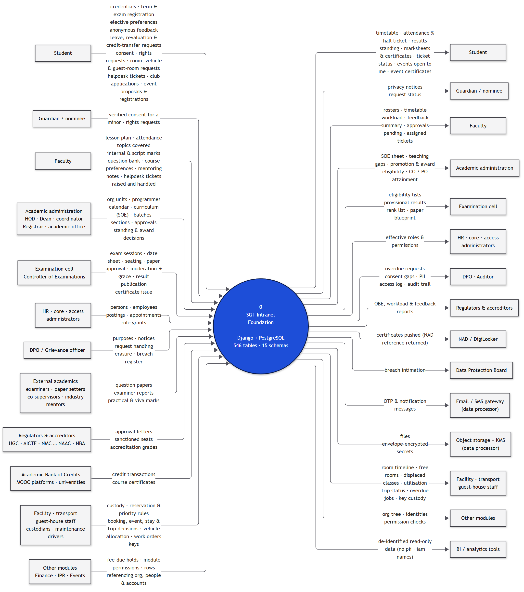

The system is the Django backend plus this database. Nobody reaches a table
directly: every flow arrives through Django, connected as `intranet_app`.

| External entity | What it is in the schema |
|---|---|
| Student · Guardian · Faculty · administrators | A `people.person` playing a role (`people.student`, `people.employee`, a guardian through `people.person_relationship`) with an `iam.user_account`. What each may do is derived, not assigned by hand: `STUDENT_BASE`, `GUARDIAN_BASE`, `EMPLOYEE_BASE`, `FACULTY` from the principal kind; `ORG_UNIT_HEAD`, reviewer and signatory roles from an `org.appointment`; `HR_ADMIN` and the like from a designation |
| Examination cell | Accounts holding `EXAM_CONTROLLER` — kept apart from `EXAM_EVALUATOR` and `EXAM_PAPER_SETTER` by `authz.role_conflict` |
| DPO / Grievance officer | Holders of the `DPO` and `GRIEVANCE_OFFICER` positions; DPO tooling connects as `intranet_dpo` |
| External academics | A `people.person` with **no** employee row — external examiner, paper setter, co-supervisor, committee expert, industry mentor. They hand their work to staff; triggers refuse an employee in an external role |
| Regulators & accreditors | `ref.regulatory_body` (UGC, AICTE, NMC …) and `ref.accreditation_body` (NAAC, NBA). Their letters are data: sanctioned seats cap the intake of a batch |
| Academic Bank of Credits · MOOC platforms | `academic.external_provider`; the student's APAAR / ABC ID sits encrypted in `pii.person_identity_document` |
| NAD / DigiLocker | `exam.certificate.nad_reference`; also one of the ways a guardian's consent is verified (`ref.verification_method`) |
| Data Protection Board | `privacy.breach_incident.board_notified_at` |
| Email / SMS gateway · object storage · KMS | Data processors (`privacy.data_processor`). The database holds hashes, ciphertext and file metadata (`people.file_object`) — never the OTP, the key or the file itself |
| Other modules | Finance, TMS, IPR, Events … attach by foreign key and register their permissions in `authz`; Finance places fee-due holds in `exam.eligibility_hold` |
| BI / analytics tools | Connect as `intranet_analytics`: no `pii`, no `iam`, no names, none of the confidential exam tables |

---

## Level 1 — the 16 processes

### 1A · Platform, governance and helpdesk

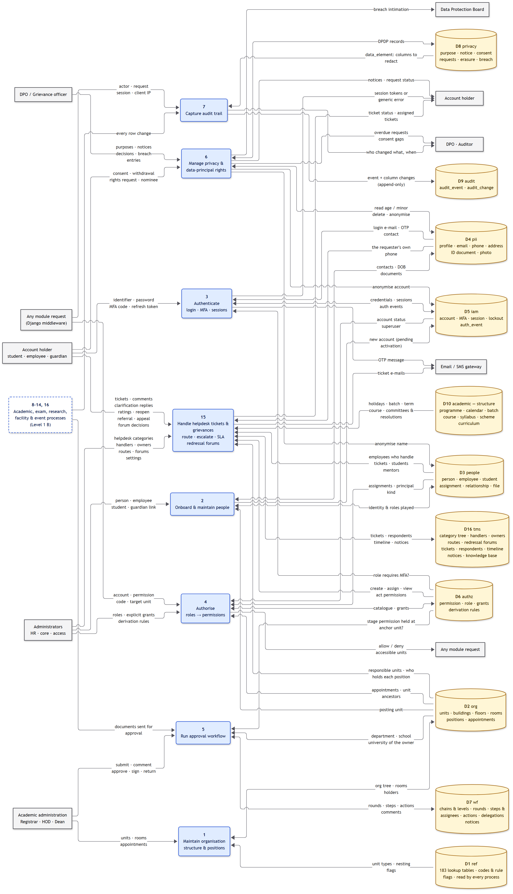

### 1B · Academic, examination, research and facilities

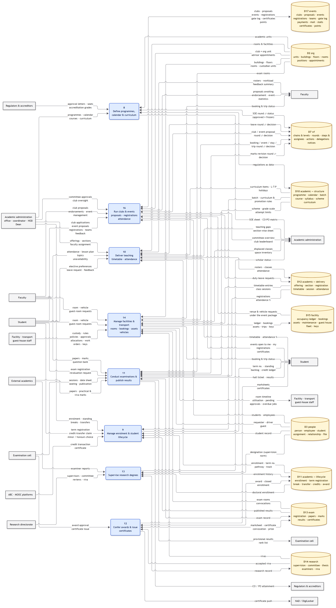

| # | Process | Owns | Entry points | Level 2 |
|---|---|---|---|---|
| 1 | Maintain organisation structure & positions | D2 `org` | `org.ancestors()` · `descendants()` · `nearest_of_type()` | 2.01 |
| 2 | Onboard & maintain people | D3 `people` · D4 `pii` | `people.v_employee_current` · `v_student_current` | 2.01 |
| 3 | Authenticate | D5 `iam` | `iam.resolve_login()` | 2.03 |
| 4 | Authorise | D6 `authz` | `authz.has_permission()` · `accessible_org_units()` · `account_requires_mfa()` | 2.04 |
| 5 | Run approval workflow (the engine every approval is configured on) | D7 `wf` | `wf.submit()` · `act()` · `can_act()` · `can_view()` · `pending_for()` · `run_timeouts()` · `document_of()` | 2.05 |
| 6 | Manage privacy & data-principal rights | D8 `privacy` | `privacy.v_dpr_request_status` · `v_minor_consent_gap` | 2.06 |
| 7 | Capture audit trail | D9 `audit` | `audit.capture()` · `enable_for_schemas()` | 2.07 |
| 8 | Define programmes, calendar & curriculum | D10 `academic` (structure) | `academic.submit_curriculum()` · `is_working_day()` · `v_soe` | 2.08 |
| 9 | Manage enrolment & student lifecycle | D11 `academic` (lifecycle) | `academic.enrollment_term_no()` · `v_credit_ledger` · `v_backlog` | 2.09a · 2.09b |
| 10 | Deliver teaching | D12 `academic` (delivery) | `allocate_sections()` · `register_core_courses()` · `allot_electives()` · `request_attendance_leave()` | 2.10a · 2.10b |
| 11 | Conduct examinations & publish results | D13 `exam` | `exam.is_eligible()` · `v_provisional_result` · `request_internal_mark_revision()` | 2.11a · 2.11b |
| 12 | Confer awards & issue certificates | D11.8 · D13.12 · D13.13 | `academic.v_award_eligibility` · `exam.v_rank_list` | 2.12 |
| 13 | Supervise research degrees | D14 `research` | `research.v_scholar_status` | 2.13 |
| 14 | Manage facilities & transport | D15 `facility` | `facility.materialise_timetable()` · `request_booking()` · `free_rooms()` · `request_trip()` · `raise_work_order()` · `run_trip_escalations()` | 2.14a · 2.14b |
| 15 | Handle helpdesk tickets & grievances | D16 `tms` | `INSERT tms.ticket` / `tms.ticket_event` / `tms.ticket_respondent` · `tms.run_scheduler()` · `can_act()` · `can_view()` · `next_escalation()` · `forum_seat()` · `v_ticket_state` · `v_grievance_register` | 2.15 |
| 16 | Run clubs & events | D17 `events` | `events.submit_club_proposal()` · `submit_proposal()` · `publish_event()` · `register()` · `issue_ticket()` · `ticket_check()` · `scan()` · `redeem_coupon()` · `record_refund()` · `expire_unpaid_registrations()` · `dispatch_mail()` · `run_mail_scheduler()` · `submit_stall_feedback()` · `submit_club_change()` · `submit_event_change()` · `check_in_round()` · `submit_settlement()` · `promote_waitlist()` · `issue_certificates()` · `submit_feedback()` · `complete_event()` · `v_event` · `v_registration` | 2.16a · 2.16b · 2.16c |

The processes talk to each other **through stores**, never directly: exam
eligibility reads attendance from D12, the standing decision reads published
results from D13, a curriculum freezes because of the round state in D7, the
occupancy ledger in D15 is written from the timetable, exam and viva stores by
triggers. That is why a module can be rebuilt without the others noticing.

---

## Level 2 — inside each process

Each table below lists the steps of the diagram above it, with the object in
the database that guards the step and what it refuses.

### 2.01 · Organisation and people

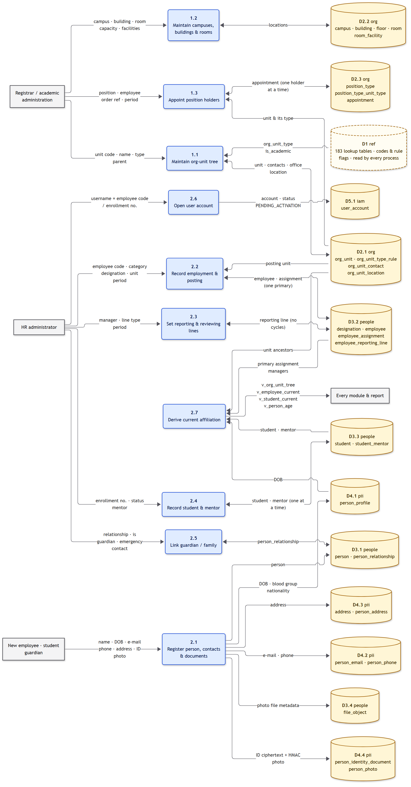

| Step | Guarded by | The database refuses |
|---|---|---|
| 1.1 Org-unit tree | `trg_org_unit_validate_tree`, `org_unit_single_root_uq` | A child type not allowed under the parent type (`org.org_unit_type_rule`), a cycle, a second root |
| 1.2 Campuses, buildings, rooms | Unique keys, `CHECK` on capacity | A room without capacity; an exam venue is simply a room with `exam_capacity` |
| 1.3 Appointments | `appointment_single_holder` (EXCLUDE), `trg_appointment_validate_position` | Two holders of one position of one unit at once; a DEAN of a SECTION |
| 2.1 Person, contacts, documents | Unique e-mail, `person_email_login_requires_verified`, one address of each type at a time | A login-enabled e-mail that was never verified; a full ID number in clear (only ciphertext + HMAC + last 4) |
| 2.2 Employment & posting | `employee_assignment_one_primary` (EXCLUDE) | Two primary postings at once; a duplicate posting |
| 2.3 Reporting lines | `trg_employee_reporting_line_no_cycle` | A reporting chain that loops back |
| 2.4 Student & mentor | `student_mentor_one_current` (EXCLUDE) | Two mentors at once; a duplicate enrollment number |
| 2.5 Guardian / family | Composite key, `CHECK (person_id <> related_person_id)` | A person related to themself |
| 2.6 User account | Username pattern, one account per person | — (no permission rows are written: access is derived by 4.5) |
| 2.7 Current affiliation | Views only | Nothing is stored: school, home department, age and current term are computed |

### 2.03 · Authenticate

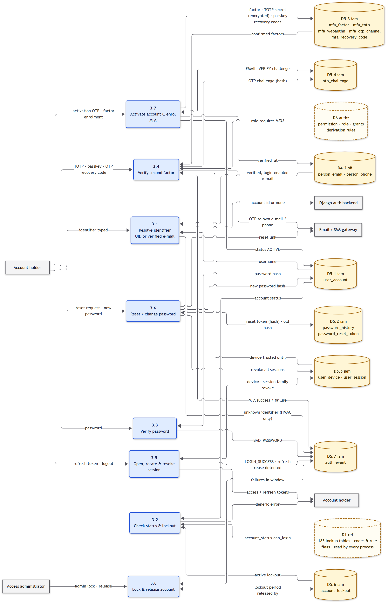

| Step | Guarded by | Notes |
|---|---|---|
| 3.1 Resolve identifier | `iam.v_login_identifier`, `iam.resolve_login()` | UID first, then a verified login-enabled e-mail. An unknown identifier is logged as an HMAC, never as typed |
| 3.2 Status & lockout | `ref.account_status.can_login`, `iam.v_account_active_lockout` | The answer to the user is always the same generic error |
| 3.3 Verify password | Django hasher string in `user_account.password` | Only hashes are stored; previous hashes go to `password_history` |
| 3.4 Second factor | `authz.account_requires_mfa()`, `trg_mfa_*_validate` | The OTP contact must belong to the account's own person; skipped while `user_device.trusted_until` is in the future |
| 3.5 Sessions | `user_session_family_one_active_uq` | One live refresh token per family; presenting a revoked one revokes the family (`REUSE_DETECTED`) |
| 3.6 Password reset | Hash-only token with expiry | On success every session is revoked (`PASSWORD_CHANGED`) |
| 3.7 Activation & MFA enrolment | `CHECK (NOT is_default OR confirmed_at IS NOT NULL)` | TOTP secrets are application-encrypted; recovery codes are hashes |
| 3.8 Lock & release | `account_lockout_no_overlap` (EXCLUDE) | Lockouts are dated rows with who released them, not a flag |

### 2.04 · Authorise

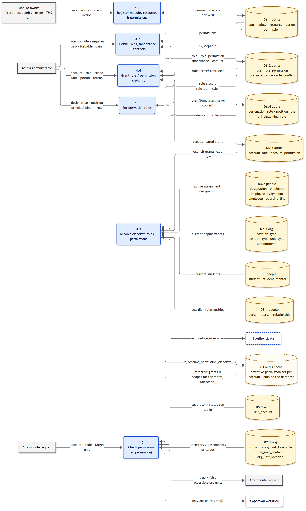

| Step | Guarded by | The database refuses |
|---|---|---|
| 4.1 Module, resources, permissions | Unique `(resource, action)`; the code is derived (`authz.v_permission_code`) | A permission typed twice under two spellings |
| 4.2 Roles, inheritance, conflicts | `trg_role_inheritance_no_cycle` | A cycle in role inheritance |
| 4.3 Derivation rules | Primary keys on `designation_role` · `position_role` · `principal_kind_role` | — (rules are templates; nothing is copied onto an account) |
| 4.4 Explicit grants | `trg_account_role_validate`, `trg_account_permission_validate`, `account_role_no_overlap` | An inactive role, a separation-of-duties conflict, a scoped grant of a non-scopable permission, an overlapping duplicate, an ad-hoc permission without a reason |
| 4.5 Effective roles & permissions | `authz.v_account_role_effective` → `v_role_closure` → `v_account_permission_effective` | Computed live from assignments, appointments and relationships, so access follows a transfer or a resignation on its own |
| 4.6 Check permission | `authz.has_permission(account, code, unit)` | Superusers pass; an account that cannot log in always fails; a grant counts globally, on the target, or on an ancestor with `include_descendants` |

`C1` is the only store in these diagrams that is not in PostgreSQL: the Django
backend caches the effective set per account and invalidates it when a grant,
assignment, appointment, relationship or status changes.

### 2.05 · Approval workflow

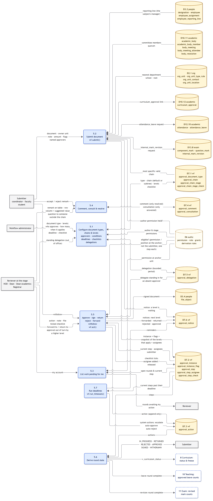

| Step | Guarded by | The database refuses |
|---|---|---|
| 5.1 Document types, chains & levels | `chain_one_per_scope` (EXCLUDE), `trg_chain_stage_validate`, `approval_delegation` EXCLUDE | Two chains for one type and scope at once; a signature level that is not the last; a level missing what its approver kind needs (a PERMISSION level without the permission, a POSITION level without the position, a COMMITTEE level without the body) or carrying settings of another kind; a timeout action without a deadline; escalation on a named or committee level; overlapping delegations of one delegator and type; a delegation to oneself or without an end |
| 5.2 Submit | `wf.submit()` | A submitter without the author permission at the owning unit; a type with no chain; a level whose org level does not exist above the owner; a MANAGER level without the person concerned; a NAMED level with nobody named, or naming someone who may not approve; a committee with fewer members than its quorum; the submitter as the approver of a level whose self-action is BLOCK and that cannot be decided without them; no level applying when the type does not allow an empty chain |
| 5.3 Pending for me | `wf.pending_for()`, `wf.can_act()`, `wf.can_view()` | — |
| 5.4 Comments & consultations | `trg_comment_validate`, `trg_consultation_validate` | A comment from anyone but the reviewer of the current step; an edited comment; a resolution by anyone but the submitter; a consultation asked by an outsider or of oneself; a reply by anyone but the person asked, or a second reply |
| 5.5 Act on the step | `trg_action_validate`, `wf.override_refusal()`, `wf.append_only()` | Acting on a closed round or a lower step; a higher level approving out of turn where the chain takes its levels in order, past a mandatory level, or so that fewer than the chain's minimum of levels would be approved by people; a rejection, return or signature out of turn; an actor who is not eligible (no permission / position at the anchor, not an assignee, no standing delegation); approving a signature step, signing without the file; a missing note, file or mandatory checklist item; forwarding or returning to an earlier level where the level does not allow it, or to a level that is not earlier; forwarding to the submitter; the submitter acting on their own document; one person completing two steps; a human taking a system action or a job acting outside `app.system_job`; any `UPDATE` / `DELETE` |
| 5.6 Round state | `wf.v_instance_state` | Status is never stored; a return or rejection closes the round and a resubmission is a new instance |
| 5.7 Deadlines | `wf.run_timeouts()` (system job) | Runs only as a system job; each overdue level gets its configured action once — reminder, escalation (clock restarts), auto-approval or auto-rejection |

Every approval of the intranet is **configuration on this process**: per
document type, the levels and — per level — who approves (a permission at an
org level, a position holder, the manager of the person concerned, named
people, a committee quorum), how many, the amount band or flag under which
it applies, and the deadline with its timeout action. A level is never a job
title — so an acting HOD is a dated, scoped grant, not a change to the
chain, and a school's different path is a chain scoped to that school.
A higher level may approve out of turn and so pass over the pending lower
levels — per chain, with a minimum number of approved levels (default 2) and
levels that can be marked mandatory; the statutory academic and the financial chains are seeded to take every level in order. Fourteen document types use the engine today: `CURRICULUM`,
`INTERNAL_MARKS_REVISION`, `ATTENDANCE_LEAVE`, `ROOM_BOOKING`,
`ROOM_BOOKING_CHANGE`, `EVENT_REQUEST`, `GUEST_STAY`, `TRIP_REQUEST`,
`TRIP_REQUEST_URGENT`, `CLUB_PROPOSAL`, `EVENT_PROPOSAL`, `CLUB_CHANGE`,
`EVENT_CHANGE` and `EVENT_SETTLEMENT`.

### 2.06 · Privacy and data-principal rights

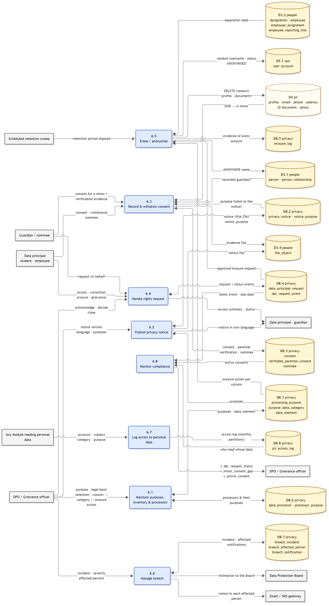

| Step | Guarded by | The database refuses |
|---|---|---|
| 6.1 Purposes, inventory, processors | `trg_data_element_validate` | An inventory row for a column that does not exist |
| 6.2 Privacy notice | Unique `(version, language)`, SHA-256 of the content | A notice retired before it was published |
| 6.3 Consent | Composite FK to `notice_purpose`, `trg_consent_validate_giver`, `consent_one_active_per_purpose` | Consent to a purpose the notice does not list; consent given by someone who is neither the principal nor a recorded guardian; two active consents for one purpose |
| 6.4 Rights request | `privacy.v_dpr_request_status` | Status is the latest event, the due date comes from `ref.dpr_request_type.response_days` — neither can be typed in |
| 6.5 Erase / anonymise | `privacy.data_element.erasure_action_id` | Drives the job column by column: `DELETE`, `ANONYMISE`, or `RETAIN_LEGAL` (marks, results, enrollment numbers stay) |
| 6.6 Breach | Composite FK `breach_notification` → `breach_affected_person` | A notification to someone not recorded as affected; a Board intimation dated before detection |
| 6.7 PII access log | Monthly partitions | — |
| 6.8 Monitor | `v_minor_consent_gap`, `v_active_consent` | — |

### 2.07 · Audit trail

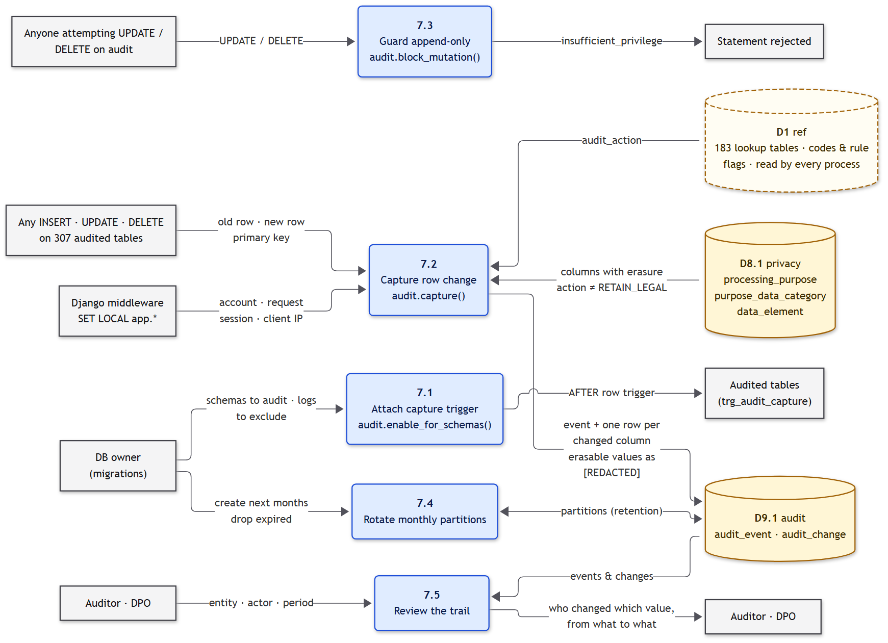

One trigger, `trg_audit_capture`, sits on **523 of the 546 tables** — every
table of every schema except the two audit tables themselves and 21 tables
that are either trails in their own right, queues, or anonymous by
construction: `iam.auth_event`, `otp_challenge`, `user_session`, `user_device`;
`privacy.pii_access_log`; `wf.approval_action`, `approval_notice`;
`facility.room_hold`, `asset_hold`; `tms.ticket_event`, `ticket_event_file`,
`ticket_notification`, `ticket_number_counter`, `kb_feedback`;
`events.entry_scan`, `round_attendance`, `event_mail_recipient`,
`event_feedback`, `event_feedback_token`, `stall_feedback`,
`stall_feedback_point`. It writes one `audit_event`
per changed row and one `audit_change` per changed column. Values of erasable
personal-data columns are written as `[REDACTED]`, so erasure is never undone
by the trail; legally retained values (marks, results) stay visible, because
"who changed 40 to 70" is the point. `UPDATE` and `DELETE` on the audit tables
are refused by trigger as well as by grant.

### 2.08 · Programmes, calendar and curriculum (SOE)

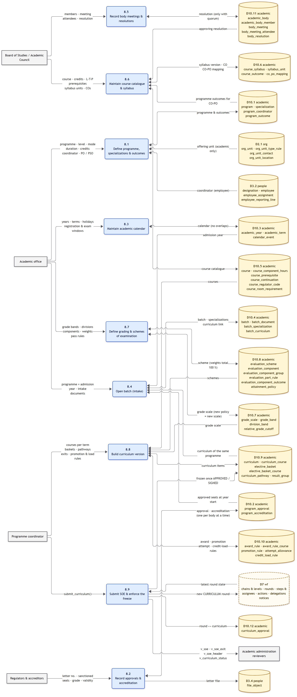

| Step | Guarded by | The database refuses |
|---|---|---|
| 8.1 Programme & outcomes | `trg_program_validate_unit`, `program_coordinator_single` | A programme run by a non-academic unit; two coordinators at once |
| 8.2 Approvals & accreditation | `program_approval_one_at_a_time`, `program_accreditation_one_at_a_time` | Two approvals of one body in one period; an accreditation that targets both a programme and an institution |
| 8.3 Calendar | `academic_year_no_overlap`, `trg_academic_term_validate`, `trg_calendar_event_validate` | Overlapping years or terms; a term outside its year; an event outside its year |
| 8.4 Batch | `trg_batch_intake_within_approval`, `trg_batch_curriculum_validate`, `trg_batch_specialization_validate` | An intake above the seats approved when the admission year starts; a curriculum or specialization of another programme |
| 8.5 Bodies & resolutions | `trg_academic_body_member_validate`, `trg_body_meeting_attendee_validate`, `trg_body_resolution_validate` | A resolution of a meeting without quorum; an attendee who was not a member that day; two chairs |
| 8.6 Courses & syllabus | `trg_course_academic_unit`, `trg_course_prerequisite_no_cycle`, `course_syllabus_one_current`, `trg_co_po_mapping_validate` | A prerequisite or continuation loop; two current syllabus versions; a CO mapped to a PO of a programme the course is not taught in |
| 8.7 Grading & schemes | `grade_band_no_overlap`, `trg_evaluation_scheme_weights` (deferred), `trg_grade_band_protect` | Overlapping bands; weights that do not total 100 %; editing a band a published result points at |
| 8.8 Curriculum version | `trg_curriculum_course_validate` and siblings | A term beyond the duration; an elective category outside a basket; the same course twice on one pathway |
| 8.9 Submit & freeze | `academic.submit_curriculum()`, `guard_curriculum_edit()`, `guard_scheme_edit()`, `guard_course_edit()` | Any change to an `APPROVED` / `SIGNED` version, its schemes or its courses' credits; while in review, an edit by anyone but the reviewer of the current stage |

### 2.09a · Enrolment and student lifecycle

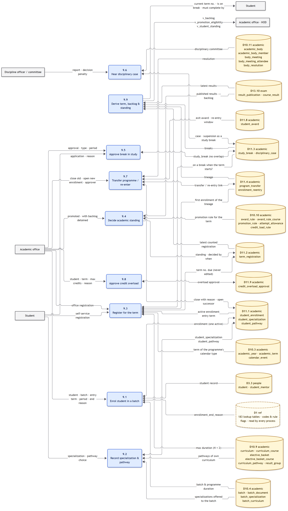

| Step | Guarded by | The database refuses |
|---|---|---|
| 9.1 Enrol in a batch | `student_enrollment_one_active`, `student_enrollment_end_reason` | Two active enrollments; a closed enrollment without a reason, or an open one with a reason |
| 9.2 Specialization & pathway | `trg_student_specialization_validate`, `trg_student_pathway_validate` | A specialization the batch was never offered; a pathway of another curriculum |
| 9.3 Term registration | `trg_term_registration_validate` | Another calendar type; a term number other than the one due; a term that starts during a break, or after the maximum duration counted from the first enrollment of the lineage |
| 9.4 Academic standing | same trigger, reading `v_backlog` and `promotion_rule` | `PROMOTED` with any backlog; promotion beyond the rule; a decision before the term starts |
| 9.5 Break in study | `study_break_no_overlap`, `trg_study_break_validate` | Overlapping breaks; a break that starts outside the enrollment |
| 9.6 Disciplinary case | `trg_disciplinary_case_validate` | A penalty before a decision; a committee of another type; a suspension not recorded as the student's own study break; a change to a closed case |
| 9.7 Transfer / re-entry | `trg_program_transfer_validate`, `trg_enrollment_reentry_validate` | A transfer whose earlier enrollment was not closed with `PROGRAM_CHANGE`; a re-entry outside the award's window or into the wrong term |
| 9.8 Credit overload | Primary key `(enrollment, term)` | — (lifts the credit maximum for that student and term only) |
| 9.9 Term, backlog, standing | `academic.enrollment_term_no()`, `v_student_standing` | The current semester is never typed in |

### 2.09b · NEP 2020 — credits, equivalence, minors and honours

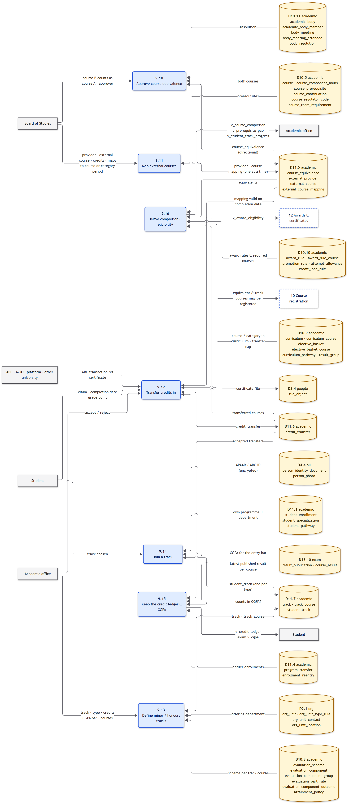

| Step | Guarded by | The database refuses |
|---|---|---|
| 9.10 Course equivalence | Primary key, `CHECK (course_id <> equivalent_course_id)` | — (directional and one hop, each direction an approved row) |
| 9.11 External mapping | `external_course_mapping_one_at_a_time` | Two mappings of one external course in one period; a mapping to both a course and a category |
| 9.12 Credit transfer | `trg_credit_transfer_validate` | Acceptance without an approver, without a mapping valid on the completion date, for a course or category outside the curriculum, or above the curriculum's cap |
| 9.13 Track definition | `trg_track_validate`, `trg_track_academic_unit` | An honours track without a programme; a minor tied to one |
| 9.14 Joining a track | `trg_student_track_validate` | Honours of another programme; a minor in the student's own department; two tracks of one type; a CGPA below the entry bar |
| 9.15 Ledger & CGPA | `v_enrollment_lineage` → `v_credit_ledger` → `exam.v_cgpa` | Nothing is copied on re-entry or transfer: earlier credits count through the lineage |
| 9.16 Completion & eligibility | `v_course_completion`, `v_prerequisite_gap`, `v_award_eligibility` | An unmet prerequisite is *reported*, not blocked — a Dean may waive it |

### 2.10a · Term set-up, registration and timetable

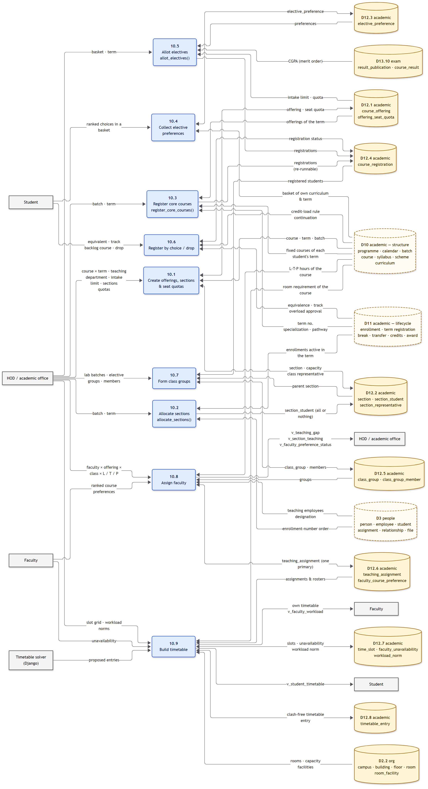

| Step | Guarded by | The database refuses |
|---|---|---|
| 10.1 Offerings, sections, quotas | `trg_course_offering_academic_unit`, `trg_section_representative_validate` | A non-academic teaching unit; a class representative from another section |
| 10.2 Allocate sections | `academic.allocate_sections()`, `trg_section_student_validate` | All or nothing: if the sections cannot hold everyone, nobody is placed. A student of another batch, a second section in the term, a full section |
| 10.3 Core courses | `academic.register_core_courses()` | Re-runnable; each row still passes the registration triggers |
| 10.4 Elective preferences | `trg_elective_preference_validate` | A basket of another curriculum or term; a course not in the basket |
| 10.5 Allot electives | `academic.allot_electives()` | Merit order; a full course moves the student to the next preference |
| 10.6 Register by choice | `trg_course_registration_validate`, `…_validate_quota`, `…_credit_load` | A course outside the curriculum, its approved equivalents and the student's tracks; a continuation without its earlier part; a full offering or quota; credits above the term maximum |
| 10.7 Class groups | `trg_class_group_member_validate`, `trg_class_group_member_clash` | A student not registered, not in the parent section, in two groups for one component, or whose other classes clash with the group's timetable |
| 10.8 Assign faculty | `teaching_assignment_one_primary` (EXCLUDE), `trg_teaching_assignment_validate` | Two primary teachers for one class and component; a component the course has no hours for |
| 10.9 Timetable | `trg_timetable_entry_validate`, `trg_timetable_entry_room_check` | A room or teacher double-booked, a section or any student in two classes at once, a slot the teacher marked unavailable, a room too small or without what the course requires |

### 2.10b · Classes, attendance, feedback and mentoring

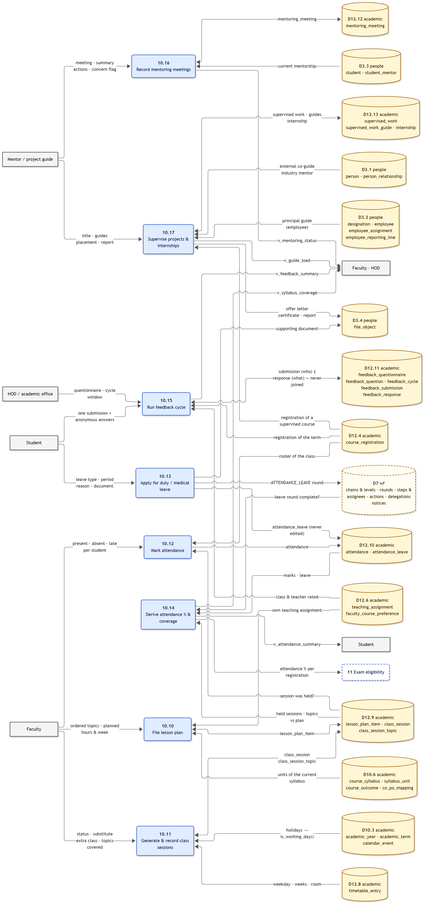

| Step | Guarded by | The database refuses |
|---|---|---|
| 10.10 Lesson plan | `trg_lesson_plan_item_validate` | A syllabus unit of another course |
| 10.11 Class sessions | `trg_class_session_validate`, `trg_class_session_working_day`, `class_session_shape` | A generated session on the wrong weekday, an off week, or a holiday of the teaching department (an extra class may be held then) |
| 10.12 Attendance | `trg_attendance_validate` | A mark on a class that was not held, for another course, or for a student not on the class's roster |
| 10.13 Leave | `academic.request_attendance_leave()`, `trg_attendance_leave_validate` | An application by anyone but the student or attendance staff; a missing document; an overlapping leave; any edit |
| 10.14 Attendance % & coverage | `v_attendance_summary`, `v_syllabus_coverage` | The percentage is never stored; approved duty leave counts as present without touching the marks |
| 10.15 Feedback | `trg_feedback_submission_validate`, `trg_feedback_response_validate` | A submission outside the window; a rating above the maximum. `feedback_response` has no student column, so answers cannot be traced back |
| 10.16 Mentoring | `trg_mentoring_meeting_validate` | A meeting dated outside the mentorship |
| 10.17 Projects & internships | `trg_supervised_work_validate`, `…_guide_validate`, `trg_internship_validate` | Supervised work on a course that is not a project / internship / dissertation; two principal guides; an employee as the external co-guide or industry mentor |

### 2.11a · Exam planning and conduct

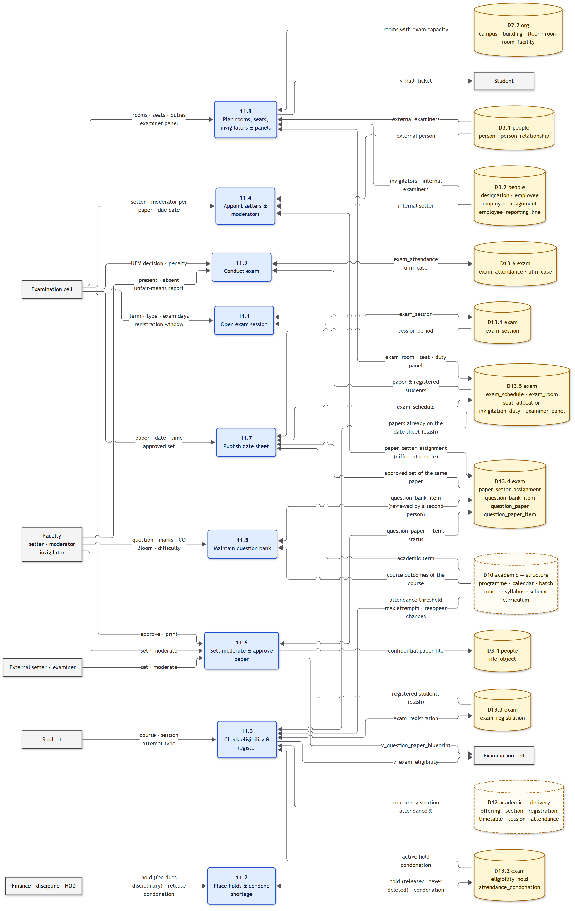

| Step | Guarded by | The database refuses |
|---|---|---|
| 11.1 Exam session | Unique `(term, name)` | — |
| 11.2 Holds & condonation | `CHECK`s on the release columns | A release without who released it, or dated before the hold. Holds are released rather than deleted, so the reason a student was blocked survives |
| 11.3 Eligibility & registration | `exam.is_eligible()`, `trg_exam_registration_validate`, `trg_exam_registration_attempt_limit` | A regular attempt with an attendance shortage or an active hold; a regular attempt outside the course's term; a paper that clashes; an attempt beyond `max_attempts_per_course` or the chances of its type |
| 11.4 Setters & moderators | `trg_paper_setter_assignment_validate` | The same person setting and moderating; a paper for continuous assessment |
| 11.5 Question bank | `trg_question_bank_item_validate`, `CHECK` reviewer ≠ author | A course outcome of another course |
| 11.6 Set, moderate, approve | `trg_question_paper_validate`, `trg_question_paper_item_validate` | A moderated status without both sign-offs, an approved one without an approver, an unreviewed question, a change after approval |
| 11.7 Date sheet | `trg_exam_schedule_validate`, `trg_exam_schedule_paper_validate` | A date outside the session, a student in two papers at once, a question paper that is not approved or is for another paper |
| 11.8 Rooms, seats, duties, panels | `trg_exam_room_validate`, `trg_seat_allocation_validate`, `trg_invigilation_duty_validate`, `trg_examiner_panel_validate` | A room without exam capacity, a seat taken at that time, a full room, an invigilator in two rooms, an employee as external examiner |
| 11.9 Conduct | `trg_exam_attendance_validate`, `trg_ufm_case_validate` | A student not registered for the paper; a penalty before the decision |

### 2.11b · Evaluation, results and attainment

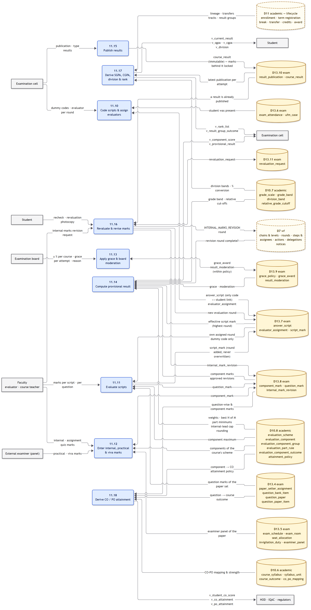

| Step | Guarded by | The database refuses |
|---|---|---|
| 11.10 Scripts & evaluators | `trg_answer_script_validate`, `trg_evaluator_assignment_validate` | A script for an absent student; one evaluator in two rounds of a script |
| 11.11 Evaluate scripts | Composite FK to the assignment, `trg_script_mark_validate`, `trg_question_mark_validate` | A mark in a round that was not assigned; marks above the component or question maximum; question marks that total more than the script |
| 11.12 Internal, practical, viva | `trg_component_mark_validate` | A component outside the course's scheme; direct entry for a script-marked paper; marks by someone not on the panel; a viva without its external examiner |
| 11.13 Grace & moderation | `trg_grace_award_validate`, `trg_result_moderation_lock` | Grace above the policy, in too many courses, or after publication |
| 11.14 Provisional result | `exam.v_component_score` → `exam.v_provisional_result` | Every rule is data on the scheme: best N of M, part minimums, internal-lead cap, rounding, relative grading |
| 11.15 Publish | `trg_course_result_validate`, `trg_script_mark_lock`, `trg_component_mark_lock` | Any `UPDATE` / `DELETE` of a published result or of the marks behind it; a grade band of another scale |
| 11.16 Revaluation & revision | `trg_revaluation_request_validate`, `trg_internal_mark_revision_validate` | A request before a result is published; a revision the curriculum does not allow, or of a scheduled paper |
| 11.17 SGPA, CGPA, division, rank | `v_current_result`, `v_sgpa`, `v_cgpa`, `v_division`, `v_rank_list` | None of these is stored |
| 11.18 CO / PO attainment | `v_student_co_score`, `academic.v_co_attainment`, `v_po_attainment` | — |

`exam.course_result.total_pct` is the one deliberately stored calculated value
in the database: a published result is a legal record and must not move when
marks, grace or policy change later. A correction is a new, revised publication.

`exam.answer_script` is the only place the dummy code is tied to a student. The
evaluator's flow carries the code and nothing else, and the table is hidden
from analytics.

### 2.12 · Awards, certificates and convocation

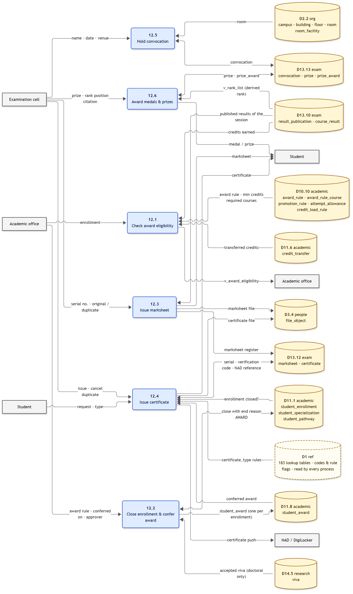

| Step | Guarded by | The database refuses |
|---|---|---|
| 12.1 Eligibility | `academic.v_award_eligibility` | — |
| 12.2 Confer award | `trg_student_award_validate`, `trg_student_award_requires_viva` | An award on an open enrollment, from another curriculum, without the credits or required courses; a doctorate without an accepted viva |
| 12.3 Marksheet | `marksheet_one_original_uq` | A second original for one student and session |
| 12.4 Certificate | `trg_certificate_validate` | A degree certificate without the award; a migration certificate on an open enrollment; a second live original; a duplicate with nothing to duplicate |
| 12.5 Convocation | Unique `(year, name)` | — |
| 12.6 Medals & prizes | `trg_prize_award_validate` | A rank prize to a student who does not hold that rank, or twice in one batch |

### 2.13 · Research degrees

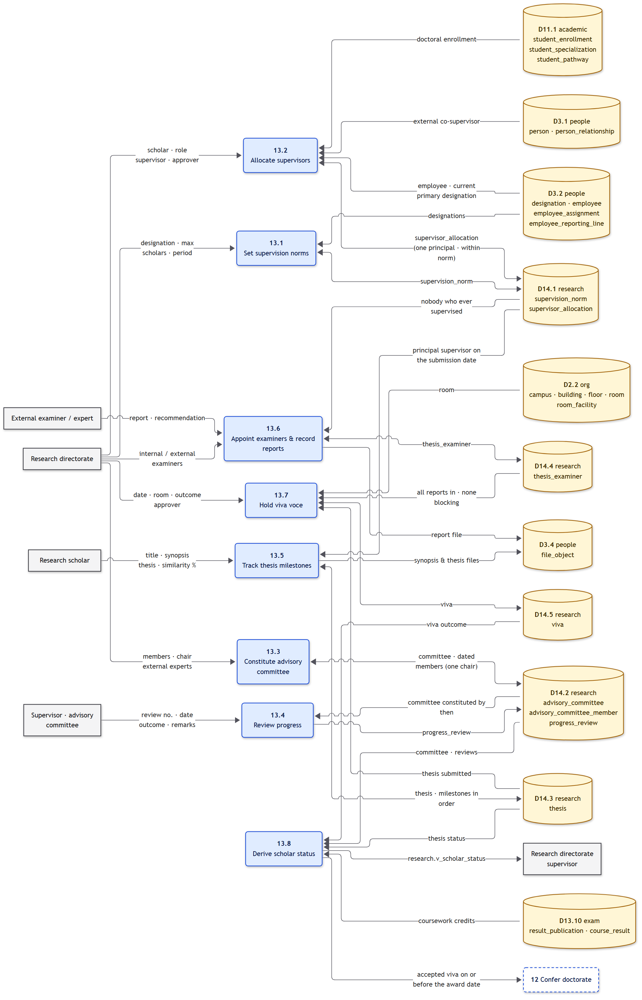

| Step | Guarded by | The database refuses |
|---|---|---|
| 13.1 Supervision norms | `supervision_norm_one_at_a_time` | Two norms for one designation in one period |
| 13.2 Supervisors | `trg_supervisor_allocation_validate`, `supervisor_allocation_no_duplicate` | A second principal supervisor; an employee allocated as external; more doctoral scholars than the norm of the supervisor's designation |
| 13.3 Advisory committee | `trg_advisory_committee_member_validate` | Two chairs at once |
| 13.4 Progress review | `trg_progress_review_validate` | A review before a committee exists |
| 13.5 Thesis milestones | `CHECK`s on date order, `trg_thesis_validate` | Milestones out of order; a submission on a day with no principal supervisor |
| 13.6 Examiners & reports | `trg_thesis_examiner_validate` | An employee as external examiner; anyone who ever supervised the scholar |
| 13.7 Viva | `trg_viva_validate` | A viva before submission, before every report is in, or while an examiner recommends rejection or major revision |
| 13.8 Scholar status | `research.v_scholar_status` | — |

### 2.14a · Space, the occupancy ledger and room bookings

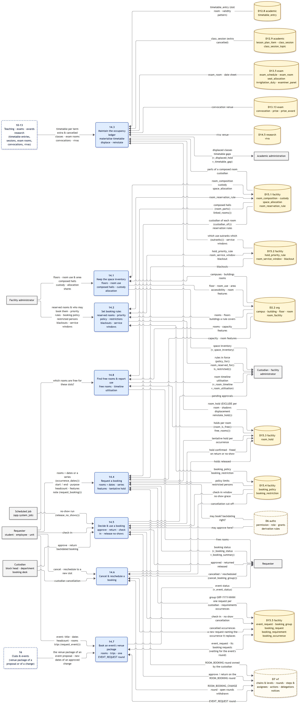

| Step | Guarded by | The database refuses |
|---|---|---|
| 14.1 Space inventory | `trg_room_floor_check`, `trg_room_composition_validate`, `custody_one_per_target`, `trg_space_allocation_validate`, `trg_*_activation_check` | A room on another building's floor; nested or cross-building composition; two custodians of one space; allocation shares over 100 %; deactivating a space with future holds; activating under an inactive floor / building |
| 14.2 Booking rules | `hold_priority_rule_one`, `trg_hold_priority_rule_validate`, `booking_policy_one_per_scope` and its CHECKs, `booking_restriction_no_overlap`, `room_reservation_rule` CHECKs, `blackout` CHECKs | A priority rule and its reverse; two policies for one scope at a time, or negative limits and windows; overlapping restrictions of one person for the same kind of resource; a reservation rule that does not name exactly one place (room, floor or building) and exactly one who (position, unit, permission or person); a blackout on nothing, empty or open-ended |
| 14.3 Occupancy ledger | `room_hold_one_source`, `trg_room_hold_a_validate`, `trg_room_hold_b_preempt` + `room_hold_no_overlap` (gist), `trg_room_hold_c_immutable`, shadows and the row lock on a composed room | A hold with no or two sources, or of a type its source does not write; two active holds on one room (buffers included) unless the new one outranks every one it displaces; a hall while the whole is in use and vice versa; editing a hold |
| 14.4 Request a booking | `trg_booking_request_validate`, `trg_booking_occurrence_validate` | A restricted requester; a reserved room by someone who matches no rule; a room under a blackout; below the minimum duration, beyond the advance window, more people than seats, a missing feature, a past date without the backdating right; rooms of two custodians in one request; editing a request or moving an occurrence |
| 14.5 Decide & use | `trg_facility_action_guard`, `trg_facility_action_effects`, `trg_booking_occurrence_validate`, `facility.release_no_shows()` | Check-in outside the window or before approval; approving an expired booking; the no-show release outside a system job |
| 14.6 Cancel & reschedule | `trg_booking_occurrence_validate`, `trg_booking_request_validate` | Self-cancellation inside the cut-off; a reschedule that does not name the occurrence it replaces through a ROOM_BOOKING_CHANGE round; editing a request |
| 14.7 Event venue package | `trg_event_request_validate`, `trg_event_request_cancel` | A round that is not an EVENT_REQUEST / EVENT_PROPOSAL / EVENT_CHANGE round of the organising unit; an organiser restricted from booking; an event in the past; editing a request (withdraw and submit again); cancelling twice |
| 14.8 Free rooms & reports | — (read only: `free_rooms()`, `room_is_free()`, `v_room_timeline`, `v_room_utilisation`) | Nothing is written; the answers are derived from the ledger |

### 2.14b · Assets, maintenance, guest house, transport, keys & parking

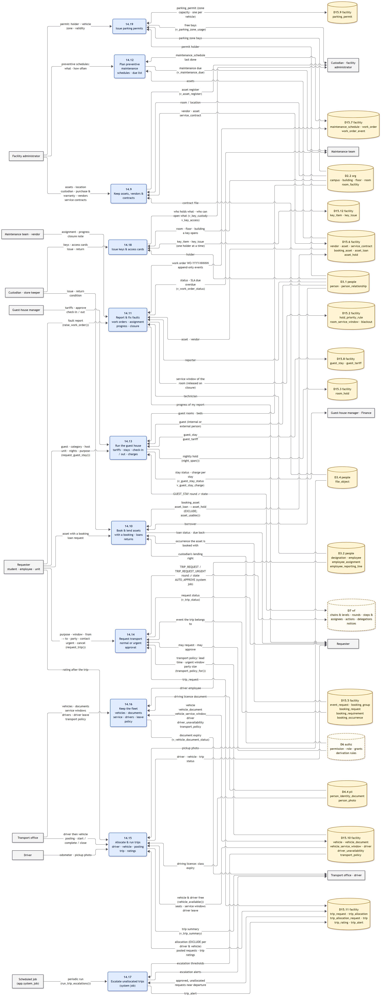

| Step | Guarded by | The database refuses |
|---|---|---|
| 14.9 Assets, vendors & contracts | `asset` CHECKs and `asset_tag` key, `vendor_name_key`, `vendor_gstin_check`, `service_contract_one_per_target` and its CHECKs | Two assets with one tag; a negative purchase cost; a warranty ending before the purchase; a condemned asset still active; two vendors of one name; a malformed GSTIN; a contract on more or fewer than one asset, asset type or room, or two at a time for one target |
| 14.10 Book & lend assets | `trg_booking_asset_validate`, `trg_asset_loan_validate`, `asset_hold_no_overlap` | Booking or lending a fixed / unserviceable asset; the same asset twice at once; lending without the custodian's right |
| 14.11 Faults & work orders | `trg_work_order_validate`, `trg_work_order_event_validate` | ASSIGNED without a technician or vendor; closing without a note; any event or edit on a closed work order; deleting history |
| 14.12 Preventive maintenance | `maintenance_schedule` CHECKs | A schedule on both or neither of an asset and a room; an interval of zero |
| 14.13 Guest house | `trg_guest_stay_validate`, `guest_tariff_one_per_target` | A stay in a room that is not a guest room; a guest of the wrong kind for the category; more guests than beds; overlapping nights; check-in before approval; editing a stay; two tariffs for one category at a time |
| 14.14 Request transport | `trg_trip_request_validate`, `wf.action_validate` (system actions), `transport_policy_one_per_scope` | A round of another unit; a normal chain for an urgent departure (or the reverse); too many people; a non-E.164 contact; cancelling once allocated; a system approval outside a system job or with a human actor |
| 14.15 Allocate & run trips | `trg_trip_allocation_validate`, `trip_allocation_driver_once` / `_vehicle_once` (gist), `trg_trip_allocation_request_validate`, `trg_trip_validate`, `trg_trip_rating_validate` | Allocating before approval, by a non-transport account, across a service window or the driver's leave, with an expired licence or document, with too small a licence class, with too few seats, or twice at once; pooling a pending trip, outside the window or over the seats; an odometer going backwards; ratings before completion, out of range or by a stranger |
| 14.16 Fleet | `trg_driver_validate`, `vehicle_registration_no_key`, `vehicle_document_one_current`, `vehicle_service_window_no_overlap`, `driver_unavailability_no_overlap` | A driver whose licence is not a DRIVING_LICENCE document of the employee with an expiry date; two vehicles with one registration; two current documents of one kind; overlapping service windows or leave |
| 14.17 Escalate trips | `facility.run_trip_escalations()` | The escalation run outside a system job |
| 14.18 Keys | `key_issue_one_holder` (gist), `trg_key_issue_validate` | A key issued by someone who is not its custodian, to a restricted person, or while someone else holds it |
| 14.19 Parking | `trg_parking_permit_validate`, `parking_permit_one_per_vehicle` | A permit in a non-zone, over the zone's bays, or for a vehicle already under a permit |

### 2.15 · Helpdesk & grievance redressal (TMS)

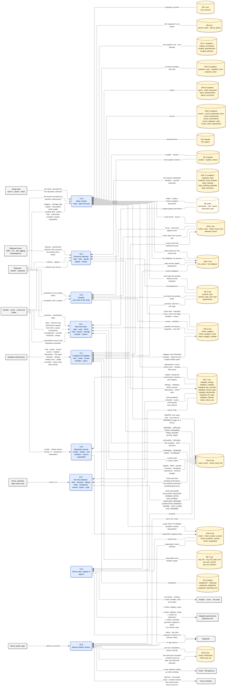

Design, policy table and end-to-end flows: [`docs/tms/tms-design.md`](tms/tms-design.md).

| Step | Guarded by | The database refuses |
|---|---|---|
| 15.1 Configure | `trg_ticket_category_validate`, `ticket_category_root_name_uq` / `ticket_category_child_name_uq`, `ticket_category_owner_one_at_a_time` (gist), `trg_ticket_category_owner_validate`, `trg_ticket_category_handler_validate`, `ticket_category_handler_uq`, `trg_ticket_route_level_validate`, `trg_redressal_forum_validate`, `helpdesk_declaration_one_at_a_time` (gist), `trg_helpdesk_setting_validate` | A KRA type in the student domain; a level not directly under the one above; a category type off the master or a priority off the leaf; a route of the other domain; a root without a responsible unit; a duplicate name under one parent; moving a node that has tickets; two owners of a node at once; owners on leaves or handlers on non-leaves; a route level missing (or carrying) its kind's settings, a position that does not exist for the unit type, an overseeing pool, two levels with one number; a forum that is both a committee and a position, a resolution required of a position, an appeal without a window, an appeal chain that loops; two declarations in force; an unknown time zone, a clarification expiry before its reminder; deleting the settings; an article on a category of the other domain; locking Student TMS while it is on (and the app role cannot touch the lock); weekday hours closing before they open; a dated override without a reason, or with hours on a closed day |
| 15.2 Raise | `trg_ticket_validate`, `trg_ticket_open`, `trg_ticket_context_required` (deferred), `trg_ticket_academic_context_validate`, `trg_ticket_respondent_validate` | A ticket under a non-leaf or inactive path or one with no route (and not filed with a forum); a student ticket while Student TMS is off; a requester who is not a current student / employee or lacks the create permission; an intake desk without `tms.intake.create` at the requester's unit, a desk recording a portal ticket or a non-portal ticket without a desk; a message type the domain does not use; a non-grievance filed with a forum; a grievance without the relief sought; a missing or future incident date; anonymity where not allowed; a phone that is not the requester's own; not accepting the declaration in force; choosing the assignee without the permission, oneself, or someone off the route; context the category needs but lacks, a student's batch that is not theirs, a missing course, a term of the wrong calendar, a semester beyond the programme or of the wrong parity; the same idempotency key twice; editing or deleting a ticket; raising under an internal-only category; the same requester, leaf and text again within `duplicate_window_seconds`; a ticket of a domain switched off (Student / Employee TMS); context of an inactive programme. A blank subject is taken from the description; the number comes from the per-year counter |
| 15.3 Work | `trg_ticket_event_validate` (row lock per ticket; `ref.tms_event_allowed_status`), `trg_ticket_event_complete` (deferred), `trg_ticket_event_file_validate`, `tms.can_act()` | An event not allowed in the current status, or by the wrong kind of actor; acting without being the assignee, a scoped administrator, the KRA head or an overseeing level holder — or while a forum has the ticket, without being its member; a confidential ticket acted on by anyone else; a reply, note, comment, escalation, transfer or resolution without text; a second clarification request; a clarification answered by anyone but the requester, or with neither text nor file; reassigning off a pool level, to a handler not serving the requester, to the current handler, the requester or a respondent; a transfer into the same category, another domain, a forum category, a category needing context the ticket lacks, or one whose route has nobody; the requester resolving their own ticket; merging into a closed or other-domain ticket, or merging a confidential one; files on an entry that takes none, after it was recorded, or beyond the limit; rewriting the timeline or its files; a hold without a reason, while paused or with holds off; releasing a hold that is not one, answering a clarification that is a hold; consulting oneself, the requester, the assignee or a respondent, or on a confidential ticket; answering a consultation one was not asked, or twice; a file of a type not accepted, over `max_file_bytes`, or belonging to another ticket |
| 15.4 Escalate | `tms.next_escalation()`, `tms.walk_route()`, `trg_ticket_event_validate`, `trg_ticket_respondent_recuse` | Escalating past the top of the route; the requester escalating a ticket that is not overdue (or with the setting off); a level whose person is missing, cannot work, is the requester, the current assignee or a respondent is skipped; naming the assignee as respondent moves the ticket on |
| 15.5 Requester's answer | `trg_ticket_event_validate`, `trg_ticket_respondent_validate` | Accepting, reopening, rating or withdrawing by anyone but the requester; a reopen without a reason, after the window, beyond `max_reopens`, of a withdrawn or merged ticket, or after a forum decided; a rating out of 1–5, twice in one resolution cycle, after the rating window, or of a ticket closed without a resolution; a respondent on a closed ticket, in a category that takes none, who is the requester, named by an outsider — and removing one |
| 15.6 Grievance redressal | `trg_ticket_event_validate`, `tms.forum_seat()`, `tms.is_forum_member()`, `academic.body_resolution` (quorum) | Referring a non-grievance, a second time, to no configured forum or to a forum with no body constituted; the requester referring too early or to another forum; the handling side referring a ticket it resolved; a decision by a non-member or a respondent, without its outcome, or — where required — without a resolution of a quorate meeting of that very committee; appealing anything but a forum decision, where no appeal forum is configured, or after the appeal window; an action report without a decision in the requester's favour whose compliance is tracked, by someone who is not a forum member, the last handler or an update-permission holder, or twice; forwarding by a non-member, without a report, to the forum that has the case, where there is no default and none is named, or to a committee not constituted |
| 15.7 Scheduler | `tms.run_scheduler()` (app.system_job) | Running it, or recording any system event (AUTO_REFERRED, AUTO_ESCALATED, ESCALATION_EXHAUSTED, OVERDUE_NOTICE, CLARIFICATION_REMINDER / _EXPIRED, AUTO_CLOSED), outside a system job; outside office hours it does nothing unless forced; an exhausted route stops the clock instead of being re-processed; a forum is never escalated; one overdue notice per overdue spell and one reminder per pause; a second run while one holds the advisory lock returns at once; outside office hours only when `scheduler_office_hours_only` is off; holds past `max_hold_days` are released; one compliance reminder per decision; one alert per forum stage without a first action within its first-action time (members and the alert position, e.g. the VC) |
| 15.8 Notices | `trg_ticket_event_notify`, `tms.notice_accounts()`, `ticket_notification` unique (event × recipient × channel), `trg_ticket_notification_validate` | Sending a notice twice; changing anything but the delivery outcome; touching a sent or skipped notice; deleting the log. Nobody is told of their own action except receipts; respondents are never told anything; a notice to someone opted out of the channel unless the rule is mandatory; any notice on a channel switched off; retrying a notice given up after `notice_max_attempts` |
| 15.9 State & reports | `tms.v_ticket_state`, `v_ticket_requester_timeline`, `v_ticket_sla`, `v_ticket_handler_stats`, `v_ticket_category_stats`, `v_grievance_register`, `v_grievance_summary`, `v_ticket_unrouted`, `tms.can_view()`, `tms.requester_shown_to()` | Nothing is stored: status, assignee, level, forum, clock, resolution, closure reason, rating and counts are derived from the timeline; requesters never see internal events; confidential tickets are seen only by participants and `tms.confidential_ticket.view`; respondents see nothing; an anonymous requester is hidden from handlers; attention tiers (`v_ticket_sla`), subtree statistics (`v_ticket_category_rollup`), participation (`v_ticket_participant`), consultations, article deflection (`v_kb_article_stats`) — all derived; `tms.available_actions()` and `tms.can_download()` answer what a screen may offer |

---

### 2.16 · Clubs and events

The process is drawn on three diagrams: **2.16a** clubs, sponsorship and event proposals; **2.16b** running an event; **2.16c** fees, settlement, messages and stalls.

Nothing in this process is hard-coded policy. The limits and requirements the rules below apply — name and objective lengths, whether advisors must be faculty, which offices a club proposal must name, the proposal lead time and required sections, proposals under approval per proposer, the guest-pass ceiling, what publishing needs, the feedback scale — are read from `events.event_setting` and lookup flags; points and tiers are dated rows; levels and deadlines are chain rows on process 5.

Approval is not on these rule lists on purpose: the rounds (CLUB_PROPOSAL, CLUB_CHANGE, EVENT_PROPOSAL, EVENT_CHANGE, EVENT_SETTLEMENT) are configuration on process 5 — levels, approvers, conditions and deadlines are chain rows, and a school or a club changes its path by adding a chain scoped to itself. What happens *after* an approval is done by one hook, `trg_events_action_effects` on `wf.approval_action`.

### 2.16a · Clubs, sponsorship and event proposals

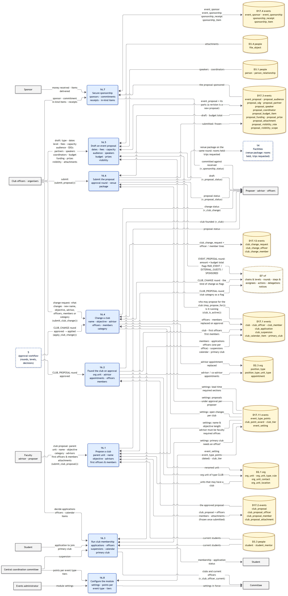

| Step | Guarded by | The database refuses |
|---|---|---|
| 16.1 Propose a club | `trg_club_proposal_validate`, `trg_club_proposal_officer_guard` / `_member_guard` / `_attachment_guard` | A club under a unit that cannot have one; an advisor who is not faculty (if the setting says so); no president, or a required office missing; officers or members who are not current students; a submitted proposal or its parts edited |
| 16.2 Found the club | `trg_events_action_effects`, `trg_club_validate`, `club_officer_one_holder` / `_one_office` (gist), `club_member_once` | A club on a unit that is not of type CLUB; changing a club's unit, code or founding proposal; two holders of an office or two offices for a student; a student who is a member twice |
| 16.3 Run membership | `trg_club_application_validate`, `club_application_one_open`, `trg_club_member_validate`, `trg_club_officer_validate`, `club_suspension_once`, `trg_primary_club_validate` | Officers, members or applicants who are not current students or whose club is suspended; a second open application; a decision by someone who is not an advisor / officer; a primary club in which the student holds no office (or, with that switched off, is not a member); a second primary club |
| 16.4 Change a club | `trg_club_change_request_validate`, `trg_club_change_officer_guard` / `_member_guard`, `events.apply_club_change()` | A change requested by someone who is not an officer / advisor of the club; a request that does not carry exactly what its type changes; a taken club name; an ineligible incoming advisor, or one who already holds the other advisory post; lines on a request of the wrong type; a submitted request or its lines edited; more requests of a club under approval than the settings allow; applying an unapproved change |
| 16.5 Draft a proposal | `trg_event_proposal_validate`, `trg_proposal_*_guard` on every part, `proposal_speaker_person_uq`, `proposal_visibility_scope_uq` | A proposer who is not an officer / advisor of the club (or of the unit); a suspended or closed club; a team event without its team sizes, or team sizes on an individual event; a paid event without a fee, a free one with a fee; a fixed capacity below the expected attendance; more guest passes than the setting allows; the same speaker or visibility scope twice; revising anything but a returned or withdrawn proposal of the same unit; changing a draft's code, proposer or unit |
| 16.6 Submit the proposal | `events.submit_proposal()`, `trg_event_proposal_validate`, `trg_proposal_*_guard` | Submitting by anyone but its proposer, or twice; without audience, coordinator and SDG where the settings require them; for an event that starts within the lead time; while the proposer already has the allowed number of the unit's proposals under approval; a facility package that is not on the proposal's round; anything changed after submission (revise as a new proposal, or change the approved event through 16.10) |
| 16.7 Sponsorship | `trg_sponsorship_validate`, `trg_event_sponsorship_guard`, `trg_sponsorship_receipt_validate`, `sponsorship_item` CHECKs | A cash amount on a non-cash contribution (or none on a cash one); a sponsorship added or changed after the proposal is submitted; receipts above the commitment; an in-kind item without a name or quantity, or with a negative value |
| 16.8 Settings, points & tiers | `trg_event_setting_guard`, `event_setting` CHECKs, `event_type_points_one`, `club_tier_no_overlap` | A second settings row or its removal; a maximum name length below the minimum; a negative lead time; cutting the feedback scale below a rating already given; two point values for a type at once; overlapping tiers |

### 2.16b · Running an event

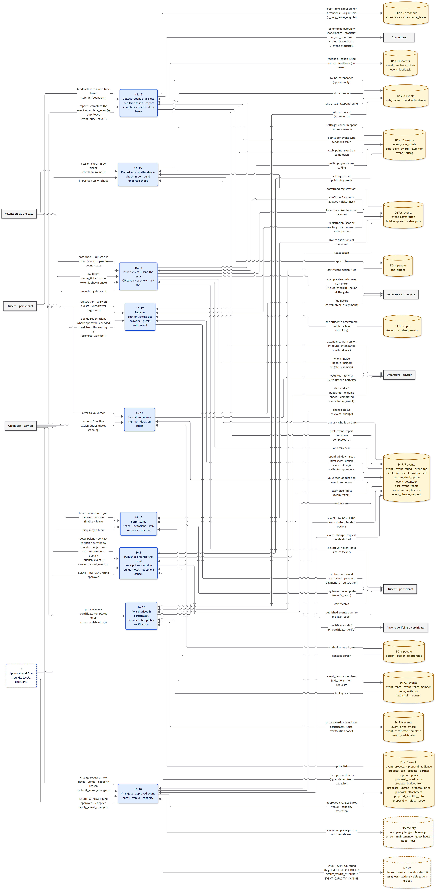

| Step | Guarded by | The database refuses |
|---|---|---|
| 16.9 Publish & organise | `trg_event_validate`, `trg_event_round_validate`, `trg_event_effects`, `events.publish_event()`, `events.cancel_event()` | An event without an approved proposal; publishing without descriptions, contact, window and a round, or by a non-organiser; a window closing after the start; a cap above the approved capacity; unpublishing with registrations; editing a completed or cancelled event; a round outside the event |
| 16.10 Change an approved event | `trg_event_change_request_validate`, `events.apply_event_change()`, `trg_event_proposal_validate` | A change by a non-organiser, to an event that has started, is over or cancelled, or that changes nothing; a capacity below the seats taken or the expected attendance; a submitted request edited; a second change while one is under approval; new dates too soon, before registration closes, or that would push a round outside the event; moving an approved event by editing its proposal; applying an unapproved change |
| 16.11 Volunteers | `trg_volunteer_application_validate`, `trg_volunteer_application_effects`, `trg_event_volunteer_validate` | An application to an event that takes none, is unpublished or over; from someone outside the university; a second one; a decision by a non-organiser or a second decision; a volunteer who is neither student nor employee |
| 16.12 Register | `trg_registration_validate` (row lock on the event), `registration (event, person)` unique, `trg_field_response_validate`, `trg_extra_pass_validate`, `events.promote_waitlist()` | Registering for an unpublished / closed event, outside the window, twice, or when it is not open to you; changing who registered; promoting with no seat free; cancelling for someone else, or withdrawing where it is not allowed; an answer outside the options or to another event's question; more guests than allowed |
| 16.13 Form teams | `trg_event_team_validate`, `trg_event_team_leader_member`, `trg_event_team_withdraw`, `event_team_member_one_live`, `trg_event_team_member_validate`, `trg_team_invitation_validate` / `trg_team_join_request_validate`, `team_invitation_one_open` / `team_join_request_one_open` | A second team for a participant; a team above its maximum; finalising below the minimum; leaving a final team; a non-organiser disqualifying; an invitation or request without an open team and a live registration, to someone already in a team, a second open one, answered twice or after it expired |
| 16.14 Tickets & gate | `events.issue_ticket()`, `ticket_check()`, `trg_registration_validate`, `trg_entry_scan_validate` | A ticket issued to anyone but its holder or an organiser, for a cancelled registration, or set by hand; a pass checked by someone not on gate duty; an unknown or replaced QR; a scan by someone who is neither a scanning volunteer nor an organiser (an import: an organiser); entry on a registration that is not confirmed; more people in than the pass allows; more out than are inside; any edit of the log |
| 16.15 Session attendance | `trg_round_attendance_validate`, `events.check_in_round()` | A session check-in by someone not on duty, with an unknown pass or another event's ticket, for a registration that is not confirmed, a second time, or before the session's check-in opens; an import by a volunteer; any edit |
| 16.16 Prizes & certificates | `trg_prize_award_validate`, `trg_certificate_validate`, `event_certificate_template` key | A prize for someone who did not attend or of another event; a certificate before the event starts, for a non-attendee, a winner's without a prize, a volunteer's for a participant, or altered after issue; two templates of one kind |
| 16.17 Feedback & closure | `trg_feedback_guard`, `feedback_token` (one per registration), `trg_post_event_report_validate`, `trg_event_validate` (completion) | Feedback without an unused token; a second token; an edited report; completing before the end. Duty leave is filed through the ATTENDANCE_LEAVE round of process 10, which applies its own rules |

### 2.16c · Fees, settlement, messages and stalls

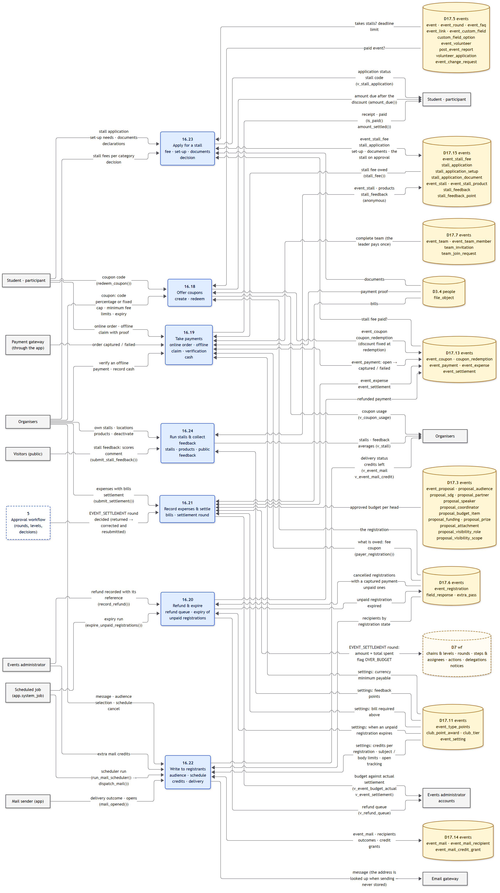

| Step | Guarded by | The database refuses |
|---|---|---|
| 16.18 Coupons | `trg_event_coupon_validate`, `trg_coupon_redemption_validate` | A coupon on a free event, by a non-organiser, above 100 %, a cap on a fixed coupon, a duplicate code; deleting a used coupon; redeeming another event's, an inactive, expired or exhausted coupon, a second coupon, someone else's registration, below the minimum fee, after payment |
| 16.19 Payments | `trg_event_payment_validate` | A payment on a free or fully paid registration, of the wrong amount, online without an order id or starting as paid, offline claimed by a stranger or without a reference, cash recorded by the payer; a team fee paid by a member or before the team is complete; verification of an offline payment by a non-organiser; a captured payment downgraded, edited or deleted |
| 16.20 Refunds & expiry | `events.record_refund()`, `events.expire_unpaid_registrations()` | A refund without the right or the reference, or twice; the expiry job outside a system job |
| 16.21 Expenses & settlement | `trg_event_expense_validate`, `trg_event_settlement_validate`, `events.submit_settlement()` | An expense by a non-organiser, of nothing, dated in the future, or against another event's budget line; any expense change while a settlement is under approval or once one is approved; settling an event that is not over, by a non-organiser, a second time, or with an expense above the bill limit and no bill; editing a settlement |
| 16.22 Messages | `trg_event_mail_validate`, `trg_event_mail_recipient_validate`, `events.dispatch_mail()`, `trg_event_mail_credit_grant_validate` | A message by a non-organiser, with a multi-line or over-long subject, scheduled in the past; hand-picked recipients on an audience message or from another event; sending twice, before the scheduled time, with no recipients or without enough credits; editing or cancelling once sending started; changing a final delivery outcome; credits granted by anyone but an events administrator; the scheduler outside a system job |
| 16.23 Stall applications | `trg_stall_application_validate`, `trg_stall_application_effects`, `trg_stall_application_setup_guard` / `_document_guard` | An application to an event that takes none, after the deadline or beyond the limit, a second one, without the declarations, a custom size not described; a decision by a non-organiser, a rejection without a reason, changes after the decision |
| 16.24 Stalls & feedback | `trg_event_stall_validate`, `trg_stall_feedback_guard`, `trg_stall_feedback_point_guard` | A stall set up by a non-organiser; a stall from an application that is not an approved one of the same event, or that repeats what the application says; renaming or deleting a stall that came from an application; feedback written directly, on an unknown or inactive stall, with a score off the scale or too many scores |

---

## Trust boundaries

The schemas are security boundaries, so a flow can be cut by a grant as well as
by a trigger.

| Database role | Used by | May read | May write | Cannot |
|---|---|---|---|---|
| `intranet_owner` | Migrations | everything | DDL | — |
| `intranet_app` | Django at run time | every schema | every schema; `audit` insert-only | `UPDATE` / `DELETE` on `audit.*`, on `wf.approval_instance` · `approval_instance_flag` · `approval_step` · `approval_action`, on `events.entry_scan` · `event_feedback` · `sponsorship_receipt` · `post_event_report`, and on `tms.ticket` · `ticket_event` · `ticket_academic_context` |
| `intranet_dpo` | DPO tooling | `ref` `org` `people` `academic` `exam` `research` `facility` `tms` `events` `pii` `privacy` | `privacy` only | `iam`, `authz`, `wf`, `audit` |
| `intranet_analytics` | BI tools | `ref` `org` `people` `academic` `exam` `research` `facility` `authz` `wf`; in `events` everything except the participant-level tables; in `tms` only configuration and the derived statistics (`v_ticket_state`, `v_ticket_sla`, `v_ticket_handler_stats`, `v_ticket_category_stats`, `v_ticket_category_rollup`, `v_grievance_summary`, `v_kb_article_stats`) — never ticket text, timelines, respondents or the per-ticket grievance register | nothing | `pii`, `iam`, `privacy`, `audit`; names (`people.person`), files, and the confidential tables: `answer_script`, `ufm_case`, `question_paper`, `question_bank_item`, `question_paper_item`, `examiner_panel`, `credit_transfer`, `feedback_response`, `study_break`, `disciplinary_case`, `attendance_leave`, `mentoring_meeting`, `approval_comment`, `approval_consultation`; in `events`: registrations, answers, guests, the gate log, feedback and its tokens, certificates, club applications, team invitations and join requests, speakers |

Secrets never cross into the database in usable form: passwords, OTPs, reset
and refresh tokens and recovery codes arrive as hashes; TOTP seeds and
government-ID numbers arrive as ciphertext whose key stays in the KMS.

---

## Data stores

Every non-lookup table, and the diagram(s) it appears on. Generated — do not
edit between the markers.

<!-- stores:begin -->
| Store | Schema | Tables | Shown on |
|---|---|---|---|
| **D2.1** | `org` | `org_unit`, `org_unit_type_rule`, `org_unit_contact`, `org_unit_location` | 01-org-people, 04-authorise, 05-workflow, 08-curriculum, 09b-nep-credits, 15-helpdesk, 16a-clubs-proposals |
| **D2.2** | `org` | `campus`, `building`, `floor`, `room`, `room_facility` | 01-org-people, 10a-term-setup, 11a-exam-conduct, 12-awards, 13-research, 14a-space-bookings, 14b-assets-transport |
| **D2.3** | `org` | `position_type`, `position_type_unit_type`, `appointment` | 01-org-people, 04-authorise, 15-helpdesk, 16a-clubs-proposals |
| **D3.1** | `people` | `person`, `person_relationship` | 01-org-people, 04-authorise, 06-privacy, 10b-teaching, 11a-exam-conduct, 13-research, 14b-assets-transport, 16a-clubs-proposals, 16b-running-events |
| **D3.2** | `people` | `designation`, `employee`, `employee_assignment`, `employee_reporting_line` | 01-org-people, 04-authorise, 05-workflow, 06-privacy, 08-curriculum, 10b-teaching, 11a-exam-conduct, 13-research, 14b-assets-transport, 15-helpdesk |
| **D3.3** | `people` | `student`, `student_mentor` | 01-org-people, 04-authorise, 09a-lifecycle, 10b-teaching, 15-helpdesk, 16a-clubs-proposals, 16b-running-events |
| **D3.4** | `people` | `file_object` | 01-org-people, 05-workflow, 06-privacy, 08-curriculum, 09b-nep-credits, 10b-teaching, 11a-exam-conduct, 12-awards, 13-research, 14b-assets-transport, 15-helpdesk, 16a-clubs-proposals, 16b-running-events, 16c-money-mail-stalls |
| **D4.1** | `pii` | `person_profile` | 01-org-people |
| **D4.2** | `pii` | `person_email`, `person_phone` | 01-org-people, 03-authenticate, 15-helpdesk |
| **D4.3** | `pii` | `address`, `person_address` | 01-org-people |
| **D4.4** | `pii` | `person_identity_document`, `person_photo` | 01-org-people, 09b-nep-credits, 14b-assets-transport |
| **D5.1** | `iam` | `user_account` | 01-org-people, 03-authenticate, 04-authorise, 06-privacy, 15-helpdesk |
| **D5.2** | `iam` | `password_history`, `password_reset_token` | 03-authenticate |
| **D5.3** | `iam` | `mfa_factor`, `mfa_totp`, `mfa_webauthn`, `mfa_otp_channel`, `mfa_recovery_code` | 03-authenticate |
| **D5.4** | `iam` | `otp_challenge` | 03-authenticate |
| **D5.5** | `iam` | `user_device`, `user_session` | 03-authenticate |
| **D5.6** | `iam` | `account_lockout` | 03-authenticate |
| **D5.7** | `iam` | `auth_event` | 03-authenticate |
| **D6.1** | `authz` | `app_module`, `resource`, `action`, `permission` | 04-authorise |
| **D6.2** | `authz` | `role`, `role_permission`, `role_inheritance`, `role_conflict` | 04-authorise |
| **D6.3** | `authz` | `account_role`, `account_permission` | 04-authorise |
| **D6.4** | `authz` | `designation_role`, `position_role`, `principal_kind_role` | 04-authorise |
| **D7.1** | `wf` | `approval_document_type`, `approval_chain`, `approval_chain_stage`, `approval_chain_stage_check` | 05-workflow |
| **D7.2** | `wf` | `approval_instance`, `approval_instance_flag`, `approval_step`, `approval_step_assignee`, `approval_step_check` | 05-workflow |
| **D7.3** | `wf` | `approval_action` | 05-workflow |
| **D7.4** | `wf` | `approval_comment`, `approval_consultation` | 05-workflow |
| **D7.5** | `wf` | `approval_delegation` | 05-workflow |
| **D7.6** | `wf` | `approval_notice` | 05-workflow |
| **D8.1** | `privacy` | `processing_purpose`, `purpose_data_category`, `data_element` | 06-privacy, 07-audit |
| **D8.2** | `privacy` | `privacy_notice`, `notice_purpose` | 06-privacy |
| **D8.3** | `privacy` | `consent`, `verifiable_parental_consent`, `nominee` | 06-privacy |
| **D8.4** | `privacy` | `data_principal_request`, `dpr_request_event` | 06-privacy |
| **D8.5** | `privacy` | `erasure_log` | 06-privacy |
| **D8.6** | `privacy` | `data_processor`, `processor_purpose` | 06-privacy |
| **D8.7** | `privacy` | `breach_incident`, `breach_affected_person`, `breach_notification` | 06-privacy |
| **D8.8** | `privacy` | `pii_access_log` | 06-privacy |
| **D9.1** | `audit` | `audit_event`, `audit_change` | 07-audit |
| **D10.1** | `academic` | `program`, `specialization`, `program_coordinator`, `program_outcome` | 08-curriculum |
| **D10.2** | `academic` | `program_approval`, `program_accreditation` | 08-curriculum |
| **D10.3** | `academic` | `academic_year`, `academic_term`, `calendar_event` | 08-curriculum, 09a-lifecycle, 10b-teaching, 15-helpdesk |
| **D10.4** | `academic` | `batch`, `batch_document`, `batch_specialization`, `batch_curriculum` | 08-curriculum, 09a-lifecycle, 15-helpdesk |
| **D10.5** | `academic` | `course`, `course_component_hours`, `course_prerequisite`, `course_continuation`, `course_regulator_code`, `course_room_requirement` | 08-curriculum, 09b-nep-credits, 15-helpdesk |
| **D10.6** | `academic` | `course_syllabus`, `syllabus_unit`, `course_outcome`, `co_po_mapping` | 08-curriculum, 10b-teaching, 11b-exam-results |
| **D10.7** | `academic` | `grade_scale`, `grade_band`, `division_band`, `relative_grade_cutoff` | 08-curriculum, 11b-exam-results |
| **D10.8** | `academic` | `evaluation_scheme`, `evaluation_component`, `evaluation_component_group`, `evaluation_part_rule`, `evaluation_component_outcome`, `attainment_policy` | 08-curriculum, 09b-nep-credits, 11b-exam-results |
| **D10.9** | `academic` | `curriculum`, `curriculum_course`, `elective_basket`, `elective_basket_course`, `curriculum_pathway`, `result_group` | 08-curriculum, 09a-lifecycle, 09b-nep-credits |
| **D10.10** | `academic` | `award_rule`, `award_rule_course`, `promotion_rule`, `attempt_allowance`, `credit_load_rule` | 08-curriculum, 09a-lifecycle, 09b-nep-credits, 12-awards |
| **D10.11** | `academic` | `academic_body`, `academic_body_member`, `body_meeting`, `body_meeting_attendee`, `body_resolution` | 05-workflow, 08-curriculum, 09a-lifecycle, 09b-nep-credits, 15-helpdesk |
| **D10.12** | `academic` | `curriculum_approval` | 05-workflow, 08-curriculum |
| **D11.1** | `academic` | `student_enrollment`, `student_specialization`, `student_pathway` | 09a-lifecycle, 09b-nep-credits, 12-awards, 13-research, 15-helpdesk |
| **D11.2** | `academic` | `term_registration` | 09a-lifecycle |
| **D11.3** | `academic` | `study_break`, `disciplinary_case` | 09a-lifecycle |
| **D11.4** | `academic` | `program_transfer`, `enrollment_reentry` | 09a-lifecycle, 09b-nep-credits |
| **D11.5** | `academic` | `course_equivalence`, `external_provider`, `external_course`, `external_course_mapping` | 09b-nep-credits |
| **D11.6** | `academic` | `credit_transfer` | 09b-nep-credits, 12-awards |
| **D11.7** | `academic` | `track`, `track_course`, `student_track` | 09b-nep-credits |
| **D11.8** | `academic` | `student_award` | 09a-lifecycle, 12-awards |
| **D11.9** | `academic` | `credit_overload_approval` | 09a-lifecycle |
| **D12.1** | `academic` | `course_offering`, `offering_seat_quota` | 10a-term-setup |
| **D12.2** | `academic` | `section`, `section_student`, `section_representative` | 10a-term-setup |
| **D12.3** | `academic` | `elective_preference` | 10a-term-setup |
| **D12.4** | `academic` | `course_registration` | 10a-term-setup, 10b-teaching |
| **D12.5** | `academic` | `class_group`, `class_group_member` | 10a-term-setup |
| **D12.6** | `academic` | `teaching_assignment`, `faculty_course_preference` | 10a-term-setup, 10b-teaching |
| **D12.7** | `academic` | `time_slot`, `faculty_unavailability`, `workload_norm` | 10a-term-setup |
| **D12.8** | `academic` | `timetable_entry` | 10a-term-setup, 10b-teaching, 14a-space-bookings |
| **D12.9** | `academic` | `lesson_plan_item`, `class_session`, `class_session_topic` | 10b-teaching, 14a-space-bookings |
| **D12.10** | `academic` | `attendance`, `attendance_leave` | 05-workflow, 10b-teaching, 16b-running-events |
| **D12.11** | `academic` | `feedback_questionnaire`, `feedback_question`, `feedback_cycle`, `feedback_submission`, `feedback_response` | 10b-teaching |
| **D12.12** | `academic` | `mentoring_meeting` | 10b-teaching |
| **D12.13** | `academic` | `supervised_work`, `supervised_work_guide`, `internship` | 10b-teaching |
| **D13.1** | `exam` | `exam_session` | 11a-exam-conduct |
| **D13.2** | `exam` | `eligibility_hold`, `attendance_condonation` | 11a-exam-conduct |
| **D13.3** | `exam` | `exam_registration` | 11a-exam-conduct |
| **D13.4** | `exam` | `paper_setter_assignment`, `question_bank_item`, `question_paper`, `question_paper_item` | 11a-exam-conduct, 11b-exam-results |
| **D13.5** | `exam` | `exam_schedule`, `exam_room`, `seat_allocation`, `invigilation_duty`, `examiner_panel` | 11a-exam-conduct, 11b-exam-results, 14a-space-bookings |
| **D13.6** | `exam` | `exam_attendance`, `ufm_case` | 11a-exam-conduct, 11b-exam-results |
| **D13.7** | `exam` | `answer_script`, `evaluator_assignment`, `script_mark` | 11b-exam-results |
| **D13.8** | `exam` | `component_mark`, `question_mark`, `internal_mark_revision` | 05-workflow, 11b-exam-results |
| **D13.9** | `exam` | `grace_policy`, `grace_award`, `result_moderation` | 11b-exam-results |
| **D13.10** | `exam` | `result_publication`, `course_result` | 09a-lifecycle, 09b-nep-credits, 10a-term-setup, 11b-exam-results, 12-awards, 13-research |
| **D13.11** | `exam` | `revaluation_request` | 11b-exam-results |
| **D13.12** | `exam` | `marksheet`, `certificate` | 12-awards |
| **D13.13** | `exam` | `convocation`, `prize`, `prize_award` | 12-awards, 14a-space-bookings |
| **D14.1** | `research` | `supervision_norm`, `supervisor_allocation` | 13-research |
| **D14.2** | `research` | `advisory_committee`, `advisory_committee_member`, `progress_review` | 13-research |
| **D14.3** | `research` | `thesis` | 13-research |
| **D14.4** | `research` | `thesis_examiner` | 13-research |
| **D14.5** | `research` | `viva` | 12-awards, 13-research, 14a-space-bookings |
| **D15.1** | `facility` | `room_composition`, `custody`, `space_allocation`, `room_reservation_rule` | 14a-space-bookings |
| **D15.2** | `facility` | `hold_priority_rule`, `room_service_window`, `blackout` | 14a-space-bookings, 14b-assets-transport |
| **D15.3** | `facility` | `room_hold` | 14a-space-bookings, 14b-assets-transport |
| **D15.4** | `facility` | `booking_policy`, `booking_restriction` | 14a-space-bookings |
| **D15.5** | `facility` | `event_request`, `booking_group`, `booking_request`, `booking_requirement`, `booking_occurrence` | 14a-space-bookings, 14b-assets-transport |
| **D15.6** | `facility` | `vendor`, `asset`, `service_contract`, `booking_asset`, `asset_loan`, `asset_hold` | 14b-assets-transport |
| **D15.7** | `facility` | `maintenance_schedule`, `work_order`, `work_order_event` | 14b-assets-transport |
| **D15.8** | `facility` | `guest_stay`, `guest_tariff` | 14b-assets-transport |
| **D15.9** | `facility` | `parking_permit` | 14b-assets-transport |
| **D15.10** | `facility` | `vehicle`, `vehicle_document`, `vehicle_service_window`, `driver`, `driver_unavailability`, `transport_policy` | 14b-assets-transport |
| **D15.11** | `facility` | `trip_request`, `trip_allocation`, `trip_allocation_request`, `trip`, `trip_rating`, `trip_alert` | 14b-assets-transport |
| **D15.12** | `facility` | `key_item`, `key_issue` | 14b-assets-transport |
| **D16.1** | `tms` | `helpdesk_setting`, `helpdesk_weekday`, `helpdesk_day_override`, `helpdesk_closure_type`, `helpdesk_declaration`, `helpdesk_file_type`, `helpdesk_channel`, `ticket_notice_rule` | 15-helpdesk |
| **D16.2** | `tms` | `ticket_category`, `ticket_category_owner`, `ticket_category_handler` | 15-helpdesk |
| **D16.3** | `tms` | `ticket_route`, `ticket_route_level`, `redressal_forum` | 15-helpdesk |
| **D16.4** | `tms` | `ticket`, `ticket_number_counter`, `ticket_academic_context`, `ticket_respondent` | 15-helpdesk |
| **D16.5** | `tms` | `ticket_event`, `ticket_event_file` | 15-helpdesk |
| **D16.6** | `tms` | `ticket_notification`, `notice_opt_out` | 15-helpdesk |
| **D16.7** | `tms` | `kb_article`, `kb_feedback` | 15-helpdesk |
| **D17.1** | `events` | `club`, `club_officer`, `club_member`, `club_application`, `club_suspension`, `club_calendar_item`, `primary_club` | 16a-clubs-proposals |
| **D17.2** | `events` | `club_proposal`, `club_proposal_officer`, `club_proposal_member`, `club_proposal_attachment` | 16a-clubs-proposals |
| **D17.3** | `events` | `event_proposal`, `proposal_audience`, `proposal_sdg`, `proposal_partner`, `proposal_speaker`, `proposal_coordinator`, `proposal_budget_item`, `proposal_funding`, `proposal_prize`, `proposal_attachment`, `proposal_visibility_role`, `proposal_visibility_scope` | 16a-clubs-proposals, 16b-running-events, 16c-money-mail-stalls |
| **D17.4** | `events` | `event_sponsor`, `event_sponsorship`, `sponsorship_receipt`, `sponsorship_item` | 16a-clubs-proposals |
| **D17.5** | `events` | `event`, `event_round`, `event_faq`, `event_link`, `event_custom_field`, `custom_field_option`, `event_volunteer`, `post_event_report`, `volunteer_application`, `event_change_request` | 16b-running-events, 16c-money-mail-stalls |
| **D17.6** | `events` | `event_registration`, `field_response`, `extra_pass` | 16b-running-events, 16c-money-mail-stalls |
| **D17.7** | `events` | `event_team`, `event_team_member`, `team_invitation`, `team_join_request` | 16b-running-events, 16c-money-mail-stalls |
| **D17.8** | `events` | `entry_scan`, `round_attendance` | 16b-running-events |
| **D17.9** | `events` | `event_prize_award`, `event_certificate_template`, `event_certificate` | 16b-running-events |
| **D17.10** | `events` | `event_feedback_token`, `event_feedback` | 16b-running-events |
| **D17.11** | `events` | `event_type_points`, `club_point_award`, `club_tier`, `event_setting` | 16a-clubs-proposals, 16b-running-events, 16c-money-mail-stalls |
| **D17.12** | `events` | `club_change_request`, `club_change_officer`, `club_change_member` | 16a-clubs-proposals |
| **D17.13** | `events` | `event_coupon`, `coupon_redemption`, `event_payment`, `event_expense`, `event_settlement` | 16c-money-mail-stalls |
| **D17.14** | `events` | `event_mail`, `event_mail_recipient`, `event_mail_credit_grant` | 16c-money-mail-stalls |
| **D17.15** | `events` | `event_stall_fee`, `stall_application`, `stall_application_setup`, `stall_application_document`, `event_stall`, `event_stall_product`, `stall_feedback`, `stall_feedback_point` | 16c-money-mail-stalls |
<!-- stores:end -->

`D1` is the `ref` schema: 183 lookup tables, read by every process. Their rule
flags (`can_login`, `is_counted`, `is_promoted`, `counts_as_present`,
`is_scheduled_exam`, `requires_award` …) are what many of the triggers above
read, so a policy change is a data change.

---

## Regenerating

The diagrams are generated from one specification, `docs/dfd/build_dfd.py`,
which also holds the table → store registry.

```bash
python docs/dfd/build_dfd.py      # writes docs/dfd/dfd-*.mmd and features/dfd-3-*.mmd, docs/data-flow-features.md, checks coverage, refreshes the table above
MMDC=/path/to/node_modules/.bin/mmdc bash docs/dfd/render.sh      # .mmd → .png + .svg (Levels 0–3; or name the diagrams to render)
python scripts/gen_catalog_diagrams.py    # the catalog's per-table features, views and functions follow the specs
```

The Level-3 feature diagrams are not specified separately: each is the
Level-2 step with every flow it touches, so changing a Level-2 flow changes
its feature on the next run.

`build_dfd.py` exits non-zero when a table in `sql/*.sql` is missing from the
registry, listed twice, placed in the wrong schema, or when a store is never
shown or never written, a node has no flow, or a process has no input or no
output. **After adding a table, add it to a store there and to a flow on the
right diagram** — the check will say so if you forget.

A read flow is emitted as `process <--> store` with the arrowhead at the store
end hidden (`linkStyle … marker-end:none`). That keeps every diagram in three
columns — sources, processes, stores and sinks — and is why the `.mmd` files
are generated rather than written by hand.
