# New Intranet — Foundation Database Design

Scope: the shared foundation every module builds on. It covers the **organisation structure, academic structure (programmes, academic calendar, years and term cycles, batches, regulator approvals and accreditation), curriculum and teaching delivery (courses, curricula, syllabus and outcomes, sections, faculty assignment, timetable, lesson plans, attendance, workload, anonymous feedback), the student lifecycle (term registration, academic standing, breaks in study, programme transfer, maximum duration), examinations (scheme of examination, eligibility, registration and attempt limits, question papers, date sheet, seating, evaluation, results, division, revaluation, certificates and convocation), research degrees (supervision, committees, thesis, viva), people and student enrollment, user creation, roles and permissions, and login (with MFA)**, plus **DPDP Act 2023** controls and an **audit trail**. Module-specific tables (IPR, events …) are out of scope; the helpdesk (TMS) is built as the first module on top, in its own file `sql/12_tms.sql` (schema `tms`). Modules plug in by referencing `org.org_unit`, `people.person` / `people.employee` / `people.student`, and `iam.user_account`, and by registering their permissions in `authz`.

Stack: **PostgreSQL 16+**, with a Django backend. Everything was verified on PostgreSQL 17.6 (see *Verification* in the README).

---

## 1. Why a redesign: problems in the current SGT UMS schema

| Current (Node/Prisma UMS) | New design |
|---|---|
| `UserLogin.role` is a hard-coded enum (`student/faculty/staff/admin…`) | A person *is* an employee / student / guardian (fact tables). Roles are data in `authz.role` |
| Permissions are free-form JSON `{key: true}` in 3 tables, plus `Role.permissions` JSON, plus a `assignedRoleIds` JSON array | `permission` = resource × action; `role_permission`, `account_role`, `account_permission` are relational |
| 21 JSON UUID-array scope columns on `CentralDepartmentPermission` (`assignedResearchSchoolIds` …) | One `scope_org_unit_id` per grant row, with `include_descendants` |
| Three separate org tables (`FacultySchoolList`, `Department`, `CentralDepartment`) | One `org.org_unit` tree with type rules enforced by the DB |
| Employee affiliation stored as 3 nullable FKs + a CHECK, and duplicated in permission `isPrimary` flags | `people.employee_assignment` with validity ranges. The DB guarantees exactly one primary assignment at a time |
| Designation is free text, matched by string (`includes('guard')`) | `people.designation` master list |
| `Program.metadata` JSON (`batchYearDocuments`, `specializationChargeRules`, `creditRange`); separate `TmsAcademicSession` / `TmsAdmissionBatch` lists; `SchoolErpSessionType` on the school; `StudentDetails.currentSemester` stored and edited by hand | `academic.program` (credit range as columns), `academic.batch` (programme × admission year) with `batch_document` and `batch_specialization`, `academic.academic_year` + `academic_term` over `ref.term_cycle`. A school's session types and a student's current semester are **derived** |
| Unused `headOf*` columns; handlers scattered across `TmsRoleHandler`, `EventPermissionConfig`, `NotingAuthority` … | `org.appointment` (single holder per position). Positions confer roles via `authz.position_role` |
| Role templates are *copied* into per-user JSON (`applyRoleToUser`) and drift | Derivation rules (`designation_role`, `position_role`, `principal_kind_role`) are resolved live in views. Nothing is copied |
| Login by UID only; no reset flow, refresh tokens, MFA or session revocation | UID **or** verified email; reset tokens, TOTP/WebAuthn/OTP MFA, rotating refresh sessions, lockouts, auth log |
| No privacy controls | Notices, consent, guardian consent, rights requests, nominee, processors, retention/erasure, breach register, PII access log |

---

## 2. Design principles

1. **BCNF / 4NF.** Every multi-valued fact has its own table: emails, phones, addresses, documents, photos, assignments, appointments, grants and scopes. **No JSON and no arrays** hold relational data.
2. **Derived data is never stored.** The following are all views or functions (§6):
   - display name, age and minor status
   - current affiliation and the employee's school
   - a student's home department, batch year and current term/semester number
   - programme duration in years
   - permission codes and effective roles/permissions
   - the account's last login
   - the status of a rights request
3. **Lookup tables instead of enums.** Each is `smallint id`, unique `code`, `label`, `is_active`, `sort_order`, so new values are data changes, not migrations.
4. **Effective dating with range types plus `EXCLUDE USING gist`.** This applies wherever history matters to the business: assignments, appointments, mentors, enrollments, programme coordinators, academic years/terms, addresses, photos, grants, nominees, consents and lockouts. The database, not the application, rejects overlaps.
5. **Current state as columns, history in the audit trail.** No parallel `*_status_history` tables. The exception is the rights-request event log, whose history the law itself requires.
6. **Schemas are security boundaries.** `pii` is invisible to analytics, and audit is append-only for the app.
7. **Erase rather than soft-delete.** Personal data is removed or anonymised, with evidence kept in `privacy.erasure_log`.

### Keys and types

| Kind | Key | Notes |
|---|---|---|
| Entities | `uuid` `gen_random_uuid()` | Switch to `uuidv7()` on PG 18 for index locality |
| Lookups | `smallint` / `int` identity | Stable `code` used by application code |
| Logs | `bigint` identity + timestamp | Monthly range partitions; retention = drop old partitions |
| Text keys | `citext` | Usernames, emails, codes are case-insensitive |
| Timestamps | `timestamptz` | `created_at`/`updated_at` everywhere (trigger keeps `updated_at`) |

---

## 3. Schema map

```
ref      183 lookup tables (geography, genders, statuses, programme levels, calendar types, term cycles, job functions, job roles, award types, DPDP bases …
         plus delivery modes, regulators, accreditation bodies, calendar event types, term registration statuses, academic standings,
         study break types, enrollment end reasons, Bloom levels, PO/PSO types, supervisor / committee / examiner roles, review outcomes,
         thesis statuses, examiner recommendations, paper-setter roles, question paper statuses, certificate types,
         facility: building kinds, room uses, hold types, booking purposes, cancel & restriction reasons, asset types & conditions,
         work-order categories / priorities / statuses, guest categories, vehicle / fuel / licence / document types, trip purposes …)
org      org_unit tree · type rules · contacts · campus / building (kind) / floor / room (use, area) · positions · appointments
people   person · relationships · designation · employee · assignment (+ function/role) · reporting_line · student · mentor · file_object
academic program (delivery mode, medium) · specialization · program_coordinator · academic_year · academic_term · batch
         · batch_document · batch_specialization · student_enrollment (end reason) · student_specialization
         · grade_scale/band · evaluation_scheme/component (scheme of examination, result rules as data)
         · evaluation_component_group (best N of M) · evaluation_part_rule (internal / external minimums)
         · course · L-T-P hours · prerequisites · curriculum (max duration, attempts) · curriculum_course · elective baskets · batch_curriculum
         · course_offering · section · section_student · class_group (lab batch / elective group) · class_group_member
         · course_registration · teaching_assignment (section-wise, per group, or combined)
         · time_slot · faculty_unavailability · timetable_entry (weekly / every N weeks) · class_session · attendance
         NEP 2020: course_equivalence · award_rule · award_rule_course · student_award · enrollment_reentry
         · external_provider · external_course · external_course_mapping · credit_transfer
         · track · track_course · student_track (minors & honours)
         calendar: calendar_event (holidays, vacations, registration / exam windows; read by is_working_day())
         approvals: program_approval (regulator, sanctioned seats) · program_accreditation (NAAC institution / NBA programme)
         lifecycle: promotion_rule · term_registration (semester registration + academic standing) · study_break · program_transfer
         · elective_preference (ranked choices; allotted by allot_electives()) · offering_seat_quota (seat ceiling per programme / school)
         content & outcomes: course_syllabus · syllabus_unit · course_outcome · program_outcome · co_po_mapping
         · lesson_plan_item · class_session_topic (course file)
         · workload_norm (hours / week per designation) · division_band (CGPA range → division)
         feedback: feedback_questionnaire · feedback_question · feedback_cycle · feedback_submission · feedback_response (no student column)
exam     exam_session · eligibility_hold · attendance_condonation · exam_registration · exam_schedule (date sheet)
         · exam_room · seat_allocation · invigilation_duty · exam_attendance · ufm_case
         · answer_script · evaluator_assignment · script_mark · component_mark · grace_policy/award · result_moderation
         · result_publication · course_result · marksheet · revaluation_request
         · paper_setter_assignment · question_paper (draft → moderated → approved → used) · convocation · certificate
         · examiner_panel (practical / viva) · internal_mark_revision
         · prize · prize_award · question_bank_item · question_paper_item · question_mark (per question, for CO attainment)
research supervision_norm · supervisor_allocation · advisory_committee · advisory_committee_member
         · progress_review · thesis · thesis_examiner · viva
facility space: room_composition · custody · space_allocation · room_reservation_rule · hold_priority_rule · room_service_window · blackout
         ledger: room_hold (every use of a room, from every source; EXCLUDE per room; displacement / reinstatement)
         bookings: booking_policy · booking_restriction · event_request · booking_group · booking_request · booking_requirement · booking_occurrence
         assets: vendor · asset · service_contract · booking_asset · asset_loan · asset_hold · maintenance_schedule · work_order · work_order_event
         guest house & parking: guest_stay · guest_tariff · parking_permit
         fleet: vehicle · vehicle_document · vehicle_service_window · driver · driver_unavailability · transport_policy
         · trip_request · trip_allocation · trip_allocation_request · trip · trip_rating · trip_alert
         keys: key_item · key_issue
tms      (module, sql/12_tms.sql; docs/tms/tms-design.md) helpdesk_setting · helpdesk_weekday (hours per day)
         · helpdesk_day_override (dated open / closed days) · helpdesk_closure_type
         · helpdesk_declaration · ticket_notice_rule
         · ticket_category (one tree: KRA type → master → category → leaf; route, forum, confidentiality … inherited)
         · ticket_category_owner (dated) · ticket_category_handler (round-robin, optionally per unit)
         · ticket_route · ticket_route_level (pool / owner / mentor / manager / position relative to the requester / named)
         · redressal_forum (SGRC → Ombudsperson, ICC, anti-ragging, equal opportunity — committees = academic_body)
         · ticket (immutable) · ticket_number_counter (per year) · ticket_academic_context · ticket_respondent
         · ticket_event (append-only → derived state, SLA clock; holds, consultations, compliance) · ticket_event_file
         · ticket_notification · notice_opt_out · helpdesk_channel · helpdesk_file_type · kb_article · kb_feedback (anonymous)
events   (module, sql/13_events.sql) clubs: club_proposal (+ officers, members, attachments) · club (= org unit of type CLUB)
         · club_officer · club_member · club_application · club_suspension · club_calendar_item
         proposals: event_proposal (+ audience, SDGs, partners, speakers, coordinators, budget items, funding, prizes,
           attachments, visibility roles / scopes) · event_sponsor · event_sponsorship · sponsorship_receipt · sponsorship_item
         events: event (created by the approval) · event_round · event_faq · event_link · event_custom_field · custom_field_option
         · event_volunteer · post_event_report
         participation: event_registration (seat / waiting list) · field_response · extra_pass · event_team · event_team_member
         · team_invitation · team_join_request · entry_scan (append-only gate log) · event_prize_award
         afterwards: event_feedback_token · event_feedback (anonymous) · event_certificate_template · event_certificate
         · event_type_points · club_point_award · club_tier
         settings: event_setting (one row: every policy value of the module that is not a lookup, a dated row or a chain row)
         club changes: club_change_request (+ officer and member lines; applied on approval) · primary_club · volunteer_application
         money: event_coupon · coupon_redemption · event_payment (online order / offline claim; captured, failed, refunded)
         messages: event_mail · event_mail_recipient (no address stored) · event_mail_credit_grant
         after approval: event_change_request (dates, venue, capacity — applied on approval) · round_attendance (per session)
         · event_expense · event_settlement (budget against actual, approved through the engine)
         stalls: event_stall_fee · stall_application (+ set-ups, documents) · event_stall (+ products) · stall_feedback · stall_feedback_point
pii      profile (DOB…) · emails · phones · addresses · identity documents · photos
iam      user_account · password history/reset · MFA (factor + TOTP/WebAuthn/OTP) · recovery codes
         · OTP challenges · devices · sessions · lockouts · auth_event
authz    app_module · resource · action · permission · role · role_permission · role_inheritance
         · role_conflict · account_role · account_permission · designation_role · position_role · principal_kind_role
wf       the approval engine — configuration: approval_document_type · approval_chain (default / per org subtree)
         · approval_chain_stage (who approves: permission at an org level / position / manager / named / committee; how many;
           amount & flag conditions; self-approval rule; file / signature; forward / return-to; deadline & timeout action)
         · approval_chain_stage_check (checklist)
         order: approval_chain.allows_level_override + min_approved_levels (a higher level may pass lower ones over) · approval_chain_stage.is_mandatory
         rounds: approval_instance (amount, subject person) · approval_instance_flag · approval_step (snapshot)
         · approval_step_assignee · approval_step_check
         · approval_action (append-only: approve, sign, return, return-to, reject, withdraw, forward, delegate; system escalate / auto-decide)
         around it: approval_delegation (out of office) · approval_consultation · approval_comment · approval_notice (outbox)
privacy  purposes · data inventory · notices · consent · parental consent · nominee · rights requests
         · processors · erasure log · breach register · PII access log
audit    audit_event · audit_change
```

The full column-level reference is in [data-dictionary.md](data-dictionary.md). For *why* each individual table exists and exactly which other tables it connects to, see [table-catalog.md](table-catalog.md).

---

## 4. ER diagrams

### 4.1 Organisation and people

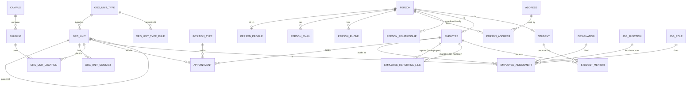

**Designation vs. function vs. role — three separate, orthogonal attributes of an assignment, all optional except designation:**
- **Designation** — the formal title/rank (Professor, Assistant Professor, HR Manager). Drives pay grade and hierarchy.
- **Job function** (`ref.job_function`) — the functional area (Academics, Finance, IT…), independent of which department someone physically sits in.
- **Job role** (`ref.job_role`) — what the person actually does (Teaching, Recruitment, Payroll Processing…).

**Reporting lines** (`people.employee_reporting_line`) — the reporting manager (day-to-day line manager) and reviewing manager (appraisal / skip-level) are tracked separately, since they can differ in a matrix org, and both are dated so a manager change doesn't erase history. The DB enforces:
- at most one active manager of each type per employee at a time (`EXCLUDE`),
- an employee can't report to themselves (`CHECK`),
- no reporting-chain cycles among currently active lines of the same type (trigger, same technique as the org-unit tree in §4.1).

### 4.1b Academic structure

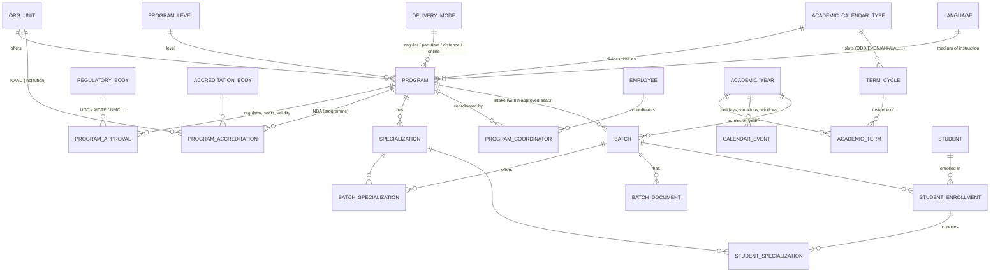

**Programme attributes and approvals:** a programme also carries its **delivery mode** (`ref.delivery_mode`: regular, part-time, distance, online, hybrid) and, optionally, its **medium of instruction** (`ref.language`); both are exposed by `academic.v_program`. Each **regulator approval** (`program_approval`: UGC, AICTE, NMC, PCI … with letter number, sanctioned seats and validity, one per body at a time) is what a batch's `intake_capacity` is checked against — a batch cannot open with more seats than the approval valid at the start of its admission year allows. **Accreditation** (`program_accreditation`) targets exactly one of a programme (NBA) or an org unit (NAAC), with grade, score and validity, one per body at a time.

**What is derived rather than stored:**
- **Batch year** is the start year of the admission `academic_year` (for example, "BTECH-CSE 2026"). See `academic.v_batch`.
- **Duration in years** is `duration_terms / terms_per_year` (`academic.v_program`).
- **Home department and school** come from the programme's `offering_org_unit_id`.
- **Current term/semester** is `academic.enrollment_term_no(enrollment, term)`, which reads the **term registration first**: the counted registration for that term, if one exists; otherwise the latest earlier registration's term number — plus one per term since if the standing was *promoted*, the same term again if *detained* — and only with no registration at all does it fall back to `entry_term_no − 1` + the terms of the programme's calendar type since the enrollment date. Terms that fall entirely inside a `study_break` are never counted. `academic.v_student_enrollment_current` exposes this as `current_term_no` together with `is_on_break`. A student who joins mid-term counts that term; a lateral entrant starts at `entry_term_no`.
- **Working day** (`academic.is_working_day(date, org_unit)`) is false when a non-working `calendar_event` (holiday, vacation) covers the date university-wide or for the unit or any of its ancestors. A timetable-generated class session on such a day is rejected; an extra class carrying its own time is not.
- **"Which session types a school runs"** (the old `SchoolErpSessionType`) is simply the calendar types of the programmes it offers.

### 4.1c Curriculum, teaching delivery and examination

```mermaid
erDiagram
  PROGRAM ||--o{ CURRICULUM : "versioned scheme of studies"
  GRADE_SCALE ||--o{ CURRICULUM : "grades by"
  CURRICULUM ||--o{ CURRICULUM_COURSE : "fixed course per term"
  CURRICULUM ||--o{ ELECTIVE_BASKET : "choose N"
  ELECTIVE_BASKET ||--o{ ELECTIVE_BASKET_COURSE : ""
  COURSE ||--o{ CURRICULUM_COURSE : ""
  COURSE ||--o{ ELECTIVE_BASKET_COURSE : ""
  COURSE ||--o{ COURSE_SYLLABUS : "versioned, one current"
  COURSE_SYLLABUS ||--o{ SYLLABUS_UNIT : "units, contact hours"
  COURSE_SYLLABUS ||--o{ COURSE_OUTCOME : "CO1 … with Bloom level"
  PROGRAM ||--o{ PROGRAM_OUTCOME : "PO / PSO"
  COURSE_OUTCOME ||--o{ CO_PO_MAPPING : "strength 1-3"
  PROGRAM_OUTCOME ||--o{ CO_PO_MAPPING : ""
  EVALUATION_SCHEME ||--o{ CURRICULUM_COURSE : "scheme of exam"
  EVALUATION_SCHEME ||--o{ EVALUATION_COMPONENT : "weights = 100%"
  BATCH ||--o| BATCH_CURRICULUM : follows
  CURRICULUM ||--o{ BATCH_CURRICULUM : ""
  COURSE ||--o{ COURSE_OFFERING : "runs in a term"
  COURSE_OFFERING ||--o{ OFFERING_SEAT_QUOTA : "seat ceiling per programme / school"
  BATCH ||--o{ SECTION : "per term"
  SECTION ||--o{ SECTION_STUDENT : ""
  SECTION ||--o{ CLASS_GROUP : "lab / tutorial batches"
  COURSE_OFFERING ||--o{ CLASS_GROUP : "batches, elective groups"
  CLASS_GROUP ||--o{ CLASS_GROUP_MEMBER : ""
  COURSE_REGISTRATION ||--o{ CLASS_GROUP_MEMBER : ""
  SECTION ||--o{ TEACHING_ASSIGNMENT : "section-wise teacher"
  CLASS_GROUP ||--o{ TEACHING_ASSIGNMENT : "batch / group teacher"
  STUDENT_ENROLLMENT ||--o{ COURSE_REGISTRATION : takes
  COURSE_OFFERING ||--o{ COURSE_REGISTRATION : ""
  COURSE_OFFERING ||--o{ TEACHING_ASSIGNMENT : "faculty x class x L/T/P"
  TEACHING_ASSIGNMENT ||--o{ TIMETABLE_ENTRY : "slot + room (no clashes)"
  TIMETABLE_ENTRY ||--o{ CLASS_SESSION : "dated class"
  CLASS_SESSION ||--o{ ATTENDANCE : ""
  COURSE_REGISTRATION ||--o{ ATTENDANCE : ""
  COURSE_REGISTRATION ||--o{ EXAM_REGISTRATION : "attempt (regular/backlog/...; attempt limit)"
  EXAM_SESSION ||--o{ EXAM_REGISTRATION : ""
  EXAM_SESSION ||--o{ PAPER_SETTER_ASSIGNMENT : "setter / moderator per paper"
  EXAM_SESSION ||--o{ QUESTION_PAPER : "set A / B …"
  PAPER_SETTER_ASSIGNMENT ||--o{ QUESTION_PAPER : "submitted / moderated by"
  QUESTION_PAPER ||--o{ EXAM_SCHEDULE : "approved set used"
  EXAM_SESSION ||--o{ EXAM_SCHEDULE : "date sheet"
  EXAM_SCHEDULE ||--o{ SEAT_ALLOCATION : "via exam_room"
  EXAM_SCHEDULE ||--o{ ANSWER_SCRIPT : "dummy-coded"
  ANSWER_SCRIPT ||--o{ SCRIPT_MARK : "per evaluation round"
  EXAM_REGISTRATION ||--o{ COURSE_RESULT : "per publication"
  RESULT_PUBLICATION ||--o{ COURSE_RESULT : ""
  GRADE_BAND ||--o{ COURSE_RESULT : ""
  STUDENT_ENROLLMENT ||--o{ CERTIFICATE : "transcript, migration, bonafide …"
  STUDENT_AWARD ||--o{ CERTIFICATE : "degree / provisional (one original)"
  CONVOCATION ||--o{ CERTIFICATE : "conferred at"
```

**The regulation / operation split:** the *rules* — grade scale, scheme of examination (components and weightage), curriculum, attendance threshold — are academic regulations in `academic`, attached to a curriculum version. The *operations* — who sat which paper, where, what marks, which result was published — are the exam cell's record in `exam`, a separate schema so its most sensitive parts (the answer-script ↔ student link, unfair-means cases) can be withheld from reporting.

**What is derived, not stored:** a registration's scheme of examination (through batch → curriculum, an approved equivalent, or a minor/honours track), attendance % (`academic.v_attendance_summary`), eligibility (`exam.v_exam_eligibility`), the mark that counts for a script (highest evaluation round), which components count in a best-of group, the provisional result (`exam.v_provisional_result`), attempt number, hall ticket, the credit ledger, SGPA and CGPA, the division and equivalent percentage (`exam.v_division`, from `division_band` and the grade scale's `pct_conversion_factor`), and syllabus coverage (`academic.v_syllabus_coverage`, from lesson plan items and the topics recorded against held sessions).

**Syllabus and outcomes (NBA / NAAC outcome-based education):** a course has versioned syllabi (`course_syllabus`, one current at a time, Board-of-Studies approved), each with its units and course outcomes; a programme has its POs / PSOs; `co_po_mapping` (strength 1–3) is accepted only when the course is actually part of one of that programme's curricula or tracks. A syllabus change never rewrites what an earlier batch was taught.

**Question papers and attempts:** a paper is prepared per session × offering × exam type — the same triple as the date sheet — so it can exist *before* the date sheet does. `paper_setter_assignment` names the setter and the moderator (never the same person); `question_paper` moves draft → submitted → moderated → approved → printed → used, with the status lookup saying what must already be on the row (a moderator, an approver), and `exam_schedule.question_paper_id` may only point at an *approved* set for that same triple. The curriculum's `max_attempts_per_course` (NULL = no limit) is enforced on `exam_registration`: once a course registration has used its attempts, no further exam registration is accepted.

**The one deliberate exception:** a *published* result (`exam.course_result.total_pct`) is stored, because an issued result is a legal record that must not move when marks, grace or policy change later. It is immutable, corrections are new publications, and the grade band it points to is frozen. Likewise `exam.certificate` records only the *issue* of a legal document (serial, public verification code, NAD / DigiLocker reference, file) — its content is derived from results and the award. The certificate type's flags set the rules: a degree or provisional certificate needs a conferred award of the same enrollment, a migration certificate needs a closed enrollment, single-issue types allow one uncancelled original per enrollment (duplicates are separate rows and need an original), and only award certificates are conferred at a convocation.

### 4.1d NEP 2020 flexibility: exits, credits, minors, equivalence

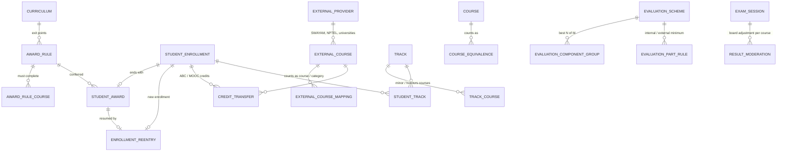

These tables (`sql/04c_academic_flexibility.sql`, plus the scheme and
timetable columns in `04_academic.sql` and `exam.result_moderation`) add the
NEP 2020 / UGC flexibility without any special-case code:

| NEP / UGC requirement | How the database supports it |
|---|---|
| **Multiple entry & exit** — certificate after year 1, diploma after year 2, degree, honours | `award_rule` per curriculum (exit term, minimum credits, required courses, re-entry window) → `student_award` when an enrollment ends (eligibility checked) → `enrollment_reentry` links the later enrollment; earlier credits count through `v_enrollment_lineage` |
| **Academic Bank of Credits (ABC)** | APAAR / ABC ID stored encrypted as `pii.person_identity_document` (type `APAAR_ID`); credits brought in with `credit_transfer.abc_reference` |
| **MOOCs / SWAYAM / NPTEL credit transfer** | `external_provider` → `external_course` → `external_course_mapping` (counts as a course or as category credits, Board-of-Studies approved, dated) → `credit_transfer` (mapping, curriculum fit and the curriculum's `max_transfer_credit_pct` cap enforced on approval) |
| **Minor & Honours degrees** | `track` (minor = another department, honours = own programme; credits, CGPA entry bar, counts-in-CGPA rule) → `track_course` (own scheme of examination) → `student_track`; registration for a track course is allowed only while on the track |
| **Course equivalence** after a curriculum change | `course_equivalence` (directional, approved): backlog students register for the replacement course under their own regulation; passed courses count toward their equivalents |
| **Fortnightly / alternate-week classes** | `timetable_entry.repeat_every_weeks`; clash checks only fire when two patterns can fall in the same week; sessions on off weeks are rejected |
| **Configurable result formula** | on `evaluation_scheme`: `max_internal_lead_pct`, `round_to_step` / `round_up`; `evaluation_component_group` (best N of M); `evaluation_part_rule` (internal / external pass minimums); `exam.result_moderation` (board adjustment) — all read by `exam.v_provisional_result` |

**One ledger for all credits.** `academic.v_credit_ledger` lists every credit a
student holds: internal results (latest attempt) and accepted transfers,
across every enrollment linked by re-entry. CGPA, credits earned, exit
eligibility (`v_award_eligibility`), track progress (`v_student_track_progress`)
and course completion (`v_course_completion`: passed, transferred or through an
equivalent) are all derived from it, so none of them can disagree.

### 4.1e Student lifecycle, calendar and feedback

```mermaid
erDiagram
  ACADEMIC_YEAR ||--o{ CALENDAR_EVENT : "holidays, vacations, windows"
  ACADEMIC_TERM ||--o{ CALENDAR_EVENT : "optionally per term"
  ORG_UNIT ||--o{ CALENDAR_EVENT : "for a unit and below, or university-wide"
  CALENDAR_EVENT_TYPE ||--o{ CALENDAR_EVENT : "non-working or not"
  CURRICULUM ||--o{ PROMOTION_RULE : "backlog cap after term N"
  STUDENT_ENROLLMENT ||--o{ TERM_REGISTRATION : "on the rolls of a term"
  ACADEMIC_TERM ||--o{ TERM_REGISTRATION : ""
  ACADEMIC_STANDING ||--o{ TERM_REGISTRATION : "promoted / with backlog / detained"
  STUDENT_ENROLLMENT ||--o{ STUDY_BREAK : "dated; the term count pauses"
  ENROLLMENT_END_REASON ||--o{ STUDENT_ENROLLMENT : "why a closed enrollment ended"
  STUDENT_ENROLLMENT ||--o| PROGRAM_TRANSFER : "continues as (to)"
  STUDENT_ENROLLMENT ||--o| PROGRAM_TRANSFER : "closed as PROGRAM_CHANGE (from)"
  STUDENT_ENROLLMENT ||--o{ ELECTIVE_PREFERENCE : "ranked choices per basket and term"
  ELECTIVE_BASKET ||--o{ ELECTIVE_PREFERENCE : "allot_electives() in merit order"
  TEACHING_ASSIGNMENT ||--o{ LESSON_PLAN_ITEM : "planned topics and hours"
  SYLLABUS_UNIT ||--o{ LESSON_PLAN_ITEM : "delivers"
  CLASS_SESSION ||--o{ CLASS_SESSION_TOPIC : "what was covered (course file)"
  LESSON_PLAN_ITEM ||--o{ CLASS_SESSION_TOPIC : ""
  DESIGNATION ||--o{ WORKLOAD_NORM : "hours per week, dated"
  GRADE_SCALE ||--o{ DIVISION_BAND : "CGPA range to division"
  FEEDBACK_QUESTIONNAIRE ||--o{ FEEDBACK_QUESTION : "rating or free text"
  FEEDBACK_QUESTIONNAIRE ||--o{ FEEDBACK_CYCLE : ""
  ACADEMIC_TERM ||--o{ FEEDBACK_CYCLE : "submission window"
  FEEDBACK_CYCLE ||--o{ FEEDBACK_SUBMISSION : "one per registration"
  COURSE_REGISTRATION ||--o{ FEEDBACK_SUBMISSION : "the ONLY student link"
  FEEDBACK_CYCLE ||--o{ FEEDBACK_RESPONSE : "no student column"
  TEACHING_ASSIGNMENT ||--o{ FEEDBACK_RESPONSE : "the class and teacher rated"
  FEEDBACK_QUESTION ||--o{ FEEDBACK_RESPONSE : ""
```

These tables (`sql/04d_student_lifecycle.sql`, plus the `end_reason_id`,
`max_duration_years` and `max_attempts_per_course` columns in
`04_academic.sql`) record the things a registrar's office otherwise keeps in
spreadsheets, and make the database check them:

| Requirement | How the database supports it |
|---|---|
| **Academic calendar** — holidays, vacations, registration and add/drop windows, exam periods, result dates | `calendar_event` per year (optionally per term), university-wide or for an org unit and everything under it; must lie inside its year. `academic.is_working_day()` reads the non-working types; a timetable-generated `class_session` on a holiday of the offering department is rejected |
| **Semester registration and academic standing** | `term_registration`: a student on the rolls of one term, for one programme term number. The database checks the calendar type, that the enrollment is active, the term is within the duration, the student is not on a break when the term starts, the maximum duration, and that `term_no` is the one the enrollment is due for (`enrollment_term_no()`). The end-of-term **standing** (`ref.academic_standing`: promoted, promoted with backlog, detained, not eligible) is decided by a named employee and checked against `v_backlog` and the curriculum's `promotion_rule` — *promoted* needs no backlog; *promoted with backlog* needs the backlog under the rule's credit / course cap for that term |
| **Promotion rule** | `promotion_rule` per curriculum checkpoint (after term N: max backlog credits, optionally max courses); `v_promotion_eligibility` shows every student against every checkpoint |
| **Break in study** (medical, personal, maternity, suspension …) | `study_break`, dated, approved, no overlaps, must start while the enrollment is active. Terms fully inside a break are skipped by `enrollment_term_no()`; a term registration into a term that starts inside a break is rejected. A break is *not* a student status (`ref.student_status` has no ON_BREAK) |
| **Maximum duration** (UGC "N + 2") | `curriculum.max_duration_years` (NULL = no limit): no term may be registered that starts after that many years from the first enrollment of the lineage (re-entry and transfer included); `v_student_standing.must_complete_by` shows the date |
| **Closed enrollment says why** | `student_enrollment.end_reason_id` (`ref.enrollment_end_reason`: award, programme change, migrated out, withdrawn, expelled, maximum duration …); a CHECK makes a closed row carry a reason and an open row none |
| **Programme transfer** | `program_transfer` links an enrollment closed as `PROGRAM_CHANGE` to the new one (same student, different programme, starting on or after the close). Credits follow through `v_enrollment_lineage`; which satisfy the new curriculum is a matter of `course_equivalence`, never a copied result |
| **Elective allotment by merit** | `elective_preference`: ranked choices (basket must be in the student's curriculum and for their own term, course must be in the basket). `academic.allot_electives(basket, term)` walks students in merit order (CGPA, then enrollment number) and gives each their highest preference with a seat, writing ordinary `course_registration` rows until `courses_to_choose` is met; seat limits still apply there. Safe to re-run |
| **Cross-school electives with seat ceilings** | any academic unit may own or teach a course, and a basket may hold courses from anywhere in the tree; `offering_seat_quota` caps an offering's seats per programme or per org unit (and everything under it). A student falls under their programme's quota first, else the nearest unit quota (`academic.offering_quota_for()`); registration — and therefore merit allotment — refuses a seat once that quota is full; `v_offering_quota_usage` shows usage |
| **Lesson plan and course file** | `lesson_plan_item` per teaching assignment (ordered topics, planned hours, optionally tied to a syllabus unit of *that* course); `class_session_topic` records what a held session actually covered. `v_syllabus_coverage` gives planned hours, items and coverage % per assignment and unit |
| **Faculty workload** | `workload_norm` — min / max teaching hours per week per designation, dated (UGC figures are the reference; nothing is seeded). `v_faculty_workload` sums the timetable per employee and term (a class every N weeks counts 1/N) and flags over / under norm |
| **Division / class** | `division_band` per grade scale (non-overlapping CGPA ranges); `exam.v_division` gives the division and the equivalent percentage (`grade_scale.pct_conversion_factor`) |
| **Anonymous student feedback** | `feedback_questionnaire` / `feedback_question` (rating 1..max or free text), `feedback_cycle` (term × window). `feedback_submission` proves a course registration has submitted (one each, inside the window, in the cycle's term) and is the **only** student link. `feedback_response` is cycle × teaching assignment × question with no student column, checked against the questionnaire and the term. Feedback is read through `v_feedback_summary`; the response table is hidden from analytics |

### 4.1f Research degrees

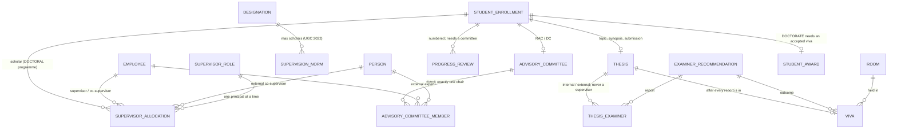

A research scholar is an ordinary student with an ordinary
`academic.student_enrollment` in a programme of level `DOCTORAL`; coursework
is the programme's curriculum (registrations, results, credits — nothing
special). Only what is specific to research degrees lives in schema
`research` (`sql/04e_research.sql`):

| Requirement | How the database supports it |
|---|---|
| **Supervision norm** (UGC Ph.D. Regulations 2022: Professor 8, Associate 6, Assistant 4 — seeded, POLICY) | `supervision_norm` per designation, dated. Allocating a *principal* supervisor to a doctoral scholar is rejected once the supervisor's current primary designation is at its norm |
| **Supervisor / co-supervisor** | `supervisor_allocation`, dated: an employee, or — for roles that allow it — an external person who is *not* an employee. One principal supervisor per scholar at a time; no duplicate person in overlapping periods |
| **Research advisory / doctoral committee** | `advisory_committee` (one per enrollment) with dated `advisory_committee_member` rows (employees or external experts); exactly one chair at a time |
| **Progress reviews** | `progress_review`, numbered per scholar with an outcome; only once a committee has been constituted by that date |
| **Thesis** | `thesis` (one per enrollment): title, status, milestone dates that must be in order (topic approved ≤ synopsis submitted ≤ synopsis approved; thesis submitted after the synopsis), plagiarism similarity, files. Submission needs a principal supervisor allocated on that date |
| **Examiners** | `thesis_examiner`: internal (must be an employee) or external (must not be); nobody who supervised or co-supervised the scholar may examine; report date and recommendation arrive together |
| **Viva voce** | `viva` (one per thesis): only on or after submission, only once every appointed examiner's report is in, and never while one recommends major revision or rejection (`examiner_recommendation.blocks_viva`) |
| **The degree** | Conferred through `academic.award_rule` / `student_award` (award type `DOCTORATE`) like any other exit; for a `DOCTORAL` programme a trigger additionally requires an accepted viva (`is_accept`) held on or before the conferral date |

`research.v_scholar_status` gives one row per doctoral enrollment: principal
supervisor, committee, reviews and last outcome, coursework credits against
the programme minimum, thesis status and submission date, pending examiner
reports, viva date and outcome.

### 4.1g Statement of Examination (SOE) and the approval workflow

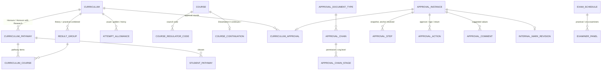

SGT's SOE module stores one flat, role-checked spreadsheet per programme ×
year. Here the SOE **is** a curriculum version:

- **Content** lives in the normalised academic tables — courses per term with
  UGC categories / sub-categories, council codes, L-T-P, credits, schemes of
  evaluation (the four-part theory internal, 4 × lab, dissertation report +
  viva), result groups (combined theory + practical), pathways, exits,
  continuation, reappear chances. `academic.v_soe`, `v_soe_exit` and
  `v_soe_header` render exactly what the SOE sheet shows.
- **Approval** uses the generic `wf` engine (§4.1j). A stage is a *permission at an
  org level* — DEPARTMENT → `curriculum_department_review.approve`, SCHOOL →
  `curriculum_school_review.approve`, university →
  `curriculum_university_review.approve`, then `curriculum.sign`. People get
  those permissions from appointments (`position_role`: HEAD, DEAN,
  DEAN_ACADEMICS, REGISTRAR) or from a dated scoped grant (acting HOD) —
  never from a role string. `wf.submit()` snapshots the steps with the real
  anchor units; `wf.approval_action` is append-only; status is derived
  (`wf.v_instance_state`, `academic.v_curriculum_status`).
- **Rules the database enforces:** the submitter never approves; one person
  completes at most one stage of a round; a return needs a note and closes
  the round (resubmission = new round, history kept); a signature needs the
  signed file; during review only the current reviewer may edit (in place,
  audited); an approved / signed version — and the schemes and course credits
  it uses — is frozen.

### 4.1h Academic operations

`sql/06c_academic_operations.sql` adds the rules that run a semester day to day, each enforced by the database:

| Need | Tables | Rule enforced / derived |
|---|---|---|
| Credit load per term | `credit_load_rule`, `credit_overload_approval` | maximum checked on every registration; `v_credit_load` shows UNDER / OK / OVER |
| Duty / medical leave | `attendance_leave` + the ATTENDANCE_LEAVE `wf` chain | approved leave counts in `v_attendance_summary` per leave type; marks never edited |
| UG / PG projects, dissertations, internships | `supervised_work`, `supervised_work_guide`, `internship` | only on project-type courses; one principal guide; external co-guides and industry mentors are non-employees; `v_guide_load` |
| Rank lists & medals | `exam.prize`, `exam.prize_award` | rank derived (`exam.v_rank_list`); rank-tied medal only to the rank holder, once per batch |
| Relative grading | `grade_scale.is_relative`, `relative_grade_cutoff` | percentile within offering × session cohort, absolute fallback (`exam.v_provisional_result`) |
| Mentoring | `mentoring_meeting` | only during the mentorship; `v_mentoring_status` |
| Class representatives | `section_representative` | only from the section; one role each |
| Timetable inputs | `org.room_facility`, `course_room_requirement`, `faculty_course_preference` | room type / features and seats checked on each timetable entry; `v_faculty_preference_status` |
| Question bank | `exam.question_bank_item`, `exam.question_paper_item` | reviewed by a second person, CO of the same course; fixed once the paper is approved; `exam.v_question_paper_blueprint` |
| Boards of Studies / Academic Council | `academic_body`, `academic_body_member`, `body_meeting`, `body_meeting_attendee`, `body_resolution` | one employee chair; external experts are non-employees; a resolution needs the quorum present; syllabus / equivalence / MOOC mapping / programme transfer reference `body_resolution` |
| CO / PO attainment | `attainment_policy`, `evaluation_component_outcome`, `exam.question_mark` | question marks within the question and the script total; `exam.v_student_co_score` → `v_co_attainment` (levels 0–3) → `v_po_attainment` (strength-weighted) |
| Disciplinary cases | `disciplinary_case` | heard by a DISCIPLINARY_COMMITTEE; decision before penalty; suspension = the student's DISCIPLINARY_SUSPENSION study break; closed = final |

### 4.1i Resource & facility management

`sql/06d_facility.sql` (schema `facility`) makes every physical resource of the university part of the same record as the academics that use it. The centre is one **occupancy ledger**:

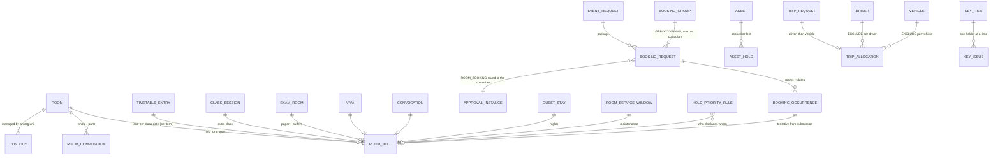

| Need | Tables | Rule enforced / derived |
|---|---|---|
| Space inventory | `org.floor`, `org.room` (`room_use_id`, `area_sqm`, `floor_id`), `room_composition`, `custody`, `space_allocation` | a room's floor is in its building; one custodian per space (room > floor > building > campus, `custodian_of()`); allocation shares ≤ 100 %; `v_space_inventory` |
| One ledger | `room_hold` + `ref.hold_type` (source table, default buffers) | every use of a room is a hold written by a trigger from its source; `EXCLUDE USING gist (room_id, blocked range) WHERE is_active`; a hold on a composed room shadows its parts, a hold on a part is checked against the whole under a row lock; `materialise_timetable(term)` writes one hold per class date (holidays and cancelled sessions skipped, idempotent, non-aborting) |
| Configurable pre-emption | `hold_priority_rule`, `outranks()` | a new hold displaces only holds its type outranks (most specific rule: type + custody unit > unit > type > global); losers keep `displaced_by` / `displaced_at` and are reinstated when the displacer goes; `v_displaced_hold`, `v_timetable_gap` |
| Who may book what | `room_reservation_rule`, `booking_restriction`, `booking_policy`, `blackout` | reserved rooms by position / unit / permission / person; per-person bans per resource kind; minimum duration, advance window, cut-offs, grace; blackouts refuse bookings but not classes or exams |
| Bookings, groups, events | `booking_group`, `booking_request`, `booking_requirement`, `booking_occurrence`, `event_request` | ROOM_BOOKING / ROOM_BOOKING_CHANGE rounds owned by the custodian (`anchor_is_owner`; a block's own chain is a scoped `wf.approval_chain`); tentative hold at submission; check-in, self-cancel cut-off, reschedule cancels the original; an event's rooms wait for the event and go to their custodians on approval; status derived (`v_booking_status`); `request_booking(..., p_skip_conflicts)` |
| Assets & maintenance | `vendor`, `asset`, `service_contract`, `booking_asset`, `asset_loan`, `asset_hold`, `maintenance_schedule`, `work_order`, `work_order_event` | portable assets only are booked or lent, never twice at once; WO-YYYY-NNNNN with an SLA per priority and an append-only history → `v_work_order_status`; closing releases the order's service windows and marks the schedule done; `v_maintenance_due`, `v_asset_register` |
| Guest house | `guest_stay`, `guest_tariff` | GUEST_STAY round (host unit head → guest house); guest category must match the person's kind; nights hold the room; `v_guest_stay_charge` = nights × the rate in force (complimentary categories 0) — the only charged spaces |
| Parking | `parking_permit` | a zone is a room of a PARKING building whose capacity is its bays; never over-allocated; one permit per vehicle at a time |
| Fleet & transport | `vehicle`, `vehicle_document`, `vehicle_service_window`, `driver`, `driver_unavailability`, `transport_policy`, `trip_request`, `trip_allocation`, `trip_allocation_request`, `trip`, `trip_rating`, `trip_alert` | TRIP_REQUEST (unit head → transport) or TRIP_REQUEST_URGENT (transport) by the policy threshold; allocation checks licence class & expiry, unavailability, mandatory documents, service windows, seats; EXCLUDE per driver and per vehicle; pooling; `run_trip_escalations()` (system job) auto-approves with AUTO_APPROVE and raises alerts; `v_trip_status`, `v_trip_summary`, `v_vehicle_document_status` |
| Keys & access | `key_item`, `key_issue` | issued only by the custodian's staff, one holder at a time (EXCLUDE), never to a restricted person; `v_key_custody`, `v_key_access` |

All rooms are free of charge for students and staff (every employee and student holds FACILITY_REQUESTER through the baseline roles); who approves is a matter of custody and grants (heads of units are custodians of their spaces by `position_role`, and FACILITY_CUSTODIAN can be granted scoped to a block); the pre-emption defaults and policies are seeded as POLICY.

### 4.1j The approval engine (`wf`) — every approval is configuration

The old UMS developed approval again in every module: club and event proposals with status columns and a hard-coded advisor → block → committee path, noting with its own authority table, IPR with mentor → reviewer → head → finance, leave with a single approver, cab bookings with a 12-state enum. Here there is **one engine**, and an approval is **rows**:

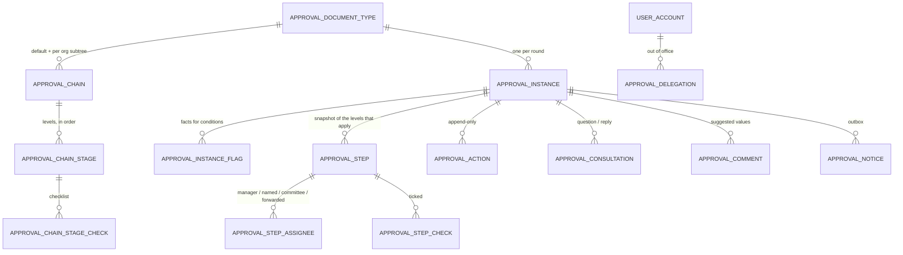

| What is configured | Where | Options |
|---|---|---|
| The kinds of document | `approval_document_type` | module, permission to submit, viewer permission, `allows_empty_chain` (approved on submission when no level applies), link to the document's table |
| The path | `approval_chain` | a default chain, and overrides scoped to any org subtree (school, block, club), each valid for a period; the nearest scope at or above the owning unit wins |
| The levels | `approval_chain_stage` (ordered) | as many as needed |
| Who approves a level | `ref.wf_approver_kind` | **PERMISSION** at an anchor (a unit type above the owner, the owner itself, or the root) · **POSITION** holder at the anchor · **MANAGER** of the person concerned, N levels up the reporting / reviewing line · **NAMED** people (fixed on the level, or chosen at submission) · **COMMITTEE** — members of an `academic.academic_body` |
| How many must approve | `required_approvals` | 1 (any one), N, or NULL = all assignees / the committee's quorum |
| When the level applies | `min_amount` / `max_amount`, `wf_flag_id` + `flag_must_be_absent` | on the round's amount and flags ("Dean only above 50,000", "extra level for external guests") |
| The requester is the approver | `ref.wf_self_action` | BLOCK (someone else must decide) or SKIP (the level is left out) |
| What the approver must supply | `needs_file`, `is_signature`, `approval_chain_stage_check`; `ref.wf_action_type.needs_note` | a file, the signed document (last level), mandatory checklist items, a note on return / rejection |
| Movement | `allows_forward`, `allows_return_to` | forward / delegate to a named person; send back to an earlier level instead of to the submitter |
| Time | `due_within`, `ref.wf_timeout_action` | NONE / REMIND / ESCALATE (one org level up, or the next manager) / AUTO_APPROVE / AUTO_REJECT — `wf.run_timeouts()` as a system job |
| Order of levels | `approval_chain.allows_level_override`, `.min_approved_levels`; `approval_chain_stage.is_mandatory` | a higher level may approve out of turn and pass the pending lower levels over (default), never leaving fewer than the minimum of levels approved by people (default 2); a level may be marked mandatory; a chain may insist on strict order — seeded strict for `CURRICULUM`, `INTERNAL_MARKS_REVISION` and `EVENT_SETTLEMENT` |
| Absence | `approval_delegation` | for a bounded period a delegate acts wherever the delegator could, for one document type or all; the action records both |

**Actions** (`ref.wf_action_type`, flags drive the rules): APPROVE, SIGN, RETURN (to the submitter — closes the round; a resubmission is a new round that can point at the one it revises), RETURN_TO (an earlier level), REJECT (final), WITHDRAW (by the submitter), FORWARD / DELEGATE (to a named person), and the system actions ESCALATE / AUTO_APPROVE / AUTO_REJECT (no actor, only under `app.system_job`). Status — IN_PROGRESS / APPROVED / SIGNED / RETURNED / REJECTED / WITHDRAWN, with the current level, its due time and an overdue flag — is derived (`wf.v_instance_state`).

**A higher level may approve out of turn.** If a round is waiting at the HOD and the Dean approves, the HOD's level is passed over — the Dean's approval is recorded on the Dean's own level and the round moves on from there. Two guards, both configuration: the round must still end with at least `min_approved_levels` levels approved by people (default 2 — so in a two-level chain nobody is passed over, and a Registrar cannot wave through alone what needed three), and a level marked `is_mandatory` always decides itself. A chain that must take every level in order sets `allows_level_override` to false — seeded so for the statutory academic chains (`CURRICULUM`, `INTERNAL_MARKS_REVISION`: department / Board of Studies, school and Academic Council are each a required step) and the financial one (`EVENT_SETTLEMENT`: verify, then sanction). Only an approval passes levels over (not a rejection or return), never a signature level, never by the submitter; a round in flight keeps the setting it was submitted under. Passed-over levels are derived (`wf.v_step_state.superseded`) and their approvers are told; `wf.overridable_for(account)` lists what is "waiting below me", kept apart from the inbox.

**Always enforced, whatever the configuration:** only the current level can be acted on — or, for an approval, a higher pending level where the chain allows passing over; the actor must be eligible for it (`wf.is_eligible()`); the submitter never decides their own document; one person completes at most one level of a round; a round in flight keeps the levels it was submitted with (snapshot); actions are append-only; a consultation never blocks and only the person asked may answer.

**Onboarding a new approval** (the whole recipe — `SKILL.md` §2a): (1) one `approval_document_type` row; (2) one `approval_chain` + its `approval_chain_stage` rows; (3) `instance_id` on the document with the standard validate trigger; (4) `wf.submit()` / `wf.act()`; (5) optionally an `AFTER INSERT` trigger on `wf.approval_action` for the module's side effects. The engine section of `sql/99_smoke_test.sql` proves it with a "purchase request" that has no code at all — manager → unit head (skipped for the head's own request) → Registrar above an amount → purchase committee for capital items → a named sanctioning officer with a checklist.

| Document type | Configured path (seeded default) |
|---|---|
| `CURRICULUM` (SOE) | department → school → university → Registrar's signature |
| `INTERNAL_MARKS_REVISION` | moderation committee at the school |
| `ATTENDANCE_LEAVE` | head of the department |
| `ROOM_BOOKING`, `ROOM_BOOKING_CHANGE` | the room's custodian (the owning unit itself); a block adds levels with a scoped chain |
| `EVENT_REQUEST` | unit head → university |
| `GUEST_STAY` | host unit head → guest house |
| `TRIP_REQUEST` / `TRIP_REQUEST_URGENT` | unit head → transport / transport only; auto-approved by the escalation job |
| `CLUB_PROPOSAL` | central coordination committee (7 days, reminder) |
| `EVENT_PROPOSAL` | advisor / head of the organising unit (skipped when they propose; 3 days) → central coordination committee (5 days) |
| `CLUB_CHANGE` | club advisor (skipped when the advisor asks; 3 days) → committee (7 days); the kind of change is a flag |
| `EVENT_CHANGE` | advisor / head of the organising unit (3 days) → committee (5 days); flags for new dates, venue, capacity |
| `EVENT_SETTLEMENT` | advisor / head of the organising unit (3 days) → committee (7 days); amount = total spent, flag OVER_BUDGET |

### 4.1k Clubs & event management (module, schema `events`)

`sql/13_events.sql` rebuilds the old club and event module. It contains no approval logic: founding a club and holding an event are the two document types above, and "following the event after approval" is the rest of the schema.

```mermaid
flowchart LR
    CP["club_proposal<br/>advisor · officers · members"] -- "CLUB_PROPOSAL round approved" --> CL["club = org_unit (CLUB)<br/>+ advisor appointments<br/>+ officers · members"]
    CL --> EP["event_proposal (draft)<br/>audience · SDGs · speakers<br/>budget · prizes · sponsors · visibility"]
    EP -- "submit: amount = budget total<br/>flags PAID / EXTERNAL / SPONSORED" --> WF{{"wf round<br/>levels by configuration"}}
    EP -. "same round" .-> FR["facility.event_request<br/>rooms held · trips"]
    WF -- approved --> EV["event (unpublished)"]
    EV -- publish --> REG["event_registration<br/>seat / waiting list · guests · answers"]
    REG --> TM["event_team · members<br/>invitations · join requests"]
    REG --> SC["entry_scan (gate log)<br/>→ attendance derived"]
    SC --> AW["prizes · certificates<br/>anonymous feedback · report"]
    AW -- complete --> PT["club_point_award<br/>→ tier · leaderboard"]
```

| Need | Tables | Rule enforced / derived |
|---|---|---|
| Kinds of club | `ref.club_category`, `club.club_category_id`, the club's parent unit | whose a club is = its parent unit (school / department / central department such as student welfare / university); what it is = its category; a chain scoped to the parent gives its clubs their own approval path; the category is a flag (`CLUBCAT_<code>`) on club and event rounds; `v_club.club_category`, `.parent_unit_type` |
| Clubs | `club_proposal` (+ `_officer`, `_member`, `_attachment`), `club`, `club_officer`, `club_member`, `club_application`, `club_suspension`, `club_calendar_item` | a club is an `org.org_unit` of type CLUB under the university, a school, a department or a central department; advisor / co-advisor are `org.appointment` (CLUB_ADVISOR, CLUB_CO_ADVISOR — faculty only); approval of the proposal creates all of it in one transaction; one holder per office and one office per student (EXCLUDE); only current students; nothing changes while suspended; `v_club`, `v_club_officer_current` |
| Proposals | `event_proposal` + `proposal_audience`, `_sdg`, `_partner`, `_speaker`, `_coordinator`, `_budget_item`, `_funding`, `_prize`, `_attachment`, `_visibility_role`, `_visibility_scope` | only an officer who may propose, an advisor, or staff of the unit; a draft is free, a submitted proposal and its parts are immutable; a returned one is revised as a new proposal; one proposal of a unit under approval at a time; `v_proposal_status` |
| Approval | — (configuration on `wf`) | `submit_proposal()` passes the budget total as the amount and the flags PAID_EVENT / EXTERNAL_GUESTS / SPONSORED; the advisor level is anchored at the organising unit (club → its advisor; department → its head) and skipped for the advisor's own proposal; a school's chain row adds its Dean above a budget or a committee quorum |
| Venue & transport | `facility.event_request` (shared round) | the package's rooms are held from submission and go to their custodians on approval; cancelling the event cancels the remaining occurrences |
| Sponsors | `event_sponsor`, `event_sponsorship`, `sponsorship_receipt`, `sponsorship_item` | receipts append-only and never above the commitment; `v_sponsorship_status` |
| The event | `event`, `event_round`, `event_faq`, `event_link`, `event_custom_field`, `custom_field_option`, `event_volunteer`, `post_event_report` | created only by the approval; the approved facts are read from the proposal, never copied; publish needs descriptions, contact, window and a round; cap ≤ approved capacity; status derived (`v_event`: draft / published / ongoing / ended / completed / cancelled) |
| Registration | `event_registration`, `field_response`, `extra_pass` | once per person; window, visibility (`can_see()`), seats under a row lock, waiting list with `promote_waitlist()`; what is owed and paid is derived (rows *Coupons*, *Payments & refunds* below); `v_registration` |
| Tickets | `event_registration.qr_token_hash`, `ticket_issued_at` | `issue_ticket()` returns the QR's token once, to the holder or an organiser, and stores only its hash; re-issue replaces it; never set by hand; none for a cancelled registration; `v_ticket` (event, state, pass size = holder + guests) |
| Teams | `event_team`, `event_team_member`, `team_invitation`, `team_join_request` | one live team per participant; never above the maximum; finalised only at or above the minimum; `v_team` |
| Volunteers | `event_volunteer` | assigned by the organisers (role, gate, may scan); students or employees; dashboard: `v_volunteer_assignment` (my duties + my totals), `v_volunteer_activity` (my scans), `v_gate_summary` (per gate) |
| Gate & attendance | `entry_scan` | `ticket_check()` previews a pass (state, how many may still enter); `scan()` by token; append-only; only scanning volunteers / organisers; in ≤ pass size, out ≤ inside; an organiser may import a sheet; `v_attendance`, `people_inside()` |
| Recognition | `event_prize_award`, `event_certificate_template`, `event_certificate` | prizes and certificates only for those who attended (winner's needs a prize, volunteer's a volunteer); serial + public verification code (`v_certificate_verify`) |
| Feedback | `event_feedback_token`, `event_feedback` | one token per attendee, burnt on use; the feedback row has no person, registration or timestamp |
| Points | `event_type_points`, `club_point_award`, `club_tier` | awarded by `complete_event()` at the value in force; an award names only its event — the club is that event's organiser, not stored again; `v_club_points`, `v_club_leaderboard`, `v_ccc_overview`, `v_event_statistics` |
| Duty leave | — (`academic.attendance_leave`) | `v_duty_leave_eligible` lists attendees / organisers per the proposal's scope; `grant_duty_leave()` files the leave through the existing ATTENDANCE_LEAVE approval |

| Club changes | `club_change_request`, `club_change_officer`, `club_change_member` + the CLUB_CHANGE `wf` chain | requested by an officer / advisor; carries exactly what its type changes (`ref.club_change_type`); frozen once submitted; the kind of change is a flag on the round; on approval `apply_club_change()` renames the unit, rewrites the objective, replaces the advisor appointment, officers and members; `v_club_change` |
| Primary club · volunteer sign-up | `primary_club`, `volunteer_application` | one primary club per student (an office in it, unless the setting says membership is enough); applications only to an event that takes them, decided once by an organiser, acceptance creates the volunteer |
| Coupons | `event_coupon`, `coupon_redemption` | only on paid events, by organisers; percentage ≤ 100 with a cap, or fixed; total / per-person limits, expiry, minimum fee; one per registration; the discount is fixed at redemption and never leaves an unpayable remainder; a cancelled registration frees its use; `v_coupon_usage` |
| Payments & refunds | `event_payment` | exactly the amount due (`amount_due()`: fee less coupon; a team's fee is the leader's); one open order (a newer one supersedes); offline claims verified by an organiser; captured is only ever refunded, by someone with `events.refund.create`; paid state, fees collected and `v_refund_queue` are derived; `expire_unpaid_registrations()` (system job, setting) |
| Messages | `event_mail`, `event_mail_recipient`, `event_mail_credit_grant` | organisers only; audience by registration state or a selection; scheduled / cancelled until sending starts; one credit per recipient (`v_event_mail_credit`), failed deliveries give it back; no address stored; opens only when switched on and never for a minor; `dispatch_mail()`, `run_mail_scheduler()`, `v_event_mail` |
| Changing an approved event | `event_change_request` + the EVENT_CHANGE `wf` chain | only by organisers, only before the event starts; new dates, venue, capacity (never below the seats taken); one change under approval at a time; on approval `apply_event_change()` rewrites the proposal's facts, shifts the rounds, releases the old venue package for the one opened with the request and records what it was before; `v_event_change` |
| Attendance per session | `round_attendance` | one check-in per registration and round, by a scanning volunteer or organiser (`check_in_round()`), or an imported sheet; opens a configurable time before the session; append-only; counts as attended; `v_round_attendance`, `v_attendance.sessions_attended` |
| Expenses & settlement | `event_expense`, `event_settlement` + the EVENT_SETTLEMENT `wf` chain | expenses by organisers under a budget head, against an approved line, with bills (required above a configurable amount); frozen once a settlement is under approval or approved; `submit_settlement()` after the event, amount = total spent, flag OVER_BUDGET; a returned settlement is corrected and resubmitted; `v_event_budget_actual`, `v_event_settlement` |
| Stalls | `event_stall_fee`, `stall_application` (+ `_setup`, `_document`), `event_stall` (+ `_product`), `stall_feedback`, `stall_feedback_point` | applications only while the event takes them (deadline, limit), one per applicant; fee per category; approval creates the stall (ST<number>); an applied stall only points at its application and says where it stands — what it is called, sells and needs is read from the application (`v_stall` shows applied and organisers' stalls alike); public anonymous feedback through `submit_stall_feedback()`; `v_stall`, `v_stall_application` |

The conversation with the payment gateway (signatures, webhook, reconciliation) and the sending of mail are the application's; the database holds the facts and the rules. Points and tiers are seeded as POLICY.

**Nothing is hard-coded — what an administrator configures.** The triggers read their limits and requirements at the moment they check, so changing a row changes the rule (and the change is audited):

| What is configured | Where it lives | Who changes it (permission → seeded role) | Seeded default |
|---|---|---|---|
| Approval levels: who approves, how many, amount / flag conditions, self-approval rule, required file / checklist, forward / return-to | `wf.approval_chain`, `wf.approval_chain_stage`, `wf.approval_chain_stage_check` | `core_admin.approval_chain.update` → WORKFLOW_ADMIN (can be granted for one school or block) | per document type |
| Deadlines and what happens when one passes (remind / escalate / auto-approve / auto-reject) | `wf.approval_chain_stage.due_within`, `.wf_timeout_action_id` | same | club proposal 7 days; event proposal 3 + 5 days; all REMIND |
| A school's, block's or club's own approval path | another `wf.approval_chain` with `scope_org_unit_id` | same | — |
| Out-of-office delegation | `wf.approval_delegation` | `core_admin.approval_delegation.assign` → WORKFLOW_ADMIN | — |
| Lists: club categories, event types, levels (by hours), modes, audience kinds, budget heads, prize / round / question types, cancel reasons, volunteer roles, certificate kinds, member roles, club offices (`may_propose`, `is_required`), approval flags | `ref.*` lookups | `core_admin.lookup.update` → CORE_ADMIN | seeded lists; President required |
| Which kinds of unit may have clubs | `org.org_unit_type_rule` | `core_admin.org_unit.update` → CORE_ADMIN | university, school, department, central department |
| Club name / objective lengths; advisor must be faculty; proposal lead time; required proposal sections (audience, coordinator, SDG); proposals under approval per proposer; guest-pass ceiling; what publishing needs (descriptions, contact, round); feedback scale | `events.event_setting` (one row) | `events.setting.update` → EVENT_ADMIN | 3–100 and 50 characters; yes; none; all three; 1; 20; all three; 1–10 |
| Points per event type; tiers | `events.event_type_points` (dated rows), `events.club_tier` (bands) | `events.points.update` → EVENT_CCC_MEMBER, EVENT_ADMIN | 2–10 per type; Bronze 0–19 … Diamond 200+ |
| Per event: registration window and cap, approval of registrations, withdrawal, guests, team sizes, fees, capacity, certificates, duty-leave scope, visibility, extra questions | the proposal and the event themselves | the organisers (`events.can_manage()`) | per event |
| Retention of participation and membership data | `privacy.processing_purpose.retention_period` | `privacy.purpose.update` → DPO | 3 years |
| Who is on the committee, who is an advisor, who is an administrator | `authz.account_role` (scoped grants), `org.appointment`, `academic.academic_body_member` | `core_admin.role_grant.assign` → ACCESS_ADMIN; `core_admin.appointment.assign` → CORE_ADMIN | — |

What stays in the schema, on purpose, is integrity rather than policy: one registration per person, attendance only from the gate log, feedback that cannot be linked to its writer, a submitted proposal never edited, the submitter never approving their own document, identifier formats (`EVT-YYYY-NNNN` …) and the 17 UN SDGs.

### 4.2 Identity and authentication

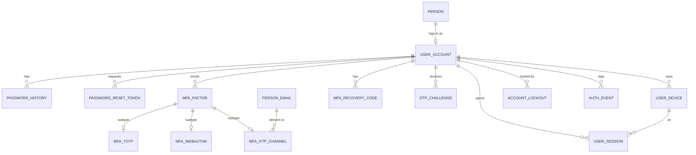

### 4.3 Authorisation

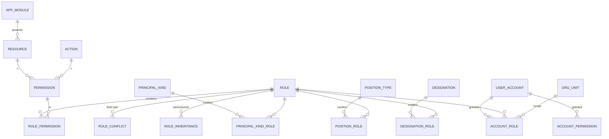

### 4.4 Privacy (DPDP)

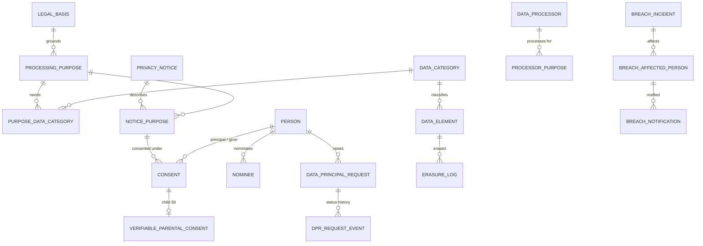

---

## 5. Key flows

### 5.1 Setting up the organisation
1. `ref.org_unit_type` and `org.org_unit_type_rule` are seeded (10). The allowed nesting is:
   - UNIVERSITY → SCHOOL, CENTRAL_DEPARTMENT, CENTRE
   - SCHOOL → DEPARTMENT, CENTRE
   - DEPARTMENT → CENTRE
   - CENTRAL_DEPARTMENT → SECTION → SECTION
   - UNIVERSITY, CENTRAL_DEPARTMENT → BLOCK (a facility block that takes custody of buildings; headed like any unit)
2. Insert the root university, then schools, departments and central departments. The trigger rejects illegal nesting and cycles, and a unique index allows only one root.
3. Appoint leaders with `org.appointment` (HEAD, DEAN, VC, REGISTRAR, DPO, GRIEVANCE_OFFICER, CHANCELLOR, CHAIRPERSON). The DB allows one holder per unit and position at a time, and only positions valid for that unit type.

### 5.2 Onboarding an employee (one transaction)
1. `people.person`, then `pii.person_profile`, `pii.person_email` (official, verified, `is_login_enabled`), `pii.person_phone` and `pii.person_address`.
2. Record the lawful basis. Employment processing is legitimate use (§7(i), purpose `EMPLOYMENT_ADMINISTRATION`). Consent-based purposes (photo, emergency contact) go in `privacy.consent`.
3. `people.employee` (code, category, type, status, grade).
4. `people.employee_assignment` with the unit, designation and `is_primary = true`. Add secondary assignments as needed.
5. `iam.user_account` (username = employee code, Django password hash, status `PENDING_ACTIVATION`). Activation happens through an email OTP (`iam.otp_challenge`, purpose `EMAIL_VERIFY`) followed by a password set.
6. **No permission rows are written.** The account automatically gets:
   - `EMPLOYEE_BASE` (principal kind),
   - designation roles (for example HR_MANAGER → HR_ADMIN),
   - position roles for any appointment (HEAD → ORG_UNIT_HEAD on that unit's subtree).

   When the person moves or leaves, their access follows automatically.

### 5.3 Onboarding a student (and guardian)
1. Create the person and contacts as above, then `people.student` and `people.student_mentor`.
2. `academic.student_enrollment` puts the student in a batch, e.g. BTECH-CSE 2026. For lateral entry, set `entry_term_no` (for example 3). A programme change or re-admission closes the current row (with an `end_reason_id` — the database refuses a closed enrollment without one) and opens a new one, linked by `program_transfer` or `enrollment_reentry`; the database allows only one active enrollment.
3. When the batch reaches the term set in `batch_specialization.from_term_no`, record the choice in `academic.student_specialization`. It must be a specialization offered to that batch.
4. Create the guardian as a person too, and link them with `people.person_relationship` (`is_guardian = true`). The guardian may get an account; `GUARDIAN_BASE` is derived automatically.
5. **If the student is a minor** (`pii.v_person_age.is_minor`), consent-based processing needs:
   - a `privacy.consent` row whose `given_by_person_id` is the guardian (a trigger checks the relationship), and
   - a `privacy.verifiable_parental_consent` row.

   `privacy.v_minor_consent_gap` lists minors still missing this.

### 5.3b Setting up programmes, the calendar and batches
1. `academic.program`: code, level, calendar type (SEMESTER / ANNUAL / PROFESSIONAL_YEAR), delivery mode (REGULAR / PART_TIME / DISTANCE / ONLINE / HYBRID), medium of instruction (optional), offering department, `duration_terms` and the credit range. A trigger rejects non-academic offering units.
2. Record each **regulator approval** in `academic.program_approval` (body, letter number, sanctioned seats, validity, letter as a file) and each **accreditation** in `academic.program_accreditation` (NBA on the programme, NAAC on the institution; grade, score, validity). One approval or accreditation per body at a time.
3. `academic.specialization` rows for the programme; `academic.program_coordinator` for the dated coordinator (one at a time). `academic.program_outcome` lists the programme's POs / PSOs for outcome-based education.
4. Each year, add `academic.academic_year` (for example 2026-27), then its `academic.academic_term` rows:
   - ODD and EVEN for semester programmes,
   - ANNUAL / PROF_YEAR for the others.

   The DB rejects overlapping years, terms outside their year, and overlapping terms of the same calendar type.
5. Fill in the **academic calendar** with `academic.calendar_event` rows on the year (optionally on a term): holidays and vacations (non-working — `academic.is_working_day()` reads them and class sessions on those dates are rejected), teaching periods, registration and add/drop windows, exam periods, result declaration, convocation. Leave `org_unit_id` NULL for a university-wide event, or set it for a school and everything under it. An event must lie inside its year, and its term inside that year.
6. Open intakes with `academic.batch` (programme × admission year, one per pair) and set `intake_capacity` — the database rejects an intake above the seats approved by any regulator whose approval is valid when the admission year starts. Attach documents with `batch_document`, and list the specializations the batch may choose, from which term, with `batch_specialization`.
7. For each course, the Board of Studies approves a **syllabus version** (`academic.course_syllabus`, one current at a time) with its `syllabus_unit` rows (contact hours) and `course_outcome` rows (CO1 …, Bloom level), then maps COs to the programme's POs / PSOs in `co_po_mapping` (strength 1–3; the course must be in one of the programme's curricula or tracks). Per curriculum, set the **promotion rule** checkpoints (`promotion_rule`: after term N, maximum backlog credits / courses), `max_duration_years` and `max_attempts_per_course`.

### 5.3c A teaching term and its examinations
1. **Before the term:** the curriculum team defines courses (credits, L-T-P, owning department), schemes of examination, and the curriculum (courses per term, elective baskets). Each batch is linked to its curriculum version.
2. **Term registration:** at the start of the term (inside the calendar's registration window) each student is put on the rolls with `academic.term_registration` — by the office or by self-service — for the programme term number they are due for. The database rejects a term of another calendar type, an enrollment not active during the term, a term number beyond the duration or not the one `academic.enrollment_term_no()` expects, a student on a break in study when the term starts, and a term starting after the curriculum's maximum duration. A term number never changes once registered: cancel and register again.
3. **Term set-up:** create course offerings for the term (and which department teaches each) and the sections per batch. Then:
   - `academic.allocate_sections(batch, term)` puts every unsectioned student into sections A, B, C … in enrollment-number order up to capacity (all or nothing);
   - `academic.register_core_courses(batch, term)` registers every student for the fixed courses of *their own* semester (`academic.enrollment_term_no`, so lateral, detained and re-entering students get the right term), safe to re-run;
   - students submit ranked **elective preferences** (`academic.elective_preference`; the basket must be in their curriculum and for their own term), then `academic.allot_electives(basket, term)` allots in merit order — each student's highest preference with a seat left, until the basket's `courses_to_choose` is met; the result is ordinary registrations, still within intake limits;
   - minor/honours courses and approved equivalents are registered by choice.
4. **Timetable:** split sections into lab/tutorial batches and form elective groups where needed (`academic.class_group`), then assign faculty to offering × class × component — the class being a section (section-wise teaching), a batch/group, or a combined class. `academic.v_teaching_gap` must be empty (every registered student has a teacher for every lecture/lab/tutorial) and `academic.v_section_teaching` is the HOD's section × course × faculty sheet. `academic.v_faculty_workload` shows each teacher's timetabled hours per week against the norm for their designation (`workload_norm`). Record faculty unavailability, then run the Django solver. It writes `academic.timetable_entry` rows, and the database rejects any room or faculty clash, a section clashing with itself or its own batch, and any student who would be in two classes at once, so a solver bug can't save a broken timetable. Parallel batches of one section are allowed. Once the timetable is final, `facility.materialise_timetable(term)` writes one occupancy-ledger hold per class date (holidays and cancelled sessions skipped, re-runnable), so exam rooms, vivas, convocations and every room booking are checked against the classes actually running (§4.1i, §5.3h).
5. **Teaching:** each teacher files a **lesson plan** (`academic.lesson_plan_item`: ordered topics with planned hours, tied to units of the course's current syllabus). Dated class sessions are generated from the timetable (plus extra classes); a generated session on a holiday of the offering department is rejected. Faculty mark attendance per session and record the **topics covered** (`class_session_topic`, the course file); attendance % and syllabus coverage (`v_syllabus_coverage`) are always calculated live. Towards the end of the term a **feedback cycle** opens: each student submits once per course registration (`feedback_submission`) and the answers are stored without any student reference (`feedback_response`); teachers and heads read `v_feedback_summary`.
6. **Question papers (before the date sheet):** the exam cell opens an exam session and appoints a setter and a moderator per offering × exam type (`exam.paper_setter_assignment`; never the same person, internal or external). Each set (`exam.question_paper`, A / B …) goes draft → submitted → moderated → approved → printed → used; the status lookup says what must already be on the row (a moderator, an approver). The file is confidential and hidden from analytics.
7. **Exam registration:** students register; regular attempts are blocked for attendance shortage (unless condoned) or an active hold, and no attempt at all is accepted once the curriculum's `max_attempts_per_course` is used up.
8. **Exam planning:** the date sheet is entered (the database rejects any student clash) and each paper is linked to its **approved** question paper set for the same session, course and exam type; then rooms, seating and invigilators. Hall tickets are generated from these. Each exam room also takes an EXAM hold in the occupancy ledger (with setup / teardown buffers), displacing a timetabled class if the priority rules allow and refusing the room if a higher-priority use holds it.
9. **Conduct and evaluation:** exam attendance and unfair-means cases are recorded. Answer scripts get dummy codes and are evaluated in rounds (first, moderation), each by a different evaluator. Internal marks are entered per component.
10. **Results:** the provisional result is calculated from the scheme's own rules: best N of M components, weighted internal and external parts, the internal-lead cap, board moderation, grace and rounding, then the grade band; pass needs the aggregate, each part minimum and each component minimum. Publishing inserts it into `exam.course_result`, after which the marks behind it are locked. SGPA/CGPA, the division (`exam.v_division`) and marksheets follow.
11. **Standing decision:** after results, the office records each student's **academic standing** on their term registration — promoted, promoted with backlog, or detained — naming who decided. The database checks it: *promoted* only with no backlog (`v_backlog`), *promoted with backlog* only within the curriculum's `promotion_rule` for that term (credits and, if set, courses); `v_promotion_eligibility` lists who qualifies before the decision is taken. A detained student's next term registration is for the same term number again.
12. **After results:** revaluation adds a new evaluation round and a revised publication. Supplementary or backlog attempts are new exam registrations against the same course registration (still within the attempt limit).
13. **At the end:** when the enrollment closes with an award (`student_award`, `end_reason` AWARD), certificates are issued from the register `exam.certificate` — transcript, provisional and final degree certificate (against the conferred award; one uncancelled original each, duplicates as separate rows), migration (needs a closed enrollment), character, bonafide … — each with a serial, a public verification code and, when pushed, the NAD / DigiLocker reference. Degree certificates are conferred at an `exam.convocation`.

### 5.3d NEP 2020 paths: credit transfer, minors, exit and re-entry
1. **Credit transfer (ABC / MOOC):** the Board of Studies maps an external course (e.g. an NPTEL course) to an internal course or to category credits for a period. A student submits the credit with the ABC reference and certificate; approval checks the mapping on the completion date, that the course/category is in the student's curriculum, and the curriculum's cap on transferred credits. The course then counts as completed, prerequisites are met, and credits (and a converted grade point, if given) enter the ledger and CGPA.
2. **Minor / honours:** a student joins a track (honours: own programme; minor: another department; CGPA entry bar). They may then register for the track's courses, which carry their own scheme of examination. Progress is derived; whether the grades count in the CGPA is the track's rule.
3. **Course equivalence:** when a new curriculum replaces a course, the Board approves `course_equivalence` rows. A backlog student registers for the replacement and is assessed under their own regulation; passed courses also count toward their equivalents.
4. **Exit:** `v_award_eligibility` shows which exits a student qualifies for (credits + required courses). The enrollment is closed and a `student_award` recorded (the database re-checks eligibility).
5. **Re-entry:** within the award's re-entry window, a new enrollment in a later batch of the same programme, entering the term after the exit point, is linked by `enrollment_reentry`. All earlier credits and completed courses count again, without copying any result.

### 5.3e Student lifecycle: breaks, detention, transfer, maximum duration
1. **Break in study:** a student applies, the office approves and records `academic.study_break` (type — medical, personal, maternity, financial, disciplinary suspension, internship —, period, reason, approver). The break must start while the enrollment is active and cannot overlap another. The student's status stays ACTIVE; `v_student_enrollment_current.is_on_break` says whether they are away today.
2. **While on a break:** no term registration is accepted into a term that starts inside the break, and any term that falls entirely inside the break is skipped when the current term is derived — a student who takes an even semester off comes back to the same term number, not the one after.
3. **Detention:** at the end of a term the standing is recorded as `DETAINED` (allowed only when the promotion checks fail or the office decides so). `academic.enrollment_term_no()` then expects the *same* term number for the student's next registration, so `register_core_courses()` registers them again for that semester's fixed courses; backlog courses are new exam registrations on the old course registrations.
4. **Promotion with backlog:** `v_backlog` lists every not-passed, not-otherwise-completed course across the enrollment's lineage. Standing `PROMOTED_WITH_BACKLOG` is accepted only within the curriculum's `promotion_rule` for that term; `PROMOTED` only with no backlog at all. Both are rejected before the term has started.
5. **Programme transfer:** close the old enrollment with `end_reason` `PROGRAM_CHANGE`, open the new one (different programme, starting on or after the close), and link them with `academic.program_transfer` (approver, resolution). `v_enrollment_lineage` now follows the transfer as well as re-entry, so earlier credits count; which earlier courses satisfy the new curriculum is decided by `course_equivalence`. The maximum duration is counted from the first enrollment of the lineage.
6. **Maximum duration (UGC "N + 2"):** `v_student_standing.must_complete_by` shows the last date a term may start. A term registration into a term starting on or after that date is rejected; the office then closes the enrollment with `end_reason` `MAX_DURATION`.
7. **Any closure:** an enrollment cannot be closed without an `end_reason_id` (award, programme change, migrated out, withdrawn, expelled, maximum duration, deceased, other), and cannot carry one while still open.

### 5.3f A doctoral scholar
1. **Admission:** the scholar is enrolled like any student, in a batch of a programme whose level is `DOCTORAL` (award type `DOCTORATE`, curriculum with the coursework and a `DISSERTATION` course). Coursework registrations, results and credits go through the ordinary academic and exam tables.
2. **Supervisor:** the research directorate allocates a principal supervisor (`research.supervisor_allocation`, role `SUPERVISOR`, an employee) and optionally co-supervisors — an employee, or an external person from industry / another university under `EXTERNAL_CO_SUPERVISOR`. The database refuses a second principal supervisor in the same period, an external person in a role that needs an employee, an employee allocated as "external", and a principal supervisor whose current primary designation already supervises its `supervision_norm` maximum of doctoral scholars.
3. **Committee:** `research.advisory_committee` is constituted (one per enrollment) with dated members — employees or external experts — and exactly one chair at a time.
4. **Progress reviews:** the committee records each six-monthly review (`progress_review`, numbered, outcome satisfactory / unsatisfactory / termination recommended); none is accepted before a committee exists.
5. **Thesis:** `research.thesis` is opened with the title and status, then the milestone dates in order — topic approved, synopsis submitted, synopsis approved, thesis submitted — with the plagiarism similarity and the files. A submission date without a principal supervisor allocated on that date is rejected.
6. **Examination:** internal and external examiners are appointed (`thesis_examiner`); an external examiner cannot be an employee, an internal one must be, and nobody who ever supervised the scholar can examine. Each report is recorded with its recommendation (accept, minor revision, major revision, reject).
7. **Viva voce:** `research.viva` is recorded (date, room, outcome, approver) only on or after the submission date, once every appointed examiner's report is in, and only if none recommends major revision or rejection; otherwise the thesis is revised and re-examined first.
8. **Degree:** the enrollment is closed and the `student_award` (type `DOCTORATE`) conferred through the ordinary exit check — plus, for a doctoral programme, an accepted viva held on or before the conferral date. The degree certificate then comes from `exam.certificate` at a convocation. `research.v_scholar_status` shows where every scholar stands throughout.

### 5.3g An SOE from draft to signature
1. The programme coordinator (`academic.program_coordinator`) builds the curriculum version: courses per semester, categories, schemes of evaluation, result groups, pathways, exits, reappear chances. `academic.v_soe` shows the sheet at any time.
2. `academic.submit_curriculum(curriculum, account)` — coordinator or curriculum administrator only — opens round 1 through `wf.submit('CURRICULUM', department, account)`: stages DEPARTMENT @ the programme's department, SCHOOL @ its school, UNIVERSITY @ the root, SIGN @ the root.
3. Each reviewer finds it in `wf.pending_for(account)`; comments with suggested values (`wf.approval_comment`); may edit in place while it is their stage (audited); approves (`wf.approval_action` APPROVE) or returns it with a note.
4. A return closes the round; the coordinator resolves the comments, edits, and resubmits (round 2).
5. After the university stage the version is APPROVED and frozen; the Registrar signs with the signed PDF (`SIGN` + `people.file_object`) → SIGNED. Batches then attach to it (`batch_curriculum`), and a later change means a new curriculum version.
6. The same engine runs any other chain — e.g. `exam.request_internal_mark_revision()` → Faculty Moderation Committee (Dean's school) → the revised internal mark counts, original kept.

### 5.3h A room from timetable to a booked event
1. The academic office runs `facility.materialise_timetable(term)` once the timetable is final (and again after changes — it is idempotent): one `room_hold` per class date, skipping holidays and cancelled sessions; the exam cell's `exam.exam_room` rows, vivas and convocations write their own holds as they are entered.
2. A professor calls `facility.request_booking(account, 'SEMINAR', title, rooms, dates, start, end, …)`: one `booking_group`, one `booking_request` per custodian (`custodian_of(room)`), one `booking_occurrence` per room and date — each checked against capacity, features, reservation rules, blackouts and the policy, and each taking a tentative hold at once (the slot is blocked while pending). `wf.submit('ROOM_BOOKING', custodian_unit, …)` opens the round; the CUSTODIAN stage is anchored at the custodian itself (`anchor_is_owner`), so the block's head — or a FACILITY_CUSTODIAN granted there — finds it in `wf.pending_for()`.
3. The custodian approves (or returns it with a note, which frees the room). The requester checks in inside the policy window; a booking nobody checked in to is NO_SHOW after the grace and the no-show sweep (`release_no_shows()`, a system job) frees the room.
4. An official function that needs the room during a class: under a priority rule allowing it (`hold_priority_rule`, scoped to the block if that is the policy) the class hold is displaced and listed in `v_displaced_hold` / `v_timetable_gap`; withdrawing or cancelling the event reinstates it.
5. A fest goes in as one `event_request` (unit head → university); its room requests wait for the event and are submitted to each custodian when it is approved; its vehicle requests go through `request_trip()` to the transport office, which allocates a driver and then a vehicle (`trip_allocation`), pools a second party if the seats allow, and closes the trip after the driver's start / complete.

### 5.3i A new approval, configured (no code)
Example: purchase requests — manager, then the unit head, the Registrar above ₹50,000, the purchase committee for capital items, and a named sanctioning officer.
1. `INSERT INTO wf.approval_document_type (code 'PURCHASE_REQUEST', module, author permission, link_table …)`.
2. `INSERT INTO wf.approval_chain` (default) and five `wf.approval_chain_stage` rows: MANAGER (level 1, may forward, 2 days → ESCALATE) · PERMISSION `purchase.approve` at the owning unit (self-action SKIP) · POSITION REGISTRAR at the root with `min_amount = 50000` · COMMITTEE (the purchase committee, flag CAPITAL) · NAMED (file required, checklist rows, may return to an earlier level).
3. The purchase table gets `instance_id`; the application calls `wf.submit('PURCHASE_REQUEST', unit, account, note, p_amount => 72000, p_flags => ARRAY['CAPITAL'], p_subject_person => requester, p_assignees => ARRAY[sanctioning_officer])`.
4. The engine snapshots only the levels that apply, resolves the manager and the committee members into `approval_step_assignee`, queues notices, and from then on `wf.pending_for(account)` is everyone's inbox and `wf.act(instance, 'APPROVE' | 'RETURN' | 'RETURN_TO' | 'REJECT' | 'FORWARD' | 'SIGN', account, …)` the only way forward. `wf.run_timeouts()` (system job) reminds, escalates or auto-decides overdue levels.
5. The School of Engineering wants its Dean before the Registrar: one more `approval_chain` scoped to that school with its own stage rows. Nothing else changes.

### 5.3j An event from proposal to club points
1. A faculty member files a `club_proposal` (parent unit, advisor, co-advisor, first officers and members) and `events.submit_club_proposal()` opens the CLUB_PROPOSAL round; when the committee approves, the hook creates the CLUB org unit, the `club`, the advisor appointments, the officers and the members.
2. The president drafts an `event_proposal` with its audience, SDGs, coordinators, budget, prizes and sponsors; `events.submit_proposal(proposal, account)` opens the EVENT_PROPOSAL round (amount = budget total, flags) and the facility package on the same round. Rooms and vehicles are then requested against that package (`facility.request_booking(…, p_event_request)`, `facility.request_trip(…, p_event)`) — the rooms are held at once.
3. The levels run as configured: the club's advisor (skipped if the advisor proposed), then the committee — or, under a school's chain, also the Dean above the budget limit and a committee quorum. A return sends it back with a note; the revision is a new proposal linked to the old one.
4. Approval creates the `event` (EVT-YYYY-NNNN, unpublished) and releases the rooms to their custodians. The organisers add descriptions, rounds, FAQs, extra questions and volunteers and call `events.publish_event()`.
5. `events.register()` gives a seat or a waiting-list place and `events.issue_ticket()` the participant's QR token (`v_ticket` is the ticket); teams form by invitation or join request and are finalised within the size limits; a withdrawal promotes the next in line.
6. On the day, the volunteers the organisers assigned see their duty in `v_volunteer_assignment`, preview each pass with `events.ticket_check()` and call `events.scan()` at the gate (in / out, with guests); `v_attendance` and `v_gate_summary` are derived from the log.
7. Where the event is paid, the participant applies a coupon (`redeem_coupon()`) and pays — an online order captured by the gateway, or an offline claim an organiser verifies; the registration is PENDING_PAYMENT until what it owes is settled, and anything captured that cannot be used shows in `v_refund_queue`. The organisers write to their registrants (`event_mail` → `dispatch_mail()`), and a fest takes stall applications that become stalls on approval.
8. If the event must move, the organisers file an `event_change_request` (new dates, venue or capacity) and `events.submit_event_change()` sends it through the EVENT_CHANGE chain; on approval the database moves the event, its rounds and its venue package. On a multi-session event participants are checked in per round (`events.check_in_round()`).
9. Expenses are recorded as they are incurred (`event_expense`); after the event `events.submit_settlement()` sends the accounts through the EVENT_SETTLEMENT chain.
10. Afterwards: `event_prize_award`, `events.issue_certificates()`, feedback through `feedback_token_for()` / `submit_feedback()` (anonymous), the `post_event_report`, `grant_duty_leave()`, and `events.complete_event()`, which awards the club its points; the leaderboard and tier follow. `events.cancel_event()` at any earlier point cancels registrations and frees the rooms.

### 5.4 Login (UID or email, then password, then MFA)
```
identifier ─► iam.resolve_login()          UID match first, else verified + login-enabled email
           ─► unknown?  auth_event(LOGIN_FAILURE, UNKNOWN_IDENTIFIER, identifier_hmac) → generic error
           ─► ref.account_status.can_login? iam.v_account_active_lockout empty?
           ─► verify Django password hash
                 fail → auth_event(BAD_PASSWORD); N failures in window → account_lockout
           ─► MFA needed?  authz.account_requires_mfa(account) OR any confirmed mfa_factor
                 (skip if user_device.trusted_until > now())
                 TOTP / WebAuthn verify, or otp_challenge(LOGIN_MFA) → auth_event(MFA_SUCCESS/FAILURE)
           ─► user_session(new family_id, refresh_token_hash, mfa_verified_at) → auth_event(LOGIN_SUCCESS)
```
- **Refresh:** insert a new session in the same family, revoke the old one (`ROTATED`). Presenting an already-revoked token revokes the whole family (`REUSE_DETECTED`). A unique index guarantees only one live token per family.
- **Password reset:** `password_reset_token` (hash only, short expiry). On success, push the old hash into `password_history` and revoke all sessions (`PASSWORD_CHANGED`).
- **Step-up:** sensitive actions (for example granting roles) require a fresh `otp_challenge(STEP_UP)` or a recent `mfa_verified_at`.

### 5.5 Authorisation check
`authz.has_permission(account, 'module.resource.action', target_org_unit)` returns true when **any** effective grant matches:
- a **global** grant (scope NULL), or
- a grant on the **target unit**, or
- a grant on an **ancestor** of the target with `include_descendants`.

Rules:
- Non-scopable permissions (for example `core_admin.role.update`) only count when granted globally.
- Superusers always pass; accounts whose status cannot log in always fail.
- `target = NULL` means "anywhere". Use it for module access and menus.

**Where effective grants come from** (`authz.v_account_role_effective`):

| Source | Scope |
|---|---|
| `EXPLICIT` — `account_role` valid now | as granted |
| `DESIGNATION` — active assignment × `designation_role` | assignment unit, or global |
| `POSITION` — active appointment × `position_role` | appointed unit |
| `PRINCIPAL_KIND` — current employee/student/guardian × `principal_kind_role` | global or home unit |

`authz.v_account_permission_effective` expands role inheritance and adds direct `account_permission` grants. `authz.accessible_org_units(account, code)` returns the set of units to filter list queries by.

**Guard rails enforced by the DB:**
- no overlapping duplicate grants,
- separation-of-duties conflicts (`role_conflict`) are rejected,
- no cycles in role inheritance,
- non-scopable permissions cannot be granted with a scope,
- inactive roles cannot be granted.

**Performance:** the Django backend caches the effective-permission set per account in Redis. Invalidate it on any change to that account's grants, assignments, appointments, relationships or status. The org tree is small (hundreds of nodes), so recursive CTEs are cheap without a closure table.

### 5.6 How a new module plugs in
1. `INSERT` into `authz.app_module` (for example `ipr`), then its `authz.resource` rows, then `authz.permission` (resource × action). (`research` — doctoral supervision, thesis, viva — is already a foundation module in schema `research`, not something a module adds.)
2. Create module roles (`IPR_REVIEWER` …) with `role_permission`. Link them to designations or positions, or grant them with a scope. For example, "Reviewer for Schools A and B" is two `account_role` rows, scoped to A and B.
3. Module tables use FKs to `org.org_unit`, `people.person`/`employee`/`student` and `iam.user_account`, and register any personal-data columns in `privacy.data_element`. Audit is enabled with `SELECT audit.enable_for_schemas(ARRAY['<schema>'], ARRAY[]::text[])`, the same call `08_audit.sql` makes for the foundation schemas (`ref, org, people, academic, exam, research, facility, pii, iam, authz, privacy`).
4. Anything that needs approval is **configured on the `wf` engine** (§4.1j, §5.3i): a document type, a chain with its levels, an `instance_id` on the document — no approval tables in the module.
5. The module lives in its own file after `11` with its own smoke test (`sql/12_tms.sql` + `98`, `sql/13_events.sql` + `97`).

This applies just as much to central/independent departments (HR, IT,
Finance, Registrar, Admissions, Library, DRD, Examinations, Estate &
Security, Transport…) as to schools — each is simply a row in
`org.org_unit` with `org_unit_type = CENTRAL_DEPARTMENT`, not a separate
table. `sql/90_example_sgt_org_structure.sql` creates the real SGT list and
proves a Head's permissions are derived automatically once appointed. See
**`docs/module-integration.md`** for that plus three fully worked examples —
**TMS (ticketing)** and **Event Management (+ academic clubs)**, both now built — each showing
exactly which existing mechanism (org units, appointments, scoped role
grants) replaces a bespoke table the old SGT UMS built for the same purpose
— and how the old **Resource Management (seminar halls & cab booking)**
maps onto the built-in `facility` schema.

### 5.7 Rights requests and erasure
- **Access summary:** join `privacy.data_element` (the inventory of personal-data columns) to the principal's rows.
- **Erasure:** for each element, apply its `erasure_action`:
  - `DELETE`,
  - `ANONYMISE` (names become a placeholder, username becomes a random tag, account status becomes `ANONYMISED`),
  - `RETAIN_LEGAL` (kept until the retention period ends).

  Every action is written to `privacy.erasure_log`.
- **Retention sweep:** a scheduled job compares each `processing_purpose.retention_period` against the end of the relationship (`employee.separated_on`, student status) and erases what is due.

---

## 6. Derived objects (views and functions)

| Object | Replaces |
|---|---|
| `org.ancestors()`, `org.descendants()`, `org.nearest_of_type()`, `org.v_org_unit_tree` | stored paths / closure tables |
| `org.v_current_appointment` | `headOfDepartment` columns |
| `wf.v_instance_state` (status, current level, due, overdue), `wf.v_step_state`, `wf.v_effective_action`, `wf.submit()`, `wf.act()`, `wf.is_eligible()`, `wf.can_act()`, `wf.can_view()`, `wf.pending_for()`, `wf.document_of()`, `wf.manager_account()`, `wf.run_timeouts()` | per-module approval tables, `workflow_stage === role` checks, status enums, per-module escalation jobs and "pending with me" queries |
| `academic.v_curriculum_status`, `academic.submit_curriculum()`, `academic.is_program_coordinator()` | `soe_documents.status / workflow_stage` |
| `academic.v_soe`, `academic.v_soe_exit`, `academic.v_soe_header`, `exam.v_result_group_outcome` | the SOE's ~60 flat `soe_rows` columns |
| `people.v_person_display_name` | `displayName` column |
| `people.v_employee_current` (primary unit, designation, job function/role, school, central dept, reporting/reviewing manager) | `primarySchoolId/DepartmentId/CentralDeptId` |
| `people.v_student_current` (programme, batch, batch year, current term, home dept, school, mentor), `people.v_person_principal_kind` | `role` enum, `StudentDetails.currentSemester` |
| `academic.v_program` (duration in years, delivery mode, medium), `academic.v_batch`, `academic.v_current_term`, `academic.v_student_enrollment_current` (current term, `is_on_break`) | `Program.metadata`, `TmsAdmissionBatch`, `TmsAcademicSession`, `SchoolErpSessionType` |
| `academic.enrollment_term_no()` (term registration first — promoted → next term, detained → same term — breaks skipped, dates as the fallback) | `StudentDetails.currentSemester` typed by hand, and a detention flag |
| `academic.v_enrollment_lineage` (re-entry and programme transfer), `v_credit_ledger`, `v_course_completion`, `v_award_eligibility`, `v_student_track_progress`, `v_prerequisite_gap` | manual credit / degree audits |
| `academic.v_backlog`, `v_promotion_eligibility`, `v_student_standing` (latest standing, backlog, break, `must_complete_by`) | manual promotion / detention lists and duration checks |
| `academic.allocate_sections()`, `academic.register_core_courses()`, `academic.allot_electives()` | manual section lists, per-student course entry and elective allotment sheets |
| `academic.is_working_day()` | holiday checks in application code |
| `academic.offering_quota_for()`, `academic.v_offering_quota_usage` | per-school seat counters kept by hand |
| `academic.v_registration_scheme`, `exam.v_component_score`, `exam.v_provisional_result`, `exam.v_sgpa`, `exam.v_cgpa`, `exam.v_division` (division and equivalent %) | result formulas hard-coded in application code; division typed on the marksheet |
| `academic.v_syllabus_coverage` | the paper course file |
| `academic.v_faculty_workload` | workload spreadsheets |
| `academic.v_feedback_summary` | — (the only way feedback is read; responses carry no student) |
| `research.v_scholar_status` | — |
| `facility.custodian_of()`, `room_is_free()`, `free_rooms()`, `outranks()`, `materialise_timetable()`, `reinstate_hold()`, `v_room_timeline`, `v_displaced_hold`, `v_timetable_gap`, `v_room_utilisation`, `v_space_inventory` | the old seminar-hall slot checks in application code; per-block room trees |
| `facility.request_booking()`, `cancel_booking_group()`, `request_event()`, `occurrence_dates()`, `release_no_shows()`, `v_booking_status`, `v_booking_summary`, `v_event_status` | `SeminarHallBooking.status` enum + `bookingGroup` strings + expiry sweep |
| `facility.raise_work_order()`, `v_work_order_status`, `v_maintenance_due`, `v_asset_register` | — |
| `facility.request_guest_stay()`, `v_guest_stay_status`, `v_guest_stay_charge`, `v_parking_zone_usage`, `v_key_custody`, `v_key_access` | — |
| `facility.request_trip()`, `run_trip_escalations()`, `v_trip_status`, `v_trip_summary`, `v_vehicle_document_status` | `CabBooking.status` (12 states), scheduler flags, ratings inside history notes |
| `events.v_club`, `v_club_officer_current`, `club_is_active()`, `is_club_officer()`, `may_propose_for()`, `can_manage()` | `AcademicClub` with seven officer columns and a status column |
| `events.v_proposal_status`, `submit_club_proposal()`, `submit_proposal()` | `ClubEventProposal.status` and its hard-coded advisor → block → committee path |
| `events.v_event`, `publish_event()`, `complete_event()`, `cancel_event()`, `can_see()` | `Event.status`, visibility JSON |
| `events.v_registration`, `register()`, `promote_waitlist()`, `seats_taken()`, `seat_limit()`, `v_team`, `team_size()` | registration status and seat counters, team completeness flags |
| `events.issue_ticket()`, `v_ticket`, `ticket_check()` | the `qrCode` string stored in clear on the registration; scan-preview arithmetic in application code |
| `events.v_attendance`, `scan()`, `people_inside()`, `attended()`, `v_gate_summary` | attendance flags and check-in counters on the registration |
| `events.v_volunteer_assignment`, `v_volunteer_activity` | the volunteer's "my assignments" / "my activity" queries |
| `events.issue_certificates()`, `v_certificate_verify`, `feedback_token_for()`, `submit_feedback()`, `v_duty_leave_eligible`, `grant_duty_leave()` | — |
| `events.amount_due()`, `amount_settled()`, `is_paid()`, `payer_registration()`, `redeem_coupon()`, `v_coupon_usage`, `v_refund_queue`, `record_refund()`, `expire_unpaid_registrations()` | `paymentStatus` / `amountPaid` copied onto each registration, `usedCount` counters, a `needsRefund` flag in JSON metadata, an expiry job that was never started |
| `events.dispatch_mail()`, `run_mail_scheduler()`, `mail_opened()`, `v_event_mail`, `v_event_mail_credit` | e-mail log status strings, stored recipient addresses, credit counters and a credit log |
| `events.submit_stall_feedback()`, `stall_fee()`, `v_stall`, `v_stall_application` | stall metadata JSON, fees typed by the applicant, `points` JSON arrays |
| `wf.override_step()`, `override_refusal()`, `overridable_for()`, `v_step_state.superseded` | bypass paths coded per module (the Anvaya team skipping the advisor) |
| `events.submit_event_change()`, `apply_event_change()`, `v_event_change` | cancelling and re-proposing an event to move it |
| `events.check_in_round()`, `v_round_attendance` | — |
| `events.submit_settlement()`, `v_event_budget_actual`, `v_event_settlement` | — |
| `events.submit_club_change()`, `apply_club_change()`, `v_club_change` | `AcademicClubChangeRequest.requestedChanges` JSON and its status column (never implemented in the old system) |
| `events.v_club_points`, `v_club_leaderboard`, `v_ccc_overview`, `v_event_statistics`, `v_sponsorship_status` | club points kept in Redis; dashboard counters |
| `pii.v_person_age` (age, `is_minor`) | — |
| `iam.v_login_identifier`, `iam.resolve_login()` | login by `uid` only |
| `iam.v_account_last_login` | `lastLoginAt` column |
| `iam.v_account_active_lockout` | — |
| `authz.v_permission_code`, `v_role_closure`, `v_account_role_effective`, `v_account_permission_effective` | JSON permission blobs |
| `authz.has_permission()`, `authz.accessible_org_units()`, `authz.account_requires_mfa()` | `checkPermission`, `assigned*SchoolIds` |
| `privacy.v_dpr_request_status`, `v_active_consent`, `v_minor_consent_gap` | — |

---

## 7. Django mapping notes (for the backend team)

- **User model:** `AUTH_USER_MODEL = "iam.UserAccount"`, subclassing `AbstractBaseUser` (not `PermissionsMixin`).
  - `USERNAME_FIELD = "username"`, `password` maps to the `password` column, and set `last_login = None` (derived from `iam.v_account_last_login`).
  - `is_active` is a property reading `account_status.can_login`.
- **Authentication backend:** resolves UID or email via `iam.resolve_login()` (or an equivalent ORM query), checks the lockout and status, verifies the password, then runs the MFA step. It writes `iam.auth_event`. Use `django-otp`/`webauthn` libraries only for the crypto; persist into the `iam.mfa_*` tables.
- **Authorisation backend:** implement `has_perm(user, "module.resource.action", obj)`, where `obj` is an org unit or any object exposing `org_unit_id`. It calls `authz.has_permission` or uses the Redis-cached effective set. Don't use `django.contrib.auth` Groups/Permissions.
- **Schemas:** set `OPTIONS: {"options": "-c search_path=util,ref,org,people,academic,exam,research,facility,tms,events,pii,iam,authz,wf,privacy,audit,public"}`. Table names are globally unique, so `Meta.db_table = "org_unit"` works as-is. Keep `managed = True` and put exclusion constraints, triggers, partitions and views into migrations with `migrations.RunSQL(open("sql/0X_….sql").read())`. Alternatively, treat these SQL files as the source of truth with `managed = False` models.
- **Range fields:** `django.contrib.postgres.fields.DateRangeField` / `DateTimeRangeField` map to `daterange`/`tstzrange`. For `citext` columns, use a plain `CharField`/`TextField` on the model; the DB column type stays `citext`, set in the RunSQL migration. `CICharField` was removed in Django 5.1.
- **Audit context:** a middleware runs `SET LOCAL app.account_id / app.request_id / app.session_id / app.client_ip` inside the request transaction (`ATOMIC_REQUESTS = True`).
- **Encryption:** use application-level envelope encryption (AWS KMS data keys) for `mfa_totp.secret_ciphertext` and `person_identity_document.number_ciphertext`. `number_hmac` uses a separate HMAC key. Keys never live in the DB.
- **DB users:**
  - migrations run as a login role that is a member of `intranet_owner`,
  - runtime connects as a member of `intranet_app`,
  - BI tools use `intranet_analytics`, which has no `pii` or `iam` access and cannot read names.
