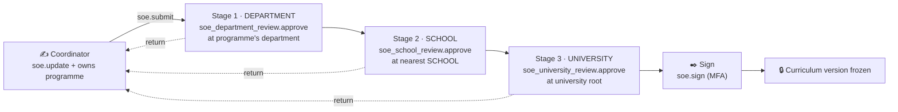

# SOE (Statement of Examination) in the permission-based intranet

**Status:** implemented — see §8 for what was built and where. §§1–7 are
the original analysis of the role-based reference module and the design that
was followed.

> **Names in §§1–7 are the proposal's working names.** The permission codes
> written there as `academics.soe.*` were built as `academics.curriculum.*`
> (`view`, `create`, `update`, `submit`, `approve`, `sign`) and the three
> review permissions `academics.curriculum_department_review.approve`,
> `academics.curriculum_school_review.approve`,
> `academics.curriculum_university_review.approve`; `authorize()` in §2 is the
> reference system's middleware, not a function of this database — the check
> here is `authz.has_permission()`. §8 is the authority for what exists.

**Reference system:** `D:\UMS - Copy\soe\SOE-SGT` (TypeORM + Next.js).
Read-only sources:
- `docs/soe-module-features.md`
- `faculty-course-creation-backend/src/models/*.entity.ts`
- `src/controllers/soe.controller.ts`
- `src/routes/index.ts`
- `src/middleware/auth.middleware.ts`
- `src/migrations/*`
- `BAOTT_ SOE_2025-2026 (1).xlsx`

---

## 1. What the SOE is

One **Statement of Examination per programme × academic year** ("2025-26
onwards"). It lists every course of every semester with:

- L-T-P hours and credits;
- UGC/NEP category (DSC, AEC, SEC, MDC, VAC, IACP, Research, Minor);
- the full marks scheme: theory internal/external, practical internal/external, dissertation/internship;
- the NEP exit points (e.g. Certificate 44 cr → Diploma 86 → Bachelor 128 → Honours / Honours with Research 172).

The Programme Coordinator authors it. It then goes **HOD → Dean → Dean Academics** for approval, and the **Registrar** signs it. A reviewer can return it, comment with a suggested value, or edit a field in place.

In the intranet DB, an SOE is not a separate spreadsheet-shaped record. It is
the **approved version of a curriculum**. The content is already modelled
normalised (see §5); what the SOE adds is the **approval and sign-off** of that
curriculum version.

---

## 2. How the reference system decides who may do what — role strings

Every decision is a comparison with one role string on the user
(`users.role`; the `user_role_contexts` table exists, but `authorize()`
checks only `req.user.role`):

| Decision | Where | How |
|---|---|---|
| Route access | `routes/index.ts:27–43` | `authorize('HOD','Dean','Dean_Academics','Admin')`, etc. |
| Create SOE | `soe.controller.ts:446–455` | `faculty_programme_assignments.is_coordinator = TRUE`, or `role === 'Admin'` |
| Submit | `:586` | creator, or Admin |
| Approve / return | `:647`, `:769` | `STAGE_ROLE_MAP[workflowStage] === role`, or Admin |
| Reviewer in-place edit | `:828` | `workflowStage === role`, or Admin |
| List scope | `:270–310` | `if role === 'Programme_Coordinator'` → own; `HOD` → `departmentId`; `Dean` → `schoolId`; else all |
| Pending queue | `:342–361` | a per-role `WHERE` clause; Registrar → approved and unsigned |
| Who to notify | `:50–90` | `departments.hod_id`, `schools.dean_id`, every user with `role = 'Dean_Academics'` / `'Registrar'` |
| Stage chain | `approval_workflow_configs.required_stages` | JSONB `["HOD","Dean","Dean_Academics"]`, copied into `soe_documents.captured_approval_config` |

**Consequences:**
- A person has one role at a time.
- An HOD is "an HOD", not "HOD of *this* department". Scope comes from a
  `departmentId` on the user row, not from an appointment.
- Acting HOD, leave cover or delegation means changing someone's role.
- Admin bypasses every check.
- Stage names and role names are the same strings, so adding a stage means changing code.

---

## 3. The same flow, permission-based

The foundation never asks "what is your role?". It only asks:

```
authz.has_permission(account, 'module.resource.action', target_org_unit)
```

Roles are bundles of permissions. People get them **derived from facts**
(appointment, designation, principal kind) or by a **scoped, dated grant**.
The grant always has a scope: an org-unit subtree, or global.

### 3.1 Permissions the SOE needs

These are proposed codes, all data rows in `authz.resource` / `authz.permission`, not code. `sign` and `submit` would be new rows in `authz.action`, which is also just a seed insert.

| Permission | Meaning | Scope target |
|---|---|---|
| `academics.soe.view` | see an SOE | the programme's offering department |
| `academics.soe.update` | author / edit a Draft or Returned SOE | the programme's department, **plus** row ownership (§3.3) |
| `academics.soe.submit` | send for approval | same as update |
| `academics.soe.export` | download the Excel | same as view |
| `academics.soe_department_review.approve` | act at the **department** stage (approve, return, comment, in-place edit) | the programme's department |
| `academics.soe_school_review.approve` | act at the **school** stage | the school above the department |
| `academics.soe_university_review.approve` | act at the **university** stage (Dean Academics) | the university root |
| `academics.soe.sign` | final sign-off | the university root; role `requires_mfa` |

Stage permissions are named by **level** (department / school / university),
not by job title. Who sits at each level is decided by appointments, not by the permission name.

### 3.2 Who holds them: derived, never typed onto the user

| Person | Fact in the foundation | Derivation | Resulting scope |
|---|---|---|---|
| HOD | `org.appointment` HEAD of the department | `authz.position_role` HEAD → role `SOE_DEPT_REVIEWER` | that department's subtree |
| Dean | `org.appointment` DEAN of the school | `position_role` DEAN → `SOE_SCHOOL_REVIEWER` | the school's subtree |
| Dean Academics | appointment to a **new** position type `DEAN_ACADEMICS` (university or Academic Affairs unit) | `position_role` → `SOE_UNIVERSITY_REVIEWER` | the whole university |
| Registrar | `org.appointment` REGISTRAR | `position_role` → `SOE_SIGNATORY` (MFA) | the whole university |
| Programme Coordinator | `academic.program_coordinator` (dated, one per programme) | teaching staff get `academics.soe.view/update/submit` through a role; a **row-level check** limits editing to their own programme | own programme only |
| Acting HOD / leave cover | — | a time-boxed `authz.account_role` grant of `SOE_DEPT_REVIEWER` scoped to the department, or a dated acting appointment | expires on its own |

Because appointments allow **one holder per position per unit at a time**
(`org.appointment` exclusion constraint), a new HOD takes over the moment the appointment changes. Nobody edits a role column.

### 3.3 Row ownership for the coordinator

`has_permission` answers "may this person edit SOEs in this department?". Being the coordinator of *this* programme is a fact about the row, not about the org unit. This is the same pattern as a faculty member marking attendance only for their own teaching assignment.

```
may_edit(account, soe) =
      authz.has_permission(account, 'academics.soe.update', program.offering_org_unit_id)
  AND account's employee is the current academic.program_coordinator of soe.program
```

This would be a small SQL function when implemented, e.g.
`academic.is_program_coordinator(account, program)`.

### 3.4 List and pending views without per-role branches

```
visible SOEs  = programmes whose offering_org_unit_id
                ∈ authz.accessible_org_units(account, 'academics.soe.view')
pending for me = SOEs whose current stage's permission P and anchor unit U satisfy
                 authz.has_permission(account, P, U)
```

An HOD sees their department, a Dean their school, and Dean Academics and the Registrar see everything. This comes from the **scope of the grant**, not from four `if role ===` branches. A person holding two roles, for example an HOD who is also a programme coordinator, sees the union of both.

### 3.5 The approval chain as data: permission + anchor level



- A **stage** is (order, required permission, anchor level).
- The **anchor unit** of each SOE is computed with existing functions:
  - department: `program.offering_org_unit_id`;
  - school: `org.nearest_of_type(that unit, 'SCHOOL')`;
  - university: the root.

  A person may act on a stage if `has_permission(person, stage permission, anchor unit)`.
- The **chain** per programme × year is a list of stage rows, replacing the JSONB `required_stages`. It is copied into per-document step rows at submission, so later configuration changes don't affect SOEs already in flight. This is the same intent as `captured_approval_config`, but relational.
- **Separation of duties**, enforced by the database:
  - the author cannot approve their own SOE;
  - one person cannot act on two stages of the same SOE;
  - review and sign-off can be made mutually exclusive with `authz.role_conflict` if policy requires it.
- **No Admin bypass.** "Admin" is just a role holding these permissions, and every action lands in the append-only audit trail.
- **Who to notify** = accounts for which `has_permission(account, next stage permission, anchor unit)` is true. There is no `hod_id` or `dean_id` column to keep in sync.

---

## 4. Side by side

| Concern | Reference SOE (role-based) | Intranet (permission-based) |
|---|---|---|
| "Can approve now?" | `workflowStage === user.role` | `has_permission(user, stage.permission, stage.anchor_unit)` |
| HOD of which department? | `users.department_id` column | `org.appointment` HEAD of *that* unit, dated |
| Dean | `schools.dean_id` | `org.appointment` DEAN |
| Coordinator | `faculty_programme_assignments.is_coordinator` | `academic.program_coordinator` (dated, one at a time) |
| More than one role | one active role string | any number of scoped, dated roles, resolved live |
| Acting / delegation | change the user's role | time-boxed scoped grant, expires on its own |
| List scope | 4 hard-coded branches | `accessible_org_units()` |
| Stage chain | JSONB of role names | stage rows: permission + anchor level |
| Admin | bypasses checks | ordinary role; audited |
| Revisions | `soe_row_revisions` via raw SQL | `audit.audit_change`, automatic, column-level |
| Signature | Base64 text column | `people.file_object` + signed step |
| After sign-off | editable in the DB | curriculum version frozen; a change = a new version |

---

## 5. Where the SOE content lives (brief)

| SOE sheet / `soe_rows` | Intranet DB |
|---|---|
| Document (programme × year, "onwards") | `academic.curriculum` version + `academic.batch_curriculum` |
| Semester/Year label ("III/II") | derived from `term_no` + calendar |
| Subject code, nomenclature, L-T-P, credits | `academic.course`, `academic.course_component_hours` |
| Category DSC/AEC/SEC/MDC/VAC/IACP/Minor | `ref.course_category` (seed values) |
| Placeholder rows ("Multi Disciplinary Course-1") | `academic.elective_basket` |
| Theory internal (Thematic, Unit, Experiential, Participation) + pass marks | `academic.evaluation_scheme` / `evaluation_component` (`min_pass_marks`), `evaluation_part_rule` |
| Practical / dissertation / internship parts | components with EXTERNAL / INTERNAL parts |
| Overall pass, "Internal" / "External + Internal" | `min_aggregate_pct`, part rules |
| Exit Certificate / Diploma / Bachelor / Honours | `academic.award_rule` (+ required courses) |
| SEC "Online / SWAYAM / MOOC" | `external_course_mapping` / `credit_transfer` |
| NEP Minor | `academic.track` |
| Reviewer comments | review comments (future engine) |
| Field-level revisions | `audit.audit_change` |

**Content gaps**, listed so they are not forgotten:
- **Pathways:** separate course sets in semesters VII–VIII for Honours and for Honours with Research.
- **Course sub-category:** DSCC and DSCE under DSC.
- **Council code** per course.
- **Theory + practical result, combined or separate.**
- **Scheduled practical and viva exams** marked directly by an internal and an external examiner.
- **Courses that continue across semesters** (Dissertation I / II).
- **Programme rules:**
  - reappear chances ("two usual + 1 golden + mercy");
  - internal-marks revision by the Faculty Moderation Committee;
  - promotion criteria.

---

## 6. Gaps in the foundation to close when the approval engine is built

1. **HEAD and DEAN derive the same role.** In `sql/10_seed_reference.sql`, `authz.position_role` maps HEAD, DEAN, VICE_CHANCELLOR and REGISTRAR all to `ORG_UNIT_HEAD`. SOE stages need a distinct role per level, for example `SOE_DEPT_REVIEWER` and `SOE_SCHOOL_REVIEWER`.
2. **No Dean Academics position.** Add a position type such as `DEAN_ACADEMICS` (and its allowed unit type) to `org.position_type`.
3. **Programme coordinator** is stored (`academic.program_coordinator`) but is neither a role-derivation source nor backed by a row-ownership function.
4. **No generic approval tables** (document type, stage definition, per-document steps, actions, comments with suggested values, returns). This is the "flexible later" engine. The SOE would be its first user, then noting, IPR, events and TMS approvals, which today each have their own tables in the old UMS.
5. **Freezing a signed curriculum version:** a trigger rejecting edits to the curriculum, its items and its schemes once signed.

---

## 7. Defects in the reference SOE module (don't carry them over)

| Defect | Where |
|---|---|
| Any logged-in user can open any SOE, its comments, approvals and revisions, and download it; those routes check only `authenticate` | `routes/index.ts:26–40` |
| Any Coordinator/Faculty can resolve comments on any SOE (no ownership check) | `routes/index.ts:43`, `resolveSOEComment` |
| Admin bypasses every stage check without a separate audit trail | `soe.controller.ts:452, 586, 647, 769, 828` |
| The list query reads `soe_approvals.soe_id / approver_id`, but inserts write `soe_document_id / reviewer_id` | `:317` vs `:571` |
| Return "preserves the stage", but resubmit restarts at the first stage | `:773` vs `:598` |
| `soe_approvals`, `soe_comments`, `soe_row_revisions` have no entity or migration (raw SQL only) | `src/models`, `src/migrations` |
| No marks validation on SOE rows: parts need not add up to the maximum, and a pass mark can exceed the maximum | `sanitizeRow` |
| Pre-fill reads course columns dropped in migration 023, so theory/practical maximums always come in blank | frontend `soe/new/page.tsx:130` |
| The marks scheme is stored twice (`courses` and `soe_rows`) and can drift | entities |
| Categories, semester labels and passing criteria are free text | `soe_rows` columns |

---

## 8. Implemented (2026-09-29)

| Design point | Built as |
|---|---|
| Generic approval engine | schema `wf` (`sql/06b_workflow.sql`): `approval_document_type`, `approval_chain` (default or per-subtree override, dated), `approval_chain_stage` (permission × org level, signature last), `approval_instance` (one round), `approval_step` (snapshot with resolved anchor unit), `approval_action` (append-only), `approval_comment` (row / column target, suggested value, resolved by the submitter) |
| Role checks → permission checks | `academics.curriculum.submit`, `academics.curriculum_department_review.approve`, `academics.curriculum_school_review.approve`, `academics.curriculum_university_review.approve`, `academics.curriculum.sign`; the database checks `authz.has_permission(actor, stage permission, stage anchor unit)` on every action |
| Approvers derived, not assigned | `position_role`: HEAD → `CURRICULUM_DEPT_REVIEWER`, DEAN → `CURRICULUM_SCHOOL_REVIEWER`, new position `DEAN_ACADEMICS` → `CURRICULUM_UNIVERSITY_REVIEWER`, REGISTRAR → `CURRICULUM_SIGNATORY` (MFA); acting HOD = a dated scoped `authz.account_role` grant |
| Coordinator ownership | `academic.is_program_coordinator()`; `academic.submit_curriculum()` accepts the coordinator or a curriculum administrator |
| Chain as data, snapshotted | `wf.submit()` picks the most specific valid chain and resolves DEPARTMENT / SCHOOL / university anchors with `org.nearest_of_type()` |
| Separation of duties | submitter never acts; one person completes at most one stage of a round; only the submitter withdraws or resolves comments |
| Pending queues / list scope | `wf.pending_for(account)`, `wf.can_act()`; lists by `authz.accessible_org_units()` |
| Status | derived: `wf.v_instance_state`, `academic.v_curriculum_status` (DRAFT / IN_REVIEW / RETURNED / WITHDRAWN / APPROVED / SIGNED) |
| Reviewer in-place edit, revisions | allowed only to the current stage's reviewer (`app.account_id`), captured by `audit.audit_change` |
| Freeze after approval | triggers on every curriculum table, on schemes of examination used by an approved version, and on course credits / L-T-P |
| Signature | `SIGN` action with the signed document as `people.file_object` (no Base64 in a text column) |
| SOE content gaps | `curriculum_pathway` + `student_pathway`, `result_group` (+ `exam.v_result_group_outcome`), `course_regulator_code`, `ref.course_category.parent_category_id` (DSC → DSCC / DSCE), `course_continuation`, `attempt_allowance` (golden / mercy chances), `curriculum.allows_internal_marks_revision` + `exam.internal_mark_revision` (its own chain), scheduled direct-marked exams (`assessment_type.uses_answer_scripts`, `requires_external_examiner`) with `exam.examiner_panel`; SGT assessment types seeded |
| SOE sheet | `academic.v_soe`, `academic.v_soe_exit`, `academic.v_soe_header` |
| Verified | `sql/99_smoke_test.sql` — 68 checks for the SOE, workflow, pathways, combined results, revisions, panels and chances; every rejection fires for its intended reason |

Every defect listed in §7 is structurally impossible here: reads are
permission-scoped, comments are resolved only by the submitter, there is no
Admin bypass (an administrator is just a role, and every action is logged),
approval records are append-only tables with migrations, marks are validated
per component, and the scheme is stored once.

