# Table catalog — every table, diagrammed

All **546 tables** of the database (foundation plus the helpdesk and events modules) in one place, **diagram first**:

1. a **schema map** and the project's **data flow diagrams** (Level 0 → Level 1 → Level 2 from `docs/data-flow.md`, and Level 3 — one diagram per feature of every module — from `docs/data-flow-features.md`) showing how data moves between users, processes and tables;
2. for every functional group of tables, an **ER diagram** with every column, key and foreign key, followed by a one-line summary per table with the **features that read or write it**, and the **views and functions** built over the group;
3. under each diagram, a **card per table**: why it exists, what it connects to, what depends on it.

Every diagram and every connection is generated from, or checked against, the live database — nothing is drawn from memory. Regenerate after a schema change with `python docs/dfd/build_dfd.py` and then `python scripts/gen_catalog_diagrams.py` (ER diagrams, schema map, summaries, features, views and functions; see the script header for settings). Group membership lives in `scripts/catalog_groups.py`; `python scripts/check_table_catalog.py` checks every card against the live foreign keys.

Related documents: `docs/academic-flow.md` (the academic chain on one slide), `docs/design.md` (principles and flows), `docs/data-dictionary.md` (every column's type and constraint, generated), `docs/module-integration.md` (how later modules attach), `docs/data-flow.md` (the DFDs, with each step's rules).

---

## Contents

- [How to read the diagrams](#how-to-read)
- [At a glance & schema map](#at-a-glance)
- [Data flow diagrams](#dfd) — [Level 0](#dfd-0) · [Level 1](#dfd-1) · Level 2: [2.01](#dfd-2-01) · [2.03](#dfd-2-03) · [2.04](#dfd-2-04) · [2.05](#dfd-2-05) · [2.06](#dfd-2-06) · [2.07](#dfd-2-07) · [2.08](#dfd-2-08) · [2.09a](#dfd-2-09a) · [2.09b](#dfd-2-09b) · [2.10a](#dfd-2-10a) · [2.10b](#dfd-2-10b) · [2.11a](#dfd-2-11a) · [2.11b](#dfd-2-11b) · [2.12](#dfd-2-12) · [2.13](#dfd-2-13) · [2.14a](#dfd-2-14) · [2.14b](#dfd-2-14b) · [2.15](#dfd-2-15) · [2.16a](#dfd-2-16) · [2.16b](#dfd-2-16b) · [2.16c](#dfd-2-16c) · [Level 3 — feature by feature](#dfd-3)
- [1. `ref` — lookup tables (183)](#s-ref)
- [2. `org` — organisation structure](#s-org)
- [3. `people` — persons, employees, students](#s-people)
- [4. `academic` — structure, curriculum, timetable, attendance, NEP flexibility, student lifecycle](#s-academic) — [4.1 Programmes, calendar, batches & enrollment](#g-a1) · [4.2 Grade scales & schemes of examination](#g-a2) · [4.3 Courses, curriculum & the SOE](#g-a3) · [4.4 Offerings, sections & timetable](#g-a4) · [4.5 Registration, attendance & leave](#g-a5) · [4.6 NEP 2020 flexibility](#g-a6) · [4.7 Student lifecycle, supervision & discipline](#g-a7) · [4.8 Syllabus, outcomes & attainment](#g-a8) · [4.9 Boards, councils & committees](#g-a9) · [4.10 Anonymous student feedback](#g-a10)
- [5. `exam` — examination](#s-exam) — [5.1 Sessions, eligibility, date sheet & conduct](#g-e1) · [5.2 Question papers, bank & question-wise marks](#g-e2) · [5.3 Evaluation, marks & moderation](#g-e3) · [5.4 Results, documents & awards](#g-e4)
- [6. `research` — doctoral and research degrees](#s-research)
- [7. `pii` — personal data, restricted](#s-pii)
- [8. `iam` — accounts, credentials, sessions](#s-iam)
- [9. `authz` — roles and permissions](#s-authz)
- [10. `wf` — the approval engine](#s-wf)
- [11. `privacy` — DPDP Act 2023 controls](#s-privacy) — [11.1 Purposes, inventory, notices & consent](#g-v1) · [11.2 Rights requests, erasure, breaches & access log](#g-v2)
- [12. `audit` — the append-only trail](#s-audit)
- [13. `facility` — resource & facility management](#s-facility) — [13.1 Space, custody & the occupancy ledger](#g-f1) · [13.2 Bookings & events](#g-f2) · [13.3 Assets, loans & maintenance](#g-f3) · [13.4 Guest house & parking](#g-f4) · [13.5 Fleet & transport](#g-f5) · [13.6 Keys & access cards](#g-f6)
- [14. `tms` — helpdesk & grievance redressal](#s-tms) — [14.1 Configuration: categories, people & policy](#g-t1) · [14.2 Routes & redressal forums](#g-t3) · [14.3 Tickets, respondents, the timeline & notices](#g-t2) · [14.4 Knowledge base](#g-t4)
- [15. `events` — clubs & event management](#s-events) — [15.1 Clubs: founding, officers, members](#g-n1) · [15.2 Event proposals, budgets & sponsors](#g-n2) · [15.3 The event and its organisation](#g-n3) · [15.4 Registrations, teams & the gate](#g-n4) · [15.5 Feedback, certificates, club points & settings](#g-n5) · [15.6 Club changes, primary club & volunteer sign-up](#g-n6) · [15.7 Coupons, payments, refunds & settlement](#g-n7) · [15.8 Messages to registrants](#g-n8) · [15.9 Stalls](#g-n9)

---

## How to read the diagrams

**ER diagrams (one per group of tables)**

| Mark | Meaning |
|---|---|
| Box | one table: every column with its type (`created_at` / `updated_at` left out) |
| `PK` · `FK` · `UK` | primary key · foreign key · part of a unique constraint |
| note `→ table` | foreign key to a table in *another* group (`→ ref.x` = a lookup list) |
| note `optional` | the column may be NULL |
| `\|\|--o{` line | one row on the `\|\|` side, zero-or-many on the `o{` side; label = the FK column |
| `\|o` end | optional parent (nullable FK); `o\|` end = at most one child (one-to-one) |
| amber box | the group's hub — referenced by three or more tables of the group |

**Under each ER diagram** the summary table gives, per table, the features of [`data-flow-features.md`](data-flow-features.md) that read (R) or write (W) it — counted at the level of its data store, the group of related tables a DFD draws as one cylinder, so a feature writing registrations is listed against the guest passes of the same store too — and below it the views computed over the group's tables and the functions (not triggers) whose body uses them.

Partitioned tables (`iam.auth_event`, `privacy.pii_access_log`, `audit.audit_event`, `audit.audit_change`) have one child table per month; they are shown as the one logical table every query and foreign key targets. Hub tables referenced from dozens of others (`people.person`, `org.org_unit`, `people.employee` …) have their "Referenced by" list grouped by purpose in the cards; the full flat list is in `docs/data-dictionary.md`.

**Data flow diagrams** — external entities are the grey boxes, processes the numbered blue shapes, data stores the yellow cylinders, and each arrow is labelled with the data that moves. The full DFD legend is in `docs/data-flow.md`.

---

## At a glance

| § | Schema | Tables | What it holds |
|---|---|---|---|
| 1 | `ref` | 183 | Lookup lists (statuses, types, categories) — data, not enums |
| 2 | `org` | 12 | The one organisation tree, positions & appointments, campuses, buildings, floors, rooms |
| 3 | `people` | 9 | Persons and the roles they play — employee, student, guardian, mentor |
| 4 | `academic` | 97 | Programmes (delivery mode, medium, regulator approvals, accreditation), calendar, batches, enrollment; grade scales, division bands & configurable schemes of examination; courses & curriculum; offerings, sections, lab batches & elective groups, registration, section-wise faculty assignment, timetable (weekly / fortnightly), class sessions, attendance; NEP 2020 flexibility — course equivalence, multiple entry & exit, credit transfer (ABC / MOOC), minors & honours; student lifecycle — term registration & academic standing, promotion rules, breaks in study, programme transfer; academic calendar & working days; elective preferences & merit allotment; syllabus, course/programme outcomes (CO–PO) & lesson plans; workload norms; anonymous student feedback; SOE content — pathways, combined results, council codes, course continuation, reappear chances, curriculum approval link; operations — credit load, duty / medical leave, projects & internships, relative grading, mentoring, class representatives, room requirements, faculty preferences; Boards of Studies / Academic Council with quorum-checked resolutions; CO / PO attainment policy; disciplinary cases |
| 5 | `exam` | 32 | Exam sessions, eligibility & holds, exam registration (attempt-capped), question-paper setting, moderation & approval, date sheet, seating, invigilation, conduct, anonymous evaluation, marks, grace, board moderation, results, marksheets, revaluation, certificates & convocation; examiner panels for practicals / vivas, internal-marks revision; medals & prizes, question bank, question-wise marks for CO attainment |
| 6 | `research` | 8 | Doctoral & research degrees — supervision norms & allocation, advisory committee, progress reviews, thesis, examiners, viva |
| 7 | `pii` | 7 | Restricted personal data — DOB, contacts, addresses, ID documents, photos |
| 8 | `iam` | 13 | Accounts, passwords, MFA, devices, sessions, lockouts, auth log |
| 9 | `authz` | 13 | Modules, permissions, roles, grants and automatic role rules |
| 10 | `wf` | 14 | The approval engine every approval is configured on — document types, chains and levels (who approves: permission at an org level, position, manager, named people, committee quorum; how many; amount and flag conditions; checklist; deadline and timeout action), rounds with a snapshot of their steps and assignees, append-only actions (approve, sign, return, return-to, reject, forward, delegate, system escalation / auto-decision), standing delegations, consultations, reviewer comments, notice outbox |
| 11 | `privacy` | 17 | DPDP Act 2023 — purposes, inventory, notices, consent, rights requests, processors, erasure, breaches |
| 12 | `audit` | 2 | Append-only, column-level change trail |
| 13 | `facility` | 41 | Resource & facility management — one occupancy ledger for every room (timetable, exams, vivas, convocations, bookings, guest stays, maintenance) with configurable pre-emption; bookings and events approved at the custodian; assets, loans and work orders; guest house with tariffs; parking; fleet, trips and drivers; keys |
| 14 | `tms` | 24 | Helpdesk & student grievance redressal — student and employee tickets on one category tree (KRA type → KRA → KPI → criteria) with inherited handling settings; routes of levels relative to the student (mentor → HOD → Dean → Dean Academics → VC), the category's office or fixed; scoped round-robin handlers and dated owners; redressal forums (SGRC with quorate resolutions → Ombudsperson; ICC, anti-ragging and equal-opportunity committees, confidential); respondents; intake desk; a business-hours SLA clock with first response and clarification pauses; an append-only timeline validated against a lifecycle table, from which every status is derived; accept / reopen / rate / withdraw / merge; holds, consultations, compliance of decisions; a knowledge base with anonymous deflection feedback; the grievance register and return; notices with opt-outs and channel switches |
| 15 | `events` | 74 | Clubs & events — clubs as org units with advisor appointments, student officers, members and applications; club and event proposals approved through the engine (budget total as the round's amount, flags for paid / external / sponsored); events with rounds, FAQs and extra questions; registrations with seats and a waiting list, guests, teams; the gate log and derived attendance; volunteers; prizes, certificates with public verification, anonymous feedback, post-event report; sponsors; club points and tiers; one row of module settings an administrator edits — no policy value is hard-coded; club change requests applied on approval, a primary club, volunteer sign-up; coupons, payments (online and offline) with a derived refund queue; messages to registrants with credits; stalls with applications, fees and anonymous feedback; changes to an approved event applied on approval; attendance per session; expenses and the settlement of the accounts |
| | **Total** | **546** | |

**Schema map** — the fourteen schemas with tables of their own and the number of foreign keys between them (lookups in `ref` left out). Amber = shared core every module references; red = security- / privacy-sensitive schemas.

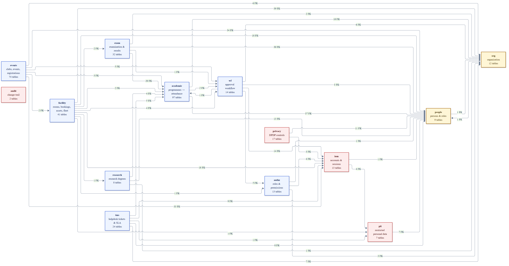

---

## Data flow diagrams

The data flow diagrams below are the project's single DFD set, maintained in **`docs/data-flow.md`** (generated by `docs/dfd/build_dfd.py`, which fails if any table is left out of a data store). They are embedded here so the movement of data and the tables it lands in can be read side by side; the numbered steps, the rules each step enforces and the full legend are in `docs/data-flow.md`. Under each Level 2 diagram, the links jump to the catalog groups holding its tables.

### Level 0 — context

The whole foundation as one process, with everyone and everything that sends data to it or receives data from it.

### Level 1 — the 16 processes

**1A · Platform, governance & helpdesk** — processes 1–7 and 15: organisation, people, authentication, authorisation, approval workflow, privacy, audit, and the helpdesk (TMS).

**1B · Academic, examination, research, facilities & events** — processes 8–14 and 16: curriculum, student lifecycle, teaching, examinations, awards, research, facilities & transport, clubs & events.

| # | Process | Catalog groups |
|---|---|---|
| 1 | Maintain organisation structure & positions | [§2 org](#s-org) |
| 2 | Onboard & maintain people | [§3 people](#s-people) · [§7 pii](#s-pii) |
| 3 | Authenticate | [§8 iam](#s-iam) |
| 4 | Authorise | [§9 authz](#s-authz) |
| 5 | Run approval workflow — the engine every approval is configured on | [§10 wf](#s-wf) |
| 6 | Manage privacy & data-principal rights | [§11 privacy](#s-privacy) |
| 7 | Capture audit trail | [§12 audit](#s-audit) |
| 8 | Define programmes, calendar & curriculum | [§4.1](#g-a1) · [§4.2](#g-a2) · [§4.3](#g-a3) · [§4.8](#g-a8) · [§4.9](#g-a9) |
| 9 | Manage enrolment & student lifecycle | [§4.5](#g-a5) · [§4.6](#g-a6) · [§4.7](#g-a7) |
| 10 | Deliver teaching | [§4.4](#g-a4) · [§4.5](#g-a5) · [§4.10](#g-a10) |
| 11 | Conduct examinations & publish results | [§5.1](#g-e1) · [§5.2](#g-e2) · [§5.3](#g-e3) · [§5.4](#g-e4) |
| 12 | Confer awards & issue certificates | [§5.4](#g-e4) · [§4.6](#g-a6) |
| 13 | Supervise research degrees | [§6 research](#s-research) |
| 14 | Manage facilities & transport | [§13 facility](#s-facility) |
| 15 | Handle helpdesk tickets | [§14 tms](#s-tms) |
| 16 | Run clubs & events | [§15 events](#s-events) |

### Level 2 — Organisation and people (processes 1, 2)

Tables: [§2 org](#s-org) · [§3 people](#s-people) · [§7 pii](#s-pii)

### Level 2 — Authenticate (3)

Tables: [§8 iam](#s-iam)

### Level 2 — Authorise (4)

Tables: [§9 authz](#s-authz)

### Level 2 — Approval workflow (5)

Tables: [§10 wf](#s-wf)

### Level 2 — Privacy and data-principal rights (6)

Tables: [§11.1](#g-v1) · [§11.2](#g-v2)

### Level 2 — Audit trail (7)

Tables: [§12 audit](#s-audit)

### Level 2 — Programmes, calendar and curriculum / SOE (8)

Tables: [§4.1](#g-a1) · [§4.2](#g-a2) · [§4.3](#g-a3) · [§4.8](#g-a8) · [§4.9](#g-a9)

### Level 2 — Enrolment and student lifecycle (9)

Tables: [§4.1](#g-a1) · [§4.5](#g-a5) · [§4.7](#g-a7)

### Level 2 — NEP 2020 credits, equivalence, minors & honours (9)

Tables: [§4.6](#g-a6)

### Level 2 — Term set-up, registration and timetable (10)

Tables: [§4.4](#g-a4) · [§4.5](#g-a5)

### Level 2 — Classes, attendance, feedback and mentoring (10)

Tables: [§4.5](#g-a5) · [§4.7](#g-a7) · [§4.10](#g-a10)

### Level 2 — Exam planning and conduct (11)

Tables: [§5.1](#g-e1) · [§5.2](#g-e2)

### Level 2 — Evaluation, results and attainment (11)

Tables: [§5.3](#g-e3) · [§5.4](#g-e4) · [§4.8](#g-a8)

### Level 2 — Awards, certificates and convocation (12)

Tables: [§5.4](#g-e4) · [§4.6](#g-a6)

### Level 2 — Research degrees (13)

Tables: [§6 research](#s-research)

### Level 2 — Space, occupancy ledger & room bookings (14 a)

Tables: [§13.1 space, custody & ledger](#g-f1) · [§13.2 bookings & events](#g-f2) · [§2 org](#s-org)

### Level 2 — Assets, maintenance, guest house, transport, keys & parking (14 b)

Tables: [§13.3 assets & maintenance](#g-f3) · [§13.4 guest house & parking](#g-f4) · [§13.5 fleet & transport](#g-f5) · [§13.6 keys](#g-f6)

### Level 2 — Helpdesk / TMS (15)

Tables: [§14 tms](#s-tms)

### Level 2 — Clubs, sponsorship & event proposals (16 a)

Tables: [§15.1 clubs](#g-n1) · [§15.2 proposals, budgets & sponsors](#g-n2) · [§15.6 club changes](#g-n6) · [§10 wf](#s-wf) · [§13.2 facility bookings & events](#g-f2)

### Level 2 — Running an event (16 b)

Tables: [§15.3 the event](#g-n3) · [§15.4 registrations, teams & the gate](#g-n4) · [§15.5 feedback, certificates & points](#g-n5)

### Level 2 — Fees, settlement, messages & stalls (16 c)

Tables: [§15.7 coupons, payments & settlement](#g-n7) · [§15.8 messages](#g-n8) · [§15.9 stalls](#g-n9)

### Level 3 — feature by feature

<!-- features -->
Every step of every Level-2 diagram has its own feature diagram (Level 3) in [`data-flow-features.md`](data-flow-features.md): **170 features**. The table lists them by area with the groups of this catalog whose tables each one reads (R) or writes (W) — at data-store level, as drawn.

**Platform — organisation, people, login, permissions, approvals, privacy, audit**

| Feature | Catalog groups it reads / writes |
|---|---|
| [1.1 · Maintain org-unit tree](data-flow-features.md#f-1-1) | [Organisation tree, positions & places](#g-o1) RW |
| [1.2 · Maintain campuses, buildings & rooms](data-flow-features.md#f-1-2) | [Organisation tree, positions & places](#g-o1) RW |
| [1.3 · Appoint position holders](data-flow-features.md#f-1-3) | [Organisation tree, positions & places](#g-o1) RW |
| [2.1 · Register person, contacts & documents](data-flow-features.md#f-2-1) | [Persons and the roles they play](#g-p1) W · [Restricted personal data](#g-k1) W |
| [2.2 · Record employment & posting](data-flow-features.md#f-2-2) | [Organisation tree, positions & places](#g-o1) R · [Persons and the roles they play](#g-p1) RW |
| [2.3 · Set reporting & reviewing lines](data-flow-features.md#f-2-3) | [Persons and the roles they play](#g-p1) RW |
| [2.4 · Record student & mentor](data-flow-features.md#f-2-4) | [Persons and the roles they play](#g-p1) RW |
| [2.5 · Link guardian / family](data-flow-features.md#f-2-5) | [Persons and the roles they play](#g-p1) RW |
| [2.6 · Open user account](data-flow-features.md#f-2-6) | [Accounts, credentials, MFA & sessions](#g-i1) W |
| [2.7 · Derive current affiliation](data-flow-features.md#f-2-7) | [Organisation tree, positions & places](#g-o1) R · [Persons and the roles they play](#g-p1) R · [Restricted personal data](#g-k1) R |
| [3.1 · Resolve identifier](data-flow-features.md#f-3-1) | [Restricted personal data](#g-k1) R · [Accounts, credentials, MFA & sessions](#g-i1) RW |
| [3.2 · Check status & lockout](data-flow-features.md#f-3-2) | [Accounts, credentials, MFA & sessions](#g-i1) R |
| [3.3 · Verify password](data-flow-features.md#f-3-3) | [Accounts, credentials, MFA & sessions](#g-i1) RW |
| [3.4 · Verify second factor](data-flow-features.md#f-3-4) | [Accounts, credentials, MFA & sessions](#g-i1) RW |
| [3.5 · Open, rotate & revoke session](data-flow-features.md#f-3-5) | [Accounts, credentials, MFA & sessions](#g-i1) RW |
| [3.6 · Reset / change password](data-flow-features.md#f-3-6) | [Accounts, credentials, MFA & sessions](#g-i1) RW |
| [3.7 · Activate account & enrol MFA](data-flow-features.md#f-3-7) | [Restricted personal data](#g-k1) W · [Accounts, credentials, MFA & sessions](#g-i1) RW |
| [3.8 · Lock & release account](data-flow-features.md#f-3-8) | [Accounts, credentials, MFA & sessions](#g-i1) RW |
| [4.1 · Register module, resources & permissions](data-flow-features.md#f-4-1) | [Modules, permissions, roles & grants](#g-z1) RW |
| [4.2 · Define roles, inheritance & conflicts](data-flow-features.md#f-4-2) | [Modules, permissions, roles & grants](#g-z1) RW |
| [4.3 · Set derivation rules](data-flow-features.md#f-4-3) | [Modules, permissions, roles & grants](#g-z1) RW |
| [4.4 · Grant role / permission explicitly](data-flow-features.md#f-4-4) | [Modules, permissions, roles & grants](#g-z1) RW |
| [4.5 · Resolve effective roles & permissions](data-flow-features.md#f-4-5) | [Organisation tree, positions & places](#g-o1) R · [Persons and the roles they play](#g-p1) R · [Modules, permissions, roles & grants](#g-z1) R |
| [4.6 · Check permission](data-flow-features.md#f-4-6) | [Organisation tree, positions & places](#g-o1) R · [Accounts, credentials, MFA & sessions](#g-i1) R |
| [5.1 · Configure document types, chains & levels](data-flow-features.md#f-5-1) | [The approval engine](#g-w1) RW |
| [5.2 · Submit document](data-flow-features.md#f-5-2) | [Organisation tree, positions & places](#g-o1) R · [Persons and the roles they play](#g-p1) R · [Courses, curriculum & the SOE](#g-a3) W · [Registration, attendance & leave](#g-a5) W · [Boards, councils & committees](#g-a9) R · [Question papers, bank & question-wise marks](#g-e2) W · [Evaluation, marks & moderation](#g-e3) W · [The approval engine](#g-w1) RW |
| [5.3 · List work pending for me](data-flow-features.md#f-5-3) | [The approval engine](#g-w1) R |
| [5.4 · Comment, consult & resolve](data-flow-features.md#f-5-4) | [The approval engine](#g-w1) RW |
| [5.5 · Approve · sign · return · reject · forward · withdraw](data-flow-features.md#f-5-5) | [Persons and the roles they play](#g-p1) W · [The approval engine](#g-w1) RW |
| [5.6 · Derive round state](data-flow-features.md#f-5-6) | [The approval engine](#g-w1) R |
| [5.7 · Run deadlines](data-flow-features.md#f-5-7) | [The approval engine](#g-w1) RW |
| [6.1 · Maintain purposes, inventory & processors](data-flow-features.md#f-6-1) | [Purposes, inventory, notices & consent](#g-v1) RW |
| [6.2 · Publish privacy notice](data-flow-features.md#f-6-2) | [Persons and the roles they play](#g-p1) W · [Purposes, inventory, notices & consent](#g-v1) RW |
| [6.3 · Record & withdraw consent](data-flow-features.md#f-6-3) | [Persons and the roles they play](#g-p1) RW · [Purposes, inventory, notices & consent](#g-v1) RW |
| [6.4 · Handle rights request](data-flow-features.md#f-6-4) | [Rights requests, erasure, breaches & access log](#g-v2) RW |
| [6.5 · Erase / anonymise](data-flow-features.md#f-6-5) | [Persons and the roles they play](#g-p1) RW · [Accounts, credentials, MFA & sessions](#g-i1) W · [Purposes, inventory, notices & consent](#g-v1) R · [Rights requests, erasure, breaches & access log](#g-v2) RW |
| [6.6 · Manage breach](data-flow-features.md#f-6-6) | [Rights requests, erasure, breaches & access log](#g-v2) RW |
| [6.7 · Log access to personal data](data-flow-features.md#f-6-7) | [Rights requests, erasure, breaches & access log](#g-v2) W |
| [6.8 · Monitor compliance](data-flow-features.md#f-6-8) | [Purposes, inventory, notices & consent](#g-v1) R · [Rights requests, erasure, breaches & access log](#g-v2) R |
| [7.1 · Attach capture trigger](data-flow-features.md#f-7-1) | other schemas only (shown on its diagram) |
| [7.2 · Capture row change](data-flow-features.md#f-7-2) | [Purposes, inventory, notices & consent](#g-v1) R · [Append-only change trail](#g-u1) W |
| [7.3 · Guard append-only](data-flow-features.md#f-7-3) | other schemas only (shown on its diagram) |
| [7.4 · Rotate monthly partitions](data-flow-features.md#f-7-4) | [Append-only change trail](#g-u1) RW |
| [7.5 · Review the trail](data-flow-features.md#f-7-5) | [Append-only change trail](#g-u1) R |

**Academic — programmes, curriculum, student lifecycle, NEP credits, teaching**

| Feature | Catalog groups it reads / writes |
|---|---|
| [8.1 · Define programme, specializations & outcomes](data-flow-features.md#f-8-1) | [Organisation tree, positions & places](#g-o1) R · [Persons and the roles they play](#g-p1) R · [Programmes, calendar, batches & enrollment](#g-a1) RW · [Syllabus, outcomes & attainment](#g-a8) RW |
| [8.2 · Record approvals & accreditation](data-flow-features.md#f-8-2) | [Persons and the roles they play](#g-p1) W · [Programmes, calendar, batches & enrollment](#g-a1) RW |
| [8.3 · Maintain academic calendar](data-flow-features.md#f-8-3) | [Programmes, calendar, batches & enrollment](#g-a1) RW |
| [8.4 · Open batch (intake)](data-flow-features.md#f-8-4) | [Programmes, calendar, batches & enrollment](#g-a1) RW · [Courses, curriculum & the SOE](#g-a3) RW |
| [8.5 · Record body meetings & resolutions](data-flow-features.md#f-8-5) | [Boards, councils & committees](#g-a9) RW |
| [8.6 · Maintain course catalogue & syllabus](data-flow-features.md#f-8-6) | [Programmes, calendar, batches & enrollment](#g-a1) R · [Courses, curriculum & the SOE](#g-a3) RW · [Offerings, sections & timetable](#g-a4) RW · [Syllabus, outcomes & attainment](#g-a8) RW · [Boards, councils & committees](#g-a9) R |
| [8.7 · Define grading & schemes of examination](data-flow-features.md#f-8-7) | [Grade scales & schemes of examination](#g-a2) RW · [Syllabus, outcomes & attainment](#g-a8) RW |
| [8.8 · Build curriculum version](data-flow-features.md#f-8-8) | [Grade scales & schemes of examination](#g-a2) R · [Courses, curriculum & the SOE](#g-a3) RW · [Offerings, sections & timetable](#g-a4) R · [NEP 2020 flexibility](#g-a6) RW · [Syllabus, outcomes & attainment](#g-a8) R |
| [8.9 · Submit SOE & enforce the freeze](data-flow-features.md#f-8-9) | [Courses, curriculum & the SOE](#g-a3) W |
| [9.1 · Enrol student in a batch](data-flow-features.md#f-9-1) | [Persons and the roles they play](#g-p1) R · [Programmes, calendar, batches & enrollment](#g-a1) RW · [Courses, curriculum & the SOE](#g-a3) R · [Registration, attendance & leave](#g-a5) RW |
| [9.2 · Record specialization & pathway](data-flow-features.md#f-9-2) | [Programmes, calendar, batches & enrollment](#g-a1) RW · [Courses, curriculum & the SOE](#g-a3) R · [Registration, attendance & leave](#g-a5) RW |
| [9.3 · Register for the term](data-flow-features.md#f-9-3) | [Programmes, calendar, batches & enrollment](#g-a1) R · [Courses, curriculum & the SOE](#g-a3) R · [Registration, attendance & leave](#g-a5) RW · [NEP 2020 flexibility](#g-a6) R · [Student lifecycle, supervision & discipline](#g-a7) R |
| [9.4 · Decide academic standing](data-flow-features.md#f-9-4) | [Courses, curriculum & the SOE](#g-a3) R · [Registration, attendance & leave](#g-a5) W · [NEP 2020 flexibility](#g-a6) R · [Results, documents & awards](#g-e4) R |
| [9.5 · Approve break in study](data-flow-features.md#f-9-5) | [Student lifecycle, supervision & discipline](#g-a7) RW |
| [9.6 · Hear disciplinary case](data-flow-features.md#f-9-6) | [Student lifecycle, supervision & discipline](#g-a7) RW · [Boards, councils & committees](#g-a9) R |
| [9.7 · Transfer programme / re-enter](data-flow-features.md#f-9-7) | [Programmes, calendar, batches & enrollment](#g-a1) RW · [Registration, attendance & leave](#g-a5) RW · [NEP 2020 flexibility](#g-a6) RW · [Student lifecycle, supervision & discipline](#g-a7) RW · [Boards, councils & committees](#g-a9) R |
| [9.8 · Approve credit overload](data-flow-features.md#f-9-8) | [Registration, attendance & leave](#g-a5) RW |
| [9.9 · Derive term, backlog & standing](data-flow-features.md#f-9-9) | [Registration, attendance & leave](#g-a5) R · [NEP 2020 flexibility](#g-a6) R · [Student lifecycle, supervision & discipline](#g-a7) R · [Results, documents & awards](#g-e4) R |
| [9.10 · Approve course equivalence](data-flow-features.md#f-9-10) | [Courses, curriculum & the SOE](#g-a3) R · [Offerings, sections & timetable](#g-a4) R · [NEP 2020 flexibility](#g-a6) RW · [Boards, councils & committees](#g-a9) R |
| [9.11 · Map external courses](data-flow-features.md#f-9-11) | [NEP 2020 flexibility](#g-a6) RW |
| [9.12 · Transfer credits in](data-flow-features.md#f-9-12) | [Persons and the roles they play](#g-p1) W · [Courses, curriculum & the SOE](#g-a3) R · [NEP 2020 flexibility](#g-a6) RW · [Restricted personal data](#g-k1) R |
| [9.13 · Define minor / honours tracks](data-flow-features.md#f-9-13) | [Organisation tree, positions & places](#g-o1) R · [Grade scales & schemes of examination](#g-a2) R · [NEP 2020 flexibility](#g-a6) RW · [Syllabus, outcomes & attainment](#g-a8) R |
| [9.14 · Join a track](data-flow-features.md#f-9-14) | [Programmes, calendar, batches & enrollment](#g-a1) R · [Registration, attendance & leave](#g-a5) R · [NEP 2020 flexibility](#g-a6) RW · [Results, documents & awards](#g-e4) R |
| [9.15 · Keep the credit ledger & CGPA](data-flow-features.md#f-9-15) | [NEP 2020 flexibility](#g-a6) R · [Student lifecycle, supervision & discipline](#g-a7) R · [Results, documents & awards](#g-e4) R |
| [9.16 · Derive completion & eligibility](data-flow-features.md#f-9-16) | [Courses, curriculum & the SOE](#g-a3) R · [Offerings, sections & timetable](#g-a4) R · [NEP 2020 flexibility](#g-a6) R |
| [10.1 · Create offerings, sections & seat quotas](data-flow-features.md#f-10-1) | [Offerings, sections & timetable](#g-a4) RW |
| [10.2 · Allocate sections](data-flow-features.md#f-10-2) | [Offerings, sections & timetable](#g-a4) W |
| [10.3 · Register core courses](data-flow-features.md#f-10-3) | [Offerings, sections & timetable](#g-a4) R · [Registration, attendance & leave](#g-a5) W |
| [10.4 · Collect elective preferences](data-flow-features.md#f-10-4) | [Registration, attendance & leave](#g-a5) RW |
| [10.5 · Allot electives](data-flow-features.md#f-10-5) | [Offerings, sections & timetable](#g-a4) R · [Registration, attendance & leave](#g-a5) RW · [Results, documents & awards](#g-e4) R |
| [10.6 · Register by choice / drop](data-flow-features.md#f-10-6) | [Registration, attendance & leave](#g-a5) RW |
| [10.7 · Form class groups](data-flow-features.md#f-10-7) | [Offerings, sections & timetable](#g-a4) RW · [Registration, attendance & leave](#g-a5) R |
| [10.8 · Assign faculty](data-flow-features.md#f-10-8) | [Offerings, sections & timetable](#g-a4) RW |
| [10.9 · Build timetable](data-flow-features.md#f-10-9) | [Organisation tree, positions & places](#g-o1) R · [Offerings, sections & timetable](#g-a4) RW |
| [10.10 · File lesson plan](data-flow-features.md#f-10-10) | [Offerings, sections & timetable](#g-a4) R · [Registration, attendance & leave](#g-a5) RW · [Syllabus, outcomes & attainment](#g-a8) RW |
| [10.11 · Generate & record class sessions](data-flow-features.md#f-10-11) | [Programmes, calendar, batches & enrollment](#g-a1) R · [Offerings, sections & timetable](#g-a4) R · [Registration, attendance & leave](#g-a5) RW · [Syllabus, outcomes & attainment](#g-a8) RW |
| [10.12 · Mark attendance](data-flow-features.md#f-10-12) | [Registration, attendance & leave](#g-a5) RW · [Syllabus, outcomes & attainment](#g-a8) R |
| [10.13 · Apply for duty / medical leave](data-flow-features.md#f-10-13) | [Persons and the roles they play](#g-p1) W · [Registration, attendance & leave](#g-a5) W |
| [10.14 · Derive attendance % & coverage](data-flow-features.md#f-10-14) | [Registration, attendance & leave](#g-a5) R · [Syllabus, outcomes & attainment](#g-a8) R |
| [10.15 · Run feedback cycle](data-flow-features.md#f-10-15) | [Offerings, sections & timetable](#g-a4) R · [Registration, attendance & leave](#g-a5) R · [Anonymous student feedback](#g-a10) RW |
| [10.16 · Record mentoring meetings](data-flow-features.md#f-10-16) | [Persons and the roles they play](#g-p1) R · [Student lifecycle, supervision & discipline](#g-a7) RW |
| [10.17 · Supervise projects & internships](data-flow-features.md#f-10-17) | [Persons and the roles they play](#g-p1) RW · [Registration, attendance & leave](#g-a5) R · [Student lifecycle, supervision & discipline](#g-a7) RW |

**Examinations, awards and research degrees**

| Feature | Catalog groups it reads / writes |
|---|---|
| [11.1 · Open exam session](data-flow-features.md#f-11-1) | [Sessions, eligibility, date sheet & conduct](#g-e1) RW |
| [11.2 · Place holds & condone shortage](data-flow-features.md#f-11-2) | [Sessions, eligibility, date sheet & conduct](#g-e1) RW |
| [11.3 · Check eligibility & register](data-flow-features.md#f-11-3) | [Sessions, eligibility, date sheet & conduct](#g-e1) RW |
| [11.4 · Appoint setters & moderators](data-flow-features.md#f-11-4) | [Persons and the roles they play](#g-p1) R · [Question papers, bank & question-wise marks](#g-e2) RW |
| [11.5 · Maintain question bank](data-flow-features.md#f-11-5) | [Question papers, bank & question-wise marks](#g-e2) RW |
| [11.6 · Set, moderate & approve paper](data-flow-features.md#f-11-6) | [Persons and the roles they play](#g-p1) W · [Question papers, bank & question-wise marks](#g-e2) RW |
| [11.7 · Publish date sheet](data-flow-features.md#f-11-7) | [Sessions, eligibility, date sheet & conduct](#g-e1) RW · [Question papers, bank & question-wise marks](#g-e2) R |
| [11.8 · Plan rooms, seats, invigilators & panels](data-flow-features.md#f-11-8) | [Organisation tree, positions & places](#g-o1) R · [Persons and the roles they play](#g-p1) R · [Sessions, eligibility, date sheet & conduct](#g-e1) RW |
| [11.9 · Conduct exam](data-flow-features.md#f-11-9) | [Sessions, eligibility, date sheet & conduct](#g-e1) RW |
| [11.10 · Code scripts & assign evaluators](data-flow-features.md#f-11-10) | [Sessions, eligibility, date sheet & conduct](#g-e1) R · [Evaluation, marks & moderation](#g-e3) RW |
| [11.11 · Evaluate scripts](data-flow-features.md#f-11-11) | [Grade scales & schemes of examination](#g-a2) R · [Syllabus, outcomes & attainment](#g-a8) R · [Question papers, bank & question-wise marks](#g-e2) RW · [Evaluation, marks & moderation](#g-e3) RW |
| [11.12 · Enter internal, practical & viva marks](data-flow-features.md#f-11-12) | [Grade scales & schemes of examination](#g-a2) R · [Syllabus, outcomes & attainment](#g-a8) R · [Sessions, eligibility, date sheet & conduct](#g-e1) R · [Question papers, bank & question-wise marks](#g-e2) RW · [Evaluation, marks & moderation](#g-e3) RW |
| [11.13 · Apply grace & board moderation](data-flow-features.md#f-11-13) | [Evaluation, marks & moderation](#g-e3) RW |
| [11.14 · Compute provisional result](data-flow-features.md#f-11-14) | [Grade scales & schemes of examination](#g-a2) R · [Syllabus, outcomes & attainment](#g-a8) R · [Question papers, bank & question-wise marks](#g-e2) R · [Evaluation, marks & moderation](#g-e3) R |
| [11.15 · Publish results](data-flow-features.md#f-11-15) | [Results, documents & awards](#g-e4) W |
| [11.16 · Revaluate & revise marks](data-flow-features.md#f-11-16) | [Question papers, bank & question-wise marks](#g-e2) W · [Evaluation, marks & moderation](#g-e3) RW · [Results, documents & awards](#g-e4) R |
| [11.17 · Derive SGPA, CGPA, division & rank](data-flow-features.md#f-11-17) | [Grade scales & schemes of examination](#g-a2) R · [Results, documents & awards](#g-e4) R |
| [11.18 · Derive CO / PO attainment](data-flow-features.md#f-11-18) | [Grade scales & schemes of examination](#g-a2) R · [Syllabus, outcomes & attainment](#g-a8) R · [Question papers, bank & question-wise marks](#g-e2) R · [Evaluation, marks & moderation](#g-e3) R |
| [12.1 · Check award eligibility](data-flow-features.md#f-12-1) | [Courses, curriculum & the SOE](#g-a3) R · [NEP 2020 flexibility](#g-a6) R · [Results, documents & awards](#g-e4) R |
| [12.2 · Close enrollment & confer award](data-flow-features.md#f-12-2) | [Programmes, calendar, batches & enrollment](#g-a1) RW · [Registration, attendance & leave](#g-a5) RW · [NEP 2020 flexibility](#g-a6) W · [Doctoral & research degrees](#g-r1) R |
| [12.3 · Issue marksheet](data-flow-features.md#f-12-3) | [Persons and the roles they play](#g-p1) W · [Results, documents & awards](#g-e4) RW |
| [12.4 · Issue certificate](data-flow-features.md#f-12-4) | [Persons and the roles they play](#g-p1) W · [Programmes, calendar, batches & enrollment](#g-a1) R · [Registration, attendance & leave](#g-a5) R · [NEP 2020 flexibility](#g-a6) R · [Results, documents & awards](#g-e4) RW |
| [12.5 · Hold convocation](data-flow-features.md#f-12-5) | [Organisation tree, positions & places](#g-o1) R · [Results, documents & awards](#g-e4) RW |
| [12.6 · Award medals & prizes](data-flow-features.md#f-12-6) | [Results, documents & awards](#g-e4) RW |
| [13.1 · Set supervision norms](data-flow-features.md#f-13-1) | [Persons and the roles they play](#g-p1) R · [Doctoral & research degrees](#g-r1) RW |
| [13.2 · Allocate supervisors](data-flow-features.md#f-13-2) | [Persons and the roles they play](#g-p1) R · [Programmes, calendar, batches & enrollment](#g-a1) R · [Registration, attendance & leave](#g-a5) R · [Doctoral & research degrees](#g-r1) RW |
| [13.3 · Constitute advisory committee](data-flow-features.md#f-13-3) | [Doctoral & research degrees](#g-r1) RW |
| [13.4 · Review progress](data-flow-features.md#f-13-4) | [Doctoral & research degrees](#g-r1) RW |
| [13.5 · Track thesis milestones](data-flow-features.md#f-13-5) | [Persons and the roles they play](#g-p1) W · [Doctoral & research degrees](#g-r1) RW |
| [13.6 · Appoint examiners & record reports](data-flow-features.md#f-13-6) | [Persons and the roles they play](#g-p1) W · [Doctoral & research degrees](#g-r1) RW |
| [13.7 · Hold viva voce](data-flow-features.md#f-13-7) | [Organisation tree, positions & places](#g-o1) R · [Doctoral & research degrees](#g-r1) RW |
| [13.8 · Derive scholar status](data-flow-features.md#f-13-8) | [Results, documents & awards](#g-e4) R · [Doctoral & research degrees](#g-r1) R |

**Resource & facility management**

| Feature | Catalog groups it reads / writes |
|---|---|
| [14.1 · Keep the space inventory](data-flow-features.md#f-14-1) | [Organisation tree, positions & places](#g-o1) RW · [Space, custody & the occupancy ledger](#g-f1) RW |
| [14.2 · Set booking rules](data-flow-features.md#f-14-2) | [Organisation tree, positions & places](#g-o1) R · [Space, custody & the occupancy ledger](#g-f1) RW · [Bookings & events](#g-f2) RW |
| [14.3 · Maintain the occupancy ledger](data-flow-features.md#f-14-3) | [Offerings, sections & timetable](#g-a4) R · [Registration, attendance & leave](#g-a5) R · [Syllabus, outcomes & attainment](#g-a8) R · [Sessions, eligibility, date sheet & conduct](#g-e1) R · [Results, documents & awards](#g-e4) R · [Doctoral & research degrees](#g-r1) R · [Space, custody & the occupancy ledger](#g-f1) RW |
| [14.4 · Request a booking](data-flow-features.md#f-14-4) | [Organisation tree, positions & places](#g-o1) R · [Space, custody & the occupancy ledger](#g-f1) RW · [Bookings & events](#g-f2) RW |
| [14.5 · Decide & use a booking](data-flow-features.md#f-14-5) | [Space, custody & the occupancy ledger](#g-f1) W · [Bookings & events](#g-f2) RW |
| [14.6 · Cancel & reschedule a booking](data-flow-features.md#f-14-6) | [Space, custody & the occupancy ledger](#g-f1) W · [Bookings & events](#g-f2) RW |
| [14.7 · Book an event's venue package](data-flow-features.md#f-14-7) | [Bookings & events](#g-f2) RW |
| [14.8 · Find free rooms & report use](data-flow-features.md#f-14-8) | [Organisation tree, positions & places](#g-o1) R · [Space, custody & the occupancy ledger](#g-f1) R |
| [14.9 · Keep assets, vendors & contracts](data-flow-features.md#f-14-9) | [Organisation tree, positions & places](#g-o1) R · [Persons and the roles they play](#g-p1) R · [Assets, loans & maintenance](#g-f3) RW |
| [14.10 · Book & lend assets](data-flow-features.md#f-14-10) | [Persons and the roles they play](#g-p1) R · [Bookings & events](#g-f2) R · [Assets, loans & maintenance](#g-f3) RW |
| [14.11 · Report & fix faults](data-flow-features.md#f-14-11) | [Persons and the roles they play](#g-p1) R · [Space, custody & the occupancy ledger](#g-f1) W · [Assets, loans & maintenance](#g-f3) RW |
| [14.12 · Plan preventive maintenance](data-flow-features.md#f-14-12) | [Assets, loans & maintenance](#g-f3) RW |
| [14.13 · Run the guest house](data-flow-features.md#f-14-13) | [Organisation tree, positions & places](#g-o1) R · [Persons and the roles they play](#g-p1) R · [Space, custody & the occupancy ledger](#g-f1) W · [Guest house & parking](#g-f4) RW |
| [14.14 · Request transport](data-flow-features.md#f-14-14) | [Bookings & events](#g-f2) R · [Fleet & transport](#g-f5) RW |
| [14.15 · Allocate & run trips](data-flow-features.md#f-14-15) | [Persons and the roles they play](#g-p1) R · [Restricted personal data](#g-k1) R · [Fleet & transport](#g-f5) RW |
| [14.16 · Keep the fleet](data-flow-features.md#f-14-16) | [Persons and the roles they play](#g-p1) R · [Restricted personal data](#g-k1) R · [Fleet & transport](#g-f5) RW |
| [14.17 · Escalate unallocated trips](data-flow-features.md#f-14-17) | [Fleet & transport](#g-f5) RW |
| [14.18 · Issue keys & access cards](data-flow-features.md#f-14-18) | [Organisation tree, positions & places](#g-o1) R · [Persons and the roles they play](#g-p1) R · [Keys & access cards](#g-f6) RW |
| [14.19 · Issue parking permits](data-flow-features.md#f-14-19) | [Organisation tree, positions & places](#g-o1) R · [Persons and the roles they play](#g-p1) R · [Guest house & parking](#g-f4) RW |

**Helpdesk & grievance redressal (TMS)**

| Feature | Catalog groups it reads / writes |
|---|---|
| [15.1 · Configure the helpdesk](data-flow-features.md#f-15-1) | [Organisation tree, positions & places](#g-o1) R · [Persons and the roles they play](#g-p1) R · [Helpdesk configuration: categories, people & policy](#g-t1) RW · [Routes & redressal forums](#g-t3) RW · [Knowledge base](#g-t4) RW |
| [15.2 · Raise a ticket](data-flow-features.md#f-15-2) | [Organisation tree, positions & places](#g-o1) R · [Persons and the roles they play](#g-p1) R · [Programmes, calendar, batches & enrollment](#g-a1) R · [Courses, curriculum & the SOE](#g-a3) R · [Offerings, sections & timetable](#g-a4) R · [Registration, attendance & leave](#g-a5) R · [Restricted personal data](#g-k1) R · [Accounts, credentials, MFA & sessions](#g-i1) R · [Helpdesk configuration: categories, people & policy](#g-t1) R · [Routes & redressal forums](#g-t3) R · [Tickets, respondents, the timeline & notices](#g-t2) W · [Knowledge base](#g-t4) RW |
| [15.3 · Work the ticket](data-flow-features.md#f-15-3) | [Helpdesk configuration: categories, people & policy](#g-t1) R · [Tickets, respondents, the timeline & notices](#g-t2) RW |
| [15.4 · Escalate](data-flow-features.md#f-15-4) | [Organisation tree, positions & places](#g-o1) R · [Persons and the roles they play](#g-p1) R · [Helpdesk configuration: categories, people & policy](#g-t1) R · [Routes & redressal forums](#g-t3) R · [Tickets, respondents, the timeline & notices](#g-t2) W |
| [15.5 · Requester's answer](data-flow-features.md#f-15-5) | [Helpdesk configuration: categories, people & policy](#g-t1) R · [Tickets, respondents, the timeline & notices](#g-t2) W |
| [15.6 · Grievance redressal](data-flow-features.md#f-15-6) | [Organisation tree, positions & places](#g-o1) R · [Boards, councils & committees](#g-a9) R · [Routes & redressal forums](#g-t3) R · [Tickets, respondents, the timeline & notices](#g-t2) W |
| [15.7 · Run the scheduler](data-flow-features.md#f-15-7) | [Helpdesk configuration: categories, people & policy](#g-t1) R · [Tickets, respondents, the timeline & notices](#g-t2) RW |
| [15.8 · Queue & deliver notices](data-flow-features.md#f-15-8) | [Helpdesk configuration: categories, people & policy](#g-t1) RW · [Tickets, respondents, the timeline & notices](#g-t2) RW |
| [15.9 · Derive state, register & reports](data-flow-features.md#f-15-9) | [Tickets, respondents, the timeline & notices](#g-t2) R · [Knowledge base](#g-t4) R |

**Clubs & event management**

| Feature | Catalog groups it reads / writes |
|---|---|
| [16.1 · Propose a club](data-flow-features.md#f-16-1) | [Organisation tree, positions & places](#g-o1) R · [Persons and the roles they play](#g-p1) R · [Clubs: founding, officers, members](#g-n1) RW · [Feedback, certificates, club points & settings](#g-n5) R |
| [16.2 · Found the club on approval](data-flow-features.md#f-16-2) | [Organisation tree, positions & places](#g-o1) W · [Clubs: founding, officers, members](#g-n1) RW · [Club changes, primary club & volunteer sign-up](#g-n6) W |
| [16.3 · Run club membership](data-flow-features.md#f-16-3) | [Persons and the roles they play](#g-p1) R · [Clubs: founding, officers, members](#g-n1) RW · [Feedback, certificates, club points & settings](#g-n5) R · [Club changes, primary club & volunteer sign-up](#g-n6) RW |
| [16.4 · Change a club](data-flow-features.md#f-16-4) | [Organisation tree, positions & places](#g-o1) W · [Clubs: founding, officers, members](#g-n1) W · [Feedback, certificates, club points & settings](#g-n5) R · [Club changes, primary club & volunteer sign-up](#g-n6) RW |
| [16.5 · Draft an event proposal](data-flow-features.md#f-16-5) | [Persons and the roles they play](#g-p1) R · [Clubs: founding, officers, members](#g-n1) R · [Event proposals, budgets & sponsors](#g-n2) RW · [Feedback, certificates, club points & settings](#g-n5) R · [Club changes, primary club & volunteer sign-up](#g-n6) R |
| [16.6 · Submit the proposal](data-flow-features.md#f-16-6) | [Event proposals, budgets & sponsors](#g-n2) RW · [Feedback, certificates, club points & settings](#g-n5) R |
| [16.7 · Secure sponsorship](data-flow-features.md#f-16-7) | [Event proposals, budgets & sponsors](#g-n2) RW |
| [16.8 · Configure the module](data-flow-features.md#f-16-8) | [Feedback, certificates, club points & settings](#g-n5) RW |
| [16.9 · Publish & organise the event](data-flow-features.md#f-16-9) | [Persons and the roles they play](#g-p1) R · [Event proposals, budgets & sponsors](#g-n2) R · [The event and its organisation](#g-n3) RW · [Feedback, certificates, club points & settings](#g-n5) R · [Club changes, primary club & volunteer sign-up](#g-n6) RW |
| [16.10 · Change an approved event](data-flow-features.md#f-16-10) | [Event proposals, budgets & sponsors](#g-n2) W · [The event and its organisation](#g-n3) RW · [Registrations, teams & the gate](#g-n4) R · [Club changes, primary club & volunteer sign-up](#g-n6) RW |
| [16.11 · Recruit volunteers](data-flow-features.md#f-16-11) | [Persons and the roles they play](#g-p1) R · [The event and its organisation](#g-n3) RW · [Club changes, primary club & volunteer sign-up](#g-n6) RW |
| [16.12 · Register](data-flow-features.md#f-16-12) | [Persons and the roles they play](#g-p1) R · [The event and its organisation](#g-n3) R · [Registrations, teams & the gate](#g-n4) RW · [Feedback, certificates, club points & settings](#g-n5) R · [Club changes, primary club & volunteer sign-up](#g-n6) R |
| [16.13 · Form teams](data-flow-features.md#f-16-13) | [The event and its organisation](#g-n3) R · [Registrations, teams & the gate](#g-n4) RW · [Club changes, primary club & volunteer sign-up](#g-n6) R |
| [16.14 · Issue tickets & scan the gate](data-flow-features.md#f-16-14) | [The event and its organisation](#g-n3) R · [Registrations, teams & the gate](#g-n4) RW · [Club changes, primary club & volunteer sign-up](#g-n6) R |
| [16.15 · Record session attendance](data-flow-features.md#f-16-15) | [The event and its organisation](#g-n3) R · [Registrations, teams & the gate](#g-n4) RW · [Feedback, certificates, club points & settings](#g-n5) R · [Club changes, primary club & volunteer sign-up](#g-n6) R |
| [16.16 · Award prizes & certificates](data-flow-features.md#f-16-16) | [Persons and the roles they play](#g-p1) R · [Event proposals, budgets & sponsors](#g-n2) R · [The event and its organisation](#g-n3) R · [Registrations, teams & the gate](#g-n4) RW · [Feedback, certificates, club points & settings](#g-n5) RW · [Club changes, primary club & volunteer sign-up](#g-n6) R |
| [16.17 · Collect feedback & close](data-flow-features.md#f-16-17) | [Persons and the roles they play](#g-p1) W · [Registration, attendance & leave](#g-a5) W · [The event and its organisation](#g-n3) W · [Registrations, teams & the gate](#g-n4) R · [Feedback, certificates, club points & settings](#g-n5) RW · [Club changes, primary club & volunteer sign-up](#g-n6) W |
| [16.18 · Offer coupons](data-flow-features.md#f-16-18) | [The event and its organisation](#g-n3) R · [Registrations, teams & the gate](#g-n4) R · [Club changes, primary club & volunteer sign-up](#g-n6) R · [Coupons, payments, refunds & settlement](#g-n7) RW |
| [16.19 · Take payments](data-flow-features.md#f-16-19) | [Persons and the roles they play](#g-p1) R · [Registrations, teams & the gate](#g-n4) R · [Feedback, certificates, club points & settings](#g-n5) R · [Coupons, payments, refunds & settlement](#g-n7) RW · [Stalls](#g-n9) R |
| [16.20 · Refund & expire](data-flow-features.md#f-16-20) | [Registrations, teams & the gate](#g-n4) RW · [Feedback, certificates, club points & settings](#g-n5) R · [Coupons, payments, refunds & settlement](#g-n7) W |
| [16.21 · Record expenses & settle](data-flow-features.md#f-16-21) | [Persons and the roles they play](#g-p1) R · [Event proposals, budgets & sponsors](#g-n2) R · [Feedback, certificates, club points & settings](#g-n5) R · [Coupons, payments, refunds & settlement](#g-n7) RW |
| [16.22 · Write to registrants](data-flow-features.md#f-16-22) | [Registrations, teams & the gate](#g-n4) R · [Feedback, certificates, club points & settings](#g-n5) R · [Messages to registrants](#g-n8) RW |
| [16.23 · Apply for a stall](data-flow-features.md#f-16-23) | [Persons and the roles they play](#g-p1) R · [The event and its organisation](#g-n3) R · [Club changes, primary club & volunteer sign-up](#g-n6) R · [Coupons, payments, refunds & settlement](#g-n7) R · [Stalls](#g-n9) RW |
| [16.24 · Run stalls & collect feedback](data-flow-features.md#f-16-24) | [Feedback, certificates, club points & settings](#g-n5) R · [Stalls](#g-n9) RW |
<!-- /features -->

---

## 1. `ref` — lookup tables (183)

**Why 183 separate tables instead of, say, 10 Postgres `ENUM` types:** every closed list of values in this system is a table, not an enum, so that adding a new designation, a new employment status, or a new DPDP purpose is a plain `INSERT` — reviewable, auditable, reversible — rather than a schema migration that has to be deployed. Each one follows the same shape: `id`, unique `code` (what application code checks), `label` (what a human sees), `is_active`, `sort_order`. Several carry one or two extra columns that drive real logic rather than being decorative:
- **Identity:** `can_login` on `account_status`.
- **Membership:** `is_current_member` on `employment_status` / `student_status`.
- **Privacy:** `is_sensitive` on `data_category`; `requires_consent` on `legal_basis`; `response_days` on `dpr_request_type`.
- **Academic:** `is_elective` on `course_category`; `is_counted` on `registration_status` and on `term_registration_status` (on the term's rolls); `is_promoted` / `allows_backlog` on `academic_standing` (does the term count move on, and may a promotion carry failed courses); `is_non_working` on `calendar_event_type` (what `academic.is_working_day()` reads); `counts_as_held` on `class_session_status`; `counts_as_present` on `attendance_status`; `rank` on `bloom_level`.
- **Examination:** `is_scheduled_exam` and `evaluation_part_id` (internal / external) on `assessment_type`; `requires_eligibility` on `exam_attempt_type`; `precedence` on `evaluation_round`; `is_pass` on `result_status`; `is_moderated` / `is_approved` on `question_paper_status` (what must already be on the paper — a moderator, an approver — and only an approved set reaches the date sheet); `requires_award` / `requires_closed_enrollment` / `is_single_issue` on `certificate_type`.
- **NEP flexibility:** `is_accepted` on `credit_transfer_status`; `requires_own_program` on `track_type` (honours vs minor).
- **Research:** `is_principal` / `allows_external` on `supervisor_role` (one principal supervisor at a time, counted against the supervision norm; may a non-employee hold the role); `is_chair` on `committee_role`; `is_satisfactory` on `progress_review_outcome`; `is_terminal` on `thesis_status`; `is_external` on `thesis_examiner_role`; `is_accept` / `blocks_viva` on `examiner_recommendation` (what a doctoral award needs; what holds the viva back).
- **Helpdesk (TMS):** `sla_hours`, `first_response_hours` and `office_hours_only` on `tms_priority` (the default SLA; a category may set its own); `is_leaf` / `depth` on `tms_category_level`; `uses_kra_type` / `context_must_be_own` on `tms_ticket_domain`; `for_student` / `for_employee` / `is_grievance` / `requires_relief` on `tms_message_type`; `is_ratable` / `is_reopenable` on `tms_closure_reason`; the state flags on `tms_event_type` that `tms.v_ticket_state` reads; the whole lifecycle in `tms_event_allowed_status`.

| Table | Why it exists | Used by |
|---|---|---|
| `academic_body_type` | Board of Studies / Faculty Board / Academic Council / examination, moderation and disciplinary committees; the helpdesk adds the Students' Grievance Redressal Committee, Internal Complaints Committee, Anti-Ragging Squad and Committee, Equal Opportunity Cell and SC / ST Cell | `academic.academic_body`, `tms.redressal_forum` |
| `academic_calendar_type` | How a programme divides its year — SEMESTER, ANNUAL, PROFESSIONAL_YEAR — and how many terms per year | `academic.program`, `ref.term_cycle` |
| `academic_standing` | The end-of-term decision on a term registration — promoted, promoted with backlog (carry-over), detained, not eligible; `is_promoted` moves the term count on, `allows_backlog` says whether the promotion may carry failed courses (still capped by `academic.promotion_rule`) | `academic.term_registration` |
| `account_status` | Account lifecycle state; `can_login` is what actually gates authentication | `iam.user_account` |
| `accreditation_body` | NAAC (grades the institution), NBA (accredits a programme), ABET — who issued an accreditation | `academic.program_accreditation` |
| `address_type` | Permanent / current / correspondence | `pii.person_address` |
| `assessment_type` | Internal, assignment, quiz, lab record, practical, viva, project, mid-term, end-term; `is_scheduled_exam` = gets a question paper, a date sheet, answer scripts and seating; `evaluation_part_id` = counts in the internal or external part | `academic.evaluation_component`, `exam.exam_schedule`, `exam.paper_setter_assignment`, `exam.question_paper` |
| `attendance_status` | Present / absent / late / on duty / medical leave; `counts_as_present` drives the attendance % | `academic.attendance`, `ref.leave_type` |
| `audit_action` | INSERT / UPDATE / DELETE tag on an audit row | `audit.audit_event` |
| `auth_event_type` | What kind of auth event happened (login success/failure, MFA challenge, token reuse…) | `iam.auth_event` |
| `auth_failure_reason` | Why a login attempt failed (unknown identifier, bad password, locked, MFA invalid…) | `iam.auth_event` |
| `award_type` | Qualifications a student can leave with — UG certificate, UG diploma, bachelor's, honours, honours with research, PG diploma, master's (NEP multiple exit), doctorate (which the database additionally refuses without an accepted `research.viva`) | `academic.award_rule` |
| `batch_document_type` | Intake approval / regulatory circular / other — what a batch document *is* | `academic.batch_document` |
| `blood_group` | A+, O-, etc. | `pii.person_profile` |
| `bloom_level` | Remember → understand → apply → analyse → evaluate → create, ranked — the cognitive level a course outcome targets (NBA outcome-based education) | `academic.course_outcome`, `exam.question_bank_item` |
| `breach_severity` | Low/medium/high/critical | `privacy.breach_incident` |
| `breach_status` | Detected → contained → notified → closed | `privacy.breach_incident` |
| `calendar_event_type` | Holiday / vacation / teaching period / term-registration and add-drop windows / exam period / result declaration / convocation; `is_non_working` is what `academic.is_working_day()` reads, and so what stops a timetabled class landing on a holiday; `tms.helpdesk_closure_type` names the ones that also close the offices | `academic.calendar_event`, `tms.helpdesk_closure_type` |
| `certificate_type` | Transcript, provisional and final award certificate, migration, character, bonafide, rank, course completion; `requires_award` (issued against a conferred `student_award`), `requires_closed_enrollment` (migration), `is_single_issue` (one live original per enrollment) | `exam.certificate` |
| `city` | Cities per state; state and country are reached *through* city, never duplicated onto the address | `org.campus`, `pii.address`, `academic.internship` |
| `class_session_status` | Scheduled / held / cancelled / rescheduled; `counts_as_held` — only held classes take attendance and count toward % | `academic.class_session` |
| `committee_role` | Chair / member / external expert of a Research Advisory Committee; `is_chair` — exactly one chair at a time | `research.advisory_committee_member`, `academic.academic_body_member` |
| `consent_channel` | Web / mobile app / paper / Consent Manager / email | `privacy.consent` |
| `contact_channel` | Email / phone / SMS / website / postal / in-app | `org.org_unit_contact`, `privacy.breach_notification`, `tms.ticket_notice_rule`, `tms.ticket_notification`, `tms.helpdesk_channel`, `tms.notice_opt_out` |
| `contact_purpose` | Official / personal / emergency | `pii.person_email`, `pii.person_phone` |
| `country` | ISO 3166-1 | `pii.person_profile` (nationality), `privacy.data_processor`, `ref.state_province`, `academic.external_provider` |
| `course_category` | Core / foundation / lab / project / internship / audit / discipline elective / open elective / value-added / MOOC / minor / honours, plus the NEP 2020 categories — skill enhancement (SEC), multidisciplinary (MDC), Indian Knowledge System, dissertation / research project; `is_elective` decides fixed curriculum vs elective basket; `requires_supervision` marks project / internship / dissertation categories | `academic.curriculum_course`, `academic.elective_basket`, `academic.track_course`, `academic.external_course_mapping`, `ref.course_category` |
| `credit_transfer_status` | Submitted / approved / rejected; `is_accepted` decides whether transferred credits count | `academic.credit_transfer` |
| `data_category` | Categories of personal data (identity, contact, health…); `is_sensitive` drives redaction | `privacy.data_element`, `privacy.pii_access_log`, `privacy.purpose_data_category` |
| `delivery_component` | LECTURE / TUTORIAL / PRACTICAL — the L-T-P of a course | `academic.course_component_hours`, `academic.class_group`, `academic.teaching_assignment`, `academic.course_room_requirement` |
| `delivery_mode` | Regular (full-time, on campus) / part-time / open & distance / online / hybrid — how a programme is delivered, a regulator-facing attribute of the programme, not of the student | `academic.program` |
| `disciplinary_penalty` | Warning / apology / fine / community service / hostel expulsion / suspension / rustication / expulsion; `requires_suspension` — must be served as a DISCIPLINARY_SUSPENSION study break linked to the case | `academic.disciplinary_case` |
| `disciplinary_status` | Reported → under inquiry → decided / under appeal → closed, or dropped; `is_decided` requires the decision and its date, `is_terminal` freezes the case | `academic.disciplinary_case` |
| `dpr_request_type` | Access / correction / erasure / grievance / nomination / consent-withdrawal, each with a response-time policy | `privacy.data_principal_request` |
| `dpr_status` | Submitted → acknowledged → in progress → completed/rejected/withdrawn | `privacy.dpr_request_event` |
| `employee_category` | Teaching / non-teaching | `people.employee`, `people.designation`, `authz.principal_kind_role` |
| `employment_status` | Active/on-leave/suspended/resigned/retired/terminated; `is_current_member` decides who counts as "a current employee" today | `people.employee` |
| `employment_type` | Permanent / contract / temporary / visiting / adjunct | `people.employee` |
| `enrollment_end_reason` | Why an enrollment closed — award conferred, change of programme, migrated out, withdrawn, expelled, maximum duration exceeded, deceased; a CHECK on `student_enrollment` makes a closed enrollment carry one and an open one carry none | `academic.student_enrollment` |
| `erasure_action` | DELETE / ANONYMISE / RETAIN_LEGAL — what erasing a given column actually does | `privacy.data_element`, `privacy.erasure_log` |
| `evaluation_part` | INTERNAL (continuous) / EXTERNAL (end-semester) — the two parts a scheme's pass minimums and internal-lead cap work on | `ref.assessment_type`, `academic.evaluation_part_rule` |
| `evaluation_round` | First evaluation / moderation / revaluation, with `precedence` — the highest round present is the mark that counts | `exam.evaluator_assignment` |
| `exam_attempt_type` | Regular / backlog / improvement / supplementary; `requires_eligibility` applies the attendance-and-hold check | `exam.exam_registration`, `academic.attempt_allowance` |
| `exam_attendance_status` | Present / absent / booked for unfair means | `exam.exam_attendance` |
| `exam_hold_type` | Disciplinary / fee dues / administrative / other | `exam.eligibility_hold` |
| `exam_session_type` | Mid-term / end-term / supplementary / special | `exam.exam_session` |
| `examiner_recommendation` | Accept / accept with minor revision / major revision & resubmission / reject — one vocabulary for an examiner's report and for the viva's outcome; `is_accept` is what a doctoral award needs, `blocks_viva` holds the viva until the thesis is revised and re-examined | `research.thesis_examiner`, `research.viva` |
| `examiner_role` | Internal / external examiner / chair of a practical or viva panel; `is_external` = must be an outside person | `exam.examiner_panel` |
| `external_provider_type` | University / MOOC platform / industry body — where external credits come from | `academic.external_provider` |
| `gender` | Optional by design (data minimisation) | `people.person` |
| `grade` | Officer levels O1–O10, ranked | `people.employee` |
| `id_document_type` | PAN / passport / voter ID / driving licence / APAAR / Aadhaar VID (never full Aadhaar) | `pii.person_identity_document` |
| `job_function` | Functional area of work (Academics, Finance, IT…) — independent of which department someone sits in | `people.employee_assignment` |
| `job_role` | What someone actually does (Teaching, Recruitment…) — distinct from Designation | `people.employee_assignment` |
| `language` | English + the Eighth-Schedule languages | `privacy.privacy_notice`, `academic.program` (medium of instruction) |
| `leave_type` | Duty / medical leave; `attendance_status_id` = how an approved leave day counts in attendance; `needs_document` | `academic.attendance_leave` |
| `legal_basis` | DPDP ground for processing — consent (§6) or a specific legitimate use (§7) | `privacy.processing_purpose` |
| `lockout_reason` | Too many failed logins / failed MFA / admin action / suspicious activity | `iam.account_lockout` |
| `meeting_mode` | In person / online / phone mentoring meeting | `academic.mentoring_meeting` |
| `mfa_factor_type` | TOTP / WebAuthn / email OTP / SMS OTP | `iam.mfa_factor` |
| `misconduct_type` | Ragging, harassment, violence, property damage, substances, academic dishonesty outside exams, IT misuse … (unfair means in an exam stays `exam.ufm_case`) | `academic.disciplinary_case` |
| `org_unit_type` | UNIVERSITY / SCHOOL / DEPARTMENT / CENTRE / CENTRAL_DEPARTMENT / SECTION (and any a future module adds, e.g. BLOCK) | `org.org_unit`, `org.org_unit_type_rule`, `org.position_type_unit_type`, `wf.approval_chain_stage`, `tms.ticket_route_level`, `tms.redressal_forum` |
| `otp_purpose` | Login MFA / step-up / email verify / phone verify / password reset | `iam.otp_challenge` |
| `paper_setter_role` | Setter / moderator of a question paper — the trigger insists they are different people | `exam.paper_setter_assignment` |
| `principal_kind` | Employee / student / guardian — drives automatic baseline roles | `authz.principal_kind_role`, `ref.tms_ticket_domain`, `events.proposal_visibility_role` |
| `prize_type` | Gold / silver / bronze medal, merit and endowment prizes | `exam.prize` |
| `program_level` | UG / PG / integrated / doctoral / diploma / certificate — DOCTORAL is what switches on the research-degree rules (supervision norm, viva before award) | `academic.program` |
| `program_outcome_type` | PO (programme outcome) vs PSO (programme-specific outcome) | `academic.program_outcome` |
| `progress_review_outcome` | Satisfactory / unsatisfactory / termination recommended — the advisory committee's verdict at a periodic review; `is_satisfactory` | `research.progress_review` |
| `publication_type` | Original / revised (after revaluation) / supplementary result | `exam.result_publication` |
| `question_difficulty` | Easy / medium / hard, with rank | `exam.question_bank_item` |
| `question_paper_status` | Draft → submitted → moderated → approved → printed → used (or withdrawn); `is_moderated` requires the setter's submission and the moderator's sign-off on the paper, `is_approved` an approver — and only an approved set may be named on the date sheet | `exam.question_paper` |
| `question_type` | MCQ / short / long / numerical / case study | `exam.question_bank_item` |
| `registration_status` | Registered / dropped / withdrawn; `is_counted` = still on the roster (drives elective intake limits) | `academic.course_registration` |
| `regulatory_body` | UGC, AICTE, NMC, DCI, PCI, INC, BCI, NCTE, COA, NCISM, RCI, CCH, state government — who approves a programme and sanctions its seats | `academic.program_approval`, `academic.course_regulator_code` |
| `relationship_type` | Father / mother / legal guardian / spouse / sibling / child / other | `people.person_relationship` |
| `reporting_line_type` | REPORTING (line manager) vs. REVIEWING (appraisal/skip-level) | `people.employee_reporting_line`, `wf.approval_chain_stage`, `tms.ticket_route_level` |
| `result_status` | Pass / fail / absent / withheld / incomplete | `exam.course_result` |
| `revaluation_status` | Submitted → in progress → completed / rejected | `exam.revaluation_request` |
| `revaluation_type` | Recheck / full revaluation / photocopy of script | `exam.revaluation_request` |
| `room_feature` | Projector, smart board, computers, AC, wheelchair access … | `org.room_facility`, `academic.course_room_requirement`, `facility.booking_requirement` |
| `room_type` | Classroom / tutorial room / lab / seminar hall / auditorium / exam hall | `org.room`, `academic.course_room_requirement`, `facility.blackout`, `facility.hold_priority_rule` |
| `section_role` | Class representative / deputy | `academic.section_representative` |
| `session_revoke_reason` | Logout / rotated / reuse detected / password changed / admin revoked / disabled / expired | `iam.user_session` |
| `state_province` | ISO 3166-2 subdivisions per country | `ref.city` |
| `storage_backend` | S3 / local filesystem | `people.file_object` |
| `student_status` | Active / graduated / withdrawn / expelled; `is_current_member` decides who counts as "a current student". There is deliberately **no** ON_BREAK value any more: a break in study is a dated `academic.study_break` row, so it can't drift out of step with the term count or need flipping back by hand | `people.student` |
| `study_break_type` | Medical / personal / maternity / financial / disciplinary suspension / industry or research break; MEDICAL and MATERNITY reveal health data, so the column is registered as such and anonymised on erasure | `academic.study_break` |
| `supervisor_role` | Supervisor / co-supervisor / external co-supervisor; `is_principal` — one at a time, counted against `research.supervision_norm`; `allows_external` — may be held by a non-employee | `research.supervisor_allocation`, `academic.supervised_work_guide` |
| `term_cycle` | The recurring slots of a calendar type — ODD/EVEN semester, ANNUAL, PROF_YEAR — with their order in the year | `academic.academic_term` |
| `term_registration_status` | Registered / provisional (dues or documents pending) / cancelled; `is_counted` = the student is on the term's rolls, so the row anchors `academic.enrollment_term_no()` | `academic.term_registration` |
| `thesis_examiner_role` | Internal examiner (an employee) / external examiner in India / abroad; `is_external` — must *not* be an employee | `research.thesis_examiner` |
| `thesis_status` | Topic approved → synopsis submitted → synopsis approved → thesis submitted → under evaluation / revision required → viva scheduled → accepted or rejected; `is_terminal` | `research.thesis` |
| `track_type` | Minor / honours / honours with research; `requires_own_program` separates honours (own programme) from a minor (another discipline) | `academic.track` |
| `ufm_case_status` | Reported → under review → decided / dismissed | `exam.ufm_case` |
| `ufm_penalty` | Warning / paper cancelled / session cancelled / debarred | `exam.ufm_case` |
| `verification_method` | How a guardian's consent was verified (existing account, DigiLocker, offline documents, OTP) | `privacy.verifiable_parental_consent` |
| `wf_action_type` | APPROVE / SIGN / RETURN / RETURN_TO / REJECT / WITHDRAW / FORWARD / DELEGATE and the system actions AUTO_APPROVE / AUTO_REJECT / ESCALATE; the flags (completes_step, closes_instance, needs_note, is_system, is_rejection, returns_to_step, reassigns, restarts_clock) drive the workflow rules | `wf.approval_action` |
| `wf_comment_status` | Pending / accepted / rejected reviewer comment; `is_resolved` | `wf.approval_comment` |
| `building_kind` | BUILDING / OPEN_AREA (grounds, courts) / PARKING — an open area or car park is a "building" whose rooms are its zones | `org.building` |
| `room_use` | FICM-style use classification of a room (classroom, laboratory, office, assembly, guest room, parking zone …) with is_bookable / is_guest_room / is_parking_zone | `facility.guest_tariff`, `org.room` |
| `hold_type` | Kind of use in the occupancy ledger (TIMETABLE, EXAM, CONVOCATION, OFFICIAL_EVENT …), the source table that writes it and its default setup / teardown buffers | `facility.hold_priority_rule`, `facility.room_hold`, `ref.booking_purpose` |
| `booking_purpose` | Why a room is booked (seminar, meeting, club activity …) → the hold type (and so the priority) it makes | `facility.booking_request` |
| `facility_resource_kind` | ROOM / ASSET / VEHICLE / GUEST_ROOM / PARKING / KEY — what a booking restriction bars a person from | `facility.booking_restriction` |
| `booking_restriction_reason` | Why a person is barred (misuse, repeated no-shows, dues, disciplinary) | `facility.booking_restriction` |
| `booking_cancel_reason` | Why a booking / stay was cancelled; is_system = set by the workflow or a job (RESCHEDULED, NO_SHOW), not chosen by a person | `facility.booking_occurrence`, `facility.guest_stay` |
| `room_service_type` | Cleaning / repair / renovation / inspection / fumigation | `facility.room_service_window` |
| `asset_type` | Kinds of asset (projector, computer, air conditioner, lab equipment …) | `facility.asset`, `facility.service_contract` |
| `asset_condition` | New / good / fair / under repair / unserviceable / condemned; is_serviceable = may be used or lent | `facility.asset` |
| `work_order_category` | Electrical / plumbing / HVAC / civil / IT-AV / furniture / housekeeping / safety | `facility.work_order` |
| `work_order_priority` | Emergency / high / normal / low with resolve_within (the SLA) — POLICY | `facility.work_order` |
| `work_order_status` | Reported / assigned / in progress / on hold / closed / rejected; is_terminal ends the work order | `facility.work_order_event` |
| `maintenance_type` | AMC service, inspection, calibration, deep cleaning, fire safety, pest control | `facility.maintenance_schedule` |
| `guest_category` | Who a guest is (faculty, student, official guest, external examiner, visitor, parent), which kind of person may be booked under it and whether the stay is complimentary | `facility.guest_stay`, `facility.guest_tariff` |
| `event_kind` | Conference / fest / workshop / ceremony / sports meet / exhibition | `facility.event_request`, `ref.event_type` |
| `key_kind` | Key / spare key / master key / access card | `facility.key_item` |
| `parking_permit_type` | Staff / student / visitor / contractor parking permit | `facility.parking_permit` |
| `vehicle_type` | Car / SUV / van / mini bus / bus / ambulance / truck / two-wheeler; is_passenger | `facility.vehicle` |
| `fuel_type` | Petrol / diesel / CNG / electric / hybrid | `facility.vehicle` |
| `licence_class` | Driving-licence classes ranked so that a higher class covers the lower ones (MCWG < LMV < LMV_TR < HMV < HPMV) | `facility.driver`, `facility.vehicle` |
| `vehicle_document_type` | RC, insurance, PUC, fitness, permit, road tax; is_mandatory_for_trip = must be valid for the whole trip | `facility.vehicle_document` |
| `vehicle_service_type` | Servicing / repair / tyres / accident repair / inspection | `facility.vehicle_service_window` |
| `driver_unavailability_reason` | Leave / sick / other duty / training (no free text about health) | `facility.driver_unavailability` |
| `trip_purpose` | Official visit, field visit, guest pick-up, airport transfer, excursion, medical, event logistics | `facility.trip_request` |
| `trip_cancel_reason` | Why a trip request was cancelled | `facility.trip_request` |
| `trip_alert_type` | AUTO_APPROVED / UNALLOCATED_SOON / EXPIRED — alerts raised by the escalation job | `facility.trip_alert` |
| `rating_role` | PASSENGER (rates the driver) / DRIVER (rates the passengers) | `facility.trip_rating` |
| `tms_ticket_domain` | STUDENT / EMPLOYEE helpdesk: who may raise (principal kind), whether the tree starts at a KRA type, whether academic context must be the requester's own batch, and the create / view / update permissions that govern the domain | `tms.ticket_category`, `tms.ticket_route`, `tms.helpdesk_declaration`, `tms.ticket_notice_rule` |
| `tms_category_level` | KRA type / master / category / leaf, with depth and labels per domain (KRA → KPI → measurement criteria for employees); `is_leaf` = where tickets, priority and handlers live | `tms.ticket_category`, `tms.ticket_route_level` |
| `tms_category_type` | Academic / non-academic / examination — set on the master (classification and reporting) | `tms.ticket_category` |
| `tms_priority` | Low / medium / high / urgent: `sla_hours` per level (72 / 48 / 24 / 8), `first_response_hours` (24 / 8 / 4 / 2) and `office_hours_only` (NULL = the helpdesk-wide setting) (POLICY) — the default SLA, wherever a category does not set its own | `tms.ticket_category`, `tms.ticket`, `tms.ticket_event` |
| `tms_message_type` | Grievance / assistance / enquiry / feedback / service request; `for_student` / `for_employee`; `is_grievance` (may go to a redressal forum); `requires_relief` | `tms.ticket` |
| `tms_ticket_status` | Open / escalated / with the forum / resolved (awaiting the requester) / closed — derived from the timeline, never stored on the ticket | `ref.tms_event_type`, `ref.tms_event_allowed_status` |
| `tms_assignment_basis` | Why a ticket went to its assignee: round-robin, route level, the requester's choice, escalation, reassignment, recusal, referral | `tms.ticket_event` |
| `tms_closure_reason` | Resolved / not maintainable / forum decision / no response / withdrawn / duplicate, with whether the ticket may then be rated or reopened | `ref.tms_event_type` |
| `tms_event_actor` | Who may record an event: the requester, someone who can act, either, a member of the forum hearing it, the person consulted, the office carrying out a decision, the scheduled job | `ref.tms_event_type` |
| `tms_event_type` | Timeline event types with the flags the derived state reads: actor, sets a status, sets the assignee, starts / pauses / stops the SLA clock, needs a remark (or a file), closure reason, counts as the first response, takes files, shown to the requester | `ref.tms_event_allowed_status`, `tms.ticket_notice_rule`, `tms.ticket_event` |
| `tms_event_allowed_status` | The lifecycle as data: in which statuses each event may be recorded | — |
| `tms_route_level_kind` | Handler pool / category owner / mentor / reporting manager / position / named person — the kinds of route level | `tms.ticket_route_level` |
| `tms_anchor_base` | Where a position level looks: the requester's unit, the category's unit, a fixed unit | `tms.ticket_route_level` |
| `tms_redressal_outcome` | Upheld / partly upheld / not upheld / not maintainable (`is_in_favour`) — a forum's decision | `tms.ticket_event` |
| `tms_intake_channel` | Portal (self-service) / walk-in / phone / e-mail / letter — how a ticket reached the helpdesk | `tms.ticket` |
| `tms_grievance_head` | The grievance heads of the UGC grievance regulations (paraphrased, POLICY), plus ragging, sexual harassment and other | `tms.ticket_category` |
| `tms_academic_context_rule` | None / programme (batch, term, semester) / course (and the course) — what context a category's tickets carry | `tms.ticket_category` |
| `tms_notice_recipient` | Requester / assignee after the event / assignee before it / forum members / followers (merged tickets' requesters) / the person consulted / who asked / the last helpdesk handler / the forum's alert position — whom a notice rule addresses | `tms.ticket_notice_rule` |
| `tms_hold_reason` | Another office / a vendor / an external body / a third party's document — what a ticket on hold awaits | `tms.ticket_event` |
| `tms_notification_status` | Pending / sent / failed / skipped / given up (after the maximum attempts); `is_final` = the delivery row can no longer change | `tms.ticket_notification` |
| `wf_approver_kind` | Who decides a level — PERMISSION at a unit, POSITION holder, MANAGER of the person concerned, NAMED person(s), COMMITTEE with a quorum | `wf.approval_chain_stage`, `wf.approval_step` |
| `wf_self_action` | What a level does when the requester is its approver — BLOCK (someone else decides) or SKIP (level left out) | `wf.approval_chain_stage` |
| `wf_timeout_action` | What happens when a level passes its deadline — NONE / REMIND / ESCALATE / AUTO_APPROVE / AUTO_REJECT | `wf.approval_chain_stage`, `wf.approval_step` |
| `wf_flag` | Facts about a request (registered by modules: PAID, EXTERNAL_GUESTS …) on which a level can be made conditional | `wf.approval_chain_stage`, `wf.approval_instance_flag` |
| `wf_notice_kind` | Kinds of notice in the approval outbox (step pending, reminder, escalated, forwarded, returned, rejected, approved) | `wf.approval_notice` |
| `event_type` | Kinds of event (workshop, hackathon, seminar …) and the facility package kind each books under | `events.club_calendar_item`, `events.event_proposal`, `events.event_type_points` |
| `event_level` | Event level by duration in hours (level 1: 2–4 h … level 4: more than 18 h) | `events.event_proposal` |
| `event_mode` | Offline / online / hybrid | `events.event_proposal` |
| `event_audience_kind` | Who an event is for (students, faculty, staff, alumni, external guests …); is_external raises the EXTERNAL_GUESTS flag on the approval round | `events.proposal_audience` |
| `participation_type` | Individual or team participation | `events.event_proposal` |
| `club_office` | Student posts of a club (president, secretary, joint secretary, document curator, creative head); `may_propose` = may propose the club's events; `is_required` = a club proposal must name this office | `events.club_officer`, `events.club_proposal_officer`, `events.club_change_officer` |
| `club_member_role` | Roles of club members (member, volunteer, core member, coordinator, heads) | `events.club_member`, `events.club_change_member` |
| `funding_source` | Where an event's money comes from (university fund, sponsorship, registration fees, other) | `events.proposal_funding` |
| `sponsor_type` | Corporate / individual / organisation sponsor | `events.event_sponsor` |
| `contribution_type` | Cash, in kind, or both | `events.event_sponsorship` |
| `budget_item_type` | Budget heads of an event (venue, refreshments, printing, prizes, honorarium, travel, equipment, publicity) | `events.proposal_budget_item` |
| `event_prize_type` | Cash, certificate, trophy, internship, scholarship, voucher, merchandise | `events.proposal_prize` |
| `event_round_type` | General session, registration desk, elimination round, final | `events.event_round` |
| `event_field_type` | Types of an extra registration question; has_options (dropdown / radio), is_file | `events.event_custom_field` |
| `registration_cancel_reason` | Why a registration was cancelled (withdrawn, by the organisers, event cancelled, unpaid) | `events.event_registration` |
| `entry_direction` | IN (entry) / OUT (exit) at the gate | `events.entry_scan` |
| `scan_source` | LIVE gate scan or IMPORT of an offline attendance sheet | `events.entry_scan` |
| `volunteer_role` | Volunteer or event manager (is_manager = may manage the event) | `events.event_volunteer` |
| `event_certificate_type` | Participation, winner or volunteer certificate | `events.event_certificate_template` |
| `duty_leave_scope` | Who gets duty leave for an event — participants, organisers, or both | `events.event_proposal` |
| `club_change_type` | Kinds of change to a club (name, objective, advisor, co-advisor, officers, members, recorded decisions); the sets_* flags say what the database applies on approval | `events.club_change_request` |
| `coupon_discount_type` | Percentage of the fee, or a fixed amount | `events.event_coupon` |
| `payment_status` | Created / authorised (is_open), captured (is_settled), failed, refunded (is_refunded) | `events.event_payment` |
| `payment_channel` | Online gateway (is_online) or offline — UPI, bank transfer, cash — verified by an organiser | `events.event_payment` |
| `mail_audience` | Whom a message goes to — all, confirmed, pending, cancelled (flags per registration state), or a selection | `events.event_mail` |
| `mail_delivery_status` | Queued, delivered (is_delivered), failed, bounced; is_final = the outcome can no longer change | `events.event_mail_recipient` |
| `stall_type` | Food, product, service, information, other | `events.event_stall`, `events.stall_application` |
| `stall_category` | Standard, premium, sponsored — the fee of a stall is set per event and category | `events.event_stall`, `events.event_stall_fee`, `events.stall_application` |
| `stall_size` | Standard stall sizes and CUSTOM (is_custom: described in words) | `events.event_stall`, `events.stall_application` |
| `stall_setup` | Special set-ups a stall may ask for (water, extra lighting, display board, canopy) | `events.stall_application_setup` |
| `club_category` | What kind of club — academic, technical, cultural, sports, literary, social service, professional chapter, hobby; carried on approval rounds as the flag CLUBCAT_<code> | `events.club`, `events.club_change_request`, `events.club_proposal` |

---

## 2. `org` — organisation structure (12)

### 2.1 Organisation tree, positions & places

One tree of org units (university → schools → departments, plus central departments and sections) with the rules for which unit type may sit under which; positions (HOD, Dean …) and who holds them; campuses, buildings and rooms.

<!-- group:o1 -->
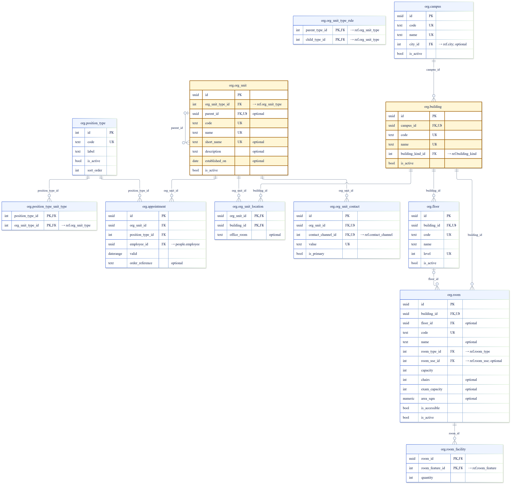

Every column of every table in this group, from the live schema (`created_at` / `updated_at` omitted). Lines are foreign keys inside the group; a note `→ table` is a foreign key to another group; amber = the group's hub. Source: [`catalog-diagrams/er-o1.mmd`](catalog-diagrams/er-o1.mmd).

| Table | What it holds | Links outside this group | Data flow — features that read (R) / write (W) its data store |
|---|---|---|---|
| [`org_unit`](#t-org-org-unit) | The single hub of the whole database | 1 lookup | [1.1](data-flow-features.md#f-1-1) RW · [1.3](data-flow-features.md#f-1-3) R · [2.2](data-flow-features.md#f-2-2) R · [2.7](data-flow-features.md#f-2-7) R · [4.6](data-flow-features.md#f-4-6) R · [5.2](data-flow-features.md#f-5-2) R · [8.1](data-flow-features.md#f-8-1) R · [9.13](data-flow-features.md#f-9-13) R · [15.1](data-flow-features.md#f-15-1) R · [16.1](data-flow-features.md#f-16-1) R · [16.2](data-flow-features.md#f-16-2) W · [16.4](data-flow-features.md#f-16-4) W |
| [`org_unit_type_rule`](#t-org-org-unit-type-rule) | The DB-enforced answer to "what can go under what" | 1 lookup | [1.1](data-flow-features.md#f-1-1) RW · [1.3](data-flow-features.md#f-1-3) R · [2.2](data-flow-features.md#f-2-2) R · [2.7](data-flow-features.md#f-2-7) R · [4.6](data-flow-features.md#f-4-6) R · [5.2](data-flow-features.md#f-5-2) R · [8.1](data-flow-features.md#f-8-1) R · [9.13](data-flow-features.md#f-9-13) R · [15.1](data-flow-features.md#f-15-1) R · [16.1](data-flow-features.md#f-16-1) R · [16.2](data-flow-features.md#f-16-2) W · [16.4](data-flow-features.md#f-16-4) W |
| [`org_unit_contact`](#t-org-org-unit-contact) | A unit's official email/phone/website | 1 lookup | [1.1](data-flow-features.md#f-1-1) RW · [1.3](data-flow-features.md#f-1-3) R · [2.2](data-flow-features.md#f-2-2) R · [2.7](data-flow-features.md#f-2-7) R · [4.6](data-flow-features.md#f-4-6) R · [5.2](data-flow-features.md#f-5-2) R · [8.1](data-flow-features.md#f-8-1) R · [9.13](data-flow-features.md#f-9-13) R · [15.1](data-flow-features.md#f-15-1) R · [16.1](data-flow-features.md#f-16-1) R · [16.2](data-flow-features.md#f-16-2) W · [16.4](data-flow-features.md#f-16-4) W |
| [`org_unit_location`](#t-org-org-unit-location) | Where a unit's office physically is — a many-to-many between units and buildings (a unit can have offices in more than one building), with a free-text room | — | [1.1](data-flow-features.md#f-1-1) RW · [1.3](data-flow-features.md#f-1-3) R · [2.2](data-flow-features.md#f-2-2) R · [2.7](data-flow-features.md#f-2-7) R · [4.6](data-flow-features.md#f-4-6) R · [5.2](data-flow-features.md#f-5-2) R · [8.1](data-flow-features.md#f-8-1) R · [9.13](data-flow-features.md#f-9-13) R · [15.1](data-flow-features.md#f-15-1) R · [16.1](data-flow-features.md#f-16-1) R · [16.2](data-flow-features.md#f-16-2) W · [16.4](data-flow-features.md#f-16-4) W |
| [`position_type`](#t-org-position-type) | The catalogue of single-holder leadership positions — HEAD, DEAN, VICE_CHANCELLOR, REGISTRAR, DPO, GRIEVANCE_OFFICER | — | [1.3](data-flow-features.md#f-1-3) RW · [4.5](data-flow-features.md#f-4-5) R · [15.1](data-flow-features.md#f-15-1) R · [15.2](data-flow-features.md#f-15-2) R · [15.4](data-flow-features.md#f-15-4) R · [15.6](data-flow-features.md#f-15-6) R · [16.2](data-flow-features.md#f-16-2) W · [16.4](data-flow-features.md#f-16-4) W |
| [`position_type_unit_type`](#t-org-position-type-unit-type) | Guards against nonsense like appointing a DEAN of a SECTION | 1 lookup | [1.3](data-flow-features.md#f-1-3) RW · [4.5](data-flow-features.md#f-4-5) R · [15.1](data-flow-features.md#f-15-1) R · [15.2](data-flow-features.md#f-15-2) R · [15.4](data-flow-features.md#f-15-4) R · [15.6](data-flow-features.md#f-15-6) R · [16.2](data-flow-features.md#f-16-2) W · [16.4](data-flow-features.md#f-16-4) W |
| [`appointment`](#t-org-appointment) | Who holds a position of a unit, over time | `people.employee` | [1.3](data-flow-features.md#f-1-3) RW · [4.5](data-flow-features.md#f-4-5) R · [15.1](data-flow-features.md#f-15-1) R · [15.2](data-flow-features.md#f-15-2) R · [15.4](data-flow-features.md#f-15-4) R · [15.6](data-flow-features.md#f-15-6) R · [16.2](data-flow-features.md#f-16-2) W · [16.4](data-flow-features.md#f-16-4) W |
| [`campus`](#t-org-campus) | Physical campuses, the top of the *location* hierarchy … | 1 lookup | [1.2](data-flow-features.md#f-1-2) RW · [10.9](data-flow-features.md#f-10-9) R · [11.8](data-flow-features.md#f-11-8) R · [12.5](data-flow-features.md#f-12-5) R · [13.7](data-flow-features.md#f-13-7) R · [14.1](data-flow-features.md#f-14-1) RW · [14.2](data-flow-features.md#f-14-2) R · [14.4](data-flow-features.md#f-14-4) R · [14.8](data-flow-features.md#f-14-8) R · [14.9](data-flow-features.md#f-14-9) R · [14.13](data-flow-features.md#f-14-13) R · [14.18](data-flow-features.md#f-14-18) R · [14.19](data-flow-features.md#f-14-19) R |
| [`building`](#t-org-building) | Buildings/blocks within a campus, shared by any module that needs a physical location … | 1 lookup | [1.2](data-flow-features.md#f-1-2) RW · [10.9](data-flow-features.md#f-10-9) R · [11.8](data-flow-features.md#f-11-8) R · [12.5](data-flow-features.md#f-12-5) R · [13.7](data-flow-features.md#f-13-7) R · [14.1](data-flow-features.md#f-14-1) RW · [14.2](data-flow-features.md#f-14-2) R · [14.4](data-flow-features.md#f-14-4) R · [14.8](data-flow-features.md#f-14-8) R · [14.9](data-flow-features.md#f-14-9) R · [14.13](data-flow-features.md#f-14-13) R · [14.18](data-flow-features.md#f-14-18) R · [14.19](data-flow-features.md#f-14-19) R |
| [`floor`](#t-org-floor) | A floor of a building (level 0 = ground, negative = basement), so a room can say where it is and custody, reservation rules and keys can target a whole floor at once | — | [1.2](data-flow-features.md#f-1-2) RW · [10.9](data-flow-features.md#f-10-9) R · [11.8](data-flow-features.md#f-11-8) R · [12.5](data-flow-features.md#f-12-5) R · [13.7](data-flow-features.md#f-13-7) R · [14.1](data-flow-features.md#f-14-1) RW · [14.2](data-flow-features.md#f-14-2) R · [14.4](data-flow-features.md#f-14-4) R · [14.8](data-flow-features.md#f-14-8) R · [14.9](data-flow-features.md#f-14-9) R · [14.13](data-flow-features.md#f-14-13) R · [14.18](data-flow-features.md#f-14-18) R · [14.19](data-flow-features.md#f-14-19) R |
| [`room`](#t-org-room) | Individual rooms inside a building — classroom, lab, seminar or exam hall | 2 lookups | [1.2](data-flow-features.md#f-1-2) RW · [10.9](data-flow-features.md#f-10-9) R · [11.8](data-flow-features.md#f-11-8) R · [12.5](data-flow-features.md#f-12-5) R · [13.7](data-flow-features.md#f-13-7) R · [14.1](data-flow-features.md#f-14-1) RW · [14.2](data-flow-features.md#f-14-2) R · [14.4](data-flow-features.md#f-14-4) R · [14.8](data-flow-features.md#f-14-8) R · [14.9](data-flow-features.md#f-14-9) R · [14.13](data-flow-features.md#f-14-13) R · [14.18](data-flow-features.md#f-14-18) R · [14.19](data-flow-features.md#f-14-19) R |
| [`room_facility`](#t-org-room-facility) | What a room has (projector, computers × 30, wheelchair access …), so course room requirements can be checked and the timetable solver can match rooms | 1 lookup | [1.2](data-flow-features.md#f-1-2) RW · [10.9](data-flow-features.md#f-10-9) R · [11.8](data-flow-features.md#f-11-8) R · [12.5](data-flow-features.md#f-12-5) R · [13.7](data-flow-features.md#f-13-7) R · [14.1](data-flow-features.md#f-14-1) RW · [14.2](data-flow-features.md#f-14-2) R · [14.4](data-flow-features.md#f-14-4) R · [14.8](data-flow-features.md#f-14-8) R · [14.9](data-flow-features.md#f-14-9) R · [14.13](data-flow-features.md#f-14-13) R · [14.18](data-flow-features.md#f-14-18) R · [14.19](data-flow-features.md#f-14-19) R |

**Views over this group** (derived, never stored): `academic.v_soe_header` · `authz.v_account_role_effective` · `events.v_club` · `facility.v_asset_register` · `facility.v_booking_status` · `facility.v_displaced_hold` · `facility.v_guest_stay_charge` · `facility.v_guest_stay_status` · `facility.v_key_access` · `facility.v_parking_zone_usage` · `facility.v_room_timeline` · `facility.v_room_utilisation` · `facility.v_space_inventory` · `org.v_current_appointment` · `org.v_org_unit_tree`  
**Functions that read or write it:** `authz.accessible_org_units()` · `events.apply_club_change()` · `events.club_is_active()` · `events.is_club_officer()` · `facility.custodian_of()` · `facility.free_rooms()` · `facility.room_reserved_for()` · `facility.rooms_under()` · `org.ancestors()` · `org.descendants()` · `org.nearest_of_type()` · `tms.forum_seat()` · `tms.level_holder()` · `tms.notice_accounts()` · `wf.is_eligible()` · `wf.run_timeouts()` · `wf.submit()`
<!-- /group:o1 -->

#### `org.org_unit`
**Why it exists:** the single hub of the whole database. Every school, academic department, central department (HR, IT, Finance…), section and facility block is one row here, in one self-referencing tree, distinguished only by `org_unit_type`. This directly replaces three separate tables the old SGT UMS used (`FacultySchoolList`, `Department`, `CentralDepartment`) with one generic structure, and it's *why* adding a genuinely new kind of department later (see `docs/module-integration.md`) needs zero DDL — just a new `org_unit_type` row and a nesting rule.
**Connects to →** `org.org_unit` (its own parent — the tree), `ref.org_unit_type`.
**Referenced by ←** `org.org_unit` (children), `org.appointment`, `org.org_unit_contact`, `org.org_unit_location`; `people.employee_assignment` (where someone works); `academic.program` (which unit offers it), `academic.course` (which department owns a course), `academic.course_offering` (which department teaches it this term), `academic.track` (which department offers a minor / honours track), `academic.calendar_event` (a holiday or window scoped to one unit and everything beneath it), `academic.program_accreditation` (NAAC grades the institution, not a programme); `authz.account_role` / `authz.account_permission` (what a permission grant is scoped to); `academic.offering_seat_quota` (seat quota for a department); `wf.approval_chain` (chain scope), `wf.approval_instance` (owning unit of a document), `wf.approval_step` (resolved stage unit), `academic.academic_body`; facility: `facility.asset`, `facility.asset_loan`, `facility.booking_policy`, `facility.booking_request`, `facility.custody`, `facility.event_request`, `facility.guest_stay`, `facility.hold_priority_rule`, `facility.key_item`, `facility.room_reservation_rule`, `facility.space_allocation`, `facility.transport_policy`, `facility.trip_request`, `facility.vehicle`; helpdesk: `tms.ticket_category` (responsible unit), `tms.ticket` (the requester's unit when raised), `tms.ticket_category_handler` (the unit a handler serves), `tms.ticket_route_level` (a fixed unit of a route level); events: `events.club`, `events.club_proposal`, `events.event_proposal`, `events.proposal_partner`, `events.proposal_visibility_scope`; approval engine: `wf.approval_action`.

#### `org.org_unit_type_rule`
**Why it exists:** the DB-enforced answer to "what can go under what" — a SCHOOL can hold a DEPARTMENT, a CENTRAL_DEPARTMENT can hold a SECTION, but a DEPARTMENT can't sit directly under the UNIVERSITY. Without this table (and the trigger that reads it), nothing would stop someone from building a nonsensical tree; with it, an illegal nesting is rejected at insert time, not caught later in a report.
**Connects to →** `ref.org_unit_type` (twice — parent type and child type).
**Referenced by ←** nothing (it's consulted by a trigger on `org.org_unit`, not joined by other tables).

#### `org.org_unit_contact`
**Why it exists:** a unit's official email/phone/website. Kept separate from `org_unit` itself (rather than columns on it) because a unit can have several contact points, one per channel marked primary — the same 4NF reasoning as splitting a person's emails into their own table.
**Connects to →** `org.org_unit`, `ref.contact_channel`.
**Referenced by ←** `facility.driver`.

#### `org.org_unit_location`
**Why it exists:** where a unit's office physically is — a many-to-many between units and buildings (a unit can have offices in more than one building), with a free-text room. Kept off `org_unit` itself for the same reason contacts are: it's a fact that can repeat.
**Connects to →** `org.building`, `org.org_unit`.
**Referenced by ←** nothing.

#### `org.position_type`
**Why it exists:** the catalogue of single-holder leadership positions — HEAD, DEAN, VICE_CHANCELLOR, REGISTRAR, DPO, GRIEVANCE_OFFICER. Deliberately separate from `authz.role` (which is about *permissions*, many people can hold): a position is about *organisational leadership*, one person at a time, and it's what makes "who is currently the Head of IT" a live, queryable fact instead of a name typed into a free-text field somewhere.
**Connects to →** nothing.
**Referenced by ←** `org.appointment`, `org.position_type_unit_type`, `authz.position_role` (how a position automatically confers permissions); facility: `facility.room_reservation_rule`; helpdesk: `tms.ticket_route_level`, `tms.redressal_forum` (the Ombudsperson); approval engine: `wf.approval_chain_stage`, `wf.approval_step`.

#### `org.position_type_unit_type`
**Why it exists:** guards against nonsense like appointing a DEAN of a SECTION — it defines which unit types a position is even meaningful for (DEAN only makes sense for a SCHOOL, HEAD makes sense for a DEPARTMENT/CENTRE/CENTRAL_DEPARTMENT/SECTION).
**Connects to →** `org.position_type`, `ref.org_unit_type`.
**Referenced by ←** nothing (consulted by a trigger on `org.appointment`).

#### `org.appointment`
**Why it exists:** who holds a position of a unit, over time. This single table — with a database constraint guaranteeing exactly one holder per (unit, position) at any moment — replaces the old system's unused `headOfFaculty`/`headOfDepartment` columns *and* its scattered singleton "who currently handles X" tables (`TmsRoleHandler`, `TmsEmployeeRoleHandler`). It also carries full history: who was Head before the current one, and when they changed, is an ordinary query, not lost data.
**Connects to →** `org.org_unit`, `org.position_type`, `people.employee`.
**Referenced by ←** `authz.position_role` reads it indirectly through the view layer (no direct FK — appointments feed the *derivation* of permissions, they aren't permissions themselves).

#### `org.campus`
**Why it exists:** physical campuses, the top of the *location* hierarchy (separate from the *organisational* hierarchy in `org_unit` — a department's reporting line and a department's office address are two different facts that shouldn't be forced into one tree).
**Connects to →** `ref.city`.
**Referenced by ←** `org.building`; facility: `facility.custody`.

#### `org.building`
**Why it exists:** buildings/blocks within a campus, shared by any module that needs a physical location (offices today; seminar halls, hostels, etc. for a future Resource Management module). Deliberately *not* used to model an administratively-managed "Block" with its own admin/subadmin — that's an `org_unit` instead (see `docs/module-integration.md` §2) because it has responsible people, not just an address.
**Connects to →** `org.campus`.
**Referenced by ←** `org.org_unit_location`, `org.room`; facility: `facility.blackout`, `facility.custody`, `facility.key_item`, `facility.room_reservation_rule`, `org.floor`.

#### `org.floor`
**Why it exists:** a floor of a building (level 0 = ground, negative = basement), so a room can say where it is and custody, reservation rules and keys can target a whole floor at once; a room's floor must belong to its own building (trigger), and deactivating a floor deactivates its rooms, which cannot be reactivated under an inactive floor.
**Connects to →** `org.building`.
**Referenced by ←** `facility.custody`, `facility.key_item`, `facility.room_reservation_rule`, `org.room`.

#### `org.room`
**Why it exists:** individual rooms inside a building — classroom, lab, seminar or exam hall — with a teaching capacity and a separate exam capacity (exam seating needs spacing; `NULL` exam capacity means "not an exam venue"). It lives in the shared `org` schema, not in `academic`, because the timetable, exam seating and a future Resource Management booking module all need the *same* room rows; three modules each keeping their own room list is exactly how double-bookings slip through.
**Connects to →** `org.building`, `org.floor` (optional), `ref.room_type`, `ref.room_use`.
**Referenced by ←** `academic.timetable_entry`, `academic.class_session` (extra classes), `exam.exam_room`, `exam.convocation`, `research.viva`, `org.room_facility`; facility: `facility.asset`, `facility.booking_occurrence`, `facility.custody`, `facility.guest_stay`, `facility.guest_tariff`, `facility.key_item`, `facility.maintenance_schedule`, `facility.parking_permit`, `facility.room_composition`, `facility.room_hold`, `facility.room_reservation_rule`, `facility.room_service_window`, `facility.service_contract`, `facility.space_allocation`, `facility.work_order`.

#### `org.room_facility`
**Why it exists:** what a room has (projector, computers × 30, wheelchair access …), so course room requirements can be checked and the timetable solver can match rooms.
**Connects to →** `org.room`, `ref.room_feature`.
**Referenced by ←** nothing.

---

## 3. `people` — persons, employees, students (9)

### 3.1 Persons and the roles they play

A human being is one `person`; being an employee, a student, a guardian or a mentor are roles attached to that one row. Files (photos, letters, minutes) live in `file_object`.

<!-- group:p1 -->
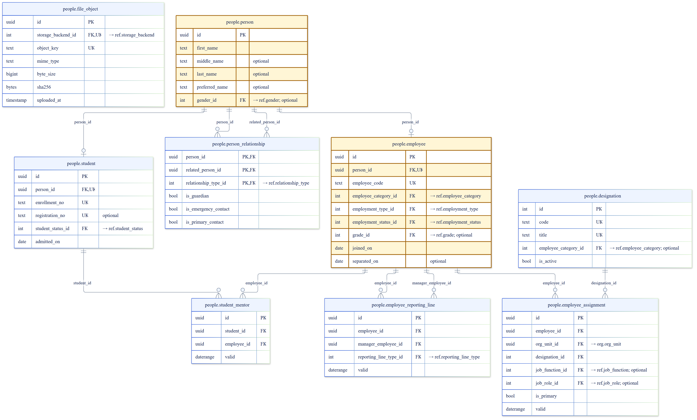

Every column of every table in this group, from the live schema (`created_at` / `updated_at` omitted). Lines are foreign keys inside the group; a note `→ table` is a foreign key to another group; amber = the group's hub. Source: [`catalog-diagrams/er-p1.mmd`](catalog-diagrams/er-p1.mmd).

| Table | What it holds | Links outside this group | Data flow — features that read (R) / write (W) its data store |
|---|---|---|---|
| [`person`](#t-people-person) | The one human entity | 1 lookup | [2.1](data-flow-features.md#f-2-1) W · [2.5](data-flow-features.md#f-2-5) RW · [4.5](data-flow-features.md#f-4-5) R · [6.3](data-flow-features.md#f-6-3) R · [6.5](data-flow-features.md#f-6-5) W · [10.17](data-flow-features.md#f-10-17) R · [11.4](data-flow-features.md#f-11-4) R · [11.8](data-flow-features.md#f-11-8) R · [13.2](data-flow-features.md#f-13-2) R · [14.10](data-flow-features.md#f-14-10) R · [14.11](data-flow-features.md#f-14-11) R · [14.13](data-flow-features.md#f-14-13) R · [14.18](data-flow-features.md#f-14-18) R · [14.19](data-flow-features.md#f-14-19) R · [16.5](data-flow-features.md#f-16-5) R · [16.9](data-flow-features.md#f-16-9) R · [16.11](data-flow-features.md#f-16-11) R |
| [`person_relationship`](#t-people-person-relationship) | Family and guardian links between two persons — "Dave is Carol's father and guardian." A self-join (person ↔ related person) rather than a `ParentDetails` table with its … | 1 lookup | [2.1](data-flow-features.md#f-2-1) W · [2.5](data-flow-features.md#f-2-5) RW · [4.5](data-flow-features.md#f-4-5) R · [6.3](data-flow-features.md#f-6-3) R · [6.5](data-flow-features.md#f-6-5) W · [10.17](data-flow-features.md#f-10-17) R · [11.4](data-flow-features.md#f-11-4) R · [11.8](data-flow-features.md#f-11-8) R · [13.2](data-flow-features.md#f-13-2) R · [14.10](data-flow-features.md#f-14-10) R · [14.11](data-flow-features.md#f-14-11) R · [14.13](data-flow-features.md#f-14-13) R · [14.18](data-flow-features.md#f-14-18) R · [14.19](data-flow-features.md#f-14-19) R · [16.5](data-flow-features.md#f-16-5) R · [16.9](data-flow-features.md#f-16-9) R · [16.11](data-flow-features.md#f-16-11) R |
| [`employee`](#t-people-employee) | The fact "this person is an employee" — code, category, employment type/status, grade | 4 lookups | [2.2](data-flow-features.md#f-2-2) RW · [2.3](data-flow-features.md#f-2-3) RW · [2.7](data-flow-features.md#f-2-7) R · [4.5](data-flow-features.md#f-4-5) R · [5.2](data-flow-features.md#f-5-2) R · [6.5](data-flow-features.md#f-6-5) R · [8.1](data-flow-features.md#f-8-1) R · [10.17](data-flow-features.md#f-10-17) R · [11.4](data-flow-features.md#f-11-4) R · [11.8](data-flow-features.md#f-11-8) R · [13.1](data-flow-features.md#f-13-1) R · [13.2](data-flow-features.md#f-13-2) R · [14.11](data-flow-features.md#f-14-11) R · [14.16](data-flow-features.md#f-14-16) R · [15.1](data-flow-features.md#f-15-1) R |
| [`designation`](#t-people-designation) | The master list of job titles (Professor, HR Manager, System Administrator…), replacing a free-text `designation` string that the old system matched by substring … | 1 lookup | [2.2](data-flow-features.md#f-2-2) RW · [2.3](data-flow-features.md#f-2-3) RW · [2.7](data-flow-features.md#f-2-7) R · [4.5](data-flow-features.md#f-4-5) R · [5.2](data-flow-features.md#f-5-2) R · [6.5](data-flow-features.md#f-6-5) R · [8.1](data-flow-features.md#f-8-1) R · [10.17](data-flow-features.md#f-10-17) R · [11.4](data-flow-features.md#f-11-4) R · [11.8](data-flow-features.md#f-11-8) R · [13.1](data-flow-features.md#f-13-1) R · [13.2](data-flow-features.md#f-13-2) R · [14.11](data-flow-features.md#f-14-11) R · [14.16](data-flow-features.md#f-14-16) R · [15.1](data-flow-features.md#f-15-1) R |
| [`employee_assignment`](#t-people-employee-assignment) | *where* and *as what* an employee works, over time — org unit, designation, job function, job role, whether it's their primary posting | `org.org_unit`; 2 lookups | [2.2](data-flow-features.md#f-2-2) RW · [2.3](data-flow-features.md#f-2-3) RW · [2.7](data-flow-features.md#f-2-7) R · [4.5](data-flow-features.md#f-4-5) R · [5.2](data-flow-features.md#f-5-2) R · [6.5](data-flow-features.md#f-6-5) R · [8.1](data-flow-features.md#f-8-1) R · [10.17](data-flow-features.md#f-10-17) R · [11.4](data-flow-features.md#f-11-4) R · [11.8](data-flow-features.md#f-11-8) R · [13.1](data-flow-features.md#f-13-1) R · [13.2](data-flow-features.md#f-13-2) R · [14.11](data-flow-features.md#f-14-11) R · [14.16](data-flow-features.md#f-14-16) R · [15.1](data-flow-features.md#f-15-1) R |
| [`employee_reporting_line`](#t-people-employee-reporting-line) | The reporting manager and reviewing manager the old system never had at all | 1 lookup | [2.2](data-flow-features.md#f-2-2) RW · [2.3](data-flow-features.md#f-2-3) RW · [2.7](data-flow-features.md#f-2-7) R · [4.5](data-flow-features.md#f-4-5) R · [5.2](data-flow-features.md#f-5-2) R · [6.5](data-flow-features.md#f-6-5) R · [8.1](data-flow-features.md#f-8-1) R · [10.17](data-flow-features.md#f-10-17) R · [11.4](data-flow-features.md#f-11-4) R · [11.8](data-flow-features.md#f-11-8) R · [13.1](data-flow-features.md#f-13-1) R · [13.2](data-flow-features.md#f-13-2) R · [14.11](data-flow-features.md#f-14-11) R · [14.16](data-flow-features.md#f-14-16) R · [15.1](data-flow-features.md#f-15-1) R |
| [`student`](#t-people-student) | The fact "this person is a student" — enrollment number and registration number … | 1 lookup | [2.4](data-flow-features.md#f-2-4) RW · [2.7](data-flow-features.md#f-2-7) R · [4.5](data-flow-features.md#f-4-5) R · [9.1](data-flow-features.md#f-9-1) R · [10.16](data-flow-features.md#f-10-16) R · [15.2](data-flow-features.md#f-15-2) R · [15.4](data-flow-features.md#f-15-4) R · [16.1](data-flow-features.md#f-16-1) R · [16.3](data-flow-features.md#f-16-3) R · [16.12](data-flow-features.md#f-16-12) R |
| [`student_mentor`](#t-people-student-mentor) | Which faculty member mentors which student, over time, with the database guaranteeing only one active mentor at a time | — | [2.4](data-flow-features.md#f-2-4) RW · [2.7](data-flow-features.md#f-2-7) R · [4.5](data-flow-features.md#f-4-5) R · [9.1](data-flow-features.md#f-9-1) R · [10.16](data-flow-features.md#f-10-16) R · [15.2](data-flow-features.md#f-15-2) R · [15.4](data-flow-features.md#f-15-4) R · [16.1](data-flow-features.md#f-16-1) R · [16.3](data-flow-features.md#f-16-3) R · [16.12](data-flow-features.md#f-16-12) R |
| [`file_object`](#t-people-file-object) | Shared metadata for any stored binary — photos, published privacy notices, consent evidence | 1 lookup | [2.1](data-flow-features.md#f-2-1) W · [5.5](data-flow-features.md#f-5-5) W · [6.2](data-flow-features.md#f-6-2) W · [6.3](data-flow-features.md#f-6-3) W · [8.2](data-flow-features.md#f-8-2) W · [9.12](data-flow-features.md#f-9-12) W · [10.13](data-flow-features.md#f-10-13) W · [10.17](data-flow-features.md#f-10-17) W · [11.6](data-flow-features.md#f-11-6) W · [12.3](data-flow-features.md#f-12-3) W · [12.4](data-flow-features.md#f-12-4) W · [13.5](data-flow-features.md#f-13-5) W · [13.6](data-flow-features.md#f-13-6) W · [14.9](data-flow-features.md#f-14-9) R · [14.15](data-flow-features.md#f-14-15) R · [15.2](data-flow-features.md#f-15-2) R · [16.5](data-flow-features.md#f-16-5) R · [16.16](data-flow-features.md#f-16-16) R · [16.17](data-flow-features.md#f-16-17) W · [16.19](data-flow-features.md#f-16-19) R · [16.21](data-flow-features.md#f-16-21) R · [16.23](data-flow-features.md#f-16-23) R |

**Views over this group** (derived, never stored): `academic.v_faculty_workload` · `academic.v_mentoring_status` · `authz.v_account_role_effective` · `events.v_club_officer_current` · `people.v_employee_current` · `people.v_person_display_name` · `people.v_person_principal_kind` · `people.v_student_current` · `tms.v_ticket_handler_stats`  
**Functions that read or write it:** `academic.allocate_sections()` · `academic.allot_electives()` · `academic.is_program_coordinator()` · `academic.request_attendance_leave()` · `events.is_club_officer()` · `events.is_current_employee()` · `events.is_current_student()` · `events.is_teaching_employee()` · `facility.room_reserved_for()` · `tms.account_of_employee()` · `tms.can_act()` · `tms.can_view()` · `tms.is_forum_member()` · `tms.is_workable()` · `tms.level_holder()` · `tms.notice_accounts()` · `tms.person_of_employee()` · `tms.round_robin()` · `wf.is_eligible()` · `wf.manager_account()` · `wf.submit()`
<!-- /group:p1 -->

#### `people.person`
**Why it exists:** the one human entity. An employee, a student, a guardian, a nominee are all *roles* one person plays — never separate copies of their name. This is the direct fix for the old system's worst normalisation problem: `UserLogin.email`, `EmployeeDetails.email` and `StudentDetails.email` were three independent columns for what should have been one fact, and they could silently drift apart. With `person` as the anchor, a student who later becomes a research-assistant employee, or a guardian who is also staff, is still exactly one row.
**Connects to →** `ref.gender`.
**Referenced by ←** grouped: `pii.*` (6 tables — `pii.person_profile`, `pii.person_email`, `pii.person_phone`, `pii.person_address`, `pii.person_identity_document` (incl. the APAAR / ABC ID), `pii.person_photo`, all hanging off `person_id`); `people.employee`, `people.student`, `people.person_relationship` (twice — as either party in a guardian/family link); `iam.user_account` (their login, if they have one); `privacy.*` (6 tables — `privacy.consent` (principal and the guardian who gave it), `privacy.data_principal_request`, `privacy.nominee`, `privacy.erasure_log`, `privacy.breach_affected_person`, `privacy.pii_access_log`); **external academics** — a person who is *not* an employee, from industry or another institution, referenced directly as a person because there is no employee row to point at: `research.supervisor_allocation` (external co-supervisor), `research.advisory_committee_member` (external expert), `research.thesis_examiner` (external examiner), `exam.paper_setter_assignment` (external setter / moderator). In each case a trigger refuses the external column for someone who *is* an employee; `exam.examiner_panel` (external examiner); also `academic.internship`, `academic.supervised_work_guide`; also `academic.academic_body_member`; facility: `facility.asset_loan`, `facility.booking_request`, `facility.booking_restriction`, `facility.event_request`, `facility.guest_stay`, `facility.key_issue`, `facility.parking_permit`, `facility.room_reservation_rule`, `facility.trip_rating`, `facility.trip_request`, `facility.vendor`, `facility.work_order`; events: `events.event`, `events.event_registration`, `events.event_sponsor`, `events.event_volunteer`, `events.proposal_coordinator`, `events.proposal_speaker`, `events.sponsorship_item`; approval engine: `wf.approval_instance`; helpdesk: `tms.ticket_respondent` (the person a complaint is against); events: `events.event_stall`, `events.stall_application`, `events.volunteer_application`.

#### `people.person_relationship`
**Why it exists:** family and guardian links between two persons — "Dave is Carol's father and guardian." A self-join (person ↔ related person) rather than a `ParentDetails` table with its own disconnected identity, which is exactly what made guardians close to unusable in the old system (no login was ever created for them in practice, and there was no way to tell if the same father had two children enrolled). This table is also what `privacy.consent`'s trigger checks before letting someone consent on a minor's behalf.
**Connects to →** `people.person` (twice), `ref.relationship_type`.
**Referenced by ←** nothing directly (read by the consent-guardian trigger and `people.v_person_principal_kind`).

#### `people.employee`
**Why it exists:** the fact "this person is an employee" — code, category, employment type/status, grade. Separated from *where* they work (that's `employee_assignment`, next) because employment status and posting change independently, and someone can hold more than one posting.
**Connects to →** `people.person`, `ref.employee_category`, `ref.employment_status`, `ref.employment_type`, `ref.grade`.
**Referenced by ←** grouped: `people.*` (`people.employee_assignment` — the faculty ↔ department link; `people.employee_reporting_line` twice, as employee and as manager; `people.student_mentor`); `org.appointment`; `academic.*` (`academic.program_coordinator`, `academic.teaching_assignment`, `academic.faculty_unavailability`, `academic.class_session` substitute, `academic.attendance` marked-by; NEP approvals: `academic.course_equivalence`, `academic.external_course_mapping`, `academic.credit_transfer` decided-by, `academic.student_award`, `academic.enrollment_reentry`; lifecycle: `academic.term_registration` registered-by / standing-decided-by, `academic.study_break` approver, `academic.program_transfer` approver, `academic.course_syllabus` approver); `exam.*` (`exam.invigilation_duty`, `exam.evaluator_assignment`, `exam.component_mark` entry, `exam.exam_attendance`, `exam.ufm_case` reporter/decider, `exam.eligibility_hold`, `exam.attendance_condonation`, `exam.grace_award`, `exam.result_moderation`, `exam.result_publication`, `exam.marksheet` issue, `exam.paper_setter_assignment` setter/moderator and appointed-by, `exam.question_paper` approver, `exam.certificate` issued-by); `research.*` (`research.supervisor_allocation` supervisor and approver, `research.advisory_committee` approver, `research.advisory_committee_member`, `research.thesis_examiner` internal examiner, `research.viva` approver); `exam.examiner_panel` (internal examiner, appointed by), `exam.internal_mark_revision` (requested by); also `academic.credit_overload_approval`, `academic.faculty_course_preference`, `academic.section_representative`, `academic.supervised_work_guide`, `exam.prize_award`, `exam.question_bank_item`; also `academic.academic_body_member`, `academic.disciplinary_case`, `exam.question_mark`; facility: `facility.driver`, `facility.guest_stay`, `facility.work_order`; helpdesk: `tms.ticket_category_owner`, `tms.ticket_category_handler`, `tms.ticket` (chosen assignee), `tms.ticket_event` (assignee), `tms.ticket_route_level` (a named level); events: `events.club_proposal`; events: `events.club_change_request`.

#### `people.designation`
**Why it exists:** the master list of job titles (Professor, HR Manager, System Administrator…), replacing a free-text `designation` string that the old system matched by substring (`includes('guard')`) to decide who was a security guard. A closed list means a designation can safely drive automatic role grants (`authz.designation_role`) — a free-text field never could.
**Connects to →** `ref.employee_category`.
**Referenced by ←** `people.employee_assignment`, `authz.designation_role`, `academic.workload_norm` (teaching hours expected of a designation), `research.supervision_norm` (doctoral scholars a designation may supervise).

#### `people.employee_assignment`
**Why it exists:** *where* and *as what* an employee works, over time — org unit, designation, job function, job role, whether it's their primary posting. A database constraint guarantees exactly one primary assignment at any moment, which is what replaces the old system's three nullable FK columns plus a hand-written CHECK constraint on `EmployeeDetails`, and it's the row `authz.designation_role` reads to work out which department a designation-derived role applies to. This is also **how faculty are connected to a department**: a teaching employee's primary assignment is their home department, which the HOD's views and the section-wise teaching sheet group by.
**Connects to →** `org.org_unit`, `people.designation`, `people.employee`, `ref.job_function`, `ref.job_role`.
**Referenced by ←** nothing directly (read by `people.v_employee_current` and by the authz derivation views).

#### `people.employee_reporting_line`
**Why it exists:** the reporting manager and reviewing manager the old system never had at all. Two roles (day-to-day line manager vs. appraisal/skip-level reviewer, which can be different people) on one self-referencing table, dated so a manager change is history, not an overwrite, with a database trigger that refuses to let a reporting chain loop back on itself.
**Connects to →** `people.employee` (twice — the employee and their manager), `ref.reporting_line_type`.
**Referenced by ←** nothing (read by `people.v_employee_current`).

#### `people.student`
**Why it exists:** the fact "this person is a student" — enrollment number and registration number (both unique; the student's General Register / roll identity, and the order in which `academic.allocate_sections` fills sections), status. Kept as thin as `employee`, for the same reason: everything about *where* they study lives in `academic.student_enrollment`, not here.
**Connects to →** `people.person`, `ref.student_status`.
**Referenced by ←** `academic.student_enrollment`, `people.student_mentor`, `exam.eligibility_hold`, `academic.disciplinary_case`; events: `events.club_application`, `events.club_calendar_item`, `events.club_member`, `events.club_officer`, `events.club_proposal_member`, `events.club_proposal_officer`; events: `events.club_change_member`, `events.club_change_officer`, `events.primary_club`.

#### `people.student_mentor`
**Why it exists:** which faculty member mentors which student, over time, with the database guaranteeing only one active mentor at a time.
**Connects to →** `people.employee`, `people.student`.
**Referenced by ←** `academic.mentoring_meeting`.

#### `people.file_object`
**Why it exists:** shared metadata for any stored binary — photos, published privacy notices, consent evidence — so every module that needs to attach a file (this schema and any future one) references one table instead of each inventing its own "uploaded file" columns.
**Connects to →** `ref.storage_backend`.
**Referenced by ←** `pii.person_photo`, `privacy.privacy_notice`, `privacy.verifiable_parental_consent`, `academic.batch_document`, `academic.credit_transfer` (MOOC certificate), `academic.program_approval` (the regulator's letter), `academic.program_accreditation`, `exam.marksheet`, `exam.question_paper` (the confidential paper), `exam.certificate`, `research.thesis` (synopsis and thesis), `research.thesis_examiner` (the report), `wf.approval_action` (signed document), `academic.attendance_leave`, `academic.internship`, `academic.supervised_work`, `academic.body_meeting`; facility: `facility.service_contract`, `facility.trip`, `facility.vehicle_document`; helpdesk: `tms.ticket_event_file` (attachments of a timeline entry); events: `events.club_proposal_attachment`, `events.event`, `events.event_certificate`, `events.event_certificate_template`, `events.event_sponsor`, `events.field_response`, `events.post_event_report`, `events.proposal_attachment`; approval engine: `wf.approval_consultation`; events: `events.event_payment`, `events.stall_application_document`; events: `events.event_expense`.

---

## 4. `academic` — structure, curriculum, timetable, attendance, NEP flexibility, student lifecycle (97)

**How the academic tables chain together:**

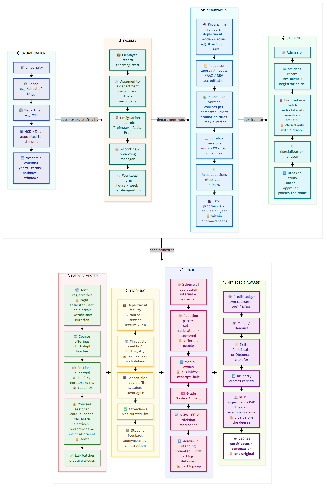

The same chain as a table, with the rule the database enforces at each link:

| Step | Held in | Rule the database enforces |
|---|---|---|
| School → Department | `org.org_unit` (§2) | allowed nesting by unit type; no cycles |
| Faculty ↔ Department | `people.employee_assignment` (§3) | one primary department at a time, with designation and job role |
| Department → Programme | `academic.program.offering_org_unit_id` | only an academic unit may run a programme |
| Department → Course | `academic.course` (owns) · `academic.course_offering` (teaches this term) | both must be academic units |
| Programme → Curriculum → Batch | `academic.curriculum`, `academic.batch`, `academic.batch_curriculum` | batch follows its own programme's curriculum |
| Student record (Enrollment / Registration No.) → Batch | `people.student` (§3) → `academic.student_enrollment` | one active enrollment; entry term within duration |
| Sections allocated | `academic.allocate_sections(batch, term)` → `academic.section_student` | own batch, one section per term, capacity; all-or-nothing |
| Courses assigned to students | `academic.register_core_courses(batch, term)` → `academic.course_registration` | only curriculum courses, approved equivalents or track courses; elective seat limits |
| Faculty ↔ course ↔ section | `academic.teaching_assignment` | one primary teacher per class and component |
| Timetable → attendance | `academic.timetable_entry` → `class_session` → `attendance` | no room / faculty / section / student clash; roster-only attendance |
| Grades | `academic.evaluation_scheme` → `exam.*` → `academic.grade_band` | weights = 100%; published results frozen |
| NEP 2020 | `course_equivalence`, `award_rule` → `student_award` → `enrollment_reentry`, `credit_transfer`, `track` → `student_track` | eligibility, mappings, caps and re-entry windows checked |
| Regulator approval → intake | `academic.program_approval` → `academic.batch.intake_capacity` | a batch can't open more seats than the regulator approved for that admission year |
| Term registration & standing | `academic.term_registration` (+ `promotion_rule`) | the term number must be the one the student is due for (`enrollment_term_no`); no registration while on a break or past the curriculum's maximum duration; a promotion is checked against the backlog and the promotion rule |
| Break in study | `academic.study_break` | starts while enrolled; no overlapping breaks; terms spent on a break aren't counted |
| Programme transfer | `academic.program_transfer` | same student, different programme, the earlier enrollment closed with reason PROGRAM_CHANGE; credits follow through the lineage |
| Elective preferences → allotment | `academic.elective_preference` → `academic.allot_electives(basket, term)` → `course_registration` | basket in the student's curriculum and for their term; merit order; seat limits still enforced at registration ; per-programme / per-school seat ceilings (`offering_seat_quota`) enforced at registration |
| Syllabus → outcomes → lesson plan → class | `course_syllabus` → `syllabus_unit`, `course_outcome` → `co_po_mapping` ← `program_outcome`; `lesson_plan_item` → `class_session_topic` | one current syllabus per course; a CO maps only to a PO of a programme the course is taught in; plan items and covered topics stay within their own course and teaching assignment |
| Calendar | `academic.calendar_event` → `academic.is_working_day()` | events inside their year / term; no timetable-generated class on a non-working day |

The derived backbone (views and functions in `09_views_functions.sql`) that these tables feed: `academic.enrollment_term_no()` (which semester a term is for a student — the counted term registration where one exists, otherwise derived from the entry term and the terms since, skipping any term spent on a break), `v_registration_scheme`, `v_assignment_student`, `v_section_teaching`, `v_teaching_gap`, `v_attendance_summary`, `v_enrollment_lineage` (now following programme transfers as well as re-entries), `v_credit_ledger`, `v_course_completion`, `v_award_eligibility`, `v_student_track_progress`, `v_prerequisite_gap`; and, for the lifecycle tables, `v_backlog`, `v_promotion_eligibility`, `v_student_standing`, `v_syllabus_coverage`, `v_faculty_workload`, `v_feedback_summary`, `exam.v_division` and `academic.is_working_day()`.

### 4.1 Programmes, calendar, batches & enrollment

What the university offers (programme, specialisation, regulator approval, accreditation), the calendar it runs on (years, terms, events), and who is admitted into it (batch → student enrollment).

<!-- group:a1 -->
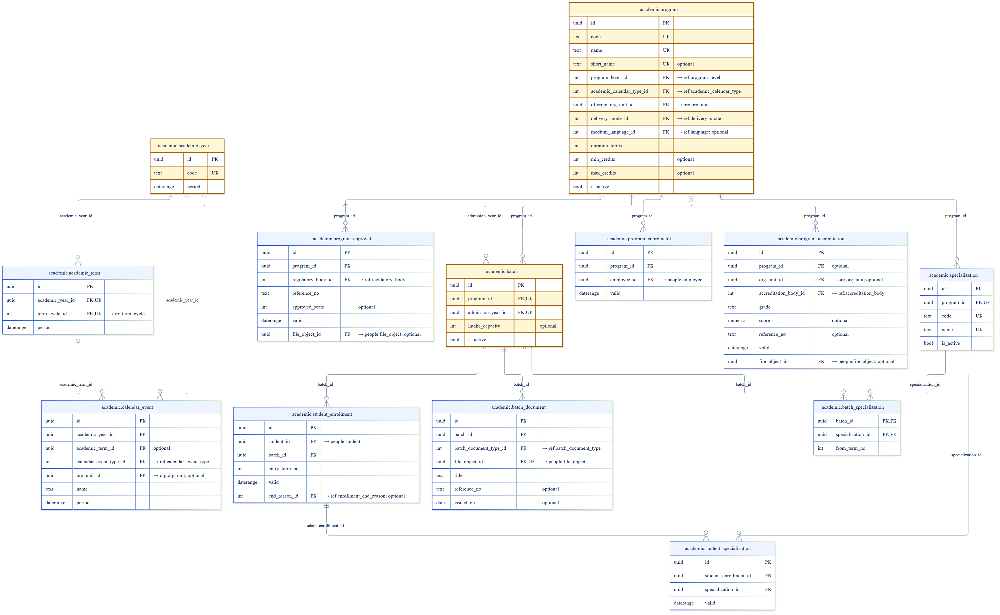

Every column of every table in this group, from the live schema (`created_at` / `updated_at` omitted). Lines are foreign keys inside the group; a note `→ table` is a foreign key to another group; amber = the group's hub. Source: [`catalog-diagrams/er-a1.mmd`](catalog-diagrams/er-a1.mmd).

| Table | What it holds | Links outside this group | Data flow — features that read (R) / write (W) its data store |
|---|---|---|---|
| [`program`](#t-academic-program) | A programme offered by an academic unit — level, calendar type, delivery mode (regular, part-time, distance, online), medium of instruction (NULL = not fixed), duration … | `org.org_unit`; 4 lookups | [8.1](data-flow-features.md#f-8-1) RW · [8.6](data-flow-features.md#f-8-6) R |
| [`specialization`](#t-academic-specialization) | Branches within a programme (e.g. AI, Data Science within B.Tech CSE) | — | [8.1](data-flow-features.md#f-8-1) RW · [8.6](data-flow-features.md#f-8-6) R |
| [`program_coordinator`](#t-academic-program-coordinator) | The dated coordinator of a programme, with the database enforcing one at a time | `people.employee` | [8.1](data-flow-features.md#f-8-1) RW · [8.6](data-flow-features.md#f-8-6) R |
| [`program_approval`](#t-academic-program-approval) | A regulator's approval of a programme — UGC, AICTE, NMC, PCI… | `people.file_object`; 1 lookup | [8.2](data-flow-features.md#f-8-2) RW · [8.4](data-flow-features.md#f-8-4) R |
| [`program_accreditation`](#t-academic-program-accreditation) | An accreditation grade with its validity | `org.org_unit`, `people.file_object`; 1 lookup | [8.2](data-flow-features.md#f-8-2) RW · [8.4](data-flow-features.md#f-8-4) R |
| [`academic_year`](#t-academic-academic-year) | Academic years (2026-27…) with non-overlapping periods enforced by the database — the anchor everything term- and batch-related hangs off | — | [8.3](data-flow-features.md#f-8-3) RW · [8.4](data-flow-features.md#f-8-4) R · [9.3](data-flow-features.md#f-9-3) R · [10.11](data-flow-features.md#f-10-11) R · [15.2](data-flow-features.md#f-15-2) R |
| [`academic_term`](#t-academic-academic-term) | A concrete term — year × cycle, e.g. "2026-27 ODD" — validated to fall inside its year and not overlap another term of the same calendar type | 1 lookup | [8.3](data-flow-features.md#f-8-3) RW · [8.4](data-flow-features.md#f-8-4) R · [9.3](data-flow-features.md#f-9-3) R · [10.11](data-flow-features.md#f-10-11) R · [15.2](data-flow-features.md#f-15-2) R |
| [`calendar_event`](#t-academic-calendar-event) | One dated event of the academic calendar — a holiday, vacation, teaching period, term-registration or add-drop window, exam period, result date, convocation | `org.org_unit`; 1 lookup | [8.3](data-flow-features.md#f-8-3) RW · [8.4](data-flow-features.md#f-8-4) R · [9.3](data-flow-features.md#f-9-3) R · [10.11](data-flow-features.md#f-10-11) R · [15.2](data-flow-features.md#f-15-2) R |
| [`batch`](#t-academic-batch) | One programme's intake in one admission year — "B.Tech CSE, 2026." Batch year is never stored; it's derived from the admission year | — | [8.4](data-flow-features.md#f-8-4) RW · [9.1](data-flow-features.md#f-9-1) R · [9.2](data-flow-features.md#f-9-2) R · [15.2](data-flow-features.md#f-15-2) R |
| [`batch_document`](#t-academic-batch-document) | Official paperwork for one intake only — typically the regulator/council letter approving that batch's seats, or a circular that applies just to that batch | `people.file_object`; 1 lookup | [8.4](data-flow-features.md#f-8-4) RW · [9.1](data-flow-features.md#f-9-1) R · [9.2](data-flow-features.md#f-9-2) R · [15.2](data-flow-features.md#f-15-2) R |
| [`batch_specialization`](#t-academic-batch-specialization) | Which specializations a given batch may choose, and from which term — a batch doesn't automatically offer every specialization its programme has ever had | — | [8.4](data-flow-features.md#f-8-4) RW · [9.1](data-flow-features.md#f-9-1) R · [9.2](data-flow-features.md#f-9-2) R · [15.2](data-flow-features.md#f-15-2) R |
| [`student_enrollment`](#t-academic-student-enrollment) | Which batch a student is in, over time — one active enrollment at a time (database-enforced), with `entry_term_no` handling lateral entry | `people.student`; 1 lookup | [9.1](data-flow-features.md#f-9-1) RW · [9.2](data-flow-features.md#f-9-2) RW · [9.3](data-flow-features.md#f-9-3) R · [9.7](data-flow-features.md#f-9-7) RW · [9.14](data-flow-features.md#f-9-14) R · [12.2](data-flow-features.md#f-12-2) RW · [12.4](data-flow-features.md#f-12-4) R · [13.2](data-flow-features.md#f-13-2) R · [15.2](data-flow-features.md#f-15-2) R |
| [`student_specialization`](#t-academic-student-specialization) | The specialization a student actually chose within an enrollment | — | [9.1](data-flow-features.md#f-9-1) RW · [9.2](data-flow-features.md#f-9-2) RW · [9.3](data-flow-features.md#f-9-3) R · [9.7](data-flow-features.md#f-9-7) RW · [9.14](data-flow-features.md#f-9-14) R · [12.2](data-flow-features.md#f-12-2) RW · [12.4](data-flow-features.md#f-12-4) R · [13.2](data-flow-features.md#f-13-2) R · [15.2](data-flow-features.md#f-15-2) R |

**Views over this group** (derived, never stored): `academic.v_award_eligibility` · `academic.v_batch` · `academic.v_co_attainment` · `academic.v_credit_load` · `academic.v_current_term` · `academic.v_enrollment_lineage` · `academic.v_faculty_workload` · `academic.v_program` · `academic.v_promotion_eligibility` · `academic.v_registration_scheme` · `academic.v_soe` · `academic.v_soe_exit` · `academic.v_soe_header` · `academic.v_student_enrollment_current` · `academic.v_student_standing` · `exam.v_division` · `exam.v_exam_eligibility` · `exam.v_hall_ticket` · `exam.v_rank_list` · `exam.v_result_group_outcome` · `facility.v_timetable_gap` · `research.v_scholar_status` · `tms.v_grievance_register`  
**Functions that read or write it:** `academic.allocate_sections()` · `academic.allot_electives()` · `academic.enrollment_term_no()` · `academic.is_program_coordinator()` · `academic.is_working_day()` · `academic.offering_quota_for()` · `academic.register_core_courses()` · `academic.request_attendance_leave()` · `academic.submit_curriculum()` · `exam.registration_has_clash()` · `exam.schedule_has_clash()` · `facility.materialise_timetable()` · `tms.day_hours()`
<!-- /group:a1 -->

#### `academic.program`
**Why it exists:** a programme offered by an academic unit — level, calendar type, delivery mode (regular, part-time, distance, online), medium of instruction (NULL = not fixed), duration in terms, credit range. This, plus `academic_year`/`academic_term` below, replaces the old system's `Program.metadata` JSON blob (which held credit ranges, batch-year documents and specialization rules as unstructured data) and its separate, disconnected `TmsAcademicSession`/`TmsAdmissionBatch` lookup lists, with one normalised structure the rest of the schema can actually join against.
**Connects to →** `org.org_unit` (which department offers it — a trigger requires an academic unit), `ref.academic_calendar_type`, `ref.program_level`, `ref.delivery_mode`, `ref.language` (medium of instruction).
**Referenced by ←** `academic.batch`, `academic.program_coordinator`, `academic.specialization`, `academic.curriculum`, `academic.track` (an honours track belongs to one programme), `academic.program_approval` (regulator approval and seats), `academic.program_accreditation` (NBA), `academic.program_outcome` (PO / PSO), `academic.offering_seat_quota`, `exam.prize`, `academic.attainment_policy`; events: `events.proposal_visibility_scope`.

#### `academic.specialization`
**Why it exists:** branches within a programme (e.g. AI, Data Science within B.Tech CSE) — its own table because a programme has many, and because a *batch* only offers a subset of them from a given term (see `batch_specialization`).
**Connects to →** `academic.program`.
**Referenced by ←** `academic.batch_specialization`, `academic.student_specialization`, `academic.curriculum_course`, `academic.elective_basket` (specialization-specific courses).

#### `academic.program_coordinator`
**Why it exists:** the dated coordinator of a programme, with the database enforcing one at a time — the same appointment pattern as `org.appointment`, applied at the programme level instead of the org-unit level.
**Connects to →** `academic.program`, `people.employee`.
**Referenced by ←** nothing.

#### `academic.program_approval`
**Why it exists:** a regulator's approval of a programme — UGC, AICTE, NMC, PCI… — with the letter reference, the sanctioned seats and its validity, one approval per body at a time (EXCLUDE). Its own table because approvals are per body and per period, and because it has teeth: a trigger on `academic.batch` refuses an intake capacity larger than the smallest approved-seat figure valid when the admission year starts (no approval on record = nothing to check; a NULL seat figure = an approval that carries no intake cap). The letter itself may be attached through `file_object`; `batch_document` remains for paperwork that applies to a single intake.
**Connects to →** `academic.program`, `ref.regulatory_body`, `people.file_object`.
**Referenced by ←** nothing (read by the `academic.batch` intake trigger).

#### `academic.program_accreditation`
**Why it exists:** an accreditation grade with its validity. NAAC grades the *institution* (an org unit), NBA accredits a *programme* — so a row targets exactly one of the two (CHECK), with one accreditation per target and body at a time (EXCLUDE). Kept apart from `program_approval` because approval is permission to run with N seats and accreditation is a quality grade; they come from different bodies on different cycles.
**Connects to →** `academic.program` or `org.org_unit` (exactly one), `ref.accreditation_body`, `people.file_object`.
**Referenced by ←** nothing.

#### `academic.academic_year`
**Why it exists:** academic years (2026-27…) with non-overlapping periods enforced by the database — the anchor everything term- and batch-related hangs off.
**Connects to →** nothing.
**Referenced by ←** `academic.academic_term`, `academic.batch` (as the admission year), `academic.calendar_event`, `exam.convocation`; events: `events.club_calendar_item`.

#### `academic.academic_term`
**Why it exists:** a concrete term — year × cycle, e.g. "2026-27 ODD" — validated to fall inside its year and not overlap another term of the same calendar type. This is what lets a student's current semester be *calculated* instead of hand-edited (the old system stored `StudentDetails.currentSemester` as a plain integer someone had to remember to update): where the student has a counted `term_registration` for a term, that is the answer; otherwise `academic.enrollment_term_no()` derives it from the entry term and the terms of this calendar type since, skipping any spent on a break.
**Connects to →** `academic.academic_year`, `ref.term_cycle`.
**Referenced by ←** `academic.course_offering`, `academic.section`, `academic.term_registration`, `academic.calendar_event`, `academic.elective_preference`, `academic.feedback_cycle`, `exam.exam_session`, `exam.eligibility_hold` — everything that happens "in a term" points here, `academic.credit_overload_approval`, `academic.faculty_course_preference`; helpdesk: `tms.ticket_academic_context`.

#### `academic.calendar_event`
**Why it exists:** one dated event of the academic calendar — a holiday, vacation, teaching period, term-registration or add-drop window, exam period, result date, convocation — scoped to an academic year (optionally one term of it) and optionally to an org unit and everything beneath it (NULL = the whole university), so a school's own holiday doesn't need a second calendar. A trigger keeps the event inside its year and a term event inside the term's own year. The event *type* carries `is_non_working`, and that is what `academic.is_working_day(date, unit)` reads, walking up the unit's ancestors; a timetable-generated class session on a non-working day is rejected by the `class_session` trigger (extra / make-up classes, which carry their own time, may still be held). The calendar is therefore something the database enforces, not a PDF someone checks by eye.
**Connects to →** `academic.academic_year`, `academic.academic_term`, `org.org_unit`, `ref.calendar_event_type`.
**Referenced by ←** nothing (read by `academic.is_working_day()`).

#### `academic.batch`
**Why it exists:** one programme's intake in one admission year — "B.Tech CSE, 2026." Batch year is never stored; it's derived from the admission year. Unique per (programme, admission year), so there's exactly one row to represent "this year's intake," not a separately-maintained `TmsAdmissionBatch` list disconnected from the programme it belongs to. Its intake capacity is not a free number: a trigger refuses one larger than the seats any regulator approved for the programme (`academic.program_approval`) as at the start of the admission year.
**Connects to →** `academic.academic_year`, `academic.program`.
**Referenced by ←** `academic.batch_document`, `academic.batch_specialization`, `academic.student_enrollment`, `academic.batch_curriculum`, `academic.section`; helpdesk: `tms.ticket_academic_context`; events: `events.proposal_visibility_scope`.

#### `academic.batch_document`
**Why it exists:** official paperwork for one intake only — typically the regulator/council letter approving that batch's seats, or a circular that applies just to that batch — typed by `batch_document_type`, with its reference number and issue date. It is deliberately **not** the scheme of studies: that is now structured data (`academic.curriculum`, linked through `academic.batch_curriculum`), and a PDF copy of it would be a second, un-queryable version of the same fact. Separate table because a batch can have several documents, reusing the shared `file_object` table for the file itself.
**Connects to →** `academic.batch`, `people.file_object`, `ref.batch_document_type`.
**Referenced by ←** nothing.

#### `academic.batch_specialization`
**Why it exists:** which specializations a given batch may choose, and from which term — a batch doesn't automatically offer every specialization its programme has ever had; a trigger checks the specialization belongs to the batch's own programme and starts within its duration.
**Connects to →** `academic.batch`, `academic.specialization`.
**Referenced by ←** nothing.

#### `academic.student_enrollment`
**Why it exists:** which batch a student is in, over time — one active enrollment at a time (database-enforced), with `entry_term_no` handling lateral entry. This is where a student's home department, school and current term are all *derived from* — none of those are stored anywhere as a copied value. An enrollment that has been closed must say why (`end_reason_id` — award, programme change, migration, withdrawal, expulsion, maximum duration…; a CHECK ties the reason to the end date, so an open enrollment can't carry one and a closed one can't lack one); that reason is what `program_transfer` and the award trigger read, instead of guessing from the student's status.
**Connects to →** `academic.batch`, `people.student`, `ref.enrollment_end_reason`.
**Referenced by ←** `academic.student_specialization`, `academic.section_student`, `academic.course_registration`, `academic.student_award`, `academic.enrollment_reentry`, `academic.credit_transfer`, `academic.student_track`; lifecycle: `academic.term_registration`, `academic.study_break`, `academic.program_transfer` (twice — from / to), `academic.elective_preference`; `exam.marksheet`, `exam.certificate`; research: `research.supervisor_allocation`, `research.advisory_committee`, `research.progress_review`, `research.thesis`, `academic.student_pathway`, `academic.attendance_leave`, `academic.credit_overload_approval`, `academic.section_representative`, `exam.prize_award`.

#### `academic.student_specialization`
**Why it exists:** the specialization a student actually chose within an enrollment — a trigger checks it's one the student's batch actually offers, so a student can't end up "specializing" in something their intake was never given.
**Connects to →** `academic.specialization`, `academic.student_enrollment`.
**Referenced by ←** nothing.

### 4.2 Grade scales & schemes of examination

How marks become grades: a grade scale with bands (absolute or relative), division bands on CGPA, and the configurable scheme of examination — components, best-N-of-M groups and per-part pass rules.

<!-- group:a2 -->
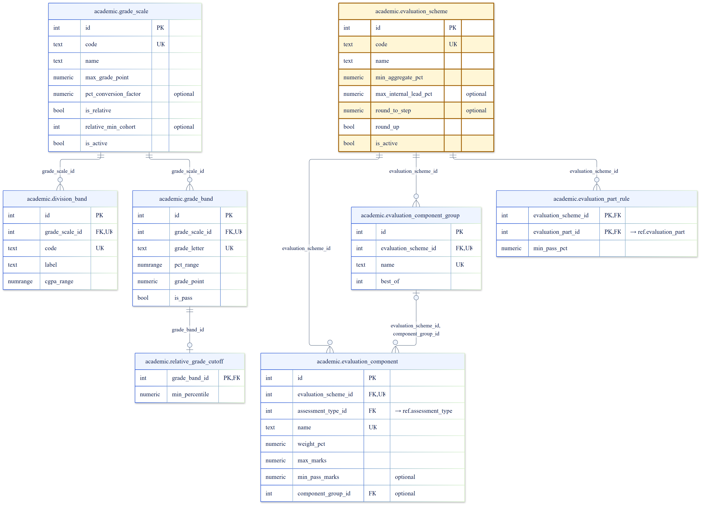

Every column of every table in this group, from the live schema (`created_at` / `updated_at` omitted). Lines are foreign keys inside the group; a note `→ table` is a foreign key to another group; amber = the group's hub. Source: [`catalog-diagrams/er-a2.mmd`](catalog-diagrams/er-a2.mmd).

| Table | What it holds | Links outside this group | Data flow — features that read (R) / write (W) its data store |
|---|---|---|---|
| [`grade_scale`](#t-academic-grade-scale) | A grading policy as data (the seeded default is UGC 10-point CBCS), including the factor that turns a CGPA into an equivalent percentage … | — | [8.7](data-flow-features.md#f-8-7) RW · [8.8](data-flow-features.md#f-8-8) R · [11.14](data-flow-features.md#f-11-14) R · [11.17](data-flow-features.md#f-11-17) R |
| [`grade_band`](#t-academic-grade-band) | One row per grade — percentage range → letter, grade point, pass/fail | — | [8.7](data-flow-features.md#f-8-7) RW · [8.8](data-flow-features.md#f-8-8) R · [11.14](data-flow-features.md#f-11-14) R · [11.17](data-flow-features.md#f-11-17) R |
| [`relative_grade_cutoff`](#t-academic-relative-grade-cutoff) | Relative grading as data | — | [8.7](data-flow-features.md#f-8-7) RW · [8.8](data-flow-features.md#f-8-8) R · [11.14](data-flow-features.md#f-11-14) R · [11.17](data-flow-features.md#f-11-17) R |
| [`division_band`](#t-academic-division-band) | The division (class) awarded on a grade scale by CGPA range — first class with distinction, first, second, pass | — | [8.7](data-flow-features.md#f-8-7) RW · [8.8](data-flow-features.md#f-8-8) R · [11.14](data-flow-features.md#f-11-14) R · [11.17](data-flow-features.md#f-11-17) R |
| [`evaluation_scheme`](#t-academic-evaluation-scheme) | The **scheme of examination** as a reusable rule set — "Theory 30/20/50", "Lab 60/40" — **and how its result is computed**, as data | — | [8.7](data-flow-features.md#f-8-7) RW · [8.8](data-flow-features.md#f-8-8) R · [9.13](data-flow-features.md#f-9-13) R · [11.11](data-flow-features.md#f-11-11) R · [11.12](data-flow-features.md#f-11-12) R · [11.14](data-flow-features.md#f-11-14) R · [11.18](data-flow-features.md#f-11-18) R |
| [`evaluation_component_group`](#t-academic-evaluation-component-group) | "best N of M" — three class tests of which only the best two count | — | [8.7](data-flow-features.md#f-8-7) RW · [8.8](data-flow-features.md#f-8-8) R · [9.13](data-flow-features.md#f-9-13) R · [11.11](data-flow-features.md#f-11-11) R · [11.12](data-flow-features.md#f-11-12) R · [11.14](data-flow-features.md#f-11-14) R · [11.18](data-flow-features.md#f-11-18) R |
| [`evaluation_component`](#t-academic-evaluation-component) | One component of a scheme — its assessment type (which also says whether it is an internal or external component), weightage, maximum marks, optional component-level … | 1 lookup | [8.7](data-flow-features.md#f-8-7) RW · [8.8](data-flow-features.md#f-8-8) R · [9.13](data-flow-features.md#f-9-13) R · [11.11](data-flow-features.md#f-11-11) R · [11.12](data-flow-features.md#f-11-12) R · [11.14](data-flow-features.md#f-11-14) R · [11.18](data-flow-features.md#f-11-18) R |
| [`evaluation_part_rule`](#t-academic-evaluation-part-rule) | Separate pass minimums per part — e.g. at least 40% in the external (end-semester) part — over and above the aggregate pass mark | 1 lookup | [8.7](data-flow-features.md#f-8-7) RW · [8.8](data-flow-features.md#f-8-8) R · [9.13](data-flow-features.md#f-9-13) R · [11.11](data-flow-features.md#f-11-11) R · [11.12](data-flow-features.md#f-11-12) R · [11.14](data-flow-features.md#f-11-14) R · [11.18](data-flow-features.md#f-11-18) R |

**Views over this group** (derived, never stored): `academic.v_soe` · `exam.v_component_score` · `exam.v_current_result` · `exam.v_division` · `exam.v_provisional_result`  
**Functions that read or write it:** none — only its constraints and triggers
<!-- /group:a2 -->

#### `academic.grade_scale`
**Why it exists:** a grading policy as data (the seeded default is UGC 10-point CBCS), including the factor that turns a CGPA into an equivalent percentage (`pct_conversion_factor` — UGC's × 10 on a 10-point scale; NULL = the scale has no conversion), so the percentage printed on a transcript is derived (`exam.v_division`), never stored. A change of policy is a *new* scale, never an edit, so every result ever published can still be explained by the scale it was graded on.
**Connects to →** nothing.
**Referenced by ←** `academic.grade_band`, `academic.division_band` (CGPA → division on this scale), `academic.curriculum` (each curriculum names its scale).

#### `academic.grade_band`
**Why it exists:** one row per grade — percentage range → letter, grade point, pass/fail. The database rejects overlapping bands within a scale, and a trigger freezes any band that a published result points to, so a band is referenced by results rather than its letter/point being copied onto them.
**Connects to →** `academic.grade_scale`.
**Referenced by ←** `exam.course_result`, `academic.relative_grade_cutoff`.

#### `academic.relative_grade_cutoff`
**Why it exists:** relative grading as data. On a grade scale marked `is_relative`, each passing band gets the cohort percentile at which it is awarded; `exam.v_provisional_result` ranks passing attempts within the course offering × exam session and falls back to the absolute percentage bands for failures and for cohorts smaller than `grade_scale.relative_min_cohort`.
**Connects to →** `academic.grade_band`.
**Referenced by ←** nothing.

#### `academic.division_band`
**Why it exists:** the division (class) awarded on a grade scale by CGPA range — first class with distinction, first, second, pass. Per grade scale, with non-overlapping ranges (EXCLUDE), for the same reason `grade_band` is: a change of policy is new data, and every division ever printed can still be explained by its scale. `exam.v_division` derives the division and the equivalent percentage (CGPA × the scale's `pct_conversion_factor`); neither is stored anywhere.
**Connects to →** `academic.grade_scale`.
**Referenced by ←** nothing (read by `exam.v_division`).

#### `academic.evaluation_scheme`
**Why it exists:** the **scheme of examination** as a reusable rule set — "Theory 30/20/50", "Lab 60/40" — **and how its result is computed**, as data: aggregate pass mark, how far internal marks may lead external marks before the excess is moderated away (`max_internal_lead_pct`), and final rounding (`round_to_step`, `round_up`). `exam.v_provisional_result` reads these columns, so a regulation change ("round up to whole marks", "cap internals at external + 30") is a new or edited scheme row, not new code. Reusable because dozens of courses share the same scheme.
**Connects to →** nothing.
**Referenced by ←** `academic.evaluation_component`, `academic.evaluation_component_group`, `academic.evaluation_part_rule`, `academic.curriculum_course`, `academic.elective_basket_course`, `academic.track_course`.

#### `academic.evaluation_component_group`
**Why it exists:** "best N of M" — three class tests of which only the best two count. The group holds `best_of`; its components all carry the same weight (the weight of one counted test), so the group contributes best_of × weight to the 100%. The deferred weights trigger checks the group has at least `best_of` components of equal weight. Which components count for each student is derived per attempt (`exam.v_component_score.is_counted`), never stored.
**Connects to →** `academic.evaluation_scheme`.
**Referenced by ←** `academic.evaluation_component` (composite FK, so a component can only join a group of its own scheme).

#### `academic.evaluation_component`
**Why it exists:** one component of a scheme — its assessment type (which also says whether it is an internal or external component), weightage, maximum marks, optional component-level pass mark ("must score 35/100 in the end-term") and optional best-of group. A deferred constraint trigger checks the weights total exactly 100% at commit (a best-of group counting best_of × weight), and a scheme can have at most one component per scheduled-exam type, so every answer script maps to exactly one component.
**Connects to →** `academic.evaluation_scheme`, `ref.assessment_type`, `academic.evaluation_component_group`.
**Referenced by ←** `exam.component_mark`, `academic.evaluation_component_outcome`.

#### `academic.evaluation_part_rule`
**Why it exists:** separate pass minimums per part — e.g. at least 40% in the external (end-semester) part — over and above the aggregate pass mark. A row per scheme × part instead of two nullable columns, so a third part (say, a separately-passed practical) is a new lookup value, not a migration.
**Connects to →** `academic.evaluation_scheme`, `ref.evaluation_part`.
**Referenced by ←** nothing (read by `exam.v_provisional_result`).

### 4.3 Courses, curriculum & the SOE

The course catalogue and a curriculum version per programme — which course in which term, pathways, electives, combined results, promotion / attempt / credit-load rules. An approved, signed curriculum *is* the Statement of Examination (SOE); `curriculum_approval` links it to its approval rounds.

These tables let a curriculum version carry everything SGT's Statement of Examination (SOE) shows, and let it be approved and signed through the generic workflow (§10). The SOE itself is derived: `academic.v_soe` (one row per course / elective slot with semester-year label, council code, category + sub-category, L-T-P, credits, internal / external maximum and pass marks, passing criteria), `academic.v_soe_exit` (credits per term and per pathway with the "Exit with …" rows) and `academic.v_soe_header` (programme, department, school, approval status).

<!-- group:a3 -->
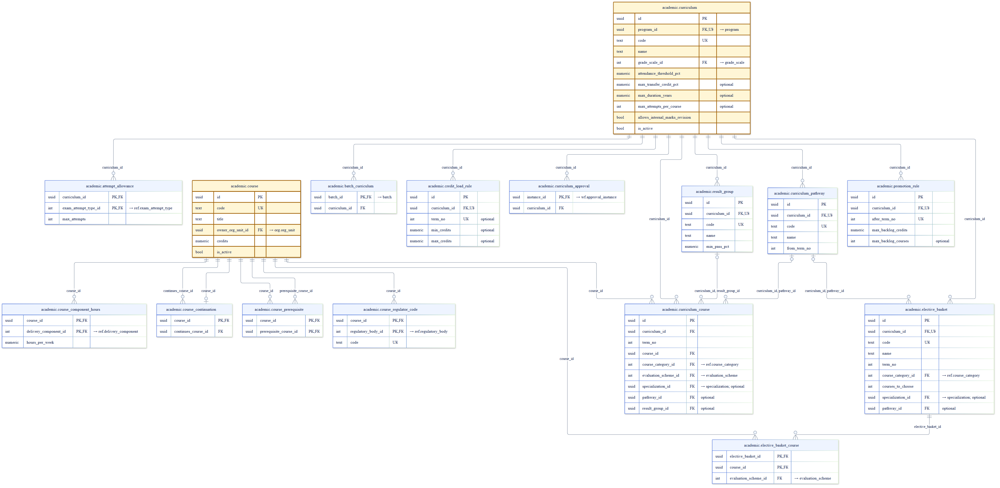

Every column of every table in this group, from the live schema (`created_at` / `updated_at` omitted). Lines are foreign keys inside the group; a note `→ table` is a foreign key to another group; amber = the group's hub. Source: [`catalog-diagrams/er-a3.mmd`](catalog-diagrams/er-a3.mmd).

| Table | What it holds | Links outside this group | Data flow — features that read (R) / write (W) its data store |
|---|---|---|---|
| [`course`](#t-academic-course) | The course catalogue — code, title, credits and the **owning** academic department (the course ↔ department mapping) | `org.org_unit` | [8.6](data-flow-features.md#f-8-6) RW · [8.8](data-flow-features.md#f-8-8) R · [9.10](data-flow-features.md#f-9-10) R · [9.16](data-flow-features.md#f-9-16) R · [15.2](data-flow-features.md#f-15-2) R |
| [`course_component_hours`](#t-academic-course-component-hours) | The L-T-P structure (e.g. 3-1-2) as one row per component, so the timetable solver knows how many weekly hours to place and a faculty assignment can only be made for a … | 1 lookup | [8.6](data-flow-features.md#f-8-6) RW · [8.8](data-flow-features.md#f-8-8) R · [9.10](data-flow-features.md#f-9-10) R · [9.16](data-flow-features.md#f-9-16) R · [15.2](data-flow-features.md#f-15-2) R |
| [`course_prerequisite`](#t-academic-course-prerequisite) | "Machine Learning requires Programming Fundamentals" — a many-to-many self-link, with a trigger rejecting prerequisite cycles | — | [8.6](data-flow-features.md#f-8-6) RW · [8.8](data-flow-features.md#f-8-8) R · [9.10](data-flow-features.md#f-9-10) R · [9.16](data-flow-features.md#f-9-16) R · [15.2](data-flow-features.md#f-15-2) R |
| [`course_continuation`](#t-academic-course-continuation) | A course that continues an earlier one across terms (Dissertation II ← Dissertation I) | — | [8.6](data-flow-features.md#f-8-6) RW · [8.8](data-flow-features.md#f-8-8) R · [9.10](data-flow-features.md#f-9-10) R · [9.16](data-flow-features.md#f-9-16) R · [15.2](data-flow-features.md#f-15-2) R |
| [`course_regulator_code`](#t-academic-course-regulator-code) | The SOE's "council code" — the code a regulator (NMC, INC, PCI …) knows the course by; one per regulator, unique within a regulator | 1 lookup | [8.6](data-flow-features.md#f-8-6) RW · [8.8](data-flow-features.md#f-8-8) R · [9.10](data-flow-features.md#f-9-10) R · [9.16](data-flow-features.md#f-9-16) R · [15.2](data-flow-features.md#f-15-2) R |
| [`curriculum`](#t-academic-curriculum) | The **scheme of studies** for a programme, versioned ("B.Tech CSE — R2024"), carrying the regulations every batch following it is bound by | `grade_scale`, `program` | [8.4](data-flow-features.md#f-8-4) R · [8.8](data-flow-features.md#f-8-8) RW · [8.9](data-flow-features.md#f-8-9) W · [9.2](data-flow-features.md#f-9-2) R · [9.3](data-flow-features.md#f-9-3) R · [9.12](data-flow-features.md#f-9-12) R |
| [`curriculum_course`](#t-academic-curriculum-course) | A fixed course in a given term of the curriculum, with its category (core, lab, project…) and scheme of examination; optionally only for one specialization | `evaluation_scheme`, `specialization`; 1 lookup | [8.4](data-flow-features.md#f-8-4) R · [8.8](data-flow-features.md#f-8-8) RW · [8.9](data-flow-features.md#f-8-9) W · [9.2](data-flow-features.md#f-9-2) R · [9.3](data-flow-features.md#f-9-3) R · [9.12](data-flow-features.md#f-9-12) R |
| [`curriculum_pathway`](#t-academic-curriculum-pathway) | An alternative course set inside one curriculum chosen from a given term | — | [8.4](data-flow-features.md#f-8-4) R · [8.8](data-flow-features.md#f-8-8) RW · [8.9](data-flow-features.md#f-8-9) W · [9.2](data-flow-features.md#f-9-2) R · [9.3](data-flow-features.md#f-9-3) R · [9.12](data-flow-features.md#f-9-12) R |
| [`result_group`](#t-academic-result-group) | SGT's "Theory / Practical — result combined": curriculum courses that pass or fail as ONE result on the credit-weighted combined percentage … | — | [8.4](data-flow-features.md#f-8-4) R · [8.8](data-flow-features.md#f-8-8) RW · [8.9](data-flow-features.md#f-8-9) W · [9.2](data-flow-features.md#f-9-2) R · [9.3](data-flow-features.md#f-9-3) R · [9.12](data-flow-features.md#f-9-12) R |
| [`elective_basket`](#t-academic-elective-basket) | An elective slot — "choose 1 of these in term 6" — as an explicit basket with a count, instead of guessing which courses were electives from their names | `specialization`; 1 lookup | [8.4](data-flow-features.md#f-8-4) R · [8.8](data-flow-features.md#f-8-8) RW · [8.9](data-flow-features.md#f-8-9) W · [9.2](data-flow-features.md#f-9-2) R · [9.3](data-flow-features.md#f-9-3) R · [9.12](data-flow-features.md#f-9-12) R |
| [`elective_basket_course`](#t-academic-elective-basket-course) | The courses offered in an elective basket, each with its own scheme of examination; keyed by basket and course, so a course is offered once per basket | `evaluation_scheme` | [8.4](data-flow-features.md#f-8-4) R · [8.8](data-flow-features.md#f-8-8) RW · [8.9](data-flow-features.md#f-8-9) W · [9.2](data-flow-features.md#f-9-2) R · [9.3](data-flow-features.md#f-9-3) R · [9.12](data-flow-features.md#f-9-12) R |
| [`batch_curriculum`](#t-academic-batch-curriculum) | Which curriculum version an intake follows | `batch` | [8.4](data-flow-features.md#f-8-4) RW · [9.1](data-flow-features.md#f-9-1) R · [9.2](data-flow-features.md#f-9-2) R · [15.2](data-flow-features.md#f-15-2) R |
| [`promotion_rule`](#t-academic-promotion-rule) | A promotion checkpoint of a curriculum — "after term N a student may move up carrying at most X backlog credits (and optionally Y courses)" | — | [8.8](data-flow-features.md#f-8-8) RW · [9.4](data-flow-features.md#f-9-4) R · [9.16](data-flow-features.md#f-9-16) R · [12.1](data-flow-features.md#f-12-1) R |
| [`attempt_allowance`](#t-academic-attempt-allowance) | Reappear chances per attempt type ("two usual + 1 golden + mercy") on top of the overall `curriculum.max_attempts_per_course`, enforced on exam registration | 1 lookup | [8.8](data-flow-features.md#f-8-8) RW · [9.4](data-flow-features.md#f-9-4) R · [9.16](data-flow-features.md#f-9-16) R · [12.1](data-flow-features.md#f-12-1) R |
| [`credit_load_rule`](#t-academic-credit-load-rule) | The minimum / maximum credits a student may register in a term of a curriculum (a term-specific rule, or a default with `term_no` NULL) | — | [8.8](data-flow-features.md#f-8-8) RW · [9.4](data-flow-features.md#f-9-4) R · [9.16](data-flow-features.md#f-9-16) R · [12.1](data-flow-features.md#f-12-1) R |
| [`curriculum_approval`](#t-academic-curriculum-approval) | Links a curriculum version (the SOE) to each of its approval rounds (`wf.approval_instance`); the curriculum's status — DRAFT / IN_REVIEW / RETURNED / APPROVED / SIGNED | `wf.approval_instance` | [5.2](data-flow-features.md#f-5-2) W · [8.9](data-flow-features.md#f-8-9) W |

**Views over this group** (derived, never stored): `academic.v_award_eligibility` · `academic.v_backlog` · `academic.v_credit_ledger` · `academic.v_credit_load` · `academic.v_curriculum_item` · `academic.v_curriculum_status` · `academic.v_prerequisite_gap` · `academic.v_promotion_eligibility` · `academic.v_registration_scheme` · `academic.v_soe` · `academic.v_soe_exit` · `academic.v_soe_header` · `academic.v_student_standing` · `academic.v_teaching_gap` · `exam.v_division` · `exam.v_exam_eligibility` · `exam.v_provisional_result` · `exam.v_result_group_outcome` · `exam.v_sgpa` · `facility.v_room_timeline`  
**Functions that read or write it:** `academic.allot_electives()` · `academic.register_core_courses()` · `academic.submit_curriculum()`
<!-- /group:a3 -->

#### `academic.course`
**Why it exists:** the course catalogue — code, title, credits and the **owning** academic department (the course ↔ department mapping). Ownership means "designs and maintains the syllabus"; *who teaches it in a given term* is a separate fact on `course_offering`, because Mathematics routinely teaches a course Engineering owns.
**Connects to →** `org.org_unit` (must be an academic unit — trigger-checked).
**Referenced by ←** `academic.course_component_hours`, `academic.course_prerequisite`, `academic.curriculum_course`, `academic.elective_basket_course`, `academic.course_offering`, `academic.course_equivalence` (twice), `academic.award_rule_course`, `academic.external_course_mapping`, `academic.track_course`, `academic.course_syllabus` (versioned content), `academic.elective_preference` (the course a student ranked), `academic.course_regulator_code`, `academic.course_continuation` (twice), `academic.course_room_requirement`, `academic.faculty_course_preference`, `exam.question_bank_item`; helpdesk: `tms.ticket_academic_context`.

#### `academic.course_component_hours`
**Why it exists:** the L-T-P structure (e.g. 3-1-2) as one row per component, so the timetable solver knows how many weekly hours to place and a faculty assignment can only be made for a component the course actually has.
**Connects to →** `academic.course`, `ref.delivery_component`.
**Referenced by ←** nothing (read by the teaching-assignment trigger and the solver).

#### `academic.course_prerequisite`
**Why it exists:** "Machine Learning requires Programming Fundamentals" — a many-to-many self-link, with a trigger rejecting prerequisite cycles. Unmet prerequisites are reported (`academic.v_prerequisite_gap`) rather than hard-blocked, because a Dean may waive one.
**Connects to →** `academic.course` (twice — course and prerequisite).
**Referenced by ←** nothing.

#### `academic.course_continuation`
**Why it exists:** a course that continues an earlier one across terms (Dissertation II ← Dissertation I). Registration for the continuation needs the earlier part registered in an earlier term; chains never loop.
**Connects to →** `academic.course` (twice).
**Referenced by ←** nothing.

#### `academic.course_regulator_code`
**Why it exists:** the SOE's "council code" — the code a regulator (NMC, INC, PCI …) knows the course by; one per regulator, unique within a regulator.
**Connects to →** `academic.course`, `ref.regulatory_body`.
**Referenced by ←** nothing.

#### `academic.curriculum`
**Why it exists:** the **scheme of studies** for a programme, versioned ("B.Tech CSE — R2024"), carrying the regulations every batch following it is bound by: its grade scale, attendance threshold, the cap on credits transferred in from MOOCs / the ABC (`max_transfer_credit_pct`, as a percentage of the programme's minimum credits), the maximum time a student may take (`max_duration_years` — UGC's "N + 2": no term registration is accepted once it has elapsed, counted from the first enrollment of the lineage) and the maximum exam attempts per course (`max_attempts_per_course`, enforced on `exam.exam_registration`). All of these are per curriculum version, so a regulation change binds new batches only. This is what replaces the scheme-of-studies PDF and the old `Program.metadata` JSON.
**Connects to →** `academic.program`, `academic.grade_scale`.
**Referenced by ←** `academic.curriculum_course`, `academic.elective_basket`, `academic.batch_curriculum`, `academic.award_rule`, `academic.promotion_rule` (backlog allowed at each promotion checkpoint), `academic.curriculum_pathway`, `academic.result_group`, `academic.attempt_allowance`, `academic.curriculum_approval`, `academic.credit_load_rule`.

#### `academic.curriculum_course`
**Why it exists:** a fixed course in a given term of the curriculum, with its category (core, lab, project…) and scheme of examination; optionally only for one specialization. A trigger keeps the term within the programme's duration, keeps elective categories out (those go in baskets), and ensures a course appears only once per curriculum — so a student's scheme is never ambiguous.
**Connects to →** `academic.curriculum`, `academic.course`, `academic.evaluation_scheme`, `academic.specialization`, `ref.course_category`, `academic.curriculum_pathway`, `academic.result_group` (both same-curriculum composite FKs).
**Referenced by ←** nothing (read through `academic.v_curriculum_item`).

#### `academic.curriculum_pathway`
**Why it exists:** an alternative course set inside one curriculum chosen from a given term — e.g. from term 7 "Honours" (internship + extra courses) or "Honours with Research" (dissertation), both inside one SOE. Items and award rules without a pathway are common to all; the same course may sit on two pathways with different schemes.
**Connects to →** `academic.curriculum`.
**Referenced by ←** `academic.curriculum_course`, `academic.elective_basket`, `academic.award_rule` (all by composite FK, so only a pathway of the same curriculum), `academic.student_pathway`.

#### `academic.result_group`
**Why it exists:** SGT's "Theory / Practical — result combined": curriculum courses that pass or fail as ONE result on the credit-weighted combined percentage (`exam.v_result_group_outcome`); the credit ledger then treats every member as passed or failed together.
**Connects to →** `academic.curriculum`.
**Referenced by ←** `academic.curriculum_course` (composite FK, same curriculum).

#### `academic.elective_basket`
**Why it exists:** an elective slot — "choose 1 of these in term 6" — as an explicit basket with a count, instead of guessing which courses were electives from their names.
**Connects to →** `academic.curriculum`, `academic.specialization`, `ref.course_category` (must be an elective category), `academic.curriculum_pathway`.
**Referenced by ←** `academic.elective_basket_course`, `academic.elective_preference` (a student's ranked choices in it).

#### `academic.elective_basket_course`
**Why it exists:** the courses offered in an elective basket, each with its own scheme of examination; keyed by basket and course, so a course is offered once per basket. The same validation as a fixed curriculum course applies (the term lies within the programme's duration and the pathway, the course is not already in the curriculum for the pathway, the category is an elective one), and the rows freeze with the curriculum once it is approved.
**Connects to →** `academic.elective_basket`, `academic.course`, `academic.evaluation_scheme`.
**Referenced by ←** nothing.

#### `academic.batch_curriculum`
**Why it exists:** which curriculum version an intake follows. A separate 1:1 table rather than a column on `batch`, so the programme is never stored twice in one row (it's already on the batch *and* on the curriculum); a trigger ensures both name the same programme.
**Connects to →** `academic.batch`, `academic.curriculum`.
**Referenced by ←** nothing.

#### `academic.promotion_rule`
**Why it exists:** a promotion checkpoint of a curriculum — "after term N a student may move up carrying at most X backlog credits (and optionally Y courses)". Per curriculum, so a regulation change binds new batches only; a term with no row has no cap beyond the standing's own `allows_backlog`. A trigger keeps the checkpoint within the programme's duration. Read by the `term_registration` trigger when a standing is decided, and by `academic.v_promotion_eligibility`, which shows each student's backlog against each checkpoint.
**Connects to →** `academic.curriculum`.
**Referenced by ←** nothing (read by the term-registration trigger and `v_promotion_eligibility`).

#### `academic.attempt_allowance`
**Why it exists:** reappear chances per attempt type ("two usual + 1 golden + mercy") on top of the overall `curriculum.max_attempts_per_course`, enforced on exam registration.
**Connects to →** `academic.curriculum`, `ref.exam_attempt_type`.
**Referenced by ←** nothing.

#### `academic.credit_load_rule`
**Why it exists:** the minimum / maximum credits a student may register in a term of a curriculum (a term-specific rule, or a default with `term_no` NULL). The maximum is enforced on every counted registration; the minimum is reported (`v_credit_load`: UNDER / OK / OVER). Part of the curriculum version, so it freezes with it.
**Connects to →** `academic.curriculum`.
**Referenced by ←** nothing.

#### `academic.curriculum_approval`
**Why it exists:** links a curriculum version (the SOE) to each of its approval rounds (`wf.approval_instance`); the curriculum's status — DRAFT / IN_REVIEW / RETURNED / APPROVED / SIGNED — is derived from the latest round (`academic.v_curriculum_status`), never stored. An approved or signed version is frozen (a change = a new version); while in review only the reviewer of the current stage may edit (audited).
**Connects to →** `wf.approval_instance`, `academic.curriculum`.
**Referenced by ←** nothing.

### 4.4 Offerings, sections & timetable

A course offered in a term, split into sections and lab / tutorial groups, taught by assigned faculty in weekly slots and rooms that meet the course's requirements.

<!-- group:a4 -->
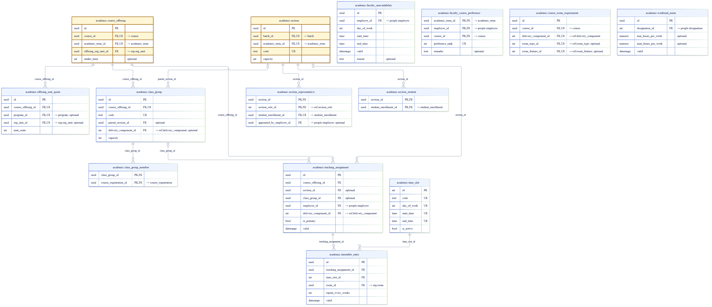

Every column of every table in this group, from the live schema (`created_at` / `updated_at` omitted). Lines are foreign keys inside the group; a note `→ table` is a foreign key to another group; amber = the group's hub. Source: [`catalog-diagrams/er-a4.mmd`](catalog-diagrams/er-a4.mmd).

| Table | What it holds | Links outside this group | Data flow — features that read (R) / write (W) its data store |
|---|---|---|---|
| [`course_offering`](#t-academic-course-offering) | A course actually running in a term, and **which department teaches it that term** (may differ from the owner), with an optional intake cap for electives | `academic_term`, `course`, `org.org_unit` | [10.1](data-flow-features.md#f-10-1) RW · [10.3](data-flow-features.md#f-10-3) R · [10.5](data-flow-features.md#f-10-5) R |
| [`offering_seat_quota`](#t-academic-offering-seat-quota) | A ceiling on the seats of one offering for one group of students | `program`, `org.org_unit` | [10.1](data-flow-features.md#f-10-1) RW · [10.3](data-flow-features.md#f-10-3) R · [10.5](data-flow-features.md#f-10-5) R |
| [`section`](#t-academic-section) | The class sections (A, B, C…) of a batch in a term, with capacity | `academic_term`, `batch` | [10.1](data-flow-features.md#f-10-1) RW · [10.2](data-flow-features.md#f-10-2) W · [10.7](data-flow-features.md#f-10-7) R |
| [`section_student`](#t-academic-section-student) | Which section a student is in for a term | `student_enrollment` | [10.1](data-flow-features.md#f-10-1) RW · [10.2](data-flow-features.md#f-10-2) W · [10.7](data-flow-features.md#f-10-7) R |
| [`section_representative`](#t-academic-section-representative) | Students holding a role in their section for the term (class representative, deputy): one holder per role, one role per student, and only a student of that section | `student_enrollment`, `people.employee`; 1 lookup | [10.1](data-flow-features.md#f-10-1) RW · [10.2](data-flow-features.md#f-10-2) W · [10.7](data-flow-features.md#f-10-7) R |
| [`class_group`](#t-academic-class-group) | A teaching group smaller than a section or cutting across sections, inside one course offering | 1 lookup | [10.7](data-flow-features.md#f-10-7) RW · [10.8](data-flow-features.md#f-10-8) R |
| [`class_group_member`](#t-academic-class-group-member) | Which registered students are in a class group | `course_registration` | [10.7](data-flow-features.md#f-10-7) RW · [10.8](data-flow-features.md#f-10-8) R |
| [`teaching_assignment`](#t-academic-teaching-assignment) | Faculty ↔ course ↔ class, per delivery component (who takes the lecture, who takes the lab), dated within the term | `people.employee`; 1 lookup | [10.8](data-flow-features.md#f-10-8) RW · [10.9](data-flow-features.md#f-10-9) R · [10.10](data-flow-features.md#f-10-10) R · [10.15](data-flow-features.md#f-10-15) R |
| [`time_slot`](#t-academic-time-slot) | Reusable weekly slot templates (ISO weekday 1–7, start, end; end after start) — the grid the timetable is placed on | — | [10.9](data-flow-features.md#f-10-9) RW |
| [`timetable_entry`](#t-academic-timetable-entry) | The timetable itself — one teaching assignment placed in a slot and a room for a date range | `org.room` | [10.9](data-flow-features.md#f-10-9) RW · [10.11](data-flow-features.md#f-10-11) R · [14.3](data-flow-features.md#f-14-3) R |
| [`faculty_unavailability`](#t-academic-faculty-unavailability) | Weekly periods a faculty member must not be timetabled (research day, administrative duty) — a solver input the database also enforces when an entry is saved | `people.employee` | [10.9](data-flow-features.md#f-10-9) RW |
| [`faculty_course_preference`](#t-academic-faculty-course-preference) | A teaching employee's ranked course preferences for a term — an input to faculty allocation; `v_faculty_preference_status` shows which preferences the allocation met | `academic_term`, `course`, `people.employee` | [10.8](data-flow-features.md#f-10-8) RW · [10.9](data-flow-features.md#f-10-9) R · [10.10](data-flow-features.md#f-10-10) R · [10.15](data-flow-features.md#f-10-15) R |
| [`course_room_requirement`](#t-academic-course-room-requirement) | What a course component needs from its room — a room type (a lab) or a feature (computers, projector) | `course`; 3 lookups | [8.6](data-flow-features.md#f-8-6) RW · [8.8](data-flow-features.md#f-8-8) R · [9.10](data-flow-features.md#f-9-10) R · [9.16](data-flow-features.md#f-9-16) R · [15.2](data-flow-features.md#f-15-2) R |
| [`workload_norm`](#t-academic-workload-norm) | The teaching hours per week expected of a designation (UGC norms: Professor 14, Assistant Professor 16 …), dated, one norm per designation at a time (EXCLUDE) | `people.designation` | [10.9](data-flow-features.md#f-10-9) RW |

**Views over this group** (derived, never stored): `academic.v_assignment_student` · `academic.v_backlog` · `academic.v_class_session` · `academic.v_credit_ledger` · `academic.v_credit_load` · `academic.v_faculty_preference_status` · `academic.v_faculty_workload` · `academic.v_guide_load` · `academic.v_offering_quota_usage` · `academic.v_po_attainment` · `academic.v_prerequisite_gap` · `academic.v_registration_scheme` · `academic.v_section_teaching` · `academic.v_student_timetable` · `academic.v_teaching_gap` · `exam.v_exam_eligibility` · `exam.v_hall_ticket` · `exam.v_result_group_outcome` · `exam.v_sgpa` · `exam.v_student_co_score` · `facility.v_room_timeline` · `facility.v_timetable_gap`  
**Functions that read or write it:** `academic.allocate_sections()` · `academic.allot_electives()` · `academic.offering_quota_for()` · `academic.register_core_courses()` · `exam.request_internal_mark_revision()` · `facility.hold_source_table()` · `facility.materialise_timetable()`
<!-- /group:a4 -->

#### `academic.course_offering`
**Why it exists:** a course actually running in a term, and **which department teaches it that term** (may differ from the owner), with an optional intake cap for electives. Everything that happens in a term — sections taught, registrations, timetable, exams — hangs off an offering, not off the catalogue course.
**Connects to →** `academic.course`, `academic.academic_term`, `org.org_unit` (academic unit only).
**Referenced by ←** `academic.course_registration`, `academic.class_group`, `academic.teaching_assignment`, `exam.exam_schedule`, `exam.eligibility_hold`, `exam.result_moderation`, `exam.paper_setter_assignment`, `exam.question_paper`, `academic.offering_seat_quota` (seats per programme / school).

#### `academic.offering_seat_quota`
**Why it exists:** a ceiling on the seats of one offering for one group of students — those of a programme, or those whose programme sits under an org unit (a school, a department, and everything beneath it) — so a cross-school elective can say "at most 20 seats for School of Engineering students". A ceiling for one group combined with the offering's `intake_limit` is a floor for everyone else, which is how "20 seats reserved for the rest" is expressed without a second mechanism. Each row targets exactly one of programme / unit (CHECK), one row per target per offering, and the unit must be academic. Which quota a student falls under is derived (`academic.offering_quota_for()`: the programme's quota first, then the nearest unit quota up the org tree), and the registration trigger refuses a counted registration once that quota is full — the same check the merit allotment function runs into, so it simply moves to the student's next preference. Usage per quota is `academic.v_offering_quota_usage`, never a stored counter.
**Connects to →** `academic.course_offering`, `academic.program` or `org.org_unit` (exactly one).
**Referenced by ←** nothing (read by the `course_registration` quota trigger and `v_offering_quota_usage`).

#### `academic.section`
**Why it exists:** the class sections (A, B, C…) of a batch in a term, with capacity — the unit a timetable and a faculty member are normally assigned to (**section-wise teaching**: each section of a course can have its own teacher per component; see `academic.v_section_teaching`).
**Connects to →** `academic.batch`, `academic.academic_term`.
**Referenced by ←** `academic.section_student`, `academic.class_group` (a section's lab/tutorial batches), `academic.teaching_assignment`, `academic.section_representative`.

#### `academic.section_student`
**Why it exists:** which section a student is in for a term. A trigger allows only students of that batch, only one section per term, and never more than the section's capacity. Sections are normally filled in one step by `academic.allocate_sections(batch, term)` — enrollment-number order, A then B then C up to capacity, all or nothing — and individual moves are ordinary edits still checked by this trigger.
**Connects to →** `academic.section`, `academic.student_enrollment`.
**Referenced by ←** nothing.

#### `academic.section_representative`
**Why it exists:** students holding a role in their section for the term (class representative, deputy): one holder per role, one role per student, and only a student of that section.
**Connects to →** `academic.section`, `ref.section_role`, `academic.student_enrollment`, `people.employee` (appointed by).
**Referenced by ←** nothing.

#### `academic.class_group`
**Why it exists:** a teaching group smaller than a section or cutting across sections, inside one course offering. Two uses: (1) **lab / tutorial batches** of a section — section A split into A1 and A2, each with its own teacher and lab slot (`parent_section_id` set); (2) **elective / open-course groups** — students from several batches who chose the same elective, split into ML-G1, ML-G2 (`parent_section_id` NULL). `delivery_component_id` says which component the group is for (e.g. PRACTICAL only) or NULL for all. Without this table, a lab split or a cross-batch elective could only be modelled as a fake section — which would break the one-section-per-student rule.
**Connects to →** `academic.course_offering`, `academic.section` (parent, optional), `ref.delivery_component`.
**Referenced by ←** `academic.class_group_member`, `academic.teaching_assignment`.

#### `academic.class_group_member`
**Why it exists:** which registered students are in a class group. A trigger requires a registration for the group's offering, membership of the parent section (for a batch), capacity, and only one group per offering per component; a second trigger rejects adding a student whose other classes clash with the group's timetable. Keyed on the course registration, so dropping the course drops the membership.
**Connects to →** `academic.class_group`, `academic.course_registration`.
**Referenced by ←** nothing (read by `academic.v_assignment_student`).

#### `academic.teaching_assignment`
**Why it exists:** faculty ↔ course ↔ class, per delivery component (who takes the lecture, who takes the lab), dated within the term. The class is **a section** (section-wise teaching — sec A and sec B of the same course can have different teachers), **a class group** (a lab batch or an elective group), or neither (one combined class for all registered students); a check allows at most one of the two. Exactly one primary faculty per class and component at a time (database-enforced), co-faculty allowed. Who a class actually reaches is derived (`academic.v_assignment_student`); the HOD's section × course × faculty sheet is `academic.v_section_teaching`, and registered students left without a teacher show up in `academic.v_teaching_gap`.
**Connects to →** `academic.course_offering`, `academic.section`, `academic.class_group`, `people.employee`, `ref.delivery_component`.
**Referenced by ←** `academic.timetable_entry`, `academic.class_session` (extra classes), `academic.lesson_plan_item` (the teacher's plan for this class), `academic.feedback_response` (the class and teacher being rated).

#### `academic.time_slot`
**Why it exists:** reusable weekly slot templates (ISO weekday 1–7, start, end; end after start) — the grid the timetable is placed on. A slot is unique by its code and by weekday + times, so the same hour is never defined twice; slots are switched off (`is_active`) rather than deleted once timetables use them.
**Connects to →** nothing.
**Referenced by ←** `academic.timetable_entry`.

#### `academic.timetable_entry`
**Why it exists:** the timetable itself — one teaching assignment placed in a slot and a room for a date range. The Django solver generates these; the database rejects any room or faculty double-booking, a section having two classes at once (including a whole-section lecture against one of its own batches), any student who would sit in two classes at once (checked by roster, which is what catches cross-batch electives and combined classes), and any slot the faculty marked unavailable — all on overlapping times, not just identical slots — so a buggy solver or a manual edit can never produce a clashing timetable. Two different batches of one section may run in parallel. An entry can repeat weekly or every N weeks (`repeat_every_weeks`, counted from the week its validity starts), so fortnightly labs on alternate weeks share a lab, a teacher and a slot without a clash, while two fortnightly classes in the same weeks still clash; class sessions on an off week are rejected.
**Connects to →** `academic.teaching_assignment`, `academic.time_slot`, `org.room`.
**Referenced by ←** `academic.class_session`; facility: `facility.room_hold`.

#### `academic.faculty_unavailability`
**Why it exists:** weekly periods a faculty member must not be timetabled (research day, administrative duty) — a solver input the database also enforces when an entry is saved.
**Connects to →** `people.employee`.
**Referenced by ←** nothing.

#### `academic.faculty_course_preference`
**Why it exists:** a teaching employee's ranked course preferences for a term — an input to faculty allocation; `v_faculty_preference_status` shows which preferences the allocation met.
**Connects to →** `academic.academic_term`, `people.employee` (teaching staff only), `academic.course`.
**Referenced by ←** nothing.

#### `academic.course_room_requirement`
**Why it exists:** what a course component needs from its room — a room type (a lab) or a feature (computers, projector). The timetable solver reads it, and the database rejects a timetable entry whose room does not meet it (or does not seat the class roster).
**Connects to →** `academic.course`, `ref.delivery_component`, `ref.room_type`, `ref.room_feature`.
**Referenced by ←** nothing.

#### `academic.workload_norm`
**Why it exists:** the teaching hours per week expected of a designation (UGC norms: Professor 14, Assistant Professor 16 …), dated, one norm per designation at a time (EXCLUDE). Only the norm is stored; the actual load is derived from the timetable in `academic.v_faculty_workload` (a class every N weeks counts 1/N) and compared with the norm of the employee's current primary designation — so "who is over-loaded this term" is a query, not a spreadsheet.
**Connects to →** `people.designation`.
**Referenced by ←** nothing (read by `v_faculty_workload`).

### 4.5 Registration, attendance & leave

A student on the rolls of a term, registered for courses (with elective preferences, pathway and credit-load checks), attending class sessions; duty / medical leave approved through the workflow counts toward attendance.

The day-to-day operations tables of `sql/06c_academic_operations.sql` are spread over groups 4.3–4.9. Derived views: `academic.v_credit_load`, `academic.v_guide_load`, `academic.v_mentoring_status`, `academic.v_faculty_preference_status`, `exam.v_rank_list`, `exam.v_question_paper_blueprint`; leave and relative grading are folded into `academic.v_attendance_summary` and `exam.v_provisional_result`.

<!-- group:a5 -->
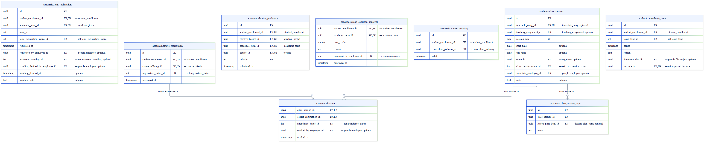

Every column of every table in this group, from the live schema (`created_at` / `updated_at` omitted). Lines are foreign keys inside the group; a note `→ table` is a foreign key to another group; amber = the group's hub. Source: [`catalog-diagrams/er-a5.mmd`](catalog-diagrams/er-a5.mmd).

| Table | What it holds | Links outside this group | Data flow — features that read (R) / write (W) its data store |
|---|---|---|---|
| [`term_registration`](#t-academic-term-registration) | A student on the rolls of one academic term, for one programme term number (semester), and — at the end of that term — the **academic standing** | `academic_term`, `student_enrollment`, `people.employee`; 2 lookups | [9.3](data-flow-features.md#f-9-3) RW · [9.4](data-flow-features.md#f-9-4) W · [9.9](data-flow-features.md#f-9-9) R |
| [`course_registration`](#t-academic-course-registration) | A student taking a course offering — the roster behind attendance, exam registration and marks | `course_offering`, `student_enrollment`; 1 lookup | [10.3](data-flow-features.md#f-10-3) W · [10.5](data-flow-features.md#f-10-5) W · [10.6](data-flow-features.md#f-10-6) RW · [10.7](data-flow-features.md#f-10-7) R · [10.12](data-flow-features.md#f-10-12) R · [10.15](data-flow-features.md#f-10-15) R · [10.17](data-flow-features.md#f-10-17) R |
| [`elective_preference`](#t-academic-elective-preference) | A student's ranked choices in an elective basket for a term | `academic_term`, `course`, `elective_basket`, `student_enrollment` | [10.4](data-flow-features.md#f-10-4) RW · [10.5](data-flow-features.md#f-10-5) R |
| [`credit_overload_approval`](#t-academic-credit-overload-approval) | An approved credit overload for one student in one term (e.g. clearing a backlog alongside the regular load) — it lifts the maximum for that student and term only | `academic_term`, `student_enrollment`, `people.employee` | [9.8](data-flow-features.md#f-9-8) RW |
| [`student_pathway`](#t-academic-student-pathway) | Which pathway a student is on, over time (one at a time), from their own curriculum | `curriculum_pathway`, `student_enrollment` | [9.1](data-flow-features.md#f-9-1) RW · [9.2](data-flow-features.md#f-9-2) RW · [9.3](data-flow-features.md#f-9-3) R · [9.7](data-flow-features.md#f-9-7) RW · [9.14](data-flow-features.md#f-9-14) R · [12.2](data-flow-features.md#f-12-2) RW · [12.4](data-flow-features.md#f-12-4) R · [13.2](data-flow-features.md#f-13-2) R · [15.2](data-flow-features.md#f-15-2) R |
| [`class_session`](#t-academic-class-session) | An actual dated class — generated from a timetable entry, or an extra/make-up class with its own time and room | `teaching_assignment`, `timetable_entry`, `org.room`, `people.employee`; 1 lookup | [10.10](data-flow-features.md#f-10-10) RW · [10.11](data-flow-features.md#f-10-11) RW · [10.12](data-flow-features.md#f-10-12) R · [10.14](data-flow-features.md#f-10-14) R · [14.3](data-flow-features.md#f-14-3) R |
| [`class_session_topic`](#t-academic-class-session-topic) | What was actually covered in a class (the course file), optionally tied to the lesson-plan item it delivers | `lesson_plan_item` | [10.10](data-flow-features.md#f-10-10) RW · [10.11](data-flow-features.md#f-10-11) RW · [10.12](data-flow-features.md#f-10-12) R · [10.14](data-flow-features.md#f-10-14) R · [14.3](data-flow-features.md#f-14-3) R |
| [`attendance`](#t-academic-attendance) | Per-lecture attendance, one mark per registered student per held class | `people.employee`; 1 lookup | [5.2](data-flow-features.md#f-5-2) W · [10.12](data-flow-features.md#f-10-12) W · [10.13](data-flow-features.md#f-10-13) W · [10.14](data-flow-features.md#f-10-14) R · [16.17](data-flow-features.md#f-16-17) W |
| [`attendance_leave`](#t-academic-attendance-leave) | Duty or medical leave for a period, applied for by the student (or attendance staff) and decided through the ATTENDANCE_LEAVE approval chain … | `student_enrollment`, `people.file_object`, `wf.approval_instance`; 1 lookup | [5.2](data-flow-features.md#f-5-2) W · [10.12](data-flow-features.md#f-10-12) W · [10.13](data-flow-features.md#f-10-13) W · [10.14](data-flow-features.md#f-10-14) R · [16.17](data-flow-features.md#f-16-17) W |

**Views over this group** (derived, never stored): `academic.v_assignment_student` · `academic.v_attendance_summary` · `academic.v_award_eligibility` · `academic.v_backlog` · `academic.v_class_session` · `academic.v_co_attainment` · `academic.v_credit_ledger` · `academic.v_credit_load` · `academic.v_guide_load` · `academic.v_offering_quota_usage` · `academic.v_prerequisite_gap` · `academic.v_registration_scheme` · `academic.v_section_teaching` · `academic.v_student_standing` · `academic.v_syllabus_coverage` · `academic.v_teaching_gap` · `exam.v_component_score` · `exam.v_exam_eligibility` · `exam.v_hall_ticket` · `exam.v_provisional_result` · `exam.v_result_group_outcome` · `exam.v_sgpa` · `exam.v_student_co_score` · `facility.v_room_timeline` · `facility.v_timetable_gap`  
**Functions that read or write it:** `academic.allot_electives()` · `academic.enrollment_pathway()` · `academic.enrollment_term_no()` · `academic.register_core_courses()` · `academic.request_attendance_leave()` · `exam.registration_has_clash()` · `exam.registration_matches_schedule()` · `exam.request_internal_mark_revision()` · `exam.schedule_has_clash()` · `facility.hold_source_table()` · `facility.materialise_timetable()`
<!-- /group:a5 -->

#### `academic.term_registration`
**Why it exists:** a student on the rolls of one academic term, for one programme term number (semester), and — at the end of that term — the **academic standing**: promoted, promoted with backlog, detained, not eligible. This row is the authoritative answer to "which semester is this student in" whenever it exists: `academic.enrollment_term_no()` reads the counted registration first and only falls back to deriving the term from dates when there is none. It is the structured replacement for the hand-edited `currentSemester` integer, and it is where a detained student's repeat of a term is recorded rather than fudged. The trigger refuses a term of another calendar type, a term the enrollment isn't active in, a term number beyond the programme's duration or other than the one the student is due for (last registered + 1 if promoted, the same again if detained), a term that starts while the student is on a `study_break`, and any term starting after the curriculum's `max_duration_years` counted from the first enrollment of the lineage (UGC N + 2). A standing can't be decided before the term starts; a plain PROMOTED can't be given with any backlog at all; a promotion with backlog is checked against `v_backlog` and the curriculum's `promotion_rule`. One row per enrollment and term, and a term number never changes once registered — cancel and register again.
**Connects to →** `academic.student_enrollment`, `academic.academic_term`, `ref.term_registration_status`, `ref.academic_standing`, `people.employee` (twice — registered by, NULL for self-service; standing decided by).
**Referenced by ←** nothing (read by `enrollment_term_no()` and `v_student_standing`).

#### `academic.course_registration`
**Why it exists:** a student taking a course offering — the roster behind attendance, exam registration and marks. The course must be part of the student's curriculum (fixed or in a basket), and elective intake limits are enforced. The registration's scheme of examination and category are *derived* through the curriculum (`academic.v_registration_scheme`), never copied onto the row. Besides curriculum courses, a student may register for an **approved equivalent** of a curriculum course (a backlog student whose course was replaced — assessed under their own regulation) or a course of a **minor / honours track** they are on; `v_registration_scheme` then says which (`counts_as_course_id`, `track_id`). Core courses are registered for a whole batch by `academic.register_core_courses(batch, term)`, which works out each student's own semester (`academic.enrollment_term_no`) and is safe to re-run.
**Connects to →** `academic.student_enrollment`, `academic.course_offering`, `ref.registration_status`.
**Referenced by ←** `academic.attendance`, `academic.class_group_member`, `academic.feedback_submission` (proof of having given feedback — never joined to the answers), `exam.exam_registration`, `exam.component_mark`, `exam.attendance_condonation`, `academic.supervised_work`.

#### `academic.elective_preference`
**Why it exists:** a student's ranked choices in an elective basket for a term — the input to allotment, kept apart from `course_registration` because a preference is a wish and a registration is a seat. The trigger checks the basket is in the student's own curriculum, the course is actually in that basket, and the basket's term is the term the student is in (`enrollment_term_no`). Allotment is `academic.allot_electives(basket, term)`: merit order (CGPA, students without one last, then enrollment number), each student's highest-ranked preference that still has a seat until the basket's `courses_to_choose` is met, written as ordinary `course_registration` rows — so seat limits and curriculum checks are still enforced where they always were, and preferences already satisfied count. Safe to re-run.
**Connects to →** `academic.student_enrollment`, `academic.elective_basket`, `academic.academic_term`, `academic.course`.
**Referenced by ←** nothing (read by `allot_electives`).

#### `academic.credit_overload_approval`
**Why it exists:** an approved credit overload for one student in one term (e.g. clearing a backlog alongside the regular load) — it lifts the maximum for that student and term only.
**Connects to →** `academic.student_enrollment`, `academic.academic_term`, `people.employee` (approver).
**Referenced by ←** nothing.

#### `academic.student_pathway`
**Why it exists:** which pathway a student is on, over time (one at a time), from their own curriculum. Registration, core-course registration and award eligibility follow it.
**Connects to →** `academic.student_enrollment`, `academic.curriculum_pathway`.
**Referenced by ←** nothing (read by `academic.enrollment_pathway()`).

#### `academic.class_session`
**Why it exists:** an actual dated class — generated from a timetable entry, or an extra/make-up class with its own time and room — with its status (held, cancelled…) and any substitute teacher. A check constraint allows exactly one of those two shapes, and for scheduled classes the time, room and faculty are *read from* the timetable, not copied. A timetable-generated session is also refused on a non-working day of the offering department's calendar (`academic.is_working_day` — holidays and vacations in `academic.calendar_event`); an extra or make-up class, which carries its own time, may still be held then.
**Connects to →** `academic.timetable_entry`, `academic.teaching_assignment`, `org.room`, `people.employee` (substitute), `ref.class_session_status`.
**Referenced by ←** `academic.attendance`, `academic.class_session_topic` (what the class actually covered); facility: `facility.room_hold`.

#### `academic.class_session_topic`
**Why it exists:** what was actually covered in a class (the course file), optionally tied to the lesson-plan item it delivers. A trigger rejects a plan item from a different teaching assignment than the session's (read from the session or from its timetable entry). Planned vs. delivered — `academic.v_syllabus_coverage`, per assignment and unit, counting only held sessions — is derived from plan items and topics, never stored as a percentage.
**Connects to →** `academic.class_session`, `academic.lesson_plan_item`.
**Referenced by ←** nothing (read by `v_syllabus_coverage`).

#### `academic.attendance`
**Why it exists:** per-lecture attendance, one mark per registered student per held class. The trigger rejects marks for a cancelled class, for the wrong course, or for a student who is not on the roster of the class (its section, lab batch or elective group). Attendance percentage (and so exam eligibility) is derived from these rows, never typed in.
**Connects to →** `academic.class_session`, `academic.course_registration`, `people.employee` (marked by), `ref.attendance_status`.
**Referenced by ←** nothing (read by `academic.v_attendance_summary`).

#### `academic.attendance_leave`
**Why it exists:** duty or medical leave for a period, applied for by the student (or attendance staff) and decided through the ATTENDANCE_LEAVE approval chain (HOD of the programme's department). Once approved, classes the student was not marked present in count as the leave type says (duty leave = present) — the marks are never edited. The reason is often health data: registered for anonymisation and hidden from analytics.
**Connects to →** `academic.student_enrollment`, `ref.leave_type`, `people.file_object` (supporting document), `wf.approval_instance`.
**Referenced by ←** nothing.

### 4.6 NEP 2020 flexibility

Multiple entry & exit awards, re-entry, course equivalence, external / MOOC courses and credit transfer (ABC), minors and honours tracks.

These tables make the academic model follow NEP 2020 / UGC rules without special cases in code. They share one derived backbone, all in `09_views_functions.sql`: `academic.v_enrollment_lineage` (an enrollment plus every earlier one it resumed after an exit or was transferred from), `academic.v_credit_ledger` (every credit a student holds — internal results and accepted transfers — across that lineage), `academic.v_course_completion` (which courses are done, and whether by passing, by transfer or through an equivalent), `academic.v_award_eligibility`, `academic.v_student_track_progress`, and the CGPA built from the ledger. The student's APAAR / ABC ID itself is **not** here: it is a personal identifier, stored encrypted in `pii.person_identity_document` (type `APAAR_ID`).

<!-- group:a6 -->
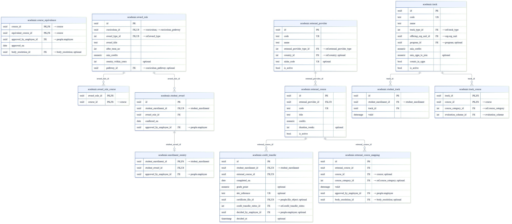

Every column of every table in this group, from the live schema (`created_at` / `updated_at` omitted). Lines are foreign keys inside the group; a note `→ table` is a foreign key to another group; amber = the group's hub. Source: [`catalog-diagrams/er-a6.mmd`](catalog-diagrams/er-a6.mmd).

| Table | What it holds | Links outside this group | Data flow — features that read (R) / write (W) its data store |
|---|---|---|---|
| [`course_equivalence`](#t-academic-course-equivalence) | "course B counts as course A", approved by the Board of Studies | `body_resolution`, `course`, `people.employee` | [9.10](data-flow-features.md#f-9-10) RW · [9.11](data-flow-features.md#f-9-11) RW · [9.12](data-flow-features.md#f-9-12) R · [9.16](data-flow-features.md#f-9-16) R |
| [`award_rule`](#t-academic-award-rule) | **multiple exit** — what a curriculum lets a student leave with, and when | `curriculum`, `curriculum_pathway`; 1 lookup | [8.8](data-flow-features.md#f-8-8) RW · [9.4](data-flow-features.md#f-9-4) R · [9.16](data-flow-features.md#f-9-16) R · [12.1](data-flow-features.md#f-12-1) R |
| [`award_rule_course`](#t-academic-award-rule-course) | Courses that must be completed for an award — e.g. the vocational summer internship NEP requires for a certificate exit | `course` | [8.8](data-flow-features.md#f-8-8) RW · [9.4](data-flow-features.md#f-9-4) R · [9.16](data-flow-features.md#f-9-16) R · [12.1](data-flow-features.md#f-12-1) R |
| [`student_award`](#t-academic-student-award) | The award actually conferred when an enrollment ends — an exit certificate or diploma, or the final degree | `student_enrollment`, `people.employee` | [9.7](data-flow-features.md#f-9-7) R · [12.2](data-flow-features.md#f-12-2) W · [12.4](data-flow-features.md#f-12-4) R |
| [`enrollment_reentry`](#t-academic-enrollment-reentry) | **multiple entry** — a new enrollment that resumes the programme after an exit | `student_enrollment`, `people.employee` | [9.3](data-flow-features.md#f-9-3) R · [9.7](data-flow-features.md#f-9-7) RW · [9.9](data-flow-features.md#f-9-9) R · [9.15](data-flow-features.md#f-9-15) R |
| [`external_provider`](#t-academic-external-provider) | Where external credits come from — another university (with its AISHE code), a MOOC platform (SWAYAM, NPTEL), an industry certification body | 2 lookups | [9.10](data-flow-features.md#f-9-10) RW · [9.11](data-flow-features.md#f-9-11) RW · [9.12](data-flow-features.md#f-9-12) R · [9.16](data-flow-features.md#f-9-16) R |
| [`external_course`](#t-academic-external-course) | A course at an external provider with its credits — the single place those credits are stated, so every transfer of it reads the same value | — | [9.10](data-flow-features.md#f-9-10) RW · [9.11](data-flow-features.md#f-9-11) RW · [9.12](data-flow-features.md#f-9-12) R · [9.16](data-flow-features.md#f-9-16) R |
| [`external_course_mapping`](#t-academic-external-course-mapping) | **MOOC / SWAYAM equivalence** — how an external course counts here for a period, as approved by the Board of Studies | `body_resolution`, `course`, `people.employee`; 1 lookup | [9.10](data-flow-features.md#f-9-10) RW · [9.11](data-flow-features.md#f-9-11) RW · [9.12](data-flow-features.md#f-9-12) R · [9.16](data-flow-features.md#f-9-16) R |
| [`credit_transfer`](#t-academic-credit-transfer) | **Academic Bank of Credits / MOOC credit transfer** — external credits a student asks to bring in, with the ABC transaction reference and the certificate | `student_enrollment`, `people.employee`, `people.file_object`; 1 lookup | [9.12](data-flow-features.md#f-9-12) RW · [9.15](data-flow-features.md#f-9-15) R · [9.16](data-flow-features.md#f-9-16) R · [12.1](data-flow-features.md#f-12-1) R |
| [`track`](#t-academic-track) | **minors and honours** — an additional credential on top of the programme | `program`, `org.org_unit`; 1 lookup | [9.13](data-flow-features.md#f-9-13) RW · [9.14](data-flow-features.md#f-9-14) RW · [9.15](data-flow-features.md#f-9-15) R |
| [`track_course`](#t-academic-track-course) | The courses of a track, each with its category and scheme of examination | `course`, `evaluation_scheme`; 1 lookup | [9.13](data-flow-features.md#f-9-13) RW · [9.14](data-flow-features.md#f-9-14) RW · [9.15](data-flow-features.md#f-9-15) R |
| [`student_track`](#t-academic-student-track) | A student on a minor or honours track over time | `student_enrollment` | [9.13](data-flow-features.md#f-9-13) RW · [9.14](data-flow-features.md#f-9-14) RW · [9.15](data-flow-features.md#f-9-15) R |

**Views over this group** (derived, never stored): `academic.v_award_eligibility` · `academic.v_course_completion` · `academic.v_credit_ledger` · `academic.v_enrollment_lineage` · `academic.v_registration_scheme` · `academic.v_soe_exit` · `academic.v_student_track_progress` · `exam.v_sgpa`  
**Functions that read or write it:** none — only its constraints and triggers
<!-- /group:a6 -->

#### `academic.course_equivalence`
**Why it exists:** "course B counts as course A", approved by the Board of Studies. Two uses: a backlog student whose old course is no longer offered registers for its replacement (old ← new), and credits earned before a curriculum change count toward the new curriculum, e.g. after re-entry (new ← old). Directional and one hop on purpose — each direction is an explicit, approved row, never inferred.
**Connects to →** `academic.course` (twice), `people.employee` (approver), `academic.body_resolution` (the Board of Studies / Academic Council resolution).
**Referenced by ←** nothing (read by the registration trigger, `v_registration_scheme` and `v_course_completion`).

#### `academic.award_rule`
**Why it exists:** **multiple exit** — what a curriculum lets a student leave with, and when: UG certificate after term 2 with N credits, UG diploma after term 4, the degree after the final term. Also how many years a student leaving with that award may come back (`reentry_within_years`; NULL = no re-entry, e.g. the final degree). Per curriculum, so a new regulation can change exit rules for new batches only.
**Connects to →** `academic.curriculum`, `ref.award_type`, `academic.curriculum_pathway` (award only on that pathway).
**Referenced by ←** `academic.award_rule_course`, `academic.student_award`.

#### `academic.award_rule_course`
**Why it exists:** courses that must be completed for an award — e.g. the vocational summer internship NEP requires for a certificate exit. A child table rather than a list column, so "which awards need this course" is a plain query.
**Connects to →** `academic.award_rule`, `academic.course`.
**Referenced by ←** nothing.

#### `academic.student_award`
**Why it exists:** the award actually conferred when an enrollment ends — an exit certificate or diploma, or the final degree. The trigger requires the enrollment to be closed on the award date, the rule to be from the student's own curriculum, and the student to be eligible right now (credits across re-entries and required courses, from `v_award_eligibility`). For a DOCTORAL programme a second trigger (in `04e_research.sql`) additionally refuses the award until a `research.viva` with an accepting outcome was held on or before the conferral date.
**Connects to →** `academic.student_enrollment` (one award per enrollment), `academic.award_rule`, `people.employee` (approver).
**Referenced by ←** `academic.enrollment_reentry`, `exam.certificate` (a degree or provisional certificate is issued against the award).

#### `academic.enrollment_reentry`
**Why it exists:** **multiple entry** — a new enrollment that resumes the programme after an exit. The trigger checks same student, same programme, starting after the exit and within the award's re-entry window, and entering the term after the exit point. The link is what makes the earlier credits and completed courses count again (`v_enrollment_lineage`), without copying a single result.
**Connects to →** `academic.student_enrollment` (the new one), `academic.student_award` (the exit it resumes from — each exit can be resumed once), `people.employee`.
**Referenced by ←** nothing.

#### `academic.external_provider`
**Why it exists:** where external credits come from — another university (with its AISHE code), a MOOC platform (SWAYAM, NPTEL), an industry certification body.
**Connects to →** `ref.external_provider_type`, `ref.country`.
**Referenced by ←** `academic.external_course`.

#### `academic.external_course`
**Why it exists:** a course at an external provider with its credits — the single place those credits are stated, so every transfer of it reads the same value.
**Connects to →** `academic.external_provider`.
**Referenced by ←** `academic.external_course_mapping`, `academic.credit_transfer`.

#### `academic.external_course_mapping`
**Why it exists:** **MOOC / SWAYAM equivalence** — how an external course counts here for a period, as approved by the Board of Studies: as a specific internal course (it replaces that course) or as credits in a category (e.g. a discipline elective). Exactly one of the two; an exclusion constraint allows one mapping at a time, so the credit a student gets depends on the mapping valid on their completion date.
**Connects to →** `academic.external_course`, `academic.course` or `ref.course_category`, `people.employee` (approver), `academic.body_resolution` (the Board of Studies / Academic Council resolution).
**Referenced by ←** nothing (read by the transfer trigger and the credit ledger).

#### `academic.credit_transfer`
**Why it exists:** **Academic Bank of Credits / MOOC credit transfer** — external credits a student asks to bring in, with the ABC transaction reference and the certificate. Credits come from the external course; the grade point is converted to the student's scale (NULL = credit only, outside the CGPA). On acceptance the trigger requires an approver, a mapping valid on the completion date, a mapped course or category that exists in the student's curriculum, and the curriculum's cap on transferred credits. Hidden from the analytics role (ABC ids, certificates).
**Connects to →** `academic.student_enrollment`, `academic.external_course`, `ref.credit_transfer_status`, `people.file_object`, `people.employee` (decided by).
**Referenced by ←** nothing (read by `academic.v_credit_ledger`).

#### `academic.track`
**Why it exists:** **minors and honours** — an additional credential on top of the programme. A minor is a second discipline offered by another department and open to other programmes (no programme); an honours track deepens the student's own programme (one programme). Carries the credits required, an optional CGPA entry bar, and whether its grades count in the CGPA.
**Connects to →** `ref.track_type`, `org.org_unit` (offering department, academic only), `academic.program` (honours).
**Referenced by ←** `academic.track_course`, `academic.student_track`.

#### `academic.track_course`
**Why it exists:** the courses of a track, each with its category and scheme of examination — a track course is outside the student's curriculum, so it must carry its own (curriculum courses get theirs from the curriculum).
**Connects to →** `academic.track`, `academic.course`, `ref.course_category`, `academic.evaluation_scheme`.
**Referenced by ←** nothing (read by the registration trigger and `v_registration_scheme`).

#### `academic.student_track`
**Why it exists:** a student on a minor or honours track over time. The trigger enforces: honours only in the student's own programme, a minor only from another department, one active track of each type, and the CGPA entry bar on joining. Registering for a track course is only possible while on the track; progress and completion are derived (`v_student_track_progress`).
**Connects to →** `academic.student_enrollment`, `academic.track`.
**Referenced by ←** nothing.

### 4.7 Student lifecycle, supervision & discipline

Breaks in study, programme transfers, mentoring meetings and disciplinary cases; projects, dissertations and internships with their guides.

The student-lifecycle tables of `sql/04d_student_lifecycle.sql` (term registration, breaks, transfers, calendar, syllabus and outcomes, lesson plans, workload and feedback — shown in groups 4.1, 4.5, 4.7, 4.8 and 4.10) cover what happens to a student *between* the structures above and the examinations below, and the data around teaching that regulators (UGC, NAAC / NBA) ask for. The common thread: each one turns something the old UMS kept as a hand-maintained flag, a JSON blob or a spreadsheet into a dated, checked row. The current semester comes from a term registration (or, failing one, from the calendar) instead of `StudentDetails.currentSemester`; a break in study is a dated row, not an ON_BREAK status; promotion and backlog are decided against published results, not typed in; a holiday is data the timetable obeys. Derived, never stored (`09_views_functions.sql`): `academic.v_backlog`, `v_promotion_eligibility`, `v_student_standing`, `v_syllabus_coverage`, `v_faculty_workload`, `v_feedback_summary`, `exam.v_division` and `academic.is_working_day()`.

<!-- group:a7 -->
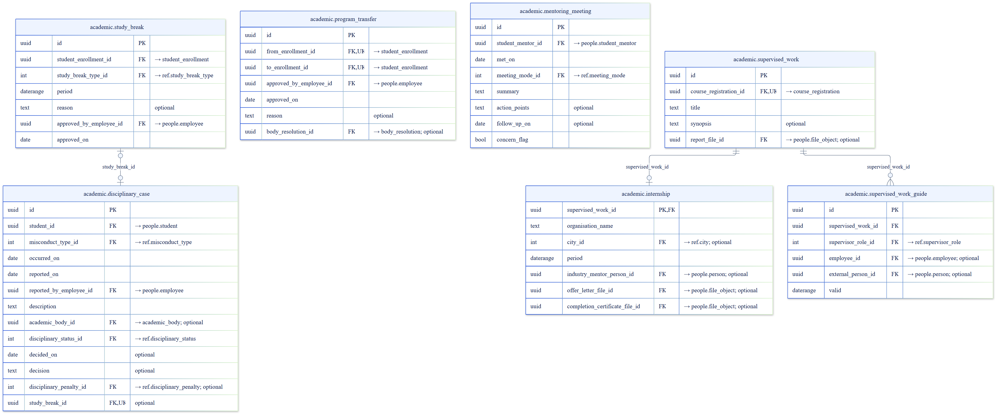

Every column of every table in this group, from the live schema (`created_at` / `updated_at` omitted). Lines are foreign keys inside the group; a note `→ table` is a foreign key to another group; amber = the group's hub. Source: [`catalog-diagrams/er-a7.mmd`](catalog-diagrams/er-a7.mmd).

| Table | What it holds | Links outside this group | Data flow — features that read (R) / write (W) its data store |
|---|---|---|---|
| [`study_break`](#t-academic-study-break) | A dated, approved break in study — medical, personal, maternity, financial, disciplinary suspension, industry break — on one enrollment, open-ended until closed | `student_enrollment`, `people.employee`; 1 lookup | [9.3](data-flow-features.md#f-9-3) R · [9.5](data-flow-features.md#f-9-5) RW · [9.6](data-flow-features.md#f-9-6) RW · [9.9](data-flow-features.md#f-9-9) R |
| [`program_transfer`](#t-academic-program-transfer) | A student who continues in another programme | `body_resolution`, `student_enrollment`, `people.employee` | [9.3](data-flow-features.md#f-9-3) R · [9.7](data-flow-features.md#f-9-7) RW · [9.9](data-flow-features.md#f-9-9) R · [9.15](data-flow-features.md#f-9-15) R |
| [`mentoring_meeting`](#t-academic-mentoring-meeting) | A mentor–mentee meeting (mode, summary, action points, follow-up date, concern flag), recorded only while the mentorship (`people.student_mentor`) is current | `people.student_mentor`; 1 lookup | [10.16](data-flow-features.md#f-10-16) RW |
| [`disciplinary_case`](#t-academic-disciplinary-case) | Student misconduct outside the exam hall (ragging, harassment, damage …; unfair means in an exam stays `exam.ufm_case`) | `academic_body`, `people.employee`, `people.student`; 3 lookups | [9.3](data-flow-features.md#f-9-3) R · [9.5](data-flow-features.md#f-9-5) RW · [9.6](data-flow-features.md#f-9-6) RW · [9.9](data-flow-features.md#f-9-9) R |
| [`supervised_work`](#t-academic-supervised-work) | A project, dissertation or internship done as a course — only for a registration whose curriculum category requires supervision | `course_registration`, `people.file_object` | [10.17](data-flow-features.md#f-10-17) RW |
| [`supervised_work_guide`](#t-academic-supervised-work-guide) | Who guides the work over time, with the same roles as doctoral supervision | `people.employee`, `people.person`; 1 lookup | [10.17](data-flow-features.md#f-10-17) RW |
| [`internship`](#t-academic-internship) | The placement details of an internship (a subtype of supervised work, only for INTERNSHIP / IACP courses) | `people.file_object`, `people.person`; 1 lookup | [10.17](data-flow-features.md#f-10-17) RW |

**Views over this group** (derived, never stored): `academic.v_enrollment_lineage` · `academic.v_guide_load` · `academic.v_mentoring_status` · `academic.v_student_enrollment_current` · `academic.v_student_standing`  
**Functions that read or write it:** `academic.enrollment_term_no()`
<!-- /group:a7 -->

#### `academic.study_break`
**Why it exists:** a dated, approved break in study — medical, personal, maternity, financial, disciplinary suspension, industry break — on one enrollment, open-ended until closed. This is what replaced the ON_BREAK value that used to sit in `ref.student_status`: a status flag says nothing about *when* the break was, has to be flipped back by hand, and can't be reconciled with the term count; a dated row can be. Breaks can't overlap (EXCLUDE) and must start while the enrollment is active; a term that falls entirely inside a break is skipped by `enrollment_term_no()`, and no term registration is accepted into a term that starts inside one. "Is this student on a break today" (`v_student_standing.is_on_break`) is derived from these rows. The reason text is often health data — registered in `privacy.data_element` and anonymised on erasure, as is the break type, since MEDICAL / MATERNITY reveal health on their own.
**Connects to →** `academic.student_enrollment`, `ref.study_break_type`, `people.employee` (approver).
**Referenced by ←** `academic.disciplinary_case`.

#### `academic.program_transfer`
**Why it exists:** a student who continues in another programme. The old enrollment is closed with end reason PROGRAM_CHANGE, a new one opens in the other programme, and this row links the two. The trigger requires the same student, a different programme, the earlier enrollment actually closed with that reason, and the new one starting no earlier than the old one ends; each enrollment can be the source or the destination of at most one transfer. The link is what makes the earlier enrollment part of the new one's lineage (`v_enrollment_lineage` follows transfers as well as re-entries), so earlier credits and completed courses count — which of them satisfy the *new* curriculum is a matter of `course_equivalence`, never a copied result. Same pattern as `enrollment_reentry`: the history is two enrollments and one explicit link, not an edited row.
**Connects to →** `academic.student_enrollment` (twice — from, to), `people.employee` (approver), `academic.body_resolution` (the Board of Studies / Academic Council resolution).
**Referenced by ←** nothing (read by `v_enrollment_lineage`).

#### `academic.mentoring_meeting`
**Why it exists:** a mentor–mentee meeting (mode, summary, action points, follow-up date, concern flag), recorded only while the mentorship (`people.student_mentor`) is current. `v_mentoring_status` gives the mentor / HOD dashboard. Notes can be sensitive: anonymised on erasure, hidden from analytics.
**Connects to →** `people.student_mentor`, `ref.meeting_mode`.
**Referenced by ←** nothing.

#### `academic.disciplinary_case`
**Why it exists:** student misconduct outside the exam hall (ragging, harassment, damage …; unfair means in an exam stays `exam.ufm_case`): the incident, who reported it, the disciplinary committee that heard it, the decision and penalty. A decided case needs its decision and date; no penalty before a decision; a suspension must be served as the student's DISCIPLINARY_SUSPENSION `academic.study_break` (so it shows in term counts), linked here; a closed case is final. The narrative is anonymised on erasure (the decision is kept as a legal record) and the table is hidden from analytics.
**Connects to →** `people.student`, `ref.misconduct_type`, `people.employee` (reporter), `academic.academic_body` (disciplinary committee), `ref.disciplinary_status`, `ref.disciplinary_penalty`, `academic.study_break`.
**Referenced by ←** nothing.

#### `academic.supervised_work`
**Why it exists:** a project, dissertation or internship done as a course — only for a registration whose curriculum category requires supervision. Title, synopsis, report.
**Connects to →** `academic.course_registration`, `people.file_object` (report).
**Referenced by ←** `academic.supervised_work_guide`, `academic.internship`.

#### `academic.supervised_work_guide`
**Why it exists:** who guides the work over time, with the same roles as doctoral supervision: one principal guide (an employee) at a time, co-guides, and external co-guides (a person from industry or another university, never an employee). `v_guide_load` shows each teacher's current guiding load.
**Connects to →** `academic.supervised_work`, `ref.supervisor_role`, `people.employee`, `people.person` (external co-guide).
**Referenced by ←** nothing.

#### `academic.internship`
**Why it exists:** the placement details of an internship (a subtype of supervised work, only for INTERNSHIP / IACP courses): organisation, city, period, industry mentor (a person outside the university), offer letter and completion certificate.
**Connects to →** `academic.supervised_work`, `ref.city`, `people.person` (industry mentor), `people.file_object` (offer letter, certificate).
**Referenced by ←** nothing.

### 4.8 Syllabus, outcomes & attainment

The syllabus and its units, course outcomes (CO) and programme outcomes (PO) with their mapping, the lesson plan, and the attainment policy that turns marks into CO / PO attainment.

<!-- group:a8 -->
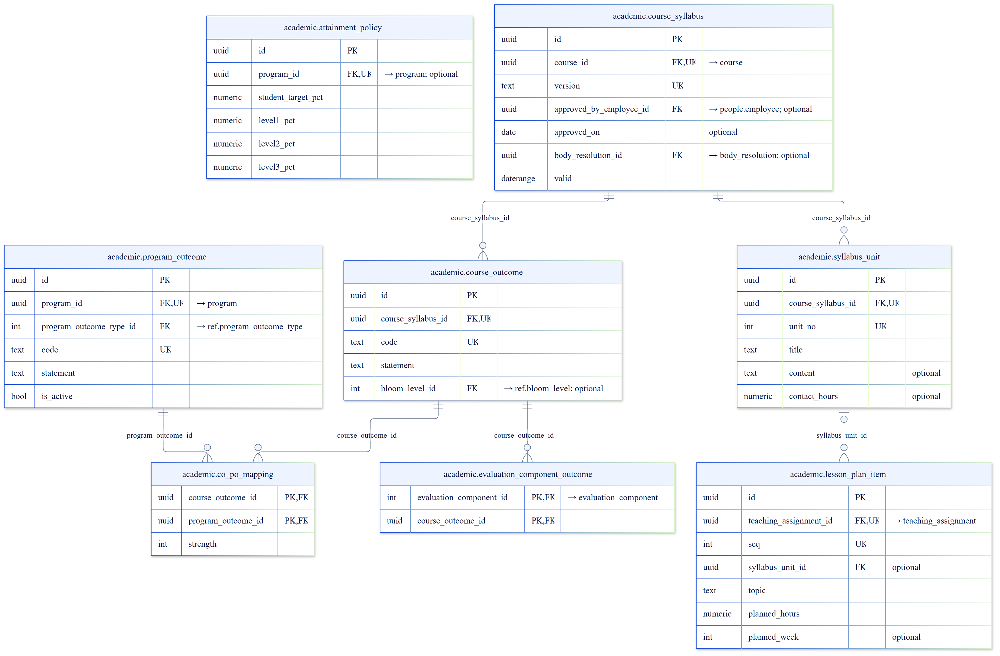

Every column of every table in this group, from the live schema (`created_at` / `updated_at` omitted). Lines are foreign keys inside the group; a note `→ table` is a foreign key to another group; amber = the group's hub. Source: [`catalog-diagrams/er-a8.mmd`](catalog-diagrams/er-a8.mmd).

| Table | What it holds | Links outside this group | Data flow — features that read (R) / write (W) its data store |
|---|---|---|---|
| [`course_syllabus`](#t-academic-course-syllabus) | A versioned syllabus of a course — approved by the Board of Studies, one current version at a time (EXCLUDE on validity) | `body_resolution`, `course`, `people.employee` | [8.6](data-flow-features.md#f-8-6) RW · [10.10](data-flow-features.md#f-10-10) R · [11.18](data-flow-features.md#f-11-18) R |
| [`syllabus_unit`](#t-academic-syllabus-unit) | The numbered units of a syllabus version, with content and contact hours | — | [8.6](data-flow-features.md#f-8-6) RW · [10.10](data-flow-features.md#f-10-10) R · [11.18](data-flow-features.md#f-11-18) R |
| [`course_outcome`](#t-academic-course-outcome) | A course outcome ("CO1: apply …") of a syllabus version, with its Bloom's level — the unit of NBA / NAAC outcome-based education | 1 lookup | [8.6](data-flow-features.md#f-8-6) RW · [10.10](data-flow-features.md#f-10-10) R · [11.18](data-flow-features.md#f-11-18) R |
| [`program_outcome`](#t-academic-program-outcome) | A programme outcome (PO) or programme-specific outcome (PSO) of a programme | `program`; 1 lookup | [8.1](data-flow-features.md#f-8-1) RW · [8.6](data-flow-features.md#f-8-6) R |
| [`co_po_mapping`](#t-academic-co-po-mapping) | The articulation matrix — which course outcome contributes to which programme outcome, and how strongly (1–3) | — | [8.6](data-flow-features.md#f-8-6) RW · [10.10](data-flow-features.md#f-10-10) R · [11.18](data-flow-features.md#f-11-18) R |
| [`lesson_plan_item`](#t-academic-lesson-plan-item) | The lesson plan of one teaching assignment — ordered topics with planned hours and week, each optionally tied to a syllabus unit | `teaching_assignment` | [10.10](data-flow-features.md#f-10-10) RW · [10.11](data-flow-features.md#f-10-11) RW · [10.12](data-flow-features.md#f-10-12) R · [10.14](data-flow-features.md#f-10-14) R · [14.3](data-flow-features.md#f-14-3) R |
| [`attainment_policy`](#t-academic-attainment-policy) | The outcome-based-education thresholds (NBA / NAAC) | `program` | [8.7](data-flow-features.md#f-8-7) RW · [8.8](data-flow-features.md#f-8-8) R · [9.13](data-flow-features.md#f-9-13) R · [11.11](data-flow-features.md#f-11-11) R · [11.12](data-flow-features.md#f-11-12) R · [11.14](data-flow-features.md#f-11-14) R · [11.18](data-flow-features.md#f-11-18) R |
| [`evaluation_component_outcome`](#t-academic-evaluation-component-outcome) | Which course outcomes an internal or directly marked component (assignment, lab evaluation, viva …) assesses, so its marks count toward those outcomes | `evaluation_component` | [8.7](data-flow-features.md#f-8-7) RW · [8.8](data-flow-features.md#f-8-8) R · [9.13](data-flow-features.md#f-9-13) R · [11.11](data-flow-features.md#f-11-11) R · [11.12](data-flow-features.md#f-11-12) R · [11.14](data-flow-features.md#f-11-14) R · [11.18](data-flow-features.md#f-11-18) R |

**Views over this group** (derived, never stored): `academic.v_co_attainment` · `academic.v_po_attainment` · `academic.v_syllabus_coverage` · `exam.v_question_paper_blueprint` · `exam.v_student_co_score`  
**Functions that read or write it:** none — only its constraints and triggers
<!-- /group:a8 -->

#### `academic.course_syllabus`
**Why it exists:** a versioned syllabus of a course — approved by the Board of Studies, one current version at a time (EXCLUDE on validity). Units, contact hours and course outcomes hang off the *version*, not the course, so a syllabus revision never rewrites what an earlier batch was taught. The catalogue `course` says *what* the course is (code, credits, owner); this table says what was in it, and when.
**Connects to →** `academic.course`, `people.employee` (approver), `academic.body_resolution` (the Board of Studies / Academic Council resolution).
**Referenced by ←** `academic.syllabus_unit`, `academic.course_outcome`.

#### `academic.syllabus_unit`
**Why it exists:** the numbered units of a syllabus version, with content and contact hours — a child table because a syllabus has many, and because lesson-plan items and coverage reporting need to point at one specific unit.
**Connects to →** `academic.course_syllabus`.
**Referenced by ←** `academic.lesson_plan_item`.

#### `academic.course_outcome`
**Why it exists:** a course outcome ("CO1: apply …") of a syllabus version, with its Bloom's level — the unit of NBA / NAAC outcome-based education. Per syllabus version, so outcomes change with the syllabus they belong to rather than being edited under an old batch.
**Connects to →** `academic.course_syllabus`, `ref.bloom_level`.
**Referenced by ←** `academic.co_po_mapping`, `exam.question_bank_item`, `academic.evaluation_component_outcome`.

#### `academic.program_outcome`
**Why it exists:** a programme outcome (PO) or programme-specific outcome (PSO) of a programme — the other end of the CO ↔ PO articulation matrix, one row per outcome so it can be mapped to, not a numbered list in a document.
**Connects to →** `academic.program`, `ref.program_outcome_type`.
**Referenced by ←** `academic.co_po_mapping`.

#### `academic.co_po_mapping`
**Why it exists:** the articulation matrix — which course outcome contributes to which programme outcome, and how strongly (1–3). A trigger insists the course is actually part of that programme (in one of its curricula, or one of its honours tracks): a mapping between a CO and a PO of a programme the course is never taught in would be meaningless data that still looks valid.
**Connects to →** `academic.course_outcome`, `academic.program_outcome`.
**Referenced by ←** nothing.

#### `academic.lesson_plan_item`
**Why it exists:** the lesson plan of one teaching assignment — ordered topics with planned hours and week, each optionally tied to a syllabus unit. Per teaching assignment rather than per course, because section A's teacher and section B's teacher plan differently. A trigger rejects a unit that belongs to a different course from the one being taught.
**Connects to →** `academic.teaching_assignment`, `academic.syllabus_unit`.
**Referenced by ←** `academic.class_session_topic`.

#### `academic.attainment_policy`
**Why it exists:** the outcome-based-education thresholds (NBA / NAAC): a student attains a course outcome at `student_target_pct` of its marks, and a course reaches attainment level 1 / 2 / 3 when that share of its students do. One university default (`program_id` NULL) and optional per-programme overrides. `academic.v_co_attainment` and `v_po_attainment` derive everything else — no attainment figure is stored.
**Connects to →** `academic.program`.
**Referenced by ←** nothing.

#### `academic.evaluation_component_outcome`
**Why it exists:** which course outcomes an internal or directly marked component (assignment, lab evaluation, viva …) assesses, so its marks count toward those outcomes. Script-marked exams are refused here — they are measured question by question through `exam.question_mark`, so nothing is counted twice.
**Connects to →** `academic.evaluation_component`, `academic.course_outcome`.
**Referenced by ←** nothing.

### 4.9 Boards, councils & committees

Board of Studies, Faculty Board, Academic Council and committees: members over time, meetings, attendance and quorum-checked resolutions that other approvals cite.

<!-- group:a9 -->
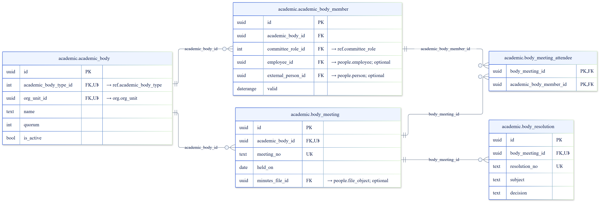

Every column of every table in this group, from the live schema (`created_at` / `updated_at` omitted). Lines are foreign keys inside the group; a note `→ table` is a foreign key to another group; amber = the group's hub. Source: [`catalog-diagrams/er-a9.mmd`](catalog-diagrams/er-a9.mmd).

| Table | What it holds | Links outside this group | Data flow — features that read (R) / write (W) its data store |
|---|---|---|---|
| [`academic_body`](#t-academic-academic-body) | The statutory bodies that approve academic decisions | `org.org_unit`; 1 lookup | [5.2](data-flow-features.md#f-5-2) R · [8.5](data-flow-features.md#f-8-5) RW · [8.6](data-flow-features.md#f-8-6) R · [9.6](data-flow-features.md#f-9-6) R · [9.7](data-flow-features.md#f-9-7) R · [9.10](data-flow-features.md#f-9-10) R · [15.6](data-flow-features.md#f-15-6) R |
| [`academic_body_member`](#t-academic-academic-body-member) | Who sits on a body over time — employees, or external experts (a person who is not an employee, as UGC requires on a Board of Studies) | `people.employee`, `people.person`; 1 lookup | [5.2](data-flow-features.md#f-5-2) R · [8.5](data-flow-features.md#f-8-5) RW · [8.6](data-flow-features.md#f-8-6) R · [9.6](data-flow-features.md#f-9-6) R · [9.7](data-flow-features.md#f-9-7) R · [9.10](data-flow-features.md#f-9-10) R · [15.6](data-flow-features.md#f-15-6) R |
| [`body_meeting`](#t-academic-body-meeting) | A meeting of a body — its number, date and minutes file | `people.file_object` | [5.2](data-flow-features.md#f-5-2) R · [8.5](data-flow-features.md#f-8-5) RW · [8.6](data-flow-features.md#f-8-6) R · [9.6](data-flow-features.md#f-9-6) R · [9.7](data-flow-features.md#f-9-7) R · [9.10](data-flow-features.md#f-9-10) R · [15.6](data-flow-features.md#f-15-6) R |
| [`body_meeting_attendee`](#t-academic-body-meeting-attendee) | Who was present — only members of that body on the meeting date | — | [5.2](data-flow-features.md#f-5-2) R · [8.5](data-flow-features.md#f-8-5) RW · [8.6](data-flow-features.md#f-8-6) R · [9.6](data-flow-features.md#f-9-6) R · [9.7](data-flow-features.md#f-9-7) R · [9.10](data-flow-features.md#f-9-10) R · [15.6](data-flow-features.md#f-15-6) R |
| [`body_resolution`](#t-academic-body-resolution) | A numbered resolution (subject, decision) passed at a meeting; the database refuses it unless the meeting had its quorum present | — | [5.2](data-flow-features.md#f-5-2) R · [8.5](data-flow-features.md#f-8-5) RW · [8.6](data-flow-features.md#f-8-6) R · [9.6](data-flow-features.md#f-9-6) R · [9.7](data-flow-features.md#f-9-7) R · [9.10](data-flow-features.md#f-9-10) R · [15.6](data-flow-features.md#f-15-6) R |

**Views over this group** (derived, never stored): none  
**Functions that read or write it:** `tms.can_view()` · `tms.forum_seat()` · `tms.is_forum_member()` · `tms.notice_accounts()` · `wf.submit()`
<!-- /group:a9 -->

#### `academic.academic_body`
**Why it exists:** the statutory bodies that approve academic decisions — the Board of Studies of a department, the Faculty Board of a school, the Academic Council of the university, and the examination, moderation and disciplinary committees — each attached to its org unit (one body of a type per unit) with its quorum. The old UMS quoted "BoS resolution no. …" as free text; here an approval points at the resolution itself.
**Connects to →** `ref.academic_body_type`, `org.org_unit`.
**Referenced by ←** `academic.academic_body_member`, `academic.body_meeting`, `academic.disciplinary_case`; approval engine: `wf.approval_chain_stage`; helpdesk: `tms.ticket_event` (the committee hearing a grievance).

#### `academic.academic_body_member`
**Why it exists:** who sits on a body over time — employees, or external experts (a person who is not an employee, as UGC requires on a Board of Studies). One chair at a time, and the chair must be an employee; no one is a member twice in overlapping periods.
**Connects to →** `academic.academic_body`, `ref.committee_role`, `people.employee`, `people.person` (external expert).
**Referenced by ←** `academic.body_meeting_attendee`.

#### `academic.body_meeting`
**Why it exists:** a meeting of a body — its number, date and minutes file. Resolutions hang off the meeting so they carry its date and attendance.
**Connects to →** `academic.academic_body`, `people.file_object` (minutes).
**Referenced by ←** `academic.body_meeting_attendee`, `academic.body_resolution`.

#### `academic.body_meeting_attendee`
**Why it exists:** who was present — only members of that body on the meeting date. The attendance is what the quorum rule counts.
**Connects to →** `academic.body_meeting`, `academic.academic_body_member`.
**Referenced by ←** nothing.

#### `academic.body_resolution`
**Why it exists:** a numbered resolution (subject, decision) passed at a meeting; the database refuses it unless the meeting had its quorum present. Course equivalences, MOOC mappings, syllabi and programme transfers reference the resolution that authorised them instead of quoting it as text.
**Connects to →** `academic.body_meeting`.
**Referenced by ←** `academic.course_equivalence`, `academic.external_course_mapping`, `academic.program_transfer`, `academic.course_syllabus`; helpdesk: `tms.ticket_event` (a committee's decision on a grievance).

### 4.10 Anonymous student feedback

Questionnaires run in feedback cycles; the submission (who answered) and the responses (what was answered) share no key, so answers stay anonymous by construction.

<!-- group:a10 -->
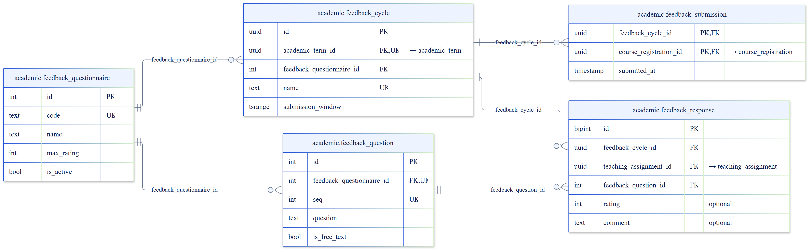

Every column of every table in this group, from the live schema (`created_at` / `updated_at` omitted). Lines are foreign keys inside the group; a note `→ table` is a foreign key to another group; amber = the group's hub. Source: [`catalog-diagrams/er-a10.mmd`](catalog-diagrams/er-a10.mmd).

| Table | What it holds | Links outside this group | Data flow — features that read (R) / write (W) its data store |
|---|---|---|---|
| [`feedback_questionnaire`](#t-academic-feedback-questionnaire) | A reusable set of questions with its rating scale (1..`max_rating`) | — | [10.15](data-flow-features.md#f-10-15) RW |
| [`feedback_question`](#t-academic-feedback-question) | The ordered questions of a questionnaire — rating questions or free-text ones | — | [10.15](data-flow-features.md#f-10-15) RW |
| [`feedback_cycle`](#t-academic-feedback-cycle) | A feedback round — one questionnaire, one term, one submission window | `academic_term` | [10.15](data-flow-features.md#f-10-15) RW |
| [`feedback_submission`](#t-academic-feedback-submission) | The **only** place a student is linked to feedback | `course_registration` | [10.15](data-flow-features.md#f-10-15) RW |
| [`feedback_response`](#t-academic-feedback-response) | One answer — cycle × teaching assignment (the class and teacher being rated) × question — a rating or a comment, and deliberately no student column | `teaching_assignment` | [10.15](data-flow-features.md#f-10-15) RW |

**Views over this group** (derived, never stored): `academic.v_feedback_summary`  
**Functions that read or write it:** none — only its constraints and triggers
<!-- /group:a10 -->

#### `academic.feedback_questionnaire`
**Why it exists:** a reusable set of questions with its rating scale (1..`max_rating`) — one row per instrument, so the same questionnaire can be run every term and results compared across cycles instead of each round inventing its own form.
**Connects to →** nothing.
**Referenced by ←** `academic.feedback_question`, `academic.feedback_cycle`.

#### `academic.feedback_question`
**Why it exists:** the ordered questions of a questionnaire — rating questions or free-text ones. A child table so a question can be added without a migration and so a response points at exactly one question.
**Connects to →** `academic.feedback_questionnaire`.
**Referenced by ←** `academic.feedback_response`.

#### `academic.feedback_cycle`
**Why it exists:** a feedback round — one questionnaire, one term, one submission window. Submissions and responses both belong to a cycle, which is what keeps "the mid-semester round" and "the end-semester round" apart and lets the window be enforced.
**Connects to →** `academic.academic_term`, `academic.feedback_questionnaire`.
**Referenced by ←** `academic.feedback_submission`, `academic.feedback_response`.

#### `academic.feedback_submission`
**Why it exists:** the **only** place a student is linked to feedback — proof that this course registration has submitted in this cycle, once (primary key), inside the window and for a registration of the cycle's term. It is never joined to the responses: there is no key on which to do so. That is how anonymity is guaranteed by construction rather than by a promise in the UI — the database can answer "who hasn't submitted yet" without ever being able to answer "what did she say".
**Connects to →** `academic.feedback_cycle`, `academic.course_registration`.
**Referenced by ←** nothing.

#### `academic.feedback_response`
**Why it exists:** one answer — cycle × teaching assignment (the class and teacher being rated) × question — a rating or a comment, and deliberately no student column. The trigger checks the question belongs to the cycle's questionnaire, a rating question gets a rating within the maximum and a free-text question a comment, and the teaching assignment is in the cycle's term. Read only in aggregate, through `academic.v_feedback_summary`.
**Connects to →** `academic.feedback_cycle`, `academic.teaching_assignment`, `academic.feedback_question`.
**Referenced by ←** nothing (read by `v_feedback_summary`).

---

## 5. `exam` — examination (32)

A separate schema because it is the exam cell's operational record and among the most sensitive data a university holds (marks, the answer-script ↔ student link, unfair-means cases). The *rules* — scheme of examination, grade scale — stay in `academic`; this schema records what happened under them.

### 5.1 Sessions, eligibility, date sheet & conduct

An exam session, who may sit (holds, attendance condonation), exam registration per attempt, the date sheet, rooms, seating, invigilation, attendance in the hall, unfair-means cases and examiner panels for practicals / vivas.

<!-- group:e1 -->
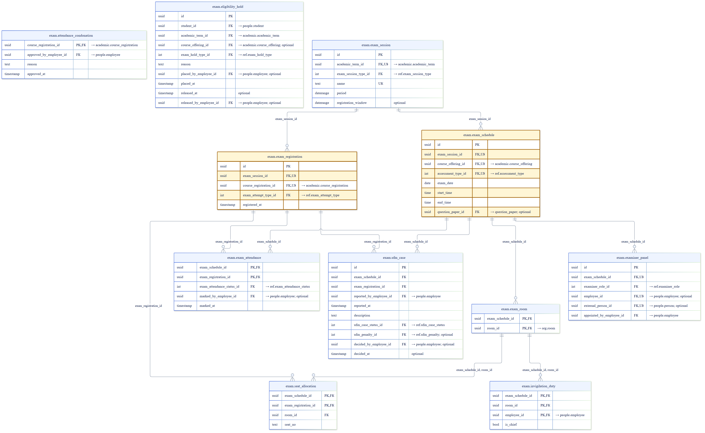

Every column of every table in this group, from the live schema (`created_at` / `updated_at` omitted). Lines are foreign keys inside the group; a note `→ table` is a foreign key to another group; amber = the group's hub. Source: [`catalog-diagrams/er-e1.mmd`](catalog-diagrams/er-e1.mmd).

| Table | What it holds | Links outside this group | Data flow — features that read (R) / write (W) its data store |
|---|---|---|---|
| [`exam_session`](#t-exam-exam-session) | An examination session in a term — mid-term, end-term, supplementary — with its exam days | `academic.academic_term`; 1 lookup | [11.1](data-flow-features.md#f-11-1) RW · [11.7](data-flow-features.md#f-11-7) R |
| [`eligibility_hold`](#t-exam-eligibility-hold) | A hold that blocks exam eligibility for a term or a single course — disciplinary, fee dues flagged by Finance, administrative | `academic.academic_term`, `academic.course_offering`, `people.employee`, `people.student`; 1 lookup | [11.2](data-flow-features.md#f-11-2) RW · [11.3](data-flow-features.md#f-11-3) R |
| [`attendance_condonation`](#t-exam-attendance-condonation) | An approved exception for an attendance shortage on one course (medical, sports, NCC…) | `academic.course_registration`, `people.employee` | [11.2](data-flow-features.md#f-11-2) RW · [11.3](data-flow-features.md#f-11-3) R |
| [`exam_registration`](#t-exam-exam-registration) | A student sitting a course's exams in a session, as a regular / backlog / improvement / supplementary attempt | `academic.course_registration`; 1 lookup | [11.3](data-flow-features.md#f-11-3) RW · [11.7](data-flow-features.md#f-11-7) R |
| [`exam_schedule`](#t-exam-exam-schedule) | The date sheet — date and time of each scheduled component (mid-term, end-term) of a course offering in a session | `academic.course_offering`, `question_paper`; 1 lookup | [11.3](data-flow-features.md#f-11-3) R · [11.7](data-flow-features.md#f-11-7) RW · [11.8](data-flow-features.md#f-11-8) RW · [11.9](data-flow-features.md#f-11-9) R · [11.12](data-flow-features.md#f-11-12) R · [14.3](data-flow-features.md#f-14-3) R |
| [`exam_room`](#t-exam-exam-room) | Which rooms a paper uses (a big hall may host several concurrent papers) | `org.room` | [11.3](data-flow-features.md#f-11-3) R · [11.7](data-flow-features.md#f-11-7) RW · [11.8](data-flow-features.md#f-11-8) RW · [11.9](data-flow-features.md#f-11-9) R · [11.12](data-flow-features.md#f-11-12) R · [14.3](data-flow-features.md#f-14-3) R |
| [`seat_allocation`](#t-exam-seat-allocation) | The seating plan — registered student → room and seat | — | [11.3](data-flow-features.md#f-11-3) R · [11.7](data-flow-features.md#f-11-7) RW · [11.8](data-flow-features.md#f-11-8) RW · [11.9](data-flow-features.md#f-11-9) R · [11.12](data-flow-features.md#f-11-12) R · [14.3](data-flow-features.md#f-14-3) R |
| [`invigilation_duty`](#t-exam-invigilation-duty) | Invigilator duty per paper and room — one chief per room, and nobody on duty in two rooms at overlapping times | `people.employee` | [11.3](data-flow-features.md#f-11-3) R · [11.7](data-flow-features.md#f-11-7) RW · [11.8](data-flow-features.md#f-11-8) RW · [11.9](data-flow-features.md#f-11-9) R · [11.12](data-flow-features.md#f-11-12) R · [14.3](data-flow-features.md#f-14-3) R |
| [`exam_attendance`](#t-exam-exam-attendance) | Present / absent / booked-for-unfair-means per student per paper — the basis for whether an answer script can exist | `people.employee`; 1 lookup | [11.9](data-flow-features.md#f-11-9) RW · [11.10](data-flow-features.md#f-11-10) R |
| [`ufm_case`](#t-exam-ufm-case) | An unfair-means (malpractice) case — reported in the hall, decided by a committee, with a penalty only once decided (check constraint) | `people.employee`; 2 lookups | [11.9](data-flow-features.md#f-11-9) RW · [11.10](data-flow-features.md#f-11-10) R |
| [`examiner_panel`](#t-exam-examiner-panel) | The examiners of a scheduled but **directly-marked** paper — an end-term practical (ETP) or a dissertation / internship viva — which has no anonymous answer scripts | `people.employee`, `people.person`; 1 lookup | [11.3](data-flow-features.md#f-11-3) R · [11.7](data-flow-features.md#f-11-7) RW · [11.8](data-flow-features.md#f-11-8) RW · [11.9](data-flow-features.md#f-11-9) R · [11.12](data-flow-features.md#f-11-12) R · [14.3](data-flow-features.md#f-14-3) R |

**Views over this group** (derived, never stored): `academic.v_co_attainment` · `exam.v_component_score` · `exam.v_current_result` · `exam.v_exam_attempt` · `exam.v_exam_eligibility` · `exam.v_hall_ticket` · `exam.v_provisional_result` · `exam.v_student_co_score`  
**Functions that read or write it:** `exam.registration_has_clash()` · `exam.registration_matches_schedule()` · `exam.schedule_has_clash()` · `facility.hold_source_table()`
<!-- /group:e1 -->

#### `exam.exam_session`
**Why it exists:** an examination session in a term — mid-term, end-term, supplementary — with its exam days. Every registration, paper and result publication belongs to one.
**Connects to →** `academic.academic_term`, `ref.exam_session_type`.
**Referenced by ←** `exam.exam_registration`, `exam.exam_schedule`, `exam.result_moderation`, `exam.result_publication`, `exam.marksheet`, `exam.paper_setter_assignment`, `exam.question_paper` (papers are prepared per session before the date sheet exists).

#### `exam.eligibility_hold`
**Why it exists:** a hold that blocks exam eligibility for a term or a single course — disciplinary, fee dues flagged by Finance, administrative. Holds are *released* (who, when), never deleted, so the history of why a student was blocked survives.
**Connects to →** `people.student`, `academic.academic_term`, `academic.course_offering`, `ref.exam_hold_type`, `people.employee` (placed/released by).
**Referenced by ←** nothing (read by `exam.v_exam_eligibility`).

#### `exam.attendance_condonation`
**Why it exists:** an approved exception for an attendance shortage on one course (medical, sports, NCC…). The reason is registered as health data and is anonymised on erasure — it often contains a diagnosis.
**Connects to →** `academic.course_registration`, `people.employee`.
**Referenced by ←** nothing (read by `exam.v_exam_eligibility`).

#### `exam.exam_registration`
**Why it exists:** a student sitting a course's exams in a session, as a regular / backlog / improvement / supplementary attempt. On insert the database checks eligibility (attendance or condonation, no active hold) for attempt types that need it, that a regular attempt is in the course's own term, and that the paper doesn't clash with another the student is sitting. A second trigger caps the number of attempts on one course registration at the curriculum's `max_attempts_per_course` (NULL = no limit). Attempt number is derived (`exam.v_exam_attempt`).
**Connects to →** `exam.exam_session`, `academic.course_registration`, `ref.exam_attempt_type`.
**Referenced by ←** `exam.seat_allocation`, `exam.exam_attendance`, `exam.ufm_case`, `exam.answer_script`, `exam.component_mark`, `exam.grace_award`, `exam.course_result`, `exam.question_mark`.

#### `exam.exam_schedule`
**Why it exists:** the date sheet — date and time of each scheduled component (mid-term, end-term) of a course offering in a session. The database rejects a slot that would put any registered student in two papers at once, a continuous-assessment component as a "paper", and dates outside the session. It also names the question-paper set actually used (`question_paper_id`): a trigger accepts only an *approved* set, and only one for the same session, course and exam type — so the link between a sitting and the paper is a fact, not a filename.
**Connects to →** `exam.exam_session`, `academic.course_offering`, `ref.assessment_type`, `exam.question_paper` (the approved set used).
**Referenced by ←** `exam.exam_room`, `exam.exam_attendance`, `exam.ufm_case`, `exam.answer_script`, `exam.examiner_panel`.

#### `exam.exam_room`
**Why it exists:** which rooms a paper uses (a big hall may host several concurrent papers). Only rooms with an exam capacity are accepted.
**Connects to →** `exam.exam_schedule`, `org.room`.
**Referenced by ←** `exam.seat_allocation`, `exam.invigilation_duty` (both via composite key, so a seat or duty can only be in a room allocated to that paper); facility: `facility.room_hold`.

#### `exam.seat_allocation`
**Why it exists:** the seating plan — registered student → room and seat. A seat is unique across every paper sitting in that room at that time, and the room's exam capacity is never exceeded.
**Connects to →** `exam.exam_registration`, `exam.exam_room`.
**Referenced by ←** nothing (read by `exam.v_hall_ticket`).

#### `exam.invigilation_duty`
**Why it exists:** invigilator duty per paper and room — one chief per room, and nobody on duty in two rooms at overlapping times.
**Connects to →** `exam.exam_room`, `people.employee`.
**Referenced by ←** nothing.

#### `exam.exam_attendance`
**Why it exists:** present / absent / booked-for-unfair-means per student per paper — the basis for whether an answer script can exist.
**Connects to →** `exam.exam_schedule`, `exam.exam_registration`, `ref.exam_attendance_status`, `people.employee`.
**Referenced by ←** nothing.

#### `exam.ufm_case`
**Why it exists:** an unfair-means (malpractice) case — reported in the hall, decided by a committee, with a penalty only once decided (check constraint).
**Connects to →** `exam.exam_schedule`, `exam.exam_registration`, `ref.ufm_case_status`, `ref.ufm_penalty`, `people.employee` (reporter, decider).
**Referenced by ←** nothing.

#### `exam.examiner_panel`
**Why it exists:** the examiners of a scheduled but **directly-marked** paper — an end-term practical (ETP) or a dissertation / internship viva — which has no anonymous answer scripts. Internal examiner = an employee, external = an outside person (as for thesis examiners). Only a panel member may enter the paper's marks, and a type that requires an external examiner accepts no marks until one is on the panel. Hidden from the analytics role.
**Connects to →** `exam.exam_schedule`, `ref.examiner_role`, `people.employee` (internal examiner, appointed by), `people.person` (external examiner).
**Referenced by ←** nothing.

### 5.2 Question papers, bank & question-wise marks

Setters and moderators, question-paper sets through approval, the reviewed question bank, the questions on each paper, and each student's marks per question (for CO attainment).

The tables of `sql/04f_exam_papers_certificates.sql` (here and in §5.4) cover the two ends of an examination: the confidential life of a question paper *before* the date sheet exists, and the legal documents issued *after* the results. The same file caps exam attempts per course (`curriculum.max_attempts_per_course`, enforced on `exam_registration` above); the division a student graduates with is derived, not stored (`exam.v_division`, from `academic.division_band`).

<!-- group:e2 -->
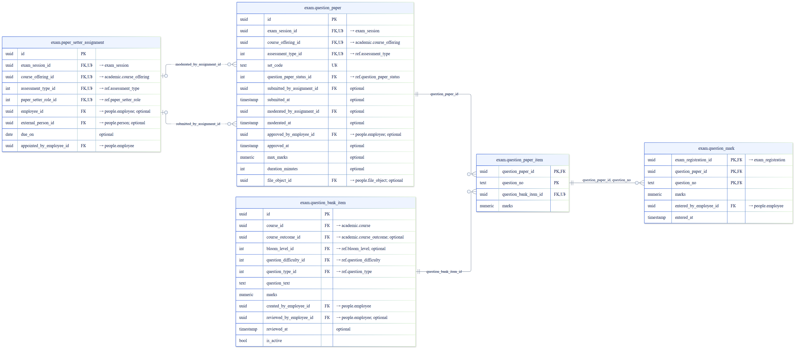

Every column of every table in this group, from the live schema (`created_at` / `updated_at` omitted). Lines are foreign keys inside the group; a note `→ table` is a foreign key to another group; amber = the group's hub. Source: [`catalog-diagrams/er-e2.mmd`](catalog-diagrams/er-e2.mmd).

| Table | What it holds | Links outside this group | Data flow — features that read (R) / write (W) its data store |
|---|---|---|---|
| [`paper_setter_assignment`](#t-exam-paper-setter-assignment) | Who sets and who moderates the paper for a scheduled component of an offering in a session — an employee, or an external examiner (a person who is not an employee) | `academic.course_offering`, `exam_session`, `people.employee`, `people.person`; 2 lookups | [11.4](data-flow-features.md#f-11-4) RW · [11.5](data-flow-features.md#f-11-5) RW · [11.6](data-flow-features.md#f-11-6) RW · [11.7](data-flow-features.md#f-11-7) R · [11.11](data-flow-features.md#f-11-11) R · [11.18](data-flow-features.md#f-11-18) R |
| [`question_paper`](#t-exam-question-paper) | One set (A, B …) of a question paper with its confidential file (application-encrypted at rest; the table is hidden from the analytics role) and its lifecycle | `academic.course_offering`, `exam_session`, `people.employee`, `people.file_object`; 2 lookups | [11.4](data-flow-features.md#f-11-4) RW · [11.5](data-flow-features.md#f-11-5) RW · [11.6](data-flow-features.md#f-11-6) RW · [11.7](data-flow-features.md#f-11-7) R · [11.11](data-flow-features.md#f-11-11) R · [11.18](data-flow-features.md#f-11-18) R |
| [`question_bank_item`](#t-exam-question-bank-item) | A reusable question for a course, tagged with its course outcome (of the same course), Bloom level, difficulty and type, and reviewed by a second person before it can be … | `academic.course`, `academic.course_outcome`, `people.employee`; 3 lookups | [11.4](data-flow-features.md#f-11-4) RW · [11.5](data-flow-features.md#f-11-5) RW · [11.6](data-flow-features.md#f-11-6) RW · [11.7](data-flow-features.md#f-11-7) R · [11.11](data-flow-features.md#f-11-11) R · [11.18](data-flow-features.md#f-11-18) R |
| [`question_paper_item`](#t-exam-question-paper-item) | The questions of a question paper, drawn from the bank (same course, reviewed, active) and fixed once the paper is approved | — | [11.4](data-flow-features.md#f-11-4) RW · [11.5](data-flow-features.md#f-11-5) RW · [11.6](data-flow-features.md#f-11-6) RW · [11.7](data-flow-features.md#f-11-7) R · [11.11](data-flow-features.md#f-11-11) R · [11.18](data-flow-features.md#f-11-18) R |
| [`question_mark`](#t-exam-question-mark) | Marks per question of the paper a student actually sat (the set named on the date sheet), each question tied to a course outcome through the question bank | `exam_registration`, `people.employee` | [5.2](data-flow-features.md#f-5-2) W · [11.11](data-flow-features.md#f-11-11) W · [11.12](data-flow-features.md#f-11-12) RW · [11.14](data-flow-features.md#f-11-14) R · [11.16](data-flow-features.md#f-11-16) W · [11.18](data-flow-features.md#f-11-18) R |

**Views over this group** (derived, never stored): `exam.v_question_paper_blueprint` · `exam.v_student_co_score`  
**Functions that read or write it:** none — only its constraints and triggers
<!-- /group:e2 -->

#### `exam.paper_setter_assignment`
**Why it exists:** who sets and who moderates the paper for a scheduled component of an offering in a session — an employee, or an external examiner (a person who is not an employee). Keyed on the same triple as `exam_schedule` (session, offering, assessment type) precisely so papers can be prepared before the date sheet exists; one assignment per role per paper. The trigger rejects an assessment type that has no paper (continuous assessment), a session earlier than the course offering, and the same person as both setter and moderator.
**Connects to →** `exam.exam_session`, `academic.course_offering`, `ref.assessment_type`, `ref.paper_setter_role`, `people.employee` (twice — the setter / moderator, and who appointed them), `people.person` (an external setter / moderator).
**Referenced by ←** `exam.question_paper` (submitted by, moderated by).

#### `exam.question_paper`
**Why it exists:** one set (A, B …) of a question paper with its confidential file (application-encrypted at rest; the table is hidden from the analytics role) and its lifecycle: draft → submitted → moderated → approved → printed → used, or withdrawn. The status is a lookup whose flags say what must already be on the row — `is_moderated` needs both the setter's submission and the moderator's sign-off, `is_approved` an approver — and the trigger checks that the submitting assignment really is the SETTER, and the moderating one the MODERATOR, of *this* paper. Max marks and duration belong to the set. The date sheet points at the approved set it used (`exam_schedule.question_paper_id`), and only an approved set for the same session, course and exam type is accepted there.
**Connects to →** `exam.exam_session`, `academic.course_offering`, `ref.assessment_type`, `ref.question_paper_status`, `exam.paper_setter_assignment` (twice — submitted by, moderated by), `people.employee` (approver), `people.file_object`.
**Referenced by ←** `exam.exam_schedule`, `exam.question_paper_item`.

#### `exam.question_bank_item`
**Why it exists:** a reusable question for a course, tagged with its course outcome (of the same course), Bloom level, difficulty and type, and reviewed by a second person before it can be used. Confidential: hidden from analytics.
**Connects to →** `academic.course`, `academic.course_outcome`, `ref.bloom_level`, `ref.question_difficulty`, `ref.question_type`, `people.employee` (author, reviewer).
**Referenced by ←** `exam.question_paper_item`.

#### `exam.question_paper_item`
**Why it exists:** the questions of a question paper, drawn from the bank (same course, reviewed, active) and fixed once the paper is approved — which gives each paper a course-outcome / Bloom blueprint (`exam.v_question_paper_blueprint`) for outcome-based education. Hidden from analytics.
**Connects to →** `exam.question_paper`, `exam.question_bank_item`.
**Referenced by ←** `exam.question_mark`.

#### `exam.question_mark`
**Why it exists:** marks per question of the paper a student actually sat (the set named on the date sheet), each question tied to a course outcome through the question bank — the raw material of CO attainment (`exam.v_student_co_score`). A mark never exceeds the question's marks, the total never exceeds the evaluated script mark, and once the attempt's result is published marks can still be added (OBE analysis often comes later) but not changed.
**Connects to →** `exam.exam_registration`, `exam.question_paper_item` (paper + question no.), `people.employee` (entered by).
**Referenced by ←** nothing.

### 5.3 Evaluation, marks & moderation

Anonymous answer scripts, evaluator assignments and marks per evaluation round, internal / component marks and their approved revisions, revaluation, grace and board moderation.

<!-- group:e3 -->
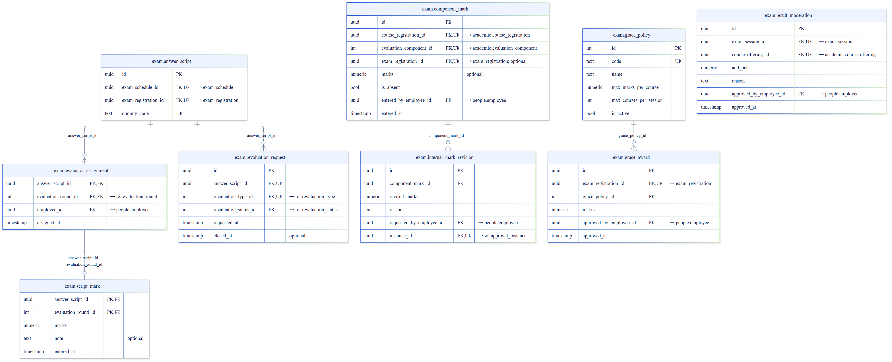

Every column of every table in this group, from the live schema (`created_at` / `updated_at` omitted). Lines are foreign keys inside the group; a note `→ table` is a foreign key to another group; amber = the group's hub. Source: [`catalog-diagrams/er-e3.mmd`](catalog-diagrams/er-e3.mmd).

| Table | What it holds | Links outside this group | Data flow — features that read (R) / write (W) its data store |
|---|---|---|---|
| [`answer_script`](#t-exam-answer-script) | A written script under a random **dummy code**, so evaluators never see whose script they're marking | `exam_registration`, `exam_schedule` | [11.10](data-flow-features.md#f-11-10) RW · [11.11](data-flow-features.md#f-11-11) RW · [11.14](data-flow-features.md#f-11-14) R · [11.16](data-flow-features.md#f-11-16) W |
| [`evaluator_assignment`](#t-exam-evaluator-assignment) | Who evaluates a script in each round — first evaluation, moderation, revaluation — with a different person required for each round of the same script | `people.employee`; 1 lookup | [11.10](data-flow-features.md#f-11-10) RW · [11.11](data-flow-features.md#f-11-11) RW · [11.14](data-flow-features.md#f-11-14) R · [11.16](data-flow-features.md#f-11-16) W |
| [`script_mark`](#t-exam-script-mark) | The marks an evaluator gave in their round | — | [11.10](data-flow-features.md#f-11-10) RW · [11.11](data-flow-features.md#f-11-11) RW · [11.14](data-flow-features.md#f-11-14) R · [11.16](data-flow-features.md#f-11-16) W |
| [`component_mark`](#t-exam-component-mark) | Marks for components that aren't answer scripts — internals, assignments, quizzes, practicals, viva | `academic.course_registration`, `academic.evaluation_component`, `exam_registration`, `people.employee` | [5.2](data-flow-features.md#f-5-2) W · [11.11](data-flow-features.md#f-11-11) W · [11.12](data-flow-features.md#f-11-12) RW · [11.14](data-flow-features.md#f-11-14) R · [11.16](data-flow-features.md#f-11-16) W · [11.18](data-flow-features.md#f-11-18) R |
| [`internal_mark_revision`](#t-exam-internal-mark-revision) | Where the curriculum allows it, a request to revise a **published** internal mark, decided through the INTERNAL_MARKS_REVISION workflow … | `people.employee`, `wf.approval_instance` | [5.2](data-flow-features.md#f-5-2) W · [11.11](data-flow-features.md#f-11-11) W · [11.12](data-flow-features.md#f-11-12) RW · [11.14](data-flow-features.md#f-11-14) R · [11.16](data-flow-features.md#f-11-16) W · [11.18](data-flow-features.md#f-11-18) R |
| [`revaluation_request`](#t-exam-revaluation-request) | A student's recheck / revaluation / photocopy request on a script, accepted only after a result for that attempt is published | 2 lookups | [11.16](data-flow-features.md#f-11-16) RW |
| [`grace_policy`](#t-exam-grace-policy) | The grace-marks rule: the most marks that may be granted in one course (> 0) and the most courses per session that may receive grace (> 0) | — | [11.13](data-flow-features.md#f-11-13) RW · [11.14](data-flow-features.md#f-11-14) R |
| [`grace_award`](#t-exam-grace-award) | Grace marks actually given to one exam attempt (one award per exam registration, marks > 0), under a named policy and approved by an employee | `exam_registration`, `people.employee` | [11.13](data-flow-features.md#f-11-13) RW · [11.14](data-flow-features.md#f-11-14) R |
| [`result_moderation`](#t-exam-result-moderation) | The examination board's moderation of one course in one session — plus (or minus) so many percentage points on every attempt's total, with the reason and the approver | `academic.course_offering`, `exam_session`, `people.employee` | [11.13](data-flow-features.md#f-11-13) RW · [11.14](data-flow-features.md#f-11-14) R |

**Views over this group** (derived, never stored): `exam.v_component_score` · `exam.v_effective_script_mark` · `exam.v_provisional_result`  
**Functions that read or write it:** `exam.request_internal_mark_revision()`
<!-- /group:e3 -->

#### `exam.answer_script`
**Why it exists:** a written script under a random **dummy code**, so evaluators never see whose script they're marking. This table is the *only* place the code ↔ student link exists, and it is withheld from the analytics role. A script can only be created for a student marked present.
**Connects to →** `exam.exam_schedule`, `exam.exam_registration`.
**Referenced by ←** `exam.evaluator_assignment`, `exam.revaluation_request`.

#### `exam.evaluator_assignment`
**Why it exists:** who evaluates a script in each round — first evaluation, moderation, revaluation — with a different person required for each round of the same script.
**Connects to →** `exam.answer_script`, `ref.evaluation_round`, `people.employee`.
**Referenced by ←** `exam.script_mark`.

#### `exam.script_mark`
**Why it exists:** the marks an evaluator gave in their round. Only an assigned round can carry a mark (composite FK), marks never exceed the component maximum, and nothing is overwritten: moderation and revaluation add rounds, and the highest-precedence round present is the mark that counts (`exam.v_effective_script_mark`). Once a result is published the rows are locked.
**Connects to →** `exam.evaluator_assignment`.
**Referenced by ←** nothing.

#### `exam.component_mark`
**Why it exists:** marks for components that aren't answer scripts — internals, assignments, quizzes, practicals, viva — either per exam attempt or carried across attempts (continuous internals). The trigger rejects components outside the course's scheme, direct entry for scheduled-exam components (those come from scripts), and marks above the maximum; published marks are locked.
**Connects to →** `academic.course_registration`, `academic.evaluation_component`, `exam.exam_registration`, `people.employee`.
**Referenced by ←** `exam.internal_mark_revision`.

#### `exam.internal_mark_revision`
**Why it exists:** where the curriculum allows it, a request to revise a **published** internal mark, decided through the INTERNAL_MARKS_REVISION workflow (e.g. the Faculty Moderation Committee at school level). The original mark is never edited; once the round completes the revised mark is what `exam.v_component_score` uses and a revised publication follows.
**Connects to →** `exam.component_mark`, `people.employee` (requested by), `wf.approval_instance`.
**Referenced by ←** nothing.

#### `exam.revaluation_request`
**Why it exists:** a student's recheck / revaluation / photocopy request on a script, accepted only after a result for that attempt is published. The outcome is a new evaluation round and a revised publication — never an edit to the original marks or result.
**Connects to →** `exam.answer_script`, `ref.revaluation_type`, `ref.revaluation_status`.
**Referenced by ←** nothing.

#### `exam.grace_policy`
**Why it exists:** the grace-marks rule: the most marks that may be granted in one course (> 0) and the most courses per session that may receive grace (> 0). Policy values are rows an examination controller changes, never constants in code.
**Connects to →** nothing.
**Referenced by ←** `exam.grace_award`.

#### `exam.grace_award`
**Why it exists:** grace marks actually given to one exam attempt (one award per exam registration, marks > 0), under a named policy and approved by an employee. The trigger refuses an award above the policy's per-course limit, or one that would take the student past the policy's number of courses with grace in the session.
**Connects to →** `exam.exam_registration`, `exam.grace_policy`, `people.employee`.
**Referenced by ←** nothing.

#### `exam.result_moderation`
**Why it exists:** the examination board's moderation of one course in one session — plus (or minus) so many percentage points on every attempt's total, with the reason and the approver. Recorded as data rather than applied by editing marks, so the individual marks stay as evaluated and the adjustment is visible and auditable; `exam.v_provisional_result` applies it before rounding. Frozen once any result of that course in that session is published.
**Connects to →** `exam.exam_session`, `academic.course_offering`, `people.employee`.
**Referenced by ←** nothing.

### 5.4 Results, documents & awards

Result publications (original, revised, supplementary) and the course results in them, marksheets, certificates, convocations, medals and prizes.

<!-- group:e4 -->
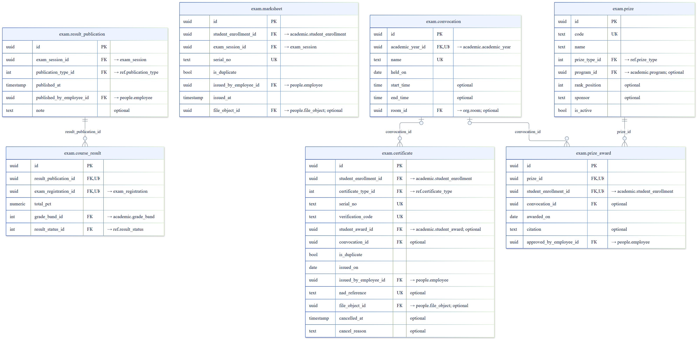

Every column of every table in this group, from the live schema (`created_at` / `updated_at` omitted). Lines are foreign keys inside the group; a note `→ table` is a foreign key to another group; amber = the group's hub. Source: [`catalog-diagrams/er-e4.mmd`](catalog-diagrams/er-e4.mmd).

| Table | What it holds | Links outside this group | Data flow — features that read (R) / write (W) its data store |
|---|---|---|---|
| [`result_publication`](#t-exam-result-publication) | A result release event — original, revised after revaluation, or supplementary | `exam_session`, `people.employee`; 1 lookup | [9.4](data-flow-features.md#f-9-4) R · [9.9](data-flow-features.md#f-9-9) R · [9.14](data-flow-features.md#f-9-14) R · [9.15](data-flow-features.md#f-9-15) R · [10.5](data-flow-features.md#f-10-5) R · [11.15](data-flow-features.md#f-11-15) W · [11.16](data-flow-features.md#f-11-16) R · [11.17](data-flow-features.md#f-11-17) R · [12.1](data-flow-features.md#f-12-1) R · [12.3](data-flow-features.md#f-12-3) R · [12.6](data-flow-features.md#f-12-6) R · [13.8](data-flow-features.md#f-13-8) R |
| [`course_result`](#t-exam-course-result) | The published result of one attempt — official total %, grade band, status | `academic.grade_band`, `exam_registration`; 1 lookup | [9.4](data-flow-features.md#f-9-4) R · [9.9](data-flow-features.md#f-9-9) R · [9.14](data-flow-features.md#f-9-14) R · [9.15](data-flow-features.md#f-9-15) R · [10.5](data-flow-features.md#f-10-5) R · [11.15](data-flow-features.md#f-11-15) W · [11.16](data-flow-features.md#f-11-16) R · [11.17](data-flow-features.md#f-11-17) R · [12.1](data-flow-features.md#f-12-1) R · [12.3](data-flow-features.md#f-12-3) R · [12.6](data-flow-features.md#f-12-6) R · [13.8](data-flow-features.md#f-13-8) R |
| [`marksheet`](#t-exam-marksheet) | The register of issued marksheets — serial number, original vs duplicate, who issued it | `academic.student_enrollment`, `exam_session`, `people.employee`, `people.file_object` | [12.3](data-flow-features.md#f-12-3) W · [12.4](data-flow-features.md#f-12-4) RW |
| [`certificate`](#t-exam-certificate) | The register of issued certificates — transcript, provisional and final award certificate, migration, character, bonafide, rank, course completion | `academic.student_award`, `academic.student_enrollment`, `people.employee`, `people.file_object`; 1 lookup | [12.3](data-flow-features.md#f-12-3) W · [12.4](data-flow-features.md#f-12-4) RW |
| [`convocation`](#t-exam-convocation) | The ceremony at which degrees are conferred — named per academic year ("12th Convocation"), dated, optionally in a room | `academic.academic_year`, `org.room` | [12.5](data-flow-features.md#f-12-5) RW · [12.6](data-flow-features.md#f-12-6) RW · [14.3](data-flow-features.md#f-14-3) R |
| [`prize`](#t-exam-prize) | A medal or prize the university awards — for a programme or university-wide, with its sponsor / endowment, optionally tied to a rank of the programme's rank list … | `academic.program`; 1 lookup | [12.5](data-flow-features.md#f-12-5) RW · [12.6](data-flow-features.md#f-12-6) RW · [14.3](data-flow-features.md#f-14-3) R |
| [`prize_award`](#t-exam-prize-award) | A prize awarded to a graduating student, optionally at a convocation, with the citation | `academic.student_enrollment`, `people.employee` | [12.5](data-flow-features.md#f-12-5) RW · [12.6](data-flow-features.md#f-12-6) RW · [14.3](data-flow-features.md#f-14-3) R |

**Views over this group** (derived, never stored): `exam.v_current_result`  
**Functions that read or write it:** `facility.hold_source_table()`
<!-- /group:e4 -->

#### `exam.result_publication`
**Why it exists:** a result release event — original, revised after revaluation, or supplementary. Results belong to the publication that released them, so "what did the student's result say on the day it was published" is always answerable.
**Connects to →** `exam.exam_session`, `ref.publication_type`, `people.employee`.
**Referenced by ←** `exam.course_result`.

#### `exam.course_result`
**Why it exists:** the published result of one attempt — official total %, grade band, status. This is the one deliberate stored calculated value in the whole database: an issued result is a legal record that must not change when marks, grace or policy change later. It is immutable (a correction is a new, revised publication), and it references the grade band rather than copying letter and grade point, with that band frozen by trigger. SGPA/CGPA are derived from these rows.
**Connects to →** `exam.result_publication`, `exam.exam_registration`, `academic.grade_band`, `ref.result_status`.
**Referenced by ←** nothing (read by `exam.v_current_result`, `exam.v_sgpa`, `exam.v_cgpa`).

#### `exam.marksheet`
**Why it exists:** the register of issued marksheets — serial number, original vs duplicate, who issued it. The marksheet's *content* is derived from published results; only the issue of the legal document is recorded. One original per student per session.
**Connects to →** `academic.student_enrollment`, `exam.exam_session`, `people.employee`, `people.file_object`.
**Referenced by ←** nothing.

#### `exam.certificate`
**Why it exists:** the register of issued certificates — transcript, provisional and final award certificate, migration, character, bonafide, rank, course completion — with serial number, a public verification code (printed / QR), the NAD / DigiLocker reference and the file. As with `marksheet`, the *content* is derived (results, award); only the issue of the legal document is recorded. The rules come from the type rather than from code: `requires_award` (a degree or provisional certificate is issued against a conferred `student_award`, which must belong to the same enrollment), `requires_closed_enrollment` (a migration certificate), `is_single_issue` (one live original per enrollment — a duplicate is a separate row that needs an original to duplicate, and a re-issue needs the earlier one cancelled first, with a reason). Only an award certificate may be tied to a convocation.
**Connects to →** `academic.student_enrollment`, `ref.certificate_type`, `academic.student_award`, `exam.convocation`, `people.employee` (issued by), `people.file_object`.
**Referenced by ←** nothing.

#### `exam.convocation`
**Why it exists:** the ceremony at which degrees are conferred — named per academic year ("12th Convocation"), dated, optionally in a room. Its own table so a certificate can say *which* convocation it was awarded at; the `certificate` trigger lets only an award certificate claim one.
**Connects to →** `academic.academic_year`, `org.room`.
**Referenced by ←** `exam.certificate`, `exam.prize_award`; facility: `facility.room_hold`.

#### `exam.prize`
**Why it exists:** a medal or prize the university awards — for a programme or university-wide, with its sponsor / endowment, optionally tied to a rank of the programme's rank list (`rank_position` 1 = the topper; the rank itself is derived in `exam.v_rank_list`, never stored).
**Connects to →** `ref.prize_type`, `academic.program`.
**Referenced by ←** `exam.prize_award`.

#### `exam.prize_award`
**Why it exists:** a prize awarded to a graduating student, optionally at a convocation, with the citation. The database checks the programme, that a rank prize goes only to the student holding that rank, and only once per batch.
**Connects to →** `exam.prize`, `academic.student_enrollment`, `exam.convocation`, `people.employee` (approver).
**Referenced by ←** nothing.

---

## 6. `research` — doctoral and research degrees (8)

A research scholar is an ordinary student with an ordinary `academic.student_enrollment` in a programme of level DOCTORAL (or any programme with a dissertation), and their coursework is that programme's curriculum — registrations, results and credits need nothing special. Only what is specific to a research degree lives here: who supervises, the advisory committee and its periodic reviews, the thesis and its examiners, and the viva. The degree itself is still conferred through `academic.award_rule` / `academic.student_award` (award type DOCTORATE); for a DOCTORAL programme the database additionally refuses the award until an accepted viva is on record. A separate schema because it is its own module with its own roles (`RESEARCH_ADMIN`; supervisors see their scholars through `FACULTY`), and because examiner reports and viva outcomes are sensitive records with their own access rules. Derived: `research.v_scholar_status` — principal supervisor, committee, reviews, coursework credits against the programme minimum, thesis and viva, on one row per doctoral enrollment.

### 6.1 Doctoral & research degrees

Supervision norms and allocation, the research advisory committee and its progress reviews, the thesis, its examiners and the viva.

<!-- group:r1 -->
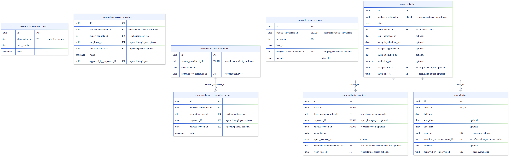

Every column of every table in this group, from the live schema (`created_at` / `updated_at` omitted). Lines are foreign keys inside the group; a note `→ table` is a foreign key to another group; amber = the group's hub. Source: [`catalog-diagrams/er-r1.mmd`](catalog-diagrams/er-r1.mmd).

| Table | What it holds | Links outside this group | Data flow — features that read (R) / write (W) its data store |
|---|---|---|---|
| [`supervision_norm`](#t-research-supervision-norm) | How many doctoral scholars a designation may supervise as principal supervisor at one time … | `people.designation` | [13.1](data-flow-features.md#f-13-1) RW · [13.2](data-flow-features.md#f-13-2) RW · [13.5](data-flow-features.md#f-13-5) R · [13.6](data-flow-features.md#f-13-6) R |
| [`supervisor_allocation`](#t-research-supervisor-allocation) | Who supervises a scholar, in which role, over time | `academic.student_enrollment`, `people.employee`, `people.person`; 1 lookup | [13.1](data-flow-features.md#f-13-1) RW · [13.2](data-flow-features.md#f-13-2) RW · [13.5](data-flow-features.md#f-13-5) R · [13.6](data-flow-features.md#f-13-6) R |
| [`advisory_committee`](#t-research-advisory-committee) | The Research Advisory / Doctoral Committee of a scholar — one per enrollment, with the date it was constituted and who approved it | `academic.student_enrollment`, `people.employee` | [13.3](data-flow-features.md#f-13-3) RW · [13.4](data-flow-features.md#f-13-4) RW · [13.8](data-flow-features.md#f-13-8) R |
| [`advisory_committee_member`](#t-research-advisory-committee-member) | The dated members of a committee — employees, or external experts referenced as persons | `people.employee`, `people.person`; 1 lookup | [13.3](data-flow-features.md#f-13-3) RW · [13.4](data-flow-features.md#f-13-4) RW · [13.8](data-flow-features.md#f-13-8) R |
| [`progress_review`](#t-research-progress-review) | The committee's periodic (six-monthly) review of a scholar | `academic.student_enrollment`; 1 lookup | [13.3](data-flow-features.md#f-13-3) RW · [13.4](data-flow-features.md#f-13-4) RW · [13.8](data-flow-features.md#f-13-8) R |
| [`thesis`](#t-research-thesis) | The thesis of a scholar, one per enrollment — title, status, the milestone dates in order … | `academic.student_enrollment`, `people.file_object`; 1 lookup | [13.5](data-flow-features.md#f-13-5) RW · [13.7](data-flow-features.md#f-13-7) R · [13.8](data-flow-features.md#f-13-8) R |
| [`thesis_examiner`](#t-research-thesis-examiner) | The examiners of a thesis — internal (an employee) or external (a person from another institution, in India or abroad) | `people.employee`, `people.file_object`, `people.person`; 2 lookups | [13.6](data-flow-features.md#f-13-6) RW · [13.7](data-flow-features.md#f-13-7) R |
| [`viva`](#t-research-viva) | The open defence, one per thesis — date, room, outcome and who approved it | `org.room`, `people.employee`; 1 lookup | [12.2](data-flow-features.md#f-12-2) R · [13.7](data-flow-features.md#f-13-7) RW · [13.8](data-flow-features.md#f-13-8) R · [14.3](data-flow-features.md#f-14-3) R |

**Views over this group** (derived, never stored): `research.v_scholar_status`  
**Functions that read or write it:** `facility.hold_source_table()`
<!-- /group:r1 -->

#### `research.supervision_norm`
**Why it exists:** how many doctoral scholars a designation may supervise as principal supervisor at one time (seeded with the UGC 2022 figures — Professor 8, Associate Professor 6, Assistant Professor 4 — marked POLICY), dated, one norm per designation at a time (EXCLUDE). A table rather than a constant so the regulation can change without a migration; enforced by the `supervisor_allocation` trigger, which counts the supervisor's current doctoral scholars against the norm for their primary designation.
**Connects to →** `people.designation`.
**Referenced by ←** nothing (read by the allocation trigger).

#### `research.supervisor_allocation`
**Why it exists:** who supervises a scholar, in which role, over time. The supervisor is an employee; a co-supervisor may be an external person from industry or another university — a `people.person` who is *not* an employee (the trigger refuses the external column for someone who is one, and refuses an external person in a role that doesn't allow it). One principal supervisor at a time, no person twice in overlapping periods (EXCLUDE), and for a doctoral scholar the supervision norm of the supervisor's current primary designation is enforced. Dated, so a change of supervisor is history rather than an overwrite — and it matters later: anyone who ever supervised the scholar is barred from examining the thesis.
**Connects to →** `academic.student_enrollment`, `ref.supervisor_role`, `people.employee` (twice — the supervisor, and who approved the allocation), `people.person` (an external co-supervisor).
**Referenced by ←** nothing (read by the thesis, examiner and viva triggers and by `v_scholar_status`).

#### `research.advisory_committee`
**Why it exists:** the Research Advisory / Doctoral Committee of a scholar — one per enrollment, with the date it was constituted and who approved it. A header row rather than bare members so that "does this scholar have a committee, since when" is one fact, and so a progress review can require one to exist by its date.
**Connects to →** `academic.student_enrollment`, `people.employee` (approver).
**Referenced by ←** `research.advisory_committee_member`.

#### `research.advisory_committee_member`
**Why it exists:** the dated members of a committee — employees, or external experts referenced as persons — with exactly one chair at a time (trigger) and no person twice in overlapping periods (EXCLUDE). Membership changes are new rows, so the committee that reviewed a scholar in a given year is always reconstructible.
**Connects to →** `research.advisory_committee`, `ref.committee_role`, `people.employee`, `people.person` (an external expert).
**Referenced by ←** nothing.

#### `research.progress_review`
**Why it exists:** the committee's periodic (six-monthly) review of a scholar — numbered per scholar, dated, with an outcome (satisfactory / unsatisfactory / termination recommended) and remarks. The trigger requires a committee constituted on or before the review date: no committee, no review. The latest outcome and the count of reviews appear in `v_scholar_status`; neither is stored.
**Connects to →** `academic.student_enrollment`, `ref.progress_review_outcome`.
**Referenced by ←** nothing.

#### `research.thesis`
**Why it exists:** the thesis of a scholar, one per enrollment — title, status, the milestone dates in order (topic approved → synopsis submitted → synopsis approved → thesis submitted, each CHECKed against the one before), the plagiarism similarity, and the synopsis and thesis files. The trigger refuses a submission date on which the scholar had no principal supervisor. Status is a lookup (`thesis_status`, with `is_terminal`), not a free-text column, and the thesis is the anchor examiners and the viva hang off.
**Connects to →** `academic.student_enrollment`, `ref.thesis_status`, `people.file_object` (twice — synopsis, thesis).
**Referenced by ←** `research.thesis_examiner`, `research.viva`.

#### `research.thesis_examiner`
**Why it exists:** the examiners of a thesis — internal (an employee) or external (a person from another institution, in India or abroad) — with the date appointed, and the report and recommendation once received (both or neither; CHECK). The trigger enforces that an external role is not held by an employee and an internal role is, and that nobody who supervised or co-supervised the scholar examines the thesis; each person at most once per thesis. The recommendation's `blocks_viva` flag is what holds the viva back.
**Connects to →** `research.thesis`, `ref.thesis_examiner_role`, `people.employee` (internal examiner), `people.person` (external examiner), `ref.examiner_recommendation`, `people.file_object` (the report).
**Referenced by ←** nothing (read by the viva trigger and `v_scholar_status`).

#### `research.viva`
**Why it exists:** the open defence, one per thesis — date, room, outcome and who approved it. The outcome reuses `examiner_recommendation`, so accept / minor revision / … mean the same on the viva as on an examiner's report. The trigger allows a viva only after the thesis was submitted, only once every appointed examiner's report is in (and at least one examiner exists), and never while any examiner recommended rejection or major revision (`blocks_viva`) — the thesis must be revised and re-examined first. An accepting outcome (`is_accept`) is what `academic.student_award` demands before conferring a doctoral degree.
**Connects to →** `research.thesis`, `org.room`, `ref.examiner_recommendation`, `people.employee` (approver).
**Referenced by ←** `facility.room_hold`.

---

## 7. `pii` — personal data, restricted (7)

Every table in this schema exists for the same underlying reason: to keep genuinely identifying/sensitive facts about a person **out of** the freely-queryable `people` schema, in tables the `intranet_analytics` role has no grant on at all, and to give each multi-valued fact (a person can have several emails, phones, addresses…) its own row instead of a fixed set of columns.

### 7.1 Restricted personal data

Profile (DOB, gender …), e-mails, phones, addresses, identity documents (app-encrypted, last 4 in clear) and photos — each one row per fact, hidden from analytics.

<!-- group:k1 -->
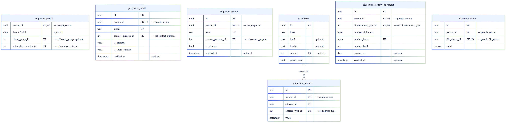

Every column of every table in this group, from the live schema (`created_at` / `updated_at` omitted). Lines are foreign keys inside the group; a note `→ table` is a foreign key to another group; amber = the group's hub. Source: [`catalog-diagrams/er-k1.mmd`](catalog-diagrams/er-k1.mmd).

| Table | What it holds | Links outside this group | Data flow — features that read (R) / write (W) its data store |
|---|---|---|---|
| [`person_profile`](#t-pii-person-profile) | Date of birth, blood group, nationality — 1:1 with `people.person`, but deliberately kept in the restricted `pii` schema rather than as columns on `person` itself | `people.person`; 2 lookups | [2.1](data-flow-features.md#f-2-1) W · [2.7](data-flow-features.md#f-2-7) R |
| [`person_email`](#t-pii-person-email) | The one place a person's email lives — globally unique (so "login by email" is unambiguous), with `is_login_enabled`/`verified_at` gating whether it can actually be used … | `people.person`; 1 lookup | [2.1](data-flow-features.md#f-2-1) W · [3.1](data-flow-features.md#f-3-1) R · [3.7](data-flow-features.md#f-3-7) W · [15.2](data-flow-features.md#f-15-2) R |
| [`person_phone`](#t-pii-person-phone) | A person's phone numbers in E.164 form (`+` and 7–15 digits) | `people.person`; 1 lookup | [2.1](data-flow-features.md#f-2-1) W · [3.1](data-flow-features.md#f-3-1) R · [3.7](data-flow-features.md#f-3-7) W · [15.2](data-flow-features.md#f-15-2) R |
| [`address`](#t-pii-address) | A postal address as a reusable value — family members can share one, rather than each having their own copy of an identical string | 1 lookup | [2.1](data-flow-features.md#f-2-1) W |
| [`person_address`](#t-pii-person-address) | A person's address of each type (permanent/current/correspondence), over time, with the database allowing only one active address of each type at once | `people.person`; 1 lookup | [2.1](data-flow-features.md#f-2-1) W |
| [`person_identity_document`](#t-pii-person-identity-document) | Government ID numbers, deliberately isolated because they need application-level encryption plus an HMAC blind index for lookup (`number_ciphertext`/`number_hmac`) | `people.person`; 1 lookup | [2.1](data-flow-features.md#f-2-1) W · [9.12](data-flow-features.md#f-9-12) R · [14.15](data-flow-features.md#f-14-15) R · [14.16](data-flow-features.md#f-14-16) R |
| [`person_photo`](#t-pii-person-photo) | A person's photo over time (one current), reusing `file_object` for the actual stored binary rather than a raw file path column | `people.file_object`, `people.person` | [2.1](data-flow-features.md#f-2-1) W · [9.12](data-flow-features.md#f-9-12) R · [14.15](data-flow-features.md#f-14-15) R · [14.16](data-flow-features.md#f-14-16) R |

**Views over this group** (derived, never stored): `iam.v_login_identifier` · `pii.v_person_age`  
**Functions that read or write it:** none — only its constraints and triggers
<!-- /group:k1 -->

#### `pii.person_profile`
**Why it exists:** date of birth, blood group, nationality — 1:1 with `people.person`, but deliberately kept in the restricted `pii` schema rather than as columns on `person` itself. This isn't a normalisation split (it's genuinely one row per person); it's an *access-control* split: this data is sensitive enough that `intranet_analytics` should never see it, while a harmless display name on `person` should stay freely queryable.
**Connects to →** `people.person`, `ref.blood_group`, `ref.country` (nationality).
**Referenced by ←** nothing directly (read by `pii.v_person_age`, the derived age/minor-status view).

#### `pii.person_email`
**Why it exists:** the one place a person's email lives — globally unique (so "login by email" is unambiguous), with `is_login_enabled`/`verified_at` gating whether it can actually be used to sign in. This is the direct fix for the old system's three independent, driftable email columns.
**Connects to →** `people.person`, `ref.contact_purpose`.
**Referenced by ←** `iam.mfa_otp_channel`, `iam.otp_challenge` (both: which email an OTP was sent to).

#### `pii.person_phone`
**Why it exists:** a person's phone numbers in E.164 form (`+` and 7–15 digits) — one table, several rows per person, never the same number twice for a person, and at most one marked primary (partial unique index). Kept in the restricted `pii` schema and registered in the privacy inventory, like e-mail.
**Connects to →** `people.person`, `ref.contact_purpose`.
**Referenced by ←** `iam.mfa_otp_channel`, `iam.otp_challenge`; helpdesk: `tms.ticket` (the requester's contact number).

#### `pii.address`
**Why it exists:** a postal address as a reusable value — family members can share one, rather than each having their own copy of an identical string.
**Connects to →** `ref.city`.
**Referenced by ←** `pii.person_address`.

#### `pii.person_address`
**Why it exists:** a person's address of each type (permanent/current/correspondence), over time, with the database allowing only one active address of each type at once.
**Connects to →** `people.person`, `pii.address`, `ref.address_type`.
**Referenced by ←** nothing.

#### `pii.person_identity_document`
**Why it exists:** government ID numbers, deliberately isolated because they need application-level encryption plus an HMAC blind index for lookup (`number_ciphertext`/`number_hmac`) — a column that can never be reversed by reading the database directly, and never a full Aadhaar number by design.
**Connects to →** `people.person`, `ref.id_document_type`.
**Referenced by ←** `facility.driver` (a driver's licence, with its `expires_on`).

#### `pii.person_photo`
**Why it exists:** a person's photo over time (one current), reusing `file_object` for the actual stored binary rather than a raw file path column.
**Connects to →** `people.file_object`, `people.person`.
**Referenced by ←** nothing.

---

## 8. `iam` — accounts, credentials, sessions (13)

### 8.1 Accounts, credentials, MFA & sessions

One login account per person; password history and reset, MFA factors (TOTP, WebAuthn, OTP channels, recovery codes), devices, sessions, lockouts and the partitioned auth log.

<!-- group:i1 -->
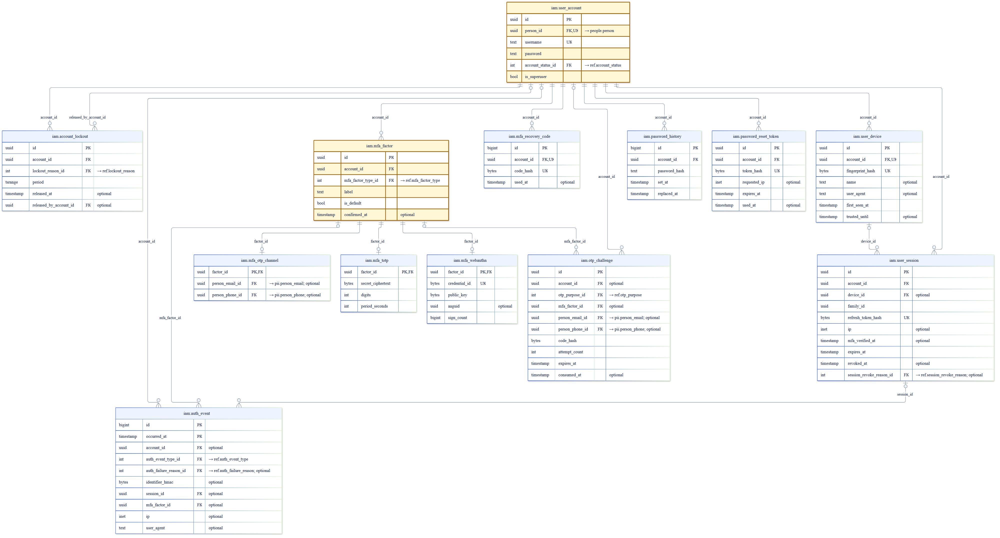

Every column of every table in this group, from the live schema (`created_at` / `updated_at` omitted). Lines are foreign keys inside the group; a note `→ table` is a foreign key to another group; amber = the group's hub. Source: [`catalog-diagrams/er-i1.mmd`](catalog-diagrams/er-i1.mmd).

| Table | What it holds | Links outside this group | Data flow — features that read (R) / write (W) its data store |
|---|---|---|---|
| [`user_account`](#t-iam-user-account) | The login itself — username (the UID), password hash, status, superuser flag — deliberately thin and deliberately separate from `person` | `people.person`; 1 lookup | [2.6](data-flow-features.md#f-2-6) W · [3.1](data-flow-features.md#f-3-1) R · [3.2](data-flow-features.md#f-3-2) R · [3.3](data-flow-features.md#f-3-3) R · [3.6](data-flow-features.md#f-3-6) W · [3.7](data-flow-features.md#f-3-7) W · [4.6](data-flow-features.md#f-4-6) R · [6.5](data-flow-features.md#f-6-5) W · [15.2](data-flow-features.md#f-15-2) R |
| [`password_history`](#t-iam-password-history) | Previous password hashes only (the current one lives on `user_account`), so a password-reuse policy can be enforced without a second copy of the *current* password … | — | [3.6](data-flow-features.md#f-3-6) RW |
| [`password_reset_token`](#t-iam-password-reset-token) | Self-service password reset — a hashed, short-lived token, never the raw token stored server-side, and never a password sent by email … | — | [3.6](data-flow-features.md#f-3-6) RW |
| [`mfa_factor`](#t-iam-mfa-factor) | The common supertype row for an enrolled second factor — account, type, label, whether it's confirmed/default | 1 lookup | [3.4](data-flow-features.md#f-3-4) R · [3.7](data-flow-features.md#f-3-7) W |
| [`mfa_totp`](#t-iam-mfa-totp) | The TOTP-specific detail (encrypted secret, digit count, period) | — | [3.4](data-flow-features.md#f-3-4) R · [3.7](data-flow-features.md#f-3-7) W |
| [`mfa_webauthn`](#t-iam-mfa-webauthn) | The passkey/security-key-specific detail (credential ID, public key, sign counter) — same reasoning as `mfa_totp` | — | [3.4](data-flow-features.md#f-3-4) R · [3.7](data-flow-features.md#f-3-7) W |
| [`mfa_otp_channel`](#t-iam-mfa-otp-channel) | For an email/SMS OTP factor, exactly *which* of the person's own contacts receives the code | `pii.person_email`, `pii.person_phone` | [3.4](data-flow-features.md#f-3-4) R · [3.7](data-flow-features.md#f-3-7) W |
| [`mfa_recovery_code`](#t-iam-mfa-recovery-code) | Single-use backup codes, hashed, for when someone loses their primary MFA device — without this, losing a phone would mean losing account access entirely | — | [3.4](data-flow-features.md#f-3-4) R · [3.7](data-flow-features.md#f-3-7) W |
| [`otp_challenge`](#t-iam-otp-challenge) | An issued one-time code, for any purpose (login MFA, step-up for a sensitive action, email/phone verification, password reset) | `pii.person_email`, `pii.person_phone`; 1 lookup | [3.4](data-flow-features.md#f-3-4) RW · [3.7](data-flow-features.md#f-3-7) RW |
| [`user_device`](#t-iam-user-device) | Devices seen for an account, so "remember this device" (skip MFA until `trusted_until`) has somewhere to live, and so a session can be tied to the device that opened it | — | [3.4](data-flow-features.md#f-3-4) R · [3.5](data-flow-features.md#f-3-5) RW · [3.6](data-flow-features.md#f-3-6) W |
| [`user_session`](#t-iam-user-session) | Refresh-token sessions with rotation — every refresh inserts a new row in the same `family_id` and revokes the old one | 1 lookup | [3.4](data-flow-features.md#f-3-4) R · [3.5](data-flow-features.md#f-3-5) RW · [3.6](data-flow-features.md#f-3-6) W |
| [`account_lockout`](#t-iam-account-lockout) | Lockout periods (too many failed logins/MFA attempts, admin action), as dated rows rather than a single "is this account locked" boolean, so lockout history and who … | 1 lookup | [3.2](data-flow-features.md#f-3-2) R · [3.8](data-flow-features.md#f-3-8) RW |
| [`auth_event`](#t-iam-auth-event) | The append-only, monthly-partitioned authentication log — every login attempt, MFA challenge, token refresh, lockout | 2 lookups | [3.1](data-flow-features.md#f-3-1) W · [3.3](data-flow-features.md#f-3-3) W · [3.4](data-flow-features.md#f-3-4) W · [3.5](data-flow-features.md#f-3-5) W · [3.8](data-flow-features.md#f-3-8) R |

**Views over this group** (derived, never stored): `authz.v_account_role_effective` · `events.v_volunteer_activity` · `iam.v_account_active_lockout` · `iam.v_account_last_login` · `iam.v_login_identifier` · `tms.v_ticket_handler_stats`  
**Functions that read or write it:** `academic.is_program_coordinator()` · `academic.request_attendance_leave()` · `authz.accessible_org_units()` · `authz.account_requires_mfa()` · `authz.has_permission()` · `events.can_manage()` · `events.is_club_officer()` · `events.issue_ticket()` · `events.may_propose_for()` · `events.redeem_coupon()` · `events.register()` · `events.submit_event_change()` · `events.submit_proposal()` · `events.ticket_check()` · `facility.raise_work_order()` · `facility.request_booking()` · `facility.request_event()` · `facility.request_trip()` · `tms.account_of_employee()` · `tms.can_login()` · `tms.is_workable()` · `tms.notice_accounts()` · `tms.person_of_account()` · `wf.is_eligible()` · `wf.manager_account()` · `wf.run_timeouts()` · `wf.submit()`
<!-- /group:i1 -->

#### `iam.user_account`
**Why it exists:** the login itself — username (the UID), password hash, status, superuser flag — deliberately thin and deliberately separate from `person`. Not every person needs one (most guardians never will), and this is exactly the row Django's `AUTH_USER_MODEL` maps to.
**Connects to →** `people.person`, `ref.account_status`.
**Referenced by ←** grouped: `authz.*` (2 tables — `authz.account_role`, `authz.account_permission`); `iam.*` (9 tables — `iam.account_lockout`, `iam.auth_event`, `iam.mfa_factor`, `iam.mfa_recovery_code`, `iam.otp_challenge`, `iam.password_history`, `iam.password_reset_token`, `iam.user_device`, `iam.user_session`); `privacy.*` (3 tables — `privacy.dpr_request_event` (who actioned it), `privacy.erasure_log` (who executed it), `privacy.pii_access_log` (who accessed someone's PII)); `wf.*` (3 tables — `wf.approval_instance` submitter, `wf.approval_action` actor, `wf.approval_comment` author / resolver); facility: `facility.asset_loan`, `facility.blackout`, `facility.booking_occurrence`, `facility.booking_restriction`, `facility.event_request`, `facility.guest_stay`, `facility.key_issue`, `facility.room_reservation_rule`, `facility.room_service_window`, `facility.trip`, `facility.trip_allocation`, `facility.trip_allocation_request`, `facility.trip_request`, `facility.work_order_event`; helpdesk: `tms.ticket` (requester, intake desk), `tms.ticket_respondent` (named by), `tms.notice_opt_out` (whose opt-out), `tms.kb_article` (written by), `tms.helpdesk_day_override` (created by), `tms.ticket_event` (actor), `tms.ticket_notification` (recipient), `tms.helpdesk_setting` (updated by); events: `events.club_application`, `events.club_member`, `events.club_proposal`, `events.club_suspension`, `events.entry_scan`, `events.event`, `events.event_certificate`, `events.event_prize_award`, `events.event_proposal`, `events.event_registration`, `events.event_team`, `events.event_volunteer`, `events.post_event_report`, `events.sponsorship_receipt`; approval engine: `wf.approval_chain_stage`, `wf.approval_consultation`, `wf.approval_delegation`, `wf.approval_notice`, `wf.approval_step_assignee`, `wf.approval_step_check`; `events.event_setting` (who last changed the settings); events: `events.club_change_request`, `events.event_coupon`, `events.event_mail`, `events.event_mail_credit_grant`, `events.event_payment`, `events.event_stall`, `events.stall_application`, `events.volunteer_application`; events: `events.event_change_request`, `events.event_expense`, `events.event_settlement`, `events.round_attendance`.

#### `iam.password_history`
**Why it exists:** previous password hashes only (the current one lives on `user_account`), so a password-reuse policy can be enforced without a second copy of the *current* password anywhere.
**Connects to →** `iam.user_account`.
**Referenced by ←** nothing.

#### `iam.password_reset_token`
**Why it exists:** self-service password reset — a hashed, short-lived token, never the raw token stored server-side, and never a password sent by email (something the old system also got right, but worth restating: this is the mechanism the old system's `Welcome@123`-default "reset" replaces).
**Connects to →** `iam.user_account`.
**Referenced by ←** nothing.

#### `iam.mfa_factor`
**Why it exists:** the common supertype row for an enrolled second factor — account, type, label, whether it's confirmed/default. Kept generic on purpose so `auth_event`/`otp_challenge` can reference "a factor" without caring which kind.
**Connects to →** `iam.user_account`, `ref.mfa_factor_type`.
**Referenced by ←** `iam.mfa_totp`, `iam.mfa_webauthn`, `iam.mfa_otp_channel` (the three subtypes), `iam.otp_challenge`, `iam.auth_event`.

#### `iam.mfa_totp`
**Why it exists:** the TOTP-specific detail (encrypted secret, digit count, period) — split from `mfa_factor` instead of adding nullable "might be a TOTP secret" columns to one shared row, the classic class-table-inheritance pattern, enforced by a trigger that checks the parent factor really is type TOTP.
**Connects to →** `iam.mfa_factor`.
**Referenced by ←** nothing.

#### `iam.mfa_webauthn`
**Why it exists:** the passkey/security-key-specific detail (credential ID, public key, sign counter) — same reasoning as `mfa_totp`.
**Connects to →** `iam.mfa_factor`.
**Referenced by ←** nothing.

#### `iam.mfa_otp_channel`
**Why it exists:** for an email/SMS OTP factor, exactly *which* of the person's own contacts receives the code — a trigger checks that contact genuinely belongs to the account's person, so someone can't register an OTP factor pointed at a contact that isn't theirs.
**Connects to →** `iam.mfa_factor`, `pii.person_email`, `pii.person_phone`.
**Referenced by ←** nothing.

#### `iam.mfa_recovery_code`
**Why it exists:** single-use backup codes, hashed, for when someone loses their primary MFA device — without this, losing a phone would mean losing account access entirely.
**Connects to →** `iam.user_account`.
**Referenced by ←** nothing.

#### `iam.otp_challenge`
**Why it exists:** an issued one-time code, for any purpose (login MFA, step-up for a sensitive action, email/phone verification, password reset) — one table for all of them, distinguished by `otp_purpose_id`, rather than a separate table per use case.
**Connects to →** `iam.mfa_factor`, `iam.user_account`, `pii.person_email`, `pii.person_phone`, `ref.otp_purpose`.
**Referenced by ←** nothing.

#### `iam.user_device`
**Why it exists:** devices seen for an account, so "remember this device" (skip MFA until `trusted_until`) has somewhere to live, and so a session can be tied to the device that opened it.
**Connects to →** `iam.user_account`.
**Referenced by ←** `iam.user_session`.

#### `iam.user_session`
**Why it exists:** refresh-token sessions with rotation — every refresh inserts a new row in the same `family_id` and revokes the old one; presenting an already-revoked token from that family revokes the whole family (theft detection). This is the entire mechanism the old system had none of (no refresh flow, no revocation at all).
**Connects to →** `iam.user_account`, `iam.user_device`, `ref.session_revoke_reason`.
**Referenced by ←** `iam.auth_event`.

#### `iam.account_lockout`
**Why it exists:** lockout periods (too many failed logins/MFA attempts, admin action), as dated rows rather than a single "is this account locked" boolean, so lockout history and who released it are preserved.
**Connects to →** `iam.user_account` (twice — the locked account and who released it), `ref.lockout_reason`.
**Referenced by ←** nothing.

#### `iam.auth_event`
**Why it exists:** the append-only, monthly-partitioned authentication log — every login attempt, MFA challenge, token refresh, lockout. Attempted identifiers are stored only as an HMAC, never the raw email/UID someone typed, so a burst of failed logins against unknown usernames doesn't itself become a store of personal data.
**Connects to →** `iam.mfa_factor`, `iam.user_account`, `iam.user_session`, `ref.auth_event_type`, `ref.auth_failure_reason`.
**Referenced by ←** nothing (it's a log — nothing points back to it).

---

## 9. `authz` — roles and permissions (13)

### 9.1 Modules, permissions, roles & grants

Permission = module resource × action. Roles bundle permissions and are granted to accounts directly (optionally scoped to an org unit) or derived automatically from designation, position or principal kind.

<!-- group:z1 -->
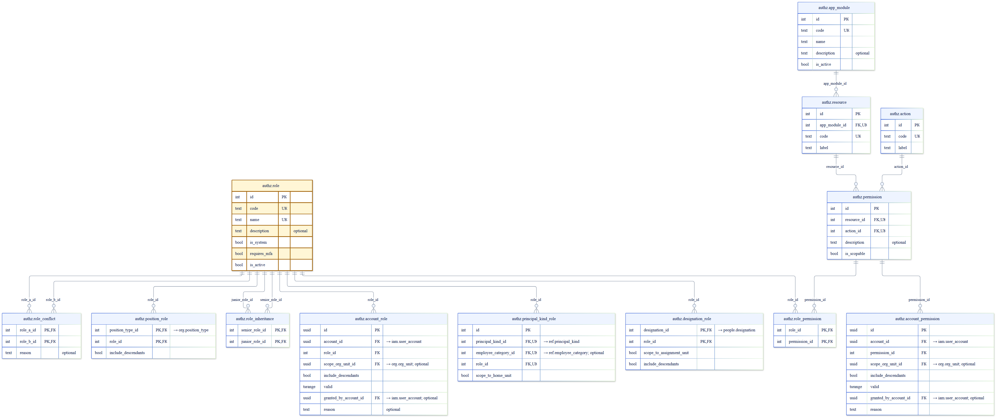

Every column of every table in this group, from the live schema (`created_at` / `updated_at` omitted). Lines are foreign keys inside the group; a note `→ table` is a foreign key to another group; amber = the group's hub. Source: [`catalog-diagrams/er-z1.mmd`](catalog-diagrams/er-z1.mmd).

| Table | What it holds | Links outside this group | Data flow — features that read (R) / write (W) its data store |
|---|---|---|---|
| [`app_module`](#t-authz-app-module) | The registry a module signs up in — one row per module, the top of the permission hierarchy | — | [4.1](data-flow-features.md#f-4-1) RW · [4.2](data-flow-features.md#f-4-2) R · [4.4](data-flow-features.md#f-4-4) R |
| [`resource`](#t-authz-resource) | The things a module protects (a ticket, a category, an employee record…) | — | [4.1](data-flow-features.md#f-4-1) RW · [4.2](data-flow-features.md#f-4-2) R · [4.4](data-flow-features.md#f-4-4) R |
| [`action`](#t-authz-action) | The fixed vocabulary of verbs (access, view, create, update, delete, approve, review, export, assign) shared by every module, so "approve" means the same thing … | — | [4.1](data-flow-features.md#f-4-1) RW · [4.2](data-flow-features.md#f-4-2) R · [4.4](data-flow-features.md#f-4-4) R |
| [`permission`](#t-authz-permission) | One resource crossed with one action — `core_admin.employee.view`, `tms.student_ticket.update` | — | [4.1](data-flow-features.md#f-4-1) RW · [4.2](data-flow-features.md#f-4-2) R · [4.4](data-flow-features.md#f-4-4) R |
| [`role`](#t-authz-role) | A named, reusable bundle of permissions (`ORG_UNIT_HEAD`, `HR_ADMIN`, `FACULTY`, `TIMETABLE_ADMIN`, `CURRICULUM_ADMIN`, `EXAM_CONTROLLER`, `EXAM_EVALUATOR`…), with … | — | [4.2](data-flow-features.md#f-4-2) RW · [4.4](data-flow-features.md#f-4-4) R · [4.5](data-flow-features.md#f-4-5) R |
| [`role_permission`](#t-authz-role-permission) | The many-to-many between roles and permissions — a plain junction table, the normalised alternative to the old system's `Role.permissions` JSON blob | — | [4.2](data-flow-features.md#f-4-2) RW · [4.4](data-flow-features.md#f-4-4) R · [4.5](data-flow-features.md#f-4-5) R |
| [`role_inheritance`](#t-authz-role-inheritance) | Lets a senior role automatically carry every permission of a junior one (e.g. every baseline role inherits `SELF_SERVICE`) without copying permission rows | — | [4.2](data-flow-features.md#f-4-2) RW · [4.4](data-flow-features.md#f-4-4) R · [4.5](data-flow-features.md#f-4-5) R |
| [`role_conflict`](#t-authz-role-conflict) | Static separation of duties — pairs of roles nobody may hold at once … | — | [4.2](data-flow-features.md#f-4-2) RW · [4.4](data-flow-features.md#f-4-4) R · [4.5](data-flow-features.md#f-4-5) R |
| [`account_role`](#t-authz-account-role) | An explicit, time-bound role grant to a specific account, optionally scoped to an org-unit subtree | `iam.user_account`, `org.org_unit` | [4.4](data-flow-features.md#f-4-4) RW · [4.5](data-flow-features.md#f-4-5) R |
| [`account_permission`](#t-authz-account-permission) | An exceptional, single-permission grant for the rare case a whole role is overkill | `iam.user_account`, `org.org_unit` | [4.4](data-flow-features.md#f-4-4) RW · [4.5](data-flow-features.md#f-4-5) R |
| [`designation_role`](#t-authz-designation-role) | The rule "holding this designation in an active assignment confers this role" — e.g. HR Manager → HR admin rights, applied at the assignment's unit or globally | `people.designation` | [4.3](data-flow-features.md#f-4-3) RW · [4.5](data-flow-features.md#f-4-5) R |
| [`position_role`](#t-authz-position-role) | The rule "holding this position (HEAD, DEAN…) confers this role on the unit you're appointed to" | `org.position_type` | [4.3](data-flow-features.md#f-4-3) RW · [4.5](data-flow-features.md#f-4-5) R |
| [`principal_kind_role`](#t-authz-principal-kind-role) | The baseline role every current employee/student/guardian gets automatically, optionally narrowed to an employee category … | 2 lookups | [4.3](data-flow-features.md#f-4-3) RW · [4.5](data-flow-features.md#f-4-5) R |

**Views over this group** (derived, never stored): `authz.v_account_permission_effective` · `authz.v_account_role_effective` · `authz.v_permission_code` · `authz.v_role_closure`  
**Functions that read or write it:** `authz.account_requires_mfa()`
<!-- /group:z1 -->

#### `authz.app_module`
**Why it exists:** the registry a module signs up in — one row per module, the top of the permission hierarchy. Seeded today: `core_admin`, `privacy`, `audit`, `self_service`, `academics` and `exam`; future modules (TMS, IPR, Events…) add their own row.
**Connects to →** nothing.
**Referenced by ←** `authz.resource`, `wf.approval_document_type`.

#### `authz.resource`
**Why it exists:** the things a module protects (a ticket, a category, an employee record…) — `resource × action` is what makes a permission, so this table exists to be crossed with `authz.action`, not to stand alone.
**Connects to →** `authz.app_module`.
**Referenced by ←** `authz.permission`.

#### `authz.action`
**Why it exists:** the fixed vocabulary of verbs (access, view, create, update, delete, approve, review, export, assign) shared by every module, so "approve" means the same thing everywhere instead of each module inventing its own verb spelling.
**Connects to →** nothing.
**Referenced by ←** `authz.permission`.

#### `authz.permission`
**Why it exists:** one resource crossed with one action — `core_admin.employee.view`, `tms.student_ticket.update`. This is the atomic unit everything else in this schema grants, checks, or bundles; its code is *derived* (`authz.v_permission_code`), never typed twice.
**Connects to →** `authz.action`, `authz.resource`.
**Referenced by ←** `authz.role_permission`, `authz.account_permission`, `wf.approval_document_type` (author permission), `wf.approval_chain_stage`, `wf.approval_step` (stage permission); facility: `facility.room_reservation_rule`; `ref.tms_ticket_domain`.

#### `authz.role`
**Why it exists:** a named, reusable bundle of permissions (`ORG_UNIT_HEAD`, `HR_ADMIN`, `FACULTY`, `TIMETABLE_ADMIN`, `CURRICULUM_ADMIN`, `EXAM_CONTROLLER`, `EXAM_EVALUATOR`…), with `requires_mfa` able to force stronger login security for anyone holding it. Roles are data — this table is the direct replacement for the old system's hard-coded six-value `UserRoleEnum`.
**Connects to →** nothing.
**Referenced by ←** grouped: `authz.role_permission` (what it contains), `authz.account_role` (explicit grants), `authz.designation_role`/`authz.position_role`/`authz.principal_kind_role` (automatic derivation rules), `authz.role_inheritance` (twice — as senior and junior), `authz.role_conflict` (twice — either side of a forbidden pairing).

#### `authz.role_permission`
**Why it exists:** the many-to-many between roles and permissions — a plain junction table, the normalised alternative to the old system's `Role.permissions` JSON blob.
**Connects to →** `authz.permission`, `authz.role`.
**Referenced by ←** nothing.

#### `authz.role_inheritance`
**Why it exists:** lets a senior role automatically carry every permission of a junior one (e.g. every baseline role inherits `SELF_SERVICE`) without copying permission rows — a trigger blocks a cycle the same way the org tree's trigger does.
**Connects to →** `authz.role` (twice — senior, junior).
**Referenced by ←** nothing.

#### `authz.role_conflict`
**Why it exists:** static separation of duties — pairs of roles nobody may hold at once (e.g. Auditor and Core Administrator; Controller of Examinations — who can decode answer scripts — and Evaluator), checked by a trigger the moment a grant would create the conflict, not caught later by a review.
**Connects to →** `authz.role` (twice).
**Referenced by ←** nothing.

#### `authz.account_role`
**Why it exists:** an explicit, time-bound role grant to a specific account, optionally scoped to an org-unit subtree — "Reviewer for Schools A and B" is two rows here, not a JSON array of school IDs (which is literally what the old system's `CentralDepartmentPermission` had — 21 separate JSON UUID-array columns for exactly this purpose).
**Connects to →** `authz.role`, `iam.user_account` (twice — who holds it, who granted it), `org.org_unit` (the scope).
**Referenced by ←** nothing.

#### `authz.account_permission`
**Why it exists:** an exceptional, single-permission grant for the rare case a whole role is overkill — deliberately requires a stated `reason`, since it's meant to be the uncommon path, not the default way permissions are handed out.
**Connects to →** `authz.permission`, `iam.user_account` (twice), `org.org_unit`.
**Referenced by ←** nothing.

#### `authz.designation_role`
**Why it exists:** the rule "holding this designation in an active assignment confers this role" — e.g. HR Manager → HR admin rights, applied at the assignment's unit or globally. This is a *template*, never copied onto a user; if someone's designation changes, their access changes automatically, which is exactly what the old system's `applyRoleToUser` (a one-time copy that then drifted) could never guarantee.
**Connects to →** `authz.role`, `people.designation`.
**Referenced by ←** nothing.

#### `authz.position_role`
**Why it exists:** the rule "holding this position (HEAD, DEAN…) confers this role on the unit you're appointed to" — the mechanism behind the Priya-Sharma-as-Head-of-IT proof in `docs/module-integration.md`.
**Connects to →** `authz.role`, `org.position_type`.
**Referenced by ←** nothing.

#### `authz.principal_kind_role`
**Why it exists:** the baseline role every current employee/student/guardian gets automatically, optionally narrowed to an employee category (e.g. every current *teaching* employee is automatically `FACULTY`) — this is what replaces the old system's hard-coded `getDefaultPermissions(role)` function with data a non-developer can edit.
**Connects to →** `authz.role`, `ref.employee_category`, `ref.principal_kind`.
**Referenced by ←** nothing.

---

## 10. `wf` — the approval engine (14)

**One configurable engine for every approval of the intranet.** The old UMS built approval again in each module (`TmsRoleHandler`, `EventPermissionConfig`, `NotingAuthority`, club-proposal status columns, SOE role strings …); here an approval is **configuration rows** on this schema, and no module owns approval tables, status columns or approver lists. For each kind of document you configure the levels and, per level, who approves (a permission at an org level, a position holder, the requester's manager, named people, a committee quorum), how many must approve, when the level applies (amount band, flag), what happens when the requester is the approver, what the approver must supply (note, file, signature, checklist), whether it may be forwarded or sent back to an earlier level, and the deadline with its timeout action (remind, escalate, auto-approve, auto-reject). A school, a block or a club changes its path with a chain scoped to itself. A higher level may approve out of turn and pass the pending lower levels over — a Dean's approval makes the HOD's unnecessary — with a minimum number of levels approved by people (2 by default), levels that can be marked mandatory, and chains that can be set to strict order. Standing delegations, consultations, reviewer comments, an inbox (`wf.pending_for()`), a "waiting below me" list (`wf.overridable_for()`), visibility (`wf.can_view()`) and a notice outbox come with the engine.

**Onboarding a new approval — the whole recipe:** (1) one `approval_document_type` row; (2) one `approval_chain` and its `approval_chain_stage` rows (overrides = more chains, scoped by org unit); (3) an `instance_id` column on the document (or a link table for many rounds) with the standard validate trigger; (4) call `wf.submit()` and `wf.act()`; (5) optionally an AFTER INSERT trigger on `approval_action` for the module's side effects. Status is derived (`wf.v_instance_state`: IN_PROGRESS / APPROVED / SIGNED / RETURNED / REJECTED / WITHDRAWN, with the current level, its due time and overdue flag). In use by: curriculum / SOE, internal-marks revision, attendance leave, room bookings, event packages, guest stays, trips (four facility paths), club proposals, event proposals, club changes, event changes and event settlements.

### 10.1 The approval engine

Every approval of the intranet is configuration here: document types and their chains of levels (who approves — a permission at an org level, a position holder, the requester's manager, named people, a committee quorum; how many; when the level applies; deadline and timeout action; checklist), one instance per round with a snapshot of its steps and assignees, append-only actions, standing delegations, consultations, reviewer comments and the notice outbox.

<!-- group:w1 -->
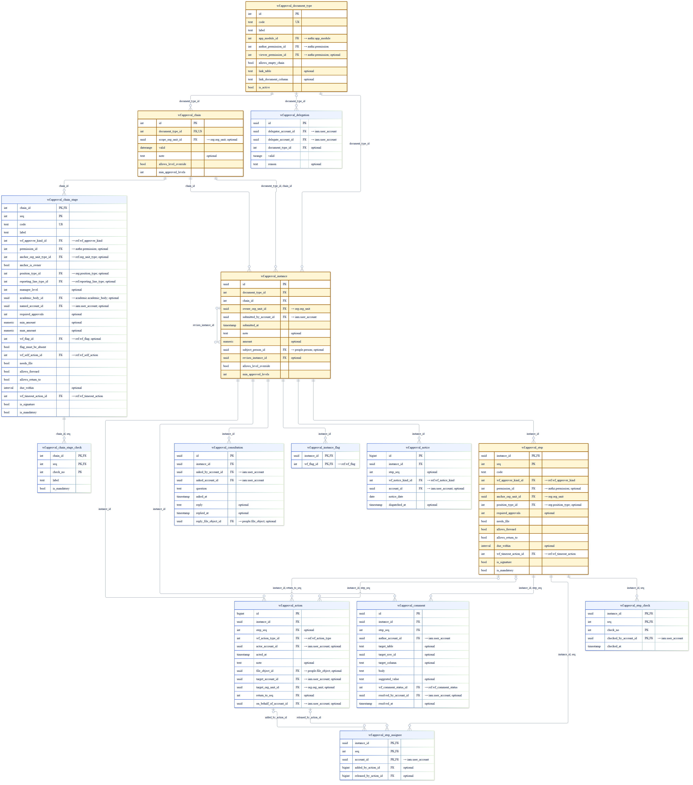

Every column of every table in this group, from the live schema (`created_at` / `updated_at` omitted). Lines are foreign keys inside the group; a note `→ table` is a foreign key to another group; amber = the group's hub. Source: [`catalog-diagrams/er-w1.mmd`](catalog-diagrams/er-w1.mmd).

| Table | What it holds | Links outside this group | Data flow — features that read (R) / write (W) its data store |
|---|---|---|---|
| [`approval_document_type`](#t-wf-approval-document-type) | A kind of document that is approved — one row per approval the intranet has … | `authz.app_module`, `authz.permission` | [5.1](data-flow-features.md#f-5-1) RW · [5.2](data-flow-features.md#f-5-2) R |
| [`approval_chain`](#t-wf-approval-chain) | The approval chain of a document type — the default, or an override for an org subtree (a school adding its Dean, medical programmes adding a stage, one block's bookings) | `org.org_unit` | [5.1](data-flow-features.md#f-5-1) RW · [5.2](data-flow-features.md#f-5-2) R |
| [`approval_chain_stage`](#t-wf-approval-chain-stage) | One level of a chain, entirely configuration | `academic.academic_body`, `authz.permission`, `iam.user_account`, `org.position_type`; 6 lookups | [5.1](data-flow-features.md#f-5-1) RW · [5.2](data-flow-features.md#f-5-2) R |
| [`approval_chain_stage_check`](#t-wf-approval-chain-stage-check) | The checklist of a level — the points an approver must confirm before approving ("budget head verified", "venue free"), each mandatory or optional | — | [5.1](data-flow-features.md#f-5-1) RW · [5.2](data-flow-features.md#f-5-2) R |
| [`approval_instance`](#t-wf-approval-instance) | One approval round of one document — owning unit, submitter, time, and what the level conditions are evaluated on | `iam.user_account`, `org.org_unit`, `people.person` | [5.2](data-flow-features.md#f-5-2) W · [5.3](data-flow-features.md#f-5-3) R · [5.5](data-flow-features.md#f-5-5) RW · [5.6](data-flow-features.md#f-5-6) R · [5.7](data-flow-features.md#f-5-7) R |
| [`approval_instance_flag`](#t-wf-approval-instance-flag) | The flags a round was submitted with (PAID_EVENT, EXTERNAL_GUESTS, CAPITAL …), one row each instead of an array, so that a level can be conditional on one and a report … | 1 lookup | [5.2](data-flow-features.md#f-5-2) W · [5.3](data-flow-features.md#f-5-3) R · [5.5](data-flow-features.md#f-5-5) RW · [5.6](data-flow-features.md#f-5-6) R · [5.7](data-flow-features.md#f-5-7) R |
| [`approval_step`](#t-wf-approval-step) | The levels of a round as they were at submission — only those whose conditions held | `authz.permission`, `org.org_unit`, `org.position_type`; 2 lookups | [5.2](data-flow-features.md#f-5-2) W · [5.3](data-flow-features.md#f-5-3) R · [5.5](data-flow-features.md#f-5-5) RW · [5.6](data-flow-features.md#f-5-6) R · [5.7](data-flow-features.md#f-5-7) R |
| [`approval_step_assignee`](#t-wf-approval-step-assignee) | The people a step is waiting for when it is not simply "whoever holds the permission" | `iam.user_account` | [5.2](data-flow-features.md#f-5-2) W · [5.3](data-flow-features.md#f-5-3) R · [5.5](data-flow-features.md#f-5-5) RW · [5.6](data-flow-features.md#f-5-6) R · [5.7](data-flow-features.md#f-5-7) R |
| [`approval_step_check`](#t-wf-approval-step-check) | A checklist item ticked by an approver on a step of a round; approving is refused while a mandatory item of the level is unticked | `iam.user_account` | [5.2](data-flow-features.md#f-5-2) W · [5.3](data-flow-features.md#f-5-3) R · [5.5](data-flow-features.md#f-5-5) RW · [5.6](data-flow-features.md#f-5-6) R · [5.7](data-flow-features.md#f-5-7) R |
| [`approval_action`](#t-wf-approval-action) | The append-only log of everything done to a round: APPROVE, SIGN, RETURN (to the submitter), RETURN_TO (an earlier level), REJECT (final), WITHDRAW, FORWARD / DELEGATE … | `iam.user_account`, `org.org_unit`, `people.file_object`; 1 lookup | [5.5](data-flow-features.md#f-5-5) W · [5.6](data-flow-features.md#f-5-6) R · [5.7](data-flow-features.md#f-5-7) W |
| [`approval_delegation`](#t-wf-approval-delegation) | A standing delegation (out of office): for a bounded period the delegate may act wherever the delegator could, for one document type or all | `iam.user_account` | [5.1](data-flow-features.md#f-5-1) RW · [5.5](data-flow-features.md#f-5-5) R |
| [`approval_consultation`](#t-wf-approval-consultation) | A question put to someone outside the chain by the submitter or a current approver, and that person's reply — the "marked for comments" of the old noting module | `iam.user_account`, `people.file_object` | [5.4](data-flow-features.md#f-5-4) RW |
| [`approval_comment`](#t-wf-approval-comment) | A reviewer's remark on a round — general, or on one table / row / column with a suggested value (the SOE's row-level suggestions) | `iam.user_account`; 1 lookup | [5.4](data-flow-features.md#f-5-4) RW |
| [`approval_notice`](#t-wf-approval-notice) | The outbox of approval notices for the application to deliver: a level is waiting for you, reminder, escalated, forwarded to you, returned, rejected, approved | `iam.user_account`; 1 lookup | [5.2](data-flow-features.md#f-5-2) W · [5.5](data-flow-features.md#f-5-5) W · [5.7](data-flow-features.md#f-5-7) W |

**Views over this group** (derived, never stored): `academic.v_curriculum_status` · `wf.v_effective_action` · `wf.v_instance_state` · `wf.v_step_state`  
**Functions that read or write it:** `facility.cancel_booking_group()` · `facility.run_trip_escalations()` · `wf.act()` · `wf.can_act()` · `wf.can_view()` · `wf.document_of()` · `wf.is_eligible()` · `wf.notify_step()` · `wf.overridable_for()` · `wf.override_refusal()` · `wf.override_step()` · `wf.run_timeouts()` · `wf.step_anchor()` · `wf.submit()`
<!-- /group:w1 -->

#### `wf.approval_document_type`
**Why it exists:** a kind of document that is approved — one row per approval the intranet has (CURRICULUM, INTERNAL_MARKS_REVISION, ATTENDANCE_LEAVE, the six facility types, CLUB_PROPOSAL, EVENT_PROPOSAL, and every later one: noting, IPR filing, leave, purchase …). It names the module, the permission needed to submit at the owning unit, the permission that lets someone outside the round read it (`viewer_permission_id`), whether a round with no applicable level is approved on submission (`allows_empty_chain` — auto-approval by configuration) and where the document lives (`link_table`, `link_document_column`), so the inbox can open it (`wf.document_of()`). Onboarding a new approval starts with one row here.
**Connects to →** `authz.app_module`, `authz.permission` (author permission, viewer permission).
**Referenced by ←** `wf.approval_chain`, `wf.approval_delegation`, `wf.approval_instance`.

#### `wf.approval_chain`
**Why it exists:** the approval chain of a document type — the default, or an override for an org subtree (a school adding its Dean, medical programmes adding a stage, one block's bookings) — valid for a period; one per type × scope at a time (EXCLUDE). At submission the engine takes the chain of the nearest scope at or above the owning unit. Changing who approves what is a new chain row, never code. The chain also says how strictly its levels are taken: by default a higher level may approve out of turn and so pass the pending lower levels over (`allows_level_override`), but never leaving fewer than `min_approved_levels` (2) levels approved by people. `(id, document_type_id)` is a key so that a round can reference the chain and its document type together.
**Connects to →** `wf.approval_document_type`, `org.org_unit` (scope).
**Referenced by ←** `wf.approval_chain_stage`, `wf.approval_instance`.

#### `wf.approval_chain_stage`
**Why it exists:** one level of a chain, entirely configuration. **Who** decides (`wf_approver_kind`): holders of a permission at an anchor (a unit type above the owner, the owner itself, or the root), the holder of a position at the anchor, the manager of the person concerned N levels up the reporting line, named people (fixed here, or chosen by the submitter), or the members of a committee (`academic.academic_body`). **How many** (`required_approvals`: one, N, or NULL = all assignees / the quorum). **When the level applies** (an amount band on the round's amount; a flag present or absent). **If the requester is the approver** (`wf_self_action`: BLOCK or SKIP). **What the approver must supply** (file, signature — the signature level is last —, checklist). **Movement** (may forward; may send back to an earlier level). **Deadline** (`due_within` and the `wf_timeout_action`). A trigger fills the defaults and refuses combinations that make no sense (a position without an anchor, a quorum above the committee, an empty amount band). Replaces the SOE's JSON list of role names and every module-specific approver table of the old UMS. **Order:** `is_mandatory` marks a level that always decides itself — a higher level approving out of turn cannot pass it over.
**Connects to →** `wf.approval_chain`, `academic.academic_body`, `authz.permission`, `iam.user_account` (named), `org.position_type`, `ref.org_unit_type` (anchor org unit type), `ref.reporting_line_type`, `ref.wf_approver_kind`, `ref.wf_flag`, `ref.wf_self_action`, `ref.wf_timeout_action`.
**Referenced by ←** `wf.approval_chain_stage_check`.

#### `wf.approval_chain_stage_check`
**Why it exists:** the checklist of a level — the points an approver must confirm before approving ("budget head verified", "venue free"), each mandatory or optional. Configuration, copied to nothing: the ticks are `wf.approval_step_check`.
**Connects to →** `wf.approval_chain_stage` (seq).
**Referenced by ←** nothing (the ticks reference it).

#### `wf.approval_instance`
**Why it exists:** one approval round of one document — owning unit, submitter, time, and what the level conditions are evaluated on: the amount, the person concerned (whose manager approves a MANAGER level) and, in `approval_instance_flag`, the flags. A return, rejection or withdrawal closes it; resubmission opens a new round that may point at the one it revises, so the history is every round. Created only by `wf.submit()`; append-only. It also keeps the chain's override settings as they were at submission, so switching a chain to strict order does not change a round in flight. Its document type is its chain's: the two are tied by one composite foreign key, so they cannot disagree.
**Connects to →** `wf.approval_chain`, `wf.approval_document_type`, `wf.approval_instance` (revises instance), `iam.user_account` (submitted by), `org.org_unit` (owner), `people.person` (subject).
**Referenced by ←** `wf.approval_action`, `wf.approval_comment`, `wf.approval_consultation`, `wf.approval_instance` (itself), `wf.approval_instance_flag`, `wf.approval_notice`, `wf.approval_step`, `academic.attendance_leave`, `academic.curriculum_approval`, `events.club_proposal`, `events.event_proposal`, `exam.internal_mark_revision`, `facility.booking_request`, `facility.event_request`, `facility.guest_stay`, `facility.trip_request`; events: `events.club_change_request`; events: `events.event_change_request`, `events.event_settlement`.

#### `wf.approval_instance_flag`
**Why it exists:** the flags a round was submitted with (PAID_EVENT, EXTERNAL_GUESTS, CAPITAL …), one row each instead of an array, so that a level can be conditional on one and a report can filter on one. Never changed after submission.
**Connects to →** `wf.approval_instance`, `ref.wf_flag`.
**Referenced by ←** nothing.

#### `wf.approval_step`
**Why it exists:** the levels of a round as they were at submission — only those whose conditions held — with the anchor unit resolved (the actual department, school, university) and the level's whole configuration copied (kind, required approvals, file / signature, forwarding, deadline and timeout action), so a later chain change never alters a round in flight. The due time restarts when a level is escalated. A step not decided itself while a higher one is, is *passed over* — derived (`wf.v_step_state.superseded`), never stored.
**Connects to →** `wf.approval_instance`, `authz.permission`, `org.org_unit` (anchor), `org.position_type`, `ref.wf_approver_kind`, `ref.wf_timeout_action`.
**Referenced by ←** `wf.approval_action`, `wf.approval_comment`, `wf.approval_step_assignee`, `wf.approval_step_check`.

#### `wf.approval_step_assignee`
**Why it exists:** the people a step is waiting for when it is not simply "whoever holds the permission": the manager, the named approvers and the committee members resolved at submission, and those added later by FORWARD, DELEGATE or ESCALATE; released when the work is handed on. `wf.pending_for()` and the eligibility check read it.
**Connects to →** `wf.approval_action` (added by action, released by action), `wf.approval_step` (seq), `iam.user_account`.
**Referenced by ←** nothing.

#### `wf.approval_step_check`
**Why it exists:** a checklist item ticked by an approver on a step of a round; approving is refused while a mandatory item of the level is unticked.
**Connects to →** `wf.approval_step` (seq), `iam.user_account` (checked by).
**Referenced by ←** nothing.

#### `wf.approval_action`
**Why it exists:** the append-only log of everything done to a round: APPROVE, SIGN, RETURN (to the submitter), RETURN_TO (an earlier level), REJECT (final), WITHDRAW, FORWARD / DELEGATE (to a named person), and the system actions ESCALATE, AUTO_APPROVE, AUTO_REJECT taken by `wf.run_timeouts()` with no actor under `app.system_job`. The database checks: only the current step; the actor is eligible for it (permission or position at the anchor, an assignee, or a standing delegate — then `on_behalf_of_account_id` records for whom); never the submitter; one person completes at most one step of a round; notes, the file and the checklist where the level asks for them; forwarding and return-to only where the level allows. Status is derived from this log (`wf.v_instance_state`), and modules hang their side effects on it with an AFTER INSERT trigger. An APPROVE may also be recorded on a higher pending level than the current one — an approval out of turn — where the chain allows it and the minimum of approved levels is kept (`wf.override_refusal()` says why not).
**Connects to →** `wf.approval_instance`, `wf.approval_step` (return to seq, step seq), `iam.user_account` (actor, on behalf of, target), `org.org_unit` (target), `people.file_object`, `ref.wf_action_type`.
**Referenced by ←** `wf.approval_step_assignee`.

#### `wf.approval_delegation`
**Why it exists:** a standing delegation (out of office): for a bounded period the delegate may act wherever the delegator could, for one document type or all; one per delegator × type at a time (EXCLUDE), never to oneself. The action then records both the actor and the person they acted for.
**Connects to →** `wf.approval_document_type`, `iam.user_account` (delegate, delegator).
**Referenced by ←** nothing.

#### `wf.approval_consultation`
**Why it exists:** a question put to someone outside the chain by the submitter or a current approver, and that person's reply — the "marked for comments" of the old noting module. It never blocks the round; only the person asked can answer, once. Hidden from analytics.
**Connects to →** `wf.approval_instance`, `iam.user_account` (asked, asked by), `people.file_object` (reply file object).
**Referenced by ←** nothing.

#### `wf.approval_comment`
**Why it exists:** a reviewer's remark on a round — general, or on one table / row / column with a suggested value (the SOE's row-level suggestions) — written by the current stage's reviewer and accepted or rejected by the submitter; never edited. Hidden from analytics.
**Connects to →** `wf.approval_instance`, `wf.approval_step` (step seq), `iam.user_account` (author, resolved by), `ref.wf_comment_status`.
**Referenced by ←** nothing.

#### `wf.approval_notice`
**Why it exists:** the outbox of approval notices for the application to deliver: a level is waiting for you, reminder, escalated, forwarded to you, returned, rejected, approved. Written by the engine's triggers and the timeout job, one of a kind per step, account and day, so a retry never notifies twice; the address is looked up when sending. Not audited (it is a queue).
**Connects to →** `wf.approval_instance`, `iam.user_account`, `ref.wf_notice_kind`.
**Referenced by ←** nothing.

---

## 11. `privacy` — DPDP Act 2023 controls (17)

### 11.1 Purposes, inventory, notices & consent

Why personal data is processed (purposes × data categories), where it lives (data elements), the notices shown, processors used, consent given (including verified parental consent) and nominees.

<!-- group:v1 -->
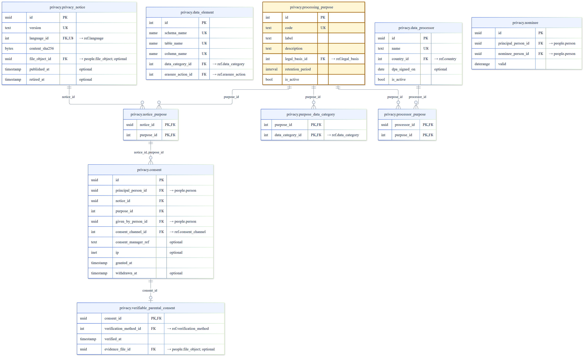

Every column of every table in this group, from the live schema (`created_at` / `updated_at` omitted). Lines are foreign keys inside the group; a note `→ table` is a foreign key to another group; amber = the group's hub. Source: [`catalog-diagrams/er-v1.mmd`](catalog-diagrams/er-v1.mmd).

| Table | What it holds | Links outside this group | Data flow — features that read (R) / write (W) its data store |
|---|---|---|---|
| [`processing_purpose`](#t-privacy-processing-purpose) | The "why" behind every piece of personal data collected | 1 lookup | [6.1](data-flow-features.md#f-6-1) RW · [6.2](data-flow-features.md#f-6-2) R · [6.5](data-flow-features.md#f-6-5) R · [7.2](data-flow-features.md#f-7-2) R |
| [`purpose_data_category`](#t-privacy-purpose-data-category) | Which categories of personal data a purpose actually needs — the concrete implementation of data-minimisation ("this purpose needs contact details, not health data") | 1 lookup | [6.1](data-flow-features.md#f-6-1) RW · [6.2](data-flow-features.md#f-6-2) R · [6.5](data-flow-features.md#f-6-5) R · [7.2](data-flow-features.md#f-7-2) R |
| [`data_element`](#t-privacy-data-element) | The personal-data inventory — every column across the whole database that holds personal data, tagged with its category and what erasing it actually means | 2 lookups | [6.1](data-flow-features.md#f-6-1) RW · [6.2](data-flow-features.md#f-6-2) R · [6.5](data-flow-features.md#f-6-5) R · [7.2](data-flow-features.md#f-7-2) R |
| [`privacy_notice`](#t-privacy-privacy-notice) | A published notice, per version and language — content is fixed by its SHA-256 hash, so a notice can't quietly change after someone consented to it | `people.file_object`; 1 lookup | [6.2](data-flow-features.md#f-6-2) RW · [6.3](data-flow-features.md#f-6-3) R |
| [`notice_purpose`](#t-privacy-notice-purpose) | Which purposes a given notice actually describes — and, critically, a composite foreign key means `privacy.consent` can only reference a purpose that's genuinely listed … | — | [6.2](data-flow-features.md#f-6-2) RW · [6.3](data-flow-features.md#f-6-3) R |
| [`data_processor`](#t-privacy-data-processor) | Third parties who process personal data on the university's behalf (email/SMS providers, cloud storage) | 1 lookup | [6.1](data-flow-features.md#f-6-1) RW |
| [`processor_purpose`](#t-privacy-processor-purpose) | Which purposes a given processor is actually used for — so "why does our SMS vendor have this data" has a stated answer | — | [6.1](data-flow-features.md#f-6-1) RW |
| [`consent`](#t-privacy-consent) | One row per consent act — principal, notice, purpose, who actually gave it (a trigger requires this to be either the principal or a recorded guardian), when, and whether … | `people.person`; 1 lookup | [6.3](data-flow-features.md#f-6-3) RW · [6.8](data-flow-features.md#f-6-8) R |
| [`verifiable_parental_consent`](#t-privacy-verifiable-parental-consent) | The DPDP §9 requirement that a child's consent-based processing needs *verified* guardian consent, not just a guardian's say-so | `people.file_object`; 1 lookup | [6.3](data-flow-features.md#f-6-3) RW · [6.8](data-flow-features.md#f-6-8) R |
| [`nominee`](#t-privacy-nominee) | DPDP §14's right to nominate someone to exercise your data rights if you die or become incapacitated — dated, one active nominee at a time | `people.person` | [6.3](data-flow-features.md#f-6-3) RW · [6.8](data-flow-features.md#f-6-8) R |

**Views over this group** (derived, never stored): `privacy.v_active_consent` · `privacy.v_minor_consent_gap`  
**Functions that read or write it:** none — only its constraints and triggers
<!-- /group:v1 -->

#### `privacy.processing_purpose`
**Why it exists:** the "why" behind every piece of personal data collected — a named purpose with a legal basis and a retention period, so "why do we have this" is always an answerable question, not an assumption.
**Connects to →** `ref.legal_basis`.
**Referenced by ←** `privacy.purpose_data_category`, `privacy.notice_purpose`, `privacy.processor_purpose`, `privacy.pii_access_log`.

#### `privacy.purpose_data_category`
**Why it exists:** which categories of personal data a purpose actually needs — the concrete implementation of data-minimisation ("this purpose needs contact details, not health data").
**Connects to →** `privacy.processing_purpose`, `ref.data_category`.
**Referenced by ←** nothing.

#### `privacy.data_element`
**Why it exists:** the personal-data inventory — every column across the whole database that holds personal data, tagged with its category and what erasing it actually means. This single table is what drives access-summary exports, erasure, and audit-log redaction all at once; skip registering a column here and it's invisible to all three. Academic and exam records (attendance, marks, results, enrollment numbers) are registered as `RETAIN_LEGAL`: the university must keep them, so erasure leaves them in place and the audit trail keeps their old/new values.
**Connects to →** `ref.data_category`, `ref.erasure_action`.
**Referenced by ←** `privacy.erasure_log`.

#### `privacy.privacy_notice`
**Why it exists:** a published notice, per version and language — content is fixed by its SHA-256 hash, so a notice can't quietly change after someone consented to it.
**Connects to →** `people.file_object`, `ref.language`.
**Referenced by ←** `privacy.notice_purpose`.

#### `privacy.notice_purpose`
**Why it exists:** which purposes a given notice actually describes — and, critically, a composite foreign key means `privacy.consent` can only reference a purpose that's genuinely listed on the notice it cites. Consent to an unlisted purpose is not just discouraged, it's structurally impossible.
**Connects to →** `privacy.privacy_notice`, `privacy.processing_purpose`.
**Referenced by ←** `privacy.consent`.

#### `privacy.data_processor`
**Why it exists:** third parties who process personal data on the university's behalf (email/SMS providers, cloud storage) — DPDP §8(2) makes the Fiduciary responsible for these too, so they need to be a tracked fact, not an invisible dependency buried in a config file.
**Connects to →** `ref.country`.
**Referenced by ←** `privacy.processor_purpose`.

#### `privacy.processor_purpose`
**Why it exists:** which purposes a given processor is actually used for — so "why does our SMS vendor have this data" has a stated answer.
**Connects to →** `privacy.data_processor`, `privacy.processing_purpose`.
**Referenced by ←** nothing.

#### `privacy.consent`
**Why it exists:** one row per consent act — principal, notice, purpose, who actually gave it (a trigger requires this to be either the principal or a recorded guardian), when, and whether it's been withdrawn. Structured this way instead of a boolean checkbox because a real consent record needs to say *what* was agreed to and *prove* it, not just that "something" was clicked.
**Connects to →** `people.person` (twice — principal and giver), `privacy.notice_purpose`, `ref.consent_channel`.
**Referenced by ←** `privacy.verifiable_parental_consent`.

#### `privacy.verifiable_parental_consent`
**Why it exists:** the DPDP §9 requirement that a child's consent-based processing needs *verified* guardian consent, not just a guardian's say-so — this row is the verification (method + evidence), 1:1 with the underlying consent.
**Connects to →** `people.file_object` (evidence), `privacy.consent`, `ref.verification_method`.
**Referenced by ←** nothing.

#### `privacy.nominee`
**Why it exists:** DPDP §14's right to nominate someone to exercise your data rights if you die or become incapacitated — dated, one active nominee at a time.
**Connects to →** `people.person` (twice).
**Referenced by ←** nothing.

### 11.2 Rights requests, erasure, breaches & access log

Data-principal requests and their events, erasure performed, breach incidents with affected persons and notifications, and the log of every read of restricted personal data.

<!-- group:v2 -->
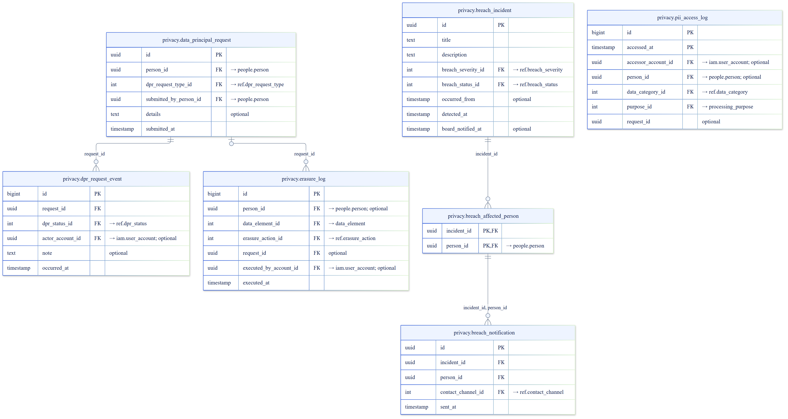

Every column of every table in this group, from the live schema (`created_at` / `updated_at` omitted). Lines are foreign keys inside the group; a note `→ table` is a foreign key to another group; amber = the group's hub. Source: [`catalog-diagrams/er-v2.mmd`](catalog-diagrams/er-v2.mmd).

| Table | What it holds | Links outside this group | Data flow — features that read (R) / write (W) its data store |
|---|---|---|---|
| [`data_principal_request`](#t-privacy-data-principal-request) | A rights request — access, correction, erasure, grievance, nomination, consent withdrawal — submitted by the principal, a guardian, or a nominee | `people.person`; 1 lookup | [6.4](data-flow-features.md#f-6-4) RW · [6.5](data-flow-features.md#f-6-5) R · [6.8](data-flow-features.md#f-6-8) R |
| [`dpr_request_event`](#t-privacy-dpr-request-event) | The status history of a request — current status is always the *latest* row here, never a directly-editable status column, so the timeline of how a request was handled … | `iam.user_account`; 1 lookup | [6.4](data-flow-features.md#f-6-4) RW · [6.5](data-flow-features.md#f-6-5) R · [6.8](data-flow-features.md#f-6-8) R |
| [`erasure_log`](#t-privacy-erasure-log) | Evidence that an erasure/anonymisation actually happened — which column, what action, whether it was triggered by a rights request, who executed it, when | `iam.user_account`, `people.person`, `data_element`; 1 lookup | [6.5](data-flow-features.md#f-6-5) W |
| [`breach_incident`](#t-privacy-breach-incident) | The personal-data breach register DPDP §8(6) requires — severity, status, when detected, when the Board was notified | 2 lookups | [6.6](data-flow-features.md#f-6-6) RW |
| [`breach_affected_person`](#t-privacy-breach-affected-person) | Which specific people a given breach affected — the join between an incident and the persons who need to be told about it | `people.person` | [6.6](data-flow-features.md#f-6-6) RW |
| [`breach_notification`](#t-privacy-breach-notification) | Proof that an affected person was actually notified, and how | 1 lookup | [6.6](data-flow-features.md#f-6-6) RW |
| [`pii_access_log`](#t-privacy-pii-access-log) | Who looked at or exported whose personal data, and for what purpose — partitioned monthly like the other high-volume logs | `iam.user_account`, `people.person`, `processing_purpose`; 1 lookup | [6.7](data-flow-features.md#f-6-7) W · [6.8](data-flow-features.md#f-6-8) R |

**Views over this group** (derived, never stored): `privacy.v_dpr_request_status`  
**Functions that read or write it:** none — only its constraints and triggers
<!-- /group:v2 -->

#### `privacy.data_principal_request`
**Why it exists:** a rights request — access, correction, erasure, grievance, nomination, consent withdrawal — submitted by the principal, a guardian, or a nominee. The old system had no equivalent at all; someone asking "what do you have on me" had no defined path.
**Connects to →** `people.person` (twice — subject and submitter), `ref.dpr_request_type`.
**Referenced by ←** `privacy.dpr_request_event`, `privacy.erasure_log`.

#### `privacy.dpr_request_event`
**Why it exists:** the status history of a request — current status is always the *latest* row here, never a directly-editable status column, so the timeline of how a request was handled can't be silently rewritten.
**Connects to →** `iam.user_account` (who actioned it), `privacy.data_principal_request`, `ref.dpr_status`.
**Referenced by ←** nothing.

#### `privacy.erasure_log`
**Why it exists:** evidence that an erasure/anonymisation actually happened — which column, what action, whether it was triggered by a rights request, who executed it, when. Without this, "we erased it" would be an unverifiable claim.
**Connects to →** `iam.user_account` (who executed it), `people.person`, `privacy.data_element`, `privacy.data_principal_request`, `ref.erasure_action`.
**Referenced by ←** nothing.

#### `privacy.breach_incident`
**Why it exists:** the personal-data breach register DPDP §8(6) requires — severity, status, when detected, when the Board was notified.
**Connects to →** `ref.breach_severity`, `ref.breach_status`.
**Referenced by ←** `privacy.breach_affected_person`.

#### `privacy.breach_affected_person`
**Why it exists:** which specific people a given breach affected — the join between an incident and the persons who need to be told about it.
**Connects to →** `people.person`, `privacy.breach_incident`.
**Referenced by ←** `privacy.breach_notification`.

#### `privacy.breach_notification`
**Why it exists:** proof that an affected person was actually notified, and how — a composite foreign key means a notification can only reference a person already recorded as affected, not an arbitrary person.
**Connects to →** `privacy.breach_affected_person`, `ref.contact_channel`.
**Referenced by ←** nothing.

#### `privacy.pii_access_log`
**Why it exists:** who looked at or exported whose personal data, and for what purpose — partitioned monthly like the other high-volume logs. This is the accountability record that makes "who accessed this record before the breach" an answerable question instead of a guess.
**Connects to →** `iam.user_account`, `people.person`, `privacy.processing_purpose`, `ref.data_category`.
**Referenced by ←** nothing.

---

## 12. `audit` — the append-only trail (2)

### 12.1 Append-only change trail

One event per changed row and one change per column; personal data is logged as changed, never copied.

<!-- group:u1 -->
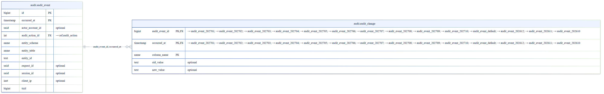

Every column of every table in this group, from the live schema (`created_at` / `updated_at` omitted). Lines are foreign keys inside the group; a note `→ table` is a foreign key to another group; amber = the group's hub. Source: [`catalog-diagrams/er-u1.mmd`](catalog-diagrams/er-u1.mmd).

| Table | What it holds | Links outside this group | Data flow — features that read (R) / write (W) its data store |
|---|---|---|---|
| [`audit_event`](#t-audit-audit-event) | One row per changed row, anywhere in the audited schemas — who, what action, which table/row, in which request/session, from which IP | 1 lookup | [7.2](data-flow-features.md#f-7-2) W · [7.4](data-flow-features.md#f-7-4) RW · [7.5](data-flow-features.md#f-7-5) R |
| [`audit_change`](#t-audit-audit-change) | One row per *changed column* within an audited event — old value, new value | `audit_event_202610`, `audit_event_202611`, `audit_event_202612`, `audit_event_202701`, `audit_event_202702`, `audit_event_202703`, `audit_event_202704`, `audit_event_202705`, `audit_event_202706`, `audit_event_202707`, `audit_event_202708`, `audit_event_202709`, `audit_event_202710`, `audit_event_default` | [7.2](data-flow-features.md#f-7-2) W · [7.4](data-flow-features.md#f-7-4) RW · [7.5](data-flow-features.md#f-7-5) R |

**Views over this group** (derived, never stored): none  
**Functions that read or write it:** none — only its constraints and triggers
<!-- /group:u1 -->

#### `audit.audit_event`
**Why it exists:** one row per changed row, anywhere in the audited schemas — who, what action, which table/row, in which request/session, from which IP. Partitioned monthly; the app role can `INSERT` but never `UPDATE`/`DELETE` (enforced by a trigger, not just a convention), so the trail can't be edited after the fact.
**Connects to →** `ref.audit_action`.
**Referenced by ←** `audit.audit_change`.

#### `audit.audit_change`
**Why it exists:** one row per *changed column* within an audited event — old value, new value. Erasable personal data (columns in `privacy.data_element` whose erasure action is DELETE or ANONYMISE — names, contacts, credentials) is written as `[REDACTED]`, so it never ends up duplicated into the audit trail and erasure actually works. Legally-retained values (`RETAIN_LEGAL` — marks, results, attendance) keep their real old/new values, because "who changed this mark from 40 to 70" is exactly what the audit is for. Splitting this from `audit_event` (rather than one wide JSON diff blob) makes a query like "every change to this student's marks" a plain, indexable filter.
**Connects to →** `audit.audit_event`.
**Referenced by ←** nothing.

---

## 13. `facility` — resource & facility management (41)

Everything physical the university lends out or keeps running, in one place, linked to the academic record rather than beside it. The centre is one **occupancy ledger** (`room_hold`): every use of a room — a timetabled class (materialised per term), an extra class, an examination, a viva, a convocation, a booking, a guest stay, a service window — is one row written by a trigger from its source, and active holds on a room never overlap (a gist EXCLUDE with setup / teardown buffers). Which use may displace which is configuration (`hold_priority_rule`), not code; a displaced class is listed for re-placement and comes back when the displacer goes. Rooms live in `org` (now with floors, use classification and area); custody says who approves use of a space, allocation who occupies it, reservation rules who may ask. Bookings, events, guest stays and trips are approved through the `wf` engine at the custodian or the requesting unit's head (`anchor_is_owner`), so a block's own chain is one `approval_chain` row scoped to it; only guest rooms carry a tariff. Assets and vehicles have ledgers of their own (`asset_hold`, `trip_allocation`), work orders an append-only history, keys one holder at a time. Statuses are derived views, never columns.

### 13.1 Space, custody & the occupancy ledger

Who manages and who occupies each space, which rooms combine, which are reserved, which use outranks which — and the ledger itself: one row per use of one room, from every source, never overlapping.

<!-- group:f1 -->
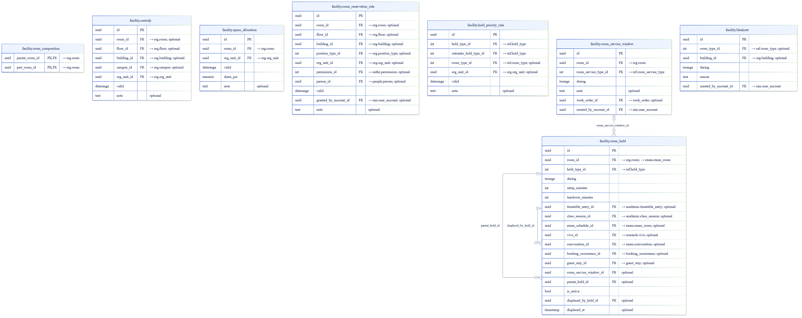

Every column of every table in this group, from the live schema (`created_at` / `updated_at` omitted). Lines are foreign keys inside the group; a note `→ table` is a foreign key to another group; amber = the group's hub. Source: [`catalog-diagrams/er-f1.mmd`](catalog-diagrams/er-f1.mmd).

| Table | What it holds | Links outside this group | Data flow — features that read (R) / write (W) its data store |
|---|---|---|---|
| [`room_composition`](#t-facility-room-composition) | A combinable hall — the whole (an auditorium) and its parts (its two halves), one level only and within one building | `org.room` | [14.1](data-flow-features.md#f-14-1) RW · [14.2](data-flow-features.md#f-14-2) RW · [14.3](data-flow-features.md#f-14-3) R · [14.4](data-flow-features.md#f-14-4) R · [14.8](data-flow-features.md#f-14-8) R |
| [`custody`](#t-facility-custody) | Which org unit manages a space — a room, a floor, a building or a whole campus — for a period, one custodian per target at a time (EXCLUDE) | `org.building`, `org.campus`, `org.floor`, `org.org_unit`, `org.room` | [14.1](data-flow-features.md#f-14-1) RW · [14.2](data-flow-features.md#f-14-2) RW · [14.3](data-flow-features.md#f-14-3) R · [14.4](data-flow-features.md#f-14-4) R · [14.8](data-flow-features.md#f-14-8) R |
| [`space_allocation`](#t-facility-space-allocation) | Which org unit occupies a room (an office, a department's classroom, a shared lab) for a period, with a share so a room can be split | `org.org_unit`, `org.room` | [14.1](data-flow-features.md#f-14-1) RW · [14.2](data-flow-features.md#f-14-2) RW · [14.3](data-flow-features.md#f-14-3) R · [14.4](data-flow-features.md#f-14-4) R · [14.8](data-flow-features.md#f-14-8) R |
| [`room_reservation_rule`](#t-facility-room-reservation-rule) | Reserved and private rooms as data, not a flag: while at least one rule covers a room (directly, or through its floor or building) on the day of use, only a requester … | `authz.permission`, `iam.user_account`, `org.building`, `org.floor`, `org.org_unit`, `org.position_type`, `org.room`, `people.person` | [14.1](data-flow-features.md#f-14-1) RW · [14.2](data-flow-features.md#f-14-2) RW · [14.3](data-flow-features.md#f-14-3) R · [14.4](data-flow-features.md#f-14-4) R · [14.8](data-flow-features.md#f-14-8) R |
| [`hold_priority_rule`](#t-facility-hold-priority-rule) | The configurable pre-emption policy: which kind of use may displace which (convocation over everything, exams over classes, official events over student activities …) … | `org.org_unit`; 2 lookups | [14.2](data-flow-features.md#f-14-2) RW · [14.3](data-flow-features.md#f-14-3) R · [14.4](data-flow-features.md#f-14-4) R · [14.11](data-flow-features.md#f-14-11) W |
| [`room_service_window`](#t-facility-room-service-window) | Planned cleaning, repair, renovation or inspection of a room, written to the ledger as a MAINTENANCE hold so nothing is booked over it | `work_order`, `iam.user_account`, `org.room`; 1 lookup | [14.2](data-flow-features.md#f-14-2) RW · [14.3](data-flow-features.md#f-14-3) R · [14.4](data-flow-features.md#f-14-4) R · [14.11](data-flow-features.md#f-14-11) W |
| [`blackout`](#t-facility-blackout) | No bookings of a kind of room, or of a whole building, for a period (examination weeks, a campus event, a lockdown) | `iam.user_account`, `org.building`; 1 lookup | [14.2](data-flow-features.md#f-14-2) RW · [14.3](data-flow-features.md#f-14-3) R · [14.4](data-flow-features.md#f-14-4) R · [14.11](data-flow-features.md#f-14-11) W |
| [`room_hold`](#t-facility-room-hold) | THE occupancy ledger — one row per use of one room for one span, written only by triggers from every source | `academic.class_session`, `academic.timetable_entry`, `exam.convocation`, `exam.exam_room`, `booking_occurrence`, `guest_stay`, `org.room`, `research.viva`; 1 lookup | [14.3](data-flow-features.md#f-14-3) RW · [14.4](data-flow-features.md#f-14-4) W · [14.5](data-flow-features.md#f-14-5) W · [14.6](data-flow-features.md#f-14-6) W · [14.8](data-flow-features.md#f-14-8) R · [14.13](data-flow-features.md#f-14-13) W |

**Views over this group** (derived, never stored): `facility.v_displaced_hold` · `facility.v_room_timeline` · `facility.v_room_utilisation` · `facility.v_space_inventory` · `facility.v_timetable_gap`  
**Functions that read or write it:** `facility.custodian_of()` · `facility.hold_source_table()` · `facility.linked_rooms()` · `facility.materialise_timetable()` · `facility.outranks()` · `facility.reinstate_hold()` · `facility.room_is_free()` · `facility.room_parts()` · `facility.room_reserved_for()`
<!-- /group:f1 -->

#### `facility.room_composition`
**Why it exists:** a combinable hall — the whole (an auditorium) and its parts (its two halves), one level only and within one building. The point is occupancy: a hold on the whole is shadowed onto every part (`room_hold.parent_hold_id`) so the per-room EXCLUDE refuses a part while the whole is in use, and a hold on a part is checked against the whole's real holds under a row lock on the whole, so two sessions cannot book a half and the whole at once.
**Connects to →** `org.room`.
**Referenced by ←** nothing.

#### `facility.custody`
**Why it exists:** which org unit manages a space — a room, a floor, a building or a whole campus — for a period, one custodian per target at a time (EXCLUDE). `custodian_of(room, date)` walks room → floor → building → campus and takes the most specific; the custodian is the owner of every booking round for the space, so its head (or anyone granted FACILITY_CUSTODIAN there) approves, and a chain scoped to that unit (`wf.approval_chain.scope_org_unit_id`) gives each block its own approval path.
**Connects to →** `org.building`, `org.campus`, `org.floor`, `org.org_unit`, `org.room`.
**Referenced by ←** nothing.

#### `facility.space_allocation`
**Why it exists:** which org unit occupies a room (an office, a department's classroom, a shared lab) for a period, with a share so a room can be split; shares in force on any day never exceed 100 % (trigger). This is the space inventory behind `v_space_inventory` (rooms, area and seats per unit for NAAC / AICTE returns), separate from custody, which is about who approves use.
**Connects to →** `org.org_unit`, `org.room`.
**Referenced by ←** nothing.

#### `facility.room_reservation_rule`
**Why it exists:** reserved and private rooms as data, not a flag: while at least one rule covers a room (directly, or through its floor or building) on the day of use, only a requester who matches a rule may book it — the holder of a position (the Vice-Chancellor's meeting room), members of an org unit and its descendants, holders of a permission, or a named person (the old per-user room access). Revoking is closing the validity; a room with no rule is open to everyone who may book at all.
**Connects to →** `authz.permission`, `iam.user_account`, `org.building`, `org.floor`, `org.org_unit`, `org.position_type`, `org.room`, `people.person`.
**Referenced by ←** nothing.

#### `facility.hold_priority_rule`
**Why it exists:** the configurable pre-emption policy: which kind of use may displace which (convocation over everything, exams over classes, official events over student activities …), optionally only for a room type or inside one unit's custody. `outranks()` picks the most specific rule (type + unit, unit, type, global); with no rule, first come first served and the later hold is refused. A rule and its reverse cannot coexist at one scope.
**Connects to →** `org.org_unit`, `ref.hold_type`, `ref.room_type`.
**Referenced by ←** nothing.

#### `facility.room_service_window`
**Why it exists:** planned cleaning, repair, renovation or inspection of a room, written to the ledger as a MAINTENANCE hold so nothing is booked over it; optionally part of a work order, which releases the rest of the window when it is closed.
**Connects to →** `facility.work_order`, `iam.user_account`, `org.room`, `ref.room_service_type`.
**Referenced by ←** `facility.room_hold`.

#### `facility.blackout`
**Why it exists:** no bookings of a kind of room, or of a whole building, for a period (examination weeks, a campus event, a lockdown). It is a booking rule, not an occupancy: classes, exams and other institutional holds are unaffected, booking requests are refused.
**Connects to →** `iam.user_account`, `org.building`, `ref.room_type`.
**Referenced by ←** nothing.

#### `facility.room_hold`
**Why it exists:** THE occupancy ledger — one row per use of one room for one span, written only by triggers from every source: timetable entries (one per class date, materialised per term; co-teachers of one class share it, held by the primary teacher's entry — the co-teacher's entry takes it only on a date the primary's session is cancelled), extra classes, exam rooms, vivas, convocations, booking occurrences, guest stays and service windows (exactly one source column, matching the hold type's declared source). The blocked range (span plus setup / teardown buffers) of active holds on a room never overlaps — a gist EXCLUDE, the last word whatever the application does. A new hold that collides only with holds its type outranks displaces them (`is_active = false`, `displaced_by_hold_id`, `displaced_at`) instead of failing, and when the displacer is deleted the losers that are free again are reinstated; the rest stay listed in `v_displaced_hold`. Holds are immutable except for displacement, and the table is not audited (its sources are).
**Connects to →** `academic.class_session`, `academic.timetable_entry`, `exam.convocation`, `exam.exam_room`, `facility.booking_occurrence`, `facility.guest_stay`, `facility.room_service_window`, `org.room`, `research.viva`, `ref.hold_type`.
**Referenced by ←** nothing.

### 13.2 Bookings & events

Booking rules and restrictions, events as one package, groups of bookings (rooms × dates, recurring), one request per custodian approved through the workflow, and the occurrences that hold the rooms.

<!-- group:f2 -->
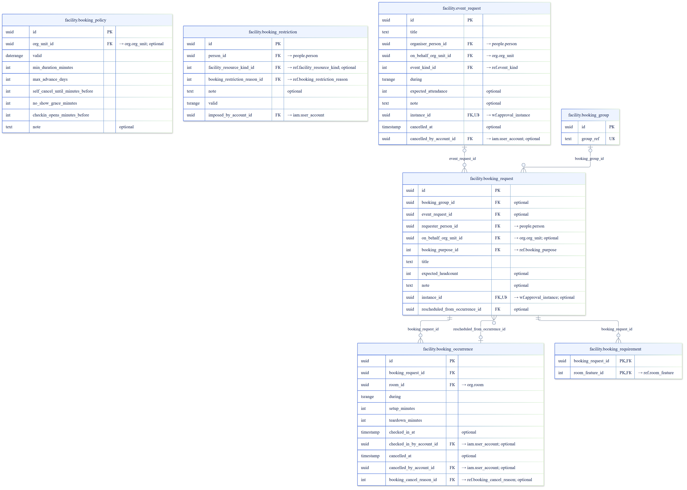

Every column of every table in this group, from the live schema (`created_at` / `updated_at` omitted). Lines are foreign keys inside the group; a note `→ table` is a foreign key to another group; amber = the group's hub. Source: [`catalog-diagrams/er-f2.mmd`](catalog-diagrams/er-f2.mmd).

| Table | What it holds | Links outside this group | Data flow — features that read (R) / write (W) its data store |
|---|---|---|---|
| [`booking_policy`](#t-facility-booking-policy) | The booking rules of a unit's spaces — minimum duration, how far ahead bookings open, the self-cancellation cut-off, the no-show grace and the check-in window | `org.org_unit` | [14.2](data-flow-features.md#f-14-2) RW · [14.4](data-flow-features.md#f-14-4) R · [14.5](data-flow-features.md#f-14-5) R · [14.6](data-flow-features.md#f-14-6) R |
| [`booking_restriction`](#t-facility-booking-restriction) | A person barred from a kind of resource (rooms, equipment, vehicles, guest rooms, parking, keys) or from all of them for a period, with the reason | `iam.user_account`, `people.person`; 2 lookups | [14.2](data-flow-features.md#f-14-2) RW · [14.4](data-flow-features.md#f-14-4) R · [14.5](data-flow-features.md#f-14-5) R · [14.6](data-flow-features.md#f-14-6) R |
| [`event_request`](#t-facility-event-request) | An event as one package — a conference, a fest, a ceremony | `iam.user_account`, `org.org_unit`, `people.person`, `wf.approval_instance`; 1 lookup | [14.4](data-flow-features.md#f-14-4) RW · [14.5](data-flow-features.md#f-14-5) RW · [14.6](data-flow-features.md#f-14-6) RW · [14.7](data-flow-features.md#f-14-7) RW · [14.10](data-flow-features.md#f-14-10) R · [14.14](data-flow-features.md#f-14-14) R |
| [`booking_group`](#t-facility-booking-group) | Bookings made together — N rooms × M dates, a daily / weekly / monthly / custom series (`occurrence_dates()`) | — | [14.4](data-flow-features.md#f-14-4) RW · [14.5](data-flow-features.md#f-14-5) RW · [14.6](data-flow-features.md#f-14-6) RW · [14.7](data-flow-features.md#f-14-7) RW · [14.10](data-flow-features.md#f-14-10) R · [14.14](data-flow-features.md#f-14-14) R |
| [`booking_request`](#t-facility-booking-request) | One booking request: who, for which unit, why (the purpose fixes the kind of hold and so its priority), how many people, approved through a ROOM_BOOKING round owned by … | `org.org_unit`, `people.person`, `wf.approval_instance`; 1 lookup | [14.4](data-flow-features.md#f-14-4) RW · [14.5](data-flow-features.md#f-14-5) RW · [14.6](data-flow-features.md#f-14-6) RW · [14.7](data-flow-features.md#f-14-7) RW · [14.10](data-flow-features.md#f-14-10) R · [14.14](data-flow-features.md#f-14-14) R |
| [`booking_requirement`](#t-facility-booking-requirement) | The room features a request needs (projector, video conferencing …); every occurrence's room must provide them (`org.room_facility`) | 1 lookup | [14.4](data-flow-features.md#f-14-4) RW · [14.5](data-flow-features.md#f-14-5) RW · [14.6](data-flow-features.md#f-14-6) RW · [14.7](data-flow-features.md#f-14-7) RW · [14.10](data-flow-features.md#f-14-10) R · [14.14](data-flow-features.md#f-14-14) R |
| [`booking_occurrence`](#t-facility-booking-occurrence) | One room for one span of a request | `iam.user_account`, `org.room`; 1 lookup | [14.4](data-flow-features.md#f-14-4) RW · [14.5](data-flow-features.md#f-14-5) RW · [14.6](data-flow-features.md#f-14-6) RW · [14.7](data-flow-features.md#f-14-7) RW · [14.10](data-flow-features.md#f-14-10) R · [14.14](data-flow-features.md#f-14-14) R |

**Views over this group** (derived, never stored): `events.v_proposal_status` · `facility.v_booking_status` · `facility.v_booking_summary` · `facility.v_event_status` · `facility.v_room_timeline`  
**Functions that read or write it:** `events.apply_event_change()` · `events.submit_event_change()` · `events.submit_proposal()` · `facility.cancel_booking_group()` · `facility.hold_source_table()` · `facility.is_restricted()` · `facility.policy_for()` · `facility.release_no_shows()` · `facility.request_booking()` · `facility.request_event()`
<!-- /group:f2 -->

#### `facility.booking_policy`
**Why it exists:** the booking rules of a unit's spaces — minimum duration, how far ahead bookings open, the self-cancellation cut-off, the no-show grace and the check-in window — one policy per scope at a time, the nearest ancestor's applying (`policy_for()`); the university default is seeded (POLICY).
**Connects to →** `org.org_unit`.
**Referenced by ←** nothing.

#### `facility.booking_restriction`
**Why it exists:** a person barred from a kind of resource (rooms, equipment, vehicles, guest rooms, parking, keys) or from all of them for a period, with the reason — misuse, repeated no-shows, dues, a disciplinary decision. Checked by every request and issue; disciplinary personal data, so the note is registered and the table is hidden from analytics.
**Connects to →** `iam.user_account`, `people.person`, `ref.booking_restriction_reason`, `ref.facility_resource_kind`.
**Referenced by ←** nothing.

#### `facility.event_request`
**Why it exists:** an event as one package — a conference, a fest, a ceremony — approved once through EVENT_REQUEST (the organising unit's head, then the university) rather than room by room. Its room and vehicle requests carry `event_request_id`; a room request of an event not yet approved has no round of its own and waits (its rooms are already held), and the event's approval submits each of them to its custodian.
**Connects to →** `iam.user_account`, `org.org_unit`, `people.person`, `wf.approval_instance`, `ref.event_kind`.
**Referenced by ←** `facility.booking_request`, `facility.trip_request`; events: `events.event_proposal`; events: `events.event_change_request`.

#### `facility.booking_group`
**Why it exists:** bookings made together — N rooms × M dates, a daily / weekly / monthly / custom series (`occurrence_dates()`) — under one reference GRP-YYYY-NNNN for the requester, with one request per custodian inside it; `cancel_booking_group()` cancels what is left and withdraws open rounds; `v_booking_summary` shows what was booked, pending, refused and cancelled. The group is only the reference — who asked, the title and the event are facts of its requests, not repeated here.
**Connects to →** nothing.
**Referenced by ←** `facility.booking_request`.

#### `facility.booking_request`
**Why it exists:** one booking request: who, for which unit, why (the purpose fixes the kind of hold and so its priority), how many people, approved through a ROOM_BOOKING round owned by the custodian of the rooms (one custodian per request). Immutable — withdraw and submit again; a reschedule is a new request naming the occurrence it replaces (ROOM_BOOKING_CHANGE), whose approval cancels the original. A restricted requester cannot submit; someone else may submit on their behalf only with the custodian's booking right.
**Connects to →** `facility.booking_group`, `facility.booking_occurrence`, `facility.event_request`, `org.org_unit`, `people.person`, `wf.approval_instance`, `ref.booking_purpose`.
**Referenced by ←** `facility.booking_occurrence`, `facility.booking_requirement`.

#### `facility.booking_requirement`
**Why it exists:** the room features a request needs (projector, video conferencing …); every occurrence's room must provide them (`org.room_facility`).
**Connects to →** `facility.booking_request`, `ref.room_feature`.
**Referenced by ←** nothing.

#### `facility.booking_occurrence`
**Why it exists:** one room for one span of a request. Validated against the room (bookable use, capacity, features), the custodian (the request's round), reservation rules, blackouts and the policy (minimum duration, advance window, backdating only with the right); it takes a tentative hold in the ledger at once, so a pending request blocks the slot. Check-in inside the policy window, cancellation by the requester until the cut-off or by the custodian's staff any time (and by the no-show sweep as a system job); never moved. Status is derived (`v_booking_status`): pending, approved, in use, no-show, completed, expired, returned, withdrawn, cancelled, rescheduled.
**Connects to →** `facility.booking_request`, `iam.user_account`, `org.room`, `ref.booking_cancel_reason`.
**Referenced by ←** `facility.booking_asset`, `facility.booking_request`, `facility.room_hold`.

### 13.3 Assets, loans & maintenance

Vendors, fixed and portable assets, service contracts, assets booked with a room or lent out (the asset ledger), preventive schedules and work orders with an append-only history.

<!-- group:f3 -->
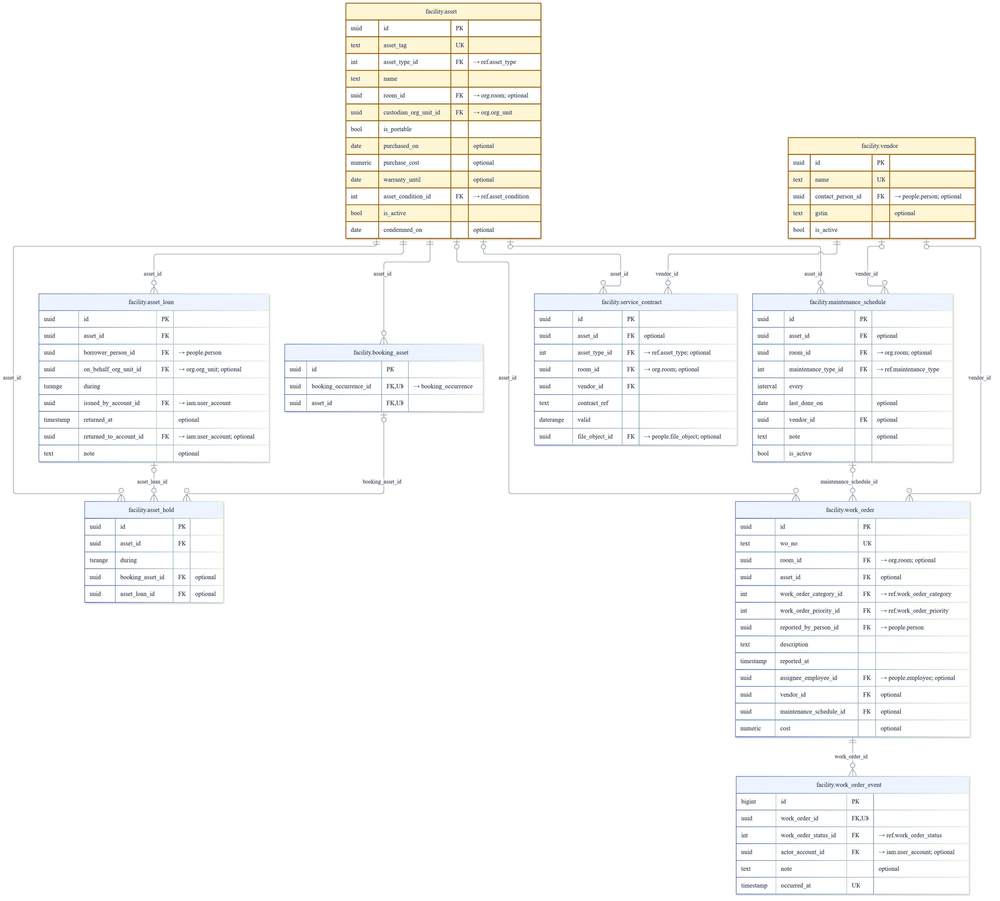

Every column of every table in this group, from the live schema (`created_at` / `updated_at` omitted). Lines are foreign keys inside the group; a note `→ table` is a foreign key to another group; amber = the group's hub. Source: [`catalog-diagrams/er-f3.mmd`](catalog-diagrams/er-f3.mmd).

| Table | What it holds | Links outside this group | Data flow — features that read (R) / write (W) its data store |
|---|---|---|---|
| [`vendor`](#t-facility-vendor) | Suppliers and service providers — AMC vendors, hire companies, repairers | `people.person` | [14.9](data-flow-features.md#f-14-9) RW · [14.10](data-flow-features.md#f-14-10) RW · [14.11](data-flow-features.md#f-14-11) R · [14.12](data-flow-features.md#f-14-12) R |
| [`asset`](#t-facility-asset) | One physical asset, fixed (an air conditioner in a room) or portable (a projector), with its tag, type, location room, custodian unit, purchase and warranty, condition … | `org.org_unit`, `org.room`; 2 lookups | [14.9](data-flow-features.md#f-14-9) RW · [14.10](data-flow-features.md#f-14-10) RW · [14.11](data-flow-features.md#f-14-11) R · [14.12](data-flow-features.md#f-14-12) R |
| [`service_contract`](#t-facility-service-contract) | An AMC or service contract with a vendor for one asset, every asset of a type, or a room's installations, valid for a period, one per target and vendor at a time | `org.room`, `people.file_object`; 1 lookup | [14.9](data-flow-features.md#f-14-9) RW · [14.10](data-flow-features.md#f-14-10) RW · [14.11](data-flow-features.md#f-14-11) R · [14.12](data-flow-features.md#f-14-12) R |
| [`booking_asset`](#t-facility-booking-asset) | A portable asset booked with a room booking; held (`asset_hold`) for the occurrence's blocked span and released with it | `booking_occurrence` | [14.9](data-flow-features.md#f-14-9) RW · [14.10](data-flow-features.md#f-14-10) RW · [14.11](data-flow-features.md#f-14-11) R · [14.12](data-flow-features.md#f-14-12) R |
| [`asset_loan`](#t-facility-asset-loan) | A portable asset lent to a person (a camera for a field visit) by the custodian unit's staff for a period; the borrower must not be restricted | `iam.user_account`, `org.org_unit`, `people.person` | [14.9](data-flow-features.md#f-14-9) RW · [14.10](data-flow-features.md#f-14-10) RW · [14.11](data-flow-features.md#f-14-11) R · [14.12](data-flow-features.md#f-14-12) R |
| [`asset_hold`](#t-facility-asset-hold) | The asset ledger, the equipment counterpart of `room_hold`: one row per use of a portable asset — a booking or a loan | — | [14.9](data-flow-features.md#f-14-9) RW · [14.10](data-flow-features.md#f-14-10) RW · [14.11](data-flow-features.md#f-14-11) R · [14.12](data-flow-features.md#f-14-12) R |
| [`maintenance_schedule`](#t-facility-maintenance-schedule) | Preventive maintenance — what is serviced (an asset or a room) how often, by which vendor | `org.room`; 1 lookup | [14.11](data-flow-features.md#f-14-11) RW · [14.12](data-flow-features.md#f-14-12) RW |
| [`work_order`](#t-facility-work-order) | A reported fault or job on a room or an asset (WO-YYYY-NNNNN): category, priority with its SLA, who reported it, the assignee (an employee) or vendor, the cost | `org.room`, `people.employee`, `people.person`; 2 lookups | [14.11](data-flow-features.md#f-14-11) RW · [14.12](data-flow-features.md#f-14-12) RW |
| [`work_order_event`](#t-facility-work-order-event) | The append-only status history of a work order — reported, assigned (needs a technician or vendor), in progress, on hold, closed / rejected (needs a note) | `iam.user_account`; 1 lookup | [14.11](data-flow-features.md#f-14-11) RW · [14.12](data-flow-features.md#f-14-12) RW |

**Views over this group** (derived, never stored): `facility.v_asset_register` · `facility.v_maintenance_due` · `facility.v_work_order_status`  
**Functions that read or write it:** `facility.asset_usable()` · `facility.raise_work_order()` · `facility.work_order_is_closed()`
<!-- /group:f3 -->

#### `facility.vendor`
**Why it exists:** suppliers and service providers — AMC vendors, hire companies, repairers — with a GSTIN and an optional contact person (a `people.person`, so contact details stay in `pii`).
**Connects to →** `people.person`.
**Referenced by ←** `facility.maintenance_schedule`, `facility.service_contract`, `facility.work_order`.

#### `facility.asset`
**Why it exists:** one physical asset, fixed (an air conditioner in a room) or portable (a projector), with its tag, type, location room, custodian unit, purchase and warranty, condition and condemnation. Portable, serviceable assets are what can be booked with a room or lent out; `v_asset_register` adds warranty status, current use and open work orders.
**Connects to →** `org.org_unit`, `org.room`, `ref.asset_condition`, `ref.asset_type`.
**Referenced by ←** `facility.asset_hold`, `facility.asset_loan`, `facility.booking_asset`, `facility.maintenance_schedule`, `facility.service_contract`, `facility.work_order`.

#### `facility.service_contract`
**Why it exists:** an AMC or service contract with a vendor for one asset, every asset of a type, or a room's installations, valid for a period, one per target and vendor at a time; the signed contract is a file.
**Connects to →** `facility.asset`, `facility.vendor`, `org.room`, `people.file_object`, `ref.asset_type`.
**Referenced by ←** nothing.

#### `facility.booking_asset`
**Why it exists:** a portable asset booked with a room booking; held (`asset_hold`) for the occurrence's blocked span and released with it.
**Connects to →** `facility.asset`, `facility.booking_occurrence`.
**Referenced by ←** `facility.asset_hold`.

#### `facility.asset_loan`
**Why it exists:** a portable asset lent to a person (a camera for a field visit) by the custodian unit's staff for a period; the borrower must not be restricted; only the return is ever recorded afterwards, and an early return frees the rest of the period.
**Connects to →** `facility.asset`, `iam.user_account`, `org.org_unit`, `people.person`.
**Referenced by ←** `facility.asset_hold`.

#### `facility.asset_hold`
**Why it exists:** the asset ledger, the equipment counterpart of `room_hold`: one row per use of a portable asset — a booking or a loan — with an EXCLUDE so an asset is never in two places at once.
**Connects to →** `facility.asset`, `facility.asset_loan`, `facility.booking_asset`.
**Referenced by ←** nothing.

#### `facility.maintenance_schedule`
**Why it exists:** preventive maintenance — what is serviced (an asset or a room) how often, by which vendor; the next due date is derived (`v_maintenance_due`) from `last_done_on`, which closing a work order of the schedule sets.
**Connects to →** `facility.asset`, `facility.vendor`, `org.room`, `ref.maintenance_type`.
**Referenced by ←** `facility.work_order`.

#### `facility.work_order`
**Why it exists:** a reported fault or job on a room or an asset (WO-YYYY-NNNNN): category, priority with its SLA, who reported it, the assignee (an employee) or vendor, the cost. Its status is the last of its events (`v_work_order_status`, with due time and overdue flag); once a terminal event is written nothing changes. Raised by anyone through `raise_work_order()`.
**Connects to →** `facility.asset`, `facility.maintenance_schedule`, `facility.vendor`, `org.room`, `people.employee`, `people.person`, `ref.work_order_category`, `ref.work_order_priority`.
**Referenced by ←** `facility.room_service_window`, `facility.work_order_event`.

#### `facility.work_order_event`
**Why it exists:** the append-only status history of a work order — reported, assigned (needs a technician or vendor), in progress, on hold, closed / rejected (needs a note). Closing releases the remainder of the order's service windows and marks its preventive schedule done.
**Connects to →** `facility.work_order`, `iam.user_account`, `ref.work_order_status`.
**Referenced by ←** nothing.

### 13.4 Guest house & parking

Stays in guest rooms (the only charged spaces, with tariffs) and parking permits in capacity-checked zones.

<!-- group:f4 -->
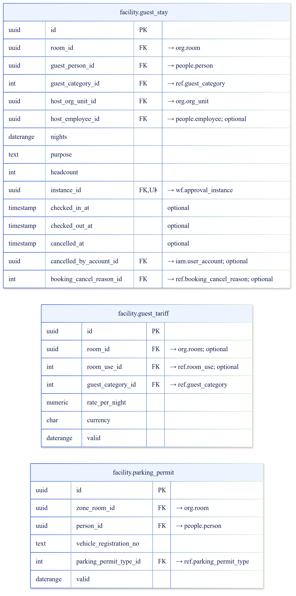

Every column of every table in this group, from the live schema (`created_at` / `updated_at` omitted). Lines are foreign keys inside the group; a note `→ table` is a foreign key to another group; amber = the group's hub. Source: [`catalog-diagrams/er-f4.mmd`](catalog-diagrams/er-f4.mmd).

| Table | What it holds | Links outside this group | Data flow — features that read (R) / write (W) its data store |
|---|---|---|---|
| [`guest_stay`](#t-facility-guest-stay) | A stay in a guest room by an internal or external guest (any `people.person`) under a guest category matching what they are, hosted by a unit and optionally an employee … | `iam.user_account`, `org.org_unit`, `org.room`, `people.employee`, `people.person`, `wf.approval_instance`; 2 lookups | [14.13](data-flow-features.md#f-14-13) RW |
| [`guest_tariff`](#t-facility-guest-tariff) | The nightly rate for a guest category in one room or in every room of a use, valid for a period, one per target and category at a time … | `org.room`; 2 lookups | [14.13](data-flow-features.md#f-14-13) RW |
| [`parking_permit`](#t-facility-parking-permit) | A person's vehicle in a parking zone (a room of a PARKING building whose capacity is its bays) for a period | `org.room`, `people.person`; 1 lookup | [14.19](data-flow-features.md#f-14-19) RW |

**Views over this group** (derived, never stored): `facility.v_guest_stay_charge` · `facility.v_guest_stay_status` · `facility.v_parking_zone_usage`  
**Functions that read or write it:** `facility.hold_source_table()` · `facility.request_guest_stay()`
<!-- /group:f4 -->

#### `facility.guest_stay`
**Why it exists:** a stay in a guest room by an internal or external guest (any `people.person`) under a guest category matching what they are, hosted by a unit and optionally an employee, approved through GUEST_STAY (host unit head, then the guest house). Its nights hold the room in the ledger from submission; the charge is derived (`v_guest_stay_charge`) and billing belongs to Finance; check-in only once approved; never edited.
**Connects to →** `iam.user_account`, `org.org_unit`, `org.room`, `people.employee`, `people.person`, `wf.approval_instance`, `ref.booking_cancel_reason`, `ref.guest_category`.
**Referenced by ←** `facility.room_hold`.

#### `facility.guest_tariff`
**Why it exists:** the nightly rate for a guest category in one room or in every room of a use, valid for a period, one per target and category at a time (a room's own tariff wins over its use's); categories flagged complimentary pay nothing. Rates are POLICY; every other room of the university is free for students and staff, so tariffs exist only here.
**Connects to →** `org.room`, `ref.guest_category`, `ref.room_use`.
**Referenced by ←** nothing.

#### `facility.parking_permit`
**Why it exists:** a person's vehicle in a parking zone (a room of a PARKING building whose capacity is its bays) for a period; a zone is never over-allocated and a vehicle is under one permit at a time; `v_parking_zone_usage` shows free bays.
**Connects to →** `org.room`, `people.person`, `ref.parking_permit_type`.
**Referenced by ←** nothing.

### 13.5 Fleet & transport

Vehicles with their documents and service windows, drivers with licences, the transport policy, trip requests approved through the workflow, driver-then-vehicle allocation, pooling, trips, ratings and escalation alerts.

<!-- group:f5 -->
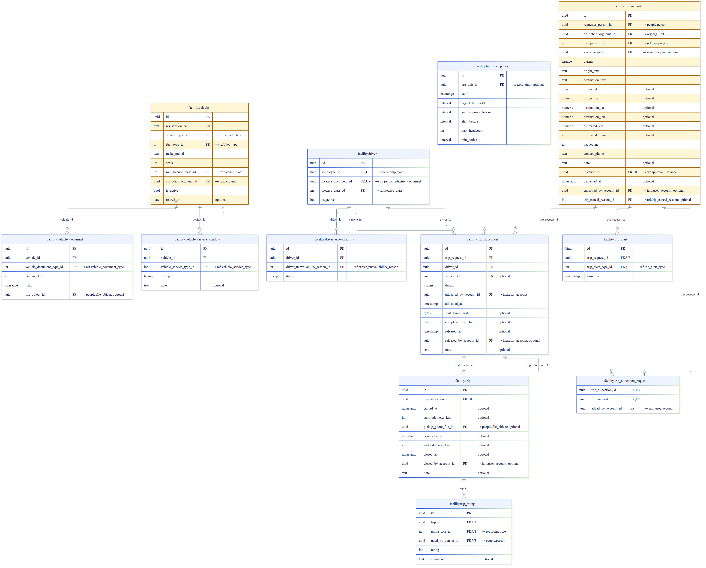

Every column of every table in this group, from the live schema (`created_at` / `updated_at` omitted). Lines are foreign keys inside the group; a note `→ table` is a foreign key to another group; amber = the group's hub. Source: [`catalog-diagrams/er-f5.mmd`](catalog-diagrams/er-f5.mmd).

| Table | What it holds | Links outside this group | Data flow — features that read (R) / write (W) its data store |
|---|---|---|---|
| [`vehicle`](#t-facility-vehicle) | A university vehicle — registration, type, fuel, passenger seats, the minimum licence class to drive it, the transport office in custody | `org.org_unit`; 3 lookups | [14.14](data-flow-features.md#f-14-14) R · [14.15](data-flow-features.md#f-14-15) R · [14.16](data-flow-features.md#f-14-16) RW · [14.17](data-flow-features.md#f-14-17) R |
| [`vehicle_document`](#t-facility-vehicle-document) | Registration certificate, insurance, PUC, fitness, permit and road tax of a vehicle with their validity, one of each type in force at a time | `people.file_object`; 1 lookup | [14.14](data-flow-features.md#f-14-14) R · [14.15](data-flow-features.md#f-14-15) R · [14.16](data-flow-features.md#f-14-16) RW · [14.17](data-flow-features.md#f-14-17) R |
| [`vehicle_service_window`](#t-facility-vehicle-service-window) | Servicing, repair and off-road periods of a vehicle | 1 lookup | [14.14](data-flow-features.md#f-14-14) R · [14.15](data-flow-features.md#f-14-15) R · [14.16](data-flow-features.md#f-14-16) RW · [14.17](data-flow-features.md#f-14-17) R |
| [`driver`](#t-facility-driver) | A driver — an employee whose driving licence is an identity document of the person (`pii.person_identity_document`, type DRIVING_LICENCE, with its expiry) and a licence … | `people.employee`, `pii.person_identity_document`; 1 lookup | [14.14](data-flow-features.md#f-14-14) R · [14.15](data-flow-features.md#f-14-15) R · [14.16](data-flow-features.md#f-14-16) RW · [14.17](data-flow-features.md#f-14-17) R |
| [`driver_unavailability`](#t-facility-driver-unavailability) | When a driver cannot drive — leave, sickness, other duty, training — as a coded reason with no free text about health; allocations avoid these periods | 1 lookup | [14.14](data-flow-features.md#f-14-14) R · [14.15](data-flow-features.md#f-14-15) R · [14.16](data-flow-features.md#f-14-16) RW · [14.17](data-flow-features.md#f-14-17) R |
| [`transport_policy`](#t-facility-transport-policy) | The transport rules of a unit (or the university default) | `org.org_unit` | [14.14](data-flow-features.md#f-14-14) R · [14.15](data-flow-features.md#f-14-15) R · [14.16](data-flow-features.md#f-14-16) RW · [14.17](data-flow-features.md#f-14-17) R |
| [`trip_request`](#t-facility-trip-request) | A request for a vehicle: who, for which unit, why, from where to where (text and coordinates), departure to expected return, party size, a contact number for the driver | `event_request`, `iam.user_account`, `org.org_unit`, `people.person`, `wf.approval_instance`; 2 lookups | [14.14](data-flow-features.md#f-14-14) RW · [14.15](data-flow-features.md#f-14-15) RW · [14.17](data-flow-features.md#f-14-17) RW |
| [`trip_allocation`](#t-facility-trip-allocation) | Dispatch: a driver first (the old pending-driver stage), then a vehicle, for a window covering the request | `iam.user_account` | [14.14](data-flow-features.md#f-14-14) RW · [14.15](data-flow-features.md#f-14-15) RW · [14.17](data-flow-features.md#f-14-17) RW |
| [`trip_allocation_request`](#t-facility-trip-allocation-request) | Pooling — another approved request riding on an existing allocation: same vehicle, inside its window, seats permitting, added by transport staff | `iam.user_account` | [14.14](data-flow-features.md#f-14-14) RW · [14.15](data-flow-features.md#f-14-15) RW · [14.17](data-flow-features.md#f-14-17) RW |
| [`trip`](#t-facility-trip) | What happened on the road: start (odometer, pickup photo), completion (odometer never lower), closure by the transport office; a closed trip is final | `iam.user_account`, `people.file_object` | [14.14](data-flow-features.md#f-14-14) RW · [14.15](data-flow-features.md#f-14-15) RW · [14.17](data-flow-features.md#f-14-17) RW |
| [`trip_rating`](#t-facility-trip-rating) | Feedback after a completed trip: passengers rate the driver, the driver rates the passengers, 1–5, one each per trip, only by people who were on it | `people.person`; 1 lookup | [14.14](data-flow-features.md#f-14-14) RW · [14.15](data-flow-features.md#f-14-15) RW · [14.17](data-flow-features.md#f-14-17) RW |
| [`trip_alert`](#t-facility-trip-alert) | Alerts raised by the escalation job (`run_trip_escalations()`, a system job): auto-approved for want of a decision, unallocated close to departure, expired | 1 lookup | [14.14](data-flow-features.md#f-14-14) RW · [14.15](data-flow-features.md#f-14-15) RW · [14.17](data-flow-features.md#f-14-17) RW |

**Views over this group** (derived, never stored): `events.v_proposal_status` · `facility.v_event_status` · `facility.v_trip_status` · `facility.v_trip_summary` · `facility.v_vehicle_document_status`  
**Functions that read or write it:** `facility.allocation_headcount()` · `facility.request_trip()` · `facility.run_trip_escalations()` · `facility.transport_policy_for()` · `facility.vehicle_available()`
<!-- /group:f5 -->

#### `facility.vehicle`
**Why it exists:** a university vehicle — registration, type, fuel, passenger seats, the minimum licence class to drive it, the transport office in custody; retired vehicles stay for the trip history.
**Connects to →** `org.org_unit`, `ref.fuel_type`, `ref.licence_class`, `ref.vehicle_type`.
**Referenced by ←** `facility.trip_allocation`, `facility.vehicle_document`, `facility.vehicle_service_window`.

#### `facility.vehicle_document`
**Why it exists:** registration certificate, insurance, PUC, fitness, permit and road tax of a vehicle with their validity, one of each type in force at a time; the mandatory ones must cover every trip a vehicle is allocated to (`v_vehicle_document_status` shows valid / expiring / expired / missing).
**Connects to →** `facility.vehicle`, `people.file_object`, `ref.vehicle_document_type`.
**Referenced by ←** nothing.

#### `facility.vehicle_service_window`
**Why it exists:** servicing, repair and off-road periods of a vehicle: bounded, non-empty time ranges that never overlap for the same vehicle (EXCLUDE), and no trip allocation may cross one — so a vehicle in the workshop is never offered for a trip.
**Connects to →** `facility.vehicle`, `ref.vehicle_service_type`.
**Referenced by ←** nothing.

#### `facility.driver`
**Why it exists:** a driver — an employee whose driving licence is an identity document of the person (`pii.person_identity_document`, type DRIVING_LICENCE, with its expiry) and a licence class; the licence is referenced, never copied, and an allocation is refused when it expires before the trip ends or its class does not cover the vehicle.
**Connects to →** `people.employee`, `pii.person_identity_document`, `ref.licence_class`.
**Referenced by ←** `facility.driver_unavailability`, `facility.trip_allocation`.

#### `facility.driver_unavailability`
**Why it exists:** when a driver cannot drive — leave, sickness, other duty, training — as a coded reason with no free text about health; allocations avoid these periods.
**Connects to →** `facility.driver`, `ref.driver_unavailability_reason`.
**Referenced by ←** nothing.

#### `facility.transport_policy`
**Why it exists:** the transport rules of a unit (or the university default): what counts as urgent (skips the unit head), when an undecided request is approved automatically, when an unallocated one raises an alert, the largest party, the minimum notice — POLICY.
**Connects to →** `org.org_unit`.
**Referenced by ←** nothing.

#### `facility.trip_request`
**Why it exists:** a request for a vehicle: who, for which unit, why, from where to where (text and coordinates), departure to expected return, party size, a contact number for the driver. Approved through TRIP_REQUEST (unit head, then transport) or, when departure falls inside the urgent threshold, TRIP_REQUEST_URGENT (transport only) — `request_trip()` picks the chain. Immutable; cancellable until a vehicle or driver is allocated.
**Connects to →** `facility.event_request`, `iam.user_account`, `org.org_unit`, `people.person`, `wf.approval_instance`, `ref.trip_cancel_reason`, `ref.trip_purpose`.
**Referenced by ←** `facility.trip_alert`, `facility.trip_allocation`, `facility.trip_allocation_request`.

#### `facility.trip_allocation`
**Why it exists:** dispatch: a driver first (the old pending-driver stage), then a vehicle, for a window covering the request. Neither a driver nor a vehicle is ever double-allocated (EXCLUDE); the driver's licence, unavailability, the vehicle's mandatory documents and service windows and the seats are all checked, and only transport staff allocate. Token hashes let the driver start and complete the trip from a link; a released allocation is kept for the record.
**Connects to →** `facility.driver`, `facility.trip_request`, `facility.vehicle`, `iam.user_account`.
**Referenced by ←** `facility.trip`, `facility.trip_allocation_request`.

#### `facility.trip_allocation_request`
**Why it exists:** pooling — another approved request riding on an existing allocation: same vehicle, inside its window, seats permitting, added by transport staff.
**Connects to →** `facility.trip_allocation`, `facility.trip_request`, `iam.user_account`.
**Referenced by ←** nothing.

#### `facility.trip`
**Why it exists:** what happened on the road: start (odometer, pickup photo), completion (odometer never lower), closure by the transport office; a closed trip is final. `v_trip_status` derives the whole lifecycle of a request from the round, the allocation and this row; `v_trip_summary` the kilometres and outcomes per unit and month.
**Connects to →** `facility.trip_allocation`, `iam.user_account`, `people.file_object`.
**Referenced by ←** `facility.trip_rating`.

#### `facility.trip_rating`
**Why it exists:** feedback after a completed trip: passengers rate the driver, the driver rates the passengers, 1–5, one each per trip, only by people who were on it.
**Connects to →** `facility.trip`, `people.person`, `ref.rating_role`.
**Referenced by ←** nothing.

#### `facility.trip_alert`
**Why it exists:** alerts raised by the escalation job (`run_trip_escalations()`, a system job): auto-approved for want of a decision, unallocated close to departure, expired — one of a kind per request.
**Connects to →** `facility.trip_request`, `ref.trip_alert_type`.
**Referenced by ←** nothing.

### 13.6 Keys & access cards

Keys and access cards per room, floor or building, and the register of who holds them.

<!-- group:f6 -->
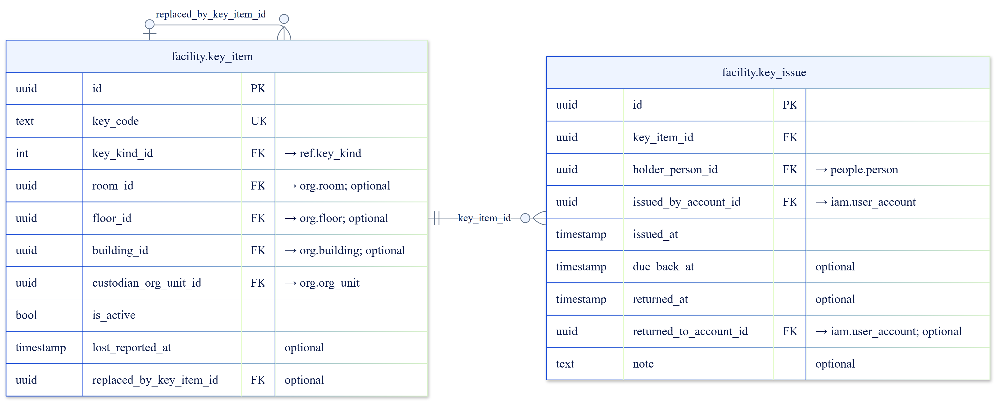

Every column of every table in this group, from the live schema (`created_at` / `updated_at` omitted). Lines are foreign keys inside the group; a note `→ table` is a foreign key to another group; amber = the group's hub. Source: [`catalog-diagrams/er-f6.mmd`](catalog-diagrams/er-f6.mmd).

| Table | What it holds | Links outside this group | Data flow — features that read (R) / write (W) its data store |
|---|---|---|---|
| [`key_item`](#t-facility-key-item) | A physical key or access card opening a room, a floor or a building (a master key opens a whole floor or building), kept by a custodian unit | `org.building`, `org.floor`, `org.org_unit`, `org.room`; 1 lookup | [14.18](data-flow-features.md#f-14-18) RW |
| [`key_issue`](#t-facility-key-issue) | The key register: who holds which key from when, one holder at a time (EXCLUDE on the issue period), issued only by a key custodian of the unit and never to a restricted … | `iam.user_account`, `people.person` | [14.18](data-flow-features.md#f-14-18) RW |

**Views over this group** (derived, never stored): `facility.v_key_custody`  
**Functions that read or write it:** none — only its constraints and triggers
<!-- /group:f6 -->

#### `facility.key_item`
**Why it exists:** a physical key or access card opening a room, a floor or a building (a master key opens a whole floor or building), kept by a custodian unit; lost and replaced keys are recorded, a replaced key is inactive.
**Connects to →** `org.building`, `org.floor`, `org.org_unit`, `org.room`, `ref.key_kind`.
**Referenced by ←** `facility.key_issue`.

#### `facility.key_issue`
**Why it exists:** the key register: who holds which key from when, one holder at a time (EXCLUDE on the issue period), issued only by a key custodian of the unit and never to a restricted person; the due and actual return are recorded on the issue. `v_key_custody` shows the holder of every key and `v_key_access` who can open which room right now.
**Connects to →** `facility.key_item`, `iam.user_account`, `people.person`.
**Referenced by ←** nothing.

---

## 14. `tms` — helpdesk & grievance redressal (24)

The ticket management system of the old SGT UMS, rebuilt on the foundation and raised to the UGC (Redress of Grievances of Students) Regulations, 2023 on the student side (`sql/12_tms.sql`, tests in `sql/98_tms_smoke_test.sql`, design and end-to-end flows in [`docs/tms/tms-design.md`](tms/tms-design.md), an SGT configuration in `sql/91_example_tms_student_helpdesk.sql`). Students and employees raise tickets under **one category tree per domain** (employees: KRA type → KRA → KPI → measurement criteria; students: master → category → sub-category). Its root names the **responsible org unit**, and every other setting — route, redressal forum, straight to the forum, confidential, anonymous, complaint against a person, incident date, grievance head, academic context — is inherited down the tree. A ticket climbs a **route**: an ordered list of levels that are a handler pool (round-robin, optionally per school or campus), a category owner, the student's mentor, the employee's manager, a position **relative to the requester's unit** (HOD = HEAD at the department, Dean = DEAN at the school), to the category's office or to a fixed unit, or a named person — skipping anyone missing, unable to work, the requester, the current assignee or a person complained against. Beyond the helpdesk, a grievance goes to a **redressal forum** — the nearest Students' Grievance Redressal Committee (`academic.academic_body`), whose decision must be a resolution of a quorate meeting, then on appeal the Ombudsperson; ragging, sexual-harassment and discrimination complaints go straight to their committees, confidentially. The SLA clock counts **office minutes** (or wall-clock time per priority), pauses for clarifications, and forums have their own time limits. The ticket row is **immutable**; every later action is an append-only `ticket_event` validated against a lifecycle table, and status, assignee, level, forum, clock, resolution, closure reason and rating are derived (`v_ticket_state`). The hourly `run_scheduler()` refers unsettled grievances, escalates or warns on overdue tickets, reminds and expires clarifications and closes uncontested resolutions; every event queues its notices once per recipient and channel (opt-outs, mandatory notices, a kill switch per channel); the grievance register and its yearly return are views. Beyond the old system: a knowledge base shown before raising, consultations of other offices, holds with a reason, and compliance tracking of committee decisions. Every behaviour of the old module is mapped in `docs/tms/tms-design.md` §2.1.

### 14.1 Configuration: categories, people & policy

One category tree per domain with the responsible unit on the root and inherited handling settings; dated owners above the leaves and round-robin handlers (optionally per unit) on them; the policy row, business weekdays, the calendar event types that close the offices, the declaration a requester accepts, and who is told about what.

<!-- group:t1 -->
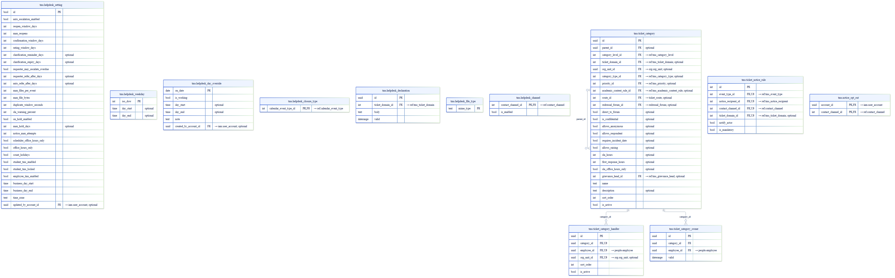

Every column of every table in this group, from the live schema (`created_at` / `updated_at` omitted). Lines are foreign keys inside the group; a note `→ table` is a foreign key to another group; amber = the group's hub. Source: [`catalog-diagrams/er-t1.mmd`](catalog-diagrams/er-t1.mmd).

| Table | What it holds | Links outside this group | Data flow — features that read (R) / write (W) its data store |
|---|---|---|---|
| [`helpdesk_setting`](#t-tms-helpdesk-setting) | One row of helpdesk policy: auto-escalation, the reopen window and the most reopenings, the confirmation window after which an uncontested resolution closes, the rating … | `iam.user_account` | [15.1](data-flow-features.md#f-15-1) RW · [15.2](data-flow-features.md#f-15-2) R · [15.5](data-flow-features.md#f-15-5) R · [15.7](data-flow-features.md#f-15-7) R · [15.8](data-flow-features.md#f-15-8) R |
| [`helpdesk_weekday`](#t-tms-helpdesk-weekday) | The days of the week the helpdesk works (ISO numbers, seeded Monday–Friday — POLICY), each with its own opening and closing time when it differs from the default … | — | [15.1](data-flow-features.md#f-15-1) RW · [15.2](data-flow-features.md#f-15-2) R · [15.5](data-flow-features.md#f-15-5) R · [15.7](data-flow-features.md#f-15-7) R · [15.8](data-flow-features.md#f-15-8) R |
| [`helpdesk_day_override`](#t-tms-helpdesk-day-override) | One date that differs from the weekly pattern and the academic calendar | `iam.user_account` | [15.1](data-flow-features.md#f-15-1) RW · [15.2](data-flow-features.md#f-15-2) R · [15.5](data-flow-features.md#f-15-5) R · [15.7](data-flow-features.md#f-15-7) R · [15.8](data-flow-features.md#f-15-8) R |
| [`helpdesk_closure_type`](#t-tms-helpdesk-closure-type) | Which academic-calendar event types close the offices | 1 lookup | [15.1](data-flow-features.md#f-15-1) RW · [15.2](data-flow-features.md#f-15-2) R · [15.5](data-flow-features.md#f-15-5) R · [15.7](data-flow-features.md#f-15-7) R · [15.8](data-flow-features.md#f-15-8) R |
| [`helpdesk_declaration`](#t-tms-helpdesk-declaration) | The declaration a requester accepts when raising a ticket of a domain ("the information is true; the matter is not before a court; I read the notices first") | 1 lookup | [15.1](data-flow-features.md#f-15-1) RW · [15.2](data-flow-features.md#f-15-2) R · [15.5](data-flow-features.md#f-15-5) R · [15.7](data-flow-features.md#f-15-7) R · [15.8](data-flow-features.md#f-15-8) R |
| [`helpdesk_file_type`](#t-tms-helpdesk-file-type) | The file types a ticket may carry (seeded PDF, PNG, JPEG — the old upload rule, POLICY); the size limit is `helpdesk_setting.max_file_bytes` | — | [15.1](data-flow-features.md#f-15-1) RW · [15.2](data-flow-features.md#f-15-2) R · [15.5](data-flow-features.md#f-15-5) R · [15.7](data-flow-features.md#f-15-7) R · [15.8](data-flow-features.md#f-15-8) R |
| [`helpdesk_channel`](#t-tms-helpdesk-channel) | The channels helpdesk notices go out on (in-app, e-mail, SMS), each with a kill switch — the old `TMS_EMAIL_ENABLED`, for every channel | 1 lookup | [15.1](data-flow-features.md#f-15-1) RW · [15.2](data-flow-features.md#f-15-2) R · [15.5](data-flow-features.md#f-15-5) R · [15.7](data-flow-features.md#f-15-7) R · [15.8](data-flow-features.md#f-15-8) R |
| [`ticket_category`](#t-tms-ticket-category) | The whole category hierarchy as one self-referencing tree, replacing the four old tables `TmsKraType`, `TmsMasterCategory`, `TmsCategory` and `TmsSubCategory` | `org.org_unit`, `redressal_forum`, `ticket_route`; 6 lookups | [15.1](data-flow-features.md#f-15-1) RW · [15.2](data-flow-features.md#f-15-2) R · [15.3](data-flow-features.md#f-15-3) R · [15.4](data-flow-features.md#f-15-4) R |
| [`ticket_category_owner`](#t-tms-ticket-category-owner) | The dated owner of a non-leaf node — the category owner, the master owner and, on a KRA type, the KRA head — one at a time (EXCLUDE) | `people.employee` | [15.1](data-flow-features.md#f-15-1) RW · [15.2](data-flow-features.md#f-15-2) R · [15.3](data-flow-features.md#f-15-3) R · [15.4](data-flow-features.md#f-15-4) R |
| [`ticket_category_handler`](#t-tms-ticket-category-handler) | The round-robin pool of a leaf, in order (replaces `TmsSubCategoryHandler`), optionally scoped to an org unit so that a school's or campus's own desk serves its students | `org.org_unit`, `people.employee` | [15.1](data-flow-features.md#f-15-1) RW · [15.2](data-flow-features.md#f-15-2) R · [15.3](data-flow-features.md#f-15-3) R · [15.4](data-flow-features.md#f-15-4) R |
| [`ticket_notice_rule`](#t-tms-ticket-notice-rule) | Which event notifies whom — the requester, the assignee after or before the event, the members of the forum hearing it, the requesters of tickets merged into it, the … | 4 lookups | [15.1](data-flow-features.md#f-15-1) RW · [15.2](data-flow-features.md#f-15-2) R · [15.5](data-flow-features.md#f-15-5) R · [15.7](data-flow-features.md#f-15-7) R · [15.8](data-flow-features.md#f-15-8) R |
| [`notice_opt_out`](#t-tms-notice-opt-out) | A person's choice not to receive helpdesk notices on a channel (the old `userSettings.emailNotifications = false`); notice rules marked mandatory | `iam.user_account`; 1 lookup | [15.8](data-flow-features.md#f-15-8) RW |

**Views over this group** (derived, never stored): `tms.v_grievance_register` · `tms.v_ticket_category` · `tms.v_ticket_sla`  
**Functions that read or write it:** `tms.available_actions()` · `tms.business_deadline()` · `tms.business_minutes_between()` · `tms.can_act()` · `tms.can_view()` · `tms.category_ancestors()` · `tms.category_subtree()` · `tms.config()` · `tms.day_hours()` · `tms.days_after()` · `tms.domain_is_open()` · `tms.eligible_assignees()` · `tms.is_business_moment()` · `tms.level_holder()` · `tms.manual_level()` · `tms.round_robin()` · `tms.run_scheduler()` · `tms.sla_office()`
<!-- /group:t1 -->

#### `tms.helpdesk_setting`
**Why it exists:** one row of helpdesk policy: auto-escalation, the reopen window and the most reopenings, the confirmation window after which an uncontested resolution closes, the rating window, clarification reminder and expiry, whether the requester may escalate an overdue ticket, after how many days the requester may refer a grievance and the helpdesk refers it automatically, files per entry and the largest file, the double-submission window, the attention warning threshold, holds and their longest duration, how often a notice is retried, whether the scheduler keeps office hours, the Student and Employee TMS switches with the Student TMS deployment lock (which the application role cannot update — column grant), whether SLA clocks count office hours only (the helpdesk-wide default a priority or category may override) and whether holidays stop the clock, office hours and the time zone (checked against `pg_timezone_names`). Replaces `TmsSettings` and the old environment flags; every value is a column an administrator changes, never code.
**Connects to →** `iam.user_account`.
**Referenced by ←** nothing.

#### `tms.helpdesk_weekday`
**Why it exists:** the days of the week the helpdesk works (ISO numbers, seeded Monday–Friday — POLICY), each with its own opening and closing time when it differs from the default (a Saturday half day). The clock counts office minutes only on these days; a table rather than an array column so that "Saturdays 9–1 are working" is one row.
**Connects to →** nothing.
**Referenced by ←** nothing.

#### `tms.helpdesk_day_override`
**Why it exists:** one date that differs from the weekly pattern and the academic calendar — the helpdesk open on a holiday or weekly off (a fee deadline, an exam-time Saturday) or closed on a normal day (an election, a shutdown) — with the reason and, optionally, its own hours. It wins over everything else; `tms.day_hours()` reads override → weekday → holiday (unless holidays are counted) → default hours, and `tms.helpdesk_calendar()` shows the result day by day for the administrator.
**Connects to →** `iam.user_account` (created by).
**Referenced by ←** nothing.

#### `tms.helpdesk_closure_type`
**Why it exists:** which academic-calendar event types close the offices. Holidays are the university-wide rows of `academic.calendar_event`, so the helpdesk uses the one calendar the university keeps instead of the old separate `TmsHolidayCalendar`; a HOLIDAY closes the helpdesk, a VACATION (no teaching) does not.
**Connects to →** `ref.calendar_event_type`.
**Referenced by ←** nothing.

#### `tms.helpdesk_declaration`
**Why it exists:** the declaration a requester accepts when raising a ticket of a domain ("the information is true; the matter is not before a court; I read the notices first") — the old raise form's checkbox, now dated text with one version in force per domain (EXCLUDE), so the ticket records exactly which text was accepted.
**Connects to →** `ref.tms_ticket_domain`.
**Referenced by ←** `tms.ticket`.

#### `tms.ticket_category`
**Why it exists:** the whole category hierarchy as one self-referencing tree, replacing the four old tables `TmsKraType`, `TmsMasterCategory`, `TmsCategory` and `TmsSubCategory`. A trigger enforces the shape by level (a KRA type only as an employee-domain root; a student tree starts at the master; each level directly under the one above), the category type on the master only, the priority on the leaf only, and a route of the tree's own domain. The root carries the domain and the responsible org unit (optionally narrowed below). Every handling setting — route, redressal forum, straight to the forum, confidential, anonymous allowed, respondents allowed, incident date required, UGC grievance head, academic-context rule, whether requesters may raise under it at all (internal-only nodes are reached by transfer), and the **category-wise SLA** (resolution hours, first-response hours, office hours or round the clock — overriding the priority's) — is NULL = "as the parent" and resolved in `v_ticket_category`, never copied down. A node cannot be moved once tickets were raised under it.
**Connects to →** `tms.ticket_category` (parent), `org.org_unit` (responsible unit), `tms.ticket_route`, `tms.redressal_forum`, `ref.tms_category_level`, `ref.tms_ticket_domain`, `ref.tms_category_type`, `ref.tms_priority`, `ref.tms_academic_context_rule`, `ref.tms_grievance_head`.
**Referenced by ←** `tms.ticket_category` (children), `tms.ticket_category_owner`, `tms.ticket_category_handler`, `tms.ticket` (raised under), `tms.ticket_event` (level node; transfer target), `tms.kb_article` (help articles).

#### `tms.ticket_category_owner`
**Why it exists:** the dated owner of a non-leaf node — the category owner, the master owner and, on a KRA type, the KRA head — one at a time (EXCLUDE). A CATEGORY_OWNER route level reaches them; owners may view the tickets below them and the KRA head may act on them. Replaces the `employeeId` columns of the old category tables and `TmsKraType.headEmployeeId`, now with history.
**Connects to →** `tms.ticket_category`, `people.employee`.
**Referenced by ←** nothing.

#### `tms.ticket_category_handler`
**Why it exists:** the round-robin pool of a leaf, in order (replaces `TmsSubCategoryHandler`), optionally scoped to an org unit so that a school's or campus's own desk serves its students: the most specific scope with someone free wins, unscoped handlers serve everyone else. The next handler is derived from the leaf's last round-robin event in that pool (`round_robin()`), not kept in a pointer column; a handler who cannot work now, raised the ticket or is named in it is skipped; picks are serialised per leaf.
**Connects to →** `tms.ticket_category`, `people.employee`, `org.org_unit` (scope).
**Referenced by ←** nothing.

#### `tms.ticket_notice_rule`
**Why it exists:** which event notifies whom — the requester, the assignee after or before the event, the members of the forum hearing it, the requesters of tickets merged into it, the person consulted or who asked, the last helpdesk handler — on which channel, per domain (NULL = both). Students now get e-mail too; nobody is told about their own action unless the rule is a receipt (`notify_actor`); `is_mandatory` rules (receipts, decisions) reach even someone who opted out; respondents are never notified.
**Connects to →** `ref.tms_event_type`, `ref.tms_notice_recipient`, `ref.contact_channel`, `ref.tms_ticket_domain`.
**Referenced by ←** nothing.

#### `tms.helpdesk_file_type`
**Why it exists:** the file types a ticket may carry (seeded PDF, PNG, JPEG — the old upload rule, POLICY); the size limit is `helpdesk_setting.max_file_bytes`. Checked on the type and size recorded in `people.file_object` whenever a file is attached.
**Connects to →** nothing.
**Referenced by ←** nothing.

#### `tms.helpdesk_channel`
**Why it exists:** the channels helpdesk notices go out on (in-app, e-mail, SMS), each with a kill switch — the old `TMS_EMAIL_ENABLED`, for every channel; a switched-off channel queues nothing.
**Connects to →** `ref.contact_channel`.
**Referenced by ←** nothing.

#### `tms.notice_opt_out`
**Why it exists:** a person's choice not to receive helpdesk notices on a channel (the old `userSettings.emailNotifications = false`); notice rules marked mandatory — receipts, referrals, decisions — still reach them. A preference, registered as personal data and deleted on erasure.
**Connects to →** `iam.user_account`, `ref.contact_channel`.
**Referenced by ←** nothing.

### 14.2 Routes & redressal forums

The ladders tickets climb — levels relative to the requester, to the category's office or fixed — and the forums that hear grievances beyond the helpdesk: a committee type or a position, its time limit, whether its decision must be a resolution, and where an appeal goes.

<!-- group:t3 -->
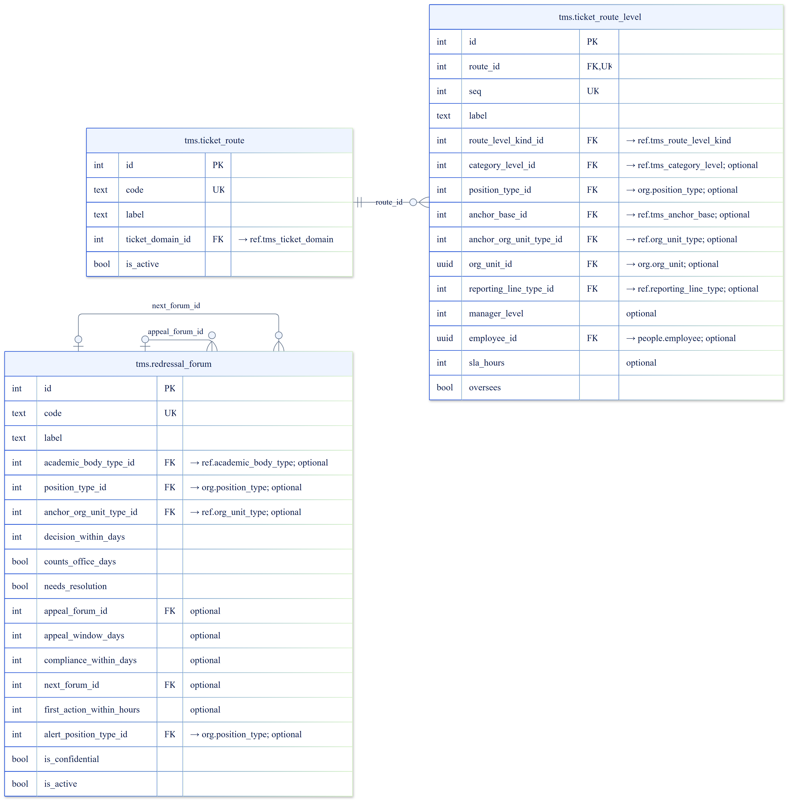

Every column of every table in this group, from the live schema (`created_at` / `updated_at` omitted). Lines are foreign keys inside the group; a note `→ table` is a foreign key to another group; amber = the group's hub. Source: [`catalog-diagrams/er-t3.mmd`](catalog-diagrams/er-t3.mmd).

| Table | What it holds | Links outside this group | Data flow — features that read (R) / write (W) its data store |
|---|---|---|---|
| [`ticket_route`](#t-tms-ticket-route) | A named ladder of one domain (seeded: student academic — mentor → HOD → Dean → Dean Academics → VC; student examination; student administrative; employee KRA tree) … | 1 lookup | [15.1](data-flow-features.md#f-15-1) RW · [15.2](data-flow-features.md#f-15-2) R · [15.4](data-flow-features.md#f-15-4) R · [15.6](data-flow-features.md#f-15-6) R |
| [`ticket_route_level`](#t-tms-ticket-route-level) | One level of a route, everything about it configuration | `org.org_unit`, `org.position_type`, `people.employee`; 5 lookups | [15.1](data-flow-features.md#f-15-1) RW · [15.2](data-flow-features.md#f-15-2) R · [15.4](data-flow-features.md#f-15-4) R · [15.6](data-flow-features.md#f-15-6) R |
| [`redressal_forum`](#t-tms-redressal-forum) | A body that hears grievances beyond the helpdesk — a committee type … | `org.position_type`; 2 lookups | [15.1](data-flow-features.md#f-15-1) RW · [15.2](data-flow-features.md#f-15-2) R · [15.4](data-flow-features.md#f-15-4) R · [15.6](data-flow-features.md#f-15-6) R |

**Views over this group** (derived, never stored): `tms.v_grievance_register` · `tms.v_ticket_requester_timeline` · `tms.v_ticket_state`  
**Functions that read or write it:** `tms.available_actions()` · `tms.can_act()` · `tms.can_view()` · `tms.forum_seat()` · `tms.level_candidate()` · `tms.level_holder()` · `tms.level_sla_minutes()` · `tms.manual_level()` · `tms.next_escalation()` · `tms.notice_accounts()` · `tms.run_scheduler()` · `tms.walk_route()`
<!-- /group:t3 -->

#### `tms.ticket_route`
**Why it exists:** a named ladder of one domain (seeded: student academic — mentor → HOD → Dean → Dean Academics → VC; student examination; student administrative; employee KRA tree), attached to category nodes and inherited down the tree. A ticket keeps the route it was raised under (or moved to by a transfer), so changing the configuration does not re-route tickets in flight. Replaces the fixed ladder of the old escalation service and the earlier `ticket_escalation_step`.
**Connects to →** `ref.tms_ticket_domain`.
**Referenced by ←** `tms.ticket_route_level`, `tms.ticket_category`, `tms.ticket`, `tms.ticket_event` (transfer).

#### `tms.ticket_route_level`
**Why it exists:** one level of a route, everything about it configuration: a handler pool, the owner of the ticket's node at a category level, the student's mentor, the employee's manager *n* levels up, the holder of a position at the requester's unit / the category's unit / a fixed unit (or the nearest unit of a type above it), or a named person; an optional SLA override; `oversees` = its holder may act at any time (the old category-type heads). A trigger checks each kind's settings and that the position exists for the unit type. Who holds the office is `org.appointment`, `people.student_mentor` or `people.employee_reporting_line`, so a change of HOD changes the ladder with no helpdesk edit.
**Connects to →** `tms.ticket_route`, `ref.tms_route_level_kind`, `ref.tms_category_level`, `org.position_type`, `ref.tms_anchor_base`, `ref.org_unit_type`, `org.org_unit`, `ref.reporting_line_type`, `people.employee`.
**Referenced by ←** `tms.ticket_event` (level reached).

#### `tms.redressal_forum`
**Why it exists:** a body that hears grievances beyond the helpdesk — a committee type (SGRC, Internal Complaints Committee, Anti-Ragging Committee, Equal Opportunity Cell: `ref.academic_body_type`) or a position (the Ombudsperson). The body or holder for a case is the nearest one at or above the requester's unit (of an anchor unit type, if set), so one university SGRC or one per school is just which bodies exist. Carries the time limit (calendar or business days, POLICY), whether the decision must be a resolution of a quorate meeting, the appeal forum and window (no cycles), how long a decision in the requester's favour may take to carry out (compliance), the default committee it forwards a case to (the anti-ragging squad's report goes to the committee), the time for its first action on a case and who is alerted when that is late (the head of the institution for ragging), and confidentiality.
**Connects to →** `ref.academic_body_type`, `org.position_type` (holder; alert position), `ref.org_unit_type`, `tms.redressal_forum` (appeal forum, default forward).
**Referenced by ←** `tms.redressal_forum` (appeal forum, default forward), `tms.ticket_category`, `tms.ticket_event` (referral, appeal, forwarding).

### 14.3 Tickets, respondents, the timeline & notices

A ticket is the facts as raised (immutable, TMS-YYYY-NNNNN), with its academic context and any person it is against; everything that happens afterwards is an append-only event, with its files, from which status, assignee, level, forum, the SLA clock, resolution, closure reason and the rating are derived; each event queues its notices once per recipient and channel.

<!-- group:t2 -->
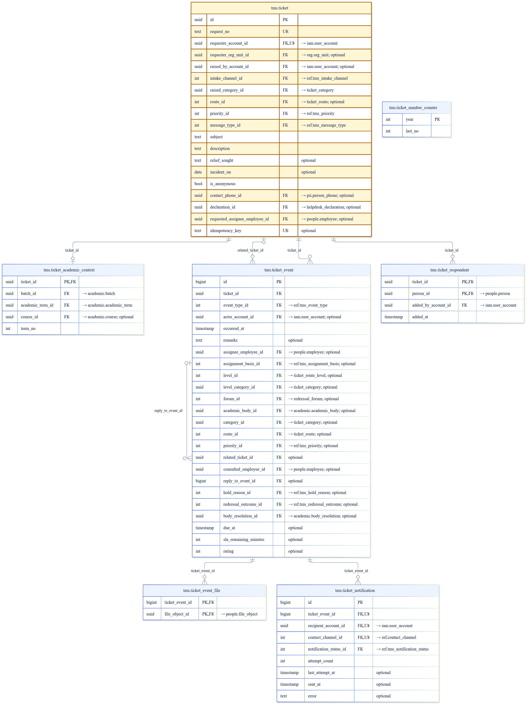

Every column of every table in this group, from the live schema (`created_at` / `updated_at` omitted). Lines are foreign keys inside the group; a note `→ table` is a foreign key to another group; amber = the group's hub. Source: [`catalog-diagrams/er-t2.mmd`](catalog-diagrams/er-t2.mmd).

| Table | What it holds | Links outside this group | Data flow — features that read (R) / write (W) its data store |
|---|---|---|---|
| [`ticket`](#t-tms-ticket) | A raised ticket, TMS-YYYY-NNNNN: who raised it (an account — names, e-mail and department are never copied), the intake desk that recorded it for them and the channel … | `iam.user_account`, `org.org_unit`, `people.employee`, `pii.person_phone`, `helpdesk_declaration`, `ticket_category`, `ticket_route`; 3 lookups | [15.2](data-flow-features.md#f-15-2) W · [15.5](data-flow-features.md#f-15-5) W · [15.8](data-flow-features.md#f-15-8) R · [15.9](data-flow-features.md#f-15-9) R |
| [`ticket_number_counter`](#t-tms-ticket-number-counter) | The last request number used per calendar year, taken under a row lock, so TMS-YYYY-NNNNN restarts at 00001 every year as in the old system … | — | [15.2](data-flow-features.md#f-15-2) W · [15.5](data-flow-features.md#f-15-5) W · [15.8](data-flow-features.md#f-15-8) R · [15.9](data-flow-features.md#f-15-9) R |
| [`ticket_academic_context`](#t-tms-ticket-academic-context) | The academic context of a ticket whose category needs it | `academic.academic_term`, `academic.batch`, `academic.course` | [15.2](data-flow-features.md#f-15-2) W · [15.5](data-flow-features.md#f-15-5) W · [15.8](data-flow-features.md#f-15-8) R · [15.9](data-flow-features.md#f-15-9) R |
| [`ticket_respondent`](#t-tms-ticket-respondent) | A person a complaint is against (a teacher, an officer, another student), named by the requester or the handling side where the category allows it | `iam.user_account`, `people.person` | [15.2](data-flow-features.md#f-15-2) W · [15.5](data-flow-features.md#f-15-5) W · [15.8](data-flow-features.md#f-15-8) R · [15.9](data-flow-features.md#f-15-9) R |
| [`ticket_event`](#t-tms-ticket-event) | The ticket's timeline, append-only: raised; public reply and internal note; requester's comment; clarification requested / provided / reminded / expired | `academic.academic_body`, `academic.body_resolution`, `iam.user_account`, `people.employee`, `redressal_forum`, `ticket_category`, `ticket_route`, `ticket_route_level`; 5 lookups | [15.2](data-flow-features.md#f-15-2) W · [15.3](data-flow-features.md#f-15-3) RW · [15.4](data-flow-features.md#f-15-4) W · [15.5](data-flow-features.md#f-15-5) W · [15.6](data-flow-features.md#f-15-6) W · [15.7](data-flow-features.md#f-15-7) RW · [15.8](data-flow-features.md#f-15-8) R · [15.9](data-flow-features.md#f-15-9) R |
| [`ticket_event_file`](#t-tms-ticket-event-file) | Files attached to a timeline entry — the ticket's own files on its CREATED entry, a reply's document, a clarification's proof, the forum's signed order | `people.file_object` | [15.2](data-flow-features.md#f-15-2) W · [15.3](data-flow-features.md#f-15-3) RW · [15.4](data-flow-features.md#f-15-4) W · [15.5](data-flow-features.md#f-15-5) W · [15.6](data-flow-features.md#f-15-6) W · [15.7](data-flow-features.md#f-15-7) RW · [15.8](data-flow-features.md#f-15-8) R · [15.9](data-flow-features.md#f-15-9) R |
| [`ticket_notification`](#t-tms-ticket-notification) | The delivery log of the notices each event causes, one row per event × recipient × channel … | `iam.user_account`; 2 lookups | [15.8](data-flow-features.md#f-15-8) RW |

**Views over this group** (derived, never stored): `tms.v_grievance_register` · `tms.v_ticket_consultation` · `tms.v_ticket_handler_stats` · `tms.v_ticket_participant` · `tms.v_ticket_requester_timeline` · `tms.v_ticket_sla` · `tms.v_ticket_state`  
**Functions that read or write it:** `tms.available_actions()` · `tms.can_download()` · `tms.can_report_compliance()` · `tms.can_view()` · `tms.is_respondent()` · `tms.level_candidate()` · `tms.level_holder()` · `tms.notice_accounts()` · `tms.requester_shown_to()` · `tms.round_robin()` · `tms.run_scheduler()`
<!-- /group:t2 -->

#### `tms.ticket`
**Why it exists:** a raised ticket, TMS-YYYY-NNNNN: who raised it (an account — names, e-mail and department are never copied), the intake desk that recorded it for them and the channel (walk-in, phone, e-mail, letter), the leaf, message type, subject, description, relief sought, incident date, anonymity, the requester's own phone, the declaration accepted, a manually chosen assignee (non-teaching staff, someone on the route) and an idempotency key. Set by the trigger, never by the caller: the number, the priority and route of the leaf (the terms the requester got), and the requester's unit when raised — what "relative to the requester" means for this ticket. Never updated or deleted; raising it routes it and writes the CREATED event (or files it straight with a forum).
**Connects to →** `iam.user_account` (requester, raised by), `org.org_unit` (requester's unit), `tms.ticket_category` (raised under), `tms.ticket_route`, `tms.helpdesk_declaration`, `people.employee` (chosen assignee), `pii.person_phone` (contact), `ref.tms_priority`, `ref.tms_message_type`, `ref.tms_intake_channel`.
**Referenced by ←** `tms.ticket_academic_context`, `tms.ticket_respondent`, `tms.ticket_event` (ticket; merged into).

#### `tms.ticket_number_counter`
**Why it exists:** the last request number used per calendar year, taken under a row lock, so TMS-YYYY-NNNNN restarts at 00001 every year as in the old system (which used MAX+1 under an advisory lock); the year is in the configured time zone. Bookkeeping, not audited.
**Connects to →** nothing.
**Referenced by ←** nothing.

#### `tms.ticket_academic_context`
**Why it exists:** the academic context of a ticket whose category needs it — batch, term, semester and (when the category's rule says so) course as references, replacing the old text snapshots and the separate `TmsAcademicSession` / `TmsAdmissionBatch` lists. Given in the same transaction as the ticket (a deferred constraint trigger insists), the student's own batch on the student side, consistent with the programme's calendar and odd / even cycle, never edited.
**Connects to →** `tms.ticket`, `academic.batch`, `academic.academic_term`, `academic.course`.
**Referenced by ←** nothing.

#### `tms.ticket_respondent`
**Why it exists:** a person a complaint is against (a teacher, an officer, another student), named by the requester or the handling side where the category allows it. The respondent never handles, hears, sees or is notified about the ticket; naming the current assignee moves the ticket on (a RECUSED event). Kept on record, never removed — a grievance-case record retained under legal obligation.
**Connects to →** `tms.ticket`, `people.person`, `iam.user_account` (added by).
**Referenced by ←** nothing.

#### `tms.ticket_event`
**Why it exists:** the ticket's timeline, append-only: raised; public reply and internal note; requester's comment; clarification requested / provided / reminded / expired; escalated (by hand, by the requester when overdue, or by the job); top reached; recused; reassigned; transferred; referred to a forum, appealed, decided (with outcome and the committee's resolution); resolved, rejected as not maintainable, merged, accepted, auto-closed, reopened, withdrawn; rated; overdue notice; put on hold and released (by hand or the job); another office consulted and its answer; the action taken on a committee's decision and the reminder when it is late; forwarded from one committee to another; the alert when a committee has not acted in time. Each event must be allowed in the current status (`ref.tms_event_allowed_status`) for its kind of actor, is validated against the state it changes one at a time per ticket, and its derived values — the next assignee, level or forum seat, the due time, the minutes left — are computed by the trigger. Status, assignee, level, forum, clock, resolution, closure reason, rating and counts are derived from it (`v_ticket_state`); the requester sees only the events meant for them (`v_ticket_requester_timeline`).
**Connects to →** `tms.ticket` (ticket, related ticket), `tms.ticket_event` (the consultation answered), `iam.user_account` (actor), `people.employee` (assignee, person consulted), `tms.ticket_route_level` (level), `tms.ticket_category` (level node, transfer target), `tms.ticket_route`, `tms.redressal_forum`, `academic.academic_body` (committee hearing it), `academic.body_resolution` (decision), `ref.tms_event_type`, `ref.tms_assignment_basis`, `ref.tms_priority`, `ref.tms_redressal_outcome`, `ref.tms_hold_reason`.
**Referenced by ←** `tms.ticket_event` (a consultation's answer), `tms.ticket_event_file`, `tms.ticket_notification`.

#### `tms.ticket_event_file`
**Why it exists:** files attached to a timeline entry — the ticket's own files on its CREATED entry, a reply's document, a clarification's proof, the forum's signed order — added in the transaction that records the entry, only on events that take files, up to the configured number. Replaces the single `documentPath` columns; part of the record, never changed.
**Connects to →** `tms.ticket_event`, `people.file_object`.
**Referenced by ←** nothing.

#### `tms.ticket_notification`
**Why it exists:** the delivery log of the notices each event causes, one row per event × recipient × channel (so a retry can never send twice — the old `TmsEmailNotification` dedupe key, made a constraint). The address is looked up when sending, never stored; the sender records the outcome, and a final status (sent, skipped) cannot change.
**Connects to →** `tms.ticket_event`, `iam.user_account` (recipient), `ref.contact_channel`, `ref.tms_notification_status`.
**Referenced by ←** nothing.

### 14.4 Knowledge base

Help articles shown before a ticket is raised — on a category node (and every leaf below it) or a whole domain, with dated publication — and anonymous feedback on whether they answered the question, which measures how many tickets they spared.

<!-- group:t4 -->
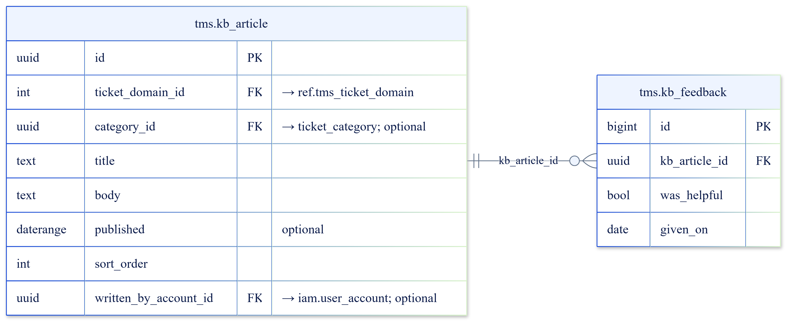

Every column of every table in this group, from the live schema (`created_at` / `updated_at` omitted). Lines are foreign keys inside the group; a note `→ table` is a foreign key to another group; amber = the group's hub. Source: [`catalog-diagrams/er-t4.mmd`](catalog-diagrams/er-t4.mmd).

| Table | What it holds | Links outside this group | Data flow — features that read (R) / write (W) its data store |
|---|---|---|---|
| [`kb_article`](#t-tms-kb-article) | A self-help article for a domain, optionally on a category node | `iam.user_account`, `ticket_category`; 1 lookup | [15.1](data-flow-features.md#f-15-1) RW · [15.2](data-flow-features.md#f-15-2) RW · [15.9](data-flow-features.md#f-15-9) R |
| [`kb_feedback`](#t-tms-kb-feedback) | Whether an article answered the reader's question — true means no ticket was needed | — | [15.1](data-flow-features.md#f-15-1) RW · [15.2](data-flow-features.md#f-15-2) RW · [15.9](data-flow-features.md#f-15-9) R |

**Views over this group** (derived, never stored): `tms.v_kb_article_stats`  
**Functions that read or write it:** `tms.kb_articles_for()`
<!-- /group:t4 -->

#### `tms.kb_article`
**Why it exists:** a self-help article for a domain, optionally on a category node — the raise screen shows the published articles of the chosen leaf, of every node above it and of the whole domain (`kb_articles_for()`) before the requester writes a ticket. Replaces the old form's "I have read the notices" checkbox with the notices themselves; the category must be of the article's domain.
**Connects to →** `ref.tms_ticket_domain`, `tms.ticket_category`, `iam.user_account` (written by).
**Referenced by ←** `tms.kb_feedback`.

#### `tms.kb_feedback`
**Why it exists:** whether an article answered the reader's question — true means no ticket was needed. Anonymous by construction (no account, a date instead of a time), append-only, not audited, and only its totals reach analytics (`v_kb_article_stats`: answers, helpful, deflection share).
**Connects to →** `tms.kb_article`.
**Referenced by ←** nothing.

---

## 15. `events` — clubs & event management (74)

The club and event module of the old SGT UMS, rebuilt on the foundation (`sql/13_events.sql`, tests in `sql/97_events_smoke_test.sql`). **Nothing here approves anything**: founding a club and holding an event are two document types on the approval engine (§10) — CLUB_PROPOSAL and EVENT_PROPOSAL — whose levels are chain rows. Seeded default: a club proposal goes to the central coordination committee; an event proposal to the organising unit's advisor / head (skipped when they are the proposer) and then to the committee, each with a deadline. A school that wants its Dean above a budget, a committee quorum instead of one member, or an extra level for paid events or external guests adds a chain scoped to itself — the round already carries the budget total as its amount and the flags PAID_EVENT / EXTERNAL_GUESTS / SPONSORED.

**After approval the event is followed to its end.** A club is an `org.org_unit` of type CLUB with advisor appointments, so permissions, scoping and custody work as for any unit. An approved proposal creates the event; the organisers publish it; people register (seats, waiting list, guests, extra questions), form teams, are scanned in and out at the gate; winners, certificates, anonymous feedback and the report follow; completing the event gives the club its points. Rooms and vehicles are requested through the `facility` package that shares the proposal's round, so one approval covers the event and its venue, and cancelling the event frees them. Every status is derived (`v_event`, `v_registration`, `v_team`, `v_club`, `v_proposal_status`). Paid events have coupons and payments (online orders and offline claims, with a derived refund queue); organisers write to their registrants within a credit allowance; an event may have stalls, applied for, paid and rated; people may offer to volunteer; and a running club is changed only through an approved change request. The conversation with the payment gateway and the sending of mail are the application's — the database holds the facts and the rules.

### 15.1 Clubs: founding, officers, members

A club of any kind (academic, technical, cultural, sports … — `ref.club_category`) is an org unit of type CLUB under a school, a department, a central department such as student welfare, or the university; here are its founding proposal (approved through the engine), its student officers and members over time, applications to join, suspensions and the yearly calendar.

<!-- group:n1 -->
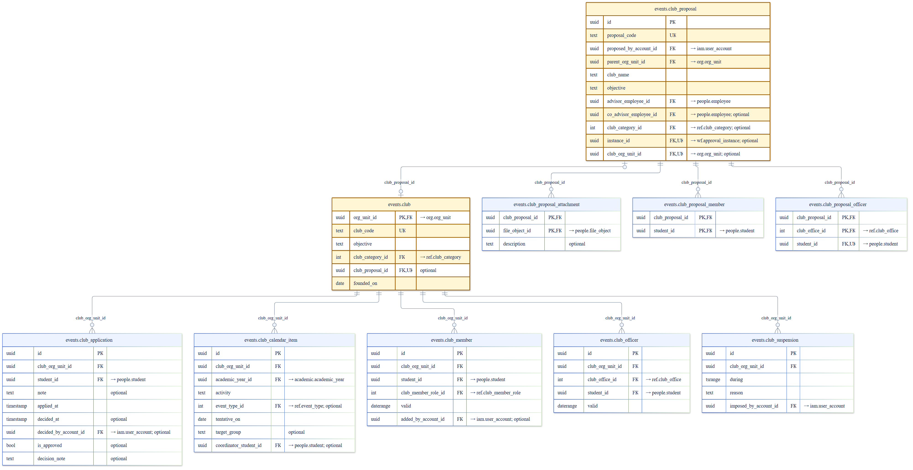

Every column of every table in this group, from the live schema (`created_at` / `updated_at` omitted). Lines are foreign keys inside the group; a note `→ table` is a foreign key to another group; amber = the group's hub. Source: [`catalog-diagrams/er-n1.mmd`](catalog-diagrams/er-n1.mmd).

| Table | What it holds | Links outside this group | Data flow — features that read (R) / write (W) its data store |
|---|---|---|---|
| [`club_proposal`](#t-events-club-proposal) | The proposal to found a club: the unit it will sit under (university, school, department or central department), name, objective, the faculty advisor and co-advisor, and | `iam.user_account`, `org.org_unit`, `people.employee`, `wf.approval_instance`; 1 lookup | [16.1](data-flow-features.md#f-16-1) RW · [16.2](data-flow-features.md#f-16-2) R |
| [`club_proposal_officer`](#t-events-club-proposal-officer) | The student officers named in a club proposal: one per office, a student in one office, a president required before submission; only current students | `people.student`; 1 lookup | [16.1](data-flow-features.md#f-16-1) RW · [16.2](data-flow-features.md#f-16-2) R |
| [`club_proposal_member`](#t-events-club-proposal-member) | The founding members named in a club proposal: one row per proposal and student | `people.student` | [16.1](data-flow-features.md#f-16-1) RW · [16.2](data-flow-features.md#f-16-2) R |
| [`club_proposal_attachment`](#t-events-club-proposal-attachment) | Files attached to a club proposal (constitution, objectives, letters) | `people.file_object` | [16.1](data-flow-features.md#f-16-1) RW · [16.2](data-flow-features.md#f-16-2) R |
| [`club`](#t-events-club) | A student club: exactly one row per org unit of type CLUB (CLB-YYYY-NNNNN, objective, founding proposal) | `org.org_unit`; 1 lookup | [16.2](data-flow-features.md#f-16-2) W · [16.3](data-flow-features.md#f-16-3) RW · [16.4](data-flow-features.md#f-16-4) W · [16.5](data-flow-features.md#f-16-5) R |
| [`club_officer`](#t-events-club-officer) | Who holds which student post of a club over time (president, secretary, joint secretary, document curator, creative head) | `people.student`; 1 lookup | [16.2](data-flow-features.md#f-16-2) W · [16.3](data-flow-features.md#f-16-3) RW · [16.4](data-flow-features.md#f-16-4) W · [16.5](data-flow-features.md#f-16-5) R |
| [`club_member`](#t-events-club-member) | Club membership over time with the member's role; a student is a member of a club once at a time | `iam.user_account`, `people.student`; 1 lookup | [16.2](data-flow-features.md#f-16-2) W · [16.3](data-flow-features.md#f-16-3) RW · [16.4](data-flow-features.md#f-16-4) W · [16.5](data-flow-features.md#f-16-5) R |
| [`club_application`](#t-events-club-application) | A student's application to join a club and the decision of an advisor or officer; one open application per student and club | `iam.user_account`, `people.student` | [16.2](data-flow-features.md#f-16-2) W · [16.3](data-flow-features.md#f-16-3) RW · [16.4](data-flow-features.md#f-16-4) W · [16.5](data-flow-features.md#f-16-5) R |
| [`club_suspension`](#t-events-club-suspension) | A period during which a club is suspended, with the reason and who imposed it (the coordination committee) | `iam.user_account` | [16.2](data-flow-features.md#f-16-2) W · [16.3](data-flow-features.md#f-16-3) RW · [16.4](data-flow-features.md#f-16-4) W · [16.5](data-flow-features.md#f-16-5) R |
| [`club_calendar_item`](#t-events-club-calendar-item) | A club's planned activities for an academic year: what (non-empty), the event type, a tentative date, the target group and a coordinating student | `academic.academic_year`, `people.student`; 1 lookup | [16.2](data-flow-features.md#f-16-2) W · [16.3](data-flow-features.md#f-16-3) RW · [16.4](data-flow-features.md#f-16-4) W · [16.5](data-flow-features.md#f-16-5) R |

**Views over this group** (derived, never stored): `events.v_club` · `events.v_club_officer_current` · `events.v_club_points`  
**Functions that read or write it:** `events.apply_club_change()` · `events.club_is_active()` · `events.is_club_officer()` · `events.may_propose_for()` · `events.submit_club_proposal()` · `events.submit_proposal()`
<!-- /group:n1 -->

#### `events.club_proposal`
**Why it exists:** the proposal to found a club: the unit it will sit under (university, school, department or central department), name, objective, the faculty advisor and co-advisor, and — in the child tables — the first officers and members. A draft until `events.submit_club_proposal()` opens its CLUB_PROPOSAL round; then frozen. Approval (the hook on `wf.approval_action`) creates the org unit of type CLUB, the `club` row, the two advisor appointments, the officers and the members in one transaction — the old system's `StudentClubProposal` with its status columns, now a document on the engine.
**Connects to →** `iam.user_account` (proposed by), `org.org_unit` (club, parent), `people.employee` (advisor, co advisor), `wf.approval_instance`, `ref.club_category`.
**Referenced by ←** `events.club`, `events.club_proposal_attachment`, `events.club_proposal_member`, `events.club_proposal_officer`.

#### `events.club_proposal_officer`
**Why it exists:** the student officers named in a club proposal: one per office, a student in one office, a president required before submission; only current students.
**Connects to →** `events.club_proposal`, `people.student`, `ref.club_office`.
**Referenced by ←** nothing.

#### `events.club_proposal_member`
**Why it exists:** the founding members named in a club proposal: one row per proposal and student. Only current students can be named, and the list freezes the moment the proposal is submitted (the trigger refuses any change after that); on approval the members become the club's first members.
**Connects to →** `events.club_proposal`, `people.student`.
**Referenced by ←** nothing.

#### `events.club_proposal_attachment`
**Why it exists:** files attached to a club proposal (constitution, objectives, letters): one row per proposal and file, frozen once the proposal is submitted so the approvers decide on exactly what was sent.
**Connects to →** `events.club_proposal`, `people.file_object`.
**Referenced by ←** nothing.

#### `events.club`
**Why it exists:** a student club: exactly one row per org unit of type CLUB (CLB-YYYY-NNNNN, objective, founding proposal). Everything a club shares with any other unit is not repeated here — its name, parent and active flag are the org unit's, its faculty advisor and co-advisor are `org.appointment` rows (positions CLUB_ADVISOR / CLUB_CO_ADVISOR), so scoped permissions, the approval chain's owner anchor and facility custody work for a club exactly as for a department. Status (active / suspended / inactive) is derived (`v_club`). **Every kind of club is the same thing with two facts on it:** *whose* it is — its parent unit: an academic club under its school or department, a cultural, sports or social-service club under the Dean Students' Welfare office (or any other central department), a university-wide society under the university — and *what* it is — its category (`ref.club_category`: academic, technical, cultural, sports, literary, social service, professional chapter, hobby …; a list an administrator extends). The parent unit decides which approval chain applies (a chain scoped to the DSW office gives its clubs their own path: its head, then the committee); the category travels on every club and event approval round as a flag (`CLUBCAT_<code>`), so a level can also depend on the kind of club.
**Connects to →** `events.club_proposal`, `org.org_unit`, `ref.club_category`.
**Referenced by ←** `events.club_application`, `events.club_calendar_item`, `events.club_member`, `events.club_officer`, `events.club_suspension`, `events.club_change_request`, `events.primary_club`.

#### `events.club_officer`
**Why it exists:** who holds which student post of a club over time (president, secretary, joint secretary, document curator, creative head): one holder per office and one office per student at a time (two EXCLUDE constraints), only current students, not while the club is suspended. `ref.club_office.may_propose` decides which officers may propose the club's events.
**Connects to →** `events.club`, `people.student`, `ref.club_office`.
**Referenced by ←** nothing.

#### `events.club_member`
**Why it exists:** club membership over time with the member's role; a student is a member of a club once at a time. Created by the founding proposal or by an approved application; ended, never deleted.
**Connects to →** `events.club`, `iam.user_account` (added by), `people.student`, `ref.club_member_role`.
**Referenced by ←** nothing.

#### `events.club_application`
**Why it exists:** a student's application to join a club and the decision of an advisor or officer; one open application per student and club; approval creates the membership in the same transaction.
**Connects to →** `events.club`, `iam.user_account` (decided by), `people.student`.
**Referenced by ←** nothing.

#### `events.club_suspension`
**Why it exists:** a period during which a club is suspended, with the reason and who imposed it (the coordination committee); a suspended club cannot propose events, take members or change officers. One suspension at a time; lifting it closes the row.
**Connects to →** `events.club`, `iam.user_account` (imposed by).
**Referenced by ←** nothing.

#### `events.club_calendar_item`
**Why it exists:** a club's planned activities for an academic year: what (non-empty), the event type, a tentative date, the target group and a coordinating student. It is a plan, not an event — an activity becomes an event only through an approved event proposal.
**Connects to →** `events.club`, `academic.academic_year`, `people.student` (coordinator), `ref.event_type`.
**Referenced by ←** nothing.

### 15.2 Event proposals, budgets & sponsors

What is proposed and approved: the proposal with its audience, SDGs, partners, speakers, coordinators, budget lines, funding, prizes, attachments and visibility; sponsors and what they commit and deliver.

<!-- group:n2 -->
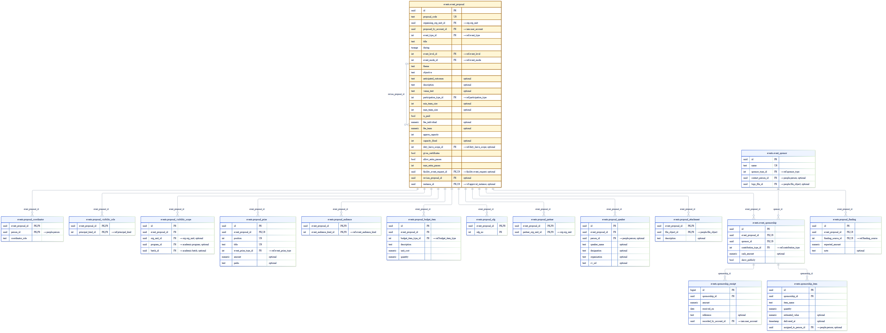

Every column of every table in this group, from the live schema (`created_at` / `updated_at` omitted). Lines are foreign keys inside the group; a note `→ table` is a foreign key to another group; amber = the group's hub. Source: [`catalog-diagrams/er-n2.mmd`](catalog-diagrams/er-n2.mmd).

| Table | What it holds | Links outside this group | Data flow — features that read (R) / write (W) its data store |
|---|---|---|---|
| [`event_proposal`](#t-events-event-proposal) | An event proposal by a club or a unit — the old `ClubEventProposal` | `facility.event_request`, `iam.user_account`, `org.org_unit`, `wf.approval_instance`; 5 lookups | [16.5](data-flow-features.md#f-16-5) RW · [16.6](data-flow-features.md#f-16-6) RW · [16.7](data-flow-features.md#f-16-7) R · [16.9](data-flow-features.md#f-16-9) R · [16.10](data-flow-features.md#f-16-10) W · [16.16](data-flow-features.md#f-16-16) R · [16.21](data-flow-features.md#f-16-21) R |
| [`proposal_audience`](#t-events-proposal-audience) | Who the proposed event is for (students, faculty, staff, alumni, external guests, industry …), one row per kind of audience; frozen once the proposal is submitted | 1 lookup | [16.5](data-flow-features.md#f-16-5) RW · [16.6](data-flow-features.md#f-16-6) RW · [16.7](data-flow-features.md#f-16-7) R · [16.9](data-flow-features.md#f-16-9) R · [16.10](data-flow-features.md#f-16-10) W · [16.16](data-flow-features.md#f-16-16) R · [16.21](data-flow-features.md#f-16-21) R |
| [`proposal_sdg`](#t-events-proposal-sdg) | The UN Sustainable Development Goals (numbers 1–17) the proposed event serves, one row per goal; frozen once submitted | — | [16.5](data-flow-features.md#f-16-5) RW · [16.6](data-flow-features.md#f-16-6) RW · [16.7](data-flow-features.md#f-16-7) R · [16.9](data-flow-features.md#f-16-9) R · [16.10](data-flow-features.md#f-16-10) W · [16.16](data-flow-features.md#f-16-16) R · [16.21](data-flow-features.md#f-16-21) R |
| [`proposal_partner`](#t-events-proposal-partner) | The clubs or other units collaborating on a proposed event, one row per unit (the organiser itself is the proposal's own unit); frozen once submitted | `org.org_unit` | [16.5](data-flow-features.md#f-16-5) RW · [16.6](data-flow-features.md#f-16-6) RW · [16.7](data-flow-features.md#f-16-7) R · [16.9](data-flow-features.md#f-16-9) R · [16.10](data-flow-features.md#f-16-10) W · [16.16](data-flow-features.md#f-16-16) R · [16.21](data-flow-features.md#f-16-21) R |
| [`proposal_speaker`](#t-events-proposal-speaker) | Resource persons / guest speakers: a person in the system or an outside name | `people.person` | [16.5](data-flow-features.md#f-16-5) RW · [16.6](data-flow-features.md#f-16-6) RW · [16.7](data-flow-features.md#f-16-7) R · [16.9](data-flow-features.md#f-16-9) R · [16.10](data-flow-features.md#f-16-10) W · [16.16](data-flow-features.md#f-16-16) R · [16.21](data-flow-features.md#f-16-21) R |
| [`proposal_coordinator`](#t-events-proposal-coordinator) | The coordinators of the proposed event — people of the university, each with a stated role (non-empty), once per proposal; frozen once submitted | `people.person` | [16.5](data-flow-features.md#f-16-5) RW · [16.6](data-flow-features.md#f-16-6) RW · [16.7](data-flow-features.md#f-16-7) R · [16.9](data-flow-features.md#f-16-9) R · [16.10](data-flow-features.md#f-16-10) W · [16.16](data-flow-features.md#f-16-16) R · [16.21](data-flow-features.md#f-16-21) R |
| [`proposal_budget_item`](#t-events-proposal-budget-item) | The budget line by line (type, description, unit cost, quantity) | 1 lookup | [16.5](data-flow-features.md#f-16-5) RW · [16.6](data-flow-features.md#f-16-6) RW · [16.7](data-flow-features.md#f-16-7) R · [16.9](data-flow-features.md#f-16-9) R · [16.10](data-flow-features.md#f-16-10) W · [16.16](data-flow-features.md#f-16-16) R · [16.21](data-flow-features.md#f-16-21) R |
| [`proposal_funding`](#t-events-proposal-funding) | The expected sources of funds for a proposal (university fund, sponsorship, registration fees, other): one row per source, each with a positive expected amount | 1 lookup | [16.5](data-flow-features.md#f-16-5) RW · [16.6](data-flow-features.md#f-16-6) RW · [16.7](data-flow-features.md#f-16-7) R · [16.9](data-flow-features.md#f-16-9) R · [16.10](data-flow-features.md#f-16-10) W · [16.16](data-flow-features.md#f-16-16) R · [16.21](data-flow-features.md#f-16-21) R |
| [`proposal_prize`](#t-events-proposal-prize) | The prizes on offer: position (from 1), title, prize type and amount (≥ 0), unique per proposal by position and title; frozen once submitted | 1 lookup | [16.5](data-flow-features.md#f-16-5) RW · [16.6](data-flow-features.md#f-16-6) RW · [16.7](data-flow-features.md#f-16-7) R · [16.9](data-flow-features.md#f-16-9) R · [16.10](data-flow-features.md#f-16-10) W · [16.16](data-flow-features.md#f-16-16) R · [16.21](data-flow-features.md#f-16-21) R |
| [`proposal_attachment`](#t-events-proposal-attachment) | Files attached to an event proposal (posters, brochures, letters): one row per proposal and file, frozen once the proposal is submitted | `people.file_object` | [16.5](data-flow-features.md#f-16-5) RW · [16.6](data-flow-features.md#f-16-6) RW · [16.7](data-flow-features.md#f-16-7) R · [16.9](data-flow-features.md#f-16-9) R · [16.10](data-flow-features.md#f-16-10) W · [16.16](data-flow-features.md#f-16-16) R · [16.21](data-flow-features.md#f-16-21) R |
| [`proposal_visibility_role`](#t-events-proposal-visibility-role) | The kinds of people (student / employee / guardian) who may see and register for the event; no row = everyone | 1 lookup | [16.5](data-flow-features.md#f-16-5) RW · [16.6](data-flow-features.md#f-16-6) RW · [16.7](data-flow-features.md#f-16-7) R · [16.9](data-flow-features.md#f-16-9) R · [16.10](data-flow-features.md#f-16-10) W · [16.16](data-flow-features.md#f-16-16) R · [16.21](data-flow-features.md#f-16-21) R |
| [`proposal_visibility_scope`](#t-events-proposal-visibility-scope) | For students: the schools / departments, programmes or batches the event is open to; no row = every student | `academic.batch`, `academic.program`, `org.org_unit` | [16.5](data-flow-features.md#f-16-5) RW · [16.6](data-flow-features.md#f-16-6) RW · [16.7](data-flow-features.md#f-16-7) R · [16.9](data-flow-features.md#f-16-9) R · [16.10](data-flow-features.md#f-16-10) W · [16.16](data-flow-features.md#f-16-16) R · [16.21](data-flow-features.md#f-16-21) R |
| [`event_sponsor`](#t-events-event-sponsor) | Sponsoring organisations known across events (name, type, contact person as a reference when the contact is in the system) — recorded once, not retyped per event | `people.file_object`, `people.person`; 1 lookup | [16.7](data-flow-features.md#f-16-7) RW |
| [`event_sponsorship`](#t-events-event-sponsorship) | A sponsor's commitment to one proposal: cash amount and / or in-kind items, by contribution type | 1 lookup | [16.7](data-flow-features.md#f-16-7) RW |
| [`sponsorship_receipt`](#t-events-sponsorship-receipt) | Cash actually received against a sponsorship, append-only, with reference and date; the sum can never exceed the commitment | `iam.user_account` | [16.7](data-flow-features.md#f-16-7) RW |
| [`sponsorship_item`](#t-events-sponsorship-item) | In-kind items a sponsor promises (non-empty name, quantity > 0, estimated value ≥ 0), with when each was delivered and to whom it was handed | `people.person` | [16.7](data-flow-features.md#f-16-7) RW |

**Views over this group** (derived, never stored): `events.v_certificate_verify` · `events.v_club_points` · `events.v_duty_leave_eligible` · `events.v_event` · `events.v_event_budget_actual` · `events.v_event_settlement` · `events.v_proposal_status` · `events.v_sponsorship_status` · `events.v_team` · `events.v_ticket` · `events.v_volunteer_assignment`  
**Functions that read or write it:** `events.amount_due()` · `events.apply_event_change()` · `events.can_manage()` · `events.can_see()` · `events.expire_unpaid_registrations()` · `events.grant_duty_leave()` · `events.payer_registration()` · `events.registration_state()` · `events.seat_limit()` · `events.submit_event_change()` · `events.submit_proposal()` · `events.submit_settlement()`
<!-- /group:n2 -->

#### `events.event_proposal`
**Why it exists:** an event proposal by a club or a unit — the old `ClubEventProposal`: type, title, dates, level, mode, individual / team participation with team sizes, fees, capacity, duty leave, certificates. A draft (round NULL) is freely edited by its proposer — an officer who may propose, an advisor, or for a unit its staff; `events.submit_proposal()` checks it is complete (audience, coordinator, SDG, in the future, no other proposal of the unit under approval), opens the EVENT_PROPOSAL round with **amount = the budget total** and the flags PAID_EVENT / EXTERNAL_GUESTS / SPONSORED, and creates the facility package (`facility.event_request`) on the same round, so rooms and vehicles are approved with the event. From then on the proposal and all its parts are immutable; a returned proposal is revised as a new proposal pointing at the old one. The approved proposal *is* the event's fixed facts — they are never copied onto `event`.
**Connects to →** `events.event_proposal` (revises proposal), `facility.event_request` (facility event request), `iam.user_account` (proposed by), `org.org_unit` (organising), `wf.approval_instance`, `ref.duty_leave_scope`, `ref.event_level`, `ref.event_mode`, `ref.event_type`, `ref.participation_type`.
**Referenced by ←** `events.event`, `events.event_proposal` (itself), `events.event_sponsorship`, `events.proposal_attachment`, `events.proposal_audience`, `events.proposal_budget_item`, `events.proposal_coordinator`, `events.proposal_funding`, `events.proposal_partner`, `events.proposal_prize`, `events.proposal_sdg`, `events.proposal_speaker`, `events.proposal_visibility_role`, `events.proposal_visibility_scope`.

#### `events.proposal_audience`
**Why it exists:** who the proposed event is for (students, faculty, staff, alumni, external guests, industry …), one row per kind of audience; frozen once the proposal is submitted. A setting can make at least one audience compulsory before submission, and EXTERNAL_GUESTS turns into a flag on the approval round, which a chain can use to add a level.
**Connects to →** `events.event_proposal`, `ref.event_audience_kind`.
**Referenced by ←** nothing.

#### `events.proposal_sdg`
**Why it exists:** the UN Sustainable Development Goals (numbers 1–17) the proposed event serves, one row per goal; frozen once submitted. Whether at least one is required is a setting, and the goals feed the event statistics.
**Connects to →** `events.event_proposal`.
**Referenced by ←** nothing.

#### `events.proposal_partner`
**Why it exists:** the clubs or other units collaborating on a proposed event, one row per unit (the organiser itself is the proposal's own unit); frozen once submitted.
**Connects to →** `events.event_proposal`, `org.org_unit` (partner).
**Referenced by ←** nothing.

#### `events.proposal_speaker`
**Why it exists:** resource persons / guest speakers: a person in the system or an outside name. A person is listed once per proposal.
**Connects to →** `events.event_proposal`, `people.person`.
**Referenced by ←** nothing.

#### `events.proposal_coordinator`
**Why it exists:** the coordinators of the proposed event — people of the university, each with a stated role (non-empty), once per proposal; frozen once submitted. Whether a coordinator is required before submission is a setting.
**Connects to →** `events.event_proposal`, `people.person`.
**Referenced by ←** nothing.

#### `events.proposal_budget_item`
**Why it exists:** the budget line by line (type, description, unit cost, quantity). The total is derived and becomes the approval round's amount — which is what makes "above 50,000 the Dean also approves" a chain row rather than code.
**Connects to →** `events.event_proposal`, `ref.budget_item_type`.
**Referenced by ←** `events.event_expense`.

#### `events.proposal_funding`
**Why it exists:** the expected sources of funds for a proposal (university fund, sponsorship, registration fees, other): one row per source, each with a positive expected amount; frozen once submitted. Set against the budget lines when the proposal is reviewed.
**Connects to →** `events.event_proposal`, `ref.funding_source`.
**Referenced by ←** nothing.

#### `events.proposal_prize`
**Why it exists:** the prizes on offer: position (from 1), title, prize type and amount (≥ 0), unique per proposal by position and title; frozen once submitted. Prizes awarded after the event (`event_prize_award`) must come from this list.
**Connects to →** `events.event_proposal`, `ref.event_prize_type`.
**Referenced by ←** `events.event_prize_award`.

#### `events.proposal_attachment`
**Why it exists:** files attached to an event proposal (posters, brochures, letters): one row per proposal and file, frozen once the proposal is submitted.
**Connects to →** `events.event_proposal`, `people.file_object`.
**Referenced by ←** nothing.

#### `events.proposal_visibility_role`
**Why it exists:** the kinds of people (student / employee / guardian) who may see and register for the event; no row = everyone. A row per kind, not an array.
**Connects to →** `events.event_proposal`, `ref.principal_kind`.
**Referenced by ←** nothing.

#### `events.proposal_visibility_scope`
**Why it exists:** for students: the schools / departments, programmes or batches the event is open to; no row = every student. `events.can_see()` evaluates it against the student's current enrollment. A scope is listed once per proposal.
**Connects to →** `events.event_proposal`, `academic.batch`, `academic.program`, `org.org_unit`.
**Referenced by ←** nothing.

#### `events.event_sponsor`
**Why it exists:** sponsoring organisations known across events (name, type, contact person as a reference when the contact is in the system) — recorded once, not retyped per event.
**Connects to →** `people.file_object` (logo), `people.person` (contact), `ref.sponsor_type`.
**Referenced by ←** `events.event_sponsorship`.

#### `events.event_sponsorship`
**Why it exists:** a sponsor's commitment to one proposal: cash amount and / or in-kind items, by contribution type. Part of the proposal (frozen with it; raises the SPONSORED flag); what actually arrived is in the two child tables, and the balance is derived (`v_sponsorship_status`).
**Connects to →** `events.event_proposal`, `events.event_sponsor`, `ref.contribution_type`.
**Referenced by ←** `events.sponsorship_item`, `events.sponsorship_receipt`.

#### `events.sponsorship_receipt`
**Why it exists:** cash actually received against a sponsorship, append-only, with reference and date; the sum can never exceed the commitment.
**Connects to →** `events.event_sponsorship`, `iam.user_account` (recorded by).
**Referenced by ←** nothing.

#### `events.sponsorship_item`
**Why it exists:** in-kind items a sponsor promises (non-empty name, quantity > 0, estimated value ≥ 0), with when each was delivered and to whom it was handed. Cash from a sponsor is a receipt (`sponsorship_receipt`), not an item.
**Connects to →** `events.event_sponsorship`, `people.person` (assigned to).
**Referenced by ←** nothing.

### 15.3 The event and its organisation

The event created by the approval — what the organisers settle afterwards — with its rounds, FAQs, links, extra registration questions, volunteers and the post-event report.

<!-- group:n3 -->
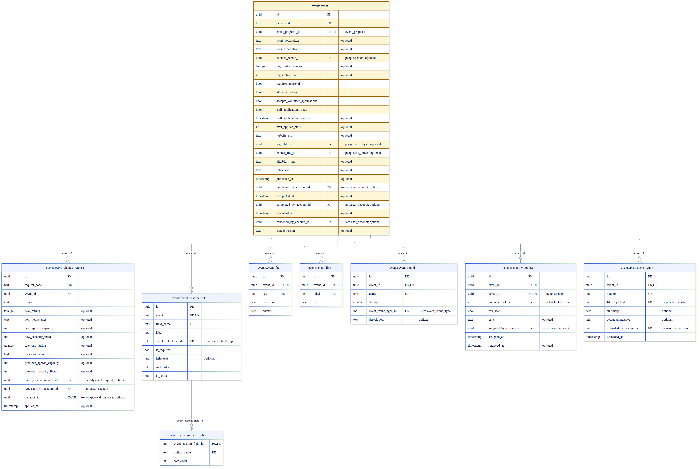

Every column of every table in this group, from the live schema (`created_at` / `updated_at` omitted). Lines are foreign keys inside the group; a note `→ table` is a foreign key to another group; amber = the group's hub. Source: [`catalog-diagrams/er-n3.mmd`](catalog-diagrams/er-n3.mmd).

| Table | What it holds | Links outside this group | Data flow — features that read (R) / write (W) its data store |
|---|---|---|---|
| [`event`](#t-events-event) | The event itself (EVT-YYYY-NNNN), created unpublished by the approval of its proposal — there is no other way to make one | `event_proposal`, `iam.user_account`, `people.file_object`, `people.person` | [16.9](data-flow-features.md#f-16-9) RW · [16.10](data-flow-features.md#f-16-10) RW · [16.11](data-flow-features.md#f-16-11) RW · [16.12](data-flow-features.md#f-16-12) R · [16.13](data-flow-features.md#f-16-13) R · [16.14](data-flow-features.md#f-16-14) R · [16.15](data-flow-features.md#f-16-15) R · [16.16](data-flow-features.md#f-16-16) R · [16.17](data-flow-features.md#f-16-17) W · [16.18](data-flow-features.md#f-16-18) R · [16.23](data-flow-features.md#f-16-23) R |
| [`event_round`](#t-events-event-round) | The rounds or sessions of an event (prelims, finals, day 2 …) | 1 lookup | [16.9](data-flow-features.md#f-16-9) RW · [16.10](data-flow-features.md#f-16-10) RW · [16.11](data-flow-features.md#f-16-11) RW · [16.12](data-flow-features.md#f-16-12) R · [16.13](data-flow-features.md#f-16-13) R · [16.14](data-flow-features.md#f-16-14) R · [16.15](data-flow-features.md#f-16-15) R · [16.16](data-flow-features.md#f-16-16) R · [16.17](data-flow-features.md#f-16-17) W · [16.18](data-flow-features.md#f-16-18) R · [16.23](data-flow-features.md#f-16-23) R |
| [`event_faq`](#t-events-event-faq) | The frequently asked questions shown on an event's page: question and answer (both non-empty) in a fixed order, the position unique within the event | — | [16.9](data-flow-features.md#f-16-9) RW · [16.10](data-flow-features.md#f-16-10) RW · [16.11](data-flow-features.md#f-16-11) RW · [16.12](data-flow-features.md#f-16-12) R · [16.13](data-flow-features.md#f-16-13) R · [16.14](data-flow-features.md#f-16-14) R · [16.15](data-flow-features.md#f-16-15) R · [16.16](data-flow-features.md#f-16-16) R · [16.17](data-flow-features.md#f-16-17) W · [16.18](data-flow-features.md#f-16-18) R · [16.23](data-flow-features.md#f-16-23) R |
| [`event_link`](#t-events-event-link) | Links shown on an event's page (social media, resources): a label unique within the event and a URL that must start with http:// or https:// | — | [16.9](data-flow-features.md#f-16-9) RW · [16.10](data-flow-features.md#f-16-10) RW · [16.11](data-flow-features.md#f-16-11) RW · [16.12](data-flow-features.md#f-16-12) R · [16.13](data-flow-features.md#f-16-13) R · [16.14](data-flow-features.md#f-16-14) R · [16.15](data-flow-features.md#f-16-15) R · [16.16](data-flow-features.md#f-16-16) R · [16.17](data-flow-features.md#f-16-17) W · [16.18](data-flow-features.md#f-16-18) R · [16.23](data-flow-features.md#f-16-23) R |
| [`event_custom_field`](#t-events-event-custom-field) | The extra questions on an event's registration form (text, number, date, dropdown, single choice, file), ordered, required or not | 1 lookup | [16.9](data-flow-features.md#f-16-9) RW · [16.10](data-flow-features.md#f-16-10) RW · [16.11](data-flow-features.md#f-16-11) RW · [16.12](data-flow-features.md#f-16-12) R · [16.13](data-flow-features.md#f-16-13) R · [16.14](data-flow-features.md#f-16-14) R · [16.15](data-flow-features.md#f-16-15) R · [16.16](data-flow-features.md#f-16-16) R · [16.17](data-flow-features.md#f-16-17) W · [16.18](data-flow-features.md#f-16-18) R · [16.23](data-flow-features.md#f-16-23) R |
| [`custom_field_option`](#t-events-custom-field-option) | The allowed answers of a dropdown or single-choice question (`event_custom_field`): one row per non-empty value, unique per question, in a set order | — | [16.9](data-flow-features.md#f-16-9) RW · [16.10](data-flow-features.md#f-16-10) RW · [16.11](data-flow-features.md#f-16-11) RW · [16.12](data-flow-features.md#f-16-12) R · [16.13](data-flow-features.md#f-16-13) R · [16.14](data-flow-features.md#f-16-14) R · [16.15](data-flow-features.md#f-16-15) R · [16.16](data-flow-features.md#f-16-16) R · [16.17](data-flow-features.md#f-16-17) W · [16.18](data-flow-features.md#f-16-18) R · [16.23](data-flow-features.md#f-16-23) R |
| [`event_volunteer`](#t-events-event-volunteer) | The volunteers and event managers of an event: a volunteer may scan at a gate when `can_scan` is set, a manager may manage the event alongside the organisers | `iam.user_account`, `people.person`; 1 lookup | [16.9](data-flow-features.md#f-16-9) RW · [16.10](data-flow-features.md#f-16-10) RW · [16.11](data-flow-features.md#f-16-11) RW · [16.12](data-flow-features.md#f-16-12) R · [16.13](data-flow-features.md#f-16-13) R · [16.14](data-flow-features.md#f-16-14) R · [16.15](data-flow-features.md#f-16-15) R · [16.16](data-flow-features.md#f-16-16) R · [16.17](data-flow-features.md#f-16-17) W · [16.18](data-flow-features.md#f-16-18) R · [16.23](data-flow-features.md#f-16-23) R |
| [`post_event_report`](#t-events-post-event-report) | The report filed after an event, in versions (summary, actual attendance, the report file); a version is never edited — a correction is a new version | `iam.user_account`, `people.file_object` | [16.9](data-flow-features.md#f-16-9) RW · [16.10](data-flow-features.md#f-16-10) RW · [16.11](data-flow-features.md#f-16-11) RW · [16.12](data-flow-features.md#f-16-12) R · [16.13](data-flow-features.md#f-16-13) R · [16.14](data-flow-features.md#f-16-14) R · [16.15](data-flow-features.md#f-16-15) R · [16.16](data-flow-features.md#f-16-16) R · [16.17](data-flow-features.md#f-16-17) W · [16.18](data-flow-features.md#f-16-18) R · [16.23](data-flow-features.md#f-16-23) R |
| [`event_change_request`](#t-events-event-change-request) | A change to an approved event that has not started — new dates, another venue, another capacity | `facility.event_request`, `iam.user_account`, `wf.approval_instance` | [16.9](data-flow-features.md#f-16-9) RW · [16.10](data-flow-features.md#f-16-10) RW · [16.11](data-flow-features.md#f-16-11) RW · [16.12](data-flow-features.md#f-16-12) R · [16.13](data-flow-features.md#f-16-13) R · [16.14](data-flow-features.md#f-16-14) R · [16.15](data-flow-features.md#f-16-15) R · [16.16](data-flow-features.md#f-16-16) R · [16.17](data-flow-features.md#f-16-17) W · [16.18](data-flow-features.md#f-16-18) R · [16.23](data-flow-features.md#f-16-23) R |

**Views over this group** (derived, never stored): `events.v_certificate_verify` · `events.v_club_points` · `events.v_duty_leave_eligible` · `events.v_event` · `events.v_event_budget_actual` · `events.v_event_change` · `events.v_event_mail_credit` · `events.v_event_settlement` · `events.v_event_statistics` · `events.v_proposal_status` · `events.v_refund_queue` · `events.v_round_attendance` · `events.v_team` · `events.v_volunteer_assignment`  
**Functions that read or write it:** `events.amount_due()` · `events.apply_event_change()` · `events.can_manage()` · `events.can_see()` · `events.cancel_event()` · `events.complete_event()` · `events.expire_unpaid_registrations()` · `events.grant_duty_leave()` · `events.issue_certificates()` · `events.may_propose_for()` · `events.payer_registration()` · `events.promote_waitlist()` · `events.publish_event()` · `events.registration_state()` · `events.seat_limit()` · `events.submit_event_change()` · `events.submit_settlement()` · `events.submit_stall_feedback()` · `events.ticket_check()`
<!-- /group:n3 -->

#### `events.event`
**Why it exists:** the event itself (EVT-YYYY-NNNN), created unpublished by the approval of its proposal — there is no other way to make one. It holds only what the organisers settle afterwards: descriptions, contact person, registration window and cap (never above the approved capacity), whether registrations need the organisers' approval, whether withdrawal is allowed, and when it was published, completed or cancelled. Publishing needs descriptions, a contact, a window and at least one round; completing needs the event to have ended and awards the club its points; cancelling cancels the registrations and the facility package. Status (draft / published / ongoing / ended / completed / cancelled) is derived (`v_event`).
**Connects to →** `events.event_proposal`, `iam.user_account` (cancelled by, completed by, published by), `people.file_object` (banner, logo), `people.person` (contact).
**Referenced by ←** `events.club_point_award`, `events.event_certificate_template`, `events.event_custom_field`, `events.event_faq`, `events.event_feedback`, `events.event_link`, `events.event_registration`, `events.event_round`, `events.event_team`, `events.event_volunteer`, `events.post_event_report`, `events.event_coupon`, `events.event_mail`, `events.event_mail_credit_grant`, `events.event_stall`, `events.event_stall_fee`, `events.stall_application`, `events.volunteer_application`, `events.event_change_request`, `events.event_expense`, `events.event_settlement`.

#### `events.event_round`
**Why it exists:** the rounds or sessions of an event (prelims, finals, day 2 …): a bounded time range that the trigger keeps inside the event's own dates, with a name unique within the event. Per-session check-ins (`round_attendance`) are made against a round, and an approved change of the event's dates shifts its rounds.
**Connects to →** `events.event`, `ref.event_round_type`.
**Referenced by ←** `events.round_attendance`.

#### `events.event_faq`
**Why it exists:** the frequently asked questions shown on an event's page: question and answer (both non-empty) in a fixed order, the position unique within the event.
**Connects to →** `events.event`.
**Referenced by ←** nothing.

#### `events.event_link`
**Why it exists:** links shown on an event's page (social media, resources): a label unique within the event and a URL that must start with http:// or https://.
**Connects to →** `events.event`.
**Referenced by ←** nothing.

#### `events.event_custom_field`
**Why it exists:** the extra questions on an event's registration form (text, number, date, dropdown, single choice, file), ordered, required or not — a row per question instead of the old JSON form definition, so answers can be validated and reported.
**Connects to →** `events.event`, `ref.event_field_type`.
**Referenced by ←** `events.custom_field_option`, `events.field_response`.

#### `events.custom_field_option`
**Why it exists:** the allowed answers of a dropdown or single-choice question (`event_custom_field`): one row per non-empty value, unique per question, in a set order. A participant's answer to such a question must be one of these options.
**Connects to →** `events.event_custom_field`.
**Referenced by ←** nothing.

#### `events.event_volunteer`
**Why it exists:** the volunteers and event managers of an event: a volunteer may scan at a gate when `can_scan` is set, a manager may manage the event alongside the organisers; a person of the university (student or employee), once per event; removed, not deleted. The volunteer's dashboard is derived: `v_volunteer_assignment` (duties with their own scan totals), `v_volunteer_activity` (their scans), `v_gate_summary` (the count per gate).
**Connects to →** `events.event`, `iam.user_account` (assigned by), `people.person`, `ref.volunteer_role`.
**Referenced by ←** `events.event_certificate`.

#### `events.post_event_report`
**Why it exists:** the report filed after an event, in versions (summary, actual attendance, the report file); a version is never edited — a correction is a new version.
**Connects to →** `events.event`, `iam.user_account` (uploaded by), `people.file_object`.
**Referenced by ←** nothing.

#### `events.event_change_request`
**Why it exists:** a change to an approved event that has not started — new dates, another venue, another capacity. The old system had no way to move an approved event short of cancelling and proposing it again; here it is a document on the approval engine (EVENT_CHANGE: by default the advisor / unit head, then the committee; flags say what changes, so a chain can treat a reschedule differently from a room change). Requested by the organisers; a draft until `events.submit_event_change()` opens the round — and, for new dates, a venue package for them on the same round, so rooms can be held while it is approved. One change of an event under approval at a time; a capacity never below the seats already taken; new dates only after registration closes and with every round still inside the event. On approval the database applies it (`events.apply_event_change()`): the proposal's dates, venue and capacity are rewritten, the rounds move by the same offset, the venue package of the old dates is released, and what the event was before is kept on the request.
**Connects to →** `events.event`, `facility.event_request` (facility event request), `iam.user_account` (requested by), `wf.approval_instance`.
**Referenced by ←** nothing.

### 15.4 Registrations, teams & the gate

Who takes part: registrations with seats and a waiting list, answers to extra questions, guests, teams with invitations and join requests, the append-only gate log, and prize winners.

<!-- group:n4 -->
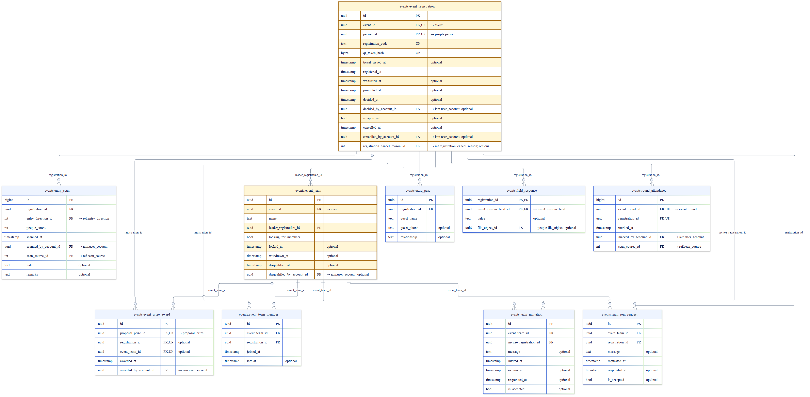

Every column of every table in this group, from the live schema (`created_at` / `updated_at` omitted). Lines are foreign keys inside the group; a note `→ table` is a foreign key to another group; amber = the group's hub. Source: [`catalog-diagrams/er-n4.mmd`](catalog-diagrams/er-n4.mmd).

| Table | What it holds | Links outside this group | Data flow — features that read (R) / write (W) its data store |
|---|---|---|---|
| [`event_registration`](#t-events-event-registration) | One person's registration for one event (once per person) | `event`, `iam.user_account`, `people.person`; 1 lookup | [16.10](data-flow-features.md#f-16-10) R · [16.12](data-flow-features.md#f-16-12) RW · [16.13](data-flow-features.md#f-16-13) R · [16.14](data-flow-features.md#f-16-14) RW · [16.15](data-flow-features.md#f-16-15) R · [16.18](data-flow-features.md#f-16-18) R · [16.19](data-flow-features.md#f-16-19) R · [16.20](data-flow-features.md#f-16-20) RW · [16.22](data-flow-features.md#f-16-22) R |
| [`field_response`](#t-events-field-response) | A participant's answers to the event's extra questions, one row each | `event_custom_field`, `people.file_object` | [16.10](data-flow-features.md#f-16-10) R · [16.12](data-flow-features.md#f-16-12) RW · [16.13](data-flow-features.md#f-16-13) R · [16.14](data-flow-features.md#f-16-14) RW · [16.15](data-flow-features.md#f-16-15) R · [16.18](data-flow-features.md#f-16-18) R · [16.19](data-flow-features.md#f-16-19) R · [16.20](data-flow-features.md#f-16-20) RW · [16.22](data-flow-features.md#f-16-22) R |
| [`extra_pass`](#t-events-extra-pass) | The guests a participant brings on their own pass (name, relationship and optionally a phone — nothing more), up to the number the event allows | — | [16.10](data-flow-features.md#f-16-10) R · [16.12](data-flow-features.md#f-16-12) RW · [16.13](data-flow-features.md#f-16-13) R · [16.14](data-flow-features.md#f-16-14) RW · [16.15](data-flow-features.md#f-16-15) R · [16.18](data-flow-features.md#f-16-18) R · [16.19](data-flow-features.md#f-16-19) R · [16.20](data-flow-features.md#f-16-20) RW · [16.22](data-flow-features.md#f-16-22) R |
| [`event_team`](#t-events-event-team) | A team of a team event: name, leader, when it was finalised (locked), withdrawn or disqualified | `event`, `iam.user_account` | [16.13](data-flow-features.md#f-16-13) RW · [16.16](data-flow-features.md#f-16-16) R · [16.19](data-flow-features.md#f-16-19) R |
| [`event_team_member`](#t-events-event-team-member) | The members of a team over time; a participant is in one live team per event, and a team never exceeds its maximum size | — | [16.13](data-flow-features.md#f-16-13) RW · [16.16](data-flow-features.md#f-16-16) R · [16.19](data-flow-features.md#f-16-19) R |
| [`team_invitation`](#t-events-team-invitation) | A team leader's invitation to a participant: it needs an open team and a live registration for the same event, the invitee must not already be in a team, only one … | — | [16.13](data-flow-features.md#f-16-13) RW · [16.16](data-flow-features.md#f-16-16) R · [16.19](data-flow-features.md#f-16-19) R |
| [`team_join_request`](#t-events-team-join-request) | A participant's request to join a team — the mirror of an invitation | — | [16.13](data-flow-features.md#f-16-13) RW · [16.16](data-flow-features.md#f-16-16) R · [16.19](data-flow-features.md#f-16-19) R |
| [`entry_scan`](#t-events-entry-scan) | The gate log: every scan in or out, with the number of people (the participant plus guests), the gate, who scanned and whether it was a live scan or an imported sheet | `iam.user_account`; 2 lookups | [16.14](data-flow-features.md#f-16-14) W · [16.15](data-flow-features.md#f-16-15) W · [16.16](data-flow-features.md#f-16-16) R · [16.17](data-flow-features.md#f-16-17) R |
| [`round_attendance`](#t-events-round-attendance) | Attendance at one session (round) of an event: one check-in per registration and round, made with the participant's ticket by a scanning volunteer or an organiser … | `event_round`, `iam.user_account`; 1 lookup | [16.14](data-flow-features.md#f-16-14) W · [16.15](data-flow-features.md#f-16-15) W · [16.16](data-flow-features.md#f-16-16) R · [16.17](data-flow-features.md#f-16-17) R |
| [`event_prize_award`](#t-events-event-prize-award) | A prize awarded to a participant or to a team (one of the two), from the proposal's prize list; only for someone who attended, and only of the same event | `proposal_prize`, `iam.user_account` | [16.16](data-flow-features.md#f-16-16) RW |

**Views over this group** (derived, never stored): `events.v_attendance` · `events.v_certificate_verify` · `events.v_coupon_usage` · `events.v_duty_leave_eligible` · `events.v_event_mail_credit` · `events.v_event_settlement` · `events.v_event_statistics` · `events.v_gate_summary` · `events.v_refund_queue` · `events.v_registration` · `events.v_round_attendance` · `events.v_team` · `events.v_ticket` · `events.v_volunteer_activity`  
**Functions that read or write it:** `events.amount_due()` · `events.attended()` · `events.check_in_round()` · `events.dispatch_mail()` · `events.expire_unpaid_registrations()` · `events.issue_certificates()` · `events.issue_ticket()` · `events.mail_credits_total()` · `events.mail_opened()` · `events.payer_registration()` · `events.people_inside()` · `events.promote_waitlist()` · `events.redeem_coupon()` · `events.register()` · `events.registration_state()` · `events.scan()` · `events.seats_taken()` · `events.submit_feedback()` · `events.team_size()` · `events.ticket_check()`
<!-- /group:n4 -->

#### `events.event_registration`
**Why it exists:** one person's registration for one event (once per person). The trigger locks the event row, checks the event is published and open, the window, visibility (`events.can_see()`), and gives a seat or — when full — a place on the waiting list; `events.promote_waitlist()` moves the next in line when a seat frees. Where the event requires approval the organisers decide each registration. A paid event's registration stays PENDING_PAYMENT until what it owes — the fee less its coupon; in a team event the team's fee, owed by the leader — is settled by a captured `events.event_payment` (`events.amount_due()`, `events.is_paid()`); an unpaid registration can be expired by a system job after the period set in the settings. Withdrawal and cancellation carry a reason; the ticket is issued by `events.issue_ticket()`, which returns the QR's token once and stores only its hash (`ticket_issued_at`; re-issuing replaces it, and it is never set by hand) — `v_ticket` is what the ticket shows. Status is derived (`v_registration`).
**Connects to →** `events.event`, `iam.user_account` (cancelled by, decided by), `people.person`, `ref.registration_cancel_reason`.
**Referenced by ←** `events.entry_scan`, `events.event_certificate`, `events.event_feedback_token`, `events.event_prize_award`, `events.event_team`, `events.event_team_member`, `events.extra_pass`, `events.field_response`, `events.team_invitation`, `events.team_join_request`, `events.coupon_redemption`, `events.event_mail_recipient`, `events.event_payment`, `events.round_attendance`.

#### `events.field_response`
**Why it exists:** a participant's answers to the event's extra questions, one row each; the answer must fit the question's type and, for a choice, be one of its options, and belong to the same event.
**Connects to →** `events.event_custom_field`, `events.event_registration`, `people.file_object`.
**Referenced by ←** nothing.

#### `events.extra_pass`
**Why it exists:** the guests a participant brings on their own pass (name, relationship and optionally a phone — nothing more), up to the number the event allows; counted at the gate with the participant.
**Connects to →** `events.event_registration`.
**Referenced by ←** nothing.

#### `events.event_team`
**Why it exists:** a team of a team event: name, leader, when it was finalised (locked), withdrawn or disqualified. It can be finalised only between the proposal's minimum and maximum size, and members cannot leave a final team; completeness is derived from its members (`v_team`).
**Connects to →** `events.event`, `events.event_registration` (leader registration), `iam.user_account` (disqualified by).
**Referenced by ←** `events.event_prize_award`, `events.event_team_member`, `events.team_invitation`, `events.team_join_request`, `events.event_payment`.

#### `events.event_team_member`
**Why it exists:** the members of a team over time; a participant is in one live team per event, and a team never exceeds its maximum size. Rows come from the leader's own entry, an accepted invitation or an accepted join request.
**Connects to →** `events.event_registration`, `events.event_team`.
**Referenced by ←** nothing.

#### `events.team_invitation`
**Why it exists:** a team leader's invitation to a participant: it needs an open team and a live registration for the same event, the invitee must not already be in a team, only one invitation may be open per team and person, it is answered once (accepted or declined, with the time of the answer) and refused after it expires; accepting adds the member. A message is limited to 500 characters.
**Connects to →** `events.event_registration` (invitee registration), `events.event_team`.
**Referenced by ←** nothing.

#### `events.team_join_request`
**Why it exists:** a participant's request to join a team — the mirror of an invitation: an open team and a live registration for the same event, not already in a team, one open request per team and person, answered once by the leader; acceptance adds the member. A message is limited to 500 characters.
**Connects to →** `events.event_registration`, `events.event_team`.
**Referenced by ←** nothing.

#### `events.entry_scan`
**Why it exists:** the gate log: every scan in or out, with the number of people (the participant plus guests), the gate, who scanned and whether it was a live scan or an imported sheet. Append-only and not audited (it is itself the log). Only a scanning volunteer or an organiser may write it; entry needs a confirmed registration; more people cannot go in than the pass allows or come out than are inside. Attendance and the head-count inside are derived (`v_attendance`, `events.people_inside()`).
**Connects to →** `events.event_registration`, `iam.user_account` (scanned by), `ref.entry_direction`, `ref.scan_source`.
**Referenced by ←** nothing.

#### `events.event_prize_award`
**Why it exists:** a prize awarded to a participant or to a team (one of the two), from the proposal's prize list; only for someone who attended, and only of the same event.
**Connects to →** `events.event_registration`, `events.event_team`, `events.proposal_prize`, `iam.user_account` (awarded by).
**Referenced by ←** nothing.

#### `events.round_attendance`
**Why it exists:** attendance at one session (round) of an event: one check-in per registration and round, made with the participant's ticket by a scanning volunteer or an organiser (`events.check_in_round()`), or imported from a sheet by an organiser. Check-in opens a configurable time before the session; only a confirmed registration of the same event; append-only and, like the gate log, not audited. The gate log says who was on the premises, this says which sessions they sat in — so a multi-day event can show attendance per session (`v_round_attendance`), and a session check-in counts as having attended.
**Connects to →** `events.event_registration`, `events.event_round`, `iam.user_account` (marked by), `ref.scan_source`.
**Referenced by ←** nothing.

### 15.5 Feedback, certificates, club points & settings

After the event: anonymous feedback (token and feedback share no key), certificate templates and the register of certificates, and the points a completed event earns its club, with tiers; and the one row of module settings, so that no policy value is hard-coded.

<!-- group:n5 -->
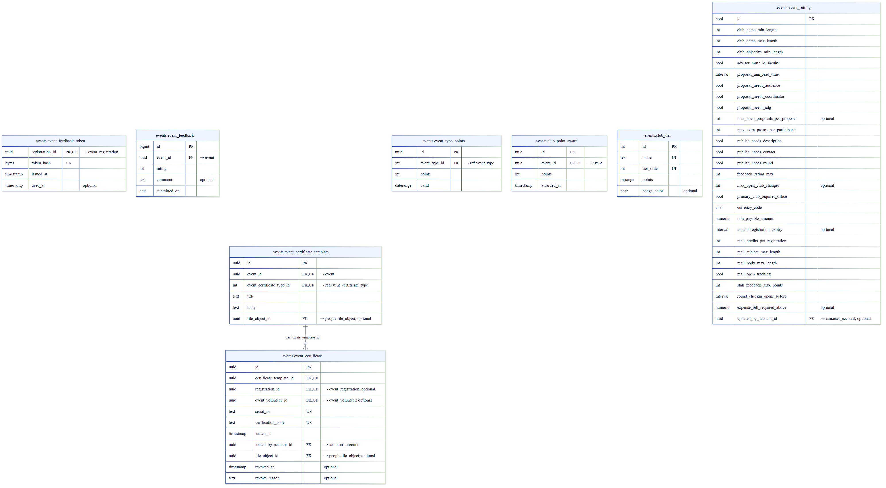

Every column of every table in this group, from the live schema (`created_at` / `updated_at` omitted). Lines are foreign keys inside the group; a note `→ table` is a foreign key to another group; amber = the group's hub. Source: [`catalog-diagrams/er-n5.mmd`](catalog-diagrams/er-n5.mmd).

| Table | What it holds | Links outside this group | Data flow — features that read (R) / write (W) its data store |
|---|---|---|---|
| [`event_feedback_token`](#t-events-event-feedback-token) | The one feedback token of an attendee, stored as a hash, with whether it was used | `event_registration` | [16.17](data-flow-features.md#f-16-17) RW |
| [`event_feedback`](#t-events-event-feedback) | Anonymous feedback on an event: rating and comment with **no link to the writer** — no person, no registration, no token id, a date instead of a timestamp | `event` | [16.17](data-flow-features.md#f-16-17) RW |
| [`event_certificate_template`](#t-events-event-certificate-template) | An event's certificate template per kind — participation, winner or volunteer — one per event and kind, with a title and body (non-empty) and an optional design file | `event`, `people.file_object`; 1 lookup | [16.16](data-flow-features.md#f-16-16) RW |
| [`event_certificate`](#t-events-event-certificate) | The register of event certificates issued (participation / winner / volunteer) with a serial and a public verification code | `event_registration`, `event_volunteer`, `iam.user_account`, `people.file_object` | [16.16](data-flow-features.md#f-16-16) RW |
| [`event_type_points`](#t-events-event-type-points) | The points a club earns for a completed event of a type, valid for a period (EXCLUDE: one value at a time) — POLICY values | 1 lookup | [16.1](data-flow-features.md#f-16-1) R · [16.3](data-flow-features.md#f-16-3) R · [16.4](data-flow-features.md#f-16-4) R · [16.5](data-flow-features.md#f-16-5) R · [16.6](data-flow-features.md#f-16-6) R · [16.8](data-flow-features.md#f-16-8) RW · [16.9](data-flow-features.md#f-16-9) R · [16.12](data-flow-features.md#f-16-12) R · [16.15](data-flow-features.md#f-16-15) R · [16.17](data-flow-features.md#f-16-17) RW · [16.19](data-flow-features.md#f-16-19) R · [16.20](data-flow-features.md#f-16-20) R · [16.21](data-flow-features.md#f-16-21) R · [16.22](data-flow-features.md#f-16-22) R · [16.24](data-flow-features.md#f-16-24) R |
| [`club_point_award`](#t-events-club-point-award) | The points awarded for one completed event (the value in force on the day), written by `events.complete_event()` | `event` | [16.1](data-flow-features.md#f-16-1) R · [16.3](data-flow-features.md#f-16-3) R · [16.4](data-flow-features.md#f-16-4) R · [16.5](data-flow-features.md#f-16-5) R · [16.6](data-flow-features.md#f-16-6) R · [16.8](data-flow-features.md#f-16-8) RW · [16.9](data-flow-features.md#f-16-9) R · [16.12](data-flow-features.md#f-16-12) R · [16.15](data-flow-features.md#f-16-15) R · [16.17](data-flow-features.md#f-16-17) RW · [16.19](data-flow-features.md#f-16-19) R · [16.20](data-flow-features.md#f-16-20) R · [16.21](data-flow-features.md#f-16-21) R · [16.22](data-flow-features.md#f-16-22) R · [16.24](data-flow-features.md#f-16-24) R |
| [`club_tier`](#t-events-club-tier) | Club tiers by total points (Bronze … Diamond): each a range of points starting at 0 or above, the ranges never overlapping (EXCLUDE), with a unique name, display order … | — | [16.1](data-flow-features.md#f-16-1) R · [16.3](data-flow-features.md#f-16-3) R · [16.4](data-flow-features.md#f-16-4) R · [16.5](data-flow-features.md#f-16-5) R · [16.6](data-flow-features.md#f-16-6) R · [16.8](data-flow-features.md#f-16-8) RW · [16.9](data-flow-features.md#f-16-9) R · [16.12](data-flow-features.md#f-16-12) R · [16.15](data-flow-features.md#f-16-15) R · [16.17](data-flow-features.md#f-16-17) RW · [16.19](data-flow-features.md#f-16-19) R · [16.20](data-flow-features.md#f-16-20) R · [16.21](data-flow-features.md#f-16-21) R · [16.22](data-flow-features.md#f-16-22) R · [16.24](data-flow-features.md#f-16-24) R |
| [`event_setting`](#t-events-event-setting) | The one row of module settings an events administrator edits (`events.setting.update`), so that no policy value is written into a function or a CHECK | `iam.user_account` | [16.1](data-flow-features.md#f-16-1) R · [16.3](data-flow-features.md#f-16-3) R · [16.4](data-flow-features.md#f-16-4) R · [16.5](data-flow-features.md#f-16-5) R · [16.6](data-flow-features.md#f-16-6) R · [16.8](data-flow-features.md#f-16-8) RW · [16.9](data-flow-features.md#f-16-9) R · [16.12](data-flow-features.md#f-16-12) R · [16.15](data-flow-features.md#f-16-15) R · [16.17](data-flow-features.md#f-16-17) RW · [16.19](data-flow-features.md#f-16-19) R · [16.20](data-flow-features.md#f-16-20) R · [16.21](data-flow-features.md#f-16-21) R · [16.22](data-flow-features.md#f-16-22) R · [16.24](data-flow-features.md#f-16-24) R |

**Views over this group** (derived, never stored): `events.v_certificate_verify` · `events.v_club_points` · `events.v_event_mail_credit` · `events.v_event_statistics`  
**Functions that read or write it:** `events.expire_unpaid_registrations()` · `events.feedback_token_for()` · `events.issue_certificates()` · `events.mail_credits_total()` · `events.mail_opened()` · `events.submit_feedback()` · `events.submit_stall_feedback()`
<!-- /group:n5 -->

#### `events.event_feedback_token`
**Why it exists:** the one feedback token of an attendee, stored as a hash, with whether it was used. It proves "an attendee, once" without saying who — it shares no key with `event_feedback`.
**Connects to →** `events.event_registration`.
**Referenced by ←** nothing.

#### `events.event_feedback`
**Why it exists:** anonymous feedback on an event: rating and comment with **no link to the writer** — no person, no registration, no token id, a date instead of a timestamp. Written only through `events.submit_feedback()`, which burns the token in the same transaction. The same design as the anonymous course feedback of §4.10.
**Connects to →** `events.event`.
**Referenced by ←** nothing.

#### `events.event_certificate_template`
**Why it exists:** an event's certificate template per kind — participation, winner or volunteer — one per event and kind, with a title and body (non-empty) and an optional design file. Certificates are issued from it only to those who qualify (attended, won a prize, volunteered).
**Connects to →** `events.event`, `people.file_object`, `ref.event_certificate_type`.
**Referenced by ←** `events.event_certificate`.

#### `events.event_certificate`
**Why it exists:** the register of event certificates issued (participation / winner / volunteer) with a serial and a public verification code; only to someone who attended, won a prize or volunteered, only after the event started; a certificate can be revoked with a reason, never altered. `v_certificate_verify` is the public check.
**Connects to →** `events.event_certificate_template`, `events.event_registration`, `events.event_volunteer`, `iam.user_account` (issued by), `people.file_object`.
**Referenced by ←** nothing.

#### `events.event_type_points`
**Why it exists:** the points a club earns for a completed event of a type, valid for a period (EXCLUDE: one value at a time) — POLICY values. The old system kept these in Redis; here they are dated rows.
**Connects to →** `ref.event_type`.
**Referenced by ←** nothing.

#### `events.club_point_award`
**Why it exists:** the points awarded for one completed event (the value in force on the day), written by `events.complete_event()`. The club is the event's organising unit — read through the event, not stored a second time. Totals, the leaderboard and the tier are derived (`v_club_points`, `v_club_leaderboard`).
**Connects to →** `events.event`.
**Referenced by ←** nothing.

#### `events.club_tier`
**Why it exists:** club tiers by total points (Bronze … Diamond): each a range of points starting at 0 or above, the ranges never overlapping (EXCLUDE), with a unique name, display order and badge colour. POLICY values an administrator changes; a club's tier is derived from its points, never stored.
**Connects to →** nothing.
**Referenced by ←** nothing.

#### `events.event_setting`
**Why it exists:** the one row of module settings an events administrator edits (`events.setting.update`), so that no policy value is written into a function or a CHECK: club name and objective lengths, whether advisors must be faculty, how long before its start an event must be proposed, which proposal sections are required (audience, coordinator, SDG), how many proposals one proposer may have under approval, the ceiling on guest passes, what publishing needs (descriptions, contact person, a round) and the feedback scale. The triggers of the module read it at the moment they check; changing the row changes the rule from then on, with the change audited. Exactly one row (it cannot be removed, and the feedback scale cannot be cut below a rating already given). Everything else that is policy lives beside it as data too: lookup flags (`ref.club_office.is_required` / `may_propose`), dated points and tier bands, the approval engine's chain rows for levels and deadlines, the purpose's retention period.
**Connects to →** `iam.user_account` (updated by).
**Referenced by ←** nothing.

### 15.6 Club changes, primary club & volunteer sign-up

What happens to a club after it is founded, and who offers to help at an event: change requests (name, objective, advisors, officers, members) approved through the engine and then applied by the database, a student's primary club, and applications to volunteer.

<!-- group:n6 -->
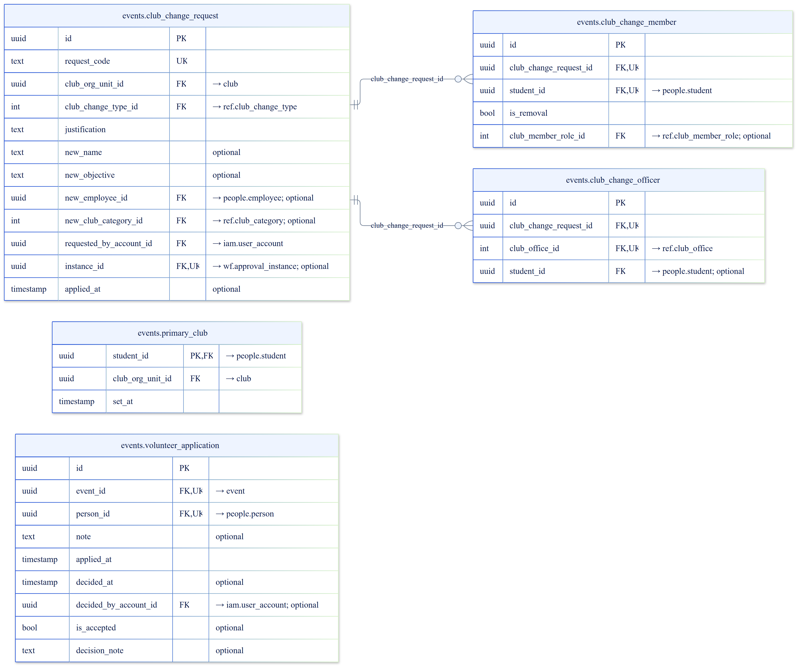

Every column of every table in this group, from the live schema (`created_at` / `updated_at` omitted). Lines are foreign keys inside the group; a note `→ table` is a foreign key to another group; amber = the group's hub. Source: [`catalog-diagrams/er-n6.mmd`](catalog-diagrams/er-n6.mmd).

| Table | What it holds | Links outside this group | Data flow — features that read (R) / write (W) its data store |
|---|---|---|---|
| [`club_change_request`](#t-events-club-change-request) | A request to change a running club — its name, its objective, its advisor or co-advisor, its officers, its members, or a governance / operational matter that is only … | `club`, `iam.user_account`, `people.employee`, `wf.approval_instance`; 2 lookups | [16.4](data-flow-features.md#f-16-4) RW |
| [`club_change_officer`](#t-events-club-change-officer) | The officer lines of a change request: who takes which office; a line with no student means the office falls vacant | `people.student`; 1 lookup | [16.4](data-flow-features.md#f-16-4) RW |
| [`club_change_member`](#t-events-club-change-member) | The member lines of a change request: who joins (with a role) and who leaves; only a current member leaves and only a non-member joins | `people.student`; 1 lookup | [16.4](data-flow-features.md#f-16-4) RW |
| [`primary_club`](#t-events-primary-club) | A student's primary club — the one shown first on their profile; one per student | `club`, `people.student` | [16.2](data-flow-features.md#f-16-2) W · [16.3](data-flow-features.md#f-16-3) RW · [16.4](data-flow-features.md#f-16-4) W · [16.5](data-flow-features.md#f-16-5) R |
| [`volunteer_application`](#t-events-volunteer-application) | An offer to volunteer at an event that takes applications (`event.accepts_volunteer_applications`) | `event`, `iam.user_account`, `people.person` | [16.9](data-flow-features.md#f-16-9) RW · [16.10](data-flow-features.md#f-16-10) RW · [16.11](data-flow-features.md#f-16-11) RW · [16.12](data-flow-features.md#f-16-12) R · [16.13](data-flow-features.md#f-16-13) R · [16.14](data-flow-features.md#f-16-14) R · [16.15](data-flow-features.md#f-16-15) R · [16.16](data-flow-features.md#f-16-16) R · [16.17](data-flow-features.md#f-16-17) W · [16.18](data-flow-features.md#f-16-18) R · [16.23](data-flow-features.md#f-16-23) R |

**Views over this group** (derived, never stored): `events.v_club_change`  
**Functions that read or write it:** `events.apply_club_change()` · `events.submit_club_change()`
<!-- /group:n6 -->

#### `events.club_change_request`
**Why it exists:** a request to change a running club — its name, its objective, its advisor or co-advisor, its officers, its members, or a governance / operational matter that is only recorded. The old system had this table but no code behind it; here it is a third document type on the approval engine (CLUB_CHANGE: by default the club's advisor, skipped when the advisor asks, then the committee — chain rows), and the kind of change travels on the round as a flag so a chain can treat an advisor change differently from a member change. A draft is requested by an officer or advisor of the club; `ref.club_change_type` says exactly which fields the request must carry; once submitted it is frozen. On approval the database applies the change itself (`events.apply_club_change()`): renames the org unit, rewrites the objective, ends and creates the advisor appointment, replaces officers, adds and removes members — nobody edits the club by hand. How many requests of a club may be under approval at once is a setting.
**Connects to →** `events.club`, `iam.user_account` (requested by), `people.employee` (new), `wf.approval_instance`, `ref.club_change_type`, `ref.club_category`.
**Referenced by ←** `events.club_change_member`, `events.club_change_officer`.

#### `events.club_change_officer`
**Why it exists:** the officer lines of a change request: who takes which office; a line with no student means the office falls vacant. One line per office and per student; only on a request whose type changes officers, only while it is a draft, only current students.
**Connects to →** `events.club_change_request`, `people.student`, `ref.club_office`.
**Referenced by ←** nothing.

#### `events.club_change_member`
**Why it exists:** the member lines of a change request: who joins (with a role) and who leaves; only a current member leaves and only a non-member joins.
**Connects to →** `events.club_change_request`, `people.student`, `ref.club_member_role`.
**Referenced by ←** nothing.

#### `events.primary_club`
**Why it exists:** a student's primary club — the one shown first on their profile; one per student. By default only a club in which they hold an office (the old rule), switchable in the settings to any club they are a member of.
**Connects to →** `events.club`, `people.student`.
**Referenced by ←** nothing.

#### `events.volunteer_application`
**Why it exists:** an offer to volunteer at an event that takes applications (`event.accepts_volunteer_applications`): one per person and event, from a student or employee, while the event is published and not over. An organiser decides once; acceptance creates the `event_volunteer` row (without scanning rights — the organisers then give the gate and the right to scan). This is in addition to organisers assigning volunteers directly, which is all the old system had.
**Connects to →** `events.event`, `iam.user_account` (decided by), `people.person`.
**Referenced by ←** nothing.

### 15.7 Coupons, payments, refunds & settlement

The money of a paid event: discount coupons and their redemptions, and every payment of a registration or stall fee — online order or offline claim, captured, failed or refunded. What is owed, what is paid and who must be refunded are derived. After the event: what was actually spent, line by line, and the settlement of the accounts approved through the engine.

<!-- group:n7 -->
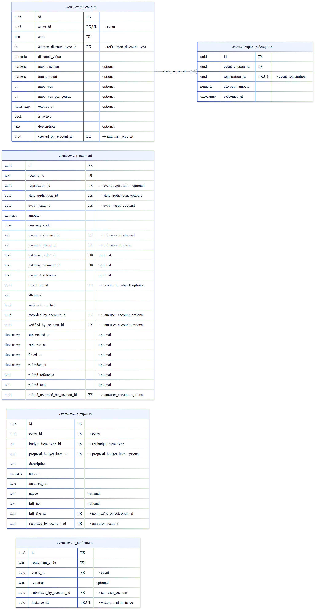

Every column of every table in this group, from the live schema (`created_at` / `updated_at` omitted). Lines are foreign keys inside the group; a note `→ table` is a foreign key to another group; amber = the group's hub. Source: [`catalog-diagrams/er-n7.mmd`](catalog-diagrams/er-n7.mmd).

| Table | What it holds | Links outside this group | Data flow — features that read (R) / write (W) its data store |
|---|---|---|---|
| [`event_coupon`](#t-events-event-coupon) | A discount coupon of a paid event: a percentage of the fee (at most 100, optionally capped) or a fixed amount, with a minimum fee, a total and a per-person limit and an … | `event`, `iam.user_account`; 1 lookup | [16.18](data-flow-features.md#f-16-18) RW · [16.19](data-flow-features.md#f-16-19) RW · [16.20](data-flow-features.md#f-16-20) W · [16.21](data-flow-features.md#f-16-21) RW · [16.23](data-flow-features.md#f-16-23) R |
| [`coupon_redemption`](#t-events-coupon-redemption) | A coupon used on a registration — one per registration — with the discount fixed at that moment, so later changes to the coupon do not rewrite history | `event_registration` | [16.18](data-flow-features.md#f-16-18) RW · [16.19](data-flow-features.md#f-16-19) RW · [16.20](data-flow-features.md#f-16-20) W · [16.21](data-flow-features.md#f-16-21) RW · [16.23](data-flow-features.md#f-16-23) R |
| [`event_payment`](#t-events-event-payment) | One payment of a registration fee — in a team event the team's flat fee, paid by its leader once the team is complete — or of a stall fee | `event_registration`, `event_team`, `stall_application`, `iam.user_account`, `people.file_object`; 2 lookups | [16.18](data-flow-features.md#f-16-18) RW · [16.19](data-flow-features.md#f-16-19) RW · [16.20](data-flow-features.md#f-16-20) W · [16.21](data-flow-features.md#f-16-21) RW · [16.23](data-flow-features.md#f-16-23) R |
| [`event_expense`](#t-events-event-expense) | What was actually spent on an event, line by line: under a budget head, against the approved budget line where there is one, with the payee, bill number and bill file | `event`, `proposal_budget_item`, `iam.user_account`, `people.file_object`; 1 lookup | [16.18](data-flow-features.md#f-16-18) RW · [16.19](data-flow-features.md#f-16-19) RW · [16.20](data-flow-features.md#f-16-20) W · [16.21](data-flow-features.md#f-16-21) RW · [16.23](data-flow-features.md#f-16-23) R |
| [`event_settlement`](#t-events-event-settlement) | The settlement of an event's accounts: submitted by the organisers after the event is over (or cancelled) through `events.submit_settlement()`, which opens an … | `event`, `iam.user_account`, `wf.approval_instance` | [16.18](data-flow-features.md#f-16-18) RW · [16.19](data-flow-features.md#f-16-19) RW · [16.20](data-flow-features.md#f-16-20) W · [16.21](data-flow-features.md#f-16-21) RW · [16.23](data-flow-features.md#f-16-23) R |

**Views over this group** (derived, never stored): `events.v_coupon_usage` · `events.v_event_budget_actual` · `events.v_event_settlement` · `events.v_event_statistics` · `events.v_refund_queue` · `events.v_stall_application`  
**Functions that read or write it:** `events.amount_due()` · `events.amount_settled()` · `events.expire_unpaid_registrations()` · `events.record_refund()` · `events.redeem_coupon()` · `events.submit_settlement()`
<!-- /group:n7 -->

#### `events.event_coupon`
**Why it exists:** a discount coupon of a paid event: a percentage of the fee (at most 100, optionally capped) or a fixed amount, with a minimum fee, a total and a per-person limit and an expiry. The code is stored trimmed and upper-cased and is unique per event. Created by the event's organisers; a coupon that was used is deactivated, never deleted.
**Connects to →** `events.event`, `iam.user_account` (created by), `ref.coupon_discount_type`.
**Referenced by ←** `events.coupon_redemption`.

#### `events.coupon_redemption`
**Why it exists:** a coupon used on a registration — one per registration — with the discount fixed at that moment, so later changes to the coupon do not rewrite history. The trigger checks the coupon is of the same event, active, not expired and within its limits (a cancelled registration's use is free again — the old system never released it), that the fee reaches the coupon's minimum, and computes the discount; what remains payable is either nothing or at least the minimum payable amount of the settings. In a team event the leader applies it. It cannot be removed once the fee was paid with it.
**Connects to →** `events.event_coupon`, `events.event_registration`.
**Referenced by ←** nothing.

#### `events.event_payment`
**Why it exists:** one payment of a registration fee — in a team event the team's flat fee, paid by its leader once the team is complete — or of a stall fee. **Online:** an order of the gateway (its order id) that is captured or fails; a newer order supersedes an open one, so there is one open order at a time. **Offline** (UPI, bank transfer, cash): claimed by the payer with a transaction reference and proof and then verified by an organiser, or recorded as received by an organiser. The amount must be exactly what is due (fee less coupon, less what is already settled); the currency and the minimum payable amount come from the settings; receipts are numbered RCP-YYYY-NNNNNN. A captured payment is never changed except to record its refund, by someone holding the refund permission, with a reference. The registration's paid state (`events.is_paid()`, `amount_due()`), the fees collected and the **refund queue** (`v_refund_queue`: superseded orders, duplicates, cancelled or rejected registrations, cancelled events, withdrawn teams, rejected stalls) are all derived — no flag is set by hand. The gateway conversation itself (signatures, webhook, reconciliation with the gateway) is the application's.
**Connects to →** `events.event_registration`, `events.event_team`, `events.stall_application`, `iam.user_account` (recorded by, refund recorded by, verified by), `people.file_object` (proof), `ref.payment_channel`, `ref.payment_status`.
**Referenced by ←** nothing.

#### `events.event_expense`
**Why it exists:** what was actually spent on an event, line by line: under a budget head, against the approved budget line where there is one, with the payee, bill number and bill file. Recorded by the organisers as it is incurred (never dated in the future); frozen while a settlement is under approval and for good once one is approved. Budget against actual per head is derived (`v_event_budget_actual`).
**Connects to →** `events.event`, `events.proposal_budget_item`, `iam.user_account` (recorded by), `people.file_object` (bill), `ref.budget_item_type`.
**Referenced by ←** nothing.

#### `events.event_settlement`
**Why it exists:** the settlement of an event's accounts: submitted by the organisers after the event is over (or cancelled) through `events.submit_settlement()`, which opens an EVENT_SETTLEMENT round whose amount is the total spent and which is flagged OVER_BUDGET when that exceeds the approved budget — so a chain can add a finance level always, above an amount, or only when over budget. Bills are required above a configurable amount. A returned settlement is corrected and submitted again as a new one; one under approval or approved at a time. Where the accounts stand — budget, spent, fees and sponsorship received, settlement status — is one derived row (`v_event_settlement`).
**Connects to →** `events.event`, `iam.user_account` (submitted by), `wf.approval_instance`.
**Referenced by ←** nothing.

### 15.8 Messages to registrants

Bulk e-mail from the organisers: the message with its audience and schedule, the delivery log per registration (no address stored), and extra credits an administrator grants.

<!-- group:n8 -->
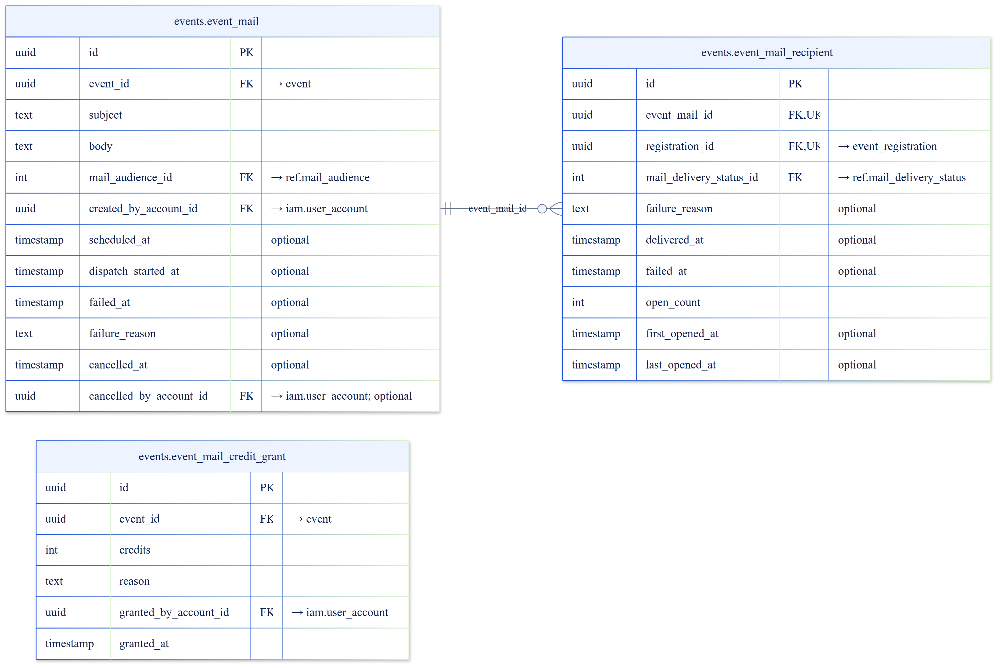

Every column of every table in this group, from the live schema (`created_at` / `updated_at` omitted). Lines are foreign keys inside the group; a note `→ table` is a foreign key to another group; amber = the group's hub. Source: [`catalog-diagrams/er-n8.mmd`](catalog-diagrams/er-n8.mmd).

| Table | What it holds | Links outside this group | Data flow — features that read (R) / write (W) its data store |
|---|---|---|---|
| [`event_mail`](#t-events-event-mail) | A message from the organisers to an event's registrants: to everyone, to those confirmed, pending or cancelled (`ref.mail_audience`), or to a hand-picked selection | `event`, `iam.user_account`; 1 lookup | [16.22](data-flow-features.md#f-16-22) RW |
| [`event_mail_recipient`](#t-events-event-mail-recipient) | The delivery log of a message: one row per registration written to | `event_registration`; 1 lookup | [16.22](data-flow-features.md#f-16-22) RW |
| [`event_mail_credit_grant`](#t-events-event-mail-credit-grant) | Extra mail credits an administrator gives an event beyond its allowance (registrations × the per-registration credits of the settings); append-only | `event`, `iam.user_account` | [16.22](data-flow-features.md#f-16-22) RW |

**Views over this group** (derived, never stored): `events.v_event_mail` · `events.v_event_mail_credit`  
**Functions that read or write it:** `events.dispatch_mail()` · `events.mail_credits_total()` · `events.mail_credits_used()` · `events.mail_opened()` · `events.run_mail_scheduler()`
<!-- /group:n8 -->

#### `events.event_mail`
**Why it exists:** a message from the organisers to an event's registrants: to everyone, to those confirmed, pending or cancelled (`ref.mail_audience`), or to a hand-picked selection; sent at once or at a scheduled time, and cancellable until sending starts. `events.dispatch_mail()` resolves the audience into recipients and takes the credits; `events.run_mail_scheduler()` (a system job) sends what is due and marks what cannot be sent as failed with the reason. Content is frozen once sending starts; the status (draft, scheduled, sending, sent, partial, undelivered, failed, cancelled) is derived (`v_event_mail`).
**Connects to →** `events.event`, `iam.user_account` (cancelled by, created by), `ref.mail_audience`.
**Referenced by ←** `events.event_mail_recipient`.

#### `events.event_mail_recipient`
**Why it exists:** the delivery log of a message: one row per registration written to. **No address is stored** — the recipient is a registration and the address is looked up when sending. The sender records the outcome (delivered, failed, bounced), which is then final; opens are counted only when open tracking is switched on in the settings, and never for a minor. Each recipient costs one mail credit, and a failed delivery gives it back (`v_event_mail_credit`).
**Connects to →** `events.event_mail`, `events.event_registration`, `ref.mail_delivery_status`.
**Referenced by ←** nothing.

#### `events.event_mail_credit_grant`
**Why it exists:** extra mail credits an administrator gives an event beyond its allowance (registrations × the per-registration credits of the settings); append-only. The old system had the log table but no way to top up.
**Connects to →** `events.event`, `iam.user_account` (granted by).
**Referenced by ←** nothing.

### 15.9 Stalls

Stalls at an event: the fee per category, applications with their set-up needs and documents, the stalls themselves with their products, and visitors' anonymous feedback.

<!-- group:n9 -->
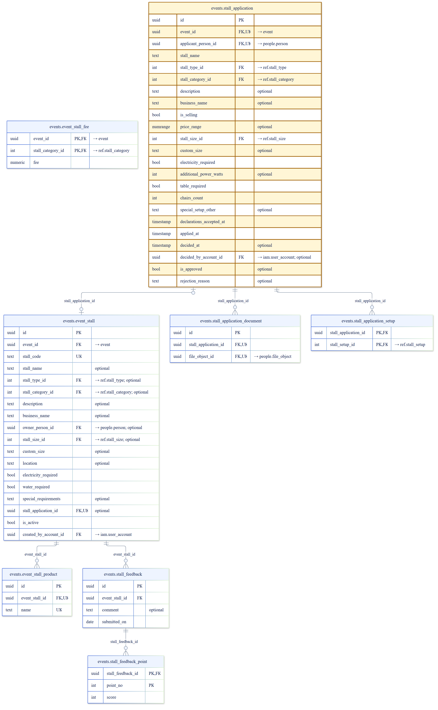

Every column of every table in this group, from the live schema (`created_at` / `updated_at` omitted). Lines are foreign keys inside the group; a note `→ table` is a foreign key to another group; amber = the group's hub. Source: [`catalog-diagrams/er-n9.mmd`](catalog-diagrams/er-n9.mmd).

| Table | What it holds | Links outside this group | Data flow — features that read (R) / write (W) its data store |
|---|---|---|---|
| [`event_stall_fee`](#t-events-event-stall-fee) | What a stall of a category costs at an event; no row means free | `event`; 1 lookup | [16.19](data-flow-features.md#f-16-19) R · [16.23](data-flow-features.md#f-16-23) RW · [16.24](data-flow-features.md#f-16-24) RW |
| [`stall_application`](#t-events-stall-application) | An application to run a stall at an event that takes them (`event.stall_applications_open`, before the deadline, within `max_applied_stalls`) | `event`, `iam.user_account`, `people.person`; 3 lookups | [16.19](data-flow-features.md#f-16-19) R · [16.23](data-flow-features.md#f-16-23) RW · [16.24](data-flow-features.md#f-16-24) RW |
| [`stall_application_setup`](#t-events-stall-application-setup) | The special set-ups a stall application asks for (water, extra lighting, display board, canopy …) — one row each instead of the old text array | 1 lookup | [16.19](data-flow-features.md#f-16-19) R · [16.23](data-flow-features.md#f-16-23) RW · [16.24](data-flow-features.md#f-16-24) RW |
| [`stall_application_document`](#t-events-stall-application-document) | Documents attached to a stall application (licences, menus): one row per application and file, and no change once the application has been decided | `people.file_object` | [16.19](data-flow-features.md#f-16-19) R · [16.23](data-flow-features.md#f-16-23) RW · [16.24](data-flow-features.md#f-16-24) RW |
| [`event_stall`](#t-events-event-stall) | A stall of an event, ST followed by a number: set up and described by the organisers, or created by an approved application | `event`, `iam.user_account`, `people.person`; 3 lookups | [16.19](data-flow-features.md#f-16-19) R · [16.23](data-flow-features.md#f-16-23) RW · [16.24](data-flow-features.md#f-16-24) RW |
| [`event_stall_product`](#t-events-event-stall-product) | The products a stall offers, one row per product with a non-empty name unique within the stall | — | [16.19](data-flow-features.md#f-16-19) R · [16.23](data-flow-features.md#f-16-23) RW · [16.24](data-flow-features.md#f-16-24) RW |
| [`stall_feedback`](#t-events-stall-feedback) | A visitor's feedback on a stall from its public form: no login, no person, a date instead of a time, an optional comment | — | [16.19](data-flow-features.md#f-16-19) R · [16.23](data-flow-features.md#f-16-23) RW · [16.24](data-flow-features.md#f-16-24) RW |
| [`stall_feedback_point`](#t-events-stall-feedback-point) | The scores of one stall feedback, each on the feedback scale of the settings (the old `points` JSON array, as rows); the stall's average is derived (`v_stall`) | — | [16.19](data-flow-features.md#f-16-19) R · [16.23](data-flow-features.md#f-16-23) RW · [16.24](data-flow-features.md#f-16-24) RW |

**Views over this group** (derived, never stored): `events.v_event_statistics` · `events.v_refund_queue` · `events.v_stall` · `events.v_stall_application`  
**Functions that read or write it:** `events.stall_fee()` · `events.submit_stall_feedback()`
<!-- /group:n9 -->

#### `events.event_stall_fee`
**Why it exists:** what a stall of a category costs at an event; no row means free. The fee of an application is derived from it (`events.stall_fee()`), not typed in by the applicant as in the old system.
**Connects to →** `events.event`, `ref.stall_category`.
**Referenced by ←** nothing.

#### `events.stall_application`
**Why it exists:** an application to run a stall at an event that takes them (`event.stall_applications_open`, before the deadline, within `max_applied_stalls`): one per applicant and event, with what the stall sells, its size, its power and furniture needs and the accepted declarations. The applicant's phone and e-mail are not copied — they are the person's in `pii`. The organisers approve or reject (a rejection needs a reason); approval creates the stall. Its fee is paid through `event_payment`.
**Connects to →** `events.event`, `iam.user_account` (decided by), `people.person` (applicant), `ref.stall_category`, `ref.stall_size`, `ref.stall_type`.
**Referenced by ←** `events.event_payment`, `events.event_stall`, `events.stall_application_document`, `events.stall_application_setup`.

#### `events.stall_application_setup`
**Why it exists:** the special set-ups a stall application asks for (water, extra lighting, display board, canopy …) — one row each instead of the old text array.
**Connects to →** `events.stall_application`, `ref.stall_setup`.
**Referenced by ←** nothing.

#### `events.stall_application_document`
**Why it exists:** documents attached to a stall application (licences, menus): one row per application and file, and no change once the application has been decided.
**Connects to →** `events.stall_application`, `people.file_object`.
**Referenced by ←** nothing.

#### `events.event_stall`
**Why it exists:** a stall of an event, ST followed by a number: set up and described by the organisers, or created by an approved application — then the row carries only the link to the application, its place on the floor plan and its active flag; its name, type, size and needs are read from the application (`v_stall` shows both kinds alike), never copied. A stall with feedback, or from an application, is deactivated rather than deleted. Its QR leads to the public feedback form.
**Connects to →** `events.event`, `events.stall_application`, `iam.user_account` (created by), `people.person` (owner), `ref.stall_category`, `ref.stall_size`, `ref.stall_type`.
**Referenced by ←** `events.event_stall_product`, `events.stall_feedback`.

#### `events.event_stall_product`
**Why it exists:** the products a stall offers, one row per product with a non-empty name unique within the stall — rows instead of the old system's JSON list, so they can be searched and constrained.
**Connects to →** `events.event_stall`.
**Referenced by ←** nothing.

#### `events.stall_feedback`
**Why it exists:** a visitor's feedback on a stall from its public form: no login, no person, a date instead of a time, an optional comment. Written only through `events.submit_stall_feedback()`.
**Connects to →** `events.event_stall`.
**Referenced by ←** `events.stall_feedback_point`.

#### `events.stall_feedback_point`
**Why it exists:** the scores of one stall feedback, each on the feedback scale of the settings (the old `points` JSON array, as rows); the stall's average is derived (`v_stall`).
**Connects to →** `events.stall_feedback`.
**Referenced by ←** nothing.
