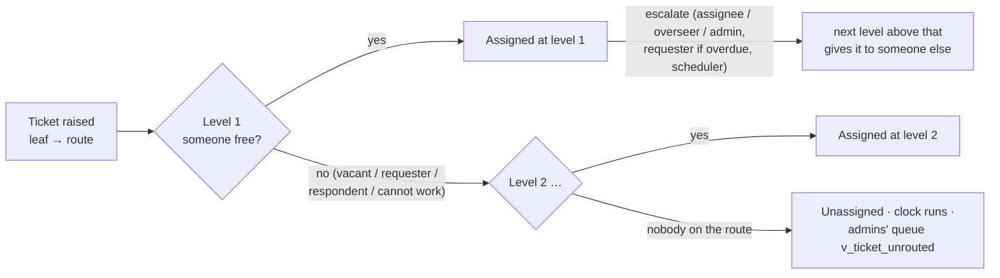
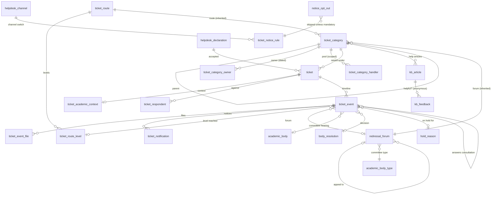

# Helpdesk (TMS) & student grievance redressal — design and end-to-end plan

Module: schema `tms`, file [`sql/12_tms.sql`](../../sql/12_tms.sql), tests
[`sql/98_tms_smoke_test.sql`](../../sql/98_tms_smoke_test.sql) (319 assertions),
SGT configuration example [`sql/91_example_tms_student_helpdesk.sql`](../../sql/91_example_tms_student_helpdesk.sql).
Status: built and tested on PostgreSQL 17 (2026-10-01). Values marked **POLICY**
are defaults to be confirmed by SGT (Registrar / IQAC / legal) — they are rows
and columns an administrator changes, never code.

---

## 1. What the module is for

One helpdesk for the two kinds of people who raise tickets:

| | Student domain | Employee domain |
|---|---|---|
| Raised by | current students (and an intake desk on their behalf) | current employees |
| Category tree | Master → Category → Sub-category | KRA type → KRA → KPI → Measurement criteria |
| Path | a **route** relative to the student (mentor → HOD → Dean → Dean Academics → VC) or through the responsible office | the KRA tree's owners, then the category-type head, then the VC |
| Beyond the helpdesk | **UGC grievance redressal**: SGRC → Ombudsperson; ragging / sexual harassment / discrimination go straight to their committees | — (grievances of employees are an HR module) |

The old SGT UMS treated the student side as a basic complaint box. Students
got in-app notices only. Nobody but the assignee could act on a student
ticket. The design treated every student ticket the same, whether it was a
library card or a ragging complaint. This module keeps every behaviour of the
old system that still makes sense, and makes the student side what a
university needs (§2).

**Not in scope (decided 2026-10-01):** tickets from guardians, applicants and
alumni (only current students and employees raise tickets); events (own
module); seminar halls and cabs (the `facility` schema).

---

## 2. The old system, and what changed

The old flow, end to end (from `Sgt-Ums/backend/src/modules/tms`):

1. The student ticks "I have read the policies", then picks a message type
   (grievance / assistance / enquiry / feedback), master → category →
   sub-category, a 10-digit contact number and one PDF/image.
2. The ticket goes round-robin to one sub-category handler. There is no
   fallback, and only the assignee may act.
3. The SLA counts business hours (Mon–Fri 9–17). An hourly cron escalates
   category → master → Registrar / Dean Academics / Controller → VC.
4. The handler may ask for clarification, which pauses the clock. The
   student may only answer that.
5. "Resolve" closes the ticket at once. The student may rate it once, or
   reopen it within 7 days.
6. Notices are in-app only. Student TMS is switched off by default.

| Gap in the old system | Now |
|---|---|
| Internal remarks visible to the student | **Public reply** (`REPLIED`) and **internal note** (`REMARKED`) are separate events. The requester's timeline never shows notes, reassignments or overdue notices. |
| An unanswered clarification left the ticket open for ever | Reminder after `clarification_reminder_days`, closed as *no response* after `clarification_expiry_days`. It can still be reopened. |
| No receipt; the student never heard of escalations | Receipt (in-app + e-mail) on raising. The student is told of every escalation, transfer, reply, referral and decision. |
| One global handler pool per sub-category, one fixed ladder | **Routes**: levels relative to the student's department / school, to the category's office, or fixed. Handler pools can be scoped per school or campus. |
| Academic context typed as free text, not checked | References to batch / term / course. A student may name only their own batch. The category decides whether the course is required. |
| No confidential channel; DSW saw everything | Ragging, sexual harassment and discrimination go straight to their committee, are confidential and may be anonymous. Admins and the DSW do not see them. |
| No "complaint against a person" | **Respondents**: the respondent never handles, hears, sees or is notified. Naming the current assignee moves the ticket on (*recusal*). |
| No formal grievance process | **Redressal forums**: SGRC (resolution of a quorate meeting, time limit), appeal to the Ombudsperson, grievance register and annual returns. |
| Walk-in / phone / letter complaints could not be logged | **Intake desk** (`tms.intake.create` at the student's unit) records them for the student. |
| Resolve = closed; unlimited reopening | `RESOLVED` awaits the student: they **accept**, **reopen** (at most `max_reopens`), **refer** to the committee, or **appeal** a forum decision. Uncontested resolutions close after `confirmation_window_days`. |
| No withdrawal, no duplicates, one attachment | **Withdraw**, **merge** (duplicates follow the surviving ticket and hear its resolution), up to `max_files_per_event` files per entry. |
| Resolution SLA only | Plus a **first-response** target per priority, and a round-the-clock option per priority. |
| Rating deleted on reopen; SLA source inconsistent; exhausted ladder re-processed hourly | Kept from the first rebuild: rating history kept, one SLA source, an exhausted ladder stops the clock. |
| No self-help; the old form only asked "have you read the notices?" | **Knowledge base** per category / domain shown before raising, with anonymous "did this help?" feedback measuring deflection. |
| Handlers could only remark or transfer when another office was needed | **Consultations** (ask another office, the ticket stays put) and **on hold** with a reason (vendor, other office, external body), released by hand or automatically. |
| A committee's decision ended the record | **Compliance**: a decision in the student's favour has a date to be carried out; the office reports the action taken; the scheduler reminds; the register shows it. |

### 2.1 Parity: everything the old TMS did, and where it is now

Every behaviour of the old module (`Sgt-Ums/backend/src/modules/tms`) is
covered at the database level. Most are kept as they were; some are covered
differently, and that is stated. Screens and e-mail templates are application
work; the database gives them what they need.

| Old feature / rule | Now |
|---|---|
| Student and employee domains; `studentTmsEnabled` (default off); `STUDENT_TMS_FORCE_DISABLED` env lock | `ref.tms_ticket_domain`; `helpdesk_setting.student_tms_enabled` (default off); `student_tms_locked`, which the application role cannot update (column grant). Locked + on is refused. |
| `EMPLOYEE_TMS_ENABLED` (reported, never enforced) | `employee_tms_enabled`, enforced like the student switch |
| Labels Master / Category / Sub-category vs KRA / KPI / Measurement criteria | `ref.tms_category_level.student_label` / `employee_label` |
| KRA Type → master; only the "ERP" KRA type's KRAs offered on the raise form | the KRA type is the tree root; any subtree can be `allows_raising = false` (internal only, reachable by transfer) |
| Service area academic / non-academic, routing to the academic / admin head | category type on the master + the route attached to it (§4.2) |
| Category CRUD; case-insensitive duplicate names; delete blocked when tickets exist ("deactivate instead") | `citext` unique per parent / domain root; `ON DELETE RESTRICT` from tickets; a node with tickets cannot be moved |
| Sub-category handlers (first = primary); replace list resets round-robin | `ticket_category_handler` (ordered, optionally per unit); the pointer is derived from the last round-robin event in the current pool, so a new list starts afresh |
| Round-robin under a row lock; requester excluded (employee); student: requester not excluded (bug) | `tms.round_robin()`: row lock per leaf; requester and respondents always excluded |
| Fallback to the category employee, then the master employee (level stayed sub-category — bug) | the next route level (KPI owner, KRA owner …) at its own level |
| Manual assignment: non-faculty only; assignee active, not a student, holds a handler position, not oneself | `tms.employee_ticket.assign` (derived for non-teaching staff); `manual_level()` — a handler of the leaf or an owner on its route; workable; not the requester |
| Assignee search (`/employees/search`, `/tms-context`) | `tms.eligible_assignees(leaf, requester)` |
| Subject 3–256 (student); optional and derived from the description (employee); description 10–5000 | `CHECK` lengths; a blank subject is taken from the description (whitespace collapsed, 256 characters) |
| Contact number: exactly 10 digits | the requester's own `pii.person_phone` (E.164, verified once in the profile, never copied) |
| Attachment: PDF / PNG / JPEG, ≤ 5 MB, magic bytes; path must be `tms/{ownUserId}/…`; download only if the file is on a ticket you can see | `tms.helpdesk_file_type` + `max_file_bytes` on the file's recorded type and size (byte sniffing stays in the upload service); a file belongs to one ticket only; `tms.can_download()` (requesters never get files of internal notes) |
| `messageType` grievance / assistance / enquiry / feedback; employees forced to grievance | `ref.tms_message_type` per domain; employees use GRIEVANCE or SERVICE_REQUEST |
| Priority: employee = sub-category's, student = client value or medium; `slaHours` from priority | priority on the leaf (the student no longer picks it); hours on `ref.tms_priority` (+ per-level override) |
| requestId `TMS-YYYY-NNNNN`, sequence restarting each year, under an advisory lock, server time zone | `tms.ticket_number_counter` per year under a row lock; the year in the configured time zone |
| Idempotency-Key (8–64 chars) replay within 24 h; same user + sub-category + description within 10 s = duplicate | unique `(requester, idempotency_key)`; `duplicate_window_seconds` (10) refuses the double submission, naming the original |
| ERP academic fields: programme / faculty / batch / session (type mapping) / course code / semester sets (odd, even, annual years, professional "Prof N") | `ticket_academic_context` by reference: the programme must be active; term of the programme's calendar type (semester / annual / professional year); semester within the programme and of the term's parity; the course when the rule says so; a student's own batch |
| Escalation ladder: sub → category → master → KRA head → admin / academic / examination head → VC (employee); → Registrar / Dean Academics / Controller → VC (student) | routes (§4.2); the old employee ladder is the seeded `EMPLOYEE_STANDARD` + one fixed overseeing head; student ladders are the seeded routes |
| Skip a level that is empty, inactive, the creator, or (manual mode) the assignee | the same skip rule, plus respondents and people who cannot work |
| Manual escalation needs a reason; at the VC only a "maximum level" remark; exhausted → 409 | reason required; escalation past the top refused; the requester may also escalate an overdue ticket |
| Auto-escalation hourly, office hours, single instance (advisory lock 7358291), startup catch-up | `run_scheduler()`: `pg_try_advisory_xact_lock(7358291)`, office hours unless `scheduler_office_hours_only = false`, `p_force` for catch-up; an exhausted ladder stops (old bug: re-processed hourly) |
| SLA clock: business hours IST, holidays (90-day lookahead), pause on clarification, resume with remaining minutes (min 1), reset on level change, finalized on resolve | office clock on the configured time zone, per-weekday hours, the academic calendar's holidays (counted or not), dated overrides, office hours or every hour (§4.7); pause / resume with remaining minutes; a new due time at each level; stopped on resolution |
| Attention tiers: paused / critical (overdue or ≤ 0 %) / warning (≤ 25 %) / normal | `v_ticket_sla.attention` and `sla_percent_left`; `sla_warning_percent` (25) |
| Overdue e-mail to the assignee, one per overdue episode, cleared on level change | `OVERDUE_NOTICE`, one per overdue spell (per clock start) |
| Statuses open / escalated / closed; resolve = close; remarks not on closed tickets | open / escalated / with the forum / resolved (awaiting the requester) / closed; `ref.tms_event_allowed_status` |
| Rating 1–5, creator only, closed only, once, no time limit; deleted on reopen | 1–5, requester only, once per resolution cycle, within `rating_window_days`; history kept |
| Reopen: creator, reason, within `reopenWindowDays` (1–90, default 7); keeps level and assignee; 48 h deadline | the same, plus at most `max_reopens`; the deadline from the level's SLA; not after a forum decision |
| `canReopen` computed for the creator | `tms.available_actions(account, ticket)` — every action, for anyone |
| Clarification: request needs remarks; only the creator replies, with remarks or a document | the same (reply-or-file checked at commit), plus reminder and expiry |
| Internal transfer (same sub-category handler, not the assignee or requester); cross-category (new round-robin handler or fail; reset level, priority, SLA) | `REASSIGNED` / `TRANSFERRED`, the same rules; the transfer walks the new leaf's route |
| Operational authority: assignee; on employee tickets also KRA head, category-type head, TMS admin | `can_act()`: assignee, overseeing levels, the KRA head, update permission at the responsible or requester's unit — on both domains |
| View: creator, assignee, past actors, analytics permission, DSW head, KRA / category-type / IT heads | `can_view()`: the same groups by permission and route, minus confidential tickets, never respondents |
| IT Department Head: employee-wide, view-only governance | role `TMS_EMPLOYEE_OVERSEER` (every employee ticket and the statistics, view only) |
| DSW head: sees tickets, dashboard intended (bug: excluded) | `TMS_STUDENT_OVERSEER` (student tickets except confidential ones, and the statistics) |
| Permission keys (`tms_submit_ticket` …), role defaults, admin = manage categories | `authz` permissions `tms.*` and roles derived from principal kind / position (§7) |
| In-app + e-mail notices per event; employee-only e-mail; dedupe key; `TMS_EMAIL_ENABLED`; user opt-out; 3 attempts (never used) | `ticket_notice_rule` (both domains), deduplicated delivery log, `helpdesk_channel.is_enabled`, `notice_opt_out` with mandatory notices, `notice_max_attempts` → GAVE_UP |
| Lists: my tickets, assigned, my raised, history (staff only); admin list with scope | `v_ticket_participant` + `v_ticket_state`, filtered by `can_view()` |
| Analytics overview (by status, type, priority, level, assignment mode; rating; escalations; resolution hours; overdue; reopened; paused hours) | `v_ticket_state` (all dimensions), `v_ticket_sla` (first response, paused office minutes, office time to resolution), `v_ticket_category_stats` |
| Employee (solver) stats; category stats per master / category / sub-category; KRA-type breakdown | `v_ticket_handler_stats` (ever assigned, open, overdue, resolved, rating, reopened); `v_ticket_category_rollup` (every tree node incl. KRA types) |
| Solver dashboard: summary, distributions, today / week / month, trend, top attention | derived from `v_ticket_state` / `v_ticket_sla` (attention, `resolved_at`) |
| Holidays screen; academic sessions; admission batches | the academic calendar; `academic.academic_term`; `academic.batch` — no TMS copies |
| Settings screen (auto-escalation, reopen window, Student TMS) | `tms.helpdesk_setting` (all of §4.4) |

The old system's bug list (#1–#27) is closed where it was a data rule: these
include #4, #5, #7, #8, #11–#15, #17, #20–#25 and #26 (lookahead, year time
zone). Front-end-only items (#1–#3, #6) and HTML escaping (#16) are
application work. Every check the old front end got wrong can now be asked
of `available_actions()`.

---

## 3. Design principles (how it fits the foundation)

- **Reference, never copy.** People, accounts, units, positions, mentors,
  managers, committees, meetings, resolutions, batches, terms, courses, files
  and phone numbers live in the foundation. TMS holds only foreign keys to
  them, so it has no name, e-mail or department snapshots.
- **Policy is data.** Every limit, window, time limit, ladder and channel is
  one of: a column of `tms.helpdesk_setting`, a row of a route / forum /
  notice rule, or a flag on a lookup. The lifecycle itself is a table
  (`ref.tms_event_allowed_status`).
- **Raised facts are immutable; the timeline is append-only.**
  `tms.ticket` is never edited. Everything that happens is a
  `tms.ticket_event`, and status, assignee, level, forum, clock, resolution,
  closure reason and rating are **derived** (`tms.v_ticket_state`).
- **Who may act is computed, not stored**: `tms.can_act()`, `tms.can_view()`,
  `tms.is_forum_member()` and `tms.requester_shown_to()`, all built on
  `authz.has_permission()`.
- **A committee decision is a committee resolution.** SGRC / ICC /
  anti-ragging decisions cite an `academic.body_resolution` of a quorate
  `academic.body_meeting` of that very body. That is the same machinery as a
  Board of Studies resolution or a disciplinary committee decision. It is
  adjudication, not an approval, so it is not a `wf` chain. (Tickets have
  never used `wf`, an earlier decision kept here.)

---

## 4. Configuration model

### 4.1 Category tree and inheritance

`tms.ticket_category` is one tree per domain. The domain and the responsible
unit are set on the root, the category type on the master, and the priority
on the leaf. Every other setting is `NULL = as the parent` and is resolved
down the tree by `tms.v_ticket_category`:

| Setting | Meaning |
|---|---|
| `route_id` | the ladder tickets of this subtree climb (§4.2) |
| `redressal_forum_id` | where a grievance from here goes (§4.3) |
| `direct_to_forum` | filed straight with the forum (statutory complaints); no route needed |
| `is_confidential` | visible only to participants and holders of `tms.confidential_ticket.view` |
| `allows_anonymous` | the requester may hide their identity from the people handling it |
| `allows_respondent` | the ticket may name a person complained against |
| `requires_incident_date` | the date of the incident is mandatory |
| `grievance_head_id` | UGC grievance head for the register and returns |
| `academic_context_rule_id` | `NONE` / `PROGRAMME` (batch, term, semester) / `COURSE` (+ course) |
| `allows_raising` | false = internal only: offered to nobody, reached by transfer (the old "only ERP KRAs on the form") |
| `sla_hours` / `first_response_hours` | **category-wise SLA**: resolution hours per level and the first-response target for this subtree (§4.4) |
| `sla_office_hours_only` | false = this subtree's clock runs round the clock (nights, weekends, holidays) |
| `org_unit_id` (below the root) | narrows the responsible office for a subtree (Transport, Library, IT …) |

### 4.2 Routes — the ladder

A route (`tms.ticket_route`, per domain) is an ordered list of levels
(`tms.ticket_route_level`):

| Level kind | Who |
|---|---|
| `HANDLER_POOL` | round-robin among the leaf's handlers **serving the requester's unit**. A handler row may be scoped to a unit; the most specific scope with someone free wins, and unscoped handlers serve everyone else. |
| `CATEGORY_OWNER` | the dated owner of the ticket's node at a tree level (category / master / KRA type) |
| `MENTOR` | the student's current mentor (`people.student_mentor`) |
| `REPORTING_MANAGER` | the employee's manager, *n* levels up (`people.employee_reporting_line`) |
| `POSITION` | the holder of a position at the **requester's unit**, the **category's unit**, or a **fixed unit** — or at the nearest unit of a given type above it |
| `NAMED` | one employee |

Each level may carry its own `sla_hours` (else the category's, else the priority's — §4.4). It may also
**oversee**: its holder can act on the ticket at any time, not only once it
reaches them (the old category-type heads).

**Skip rule.** A level is skipped when its person is missing, cannot work
now (not a current employee or cannot log in), is the requester, is the
current assignee, or is named as a respondent. If no level is left,
escalation is refused, and the scheduler stops the clock
(`ESCALATION_EXHAUSTED`).

**Seeded routes** (relative levels only, so they fit any org structure):

```
STUDENT_ACADEMIC        1 Mentor → 2 HEAD @ student's DEPARTMENT (HOD) → 3 DEAN @ student's SCHOOL
                        → 4 DEAN_ACADEMICS @ UNIVERSITY → 5 VICE_CHANCELLOR
STUDENT_EXAMINATION     1 exam handlers → 2 category owner → 3 master owner
                        → 4 HEAD @ category's unit (Controller of Examinations) → 5 VC
STUDENT_ADMINISTRATIVE  1 service desk → 2 category owner → 3 master owner
                        → 4 HEAD @ category's unit (the office) → 5 REGISTRAR → 6 VC
EMPLOYEE_STANDARD       1 handlers → 2 KPI owner → 3 KRA owner → 4 KRA head → 9 VC
```

The old employee ladder also had a fixed "admin / academic / examination
head" after the KRA head. That is one more `POSITION` level with a
`FIXED_UNIT` and `oversees = true`, added in SGT's own configuration (the
test builds exactly that).

The academic path is the one agreed for academic issues. A student of CSE
gets their mentor, then the HOD of CSE, then the Dean of Engineering, then
Dean Academics, then the VC. An MBA student without a mentor or a Dean in
post goes straight to Dean Academics. A school that wants its own academic
office first gives that subtree another route with a scoped `HANDLER_POOL`
at level 1. That is configuration, not code.



### 4.3 Redressal forums

`tms.redressal_forum` is either a **committee type** (an
`academic.academic_body` type) or a **position**. The body or holder that
hears a case is the **nearest one at or above the requester's unit** (of an
anchor unit type, if set). One SGRC for the university, or one per school
with the university's as a fallback, is just which bodies exist.

SGT runs several committees, as the UGC norms require. Each is a forum, and
a case can pass from one to another.

| Forum (seeded) | Kind | First action within | Decision within (POLICY) | Decision must be a resolution | Forwards by default to | Appeal to (window) | Late first action alerts | Confidential |
|---|---|---|---|---|---|---|---|---|
| `SGRC` — Students' Grievance Redressal Committee | committee | the category's / priority's first response | 15 days | yes (quorate meeting) | — (names the forum) | `OMBUDSPERSON` (15 days) | — | no |
| `OMBUDSPERSON` | position at the university | as above | 30 days | no | — | — | — | no |
| `ANTI_RAGGING_SQUAD` — Anti-Ragging Squad | committee | **2 hours** | 1 day (inquiry report) | no (the squad's report) | `ANTI_RAGGING` | — | head of the institution (VC) | yes |
| `ANTI_RAGGING` — Anti-Ragging Committee | committee | **24 hours** | 7 days | yes | — | — | head of the institution (VC) | yes |
| `ICC` — Internal Complaints Committee | committee | **24 hours** | 90 days | yes | — | — | — | yes |
| `EQUAL_OPPORTUNITY` — Equal Opportunity Cell | committee | as above | 30 days | yes | — | `OMBUDSPERSON` (15 days) | — | no |
| `SC_ST_CELL` — SC / ST Cell | committee | as above | 30 days | yes | — | `OMBUDSPERSON` (15 days) | — | no |

All of these values are columns of `tms.redressal_forum`, so they stay
flexible: `first_action_within_hours`, `decision_within_days`,
`counts_office_days`, `needs_resolution`, `next_forum_id`,
`appeal_forum_id` / `appeal_window_days`, `compliance_within_days`,
`alert_position_type_id`, `is_confidential`. More committees are rows: a new
`ref.academic_body_type`, a forum row and the body. Several bodies of one type
(one SGRC per school) are just more `academic.academic_body` rows; the
nearest one hears the case.

Days are calendar days unless `counts_office_days` (then the close of
office on the *n*-th business day, `tms.days_after()`). Appeal chains are
checked for cycles. A multi-tier chain such as the 2019 regulations'
department → faculty → university committees is just more forums linked by
`appeal_forum_id`.

### 4.4 Settings (`tms.helpdesk_setting`, one row)

| Column | Default | Effect |
|---|---|---|
| `auto_escalation_enabled` | true | the scheduler escalates overdue helpdesk tickets (off → one overdue notice per spell) |
| `reopen_window_days` | 7 | a closed ticket may be reopened within this |
| `max_reopens` | 2 | after that, the student refers the grievance instead |
| `confirmation_window_days` | 3 | an uncontested resolution closes automatically |
| `rating_window_days` | 15 | rating allowed within this of the resolution |
| `clarification_reminder_days` / `_expiry_days` | 2 / 7 | reminder, then closed for no response (NULL = never) |
| `requester_may_escalate_overdue` | true | the requester may escalate an overdue ticket |
| `requester_refer_after_days` | 7 | the student may refer an open grievance after this (NULL = only once resolved) |
| `auto_refer_after_days` | 15 | an unsettled grievance goes to its forum automatically (NULL = never) |
| `max_files_per_event` | 5 | attachments per timeline entry |
| `max_file_bytes` | 5 MB | largest attachment (types in `tms.helpdesk_file_type`: PDF, PNG, JPEG) |
| `duplicate_window_seconds` | 10 | same requester, leaf and text within this = a double submission (0 = off) |
| `sla_warning_percent` | 25 | attention tier WARNING at or below this share of the clock left |
| `on_hold_enabled` / `max_hold_days` | true / 10 | holds allowed; a hold is released automatically after this (NULL = never) |
| `notice_max_attempts` | 3 | a notice failing this often is given up |
| `scheduler_office_hours_only` | true | false = the job also runs nights and holidays (for round-the-clock priorities) |
| `student_tms_enabled` | false | Student TMS switch (as the old system; `91` turns it on) |
| `student_tms_locked` | false | deployment lock (old `STUDENT_TMS_FORCE_DISABLED`): Student TMS cannot be switched on; not updatable by the application role |
| `employee_tms_enabled` | true | Employee TMS switch (old flag, now enforced) |
| `business_day_start` / `_end`, `time_zone` | 09:00 / 17:00, Asia/Kolkata | the default office hours (a weekday may have its own, §4.7) |
| `office_hours_only` | true | the helpdesk-wide default for every SLA clock: count office hours only, or every hour (nights, weekends, holidays). A priority or a category may override it |
| `count_holidays` | false | true = holidays count as working days (the clock does not stop for them) |

**SLA, category by category.** The SLA of a level is taken from the first
of these that is set:

1. the route level's own `sla_hours`;
2. the **category's** `sla_hours`, from the leaf itself or the nearest node
   above it;
3. the priority's hours.

The first-response target comes from the category (`first_response_hours`),
else the priority. Office hours versus round the clock comes from the
category (`sla_office_hours_only`), else the priority. A forum's clock is its
own time limit.

So SGT defines the SLA per category and leaves the priority as the default
for anything not yet defined. A change applies from the next clock start
(raising, escalation, transfer, reopening); clocks already running keep their
due time.

Priorities (`ref.tms_priority`, POLICY, the defaults): LOW 72 h / first
response 24 h · MEDIUM 48 / 8 · HIGH 24 / 4 · URGENT 8 / 2, all in office
hours. Set `office_hours_only = false` for round-the-clock.

**Harassment and ragging are URGENT.** In SGT's configuration
(`sql/91_example_tms_student_helpdesk.sql`), the ragging, sexual-harassment
and harassment / victimisation categories have priority URGENT and a
round-the-clock clock: the 2-hour first response counts nights and holidays,
and the committee's time limit counts calendar days. Every other category
takes its priority's SLA until SGT sets its own.

`tms.helpdesk_declaration` holds the text the requester accepts. It is dated,
with one in force per domain, and the ticket records the version accepted.

### 4.5 Knowledge base, files and channels

- `tms.kb_article`: a help article for a category node (shown for every
  leaf below it) or a whole domain, with dated publication.
  `tms.kb_articles_for(leaf)` returns what the raise screen shows first.
- `tms.kb_feedback`: "did this answer your question?". It is anonymous (no
  account) and append-only. `v_kb_article_stats` gives each article's
  deflection share.
- `tms.helpdesk_file_type` lists accepted file types; `tms.helpdesk_channel`
  is a kill switch per notice channel; `tms.notice_opt_out` records a
  person's opt-out per channel (mandatory notices still go).
- Forums carry `compliance_within_days` (POLICY: SGRC 30, Ombudsperson 30,
  ICC 60, anti-ragging 15, equal opportunity 30). This is the time to carry
  out a decision in the student's favour.
- `ref.tms_hold_reason` says what a ticket on hold awaits: another office, a
  vendor, an external body, or a third party's document.

### 4.6 Message types

| Type | Student | Employee | Grievance (may go to a forum) | Relief sought required |
|---|---|---|---|---|
| GRIEVANCE | ✓ | ✓ | ✓ | ✓ |
| ASSISTANCE, ENQUIRY, FEEDBACK | ✓ | | | |
| SERVICE_REQUEST | | ✓ | | |

### 4.7 The calendar the clock runs on

Whether an hour counts is decided in two steps, both configured by the
administrator.

**1. Count non-working hours or not.** The first of these that is set wins:
- the category's `sla_office_hours_only` (inherited down the tree);
- the priority's `office_hours_only` (NULL by default);
- the helpdesk-wide `helpdesk_setting.office_hours_only` (true by default).

A committee's time limit counts calendar or working days by its own
`counts_office_days`.

**2. Which hours are office hours** (`tms.day_hours(date)`), checked in this
order:
1. **Dated overrides** (`tms.helpdesk_day_override`). One date is open (a
   holiday or weekly off made working: fee deadline, exam Saturday) or
   closed (election, shutdown), with the reason and optionally its own hours.
2. **The weekly pattern** (`tms.helpdesk_weekday`): which weekdays work, each
   with its own hours if they differ from the default (a Saturday half day).
3. **Holidays**: university-wide events of the academic calendar of the types
   in `helpdesk_closure_type` (HOLIDAY by default; VACATION could be added).
   They close the day unless `count_holidays` is on. Adding or removing a
   holiday is done in the academic calendar, so there is one calendar for the
   whole university.
4. Otherwise the day is open with the default hours.

`tms.helpdesk_calendar(from, to)` shows the result day by day, with the
reason (working day / weekly off / holiday / holiday counted / override),
so the administrator sees exactly what the clock will do.

### 4.8 What an administrator configures

Everything below is data: rows and columns the helpdesk administrator
(`TMS_ADMIN`, permission `tms.config.update`) changes from the admin screens.
No code changes are needed, and every change is audited.

| Area | Where |
|---|---|
| Switches | Student TMS, Employee TMS (`helpdesk_setting`); the deployment lock on Student TMS is the one setting reserved to the database owner |
| Office calendar | default hours and time zone; working weekdays and per-weekday hours; holidays counted or not; which calendar event types close the office; dated open / closed days |
| Counting time | helpdesk-wide office hours vs every hour; per priority; per category; per committee (calendar or working days) |
| SLA | priority hours and first-response hours; category-wise resolution and first-response hours (inherited); per route level hours; the attention warning threshold |
| Categories | the tree, names, order, active / internal only; responsible office; category type; priority; academic context rule; grievance head; route; forum; straight to the forum; confidential; anonymous allowed; respondents allowed; incident date required |
| People | handlers per leaf (and per school / campus), category owners (dated), route levels (mentor, HOD, Dean, fixed offices, named people, overseeing) |
| Committees | which forums exist, their committee type or position, time limit, first-action time, alert position, resolution required, default forward, appeal forum and window, compliance period, confidentiality; the bodies and members themselves (`academic.academic_body*`) |
| Requester's side | declaration text (dated); message types; who may choose the assignee (role); intake desks (role, scoped) |
| Lifecycle policy | reopen window and maximum reopenings; confirmation window; rating window; clarification reminder and expiry; holds allowed and maximum hold; requester escalation; when the requester may refer and when the helpdesk refers automatically; auto-escalation on / off; scheduler office hours or round the clock |
| Files and notices | accepted file types and size; files per entry; duplicate window; notice rules per event / recipient / channel / domain, mandatory or not; channel kill switches; retry limit |
| Knowledge base | articles per category or domain, dated publication |

---

## 5. UGC alignment

How the UGC (Redress of Grievances of Students) Regulations, 2023 are met:

| Expectation | Where |
|---|---|
| Online grievance portal; every grievance registered with a number and acknowledged | `tms.ticket` (TMS-YYYY-NNNNN), receipt notice on `CREATED` (in-app + e-mail) |
| Students' Grievance Redressal Committee(s), with a quorum for decisions | forum `SGRC` → `academic.academic_body` of type STUDENT_GRIEVANCE_COMMITTEE; `FORUM_DECIDED` must cite a resolution of a quorate meeting of that body |
| Time limit for the committee's decision | `decision_within_days` (15, POLICY); the forum's clock; overdue notice to its members |
| Appeal to the Ombudsperson, within a period after the decision; Ombudsperson decides within a time limit | `APPEALED` within `appeal_window_days` → forum `OMBUDSPERSON` (position at the university), 30 days (POLICY) |
| Kinds of grievance listed in the regulations | `ref.tms_grievance_head` (15 listed heads, paraphrased — confirm wording) on every category |
| Records and reporting of grievances received / disposed / pending | `tms.v_grievance_register` (per referral) and `tms.v_grievance_summary` (per academic year × forum × head), for the UGC return and NAAC |
| Ragging and sexual harassment handled under their own regulations | categories `direct_to_forum` → `ANTI_RAGGING` / `ICC`, confidential, incident date required, respondents |
| Discrimination against SC / ST / OBC / women / minority / PwD students | Equal Opportunity Cell forum (or SGRC, by configuration) |
| No victimisation of the complainant; fairness | respondents excluded from handling, hearing, viewing and notices; anonymous option where allowed |

The standard student tree in `91` follows this. It has 8 masters: Academic,
Examinations, Fees & scholarships, Campus services, Records & documents,
Equity & conduct, Ragging, Sexual harassment. That makes 28 leaves, each
mapped to a grievance head, a route and a forum.

> **POLICY to confirm:** the exact time limits and appeal windows in force, the
> wording of the grievance heads, whether grievances go to the SGRC directly
> (set `direct_to_forum` on those categories) or via the helpdesk first (the
> default, with `auto_refer_after_days` as the safety net), retention periods.

---

## 6. End-to-end flows

### 6.1 Raising a ticket

Before raising, the screen shows the knowledge-base articles for the chosen
leaf (`tms.kb_articles_for`). The reader may answer "this solved it"
(`kb_feedback`, anonymous) and raise nothing.

Self-service (portal) or through an **intake desk** (walk-in, phone, e-mail,
letter: `raised_by_account_id` + a non-self-service `intake_channel`). The
desk needs `tms.intake.create` at the student's unit. Checked on insert
(`tms.ticket_validate`):

- the leaf is active and its whole path is active, and it is not internal
  only; it has an active route, or is `direct_to_forum` with a forum;
- not the same requester, leaf and text again within `duplicate_window_seconds`;
  a blank subject is taken from the description;
- the domain's switch is on (Student TMS, Employee TMS);
- the requester is a current student / employee of the domain with the
  create permission; Student TMS is on for student tickets;
- the message type fits the domain; a direct-to-forum complaint is a
  grievance;
- relief sought (when the message type needs it), incident date (when the
  category needs it, not in the future), anonymity (when the category
  allows it);
- the contact number is one of the requester's own; the declaration in
  force is accepted;
- a manual assignee (employee domain, non-teaching staff only) is a
  handler or an owner on the ticket's route, not the requester, and able
  to work.

Filled in by the trigger: number, priority, route, and **the requester's
unit when raised** (what "relative to the requester" means for this ticket;
a later move of the student does not re-route it). Academic context is
inserted in the same transaction. A deferred check requires it when the
rule says so, and for students the batch must be one they are or were
enrolled in. Files go on the `CREATED` entry, in the same transaction.

### 6.2 Routing at creation

Direct-to-forum categories: `CREATED`, then `REFERRED` by the requester at
once (status *with the forum*). Otherwise: the manual choice, else the first
route level that gives the ticket to someone (§4.2), else unassigned with
the clock running (the admins' queue `tms.v_ticket_unrouted`). The due time
is the level's SLA in office (or wall-clock) time.

### 6.3 Working a ticket

| Event | By | Effect |
|---|---|---|
| `REPLIED` | someone who can act | public reply; counts as the first response; notifies the requester |
| `REMARKED` | someone who can act | internal note; never shown to or sent to the requester |
| `REQUESTER_COMMENTED` | requester | follow-up; notifies the assignee; clock unchanged |
| `CLARIFICATION_REQUESTED` | can act | pauses the clock, keeping the minutes left |
| `CLARIFICATION_PROVIDED` | requester | reply **or** a file (checked at commit); resumes with the minutes left |
| `REASSIGNED` | can act | to another handler of the same leaf serving this requester (pool levels only) |
| `TRANSFERRED` | can act | to another active leaf of the domain (not direct-to-forum, context satisfied); new priority, route and first level; must find someone |
| `RECUSED` | automatic, on naming the assignee as respondent | moves to the next level |
| `PUT_ON_HOLD` | can act | with a hold reason (other office, vendor, external body, third-party document); pauses the clock; shown to the requester |
| `HOLD_RELEASED` / `HOLD_EXPIRED` | can act / scheduler after `max_hold_days` | resumes with the minutes left |
| `CONSULTATION_REQUESTED` | can act | asks another employee (not the requester, assignee, oneself or a respondent; never on a confidential ticket); they may then see the ticket but not act on it; internal |
| `CONSULTATION_ANSWERED` | the person asked, once | reply or file; tells whoever asked; internal |

Files go on any entry that takes them, in the same transaction: only an
accepted type, up to `max_file_bytes`, up to `max_files_per_event`, and a
file of one ticket only. `tms.can_download()` lets a requester download only
the files of entries shown to them.

`tms.available_actions(account, ticket)` lists what the account may record
now. A screen shows exactly those buttons; the old front end and back end
disagreed about several of them.

### 6.4 Escalation

- **Manual** (`ESCALATED`, reason required): by someone who can act, or by
  the requester when the ticket is overdue and
  `requester_may_escalate_overdue` is on.
- **Automatic** (`AUTO_ESCALATED`): the scheduler, for every helpdesk ticket
  past its due time.
- The next level is the first one above the current level that gives the
  ticket to **someone else** (skip rule §4.2). At the top, the clock stops.
  The ticket stays open with the last holder and is not re-processed.
- The requester and the new assignee are told; so is the previous one (when
  someone else moved it).

### 6.5 Resolution and closure

```mermaid
stateDiagram-v2
  [*] --> OPEN: CREATED
  OPEN --> ESCALATED: ESCALATED / AUTO_ESCALATED
  ESCALATED --> ESCALATED: ESCALATED / AUTO_ESCALATED
  OPEN --> OPEN: TRANSFERRED · REPLIED · REMARKED · clarification
  ESCALATED --> OPEN: TRANSFERRED
  OPEN --> WITH_FORUM: REFERRED / AUTO_REFERRED
  ESCALATED --> WITH_FORUM: REFERRED / AUTO_REFERRED
  OPEN --> RESOLVED: RESOLVED / REJECTED (not maintainable)
  ESCALATED --> RESOLVED: RESOLVED / REJECTED
  WITH_FORUM --> RESOLVED: FORUM_DECIDED
  RESOLVED --> OPEN: REOPENED (≤ max_reopens; not after a forum)
  RESOLVED --> WITH_FORUM: REFERRED (dissatisfied) / APPEALED (forum decision)
  RESOLVED --> CLOSED: CONFIRMED / AUTO_CLOSED
  OPEN --> CLOSED: WITHDRAWN · MERGED · CLARIFICATION_EXPIRED
  ESCALATED --> CLOSED: WITHDRAWN · MERGED · CLARIFICATION_EXPIRED
  WITH_FORUM --> CLOSED: WITHDRAWN · CLARIFICATION_EXPIRED
  CLOSED --> OPEN: REOPENED (reopenable reason, within window)
```



The diagram is `ref.tms_event_allowed_status`. Closure reasons
(`ref.tms_closure_reason`) decide what may follow:

| Reason | Comes from | Rate? | Reopen? |
|---|---|---|---|
| RESOLVED | `RESOLVED` → accepted / auto-closed | ✓ | ✓ |
| NOT_MAINTAINABLE | `REJECTED` → accepted / auto-closed | ✓ | ✓ |
| FORUM_DECISION | `FORUM_DECIDED` → accepted / auto-closed | | (appeal instead) |
| NO_RESPONSE | `CLARIFICATION_EXPIRED` | | ✓ |
| WITHDRAWN | `WITHDRAWN` | | |
| DUPLICATE | `MERGED` | | |

The requester can never resolve their own ticket. A rating (1–5) is given
once per resolution cycle, within the rating window, and the history is
kept across reopenings. A merged ticket's requester can see the surviving
ticket and is told when it is resolved.

### 6.6 Grievance redressal (UGC)

1. **Referral** of a *grievance* to the category's forum (once per ticket):
   - by the **student**, when dissatisfied with a resolution, or after
     `requester_refer_after_days`, or at once for direct-to-forum categories;
   - by the **handling side**, at any time, optionally to another forum
     (for example a complaint that turns out to be ragging);
   - **automatically**, when the helpdesk has not settled it within
     `auto_refer_after_days`.
2. The nearest body (or holder) is seated (`tms.forum_seat`). If none is
   constituted, the referral is refused. The forum's clock starts. Only its
   current members act from now on (reply, clarification, decision), never a
   respondent.
3. **Decision** (`FORUM_DECIDED`): outcome (upheld / partly upheld / not
   upheld / not maintainable), the order as remarks, the signed order as a
   file. For a committee it must cite a resolution of a quorate meeting of
   that body. Status becomes RESOLVED.
4. **Appeal** (`APPEALED`, requester) within the forum's appeal window, to
   its appeal forum (SGRC → Ombudsperson). Otherwise the decision is
   accepted, or closes automatically when the appeal window ends.
   **Forwarding** (`FORUM_FORWARDED`, by a member, with the committee's
   report): the case moves to another committee. It goes to the forum's
   default (`next_forum_id`; the squad's goes to the Anti-Ragging Committee)
   or to the one named (a grievance that turns out to be discrimination goes
   to the Equal Opportunity Cell). The new committee is seated and its own
   clock starts. The first committee keeps sight of the case but no longer
   acts on it. Forwarding is refused to the same forum, to one with no body
   constituted, or without a report.
5. **Compliance.** A decision in the student's favour from a forum with
   `compliance_within_days` must be carried out by then. A forum member, the
   last helpdesk assignee (the office that handled it), or a holder of the
   domain's update permission at the responsible unit reports it once
   (`ACTION_TAKEN`, with the evidence as a file); the student is told. When
   the date passes unreported, the scheduler sends `COMPLIANCE_REMINDER` to
   that office and the forum.
6. Every stage with a forum is a row of `tms.v_grievance_register`, whether
   referred, appealed or forwarded in. Each row records:
   - when the case arrived;
   - the **first action** and its due time (in time or not);
   - the time limit;
   - how the stage ended (decided / forwarded), its outcome, and whether in
     time;
   - pending / overdue;
   - compliance due / done / overdue;
   - the academic year.

**Urgent cases are the committees' to act on at once.** Each stage with a
forum has a first-action target: the forum's `first_action_within_hours`, or
else the category's or the priority's first-response hours. For the urgent
categories this is counted round the clock. If no member has acted by then,
the scheduler raises one `FORUM_ACTION_OVERDUE` per stage. It goes to the
members (in-app + e-mail) and to the forum's alert position, nearest above
the student, by in-app, e-mail and SMS: the head of the institution for the
anti-ragging squad and committee. The alert is mandatory: nobody can opt out
of it.

A forum past its time limit is never escalated. Its members get one overdue
notice per overdue spell.

### 6.7 Statutory and sensitive complaints

Ragging, sexual harassment and discrimination categories are
`direct_to_forum`, `is_confidential`, `allows_respondent` and
`requires_incident_date`. Ragging also allows anonymity; sexual harassment
does not, because the ICC needs a named complainant. For such tickets:

- they are visible only to the complainant, the forum's members,
  participants, and holders of `tms.confidential_ticket.view`. Not the TMS
  admin, the DSW, unit heads or the grievance cell (they see counts only, in
  the register);
- the **respondent** never sees, handles, hears or is notified;
- an **anonymous** requester is hidden from the handlers
  (`tms.requester_shown_to`); only `tms.anonymous_identity.view` reveals them;
- they are never merged.

In SGT's configuration a ragging complaint goes first to the **Anti-Ragging
Squad**. The squad must act within 2 hours, round the clock, or the VC is
alerted. Its inquiry report is due in a day and forwarded to the
**Anti-Ragging Committee**, which must act within 24 hours and decide in 7
days. Sexual-harassment complaints go to the ICC (first action in 24 hours);
caste-based discrimination to the SC / ST Cell; other discrimination to the
Equal Opportunity Cell; harassment / victimisation to the SGRC. All of them
are URGENT or HIGH.

A ragging decision that leads to discipline is then recorded in the
foundation's `academic.disciplinary_case` (a disciplinary committee), linked
by the application.

### 6.8 The scheduler (`tms.run_scheduler`, hourly, `app.system_job = on`)

One instance at a time (`pg_try_advisory_xact_lock(7358291)`; a second
concurrent run returns at once). During office hours, or always when
`scheduler_office_hours_only` is off, or when forced:

1. Auto-referral of unsettled grievances.
2. Overdue running clocks: at the helpdesk, escalate (or stop at the top,
   or send an overdue notice when auto-escalation is off); at a forum,
   always an overdue notice.
   Forums that have not acted within their first-action time: one alert per
   stage (members and the alert position).
3. Holds longer than `max_hold_days`: released.
4. Forum decisions not carried out by their compliance date: one reminder.
5. Clarifications: a reminder, then expiry.
6. Uncontested resolutions: closed after the confirmation window (forum
   decisions: after the appeal window).

It returns the counts per step. `p_now` judges what is due (for catch-up
runs and tests), and new deadlines always count from the real clock.

---

## 7. Access

| Who | Sees | Acts |
|---|---|---|
| Requester | own tickets (timeline without internal events: `v_ticket_requester_timeline`) | comment, answer clarification, escalate when overdue, refer, appeal, accept, reopen, withdraw, rate, name a respondent |
| Current assignee | ✓ | ✓ |
| Past participants (acted / were assigned) | ✓ | — |
| Holders of a level of the ticket's route (e.g. the student's HOD and Dean) | ✓ | if the level oversees |
| `*_ticket.view` at the responsible unit **or the requester's unit** (unit heads and deans via `TMS_UNIT_SUPERVISOR`; DSW via `TMS_STUDENT_OVERSEER`) | ✓ (not confidential) | — |
| `*_ticket.update` at either unit (`TMS_ADMIN` everywhere) | ✓ (not confidential) | ✓ (not confidential, not with a forum) |
| KRA head (employee tickets) | ✓ | ✓ |
| Forum members | tickets their forum heard | while the ticket is with their forum |
| A consulted employee | ✓ | answer the consultation only |
| Compliance reporters (forum member, last handler, update permission at the responsible unit) | — | report the action taken on a decision |
| `TMS_EMPLOYEE_OVERSEER` (the old IT Department Head) | every employee ticket | — |
| `tms.confidential_ticket.view` | confidential tickets | — |
| Respondent | **never** | **never** |
| `tms.grievance_register.view` (`TMS_GRIEVANCE_CELL`, `TMS_ADMIN`) | the register (no text) | — |

Roles: `TMS_STUDENT_REQUESTER` and `TMS_EMPLOYEE_REQUESTER` (derived for every
current student / employee), `TMS_STAFF_REQUESTER` (non-teaching staff may
choose the assignee), `TMS_UNIT_SUPERVISOR` (HEAD and DEAN positions),
`TMS_STUDENT_OVERSEER` (DSW, with the statistics), `TMS_EMPLOYEE_OVERSEER`,
`TMS_INTAKE_DESK`, `TMS_GRIEVANCE_CELL`, `TMS_ADMIN` (MFA; no confidential
access by design).

---

## 8. Notices (`tms.ticket_notice_rule`, all editable rows)

| Event | Requester | Assignee (new) | Previous assignee | Forum members | Followers |
|---|---|---|---|---|---|
| CREATED | in-app + e-mail (receipt) | in-app + e-mail | | | |
| REPLIED | in-app + e-mail | | | | |
| REQUESTER_COMMENTED | | in-app + e-mail | | | |
| CLARIFICATION_REQUESTED / _REMINDER | in-app + e-mail | | | | |
| CLARIFICATION_PROVIDED | | in-app + e-mail | | in-app | |
| CLARIFICATION_EXPIRED | in-app + e-mail | in-app | | | |
| ESCALATED / AUTO_ESCALATED | in-app | in-app + e-mail | in-app | | |
| RECUSED / REASSIGNED | | in-app + e-mail | in-app (reassigned) | | |
| TRANSFERRED | in-app | in-app + e-mail | | | |
| REFERRED / AUTO_REFERRED | in-app + e-mail (receipt) | | in-app | in-app + e-mail | |
| APPEALED | in-app + e-mail (receipt) | | | in-app + e-mail | |
| FORUM_DECIDED, REJECTED, MERGED | in-app + e-mail | | | | |
| RESOLVED | in-app + e-mail | | | | in-app + e-mail |
| REOPENED | | in-app + e-mail | | | |
| WITHDRAWN | | in-app | | | |
| AUTO_CLOSED | in-app | | | | |
| OVERDUE_NOTICE | | e-mail | | e-mail | |
| PUT_ON_HOLD / HOLD_RELEASED | in-app | | | | |
| HOLD_EXPIRED | in-app | in-app + e-mail | | | |
| ACTION_TAKEN | in-app + e-mail | | | in-app | |
| FORUM_FORWARDED | in-app + e-mail | | | in-app + e-mail (the new committee) | |
| FORUM_ACTION_OVERDUE | | | | in-app + e-mail, and the alert position by in-app, e-mail and SMS (mandatory) | |

Consultations go to the person consulted (CONSULTATION_REQUESTED, in-app +
e-mail), and the answer goes to whoever asked (in-app + e-mail) and the
assignee (in-app). COMPLIANCE_REMINDER goes to the last helpdesk handler
(in-app + e-mail) and the forum (e-mail).

Nobody is notified of their own action except for the receipts. Respondents
are never notified. A person may opt out of a channel (`notice_opt_out`).
Rules marked `is_mandatory` still reach them: receipts, referrals, appeals,
decisions, not-maintainable closures, expiry and merges. A channel can be
switched off as a whole (`helpdesk_channel`). A notice that fails
`notice_max_attempts` times is given up (`GAVE_UP`, final), so retries never
run for ever. `tms.ticket_notification` is the delivery log: one row
per event × recipient × channel, so a retry never sends twice, and no
address is stored. Students now get e-mail (the old system sent them
nothing). An e-mail / SMS provider is a `privacy.data_processor`.

---

## 9. Reports

| View | For | Contents |
|---|---|---|
| `v_ticket_state` | app, analytics | the derived state of every ticket |
| `v_ticket_sla` | analytics | first-response due / actual / breached, office minutes to resolution |
| `v_ticket_handler_stats` | supervisors | per handler: open, overdue, awaiting clarification, resolved, rating, reopened |
| `v_ticket_category_stats` | supervisors | per category: by status, overdue, late first responses, escalations, reopens, referrals, rating, mean resolution (office hours) |
| `v_grievance_register` | grievance cell | each referral / appeal: forum, head, dates, outcome, in time, pending, overdue, academic year |
| `v_grievance_summary` | analytics, UGC / NAAC returns | per academic year × forum × head: received, decided, in time, pending, overdue, in favour, appeals, average days |
| `v_ticket_unrouted` | admins | open tickets nobody on the route can take |
| `v_ticket_sla` (attention) | handlers, dashboards | attention tier PAUSED / CRITICAL / WARNING / NORMAL and the share of the clock left (the old solver "top attention") |
| `v_ticket_category_rollup` | supervisors | every tree node with all tickets below it (per KRA type, master, category) |
| `v_ticket_participant` | app | who takes part how — the my / assigned / raised / history lists |
| `v_ticket_consultation` | handlers | open and answered consultations |
| `v_kb_article_stats` | admins, analytics | answers, helpful, deflection share per article |

`intranet_analytics` sees configuration, the state and the statistics, but
never ticket text, timelines, respondents or the per-ticket register.

---

## 10. Personal data (DPDP Act, 2023)

- Purposes: `HELPDESK` (voluntarily provided, 3 years, POLICY) and
  `GRIEVANCE_REDRESSAL` (legal obligation under the UGC regulations, 5
  years, POLICY).
- Data category `GRIEVANCE_CASE` (sensitive): allegations and respondents.
- Registered columns (`privacy.data_element`): the ticket's subject,
  description and relief sought (ANONYMISE); incident date, contact phone and
  files (DELETE); timeline remarks (ANONYMISE); academic context batch /
  course (RETAIN_LEGAL); respondent (RETAIN_LEGAL — a case record must
  survive a respondent's erasure request).
- Audit: configuration and respondents are audited. The timeline, its files
  and the delivery log are append-only records themselves.
- Anonymity is a presentation rule: the requester is still stored (for
  notices and clarifications) but hidden from handlers.
- A notice opt-out (`notice_opt_out.account_id`) is registered (CONTACT,
  DELETE). Knowledge-base feedback has no person at all, and it is neither
  audited nor visible per row to analytics.
- Consultations show a ticket to one more named employee. They are refused on
  confidential tickets.

---

## 11. Data model

23 tables and 20 `ref` lookups.

- **First revision** added `ticket_route`, `ticket_route_level`,
  `redressal_forum`, `helpdesk_declaration`, `ticket_respondent`,
  `ticket_event_file` (replacing the old `ticket_escalation_step`). Its
  lookups: closure reason, event actor, event allowed status, route level
  kind, anchor base, redressal outcome, intake channel, grievance head,
  academic context rule.
- **Second revision** (parity and extensions) added `helpdesk_file_type`,
  `helpdesk_channel`, `ticket_number_counter`, `notice_opt_out`, `kb_article`,
  `kb_feedback` and the lookup `tms_hold_reason`. It also gave
  `ticket_event` the consulted employee, the request answered and the hold
  reason; gave the forum a compliance period; and made `allows_raising`
  inheritable.



Changed: `ticket` gains the requester's unit, intake desk and channel,
route, relief sought, incident date, anonymity and declaration; the single
document moves to `ticket_event_file`. `ticket_event` gains route level,
forum, committee, related ticket, outcome and resolution. `ticket_category`
gains the inherited settings. `ticket_category_handler` gains a unit scope.

---

## 12. Using it from the application (Django)

- Raise: `INSERT tms.ticket` (+ `ticket_academic_context`, `ticket_respondent`,
  and files on the `CREATED` event in the same transaction).
- Act: `INSERT tms.ticket_event` with the event code, actor and the few
  inputs that event takes (remarks; target handler; new category; forum;
  related ticket; outcome and resolution; rating). Everything else is
  computed, and refused with a clear message if not allowed.
- Show: `v_ticket_state`, `v_ticket_requester_timeline` for requesters,
  the raw timeline for staff; check `can_view` / `can_act`; mask the
  requester when `requester_shown_to` is false; offer the buttons
  `available_actions` returns; serve a file only if `can_download`.
- Raise screen: `kb_articles_for(leaf)` first; `eligible_assignees(leaf,
  requester)` for staff who may choose; on a duplicate (unique violation)
  show the original ticket.
- Run `tms.run_scheduler()` hourly under `SET LOCAL app.system_job = 'on'`.
- Deliver `tms.ticket_notification` rows and record the outcome
  (SENT / FAILED / SKIPPED).

---

## 13. Tests (`sql/98_tms_smoke_test.sql`, 319 assertions)

The second revision added:
- per-year numbering, the duplicate guard and the derived subject;
- internal-only categories;
- file type, size and ownership rules, and downloads;
- assignee search and available actions;
- compliance reporting and reminders;
- holds (manual and automatic release, switch);
- consultations;
- opt-out with mandatory notices, the channel switch, giving up;
- attention tiers;
- the knowledge base and deflection;
- the employee switch and the Student TMS lock;
- inactive programmes;
- the employee overseer;
- participants, rollups, and the round-the-clock scheduler.

The first revision covered:

These cover:
- the office clock and forum days;
- route and forum configuration and their refusals;
- tree inheritance;
- the old employee flow: round-robin, owners, KRA head, fixed overseeing
  head, VC, manual choice, reassign, transfer, clarification, rating, reopen
  limits;
- the student academic route (mentor → HOD → Dean → Dean Academics → VC,
  with vacant levels skipped);
- intake desk, declaration, own-batch context, scoped handler pools;
- replies vs notes, attachments, first response;
- respondents and recusal, anonymity;
- SGRC referral, quorate resolution, appeal to the Ombudsperson,
  acceptance, the register;
- referral rules and settings flips;
- merge with followers, withdrawal;
- the confidential ragging case;
- category-wise SLA: inheritance, a leaf's own hours, round the clock, a route level's hours winning, the first-response target;
- multiple committees: squad → committee forwarding, the late-first-action alert to the members and the VC, forwarding refusals, the register's forwarded stages;
- the administrator's calendar: the calendar view with reasons, holidays counted, dated overrides (open, closed, own hours), a Saturday half day, refusals, the helpdesk-wide office-hours switch and a priority overriding it;
- unrouted queue;
- scheduler: escalation, exhaustion, office-hours gating, overdue notices,
  reminders, expiry, auto-close, forum overdue, auto-referral;
- notices, reports, privacy and grants.

Every setting used is flipped in a test to show the behaviour change.

---

## 14. Open items and later work

- **POLICY confirmations**: forum time limits and appeal windows, priority
  hours, office weekdays and hours, retention periods, grievance-head
  wording, helpdesk-first vs committee-first for grievances,
  `auto_refer_after_days`.
- **Seeds**: committee members, the Ombudsperson's appointment, handlers and
  owners per category are entered by SGT (`91` creates the bodies and the
  tree only).
- **Done in the second revision**: knowledge base and deflection,
  consultations, on hold, compliance of forum decisions, round-the-clock
  scheduling, full parity with the old module (§2.1).
- **Application side**:
  - checking a file's magic bytes when it is uploaded (the database checks
    the recorded type and size);
  - HTML-escaping e-mail templates;
  - the dashboards' time buckets (today / week / month, trends), drawn from
    the views.
- **Later, if wanted**:
  - a major-incident parent ticket that resolves its children (merging covers
    duplicates today);
  - guardians, applicants and alumni as requesters (deliberately out for
    now).
