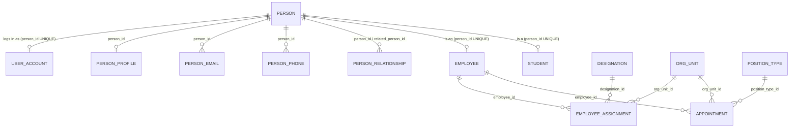
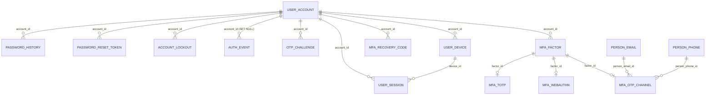
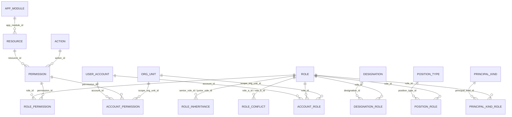
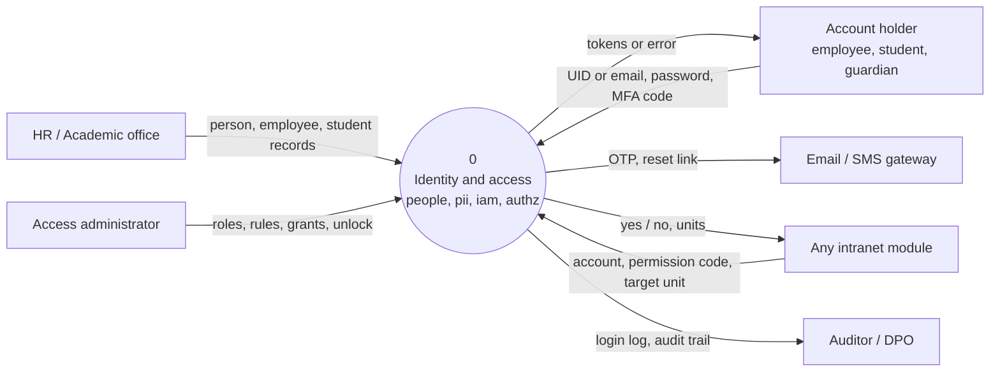
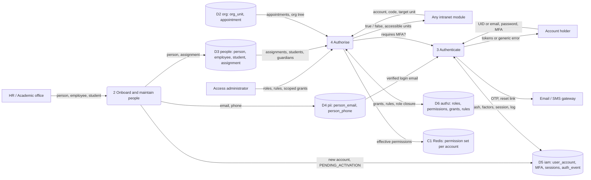
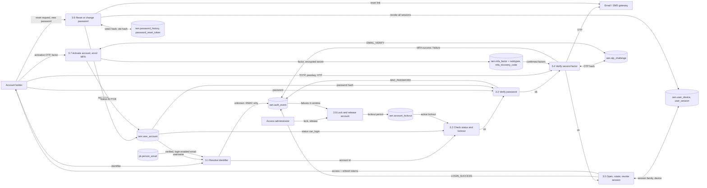
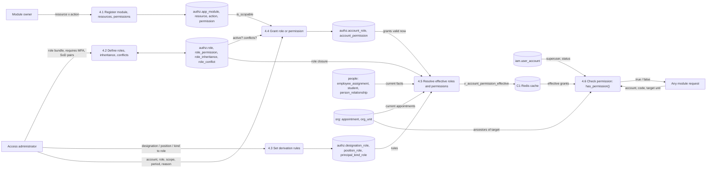

# User Management, Login & Permission-Based Roles

As of 2026-09-30. Scope: the new intranet foundation database only.

## Overview

In the new intranet database, a person has **one login account**, and what that account may do is **computed live** from roles. Roles are never copied onto the user. The design spans three layers, each in its own PostgreSQL schema:

| Layer | Schema | What it holds | Source file |
| --- | --- | --- | --- |
| User master | `people`, `pii` | The human (`people.person`), their contacts, and the facts that make them an employee, student or guardian | `sql/03_people.sql` |
| Login (authentication) | `iam` | The account, password, MFA, devices, sessions, lockouts and the login log | `sql/05_iam.sql` |
| Permission-based roles (authorisation) | `authz` | Modules, resources, actions, permissions, roles, and who holds which role in which org unit | `sql/06_authz.sql` |

The views and functions that connect them live in `sql/09_views_functions.sql`. The seeded roles and permissions live in `sql/10_seed_reference.sql`.

Roles and permissions are rows of data, and every check goes through one function: `authz.has_permission(account, 'module.resource.action', org_unit)`.

## Tables

There are 36 tables in scope: 10 in the user master, 13 for login, 13 for roles and permissions, plus the lookup tables that feed them. PK = primary key, FK = foreign key.

### A. User master (who the person is)

`people.person` is the single master record for every human. Being an employee, a student or a guardian is a separate fact table pointing at it, never a copy of the name or contacts.

| Table | Key columns | Purpose and rules |
| --- | --- | --- |
| `people.person` | `id` PK (uuid), `first_name`, `middle_name`, `last_name`, `preferred_name`, `gender_id` FK | The one human entity. Only the name lives here; everything else is in `pii`. |
| `pii.person_profile` | `person_id` PK+FK, `date_of_birth`, `blood_group_id`, `nationality_country_id` | 1:1 split of sensitive demographics, kept in the restricted `pii` schema. |
| `pii.person_email` | `id` PK, `person_id` FK, `email` (citext, globally UNIQUE), `contact_purpose_id`, `is_primary`, `is_login_enabled`, `verified_at` | One row per address. An address can be used to log in only if `is_login_enabled` and `verified_at` is set (CHECK). One primary per person. |
| `pii.person_phone` | `id` PK, `person_id` FK, `e164`, `is_primary`, `verified_at` | Phones in E.164 format; the SMS OTP channel points here. |
| `people.employee` | `id` PK, `person_id` FK UNIQUE, `employee_code` UNIQUE, `employee_category_id`, `employment_type_id`, `employment_status_id`, `joined_on`, `separated_on` | Makes a person an employee. `employee_code` is normally the login username. |
| `people.employee_assignment` | `employee_id` FK, `org_unit_id` FK, `designation_id` FK, `is_primary`, `valid` (daterange) | Where the employee works and in what designation. Exactly one primary assignment at a time (EXCLUDE constraint). Drives designation-based roles. |
| `people.designation` | `id` PK, `code`, `title`, `employee_category_id` | Designation master (e.g. `HR_MANAGER`, `ADMISSION_OFFICER`). |
| `org.appointment` | `org_unit_id` FK, `position_type_id` FK, `employee_id` FK, `valid`, `order_reference` | Who holds a leadership position (HEAD, DEAN, VC, REGISTRAR, DPO). One holder per unit and position at a time. Drives position-based roles. |
| `people.student` | `id` PK, `person_id` FK UNIQUE, `enrollment_no` UNIQUE, `registration_no`, `student_status_id`, `admitted_on` | Makes a person a student. `enrollment_no` is normally the login username. |
| `people.person_relationship` | `person_id`, `related_person_id`, `relationship_type_id`, `is_guardian` | Links a guardian (also a `person`) to a student. `is_guardian = true` makes them a GUARDIAN principal. |

### B. Login details (iam)

| Table | Key columns | Purpose and rules |
| --- | --- | --- |
| `iam.user_account` | `id` PK, `person_id` FK UNIQUE, `username` UNIQUE, `password` (Django hash), `account_status_id` FK, `is_superuser` | The login account. At most one per person. There is no `role` column and no `last_login` column. |
| `iam.password_history` | `account_id` FK, `password_hash`, `set_at`, `replaced_at` | Previous hashes, for the no-reuse policy. |
| `iam.password_reset_token` | `account_id` FK, `token_hash` (32 bytes), `expires_at`, `used_at`, `requested_ip` | Reset links. Only the SHA-256 hash of the token is stored. |
| `iam.mfa_factor` | `id` PK, `account_id` FK, `mfa_factor_type_id`, `is_default`, `confirmed_at` | One row per enrolled second factor. One default per account. |
| `iam.mfa_totp` | `factor_id` PK+FK, `secret_ciphertext`, `digits`, `period_seconds` | Authenticator-app subtype. The seed is encrypted by the application. |
| `iam.mfa_webauthn` | `factor_id` PK+FK, `credential_id`, `public_key`, `sign_count` | Passkey or security-key subtype. |
| `iam.mfa_otp_channel` | `factor_id` PK+FK, `person_email_id` or `person_phone_id` | Email/SMS OTP subtype. A trigger checks the email or phone belongs to the account's own person. |
| `iam.mfa_recovery_code` | `account_id` FK, `code_hash`, `used_at` | Backup codes, hashed. |
| `iam.otp_challenge` | `account_id` FK, `otp_purpose_id`, one of `mfa_factor_id` / `person_email_id` / `person_phone_id`, `code_hash`, `attempt_count`, `expires_at`, `consumed_at` | Every one-time code: login MFA, step-up, email/phone verification, password reset. |
| `iam.user_device` | `account_id` FK, `fingerprint_hash`, `trusted_until` | Known devices. `trusted_until` implements "remember this device" for MFA. |
| `iam.user_session` | `account_id` FK, `device_id` FK, `family_id`, `refresh_token_hash` UNIQUE, `mfa_verified_at`, `expires_at`, `revoked_at`, `session_revoke_reason_id` | Refresh-token sessions with rotation. Only one live token per family (unique index). |
| `iam.account_lockout` | `account_id` FK, `lockout_reason_id`, `period` (tstzrange), `released_at`, `released_by_account_id` | Lock periods. Periods cannot overlap for one account. |
| `iam.auth_event` | `occurred_at`, `account_id`, `auth_event_type_id`, `auth_failure_reason_id`, `identifier_hmac`, `session_id`, `mfa_factor_id`, `ip`, `user_agent` | Append-only login log, partitioned by month. A failed identifier is stored only as a keyed HMAC. |

### C. Permission-based roles (authz)

| Table | Key columns | Purpose and rules |
| --- | --- | --- |
| `authz.app_module` | `id` PK, `code` (e.g. `core_admin`), `name`, `is_active` | A module of the intranet. |
| `authz.resource` | `id` PK, `app_module_id` FK, `code` (e.g. `employee`, `_module`) | A thing inside a module that is protected. |
| `authz.action` | `id` PK, `code` | Verbs: access, view, create, update, delete, approve, review, export, assign. |
| `authz.permission` | `id` PK, `resource_id` FK, `action_id` FK, `is_scopable` | Resource × action. Its code, `module.resource.action`, is derived and never stored. Non-scopable permissions can only be granted university-wide. |
| `authz.role` | `id` PK, `code`, `name`, `is_system`, `requires_mfa`, `is_active` | A named bundle of permissions. `requires_mfa` forces MFA for anyone holding it. |
| `authz.role_permission` | `role_id` FK, `permission_id` FK | Which permissions a role contains. |
| `authz.role_inheritance` | `senior_role_id`, `junior_role_id` | The senior role gets every permission of the junior one, transitively. A trigger rejects cycles. |
| `authz.role_conflict` | `role_a_id`, `role_b_id`, `reason` | Separation of duties: no account may hold both at once. |
| `authz.account_role` | `account_id` FK, `role_id` FK, `scope_org_unit_id` FK, `include_descendants`, `valid` (tstzrange), `granted_by_account_id`, `reason` | **Explicit** grant of a role in an org unit (NULL = whole university), for a time period. No overlapping duplicates. |
| `authz.account_permission` | same shape, with `permission_id` and a mandatory `reason` | Exceptional single-permission grant. |
| `authz.designation_role` | `designation_id`, `role_id`, `scope_to_assignment_unit`, `include_descendants` | **Derived** rule: holding this designation gives this role. |
| `authz.position_role` | `position_type_id`, `role_id`, `include_descendants` | **Derived** rule: being appointed to this position gives this role in that unit. |
| `authz.principal_kind_role` | `principal_kind_id`, `employee_category_id`, `role_id`, `scope_to_home_unit` | **Derived** rule: every employee, student or guardian gets a baseline role. |

### D. Lookup values used by login

| Lookup | Values |
| --- | --- |
| `ref.account_status` (with `can_login`) | PENDING_ACTIVATION (no), ACTIVE (yes), SUSPENDED (no), DISABLED (no), ANONYMISED (no) |
| `ref.mfa_factor_type` | TOTP, WEBAUTHN, EMAIL_OTP, SMS_OTP |
| `ref.otp_purpose` | LOGIN_MFA, STEP_UP, EMAIL_VERIFY, PHONE_VERIFY, PASSWORD_RESET |
| `ref.auth_event_type` | LOGIN_SUCCESS, LOGIN_FAILURE, MFA_CHALLENGE_SENT, MFA_SUCCESS, MFA_FAILURE, LOGOUT, TOKEN_REFRESH, TOKEN_REUSE_DETECTED, PASSWORD_CHANGED, PASSWORD_RESET_REQUESTED, PASSWORD_RESET_COMPLETED, ACCOUNT_LOCKED, ACCOUNT_UNLOCKED, MFA_ENROLLED, MFA_REMOVED |
| `ref.auth_failure_reason` | UNKNOWN_IDENTIFIER, BAD_PASSWORD, ACCOUNT_INACTIVE, ACCOUNT_LOCKED, MFA_INVALID, MFA_EXPIRED, RATE_LIMITED |
| `ref.session_revoke_reason` | LOGOUT, ROTATED, REUSE_DETECTED, PASSWORD_CHANGED, ADMIN_REVOKED, ACCOUNT_DISABLED, EXPIRED |
| `ref.lockout_reason` | FAILED_LOGINS, FAILED_MFA, ADMIN_ACTION, SUSPICIOUS_ACTIVITY |
| `ref.principal_kind` | EMPLOYEE, STUDENT, GUARDIAN |

### E. Seeded roles

| Role | MFA | Gets it how | Main permissions |
| --- | --- | --- | --- |
| SELF_SERVICE | No | Inherited by every baseline role | Own profile view/update, raise own privacy request |
| EMPLOYEE_BASE | No | Every current employee | SELF_SERVICE |
| STUDENT_BASE | No | Every current student | SELF_SERVICE |
| GUARDIAN_BASE | No | Every guardian of a current student | SELF_SERVICE |
| ORG_UNIT_HEAD | No | Appointment as HEAD, DEAN, VICE_CHANCELLOR or REGISTRAR, scoped to that unit and below | View org units, employees, students, programmes, batches, enrollments, reporting lines |
| HR_ADMIN | Yes | Designation HR_MANAGER (university-wide) | Manage persons, employees, reporting lines |
| ACADEMIC_ADMIN | Yes | Designation ADMISSION_OFFICER (university-wide) | Manage students, programmes, batches, enrollments |
| ACCESS_ADMIN | Yes | Explicit grant | Manage accounts, view roles, assign role grants |
| CORE_ADMIN | Yes | Explicit grant; inherits HR_ADMIN, ACADEMIC_ADMIN, ACCESS_ADMIN | Plus create/update org units, roles, designations, calendar; assign appointments |
| DPO | Yes | Appointment as DPO | Privacy module: consents, requests, breaches, notices |
| AUDITOR | Yes | Explicit grant; conflicts with CORE_ADMIN and ACCESS_ADMIN | Audit module: audit trail view/export, login log view |

## ERD

Three diagrams cover the 36 tables: A shows the user master and where the login account attaches, B the login tables, C the roles and permissions. The Tables section lists every column.

### A. User master and login account

`people.person` is the centre. The account, the employee record and the student record each point at it with a UNIQUE foreign key, so each exists at most once per person. Assignments and appointments are what later give an employee roles.

### B. Login details (iam)

Every `iam` table cascades from `user_account`, so closing an account removes its credentials, factors and sessions. `auth_event` is the exception: it keeps the row and sets `account_id` to NULL, so the login history survives. A session belongs to both the account and the device it was opened on. Passwords, codes and tokens are stored only as hashes; the TOTP seed is encrypted.

### C. Permission-based roles (authz)

`role` is the hub. Permissions go into a role through `role_permission`, and a role reaches an account in two ways: a stored, scoped grant (`account_role`, `account_permission`), or a derivation rule (`designation_role`, `position_role`, `principal_kind_role`) matched against the person's designation, appointment or principal kind and resolved live.

## DFD

The DFDs use the repo's own process and store numbers (`docs/data-flow.md`): process 2 onboards people, 3 authenticates, 4 authorises. Stores are D2 `org`, D3 `people`, D4 `pii`, D5 `iam` and D6 `authz`.

### Level 0: context

Only the account holder and the gateway see authentication data. Modules never read `iam` or `authz` tables directly; they ask one question and get yes/no or a list of units.

### Level 1: the three processes

Process 4 also tells process 3 whether the account must use MFA, because `requires_mfa` sits on the role.

### Level 2: process 3, authenticate

### Level 2: process 4, authorise

## Workflows

### 1. Creating a user (employee onboarding, one transaction)

1. Insert `people.person`, then `pii.person_profile`, `pii.person_email` (official address, verified, `is_login_enabled = true`), `pii.person_phone`.
2. Insert `people.employee` (employee code, category, type, status).
3. Insert `people.employee_assignment` with the org unit, designation and `is_primary = true`.
4. Insert `iam.user_account` with `username` = employee code and status `PENDING_ACTIVATION`.
5. Activation: an `iam.otp_challenge` with purpose `EMAIL_VERIFY` is sent; after the code is verified the user sets a password and the status becomes `ACTIVE`.
6. **No role or permission rows are written.** The account gets EMPLOYEE_BASE from its principal kind, any designation role (e.g. HR_MANAGER → HR_ADMIN) and any position role (HEAD → ORG_UNIT_HEAD) automatically.

Students follow the same steps with `people.student` (username = enrollment number) and get STUDENT_BASE. A guardian is a `person` linked by `people.person_relationship` with `is_guardian = true` and gets GUARDIAN_BASE.

### 2. Login (UID or email, then password, then MFA)

1. The user types an identifier. `iam.resolve_login()` looks it up in `iam.v_login_identifier`: username first, then a verified, login-enabled email.
2. Unknown identifier → `auth_event` (LOGIN_FAILURE, UNKNOWN_IDENTIFIER, `identifier_hmac` only) and a generic error.
3. The account's status must have `can_login = true`, and `iam.v_account_active_lockout` must be empty. Otherwise LOGIN_FAILURE with ACCOUNT_INACTIVE or ACCOUNT_LOCKED.
4. The Django password hash is verified. On failure → `auth_event` (BAD_PASSWORD). N failures inside the window → an `iam.account_lockout` row (FAILED_LOGINS).
5. MFA is needed if `authz.account_requires_mfa(account)` is true (superuser, or any role with `requires_mfa`) or the user has a confirmed factor. It is skipped when `user_device.trusted_until` is in the future.
6. The factor is checked: TOTP or WebAuthn directly, or an `otp_challenge` (LOGIN_MFA) by email/SMS → `auth_event` MFA_SUCCESS or MFA_FAILURE.
7. A `user_session` row is created (new `family_id`, `refresh_token_hash`, `mfa_verified_at`) → `auth_event` LOGIN_SUCCESS. Last login is read from `iam.v_account_last_login`.

### 3. Session refresh and logout

1. **Refresh:** a new `user_session` row is inserted in the same family and the old one is revoked with reason ROTATED.
2. **Theft detection:** presenting an already-revoked token revokes the whole family (REUSE_DETECTED) and logs TOKEN_REUSE_DETECTED.
3. **Logout:** the session is revoked (LOGOUT) and a LOGOUT event is written.

### 4. Password reset

1. The user asks for a reset → `iam.password_reset_token` (hash only, short expiry) and PASSWORD_RESET_REQUESTED.
2. The user opens the link; the token hash must match, be unexpired and unused.
3. The old hash moves to `iam.password_history`; the new one must not match recent history.
4. `used_at` is set, every session is revoked (PASSWORD_CHANGED) and PASSWORD_RESET_COMPLETED is logged.

### 5. Assigning a role

There are two ways, and the first is preferred.

1. **By fact (derived):** record the business fact and the role follows. Appoint a HEAD in `org.appointment`, or give a designation in `employee_assignment`. When the appointment or assignment ends, the role ends too.
2. **By explicit grant:** an admin with `core_admin.role_grant.assign` in that unit inserts `authz.account_role` (role, scope unit, `include_descendants`, validity period, reason, granted by). Sensitive grants need a fresh step-up (`otp_challenge` STEP_UP or a recent `mfa_verified_at`).
3. The database rejects: an inactive role, an overlapping duplicate grant, a role that conflicts with one already held (`role_conflict`), and a non-scopable permission granted with a scope.
4. "Reviewer for Schools A and B" is two `account_role` rows, one scoped to each school.
5. The backend clears its cached permission set for that account.

### 6. Checking a permission

1. The app calls `authz.has_permission(account_id, 'core_admin.employee.update', target_org_unit_id)`.
2. The account must exist and its status must allow login; a superuser passes at once.
3. `authz.v_account_role_effective` gathers every role held right now from the four sources: EXPLICIT, DESIGNATION, POSITION, PRINCIPAL_KIND.
4. `authz.v_role_closure` adds every inherited role; `role_permission` turns roles into permissions, and direct `account_permission` grants are added.
5. It returns true if any permission with that code is global, on the target unit, or on an ancestor of the target with `include_descendants`.
6. For lists, `authz.accessible_org_units(account, code)` returns the set of units to filter by. Pass `target = NULL` for module access and menus.

## How it all connects

The chain is **person → account → effective roles → permissions → yes/no for one org unit**. Only the first two links and the explicit grants are stored; everything after is computed each time.

| Link | Joined on | Stored or derived |
| --- | --- | --- |
| Person → login account | `iam.user_account.person_id` → `people.person.id` (UNIQUE, so one account per person) | Stored |
| Email → account (login by email) | `pii.person_email.person_id` = `user_account.person_id`, verified and login-enabled | Derived: `iam.v_login_identifier` |
| Person → employee / student / guardian | `people.employee.person_id`, `people.student.person_id`, `person_relationship.related_person_id` | Stored facts; kind derived in `people.v_person_principal_kind` |
| Account → explicit roles | `authz.account_role.account_id` | Stored grant, time-bound and scoped |
| Employee → designation roles | `employee_assignment.designation_id` → `authz.designation_role` | Derived |
| Employee → position roles | `org.appointment.position_type_id` → `authz.position_role` | Derived |
| Principal kind → baseline role | `authz.principal_kind_role` | Derived |
| Role → inherited roles | `authz.role_inheritance` | Derived: `authz.v_role_closure` |
| Role → permissions | `authz.role_permission` | Stored |
| Permission → code | `resource` + `action` + `app_module` | Derived: `authz.v_permission_code` |
| Grant scope → target unit | `scope_org_unit_id` and `org.ancestors()` | Derived in `authz.has_permission()` |

### Worked example

An Assistant Professor is appointed HEAD of the Computer Science department.

1. `people.person` → `people.employee` (code `EMP1234`) → `iam.user_account` (username `EMP1234`).
2. The employee is an EMPLOYEE principal → **EMPLOYEE_BASE** (global) → inherits SELF_SERVICE.
3. `org.appointment` (HEAD of CSE) → `position_role` → **ORG_UNIT_HEAD** scoped to CSE and everything below it.
4. `has_permission(acc, 'core_admin.student.view', <CSE>)` → true. The same call for the Mechanical department → false.
5. When the headship's `valid` range ends, step 3 disappears on its own. Nobody has to remove a role.

### Design rules to keep

- Never add a `role` column to `user_account`, and never write `if user.role == 'admin'` in code. Always call `authz.has_permission()`.
- Never copy derived roles onto the user. Record the fact (assignment, appointment) and let the view derive the role.
- Passwords, OTPs, reset tokens, recovery codes and refresh tokens are stored as hashes only; the TOTP seed is encrypted.
- A new module adds its own `app_module`, `resource`, `permission` and roles as rows. No schema change to `authz` is needed.
- The backend caches each account's permission set (Redis). It must be cleared when that account's grants, assignments, appointments, relationships or status change.

### Open points

- The lockout threshold (N failed logins in what window) and the session and token expiry times are application settings. They are not yet fixed anywhere in the database.
- Which roles, besides the seeded admin roles, should require MFA still needs a decision.
